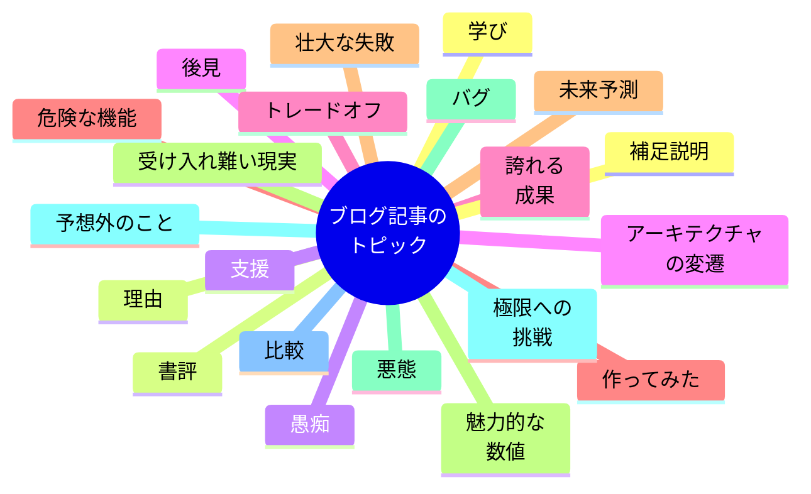

## 何を書くのか

    この章で取り上げること
     
    <ul>
        <li>そのトピックに書く価値があるかをチェックするための簡単な基準</li>
        <li>はじめの一歩として役立つトピックアイデアの長いリスト</li>
        <li>アイデアを絶やさないための方法</li>
    </ul>

- 本章では一般的なエンジニアではなく、ブログ執筆者自身が魅力的なブログ記事に発展させることのできるアイデアをどうやってたくさん見つけ出すかに的を絞って取り上げます。
- 具体的にはアイデアを生み出すことに焦点を当て、次のような内容を取り上げます。
  1. どんなトピックのアイデアが可能性を秘めているのかを判断するための覚えやすい基準
  2. 日常業務や幅広い業界の議論の中からインスピレーションを得る方法
  3. 新しいアイデアを絶やさず見つける方法

### アイデアの優先順位付け：3つのP

- 評価されるエンジニアリングブログ記事として存在感を示したいなら、自身の経験に基づいたトピック、つまり自分がユニークで興味深い視点を提供できるトピックを選ぶことは絶対に外せない条件です。
- これから書こうとしているトピックが次の**3つのP**のいずれかに該当するかどうかをチェックすることが良い結果が得られるブログ記事になります。
  - 【**Proud：誇りに思うこと**】エンジニア仲間に披露したい成果は何か。ユーザーやコントリビューターを感動させるものがあるか
  - 【**Pained：苦痛に感じていること**】常に頭痛の種となり、進捗を阻んでいる課題は何か
  - 【**Passionate：情熱を持っていること**】あなたの血が騒ぐものは何か
- 上記のいずれにも該当しないトピック、つまり、「個人的に誇りに思っていないこと」「悩みの種になっていないこと」「情熱を持っていないこと」の全てを満たすようなブログ記事を書いたところで良い結果が得られるはずがありません。

> 【**Column**】**手間のいらないトピック検証方法**
> 手間なく気になるトピックの反応を試す方法として、SNSの投稿でアイデアを軽く流してみるというものがあります。良い反響が得られたのなら、同じアイデアに基づいたブログ記事も良い反響を得られる可能性があることを意味しています。
> 　ただし、もし最初の反応がイマイチでもまだ諦めないでください。いくつかいくつかのことなるバリエーションの投稿を試してみましょう。SNSは気まぐれなのです。

### トピックはどこにでも転がっている

#### 実装した素敵なもの

#### セキュリティインシデントの事後分析

#### トラフィックスパイクを乗り切った（あるいは乗り切れなかった）インフラ

#### バグハント

#### オープンソースへの貢献

#### 楽しい週末プロジェクト

#### 設計上の興味深い判断とトレードオフ

#### 実施中のアーキテクチャの変更

#### フラストレーションと疲労

#### 物議を醸す話題で立場を表明する

#### 魅力的な数値

#### 意外な使い方を提案する

#### 過去の予測を振り返る

#### 機能に関する誤解を解く

#### 機能の比較

#### フットガン対策

#### なぜ「それ」を作っているのか

### トリガーへの露出を増やす

#### SNS（ソーシャルメディア）

#### オンラインコミュニティ

#### フィードとサブスクリプション

#### チーム内のチャットアプリ

### まとめ

