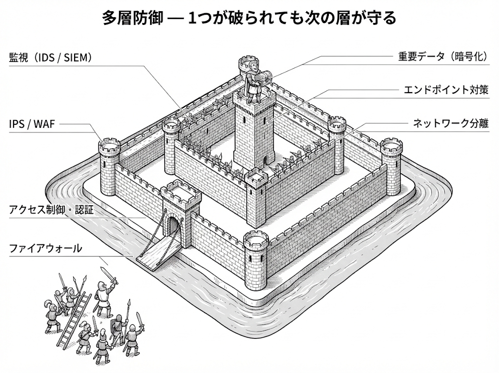

# Webサーバーのセキュリティ

この章では以下の項目について説明します。
<ol>
    <li></li>
    <li></li>
    <li></li>
    <li></li>
    <li></li>
</ol>

## 入力の検証

### 許可リスト

### ブロックリスト

### パターンマッチング

### 【コラム】検証における正規表現の使用

### さらなる検証

### メールアドレスの検証

### ファイルアップロードの検証

### 【コラム】クライアント側での検証

## 出力のエスケープ

### HTTPレスポンスの出力エスケープ

### DBコマンドにおける出力のエスケープ

### コマンド文字列の出力エスケープ

## リソースの処理

## REST（Representational State Transfer）

## 多層防御

- Webサーバーを中世のお城のようなものだと考えてください。複数の防御レイヤーを重複して実装することで1つのレイヤーが破られても、攻撃者は次のレイヤーと戦わなければならなくなります。この考え方が**多層防御**です。
  1. 監視→内壁の上の弓兵
  2. IPS / WAF→外周壁
  3. アクセス制御・認証→跳ね橋
  4. ファイアウォール→堀の水面
  5. 重要データ→城主が持つ宝箱
  6. エンドポイント対策→天守
  7. ネットワーク分離→内壁
- 本書では後半で説明する脆弱性ごとに、一般的に複数の防御方法を示します。可能な限り、これらの保護技術を多く使用してください。<u>複数の防御レイヤーを使用することで、あるドメインでセキュリティが一時的に（そして不可避的に）低下しても、別のセキュリティレイヤーが脆弱性を悪用されるのを防ぐことができます</u>。
- 防御の多重化は防御対象の脆弱性によって異なります。例えば、インジェクション攻撃に対する防御策としては以下のリストのすべての対策を講じる必要があります。
  - **データベース**に接続する際にはパラメータ化されたステートメントを使用する
  - **HTTPリクエスト**から送られてくるすべての入力をパターンマッチングを使用して許可リストと照合するか、またはブロックリストと照合する。
  - 制限付きの権限を持とう**アカウント**としてデータベースに接続する。
  - **データベース**への各呼び出しからの各応答が期待される形式であることを検証する。
  - **データベース**呼び出しのログを記録し、異常なアクティビティがないか監視する。

## 最小特権の原則

- 多層防御の2つの原則のうちの1つは**最小特権の原則**です。これは各ソフトウェアコンポーネントおよびプロセスには意図する動作を達成するために必要な最小限の権限セットが与えられるべきであるという原則です。
- 最小特権の原則をWebアプリケーションに適用する方法をよく考えてください。この作業には以下のいずれかが関わります。
  - コンテンツセキュリティポリシー（CSP）を設定してクッキー（Cookie）へのアクセスを防止することにより、ブラウザで実行されるJavaScriptコードの権限を制限する。
  - 権限が制限されたアカウントでデータベースに接続する。このアカウントには読み書き権限が必要かもしれませんが、テーブル構造の変更は許可すべきではありません。
  - Webサーバープロセスを、アセット、構成、およびコードへのアクセスに必要なディレクトリのみにアクセスできる非rootユーザーとして実行する。

## まとめ

