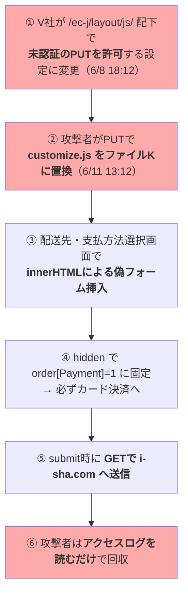

# 令和5年度秋期　午後2

## 問1の学習ポイントまとめ

| 論点             | 押さえる要点                                                                                               |
| ---------------- | ---------------------------------------------------------------------------------------------------------- |
| DASTの限界       | ツールは「**送った先の応答**」しか見ない。入力画面と出力画面が離れていれば**拡張機能**で判定対象を追加する |
| 初期値の設定     | 真と偽で**応答に差が出る**ことが検出の前提。ヒットしない初期値では**偽陰性**になる                         |
| SQLiの型         | **文字列型なら `'` で閉じてから条件を足す**／数値型ならそのまま。令和7春 問2と対で覚える                   |
| URLの網羅        | JavaScriptで動的生成／メール経由のURLは**たどれない**。設計書など一次情報で補う                            |
| 拒否回避         | **アカウントロック**と**1回限りの申込み**は、繰り返し送るDASTと相性が悪い                                  |
| HttpOnly         | 守るのは**cookieだけ**。偽フォーム表示・なりすまし操作は防げない。根本対策は**出力時のエスケープ**         |
| アクセス制御     | **パラメータの削除**でも回避され得る。認可は**サーバ側が保持する情報**（セッション）で判断する             |
| 内製化の運用課題 | 資産情報の**一元管理**（診断準備の短縮）と、問合せ**窓口の集約＋ナレッジ共有**（費用の抑制）               |

## 問2の学習ポイントまとめ

| 論点             | 押さえる要点                                                                                   |
| ---------------- | ---------------------------------------------------------------------------------------------- |
| 責任共有モデル   | IaaS/PaaS/SaaS で範囲が変わるが、**データは常に利用者の責任**                                  |
| 最小権限         | 委託業務の記述から**必要な操作だけ**を拾う。編集権限の中身を1つずつ照合する                    |
| 監査・検知       | 絞りきれない権限は**イベント検知＋アラート**で補う。**ログの削除操作**は最優先の監視対象       |
| OAuth 2.0        | クライアント／認可サーバ／リソースサーバの割当て。**シークレットを使う(7)はバックチャネル**    |
| 認可コードフロー | **クライアント認証と認可コードの両方**が要る。片方の漏えいで即突破はされない                   |
| PKCE             | **BASE64URL(SHA256(検証コード)) ＝ チャレンジコード**。向きを間違えない                        |
| 暗号スイート     | **RC4・MD5・SHA-1・DES/3DES** が入っていたら推奨外                                             |
| リポジトリ運用   | **削除しても変更履歴に残る**。漏れた秘密情報は消すのではなく**無効化**する                     |
| 職務の分離       | アップロードと承認を**別人**に。自己承認を許すルールを廃止する                                 |
| 連携トークン     | **スコープ・有効期間・接続元**で絞る。本問は有効期間も接続元も固定なので**スコープで絞る**一択 |

## 午後Ⅱ 全体の学習ポイント

| 分野         | 問1（脆弱性診断の内製化）                                                                                          | 問2（クラウド移行と外部連携）                                   |
| ------------ | ------------------------------------------------------------------------------------------------------------------ | --------------------------------------------------------------- |
| 技術         | DASTの仕組みと限界、 SQLi（文字列型）、 XSSとHttpOnly、 アクセス制御の回避                                | 責任共有モデル、 権限設計、 OAuth 2.0／PKCE、暗号スイート |
| 運用・管理   | 資産情報の一元管理、 診断手順の標準化、 外部委託費用の抑制                                                   | 委託先への最小権限付与、 監査ログ、職務の分離                |
| 共通する思想 | **認可はサーバ側の情報で判断する**／ **ツールや属性に頼り切らない**／ **侵害・漏えいを前提に被害を限定する** | ← 同左                                                          |

# 令和6年度春季 午後問題

## 問1の学習ポイントまとめ

| 表3項番 | 脆弱性                                        | OWASP API Security Top 10                 | 対策の本質                                        |
| ------- | --------------------------------------------- | ----------------------------------------- | ------------------------------------------------- |
| 1       | JWT改ざんによるなりすまし （alg=none）     | API2 Broken Authentication             | サーバ側で アルゴリズムを固定する              |
| 2       | アクセスコントロールの不備A （mid改変）    | **API1 BOLA**                             | JWTの利用者IDと リクエストの対象を突き合わせる |
| 3       | アクセスコントロールの不備B （status追加） | Mass Assignment                           | 仕様外パラメータを 許可リストで排除            |
| 4       | 2要素認証の突破 （総当たり）               | API4 Unrestricted Resource Consumption | 試行回数制限＋ 探索空間の拡大                  |
| 後半    | 脆弱性V （Log4Shell型RCE）                 | ソフトウェア サプライチェーン          | 恒久＝バージョンアップ 暫定＝WAF               |

## 問2の学習ポイントまとめ

| 対策           | 攻撃方法                      | 実現手段（最終形）                                                                                            |
| -------------- | ----------------------------- | ------------------------------------------------------------------------------------------------------------- |
| V-1 認証強化   | 方法1（認証情報を推測）       | 表7 項番3 多要素認証機能。 方式は**表2（イ）デジタル証明書による クライアント認証**（フィッシング耐性） |
| V-2 脆弱性対策 | 方法2（脆弱性を悪用）         | S-APPLの脆弱性情報を収集し、 修正プログラムを適用                                                          |
| V-3 ステルス化 | 方法2（ポートスキャンで偵察） | 表7 項番1 **SPA機能** （ポートノッキングの上位互換）                                                       |
| DDoS（回線）   | 容量枯渇型                    | **外部サービス** （DDoS対策CDN等）                                                                         |
| DDoS（サーバ） | SYN/UDP/HTTP GET Flood        | UTMのIPS/WAF有効化 ＋ **取引先向けWebサーバの非公開化**                                                    |

## 問3の学習ポイントまとめ

| 脆弱性                 | 成立した原因（本文の設定）                                                                                                                  | 根本対策                                                         | 保険的対策                                   |
| ---------------------- | ------------------------------------------------------------------------------------------------------------------------------------------- | ---------------------------------------------------------------- | -------------------------------------------- |
| **格納型XSS**          | 問合せ機能の入力が 問合せ管理機能で 未エスケープ出力。 **SESSIONIDにHttpOnlyがない**／ サイト管理機能に **接続元制限がない** | 出力時の エスケープ                                           | HttpOnly、 接続元制限                     |
| **CSRF**               | csrf_tokenの**存在チェックのみ**で セッションとの紐付けを 検証していない                                                              | トークンを セッションに 紐付けて検証                       | SameSite属性                                 |
| **認可制御 の不備** | 注文履歴の閲覧可否を **order-codeの 推測困難性だけ**に依存                                                                            | **cookieの利用者と order-codeの 利用者を 突き合わせる** | IDの推測困難化                               |
| **SSRF**               | pageパラメータの**遷移先を 検証していない**。IMDSが**方式1**。 クレデンシャルが**全操作可能**                                         | **許可リストで 遷移先を サイトPに限定**                    | ネットワークACL、 IMDS方式2、 最小権限 |

## 問4の学習ポイントまとめ

**検出された脆弱性と修正方法**

| 脆弱性                                 | 成立原因                                                                                     | 修正方法                                                      |
| -------------------------------------- | -------------------------------------------------------------------------------------------- | ------------------------------------------------------------- |
| **セッション フィクセーション**     | ログイン（画面遷移（イ））の 前後で**sessionIDが変わらない**。 hidden フィールドで管理 | **使用済みIDを 無効化した上で、 新しいsessionIDを発行** |
| **メールヘッダー インジェクション** | 画面09の**会社名**が検証されずに メールヘッダーに使われる                                 | 改行コードを許可しない （ヘッダー出力APIを使う）           |
| **HTTPヘッダー の不備**             | CSP / HSTS / X-Content-Type-Options が未出力                                              | 各ヘッダーを設定 （**保険的対策**）                        |
| TLS 1.1 が利用可能                     | 危殆化したプロトコル の有効化                                                             | TLS 1.2 以上に限定                                            |
| HTTPサーバの バージョンの露出       | レスポンスヘッダーに バージョン出力                                                       | バージョン情報を隠蔽                                          |

**仕様レベルの問題（ツールでは検出されない）**

| 問題                                             | 改善方針                               |
| ------------------------------------------------ | -------------------------------------- |
| **求職者IDが推測可能** （年月日8桁＋連番6桁） | 推測困難な値に変更                     |
| **APIkeyだけで認証**（有効期間14日）             | アクセス元IP制限、取得情報の限定       |
| **メールアドレス以外の 変更時に通知しない**   | 全てのプロパティ変更で通知メールを送信 |
| ログインが**単要素認証**                         | 多要素認証への変更                     |

## 全体の学習ポイント

### 繰り返し現れた3つの型

**① 信頼できる情報と信頼できない情報を突き合わせる（＝認可）**

| 問           | 信頼できる情報                 | 信頼できない情報          | 追加すべき処理          |
| ------------ | ------------------------------ | ------------------------- | ----------------------- |
| 問1 設問2(3) | JWTの利用者ID                  | パラメータ **mid**        | 一致するか検証          |
| 問1 設問2(4) | 仕様で定義された パラメータ | 追加された **status**     | 許可リストで排除        |
| 問3 設問3(2) | cookie（SESSIONID）            | パラメータ **order-code** | 不一致ならエラー        |
| 問3 設問4(4) | 許可されたURL （サイトP）   | パラメータ **page**       | サイトP以外は エラー |

**② 検知精度と可用性のトレードオフ**

| 問           | 場面                        | 結論                                                         |
| ------------ | --------------------------- | ------------------------------------------------------------ |
| 問1 設問3(4) | WAFルールの動作             | 一定期間は「検知」→誤検知による遮断を防ぐ →アラートを精査 |
| 問2 設問1(2) | アノマリ型IPSの しきい値 | 低すぎると正常な通信を異常と検知する                         |

**③ 根本対策と保険的対策の区別**

| 問             | 根本対策                      | 保険的対策                               |
| -------------- | ----------------------------- | ---------------------------------------- |
| 問1（脆弱性V） | ライブラリHのバージョンアップ | WAFの暫定ルール                          |
| 問3（XSS）     | 出力時のエスケープ            | HttpOnly、接続元制限                     |
| 問3（SSRF）    | 許可リストで遷移先を限定      | ネットワークACL、 IMDS方式2、最小権限 |
| 問4（CSV）     | 所属グループの変更            | CSVファイルの暗号化                      |

### 答案作成の型

| 指示                   | 書くべき要素                                                                                                      |
| ---------------------- | ----------------------------------------------------------------------------------------------------------------- |
| 「**具体的に**」       | **誰が／何を使って／何をして／何が起きるか**を、 本文の固有名詞（mid、order-code、DNS-K、page…） のまま書く |
| 「**〜を示して**」     | 指定された要素（問2設問1(1)の「H社での攻撃対象」） を必ず書く                                                  |
| 「**〜の特徴を基に**」 | その観点から答える（問3設問4(1)のSSRFの仕組み上の制約）                                                           |
| 理由を問う設問         | **「〜から」「〜ため」**で締める                                                                                  |

**本文が否定した選択肢は書かない**（問2設問2(2)の「リンクをクリックしない」など）。

**字数制限は要素数のヒント**。20〜25字＝1要素、35〜40字＝2〜3要素、60字＝3要素が目安。

### 令和6年度春期の出題傾向

| 問  | 中心テーマ                                  | 難度の勘所                                              |
| --- | ------------------------------------------- | ------------------------------------------------------- |
| 問1 | APIセキュリティ （JWT・BOLA・Log4Shell） | JWTのalg=none、 WAFの正規表現記述                    |
| 問2 | VPN・DDoS                                   | ポートノッキングとSPAの対比、 MFA突破フィッシング    |
| 問3 | Web脆弱性 （XSS/CSRF/認可/SSRF）         | SameSiteの挙動表、 IMDSv1/v2とSSRF                   |
| 問4 | セキュアプログラミング                      | Linuxパーミッションと所属グループ、 例外処理、ソルト |

**問1と問3は「認可の不備」が共通テーマ**。どちらを選んでも同じ思考（信頼できる情報と突き合わせる）が使える。**問4はOS権限とJavaの読解**で、Linuxとプログラミングの素養がある受験者には得点源になりやすい。

# 令和6年度秋季 午後問題

## 問1の学習ポイントまとめ

| フェーズ         | 今回の痕跡                                            | 見るべきログ                               |
| ---------------- | ----------------------------------------------------- | ------------------------------------------ |
| 初期侵入         | `△△△.com` から i.ps1 をダウンロード                   | net1.csv／プロキシログ                     |
| **永続化**       | **タスク名 install** の登録 （ログオン時トリガー） | **srv.csv**                                |
| ファイルレス実行 | q.ps1 を**メモリ上に展開**して実行                    | net1.csv （ファイル生成ログが残らない） |
| 防御回避         | **VSCAN_SVC の停止**                                  | srv.csv／ マルウェア対策サービス        |
| 探索             | Dドライブ・`\\filesv` のファイル参照                  | file.csv                                   |
| 収集             | **s.rar** の作成（後に削除）                          | file.csv                                   |
| 持出し           | `/v/upl` へ 511MB アップロード                        | **net2.csv**（810MB）／ プロキシログ    |
| 横展開           | PC-A → 各PCへ RDP、**PC-C のみ成功**                  | **auth.csv**                               |
| C2               | 1時間おきに `○○○.com`、 拒否後は `□□□.com`         | net1.csv／ net2.csv（0.1MB/時）         |
| 痕跡消去         | s.rar の削除                                          | file.csv                                   |

**このタイムラインを1枚で描けるようになることが、この問題の最大の学習効果。**

## 問2の学習ポイントまとめ

**ドメイン名変更プロジェクトの勘所**

| フェーズ             | やること                                                     | 本問での該当                                              |
| -------------------- | ------------------------------------------------------------ | --------------------------------------------------------- |
| 送信元の棚卸し       | 自ドメインを名乗って送信する **全てのサービス**を洗い出す | Uサービス、 **Tサービス（漏れていた）**、 Yサービス |
| 段階的なポリシー強化 | `none` → `quarantine` → `reject`                             | Mail-Step1 → Step3                                        |
| レポート分析         | rua で認証漏れを検出                                         | 表3 項番5、 Uサービス管理Web                           |
| 旧ドメインの扱い     | **契約を継続**し、`v=spf1 -all` ＋ DMARC で送信不可を宣言 | 設問4(3)                                                  |

**旧ドメイン名を手放すリスク（表7）**

| 項目         | 悪用の例                                                               |
| ------------ | ---------------------------------------------------------------------- |
| Webの悪用    | 見た目が同じサイト → **修正プログラムに見せかけたマルウェア配布**   |
| メールの送信 | 旧ドメイン名を送信元とする詐称メール                                   |
| メールの受信 | **社外サービスのパスワード再設定メールを受信 → アカウント乗っ取り** |

## 問3の学習ポイントまとめ

**攻撃の全体像（Webスキミング／Magecart型）**

**根本原因と対策**

| 原因                                                                  | 対策                                                                         |
| --------------------------------------------------------------------- | ---------------------------------------------------------------------------- |
| **未認証でのPUTメソッドを許可** （利便性のための設定変更）         | PUTの禁止（6/16実施）。 ファイル更新はSSH等の認証された経路で             |
| 改ざんに**気づく仕組みがなかった** （利用者の問合せで発覚）        | **Webサーバのファイルの改ざん検知** （本文末尾でJ社が検討することにした） |
| `customize.js` の**読み込みを 無効化できない**（WebアプリPの仕様） | 不要なファイルを配置しない。 **SRI（Subresource Integrity）** の活用      |
| キャッシュにより影響が継続                                            | **Cache Busting**                                                            |

**「カード情報の非保持化」の限界**

J社はトークン型決済でカード情報をサーバに保持していなかった。しかし**利用者のブラウザ上でJavaScriptを改ざんされれば、入力された瞬間に盗まれる**。これがWebスキミングの本質。

| 対策                                   | 内容                                                                                                              |
| -------------------------------------- | ----------------------------------------------------------------------------------------------------------------- |
| **CSP （Content-Security-Policy）** | スクリプトの読み込み元・送信先を制限 （`script-src`, `connect-src`）。 i-sha.com への送信を遮断できた可能性 |
| **SRI （Subresource Integrity）**   | 外部JSのハッシュ値を検証し、 改ざんされたファイルを読み込まない                                                |
| **ファイル改ざん検知**                 | 定期的にハッシュ値を比較。 本文でJ社が検討を決めたもの                                                         |
| 最小限のファイル配置                   | 「通常時は空のファイル」である `customize.js` が攻撃の足掛かりになった                                         |

**インシデント対応として押さえるべき流れ**

1. 利用者からの問合せ（6/11〜12）→ アクセスログの確認
2. 委託先（V社）への確認 → 原因と時系列の特定（図4）
3. **影響期間の確定**（6/11 13:12 〜 6/16 9:00、**キャッシュの影響を考慮**）
4. **被害者候補の特定**（`/shopping` にアクセスしたアカウント名）
5. **利用者への案内**、**関係当局への報告・届出**
6. 再発防止策（ファイルの改ざん検知）の検討・実施

## 問4の学習ポイントまとめ

**検出された脆弱性と修正方法**

| 脆弱性                                 | 成立原因                                                                                     | 修正方法                                            |
| -------------------------------------- | -------------------------------------------------------------------------------------------- | --------------------------------------------------- |
| **セッション フィクセーション**     | ログイン（画面遷移（イ）） の前後で**sessionIDが 変わらない**。hidden フィールドで管理 | **使用済みIDを無効化し、新しいsessionIDを発行**     |
| **メールヘッダー インジェクション** | 画面09の**会社名**が 検証されずに メールヘッダーに使われる                             | 改行コードを許可しない （ヘッダー出力APIを使う） |
| **HTTPヘッダー の不備**             | CSP / HSTS /  X-Content-Type-Options が未出力                                          | 各ヘッダーを設定 （**保険的対策**）              |
| TLS 1.1 が利用可能                     | 危殆化したプロトコル の有効化                                                             | TLS 1.2 以上に限定                                  |
| HTTPサーバの バージョンの露出       | レスポンスヘッダーに バージョン出力                                                       | バージョン情報を隠蔽                                |

**仕様レベルの問題（ツールでは検出されない）**

| 問題                                             | 改善方針                               |
| ------------------------------------------------ | -------------------------------------- |
| **求職者IDが推測可能** （年月日8桁＋連番6桁） | 推測困難な値に変更                     |
| **APIkeyだけで認証**（有効期間14日）             | アクセス元IP制限、取得情報の限定       |
| **メールアドレス以外の変更時に通知しない**       | 全てのプロパティ変更で通知メールを送信 |
| ログインが**単要素認証**                         | 多要素認証への変更                     |

## 全体の学習ポイント

### 4問に共通する視点

**① 「気付かれない」ための細工を見抜く**

| 問  | 攻撃者が発覚を防いだ方法                                                                                                 |
| --- | ------------------------------------------------------------------------------------------------------------------------ |
| 問1 | マルウェア対策ソフトを停止（アラートを出させない）、 s.rar を削除（痕跡消去）、q.ps1 をメモリ上に展開（ファイルレス） |
| 問3 | 画面遷移は正常に進む（submit イベントに便乗）、 GETで送るので攻撃者側にアプリ不要                                     |
| 問4 | **メールヘッダーインジェクションで通知メールを横取り** （図Dの核心）、会社名の変更は通知メールが飛ばない              |

**② ログ・レポートを「読む」力**

| 問  | 読むべきもの                          | 読み方                                                                                            |
| --- | ------------------------------------- | ------------------------------------------------------------------------------------------------- |
| 問1 | time.csv / net2.csv / プロキシログ | **時系列を攻撃フェーズにマッピング**する。 810MB／0.1MB の違いで持出しとビーコンを 見分ける |
| 問2 | DMARCレポート（rua）                  | **認証に失敗している正規の送信元**を洗い出す                                                      |
| 問3 | Webサーバの アクセスログ           | **ステータスコード**（204成功／405拒否）で 成否を判別                                          |
| 問4 | 診断報告書 （表B のsessionID）     | **同じ値が並んでいること**自体が異常                                                              |

**③ 影響範囲の特定（誰が被害者か）**

| 問  | 特定の方法                                                                         |
| --- | ---------------------------------------------------------------------------------- |
| 問1 | PC-A・PC-C・filesv 上の、**`ad01\user019` でアクセス可能なファイル**               |
| 問3 | 影響期間（**キャッシュ破棄まで**）に **`/shopping` にアクセスしたアカウント名** |
| 問4 | WebAPIで取得可能な**全求職者**（求職者IDが推測可能なため）                         |

**④ 「仕様どおり」でも脆弱なものがある**

| 問  | 仕様上は正しいが危険なもの                                            |
| --- | --------------------------------------------------------------------- |
| 問2 | メーリングリストのSubject書換え（サービスの正常な機能） → DKIM失敗 |
| 問3 | hidden パラメータでの支払方法の受け渡し → 改ざん耐性なし              |
| 問4 | **求職者IDの採番規則**（年月日＋連番）→ 総当たり可能                  |

### 答案作成の型

| 指示                       | 書くべき要素                                                                                   |
| -------------------------- | ---------------------------------------------------------------------------------------------- |
| 「**調査の内容**」         | **どのログから／どんな条件で／何を探すか** （問1 設問1(6)(7)）                              |
| 「**対策の内容**」         | **どの機器・サービスで／誰に対して／何を／どう設定するか** （問1 設問1(5)の3要素）          |
| 「**〜を含めて具体的に**」 | 指定された要素を必ず全部入れる （問2 設問5(2)の「Sサービスへの登録内容とYサービスの仕様」） |
| 「**図示せよ**」           | **変わる部分と変わらない部分を両方描く**（問3 設問2(1)）                                       |
| 自由記述（改善方針案）     | **「〜するように変更する」＋「〜できるから」**の型 （問4 設問3）                            |

### 令和6年度秋期の出題傾向

| 問  | 中心テーマ                 | 難度の勘所                                                                                   |
| --- | -------------------------- | -------------------------------------------------------------------------------------------- |
| 問1 | インシデント レスポンス | 表3のログから**攻撃フェーズを時系列で再構成**する。 設問数9で記述も多いが、知識依存は低い |
| 問2 | SPF/DKIM/DMARC             | **送信ドメイン認証の仕組みを正確に理解**していないと 設問5(2)が書けない。知識依存が高い   |
| 問3 | Webスキミング              | **ECMAScriptとHTMLを読む**力。 設問2(1)の図示は珍しい出題形式                             |
| 問4 | セキュリティ診断           | **複数の脆弱性の連鎖**を追う。 設問3は自由記述で、診断者としての提案力が問われる          |

**問1と問3は読解中心、問2と問4は知識＋構成理解が要る。**同じ年度の春期と比べると、秋期は**ログ・レポートという「生の資料」を読ませる**比重が高い。

# 令和7年度春期 午後問題

## 問1の学習ポイントまとめ

| 論点                     | 押さえる要点                                                                                           |
| ------------------------ | ------------------------------------------------------------------------------------------------------ |
| セキュリティ・バイ・デザイン | **企画・設計工程から**組み込む。後付けではない                                                       |
| 再委託管理               | L社は再委託先と**直接契約がない** → 委託先に**同等要求を課す義務**を契約に明記する                     |
| 外部スクリプト           | 外部サーバから**都度読み込む**構成は、配信元の侵害で即被害。 **自社配置**／SRI／そもそも読み込まない |
| SBOMの限界               | **リポジトリ内のコードとライブラリ**しか載らない。 外部サービス・外部スクリプトは**資産管理**で拾う |
| SBOMの効用               | 「**何のどのバージョンを使っているか**」が機械可読 → **影響範囲の即時特定**                           |
| 責任追跡性               | **共用アカウント＋紙の利用記録簿**では担保できない。システムのログで個人を特定できること               |
| ログの取得点             | サーバ側で取れないなら、**必ず経由する踏み台サーバ**で取る                                             |
| SASTの配置               | **コンパイル後**にしか置けない。 開発者端末＝**早期発見**／CI/CD＝**自動実行**                      |

**この問は知識よりも「表1（あるべき姿）と図1（実態）の突き合わせ」という作業が本体。** ガイドラインの各項番が、システムSのどの記述に対応するかを機械的にマッピングできれば、設問3は確実に取れる。

## 問2の学習ポイントまとめ

| 論点                     | 押さえる要点                                                                                           |
| ------------------------ | ------------------------------------------------------------------------------------------------------ |
| ブラインドSQLi           | **数値型なら引用符で構文エラー**／`and 1=0` と `and 1=1` の**応答差**が注入成立の証拠。 テーブル名を1文字ずつ特定できる |
| 診断結果が変わる理由     | サイトが不変でも、**新たな脆弱性の公表**と**評価の見直し**で結果は変わる → **定期診断が必要**           |
| ビットセキュリティ       | **ECDHE＝曲線で128／DHE＝鍵長で112**。RSA2048＝112、RSA3072＝ECC256＝128                               |
| 攻撃の早期検知           | **どのログの／何が／どうなったら／誰に通知**の4要素で書く                                               |
| 試行回数無制限への対策   | IP制限が使えない・アカウントロックも運用が重い → **クライアント証明書による端末認証**                   |
| CVSSのAC                 | **攻撃者が制御できない条件に依存するか**で L/H を判定。 URLの推測困難性は**Security by Obscurity**   |
| 権限の最小化             | OSコマンドインジェクションでも、**プロセス権限が一般利用者なら被害が限定**される                        |
| EPSS                     | **FIRSTが公開**する「30日以内に悪用される確率」。現状値と違い**自分で調べなくてよい**／**毎日更新→監視**が必要 |
| 優先度評価               | 1次評価（基本値×EPSS）で領域、2次評価（環境値）で S〜C。 **領域IとIIIは同じ扱い／差が出るのは領域II** |
| 実証済みの脆弱性         | EPSSが算出されない（CVEなし）ものは、**悪用可能と確認済みなら安全側に高く見積もる**                     |

**この問の肝は「深刻度（CVSS）だけで優先順位を決めない」こと。** PC-1（Medium だが EPSS 96.54% → A）と PD-1（High だが EPSS 0.0% → C）の逆転を説明できれば、この問のテーマを理解したことになる。

## 問3の学習ポイントまとめ

| 論点                       | 押さえる要点                                                                                             |
| -------------------------- | -------------------------------------------------------------------------------------------------------- |
| 証明書検証の無視           | **開発時の回避策が本番に残る**典型。MITMで**Authorizationヘッダーが丸見え**になる                         |
| 正しい開発環境の作り方     | 検証を無効化せず、**解析ツールのルート証明書をインストールして信頼設定**。本番ビルドでは信頼しない        |
| SAN                        | **接続先FQDN**が入る。CNは非推奨。プロキシは接続先になりすますため**その場で証明書を生成**する            |
| TLS 1.3のフロー            | CONNECT → 200 OK → Client Hello → **Server Hello／EE／Certificate／Certificate Verify／Finished をまとめて送信** |
| アプリ内の秘密             | **埋め込んだ鍵は秘密にできない**。暗号化しても鍵が同梱なら難読化にすぎない                                |
| 予測可能な識別子           | **連番のファイル名**＋**全ファイル操作可能な権限**＝全件取得。UUID化と権限の限定で断つ                   |
| 署名付きURL                | サーバ側が **HMAC-SHA256**で署名し、**対象ファイル・操作・有効期限**を限定。 生成は**ファイル名が確定した直後**（注文番号の採番後） |
| URL検証                    | 前方一致は **`.`／`@`** で回避される。**末尾の `/` まで**含めるか、**ホスト名を完全一致**で比較           |
| WebViewの弱点              | **アドレスバーがない**＝利用者がURLを確認できない。アプリ側で遷移先を検証するしかない                    |

**この問は「クライアントは信頼できない」という一点に集約される。** 証明書検証・鍵の保管・URL検証のいずれも、**攻撃者が自分の端末で自由に解析・改変できる**という前提に立てば、どこが穴になるかが見える。

## 問4の学習ポイントまとめ

| 論点                         | 押さえる要点                                                                                             |
| ---------------------------- | -------------------------------------------------------------------------------------------------------- |
| サブドメインテイクオーバー   | CDN・クラウド解約時に**CNAMEレコードを残さない**。**レコード削除が先、解約が後**                           |
| 未登録の公開IT資産           | **他社DC／クラウド／レンタル**で事業部が立てた資産は台帳に載らない＝**シャドーIT**                         |
| WHOIS                        | **RFC 3912**。レジストラ／レジストリへの問合せ。後継は**RDAP**                                            |
| 外部調査（検索エンジン型）   | **組織名で横断検索できるサービス**を起点に、**FQDNとGIP**を得て、 ドメイン検索（X）とIP検索（Y）で**持ち主**まで辿る |
| 担当者識別番号               | 組織名→**担当者識別番号**→部署名・担当者名、という**2段階検索**の鍵                                       |
| ASMの2方式                   | **オンアクセス型**（負荷・時間）と**検索エンジン型**（高速・鮮度はサービス依存）                          |
| 能動的調査の順序             | 受動的に資産を洗い出す → **自社資産と確定してから**ポートスキャン・脆弱性スキャン                         |
| 利用終了時の措置（K-4）      | **停止・切り離し → DNSレコード削除 → ドメイン/GIP返却 → データ消去・廃棄 → 台帳更新**                      |
| CVSS 4.0                     | **Base／Threat／Environmental／Supplemental**、**AT**の新設、VC/VI/VA と SC/SI/SA                          |
| KEVカタログ                  | **Known Exploited Vulnerabilities**（CISA）。掲載の主条件は**実際に悪用された**こと                       |
| 脆弱性管理の改善             | **ニュース起点→資産台帳起点**／**全部門一斉→該当部門に優先度付きで**／**連絡して終わり→実施を確認**        |

**この問のテーマは「知らない資産は守れない」。** 設問1〜3が「**資産の把握**」、設問4が「**把握した資産に対する脆弱性管理**」という二部構成になっており、目標K-1〜K-4がそのまま答案の骨子になっている。

## 全体の学習ポイント

### 4問に共通する視点

**① 「自分が把握していないもの」が穴になる**

| 問  | 把握できていなかったもの                                                        |
| --- | ------------------------------------------------------------------------------- |
| 問1 | **外部サーバから読み込むスクリプトP**（SBOMにも資産台帳にも載らない）           |
| 問2 | **初回リリース後に増えた脆弱性**（サイトは不変でも脆弱性情報は変わる）          |
| 問3 | **アプリに埋め込んだ鍵**が秘密でないこと／**WebViewが表示するURL**              |
| 問4 | 事業部が**他社DC・クラウド・レンタル**で立てた**未登録の公開IT資産**            |

**② 優先順位を「深刻度」だけで決めない**

| 指標         | 答える問い                       | 出題箇所                             |
| ------------ | -------------------------------- | ------------------------------------ |
| **CVSS**     | 悪用されたら**どれだけ深刻か**   | 問2（基本値・環境値）／問4（最新版4.0） |
| **EPSS**     | **悪用される確率**（予測）       | 問2（1次評価の縦軸）                 |
| **KEV**      | **実際に悪用されたか**（事実）   | 問4                                  |
| **環境値**   | **自社環境での影響**             | 問2（2次評価）                       |

> 問2のPC-1（Medium だが EPSS 96.54% → **A**）と PD-1（High だが EPSS 0.0% → **C**）の逆転が、この視点の象徴。

**③ 境界の外にあるものは信頼しない**

| 問  | 信頼境界の外にあるもの                             | 取るべき態度                                           |
| --- | -------------------------------------------------- | ------------------------------------------------------ |
| 問1 | 業務委託先・**再委託先**／他社が運営するサーバT    | 契約で同等要求を課す／外部読み込みをやめる             |
| 問2 | リモートアクセス元のPC                             | **クライアント認証**で端末を認証する                   |
| 問3 | **スマホ（利用者の端末）**                         | 鍵を置かない／**サーバ側で署名付きURLを発行**する      |
| 問4 | 事業部が勝手に契約したサービス                     | **外部から見える姿**を自分で調べる（ASM）              |

**④ 「仕様」は守ってもくれるし、頼りすぎると裏切る**

| 問  | 守ってくれた仕様                                               | 頼ってはいけない仕様                                     |
| --- | -------------------------------------------------------------- | -------------------------------------------------------- |
| 問2 | サイトCのWebアプリが**一般利用者権限で稼働**（最小権限）        | **URLの推測困難性**（Security by Obscurity）             |
| 問3 | **署名付きURL**の有効期限・対象限定                            | **前方一致のURL検証**（`.`／`@` で回避される）           |
| 問4 | 支社に**UTM以外の公開IT機器がない**という構成                   | **台帳に載っているものが全て**という思い込み             |

### 答案作成の型

| 設問の指示                     | 書くべき要素                                                                                   |
| ------------------------------ | ---------------------------------------------------------------------------------------------- |
| 「**方法**を具体的に」         | **どこ（どのログ・どの機能）から／何を／どうするか** （問2 設問3(2)、問3 設問1(1)〜(3)、問4 設問3(1)(2)） |
| 「**理由**を具体的に」         | **事実＋その効果**の2要素 （問1 設問4「バージョンが明確になる」＋「影響有無を把握できる」）   |
| 「**それぞれ**」と指定         | **対比で書く**。同じ内容を2つ書かない （問1 設問5(2)＝早期発見／自動実行、問2 設問5(1)＝手作業／参照するだけ） |
| 「**〜する場合としない場合**」 | **両方に異なる措置**を書く（問4 設問3(3)＝停止して修正／切り離して廃棄）                       |
| **15〜20字以内**               | **用語そのもの**を出す（問2 設問3(3)＝クライアント認証、問3 設問4(1)＝URLを確認する手段がない） |
| 「**明記すべき事項**」         | **契約・規程に書く文言**として成立する形で書く（問1 設問1(2)）                                 |
| 表の空欄（点検結果）           | **「問題なし」も立派な解答**。全部に問題があると思い込まない（問1 設問3(2)）                    |

### 令和7年度春期の出題傾向

| 問  | 中心テーマ                   | 難度の勘所                                                                                       |
| --- | ---------------------------- | ------------------------------------------------------------------------------------------------ |
| 問1 | サプライチェーンリスク対策   | **表1（あるべき姿）と図1（実態）の突き合わせ**が本体。知識依存は低いが、**対応表を作る作業量**がある |
| 問2 | 脆弱性管理（評価と優先度）   | 前半はブラインドSQLiとCVSSの読解、後半は**領域図＋対応優先度表の適用**。 **設問6で8件を機械的に判定**でき、得点源になる |
| 問3 | スマホアプリの脆弱性         | **TLSハンドシェイクの順序**と**モバイル特有の落とし穴**。知識依存が最も高い                      |
| 問4 | IT資産管理・脆弱性管理       | **ASM（外部からの資産調査）**という新しめのテーマ。 X・Y・Zサービスの役割分担を整理できれば設問2で大きく稼げる |

**この回は「脆弱性管理」が問2と問4の2問を占めた。** しかも問2は**EPSS**、問4は**KEVカタログ・CVSS 4.0**と、**いずれも新しい指標**が問われている。
出題の重心を整理すると次のとおり。

| 観点               | 問1   | 問2   | 問3   | 問4   |
| ------------------ | :---: | :---: | :---: | :---: |
| 知識依存           | 低    | 中    | **高** | 中    |
| 読解・突き合わせ量 | **多** | 中    | 中    | **多** |
| 計算・判定作業     | 少    | **多** | 少    | 少    |
| マネジメント色     | **強** | 中    | 弱    | **強** |

> **選択の目安**：マネジメント寄りの記述が得意なら**問1＋問4**、技術仕様の読み込みが得意なら**問2＋問3**。
> ただし**問2の設問6（m〜t）は表に当てはめるだけで8箇所**取れるので、評価モデルの運用を理解しておくと費用対効果が高い。
> 年度をまたいだ接続としては、**令和5年度春期 午後Ⅱ 問1のSQLi（文字列型）と本年度 問2（数値型）**、**令和5年度秋期のSAN検証と本年度 問3 設問2(1)**、**令和5年度春期 午後Ⅱの公開資産把握と本年度 問4のASM**が対になっている。

# 令和7年度秋期 午後問題

## 問1の学習ポイントまとめ

| 論点                       | 押さえる要点                                                                                             |
| -------------------------- | -------------------------------------------------------------------------------------------------------- |
| CSP                        | `default-src 'self'` は**外部ドメイン読込み**と**インラインスクリプト**を止める。 **同一オリジンのファイルは止められない** |
| CSPの回避                  | **アップロード機能で同一オリジンにスクリプトを置く**＝`'self'` を実質無力化                               |
| 格納型XSS                  | **入力画面と出力画面が別**／**時間条件（締切超過）で遅延発火**／**狙うのは権限の高い利用者**              |
| CSRFトークンの限界         | **別サイトからのリクエスト**は防げるが、**同一オリジンで動くスクリプト**には読まれる                     |
| 権限昇格                   | `is_admin=1` を**管理者のブラウザから**送らせる。一般利用者の画面で動かしても意味がない                   |
| ファイルアップロード       | 拡張子だけのチェックは**リネームで突破**される。**形式と拡張子の整合性**を検証する                        |
| XSSの根本対策              | **出力時のエスケープ**。出力先（HTML／属性／JS／URL／CSS）ごとに正しい処理を選ぶ                          |
| DASTの限界                 | **リクエストとレスポンスの対応**でしか判定できない＝**蓄積型・遅延型を見逃す**                            |
| 検査の組合せ               | **DAST＋SAST＋仕様を理解した専門家による手動検査**                                                        |

**この問は「CSPを設定してあるのに、なぜ攻撃が成立したのか」という一点に答えられるかが全て。** 失敗した攻撃（インライン／外部ドメイン）と成功した攻撃（同一オリジンのアップロードファイル）の差分を説明できれば、設問2(5)だけでなく設問3(1)・設問4まで一本の線でつながる。

## 問2の学習ポイントまとめ

| 論点                       | 押さえる要点                                                                                             |
| -------------------------- | -------------------------------------------------------------------------------------------------------- |
| 楕円曲線＋署名             | **ECDSA／EdDSA**。ECDHは**鍵交換**、RSAは楕円曲線ではない                                                  |
| サイドチャネル攻撃         | ネットワーク遮断・持込み制限の**外側**から狙う＝**作動音・漏えい電磁波**。対策は遮音・電磁シールド        |
| エアギャップの限界         | **可搬媒体が橋渡し**になる。入口（署名前の追加）と出口（署名後の持出し・削除）の2か所を押さえる            |
| 検知を避ける細工           | **警告が出る条件**（件数・内容の一致検査）を調べ、**そこを通過するように**痕跡を消す                      |
| ハッシュ／MAC／署名        | ハッシュは**鍵がないので誰でも再計算できる**→改ざん検知にならない。 **MAC＝共通鍵**（否認防止は不可）／署名＝公開鍵ペア（否認防止あり） |
| 内部不正の機会削減         | **複数名＋相互確認**（デュアルコントロール）。研修は動機・正当化、手順は**機会**に効く                    |
| 鍵の移送                   | **暗号文と鍵を同じ経路で運ばない**。公開鍵暗号なら**運ぶのは暗号文だけ**で済む（鍵ラッピング）            |
| HSM                        | **鍵が外部に出ない**／耐タンパー／暗号処理をHSM内で実行                                                   |
| 公開鍵のすり替え           | 暗号化の前に**公開鍵の真正性**を確認しないとMITMが成立。**署名・証明書・帯域外確認**で防ぐ                |

**この問は「暗号を使っていても、周辺の手順が穴になる」という一本の筋で貫かれている。** 署名対象を確認しない（設問3(1)）、鍵なしハッシュで照合する（設問3(2)）、暗号文と鍵を一緒に運ぶ（設問4(1)）、公開鍵の出所を確認しない（設問4(4)）——いずれも**暗号アルゴリズムではなく運用設計の欠陥**である。

## 問3の学習ポイントまとめ

| 論点                           | 押さえる要点                                                                                             |
| ------------------------------ | -------------------------------------------------------------------------------------------------------- |
| DNSのセキュリティ              | **DNSSEC＝署名（真正性・完全性、暗号化なし）／DoH＝HTTPS／DoT＝TLS（機密性）**                            |
| MITB・口座情報の改ざん         | **数字入力トークンは「入力した数字が何か」を示せない**→別の数字を入れさせられる                           |
| トランザクション署名           | **カメラ付きトークンが取引内容をディスプレイに表示**＝改ざんに気付ける                                    |
| 偽サーバの細工                 | **名義人を空白に置換**して「表示されないことがある」仕様に紛れさせる／ **図3にない画面**は違和感の手掛かり |
| 管理コンソールの保護           | **接続元IPアドレス制限**。社内の出口（M-FWのGIP）だけに絞る                                               |
| プロキシ型サービスの副作用     | **送信元IPが変わる**→取引先のIP制限に**新しい固定GIPを登録**してもらう                                    |
| 一本化の落とし穴               | **Kサービスを使うために必要な通信**（ソフト入手・認証・OS更新）と**対象外の業務**は許可が要る             |
| MFAの運用                      | **認証手段が1つだと故障で詰む**。方式3（都度選択）＋**代替手段の事前登録**                                |
| ログの二次利用                 | 接続制御のためのログ（OSバージョン・アカウント名）を、**資産管理・移行促進**に活用する                    |

**この問は「サービスを1つ入れると、周辺の前提が全部ずれる」という設計の勘所を問うている。** Kサービスの導入で、送信元IPが変わり（設問4(1)）、通信経路の許可設計が変わり（設問4(2)）、認証手段の冗長性が必要になり（設問5(1)）、代わりに新しい可視性が手に入る（設問5(2)）。

## 問4の学習ポイントまとめ

| 論点                         | 押さえる要点                                                                                             |
| ---------------------------- | -------------------------------------------------------------------------------------------------------- |
| マルウェア対策方式           | パターンマッチング＝**既知のみ・速い**／サンドボックス＝**未知も検知・遅い**／ **暗号化添付はどちらも不可** |
| リスク対応の4分類            | **低減・回避・移転・保有**。サイバー保険と委託＝**移転**、残留リスク＝**保有**                              |
| 最小権限                     | **業務の流れから必要な操作を1つずつ拾う**。管理者は「権限変更だけ」で中身は読まない（職務の分離）           |
| ネットワーク分離             | 端末対策・入口対策で止まらなかった**感染の拡大**を、**セグメント間のFW**で断つ                            |
| 可搬媒体の検査               | **業務で必要なUSBメモリは禁止ではなく検査**。検査用PCは**社内LANから切り離す**                             |
| 制御系の復旧                 | **箱（SCADA）だけでなく中身（NCプログラム）**まで復旧できないと製造は再開できない                          |
| 被害シナリオの作り方         | **発端（感染したPC）→ 経路（大量パケット）→ 結果（通信断・工作停止）**を一続きで書く                       |
| 仕組みと手順の書き分け       | **仕組み＝事前に用意するモノ**／**手順＝実行する作業**                                                     |
| RTOからの逆算                | 「**2時間以内**」という最大許容停止時間が、**どこまで事前準備するか**を決める                              |

**この問は「サプライチェーンの下流企業が、上流から要求された水準をどう整えるか」という設定。** 売上げの90%をJ社に依存し、**納期遅延・品質不良でも損害賠償責任を負う**という条件が、**可用性（2時間以内の復旧）**を最重要に押し上げている。技術論だけでなく**事業上の制約から対策の優先度が決まる**という構造を読み取りたい。

## 全体の学習ポイント

### 4問に共通する視点

**① 「検知されないための工夫」を見抜く**

| 問  | 攻撃者／リスク側が検知を逃れた方法                                                                 |
| --- | -------------------------------------------------------------------------------------------------- |
| 問1 | **同一オリジンにスクリプトを置いてCSPを回避**／入力と出力が別画面で**診断ツールに検知されない**     |
| 問2 | 署名後の不正ファイルを**業務用メディアから削除**して、照合検査を通過させ**警告メールを出させない** |
| 問3 | 攻撃者口座の名義人を**空白文字に置換**して、「表示されないことがある」仕様に紛れさせる              |
| 問4 | **パターンマッチング型では未知のマルウェアが検知できない**／**暗号化添付は検査できない**            |

**② 暗号・認証そのものではなく「周辺の手順」が穴になる**

| 問  | 周辺の穴                                                                   |
| --- | -------------------------------------------------------------------------- |
| 問2 | 署名対象を**確認しない**／**鍵なしハッシュ**で照合／暗号文と鍵を**一緒に運ぶ**／**公開鍵の出所を確認しない** |
| 問3 | トークンは正しく動くが、**入力させる数字をすり替えられる**／MFAの**代替手段が未登録** |

**③ 権限と分離で被害を限定する**

| 問  | 使われた原則                                                             |
| --- | ------------------------------------------------------------------------ |
| 問1 | 攻撃の本体は**権限昇格**（is_admin=1）。ロール設計が攻撃対象になる         |
| 問2 | **デュアルコントロール**（複数名＋相互確認）で内部不正の機会を減らす       |
| 問4 | **最小権限**（表3の見直し）＋**ネットワーク分離**（IT/OT）               |

**④ 「使うために必要な前提」を塞がない**

| 問  | 見落とされた前提                                                               |
| --- | ------------------------------------------------------------------------------ |
| 問3 | HTTPSの宛先をKサービスだけに絞ると、**Kソフトの入手・認証・OS更新・対象外業務**が止まる |
| 問4 | USBメモリを禁止すると、**NCプログラムを運ぶ業務**が止まる → **検査して使う**     |

### 答案作成の型

| 設問の指示                       | 書くべき要素                                                                                   |
| -------------------------------- | ---------------------------------------------------------------------------------------------- |
| 「**処理の内容**を答えよ」       | **どのファイルを／どこに／どうするか**（問2 設問3(1)は「追加する」＋「送信して削除する」の2段） |
| 「**手法**を具体的に」           | **どこから／何を観測して／何を得るか**（問2 設問2のサイドチャネル）                             |
| 「**設定内容**を具体的に」       | **対象・項目・値**まで書く（問3 設問3は「接続元IPアドレスを a1.b1.c1.d1 に制限」）              |
| 「**対策とその導入箇所**を含めて」 | **箇所（図の記号）＋対策名**をセットで（問4 設問3）                                            |
| 「**攻撃の発端を含めて**」       | **発端 → 経路 → 結果**を一続きの文で（問4 設問4(2)のj）                                         |
| 「**できるだけ効果が高いもの**」  | 端末ごとの対策より**経路を断つ対策**を選ぶ（問4 設問3・設問4(2)）                              |
| 「**施策**を具体的に」           | **どの情報を使い／誰を特定し／誰に働きかけるか**（問3 設問5(2)）                                |
| 表の空欄（仕組み／手順）         | **仕組み＝用意するモノ／手順＝実行する作業**で書き分ける（問4 設問4）                           |

### 令和7年度秋期の出題傾向

| 問  | 中心テーマ                   | 難度の勘所                                                                                     |
| --- | ---------------------------- | ---------------------------------------------------------------------------------------------- |
| 問1 | SaaSのXSSと権限昇格          | **HTMLとECMAScriptを読む**力が前提。ただし知識は**CSPとXSSに集中**しており、読めれば一気に解ける |
| 問2 | 暗号鍵の管理                 | **公開鍵暗号の向き**（暗号鍵＝公開鍵／復号鍵＝秘密鍵）を取り違えなければ設問4(2)は確実。 記述は「手順の穴を突く」発想が要る |
| 問3 | 情報システムの強化（SaaS前提） | 設問が**本文の至る所に根拠が散っている**タイプ。 設問4(2)は**4つの宛先を漏れなく**挙げる必要があり差が付く |
| 問4 | 製造業のセキュリティ管理     | **経営ガイドラインの指示4・5・8**に沿った構成。知識は軽いが、**業務の流れから権限・対策を導く**作業量が多い |

**この回は「技術2問（問1・問2）＋マネジメント2問（問3・問4）」という構成。**

| 観点               | 問1   | 問2   | 問3   | 問4   |
| ------------------ | :---: | :---: | :---: | :---: |
| 知識依存           | 中    | **高** | 中    | 低    |
| 読解・突き合わせ量 | 中    | 中    | **多** | **多** |
| コード／図の読解   | **高** | 中    | 低    | 低    |
| マネジメント色     | 弱    | 中    | 中    | **強** |

> **選択の目安**：コードが読めるなら**問1**は短時間で高得点が狙える。暗号の基礎（公開鍵の向き、MACと署名の違い）が固まっているなら**問2**。
> 業務要件から対策を導くのが得意なら**問3＋問4**。ただし**問3は設問4(2)のような「漏れなく挙げる」設問**、**問4は表の空欄を業務の流れから埋める作業**が中心で、いずれも**本文を往復する時間**が必要になる。
>
> **年度内の接続**：令和7年度は**春期も秋期も「脆弱性管理」「サプライチェーン」「クラウド／SaaS前提の構成」**が繰り返し問われている。
> - 春期 問1（SBOM・委託先管理）↔ 秋期 問4（サプライチェーンの下流側）
> - 春期 問3（TLS終端プロキシ）↔ 秋期 問3（KサービスによるHTTPS終端）
> - 春期 問2（EPSSによる優先度）↔ 秋期 問1（診断ツールで検知できない脆弱性の扱い）
