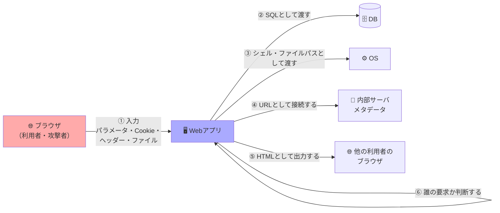
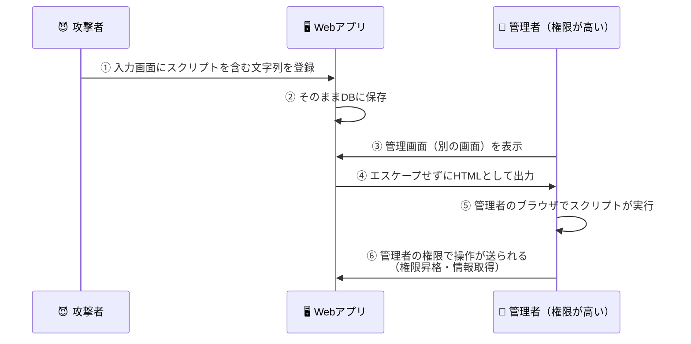
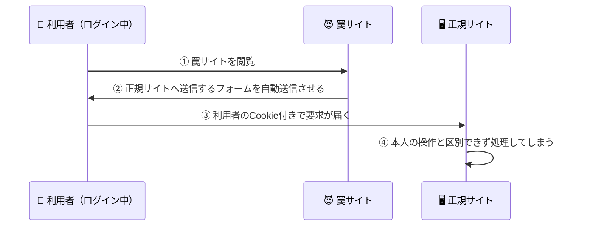
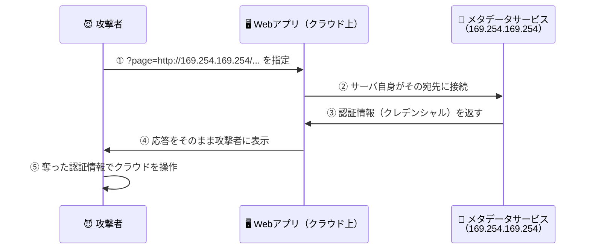

# 予想テーマ④ Webセキュリティの基本 <!-- omit in toc -->

> 目的：R5〜R7の25問中**8問で中心テーマ**になった最頻出分野を、「**原因 → 起きること → 根本対策／保険的対策**」の型で即答できるようにする
> 位置付け：用語の定義は `過去問道場.md`（Webアプリケーションの主な脆弱性と対策／CSRF／HSTS）に任せ、ここでは「**どこが欠けると何が起きるか**」と「**答案の書き方**」に絞る
> 通読の目安：30〜40分

- [1. 全体地図](#1-全体地図)
- [2. 仕組み：代表的な3つの攻撃の流れ](#2-仕組み代表的な3つの攻撃の流れ)
- [3. 脆弱性ごとの「欠けると何が起きるか」表](#3-脆弱性ごとの欠けると何が起きるか表)
- [4. ブラウザ側の防御機構：守れるもの／守れないもの](#4-ブラウザ側の防御機構守れるもの守れないもの)
- [5. 検査手法とWAFの限界](#5-検査手法とwafの限界)
- [6. 設問になる形と答案の型](#6-設問になる形と答案の型)
- [7. 過去問との接続](#7-過去問との接続)
- [8. 落とし穴](#8-落とし穴)
- [9. 自己チェック](#9-自己チェック)

---

## 1. 全体地図

Webの脆弱性は、ほぼ**次の3つの型**に分かれる。

| 型                                        | 本質                                                           | 該当する脆弱性                                                            |
| ----------------------------------------- | -------------------------------------------------------------- | ------------------------------------------------------------------------- |
| **A. 入力を別の処理系にそのまま渡す**     | データが**命令（コード）として解釈**される                     | SQLi、XSS、OSコマンド、ディレクトリトラバーサル、ヘッダーインジェクション |
| **B. 誰の要求かを正しく判断しない**       | **信頼できない情報**（パラメータ）で認可・本人確認をしている   | 認可の不備（BOLA）、マスアサインメント、CSRF、セッション固定              |
| **C. サーバに接続先・読込み先を選ばせる** | 外部から**宛先を指定**できる、外部の**ファイルを信頼**している | SSRF、オープンリダイレクト、外部スクリプトの改ざん、ファイルアップロード  |

> **一番大事な原則**：**ブラウザから届くものは全て攻撃者が書き換えられる**（hidden・Cookie・ヘッダー・JavaScriptの検証も含む）。判断は**サーバ側が保持する情報**（セッション）で行う。

---

## 2. 仕組み：代表的な3つの攻撃の流れ

**格納型XSS（R6春 問3、R7秋 問1の型）**

> **入力画面と出力画面が別**、**時間差で発火**、**狙うのは権限の高い利用者**。この3点がそろうと、DASTの診断でも見逃されやすい。

**CSRF**

> **対策の核心**：正規の画面だけが知っている**秘密の値（CSRFトークン）をセッションに紐付けて照合**する。存在チェックだけでは防げない。

**SSRF（クラウドのメタデータ窃取）**

---

## 3. 脆弱性ごとの「欠けると何が起きるか」表

| 脆弱性                                           | 原因（欠けているもの）                                       | 何が起きるか                                                   | 根本対策                                                             | 保険的対策                                         |
| ------------------------------------------------ | ------------------------------------------------------------ | -------------------------------------------------------------- | -------------------------------------------------------------------- | -------------------------------------------------- |
| **XSS**                                          | 出力時のエスケープ                                           | 他の利用者のブラウザで スクリプトが実行される               | **出力時に出力先に応じた エスケープ**をする                       | CSP、HttpOnly、入力値の検証                        |
| **SQL インジェクション**                      | SQL文を文字列連結で組み立てている                            | DBの不正な参照・改ざん・削除                                   | **プレースホルダ** （バインド機構）を使う                         | エラーメッセージを出さない、DBアカウントの最小権限 |
| **OSコマンド インジェクション**               | 入力値をシェルに渡している                                   | サーバ上で任意のコマンドが 実行される                       | **シェルを起動する関数を使わない**                                   | プロセスの最小権限                                 |
| **ディレクトリ トラバーサル**                 | 外部から受け取った値を ファイル名に使っている             | `../` で非公開ファイルを読まれる                               | **ファイル名を外部から受け取らない** （固定・IDで対応付け）       | ファイル名部分だけを取り出す、アクセス権の限定     |
| **認可の不備** （BOLA／IDOR）                 | パラメータの**ID**だけで対象を決め、持ち主を確認していない   | IDを変えると**他人のデータ**を 参照・変更できる             | **セッション（トークン）の利用者と対象の持ち主を突き合わせる**       | IDを推測困難にする                                 |
| **マスアサインメント**                           | 受け取ったパラメータを **全て**オブジェクトに反映している | 仕様にない `status` や `is_admin` を追加して書き換えられる     | **許可リスト**で受け付ける パラメータを限定する                   | —                                                  |
| **CSRF**                                         | 要求が正規の画面から送られたかを 確認していない           | ログイン中の利用者に **意図しない操作**をさせられる         | **セッションに紐付けたCSRFトークン** を照合する／重要操作で再認証 | **SameSite属性**                                   |
| **セッション フィクセーション**               | ログインの前後で **セッションIDが変わらない**             | 攻撃者が用意したIDで被害者に ログインさせ、そのIDで乗っ取る | **ログイン成功時に旧IDを無効化し、新IDを発行**する                   | —                                                  |
| **SSRF**                                         | サーバが接続する**宛先を 外部から指定できる**             | 内部サーバやメタデータに **サーバ自身が接続**して情報を返す | **接続先を許可リストで限定**する                                     | 内部アドレスの拒否、IMDSv2、権限の最小化           |
| **オープン リダイレクト**                     | リダイレクト先を外部から指定できる                           | 正規ドメインのURLから**偽サイトへ 誘導**される              | **遷移先を固定、または許可リスト**で限定する                         | —                                                  |
| **HTTP／メール ヘッダー インジェクション** | 入力値の**改行コード**を許している                           | 任意のヘッダーを挿入される （Set-Cookie、Bcc の追加など）   | **改行コードを許可しない**／ヘッダー出力用のAPIを使う                | —                                                  |
| **危険なファイル アップロード**               | **拡張子だけ**を検査している                                 | スクリプトをアップロードされ、**同一オリジンで実行**される     | **ファイルの形式と拡張子の 整合性**を検査する                     | 公開領域外に保存、ダウンロードとして配信、nosniff  |
| **クリックジャッキング**                         | 他サイトの `iframe` に埋め込まれることを許している           | 透明に重ねた画面で 意図しない操作をさせられる               | **CSP `frame-ancestors`** ／  `X-Frame-Options`                   | —                                                  |
| **外部スクリプトの改ざん** （Webスキミング）  | 外部・改ざん可能な場所の JavaScriptを**そのまま読み込む** | 決済画面で**入力した瞬間に** カード情報を盗まれる           | 自社に配置、**SRI**、不要なスクリプトを読み込まない                  | CSP（`script-src`／`connect-src`）、改ざん検知     |

**エスケープは「出力先」で変わる**

| 出力先            | 必要な処理                                                                   |
| ----------------- | ---------------------------------------------------------------------------- |
| HTMLの本文        | `& < > " '` を文字参照に置き換える                                           |
| HTMLの属性値      | 属性値を**必ず `"` で囲み**、上と同じ置換をする                              |
| URLを出力する属性 | `http:`／`https:` で始まるものだけを許可（**`javascript:` スキーム**を防ぐ） |
| JavaScriptの中    | 動的に値を埋め込まない（埋め込むならJSON化して安全に渡す）                   |

**SQLインジェクションの型**

| 型             | 注入の形                                                          | 例                                    |
| -------------- | ----------------------------------------------------------------- | ------------------------------------- |
| **文字列型**   | `'` で文字列を閉じてから条件を足す                                | `' OR '1'='1`                         |
| **数値型**     | 引用符なしでそのまま条件を足す                                    | `1 and 1=1`（`'` を足すと構文エラー） |
| **ブラインド** | 結果が表示されない。**真偽で応答が変わる**ことで1文字ずつ推測する | `and 1=1` と `and 1=0` の応答差       |

---

## 4. ブラウザ側の防御機構：守れるもの／守れないもの

**Cookieの属性**

| 属性                | 効果                                                                                               | 守れないもの                                                          |
| ------------------- | -------------------------------------------------------------------------------------------------- | --------------------------------------------------------------------- |
| **HttpOnly**        | JavaScript（`document.cookie`）から**読めない**                                                    | XSSによる**偽フォーム表示・なりすまし操作**（Cookieは自動で送られる） |
| **Secure**          | **HTTPSのときだけ**送信する                                                                        | HTTPS上の攻撃全般                                                     |
| **SameSite=Strict** | クロスサイトの要求では**一切送らない**                                                             | 同一サイト内からの攻撃（XSS）                                         |
| **SameSite=Lax**    | クロスサイトでは**トップレベルのGETナビゲーションだけ**送る（POST・iframe・画像・XHRでは送らない） | **GETで状態を変える**処理へのCSRF                                     |
| **SameSite=None**   | 常に送る（**Secure必須**）                                                                         | CSRFを防げない                                                        |
| **Domain**          | 指定すると**サブドメインにも送られる**（指定しないほうが狭い）                                     | —                                                                     |

**同一オリジンポリシーとCORS**

| 項目                     | 押さえる要点                                                                                          |
| ------------------------ | ----------------------------------------------------------------------------------------------------- |
| **オリジン**             | **スキーム＋ホスト＋ポート**の3つが全て一致して同一                                                   |
| **同一オリジンポリシー** | 別オリジンへの要求の**応答をスクリプトから読めない**（送信自体は止めない → CSRFは防げない）           |
| **CORS**                 | サーバが `Access-Control-Allow-Origin` で**読んでよいオリジンを明示的に許可**する仕組み（制限の緩和） |
| **CORSの設定ミス**       | 要求元のOriginをそのまま許可＋認証情報付き → **どのサイトからでも応答を読まれる**                     |

**レスポンスヘッダー**

| ヘッダー                            | 効果                                                                               | 限界                                                                       |
| ----------------------------------- | ---------------------------------------------------------------------------------- | -------------------------------------------------------------------------- |
| **CSP** `default-src 'self'`        | **外部ドメインのスクリプト**と**インラインスクリプト**（`onerror` なども）を止める | **同一オリジンに置かれたファイル**は止められない（アップロード機能で突破） |
| **CSP** `connect-src`               | `fetch`／XHRの**送信先**を限定する                                                 | 画面遷移やフォーム送信による持出しは別の指定が必要                         |
| **CSP** `frame-ancestors`           | 自サイトを `iframe` に埋め込める相手を限定する                                     | —                                                                          |
| **SRI**（`integrity` 属性）         | 読み込むファイルの**ハッシュ値を検証**し、改ざんされていれば実行しない             | 正規の更新時にハッシュ値の更新が必要                                       |
| **HSTS**                            | ブラウザが送信前に `https://` に書き換える（SSLストリッピング対策）                | **初回アクセス**は保護されない（→ プリロード）                             |
| **X-Content-Type-Options: nosniff** | Content-Typeを無視した**内容の推測**をさせない                                     | —                                                                          |
| **X-Frame-Options**                 | `iframe` への埋め込みを禁止・制限する                                              | CSP `frame-ancestors` が後継                                               |

> **設問の定番**：「この対策を入れていたのに、なぜ攻撃が成立したか」。答えは**その機構が守る範囲の外**を突かれた、という形になる（HttpOnly → なりすまし操作／CSP → 同一オリジンのファイル／SameSite=Lax → GETでの状態変更）。

---

## 5. 検査手法とWAFの限界

| 手法         | できること                                       | 見逃すもの                                                                                        |
| ------------ | ------------------------------------------------ | ------------------------------------------------------------------------------------------------- |
| **DAST**     | 稼働中のアプリに要求を送り、**応答の差**で判定   | **入力と出力が別画面**の格納型・遅延型／JavaScriptで生成されるURL／**仕様上の問題**（認可の設計） |
| **SAST**     | ソースコードを実行せずに解析                     | 実行時の設定・構成の問題。偽陽性が多い                                                            |
| **手動診断** | **仕様を理解した専門家**が業務の流れに沿って検査 | 工数がかかる                                                                                      |
| **WAF**      | 既知の攻撃パターンの要求を遮断                   | アプリの**仕様の欠陥**（認可の不備）、未知の形。**根本対策ではなく暫定・保険**                    |

**WAF導入時の定番**

| 論点           | 押さえる要点                                                                                                           |
| -------------- | ---------------------------------------------------------------------------------------------------------------------- |
| 位置付け       | 修正が間に合わない間の**暫定対策**。**根本対策はアプリの修正**                                                         |
| 導入直後の動作 | まず一定期間は**検知（ログのみ）モード**で運用し、**誤検知で正常な要求を遮断しない**ことを確認してから遮断に切り替える |
| DASTの拒否回避 | **アカウントロック**や**1回限りの申込み**は、同じ要求を繰り返すDASTと相性が悪い                                        |

---

## 6. 設問になる形と答案の型

| 設問の形                                     | 書くべき要素                                                         | 書き出しの例                                                                      |
| -------------------------------------------- | -------------------------------------------------------------------- | --------------------------------------------------------------------------------- |
| 「**攻撃が成立した原因**」                   | **どの機能が／何をしていないか**                                     | 「○○機能が、タスク名をエスケープせずにHTMLとして出力していたから」                |
| 「**修正方法**を具体的に」                   | **どの処理で／何と何を／どう比較・処理するか**                       | 「セッションの利用者IDと、パラメータ mid の利用者IDが一致することを検証する」     |
| 「**追加すべき処理**」                       | 処理の**タイミング**（入力時か出力時か）を明示する                   | 「出力時にエスケープ処理を施す」                                                  |
| 「**○○を設定していたのに防げなかった理由**」 | **その対策が守る範囲の外**を名指しする                               | 「CSPの 'self' では、同一オリジンにアップロードされたファイルは止められないから」 |
| 「**攻撃の手順**」                           | **誰が／どの画面に／何を入力し／誰の画面で／何が起きるか**           | 「攻撃者がタスク名にスクリプトを登録し、管理者が進捗画面を表示すると…」           |
| 「**根本対策と保険的対策**」                 | 根本＝**原因そのものを除く**／保険＝**被害を限定する**               | 根本「プレースホルダを使う」／保険「DBアカウントの権限を最小化する」              |
| 「**診断ツールで検出されなかった理由**」     | ツールの**判定方法**（要求と応答の対応）と、攻撃の**性質**の食い違い | 「入力した画面の応答には現れず、別の画面で時間差で出力されるから」                |
| 空欄（文字列の抜き出し）                     | **システムが付加した部分**を含めない                                 | —                                                                                 |

> **型のコツ**：Webの記述は、**本文のパラメータ名・画面名・機能名をそのまま使う**（mid、order-code、page、is_admin など）。「入力値を検証する」のような一般論では点にならない。

---

## 7. 過去問との接続

| 回・問             | 設問の型                                                                                                                      | このノートの該当箇所        |
| ------------------ | ----------------------------------------------------------------------------------------------------------------------------- | --------------------------- |
| **R5春 午後Ⅰ 問1** | **プレースホルダ**（`prepareStatement`）／レースコンディション                                                                | 3章                         |
| **R5春 午後Ⅱ 問1** | **DASTの限界**／文字列型SQLi／**HttpOnlyはCookieだけ**／パラメータ削除によるアクセス制御の回避                                | 3章・4章・5章               |
| **R5秋 問1**       | **XSSの3分類**／出力時のエスケープ／**同一オリジンポリシー**（別オリジンの応答は読めない）                                    | 2章・3章・4章               |
| **R6春 問1**       | JWTの alg=none／**BOLA**（JWTの利用者IDと mid の突き合わせ）／**マスアサインメント**／WAFの検知モード                         | 3章・5章                    |
| **R6春 問3**       | 格納型XSS／**CSRFトークンのセッション紐付け**／**SameSiteの挙動**／認可の不備／**SSRFとIMDS**                                 | 2章・3章・4章               |
| **R6秋 問3**       | Webスキミング／**未認証のPUT**（204成功・405拒否）／CSP・**SRI**                                                              | 3章・4章                    |
| **R6秋 問4**       | **セッションフィクセーション**／**メールヘッダーインジェクション**／HSTS・nosniff                                             | 3章・4章                    |
| **R7春 問2**       | **数値型のブラインドSQLi**（`'` で構文エラー、`and 1=1`／`and 1=0` の応答差）                                                 | 3章                         |
| **R7春 問3**       | URLの**前方一致**は `.`／`@` で回避される（検証は完全一致・ホスト名で）                                                       | 3章（オープンリダイレクト） |
| **R7秋 問1**       | **CSPの限界**（同一オリジンのファイル）／**アップロードの形式と拡張子の整合性**／出力時のエスケープ／**DASTの限界と手動診断** | 3章・4章・5章               |

---

## 8. 落とし穴

| 落とし穴                                       | 正しい理解                                                                       |
| ---------------------------------------------- | -------------------------------------------------------------------------------- |
| **XSSの根本対策を「入力値の検証」と書く**      | 根本対策は**出力時のエスケープ**。入力値の検証は保険                             |
| **HttpOnlyでXSSが防げると書く**                | 守るのは**Cookieの読み取りだけ**。偽フォーム・なりすまし操作は防げない           |
| **CSPを設定すればXSSは成立しないと考える**     | `'self'` は**同一オリジンのファイル**を止められない                              |
| **CSRFトークンは「あればよい」と考える**       | **セッションに紐付けて照合**しないと、攻撃者自身のトークンで通る                 |
| **同一オリジンポリシーでCSRFが防げると考える** | 止めるのは**応答の読み取り**。要求の送信は止めない                               |
| **IDを推測困難にすれば認可は十分と考える**     | それは**保険**。根本は**持ち主の突き合わせ**（Security by Obscurity に頼らない） |
| **hidden・Cookie・JSの検証を信頼する**         | ブラウザ側の値は**全て書き換えられる**。判断はサーバ側の情報で                   |
| **WAFを根本対策として書く**                    | WAFは**暫定・保険**。根本はアプリの修正                                          |
| **ログイン後もセッションIDを使い続ける**       | ログイン成功時に**旧IDの無効化と新IDの発行**の両方が必要                         |
| **拡張子チェックだけで安全と考える**           | リネームで突破される。**形式（中身）と拡張子の整合性**を検査                     |
| **SSRF対策を拒否リストで書く**                 | 表記の言い換え（10進数表記、リダイレクト）で回避される。**許可リスト**で限定     |

---

## 9. 自己チェック

- **Q1**. Webの脆弱性を3つの型に分けるとどうなるか。
→**A1**. 入力を別の処理系にそのまま渡す型、誰の要求かを正しく判断しない型、サーバに接続先・読込み先を選ばせる型。

- **Q2**. XSSの根本対策と、保険的対策を1つずつ答えよ。
→**A2**. 根本対策は出力時に出力先に応じたエスケープをすること。保険的対策はCSP、HttpOnly、入力値の検証など。

- **Q3**. HttpOnly属性を付けていても、XSSで防げない被害を1つ挙げよ。
→**A3**. 偽のフォームを表示して入力情報を盗むこと、利用者になりすまして操作を送ることなど。

- **Q4**. CSPの `default-src 'self'` を設定していたのにスクリプトが実行された。考えられる理由は。
→**A4**. アップロード機能などで、同一オリジン上にスクリプトのファイルを置かれたから。

- **Q5**. CSRFトークンを「存在するかどうか」だけで検証すると何が起きるか。
→**A5**. 攻撃者が自分のセッションで取得したトークンを使えば検証を通過でき、CSRFを防げない。

- **Q6**. SameSite=Lax のCookieが、クロスサイトで送られるのはどんな場合か。
→**A6**. トップレベルのGETによる画面遷移（リンクのクリックなど）の場合だけ。POSTやiframe、画像、XHRでは送られない。

- **Q7**. 同一オリジンの条件となる3つの要素は。
→**A7**. スキーム、ホスト、ポート。

- **Q8**. パラメータ mid を変えると他人の注文が見える。修正方法を答えよ。
→**A8**. セッション（トークン）に含まれる利用者IDと、mid で指定された注文の持ち主が一致することを検証し、一致しなければエラーにする。

- **Q9**. 数値型のSQLインジェクションで、`'` を付けると構文エラーになる理由は。
→**A9**. 値が引用符で囲まれていないので、余分な `'` がSQL文の構文を壊すから。

- **Q10**. セッションフィクセーションの対策を答えよ。
→**A10**. ログイン成功時に、使用中のセッションIDを無効化し、新しいセッションIDを発行する。

- **Q11**. SSRFの根本対策を答えよ。拒否リストではいけない理由も答えよ。
→**A11**. 接続先を許可リストで限定する。拒否リストはIPアドレスの別表記やリダイレクトで回避されるから。

- **Q12**. ファイルアップロードで、拡張子のチェックに加えて行うべき検査は。
→**A12**. ファイルの形式（中身）が拡張子と整合しているかの検査。

- **Q13**. 外部サーバから読み込むJavaScriptの改ざんに備える対策を2つ挙げよ。
→**A13**. 自社サーバに配置する、SRIでハッシュ値を検証する、CSPで読込み元・送信先を限定する、などから2つ。

- **Q14**. DASTで格納型XSSを見逃しやすい理由は。
→**A14**. DASTは送信した要求とその応答の対応で判定するが、格納型は別の画面で、時間差で出力されるから。

- **Q15**. WAFを導入した直後に、すぐ遮断モードにしない理由は。
→**A15**. 誤検知で正常な要求を遮断し、業務を止めてしまうおそれがあるから。まず検知モードで誤検知がないことを確認する。

- **Q16**. HSTSを設定しても防げない場面は。
→**A16**. 初回アクセスのHTTP通信（ブラウザがまだHSTSの情報を記憶していないとき）。
