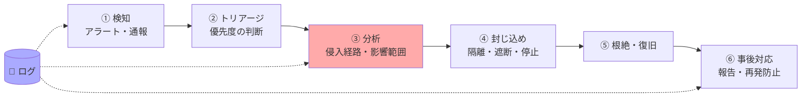
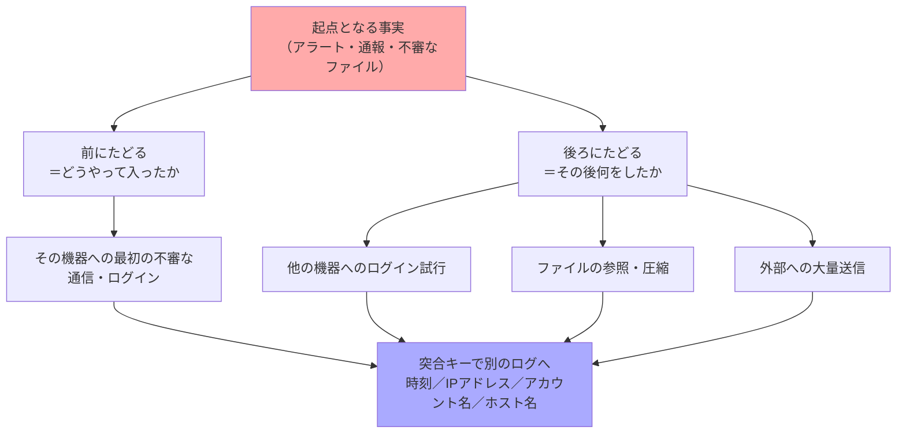
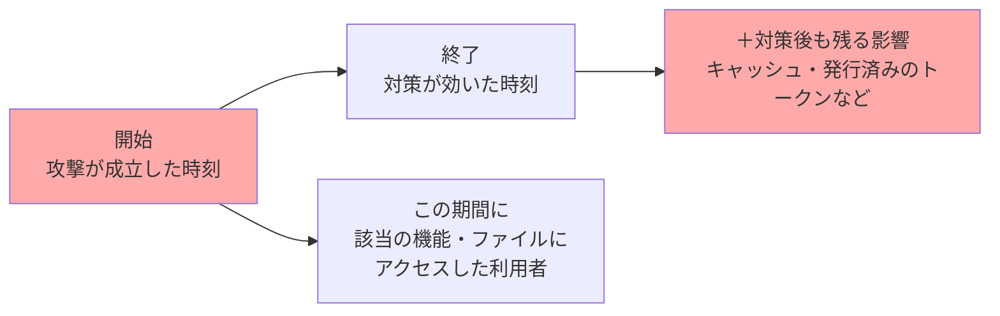

# 予想テーマ③ インシデント対応とログ解析 <!-- omit in toc -->

> 目的：ログ・レポートという**「生の資料」を読ませる設問**で、根拠を拾って**調査内容・影響範囲**を書けるようにする
> 位置付け：攻撃の筋と備えは `予想テーマ_ランサムウェア対応.md` に分け、ここでは**「痕跡の読み方と調査の書き方」**を扱う
> 通読の目安：30〜40分

- [1. 全体地図](#1-全体地図)
- [2. 仕組み：ログから攻撃を再構成する](#2-仕組みログから攻撃を再構成する)
- [3. ログの種類ごとの「分かること／分からないこと」](#3-ログの種類ごとの分かること分からないこと)
- [4. 読み方の技](#4-読み方の技)
- [5. 影響範囲の特定と証拠保全](#5-影響範囲の特定と証拠保全)
- [6. 設問になる形と答案の型](#6-設問になる形と答案の型)
- [7. 過去問との接続](#7-過去問との接続)
- [8. 落とし穴](#8-落とし穴)
- [9. 自己チェック](#9-自己チェック)

---

## 1. 全体地図

ログ解析で答えるのは、常に次の4つ。

| 問い           | 設問での現れ方                                 |
| -------------- | ---------------------------------------------- |
| **いつから**   | 「侵入された日時」「影響があった期間」         |
| **どこから**   | 「侵入経路」「最初に感染した機器」             |
| **何をされた** | 「攻撃者が行った操作」「持ち出されたファイル」 |
| **どこまで**   | 「被害の範囲」「連絡すべき対象者」             |

---

## 2. 仕組み：ログから攻撃を再構成する

**攻撃フェーズと痕跡の対応**

| フェーズ     | 典型的な痕跡                                          | 見るログ                                   |
| ------------ | ----------------------------------------------------- | ------------------------------------------ |
| **初期侵入** | 不審なサイトからのスクリプト・ファイルのダウンロード  | プロキシ、端末のプロセス・通信ログ         |
| **永続化**   | タスク・サービスの登録、自動起動の設定                | 端末のイベントログ                         |
| **防御回避** | マルウェア対策サービスの停止                          | 端末のイベントログ、対策ソフトの管理サーバ |
| **探索**     | ドライブや共有フォルダの一覧・参照                    | ファイルアクセスログ                       |
| **横展開**   | 1台から多数の機器へのログイン試行、**失敗の後の成功** | 認証ログ                                   |
| **収集**     | 圧縮ファイルの作成（後に削除）                        | ファイルアクセスログ                       |
| **持出し**   | 外部への**大容量の送信**                              | プロキシ、FW                               |
| **C2通信**   | 外部への**小さく定期的な通信**                        | プロキシ、DNS、FW                          |
| **痕跡消去** | ファイル・ログの削除                                  | ファイルアクセスログ、外部保管のログ       |

---

## 3. ログの種類ごとの「分かること／分からないこと」

| ログ                      | 分かること                                                 | 分からないこと・注意点                                                   |
| ------------------------- | ---------------------------------------------------------- | ------------------------------------------------------------------------ |
| **FW**                    | 送信元・宛先のIPアドレスとポート、許可／拒否、通信量       | **通信の中身**。HTTPSのURLやファイル名は見えない                         |
| **プロキシ**              | 利用者・接続先のURL（FQDN）・メソッド・通信量・許可／拒否  | **プロキシを経由しない通信**。HTTPSは復号しなければ中身は不明            |
| **DNS**                   | どの端末がどのドメイン名を問い合わせたか                   | 実際に接続したか、何を送ったか                                           |
| **認証**（AD・IdP）       | 誰が・いつ・どこから・成功／失敗                           | ログイン後に**何をしたか**                                               |
| **端末**（EDR・イベント） | プロセスの起動、タスク登録、サービス停止、通信先           | **メモリ上だけで動いた処理**はファイル生成の記録が残らない               |
| **ファイルサーバ**        | 誰が・どのファイルを・参照／作成／削除したか               | ファイルの**内容**、端末にコピーした後の扱い                             |
| **Web／APサーバ**         | 接続元IP、メソッド、パス、**ステータスコード**、応答サイズ | **POSTの本文**（通常は記録されない）、セッション内の利用者（設計による） |
| **メール**                | 送信元・宛先・件名・添付の有無、認証結果                   | 受信者が**開いたか・クリックしたか**                                     |
| **クラウドの監査ログ**    | 誰が・どのAPIで・どの資源を操作したか                      | **監査ログの対象外の操作**、ログ取得を止められた後の操作                 |

> **設問の定番**：「**このログでは分からない**ので、**別のログと突き合わせる**」。IPアドレスから端末を特定するには**DHCPのログ**、端末から利用者を特定するには**認証ログ**、というつなぎ方を覚えておく。

---

## 4. 読み方の技

| 技                         | 見るもの                               | 読み取れること                                           |
| -------------------------- | -------------------------------------- | -------------------------------------------------------- |
| **① 時刻をそろえる**       | 各ログのタイムゾーン、時刻同期の有無   | UTCとJSTの**9時間差**、時刻がずれた機器の補正            |
| **② 起点から前後にたどる** | アラートの時刻の前後                   | 前＝侵入経路、後＝被害                                   |
| **③ 通信量の大小を比べる** | 送信バイト数                           | **大きい＝持出し**／**小さく定期的＝C2通信**             |
| **④ 成否を見分ける**       | ステータスコード、許可／拒否、認証結果 | **拒否された試行は被害ではない**。成功したものだけが被害 |
| **⑤ 失敗の後の成功を探す** | 連続した認証失敗の直後の成功           | 総当たり・パスワードスプレーの**成功**                   |
| **⑥ いつもとの違いを探す** | 時間帯、接続元、利用者と機器の組合せ   | 深夜のログイン、普段使わないサーバへのアクセス           |
| **⑦ 「記録がない」を読む** | あるはずの記録の欠落                   | **取得対象外**／**削除された**／**メモリ上で実行された** |
| **⑧ 拒否の後の変化を見る** | 遮断した後の通信先                     | **別の通信先に切り替えた**＝別のC2サーバがある           |

**HTTPステータスコード（成否の判定に使う）**

| コード       | 意味                       | ログでの読み方                              |
| ------------ | -------------------------- | ------------------------------------------- |
| **200**      | 成功                       | 要求が処理された                            |
| **201／204** | 作成成功／成功（本文なし） | **PUT・DELETEが成功**した                   |
| **301／302** | リダイレクト               | ログイン成功後の遷移、未認証時の誘導        |
| **401**      | 認証が必要                 | 未認証・認証失敗                            |
| **403**      | 権限なし                   | アクセス制御で**拒否**された                |
| **404**      | 存在しない                 | **多数並ぶ＝探索・スキャン**                |
| **405**      | メソッド不許可             | PUTなどが**拒否**された（設定変更後に並ぶ） |
| **500**      | サーバ内部エラー           | **インジェクションの試行**で出ることがある  |

---

## 5. 影響範囲の特定と証拠保全

**影響範囲＝「期間」×「対象」**

| 特定の軸           | 考え方                                                           | 例                                                       |
| ------------------ | ---------------------------------------------------------------- | -------------------------------------------------------- |
| **期間の開始**     | 脆弱な設定に**変更した時刻**ではなく、**攻撃が成功した時刻**     | 設定変更は6/8、改ざん成功は6/11 → 開始は6/11             |
| **期間の終了**     | 対策を実施した時刻。ただし**対策後も残る影響**を足す             | 改ざんファイルを戻しても、**ブラウザのキャッシュ**に残る |
| **対象（利用者）** | その期間に**該当の画面・機能にアクセスした**利用者               | 決済画面のパスにアクセスしたアカウント                   |
| **対象（資産）**   | 奪われたアカウントで**アクセス可能だった**ファイル・サーバ       | そのアカウントが参照できる共有フォルダ全体               |
| **見積もり方**     | 証拠で否定できない範囲は**被害があったものとして扱う**（安全側） | ログが残っていない期間は、影響ありとして扱う             |

**証拠保全**

| 項目             | 押さえる要点                                                     |
| ---------------- | ---------------------------------------------------------------- |
| **揮発性の順序** | **消えやすいものから**保全する（メモリ → 通信の状態 → ディスク） |
| **電源**         | 切らない。**ネットワークから切り離す**                           |
| **複製で調査**   | 原本は触らず、**複製を取って**調査する                           |
| **同一性の証明** | 原本と複製の**ハッシュ値**を記録し、一致を確認する               |
| **作業の記録**   | 誰が・いつ・何をしたかを記録する（証拠としての信頼性を保つ）     |

**ログ基盤に求められること（再発防止で問われる）**

| 要件             | 理由                                                                 |
| ---------------- | -------------------------------------------------------------------- |
| **時刻同期**     | 複数のログを時系列で突き合わせるため                                 |
| **外部への転送** | 侵害された機器上のログは**削除・改変される**ため                     |
| **保存期間**     | 侵入から発覚までが長い場合に、**さかのぼって調査**するため           |
| **取得項目**     | 利用者・接続元・操作内容を**個人単位で特定**できること（責任追跡性） |
| **監視と通知**   | 記録するだけでなく、**条件に合致したら通知**すること                 |

---

## 6. 設問になる形と答案の型

| 設問の形                           | 書くべき要素                                               | 書き出しの例                                                         |
| ---------------------------------- | ---------------------------------------------------------- | -------------------------------------------------------------------- |
| 「**調査の内容**を具体的に」       | **どのログから／どんな条件で／何を探すか**                 | 「プロキシログから、○○.com への通信を検索し、送信元のPCを特定する」  |
| 「**早期に検知する方法**」         | **どのログの／何が／どうなったら／誰に通知**               | 「認証ログに失敗の記録が多数出力されたら、管理者にメールで通知する」 |
| 「**そう判断した根拠**」           | **ログの具体的な記録**（時刻・値・コード）を引く           | 「PUTのリクエストに対するステータスコードが204であったから」         |
| 「**被害の範囲**を答えよ」         | **期間＋対象**                                             | 「6/11 13:12から○○までの間に、△△にアクセスした利用者」               |
| 「**被害がないと判断できる理由**」 | **成功の記録がない**／**拒否されている**ことを示す         | 「ログイン試行が全て失敗しているから」                               |
| 「**このログで特定できない理由**」 | そのログが**記録していない項目**を名指しする               | 「FWのログにはIPアドレスしか記録されず、利用者を特定できないから」   |
| 「**対策の内容**を具体的に」       | **どの機器・サービスで／誰に対して／何を／どう設定するか** | 「プロキシで、○○.com への通信を拒否するように設定する」              |
| 「**他に確認すべきこと**」         | **同じ痕跡を持つ別の機器**を探す                           | 「同じ通信先へのアクセスが他のPCにないかを、プロキシログで確認する」 |

> **型のコツ**：ログの記述は、**本文の固有名詞（ログの名前・ファイル名・ドメイン名・時刻）をそのまま使う**。一般論で書くと根拠が伝わらない。

---

## 7. 過去問との接続

| 回・問                | 設問の型                                                                                                                                       | このノートの該当箇所 |
| --------------------- | ---------------------------------------------------------------------------------------------------------------------------------------------- | -------------------- |
| **R6秋 問1**          | 複数のログから**攻撃フェーズを時系列で再構成**／**810MBと0.1MB**で持出しとC2を見分ける／調査内容・対策内容の記述                               | 2章・4章 ③・6章      |
| **R6秋 問1**          | 拒否した後に**別の通信先へ切り替え**／**アクセス可能だったファイル**で影響範囲を特定                                                           | 4章 ⑧・5章           |
| **R6秋 問3**          | アクセスログの**ステータスコード（204成功／405拒否）**で成否を判定／**キャッシュを含めた影響期間**／該当パスにアクセスした**アカウント**の特定 | 4章・5章             |
| **R6秋 問2**          | **DMARCレポート**から認証に失敗している正規の送信元を洗い出す                                                                                  | 3章（メール）        |
| **R7春 問1 設問5(1)** | サーバ側でログが取れない → **必ず経由する踏み台サーバ**で取得する                                                                              | 5章（ログ基盤）      |
| **R7春 問2 設問3(2)** | 特定のメッセージが**多数出力されたら通知**する（早期検知の4要素）                                                                              | 6章                  |
| **R7秋 問3 設問5(2)** | 接続制御のログを**別の目的（OS移行の促進）に活用**する                                                                                         | 3章・6章             |

---

## 8. 落とし穴

| 落とし穴                                       | 正しい理解                                                             |
| ---------------------------------------------- | ---------------------------------------------------------------------- |
| **試行と成功を区別しない**                     | 拒否・失敗の記録は**被害ではない**。成功した記録だけを被害として数える |
| **影響期間を「設定変更の時刻」から数える**     | 開始は**攻撃が成功した時刻**。設問がどちらを聞いているか確認する       |
| **対策実施の時刻で影響が終わると考える**       | **キャッシュ・発行済みトークン・窃取済みの認証情報**は対策後も残る     |
| **「ログを確認する」だけで終える**             | **どのログから・どんな条件で・何を探すか**まで書く                     |
| **1つのログで全て分かると思い込む**            | IPアドレス→端末→利用者は、**別のログとの突合**が必要                   |
| **記録がないことを「何も起きていない」と読む** | **取得していない・消された・メモリ上で実行された**可能性を考える       |
| **時刻のずれを見落とす**                       | ログごとに**タイムゾーン**が違うことがある。本文の注記を確認する       |
| **最初に見つかった1台で調査を終える**          | 同じ痕跡を**他の機器でも検索**する（横展開の確認）                     |

---

## 9. 自己チェック

Q1. ログ解析で答える4つの問いは。

いつから、どこから、何をされた、どこまで。

Q2. 外部への通信のうち、持出しとC2通信を通信量でどう見分けるか。

大容量の送信は持出し。小さく定期的な通信はC2通信。

Q3. FWのログだけでは利用者を特定できない理由と、特定するために突き合わせるログは。

FWのログにはIPアドレスしか記録されないから。DHCPのログで端末を、認証ログで利用者を特定する。

Q4. PUTメソッドのリクエストが成功したことを示すステータスコードは。拒否を示すコードは。

成功は201または204。拒否は405（メソッド不許可）や403。

Q5. アクセスログに404が短時間に多数並んでいる。何が疑われるか。

存在するパスを探す探索・スキャン。

Q6. 認証ログで「多数の失敗の直後に成功」があった。何を意味するか。

総当たりやパスワードスプレーなどの試行が成功し、不正にログインされた可能性。

Q7. 遮断した通信先とは別の通信先への定期的な通信が始まった。何を意味するか。

マルウェアが別のC2サーバに切り替えた。遮断だけでは封じ込めができていない。

Q8. 改ざんされたファイルを元に戻した後も、影響期間が続くのはどんな場合か。

利用者のブラウザやCDNのキャッシュに、改ざんされたファイルが残っている場合。

Q9. 奪われたアカウントによる情報漏えいの範囲は、どう特定するか。

そのアカウントでアクセス可能だったファイル・サーバを範囲とする。参照の記録で否定できないものは被害ありとして扱う。

Q10. 「調査の内容を具体的に」と問われたときの3要素は。

どのログから、どんな条件で、何を探すか。

Q11. 「早期に検知する方法」と問われたときの4要素は。

どのログの、何が、どうなったら、誰に通知するか。

Q12. ログを機器の外に転送して保管する理由と、時刻同期が必要な理由を答えよ。

侵害された機器上のログは削除・改変されるから。複数のログを時系列で突き合わせるため。

Q13. 証拠保全で、原本と複製が同一であることをどう示すか。

両方のハッシュ値を記録し、一致することを確認する。

