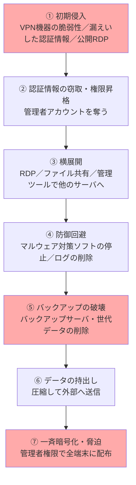
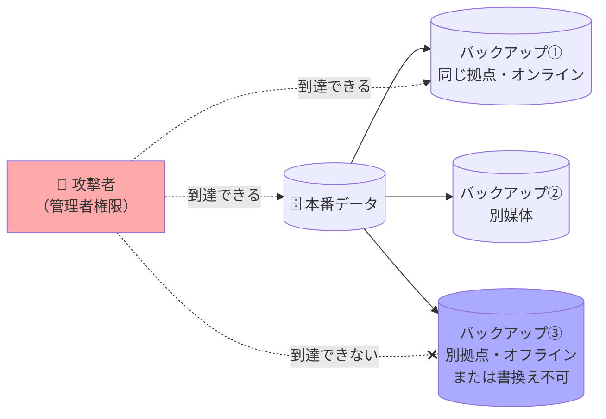
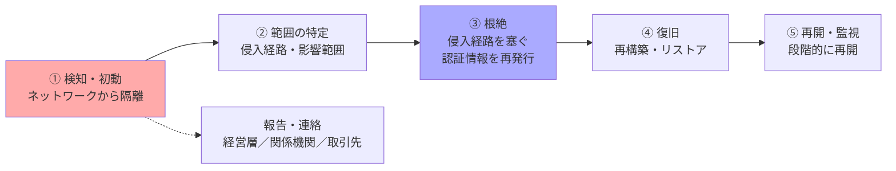

# 予想テーマ② ランサムウェア対応 <!-- omit in toc -->

> 目的：**侵入から暗号化までの筋**と**備え（バックアップ・復旧）**を、設問の形で書けるようにする
> 位置付け：痕跡の読み方と調査の書き方は `予想テーマ_インシデント対応とログ解析.md` に分け、ここでは**「攻撃の筋と備え」**を扱う
> 通読の目安：30〜40分

- [1. 全体地図](#1-全体地図)
- [2. 仕組み：侵入から脅迫まで](#2-仕組み侵入から脅迫まで)
- [3. 段階ごとの「欠けると何が起きるか」表](#3-段階ごとの欠けると何が起きるか表)
- [4. バックアップの設計](#4-バックアップの設計)
- [5. 初動・復旧・報告](#5-初動復旧報告)
- [6. 設問になる形と答案の型](#6-設問になる形と答案の型)
- [7. 過去問との接続](#7-過去問との接続)
- [8. 落とし穴](#8-落とし穴)
- [9. 自己チェック](#9-自己チェック)

---

## 1. 全体地図

| 観点         | 従来型（ばらまき型） | **現在の主流（侵入型）**                                             |
| ------------ | -------------------- | -------------------------------------------------------------------- |
| 侵入経路     | メールの添付ファイル | **VPN機器の脆弱性・漏えいした認証情報・公開されたRDP**               |
| 攻撃の進め方 | 自動的に暗号化       | **攻撃者が手動で内部を探索**し、権限を奪ってから一斉に暗号化         |
| 脅迫         | 復号と引換えに金銭   | **二重脅迫**（暗号化＋**窃取したデータの暴露**）                     |
| バックアップ | あれば復旧できた     | **バックアップも狙って破壊**される                                   |
| 対策の重心   | 入口（メール）対策   | **侵入後の横展開を止める**＋**壊されないバックアップ**＋**復旧手順** |

> **設問の前提になる考え方**：バックアップがあっても、**暴露の脅迫は残る**。逆に、暴露を防げても**業務は止まる**。**機密性と可用性の両方**が同時に問われる。

---

## 2. 仕組み：侵入から脅迫まで

> **読み方**：⑦が起きた時点で、①〜⑥は**すでに終わっている**。発覚した時点で「暗号化を止める」だけでなく、**「いつから侵入されていたか」「何を持ち出されたか」**を調べる必要がある。

---

## 3. 段階ごとの「欠けると何が起きるか」表

| 段階                   | 欠けている対策                             | 何が起きるか                                             | 対策の書き方                                                       |
| ---------------------- | ------------------------------------------ | -------------------------------------------------------- | ------------------------------------------------------------------ |
| **① 初期侵入**         | VPN機器の**修正プログラム適用**            | 公開された脆弱性を突かれて侵入される                     | 脆弱性情報を継続的に収集し、速やかに修正プログラムを適用する       |
|                        | VPN認証の**多要素化**                      | 漏えい・推測された認証情報でログインされる               | 多要素認証（できればクライアント証明書）を導入する                 |
|                        | **不要なアカウント・公開サービスの棚卸し** | 退職者・保守用アカウントや公開RDPが入口になる            | 不要なアカウントを削除し、管理用ポートを外部に公開しない           |
| **② 権限の奪取**       | **管理者パスワードの使い回し禁止**         | 1台の管理者権限から全台に入られる                        | 端末ごとに異なるパスワードを設定する                               |
|                        | **管理者権限の常用禁止**                   | 端末のメモリに残った管理者の認証情報を盗まれる           | 通常業務は一般権限で行い、管理作業は専用端末・専用アカウントで行う |
| **③ 横展開**           | **ネットワーク分離**                       | 端末セグメントからサーバ・制御系まで到達される           | セグメント間にFWを置き、業務に必要な通信だけを許可する             |
|                        | **端末間通信の制限**                       | PCからPCへRDP・ファイル共有で広がる                      | 端末間のRDP・ファイル共有を禁止する                                |
| **④ 防御回避**         | **ログの外部保管**                         | 侵入の痕跡を消され、調査できなくなる                     | ログを別のサーバに転送し、削除・改変できないように保管する         |
|                        | **対策ソフト停止の検知**                   | 停止されても気付かない                                   | サービス停止を検知して管理者に通知する                             |
| **⑤ バックアップ破壊** | **バックアップの隔離**                     | 本番と同じ権限・同じネットワークなので一緒に暗号化される | オフライン保管または書換え不可の保管にし、認証も本番と分ける       |
| **⑥ 持出し**           | **外向き通信の監視**                       | 大量のデータ送信に気付かない                             | プロキシで通信先と通信量を監視し、異常を通知する                   |
| **⑦ 暗号化**           | **復旧手順の整備と訓練**                   | バックアップがあっても、戻し方が分からず復旧が遅れる     | 復旧手順を文書化し、定期的にリストア試験を行う                     |

---

## 4. バックアップの設計

| 設計項目         | 押さえる要点                                                                                             | 欠けると                                                       |
| ---------------- | -------------------------------------------------------------------------------------------------------- | -------------------------------------------------------------- |
| **3-2-1ルール**  | **3つ**のコピー／**2種類**の媒体／**1つ**は別の場所                                                      | 1か所の障害・侵害で全滅する                                    |
| **隔離**         | **オフライン**（媒体を取り外す）または**書換え不可**（一定期間、削除・変更できない）                     | 本番と一緒に暗号化・削除される                                 |
| **認証の分離**   | バックアップの管理アカウントを**本番の認証基盤と別**にする                                               | 管理者アカウントを奪われるとバックアップも操作される           |
| **世代管理**     | **複数世代**を保持する                                                                                   | 暗号化後・感染後のデータで**上書き**され、健全な世代がなくなる |
| **対象の網羅**   | データだけでなく**OS・設定・プログラム**も対象にする                                                     | データは戻っても**システムが再構築できない**                   |
| **リストア試験** | 実際に戻せるかを**定期的に確認**する                                                                     | 本番で初めて「戻せない」「時間が足りない」と分かる             |
| **RPO／RTO**     | **RPO**＝どの時点まで戻せるか（取得頻度を決める）／**RTO**＝いつまでに復旧するか（事前準備の量を決める） | 取得頻度や予備機の準備が、事業の要求と合わない                 |

> **設問のつなぎ方**：本文に「**○時間以内に復旧**」（RTO）が書かれていたら、それが**どこまで事前に用意するか**（予備機、復旧用の媒体、手順書）の根拠になる。

---

## 5. 初動・復旧・報告

**やること・やってはいけないこと**

| 場面           | やること                                                                | やってはいけないこと                                         |
| -------------- | ----------------------------------------------------------------------- | ------------------------------------------------------------ |
| **初動**       | 感染端末を**ネットワークから切り離す**（LANケーブルを抜く、無線を切る） | **電源を切る・再起動する**（メモリ上の証拠が失われる）       |
| **証拠保全**   | ログ・メモリ・ディスクを保全してから調査する                            | 感染端末で調査ツールを動かし続け、**証拠を上書き**する       |
| **範囲の特定** | **侵入経路**と**いつから**を特定する                                    | 暗号化された端末だけを見て、**侵入口を放置**する             |
| **根絶**       | 侵入経路を塞ぎ、**奪われた可能性のある認証情報を全て再発行**する        | パスワードを変えずに復旧し、**同じ認証情報で再侵入**される   |
| **復旧**       | **クリーンな状態から再構築**し、**健全と確認した世代**からリストアする  | 感染時期以降のバックアップを戻し、**マルウェアごと復元**する |
| **再開**       | 監視を強化し、**重要な業務から段階的に**再開する                        | 一斉に再接続して、残っていた感染端末から**再び拡大**させる   |
| **身代金**     | 支払わない方針を事前に決め、復旧手段を自前で持つ                        | 支払えば戻ると期待する（**復号も非公開も保証されない**）     |

**報告・連絡**

| 相手                   | 内容                                                                                                                                                                |
| ---------------------- | ------------------------------------------------------------------------------------------------------------------------------------------------------------------- |
| **経営層**             | 事業への影響、復旧見込み、判断が必要な事項                                                                                                                          |
| **個人情報保護委員会** | 個人データの漏えい等（**おそれを含む**）があれば報告。**速報**（速やかに、概ね3〜5日以内）と**確報**（30日以内、不正の目的によるおそれがある場合は60日以内）の2段階 |
| **本人**               | 漏えい等の対象となった本人への通知                                                                                                                                  |
| **警察・関係機関**     | 被害の届出・相談                                                                                                                                                    |
| **取引先・委託元**     | 契約上の報告義務、納期への影響（サプライチェーンの下流なら特に重要）                                                                                                |

---

## 6. 設問になる形と答案の型

| 設問の形                               | 書くべき要素                                           | 書き出しの例                                                                   |
| -------------------------------------- | ------------------------------------------------------ | ------------------------------------------------------------------------------ |
| 「**被害が拡大した原因**」             | **どの設定・運用が／何を許したか**                     | 「全PCで同じ管理者パスワードを使っていたので、他のPCにもログインできたから」   |
| 「**バックアップが使えなかった理由**」 | **到達できた経路**か**上書きされた世代**               | 「バックアップサーバに本番と同じ管理者アカウントでログインできたから」         |
| 「**対策とその導入箇所**」             | **箇所（図の記号・機器名）＋対策名**                   | 「（あ）の箇所にFWを設置し、サーバへの通信を業務に必要なものに限定する」       |
| 「**復旧のための仕組みと手順**」       | **仕組み＝事前に用意するモノ**／**手順＝実行する作業** | 仕組み「○○をバックアップする媒体とソフトウェア」／手順「○○をリストアする手順」 |
| 「**初動で行うべきこと**」             | **何を／どこから切り離すか**＋**やらないこと**         | 「PCの電源は切らずに、LANケーブルを抜いてネットワークから切り離す」            |
| 「**復旧前に行うべきこと**」           | **侵入経路の遮断**と**認証情報の再発行**               | 「侵入に使われた脆弱性を修正し、全アカウントのパスワードを変更する」           |
| 「**被害シナリオ**」                   | **発端 → 経路 → 結果**を一続きで                       | 「VPN機器から侵入した攻撃者が、管理者権限でサーバを暗号化し、○○が停止する」    |

> **型のコツ**：ランサムの記述は、**「攻撃者がどこまで到達できたか」**（ネットワーク・権限）で整理する。到達できた理由が**原因**、到達できなくする方法が**対策**になる。

---

## 7. 過去問との接続

| 回・問                | 設問の型                                                                                          | このノートの該当箇所 |
| --------------------- | ------------------------------------------------------------------------------------------------- | -------------------- |
| **R6春 問2**          | VPNの**認証強化**（クライアント証明書）／**脆弱性対策**／ポートを見せない仕組み                   | 3章 ①                |
| **R6秋 問1**          | **永続化**（タスク登録）／**対策ソフトの停止**／**RDPによる横展開**／圧縮して**持出し**／痕跡消去 | 2章・3章 ②〜⑥        |
| **R7秋 問4 設問3**    | **感染拡大を止める**対策と導入箇所（セグメント間のFW）／可搬媒体の検査                            | 3章 ③、6章           |
| **R7秋 問4 設問4(1)** | 復旧の**仕組み（媒体とソフトウェア）と手順（リストア）**の書き分け／**中身まで**戻す              | 4章、6章             |
| **R7秋 問4 設問4(2)** | **発端を含めた被害シナリオ**／ネットワークから**切り離す手順**／RTOからの逆算                     | 4章・5章・6章        |
| **R7秋 問2**          | 隔離された環境でも**可搬媒体が橋渡し**になる                                                      | 4章（隔離の限界）    |

---

## 8. 落とし穴

| 落とし穴                               | 正しい理解                                                                   |
| -------------------------------------- | ---------------------------------------------------------------------------- |
| **「バックアップを取得する」だけ書く** | 取得していても**壊される・戻せない**。**隔離・世代・リストア試験**まで書く   |
| **初動で「電源を切る」と書く**         | **ネットワークから切り離す**。電源断はメモリ上の証拠を失う                   |
| **暗号化された端末だけを対象にする**   | 暗号化は**最終段階**。侵入口と、まだ暗号化されていない感染端末を探す         |
| **復旧＝リストアと考える**             | **侵入経路の遮断と認証情報の再発行が先**。順序を誤ると再侵入される           |
| **可用性の話だけで終える**             | 二重脅迫なので**情報漏えいの調査・報告**も必要                               |
| **入口対策だけを答える**               | 「感染の**拡大**を防ぐ」と問われたら、**ネットワーク分離・端末間通信の制限** |
| **仕組みと手順を同じ内容で書く**       | 仕組み＝**用意するモノ**／手順＝**実行する作業**                             |

---

## 9. 自己チェック

Q1. 二重脅迫とは何か。

データを暗号化して復号と引換えに金銭を要求することに加え、窃取したデータを公開すると脅すこと。

Q2. 侵入型ランサムウェアの主な侵入経路を3つ挙げよ。

VPN機器の脆弱性、漏えい・推測された認証情報、外部に公開されたRDP。

Q3. 全PCで同じローカル管理者パスワードを使っていると何が起きるか。

1台で管理者の認証情報を奪われると、同じ認証情報で他の全てのPCにログインされ、横展開される。

Q4. バックアップが本番と一緒に暗号化されないための条件を2つ挙げよ。

オフライン保管または書換え不可の保管にすること。バックアップの管理アカウントを本番の認証基盤と分けること。

Q5. 世代管理をしていないと何が起きるか。

暗号化・感染後のデータでバックアップが上書きされ、健全な時点に戻せなくなる。

Q6. RPOとRTOの違いを答えよ。

RPOはどの時点のデータまで戻せるか（取得頻度を決める）。RTOはいつまでに復旧するか（事前準備の量を決める）。

Q7. 感染が疑われるPCの初動として適切な操作と、その理由を答えよ。

電源は切らずにネットワークから切り離す。被害の拡大を止めつつ、メモリ上の証拠を残すため。

Q8. リストアの前に行うべきことを2つ挙げよ。

侵入経路を塞ぐこと。奪われた可能性のある認証情報を全て再発行すること。

Q9. 「感染の拡大を防ぐ、できるだけ効果が高い対策」と問われたら、何を軸に答えるか。

端末ごとの対策ではなく、経路を断つ対策（セグメント間のFW、端末間通信の禁止）。

Q10. ログを外部のサーバに転送して保管する目的は。

攻撃者に侵入の痕跡を削除・改変されても、調査に必要なログを残すため。

Q11. 個人データの漏えいのおそれがある場合、個人情報保護委員会への報告は何段階か。

速報と確報の2段階。あわせて本人への通知が必要。

Q12. 復旧の「仕組み」と「手順」をどう書き分けるか。

仕組みは事前に用意するモノ（媒体、ソフトウェア、予備機）。手順は実行する作業（リストア、切り離し）。

