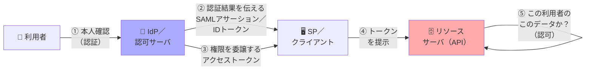
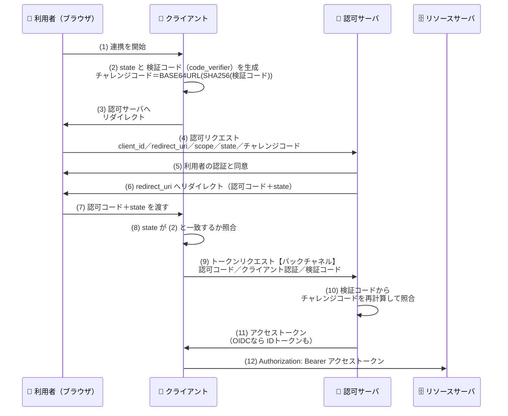
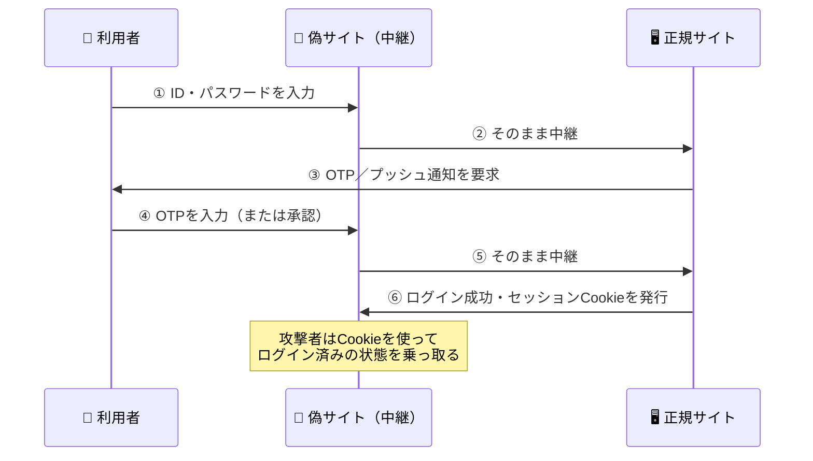

# 予想テーマ① 認証・認可 <!-- omit in toc -->

> 目的：**「知識を手掛かりに本文を当てはめる」複合設問**で、OAuth／OIDC／MFAが題材になったときに書けるようにする
> 位置付け：用語の定義は `過去問道場.md`（OAuth2.0とOIDC／SAML／FIDO2／利用者認証）に任せ、ここでは「**欠けると何が起きるか**」と「**答案の書き方**」に絞る
> 通読の目安：30〜40分

- [1. 全体地図](#1-全体地図)
- [2. 仕組み：認可コードフロー＋PKCE](#2-仕組み認可コードフローpkce)
- [3. 「欠けると何が起きるか」表](#3-欠けると何が起きるか表)
- [4. トークンの検証と保護](#4-トークンの検証と保護)
- [5. MFAの突破手口とパスキー](#5-mfaの突破手口とパスキー)
- [6. 設問になる形と答案の型](#6-設問になる形と答案の型)
- [7. 過去問との接続](#7-過去問との接続)
- [8. 落とし穴](#8-落とし穴)
- [9. 自己チェック](#9-自己チェック)

---

## 1. 全体地図

| 問い                           | 担当する仕組み                | 設問で狙われる点                                 |
| ------------------------------ | ----------------------------- | ------------------------------------------------ |
| **誰か**（認証）               | パスワード／MFA／パスキー     | フィッシング耐性、代替手段、回復経路             |
| **認証結果を どう伝えるか** | SAML／OIDC（IDトークン）      | 署名・宛先・有効期限の検証漏れ                   |
| **何をしてよいか** （認可） | OAuth 2.0（アクセストークン） | スコープ、リダイレクト先、認可コードの横取り     |
| **この要求を 通してよいか** | API側のアクセス制御           | トークンの利用者とリクエスト対象の**突き合わせ** |

> **一番大事な区別**：OAuth 2.0 は**認可**の仕組みで、「誰か」は保証しない。ログインに使うなら **OIDC（IDトークン）**。

---

## 2. 仕組み：認可コードフロー＋PKCE

**フロントチャネルとバックチャネル**

| 経路                 | 該当する通信 | 特徴                                                                 |
| -------------------- | ------------ | -------------------------------------------------------------------- |
| **フロントチャネル** | (3)(4)(6)(7) | **ブラウザを経由**する。URLに載るので、履歴・Referer・中継で漏れ得る |
| **バックチャネル**   | (9)(11)(12)  | **サーバ間で直接**通信する。クライアントシークレットはここでだけ使う |

> **設計の意図**：漏れやすいフロントチャネルには**認可コード（短命・1回限り）** しか流さず、**トークン本体はバックチャネル**で受け取る。

---

## 3. 「欠けると何が起きるか」表

| 要素                              | 役割                                                 | 欠ける／検証しないと                                                                    | 対策の書き方                                                   |
| --------------------------------- | ---------------------------------------------------- | --------------------------------------------------------------------------------------- | -------------------------------------------------------------- |
| **state**                         | 認可リクエストと応答を **同じセッションに紐付け** | **CSRF**。攻撃者の認可コードを被害者に送らせ、 **攻撃者のアカウントと連携**させる    | セッションに紐付けた推測困難な値を 発行し、応答時に照合する |
| **PKCE**                          | 認可コードを**要求した 本人だけ**が交換できる     | **認可コード横取り**。スマホアプリの カスタムURLスキームなどで別アプリが 受け取る | 検証コードを生成し、チャレンジコードを送って照合させる         |
| **redirect_uri の完全一致**       | 認可コードの**届け先を固定**                         | 攻撃者のサイトへ認可コードが届く （前方一致・部分一致は回避される）                  | 事前登録したURIと **完全一致**で比較する                    |
| **クライアント認証**              | トークンを要求できる **クライアントを限定**       | 認可コードだけで誰でも トークンに交換できる                                          | シークレットをサーバ側だけに置く                               |
| **認可コードの 1回限り・短命** | 盗まれても**再利用させない**                         | リプレイで再度トークンを取得される                                                      | 使用済みコードを無効化し、有効期間を短くする                   |
| **scope の最小化**                | 委譲する権限を **必要な範囲に限定**               | トークン漏えい時の被害が全権限に及ぶ                                                    | 必要な操作だけの スコープを要求・付与する                   |
| **nonce**（OIDC）                 | IDトークンを **その認証要求に紐付け**             | **IDトークンのリプレイ** （過去のトークンの使い回し）                                | 要求時の値とIDトークン内の値 を照合する                     |
| **aud の検証**                    | トークンの**宛先が自分か**                           | **他のクライアント向けトークンの流用** でなりすまされる                              | aud が自身の client_id であることを検証する                    |
| **署名アルゴリズム の固定**    | 署名検証を**必ず行わせる**                           | **alg=none** や方式の差し替えで 改ざんしたトークンが通る                             | サーバ側で許可するアルゴリズム を固定する                   |

**使ってはいけない／注意が要るフロー**

| フロー                                              | 問題点                                                                   |
| --------------------------------------------------- | ------------------------------------------------------------------------ |
| **インプリシットフロー**                            | アクセストークンが**フロントチャネル（URL）** に載る。現在は非推奨       |
| **パスワードを クライアントに渡す方式**          | クライアントが**利用者のパスワードを知ってしまう**。委譲の意味がなくなる |
| **秘密を持てないクライアント**（スマホアプリ・SPA） | シークレットを埋め込んでも**解析で取り出される** → **PKCEが必須**        |

---

## 4. トークンの検証と保護

**IDトークン（JWT）を受け取ったら検証する項目**

| クレーム  | 検証内容                   | 検証しないと                    |
| --------- | -------------------------- | ------------------------------- |
| **署名**  | IdPの公開鍵で検証できるか  | 改ざん・偽造が通る              |
| **iss**   | 想定した発行者か           | 別のIdPが発行したトークンが通る |
| **aud**   | 自分宛てか                 | 他サービス向けトークンの流用    |
| **exp**   | 有効期限内か               | 古いトークンの再利用            |
| **nonce** | 自分が送った値と一致するか | リプレイ                        |

**アクセストークンの保護**

| 観点           | 押さえる要点                                                                                 |
| -------------- | -------------------------------------------------------------------------------------------- |
| Bearerの性質   | **持っている者が使える**（持参人払い）。漏れたら終わりなので、**短命・最小スコープ**にする   |
| 更新           | **リフレッシュトークン**で再発行する。こちらは長命なので**サーバ側で保管**し、失効できること |
| 絞り込みの3軸  | **スコープ／有効期間／接続元**。本文で2つが固定なら、残り1つが答え                           |
| 漏えい時の対処 | 消すのではなく**無効化（失効）** する。リポジトリの履歴に残った秘密も同じ                    |
| API側の認可    | トークンが正しくても、**トークンの利用者IDとリクエストの対象**を突き合わせる（BOLA対策）     |

---

## 5. MFAの突破手口とパスキー

| 手口                           | 何をされるか                                           | 効かない対策                    | 効く対策                                               |
| ------------------------------ | ------------------------------------------------------ | ------------------------------- | ------------------------------------------------------ |
| **中継型フィッシング**（AiTM） | 偽サイトが入力を**リアルタイムに中継**し、Cookieを奪う | SMS・TOTP・プッシュ通知         | **パスキー／クライアント証明書**（フィッシング耐性）   |
| **MFA疲労攻撃**                | 承認要求を連打し、誤って承認させる                     | 単純なプッシュ承認              | **数字照合**、パスキー                                 |
| **SIMスワップ**                | 電話番号を乗っ取り、SMSを受け取る                      | SMS認証                         | SMS以外の要素                                          |
| **セッションCookieの窃取**     | マルウェアで**認証後のCookie**を盗む                   | **MFA全般**（認証は済んでいる） | セッション短縮、重要操作時の再認証、端末・接続元の条件 |
| **回復経路の悪用**             | パスワード再設定や代替手段の登録を悪用する             | 本体の認証強化                  | 回復手続にも同等の本人確認、変更時の通知               |

**なぜパスキーは中継型フィッシングに強いのか（1文で言えるように）**

> 認証器が**アクセス先のオリジンに紐付いた鍵で署名**するため、偽サイトでは正規サイト用の署名が生成されず、中継しても検証に失敗するから。

**認証方式の比較**

| 方式               | 要素             | フィッシング耐性 | 弱点                     |
| ------------------ | ---------------- | :--------------: | ------------------------ |
| パスワード         | 知識             |        ✕         | 漏えい・推測・使い回し   |
| SMS OTP            | 所持             |        ✕         | 中継、SIMスワップ        |
| TOTP（認証アプリ） | 所持             |        ✕         | 中継                     |
| プッシュ通知       | 所持             |        ✕         | 中継、MFA疲労            |
| クライアント証明書 | 所持             |        ○         | 証明書の配布・失効の運用 |
| パスキー（FIDO2）  | 所持＋生体／知識 |        ○         | 端末紛失時の回復経路     |

---

## 6. 設問になる形と答案の型

| 設問の形                       | 書くべき要素                                                   | 書き出しの例                                                     |
| ------------------------------ | -------------------------------------------------------------- | ---------------------------------------------------------------- |
| 「**攻撃の手順**を具体的に」   | **誰が／何を入手して／ どこへ送り／何を得るか**             | 「攻撃者が認可コードを入手し、トークンリクエストを送信して…」    |
| 「**検証すべき内容**を答えよ」 | **どの値と／どの値が／ 一致するか**                         | 「応答の state が、セッションに保存した値と一致すること」        |
| 「**なぜ防げるのか**」         | **攻撃者が持っていないもの**を 名指しする                   | 「攻撃者は検証コードを知らないので、トークンを取得できないから」 |
| 「**なぜ防げないのか**」       | **その対策が守る範囲の外** であることを示す                 | 「利用者が入力したOTPを、偽サイトが正規サイトに中継できるから」  |
| 「**権限を絞る方法**」         | スコープ／有効期間／接続元のうち、**本文で固定されていない軸** | 「トークンのスコープを、○○の参照だけに限定する」                 |
| 空欄（通信の番号・登場人物）   | **シークレットを使う通信＝バックチャネル**から特定する         | —                                                                |
| **15〜20字**                   | 用語そのもの                                                   | 「クライアント認証を行う」「数字照合を有効にする」               |

> **型のコツ**：認証・認可の記述は、**「攻撃者が持っているもの／持っていないもの」**を整理すると、ほぼそのまま答案になる。

---

## 7. 過去問との接続

| 回・問                   | 設問の型                                                                                                                | このノートの該当箇所  |
| ------------------------ | ----------------------------------------------------------------------------------------------------------------------- | --------------------- |
| **R5春  午後Ⅱ 問2**   | OAuthの登場人物の割当て／**シークレットを使う通信はバックチャネル**／PKCEの計算の向き／連携トークンを**スコープで絞る** | 2章・3章・4章         |
| **R6春 問1**          | JWTの **alg=none**／**JWTの利用者IDとパラメータ mid の突き合わせ**／仕様外パラメータの排除／2要素認証の総当たり         | 3章・4章              |
| **R6春 問2**          | MFAを突破するフィッシング → **デジタル証明書によるクライアント認証**を選ぶ                                           | 5章                   |
| **R7春 問2 設問3(3)** | IP制限もアカウントロックも使えない → **クライアント認証**（20字）                                                    | 5章・6章              |
| **R7秋 問3 設問2**    | 数字入力トークンは**入力した数字の意味を示せない** → 取引内容を表示する方式                                          | 5章（中継と同じ構図） |
| **R7秋 問3 設問5(1)** | 認証手段が1つだと故障で詰む → **代替手段の事前登録**                                                                 | 5章（回復経路）       |

---

## 8. 落とし穴

| 落とし穴                                       | 正しい理解                                                                   |
| ---------------------------------------------- | ---------------------------------------------------------------------------- |
| **OAuthで「ログイン」できると 思い込む**    | アクセストークンは「誰か」を保証しない。認証は**OIDCのIDトークン**           |
| **PKCEの向きを逆に書く**                       | **チャレンジコード＝BASE64URL(SHA256(検証コード))**。先に送るのはチャレンジ  |
| **state と nonce と PKCE を 混同する**      | state＝**CSRF**／nonce＝**IDトークンのリプレイ**／PKCE＝**認可コード横取り** |
| **MFAがあればフィッシングは 防げると書く**  | OTPもプッシュも**中継される**。耐性があるのは**オリジンに紐付く方式**        |
| **トークンが正しければ 通してよいと考える** | **トークンの持ち主とリクエスト対象**の突き合わせが別途必要                   |
| **多段階認証を多要素認証と呼ぶ**               | 「パスワード＋秘密の質問」は**どちらも知識**                                 |
| **回復経路を見落とす**                         | 本体を強くしても、**再設定メールや代替手段**が弱ければそこから破られる       |

---

## 9. 自己チェック

Q1. state パラメータは何の攻撃を防ぐか。検証内容とあわせて答えよ。

CSRF（攻撃者の認可コードを被害者に使わせる攻撃）。応答の state が、セッションに紐付けて保存した値と一致することを検証する。

Q2. チャレンジコードと検証コードの関係式を書け。

チャレンジコード＝BASE64URL(SHA256(検証コード))

Q3. 認可コードを横取りした攻撃者が、PKCEがあるとトークンを取得できない理由を答えよ。

攻撃者は検証コードを知らないので、認可サーバでの照合に失敗するから。

Q4. redirect_uri を前方一致で検証していると何が起きるか。

登録済みURIで始まる別のホスト（`.` や `@` を使った細工）へ認可コードが送られる。完全一致で比較する。

Q5. クライアントシークレットを使う通信はフロントチャネルか、バックチャネルか。

バックチャネル（クライアントと認可サーバの直接通信）。

Q6. IDトークンの aud を検証しないと何が起きるか。

他のクライアント向けに発行されたIDトークンを流用され、なりすましを許す。

Q7. スマホアプリにクライアントシークレットを埋め込んではいけない理由は。

アプリを解析すれば取り出せるので、秘密として成立しないから。PKCEを使う。

Q8. TOTPが中継型フィッシングを防げない理由を答えよ。

利用者が偽サイトに入力したOTPを、偽サイトが有効期間内に正規サイトへ中継できるから。

Q9. パスキーが中継型フィッシングに強い理由を答えよ。

認証器がアクセス先のオリジンに紐付いた鍵で署名するので、偽サイトでは正規サイト用の署名が生成されないから。

Q10. セッションCookieを盗まれた場合、MFAが効かないのはなぜか。効く対策を1つ挙げよ。

認証が済んだ後の状態を使われるから。セッション有効期間の短縮、重要操作時の再認証、接続元や端末による条件付きアクセスなど。

Q11. 連携トークンの権限を絞る3つの軸は。

スコープ、有効期間、接続元。本文で固定されている軸は答えにならない。

Q12. アクセストークンが正しく検証できても、API側で追加で確認すべきことは。

トークンに含まれる利用者IDと、リクエストで指定された操作対象の持ち主が一致すること。

