# 令和5年度 秋期 情報処理安全確保支援士試験 午後 設問別解説 <!-- omit in toc -->

> 出典：IPA 令和5年度秋期 情報処理安全確保支援士試験 午後 問題・解答例（©2023 独立行政法人情報処理推進機構）
> 形式：問1〜問4から**2問選択**／13:00〜15:30（2時間30分）
> 構成：各設問について「**設問文 → 解答 → 解説**」の順に記載。**解答**はIPA公表の解答例であり、記述式は同趣旨であれば可。
> 備考：**令和5年度秋期から午後Ⅰ・午後Ⅱが「午後」に統合**され、4問中2問選択の形式になった最初の回。

- [問1 Webアプリケーションプログラムの開発（Q社）](#問1-webアプリケーションプログラムの開発q社)
- [問2 セキュリティ対策の見直し（M社）](#問2-セキュリティ対策の見直しm社)
- [問3 継続的インテグレーションサービスのセキュリティ（N社）](#問3-継続的インテグレーションサービスのセキュリティn社)
- [問4 リスクアセスメント（G百貨店・W社）](#問4-リスクアセスメントg百貨店w社)
- [全体の学習ポイント](#全体の学習ポイント)

---

## 問1 Webアプリケーションプログラムの開発（Q社）

### 題材の整理

| 項目         | 内容                                                                                                                                                                                                                                            |
| ------------ | ----------------------------------------------------------------------------------------------------------------------------------------------------------------------------------------------------------------------------------------------- |
| 企業         | Q社：洋服のEC事業を手掛ける従業員100名の会社                                                                                                                                                                                                    |
| システム     | **WebアプリQ**でECサイトを運営。<br>ドメイン名は `□□□.co.jp`、<br>利用者は**HTTPS**でアクセス。開発・運用はQ社開発部                                                                                                                            |
| 今回の変更   | 会員による**商品レビュー機能**を追加                                                                                                                                                                                                            |
| 認証         | 会員IDとパスワードで認証。<br>ログイン済み会員には**セッションIDをcookieとして払出し**                                                                                                                                                          |
| レビュー機能 | レビュータイトル（**50字**）とレビュー詳細（**300字**）<br>は自由記述。入力文字数制限あり                                                                                                                                                       |
| アイコン画像 | `/user/upload` へ、**画像ファイル（`uploadfile`）**<br>と **トークン（`token`）** をパラメータとして送信。<br>トークンが `/user/profile` で払い出されたものと一<br>致したときに成功。<br>アップロードした画像は**レビューページにも表示される** |
| 判明した不備 | ①会員が入力したスクリプトが実行されてしまう <br>②cookieに**HttpOnly属性を付与していない** <br>③アップロードされた**画像ファイルの形式をチェック<br>していない**                                                                                 |

**出題趣旨**：Webアプリケーションプログラムの脆弱性を悪用されたことによるインシデント対応を題材に、**HTMLやECMAScriptから悪用された脆弱性と問題点を読み解き、対策を立案する能力**を問う。

**攻撃の全体像**

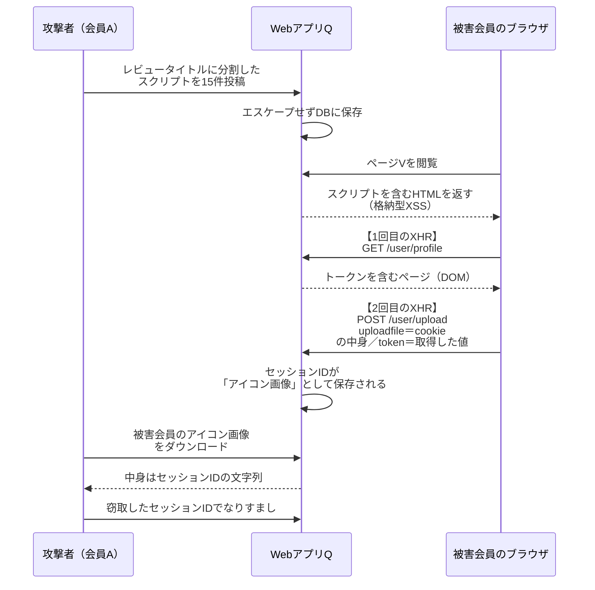

---

### 設問1(1)　XSS脆弱性の種類

> **設問1**　この攻撃で使われたXSS脆弱性について答えよ。
> **(1)** XSS脆弱性の種類を解答群の中から選び、記号で答えよ。
>
> 　解答群　　ア　DOM Based XSS　　イ　格納型XSS　　ウ　反射型XSS

**解答**：**イ（格納型XSS）**

**解説**
会員Aが投稿したレビューが**サーバ側に保存され**、ページVを閲覧した**すべての会員**にそのまま配信されている。これが格納型（Stored／持続型）XSSの定義そのもの。

| 種類          | スクリプトの出どころ                                                    | 被害者の踏み方                | 本問との照合                                                                                                                |
| ------------- | ----------------------------------------------------------------------- | ----------------------------- | --------------------------------------------------------------------------------------------------------------------------- |
| **イ 格納型** | **サーバに保存**された値                                                | **普通にページを見るだけ**    | 〇 図3のHTMLにスクリプトが埋め込まれている。<br>16件表示されるはずのレビューが2件しか表示されな<br>い＝保存された投稿が原因 |
| ウ 反射型     | リクエストのパラメータが即<br>座に応答へ反映される                      | 罠URLを踏ませる<br>必要がある | ✕ 本問に罠URLの記述はなく、<br>通常の閲覧で発動している                                                                     |
| ア DOM Based  | サーバの応答ではなく、<br>**クライアント側スクリプトの<br>DOM操作過程** | 罠URLなど                     | ✕ 図3の時点で**サーバが返すHTMLの中に**スクリプトが<br>入っている                                                           |

**判別のコツ**：**「サーバが返したHTMLそのものにスクリプトが入っているか」**を図3で確認する。入っていれば格納型か反射型、入っていなければDOM Based。さらに**保存されているか（他人が普通に見て発動するか）**で格納型と反射型を分ける。

**+α**：格納型は**被害が面で広がる**（ページを見た全員）ため、反射型より深刻度が高く評価されるのが一般的。本問でも「16件表示されるはずが2件」という会員からの問合せで初めて発覚しており、**攻撃者が能動的に誘導しなくても被害が積み上がる**点が特徴。

---

### 設問1(2)　WebアプリQにおける対策（30字以内）

> **(2)** WebアプリQにおける対策を、30字以内で答えよ。

**解答**：**レビュータイトルを出力する前にエスケープ処理を施す。**

**解説**
ポイントは2つ。**どこを**直すのかと、**何を**するのか。

**どこを直すのか — 「レビュータイトル」と特定できる根拠**

図3を見ると、スクリプトが出力されているのは `<div class="review-title">` の中だけである。一方、会員Bのレビュー詳細はこうなっている。

```html
<div class="description">サイズ感がぴったりフィットして気に入っています(&gt;_&lt;)<br>…</div>
```

`>` と `<` が **`&gt;` `&lt;` にエスケープされている**。つまり**レビュー詳細の欄は既に対策済み**で、**レビュータイトルの欄だけが未対策**。「レビュー欄」「入力値」と漠然と書くのではなく、**レビュータイトル**と特定して書く。

**何をするのか**

XSSの根本対策は**出力時のエスケープ処理**（`< > & " '` をHTMLエンティティに変換する）。**入力時のフィルタリングではない**点に注意。

**+α：やってはいけない対策**

| 誤った対策                         | なぜ不十分か                                                                                                         |
| ---------------------------------- | -------------------------------------------------------------------------------------------------------------------- |
| 入力時に `<script>` を<br>除去する | 大文字小文字・分割・別のタグや属性<br>（``）で回避される                                              |
| 入力文字数制限を厳しくする         | **本問の設問2がまさにこれを回避している**                                                                            |
| HttpOnly属性を付ける               | cookieは守れるが、<br>**設問3のような画面操作や偽フォームは防げない**<br>（令和5年春期 午後Ⅱ問1 設問4(2)と同じ論点） |

あわせて**CSP（Content-Security-Policy）** の `script-src` でインラインスクリプトを禁止する多層防御も有効だが、設問は「対策」を30字で問うているので**根本対策であるエスケープ処理**を答える。

---

### 設問2　入力文字数制限を超えるスクリプトを実行させた方法（50字以内）

> **設問2**　図3について、入力文字数制限を超える長さのスクリプトが実行されるようにした方法を、50字以内で答えよ。

**解答**：**HTMLがコメントアウトされ一つのスクリプトになるような投稿を複数回に分けて行った。**

**解説**
レビュータイトルは**50字**しか入らないのに、図4のスクリプトは20行ある。この矛盾をどう解いたか、という設問。

図3のレビュータイトルを順に抜き出すと仕掛けが見える。

```
1件目 : <script>xhr=new XMLHttpRequest();/*
2件目 : */url1="https://□□□.co.jp/user/profile";/*
   …（同様に続く）…
15件目: */xhr2.send(form);}</script>
```

各投稿が **`/*` で終わり、次の投稿が `*/` で始まる**。この `/*` 〜 `*/` は**JavaScriptのブロックコメント**なので、投稿と投稿の間に挟まるHTML（`</div><div class="description">a</div></div><div class="review">…<div class="review-title">`）が**まとめてコメントとして無視される**。

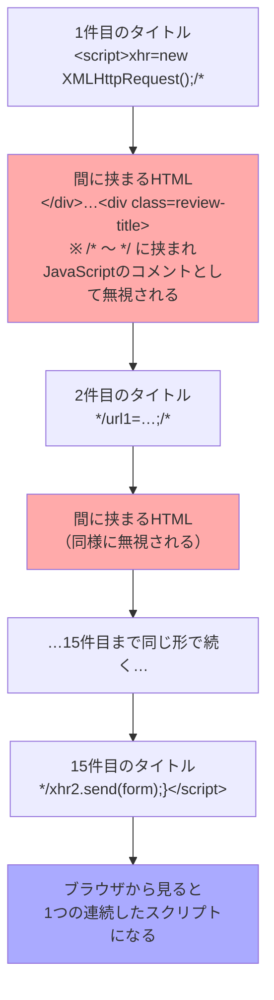

結果として、ブラウザは**15件のタイトルを連結した1本のスクリプト**として解釈する。最初の投稿で `<script>` を開き、最後の投稿で `</script>` を閉じている点も重要。

**この設問を解く手掛かり**

| 手掛かり                                 | 本文・図のどこ                                                                  |
| ---------------------------------------- | ------------------------------------------------------------------------------- |
| 1件のタイトルは50字まで                  | 図1の機能5                                                                      |
| 会員Aの投稿が**15件**ある                | Nさんの気付き<br>「会員Aによって15件のレビューが投稿されていること」            |
| 各タイトルが `/*` と `*/` で挟まれている | **図3のHTMLそのもの**                                                           |
| レビュー詳細は `a` という無意味な1文字   | 図3。**詳細欄はエスケープ済みで使えない**ので、<br>必須項目を埋めるだけのダミー |

**+α**
- **文字数制限はセキュリティ対策にならない**、という教訓そのものの設問。制限は入力値の妥当性確保のためであって、XSS対策にはならない。
- 似た手口として、**HTMLコメント `<!-- -->`** や**属性値の途中で切る**方法もある。「分割して投稿し、途中のノイズをコメント化して繋ぐ」という発想を押さえておく。
- 会員から「**16件表示されるはずのレビューが2件しか表示されていない**」という問合せが入ったのは、**13件分のタイトルと周囲のHTMLがコメントとして消えて見えなくなった**ため。症状と原因がきれいに対応している。

---

### 設問3(1)　図4の6〜20行目の処理（60字以内）

> **設問3**　図4のスクリプトについて答えよ。
> **(1)** 図4の6〜20行目の処理の内容を、60字以内で答えよ。

**解答**：**XHRのレスポンスから取得したトークンとともに、アイコン画像としてセッションIDをアップロードする。**

**解説**
1〜5行目で `/user/profile` に対する**1回目のXHR**を投げ、6行目の `onload` 以降がその**レスポンス受信後の処理**になる。

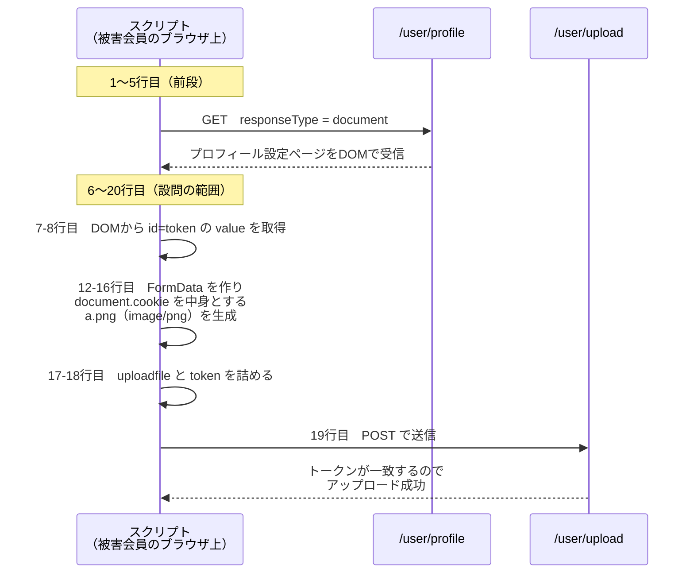

| 行     | 処理                                                                                                                     | 意味                                            |
| ------ | ------------------------------------------------------------------------------------------------------------------------ | ----------------------------------------------- |
| 7〜8   | `page = xhr.response` → <br>`token = page.getElementById("token").value`                                                 | **1回目のレスポンスからトー<br>クンを取り出す** |
| 9〜11  | 2回目のXHRを `/user/upload` に POST で開く                                                                               | アップロード先                                  |
| 12〜16 | `cookie = document.cookie` を中身に、<br>ファイル名 `a.png`・<br>MIMEタイプ `image/png` の**ファイルオブジェクトを生成** | **セッションIDを画像に見せかける**              |
| 17〜18 | `uploadfile` と `token` をFormDataに追加                                                                                 | 図1の機能6が要求するパラメ<br>ータ名と一致      |
| 19     | 送信                                                                                                                     | アップロード実行                                |

**答案に必ず入れる3要素**：①**トークンを取得して**（＝1回目のXHRのレスポンスから）②**セッションIDを**（＝`document.cookie`）③**アイコン画像としてアップロードする**。

**+α：なぜトークンが必要だったのか**
図1の機能6に「パラメータのトークンが、`/user/profile` にアクセスして**払い出されたものと一致したときに**、アップロードが成功する」とある。これは典型的な**CSRF対策トークン**。

しかし**XSSが成立していると、スクリプトは同一オリジンで自由にXHRできる**ため、トークンを取得する `/user/profile` へのアクセスも、それを使ったアップロードも成立してしまう。

> **XSSがあるとCSRF対策は無効化される**——だからXSSの根本対策が先。

さらに、**cookieにHttpOnly属性がない**（13行目の `document.cookie` が成功する）、**アップロードされた画像ファイルの形式をチェックしていない**（PNGでない中身が通る）という2つの不備が重なって初めてこの攻撃が完成する。**単独では小さな不備の組合せが致命傷になる**という構図を押さえたい。

---

### 設問3(2)　アップロードされた情報の取得方法（50字以内）

> **(2)** 攻撃者は、図4のスクリプトによってアップロードされた情報をどのようにして取得できるか。取得する方法を、50字以内で答えよ。

**解答**：**会員のアイコン画像をダウンロードして、そこからセッションIDの文字列を取り出す。**

**解説**
鍵は図1の機能6の最後の一文。

> アップロードしたアイコン画像は、会員プロフィール設定ページや、**レビューページに表示される**。

会員プロフィール設定ページは**ログイン済み会員本人しか見られない**が、**レビューページは誰でも閲覧できる**。実際、図3のHTMLには

```html
<div class="icon"></div>
```

とアイコン画像のURLが**そのまま書かれている**。攻撃者はこのURLにアクセスして画像ファイルをダウンロードし、中身を開けばセッションIDの文字列が入っている。

**攻撃者から見た流れ**

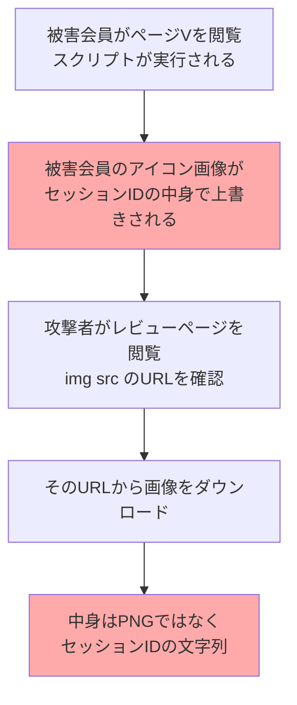

**+α**
- XSSで窃取した情報を**攻撃者のサーバに直接送らず、被害サイト自身に置いて後から回収する**のがこの攻撃の巧妙な点。外向きの不審な通信が発生しないため、**出口対策やCSPの `connect-src` では検知・防止しにくい**。
- 「**アップロードされた画像ファイルの形式をチェックしていない**」という不備がここで効く。マジックナンバー（PNGなら `89 50 4E 47`）の検証や、サーバ側での**再エンコード**をしていれば、セッションIDは画像として保存できずに弾かれていた。

---

### 設問3(3)　取得した情報でできること（40字以内）

> **(3)** 攻撃者が(2)で取得した情報を使うことによってできることを、40字以内で答えよ。

**解答**：**ページVにアクセスした会員になりすまして、WebアプリQの機能を使う。**

**解説**
取得したのは**セッションID**。WebアプリQは「ログインした会員には、セッションIDをcookieとして払い出す」設計なので、攻撃者が自分のブラウザのcookieにそのセッションIDを設定すれば、**その会員としてログイン済みの状態**になる（**セッションハイジャック**）。

**何ができるか**は図1の機能一覧から具体化できる。

| 機能                                            | 攻撃者ができること                                   |
| ----------------------------------------------- | ---------------------------------------------------- |
| 4. 商品の購入機能（ログイン済み会員だけ）       | 勝手に商品を購入する                                 |
| 6. 会員プロフィール機能（ログイン済み会員だけ） | **クレジットカード情報を登録するページ**の閲覧・操作 |
| 5. 商品レビュー機能                             | その会員になりすましてレビューを投稿する             |

答案は「**なりすまして**」＋「**ログイン済み会員向けの機能を使える**」の2点を40字に収める。

**+α：対策の方向**

| 対策                               | 効果                                                                 |
| ---------------------------------- | -------------------------------------------------------------------- |
| **HttpOnly属性の付与**             | `document.cookie` でセッションIDを読めなくする（本問の直接の封じ手） |
| **ログイン後のセッションID再生成** | セッションフィクセーション対策                                       |
| **重要操作時の再認証**             | 購入やカード情報変更の前にパスワード再入力                           |
| **送信元IPや端末の変化の検知**     | セッションの乗っ取りを検知する                                       |

ただし**根本対策はXSSを直すこと**。HttpOnlyはあくまで緩和策である点は設問1(2)と同じ。

---

### 設問4　攻撃者のドメインでは成功しない仕組み（40字以内）

> **設問4**　仮に、攻撃者が用意したドメインのサイトに図4と同じスクリプトを含むHTMLを準備し、そのサイトにWebアプリQのログイン済み会員がアクセスしたとしても、Webブラウザの仕組みによって攻撃は成功しない。この仕組みを、40字以内で答えよ。

**解答**：**スクリプトから別ドメインのURLに対してcookieが送られない仕組み**

**解説**
図4のスクリプトが成立するには、**被害会員としてログイン済みの状態で** `□□□.co.jp` にアクセスできる必要がある。ところが攻撃者のドメイン（例 `evil.example`）上で同じスクリプトを動かすと——

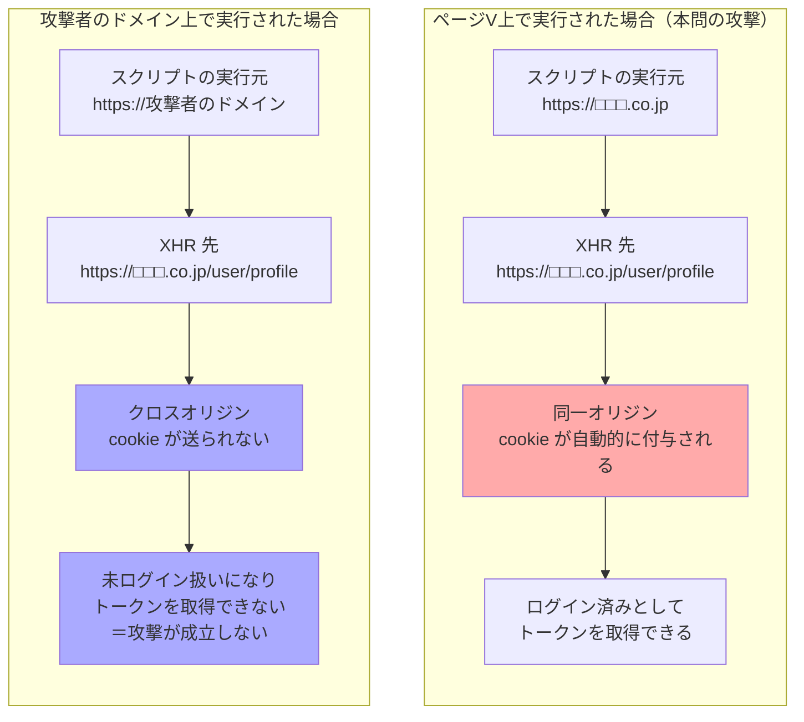

**仕組みの名前でいえば同一オリジンポリシー（Same-Origin Policy）**。スクリプトから別オリジンへリクエストを出すとき、**既定では認証情報（cookie）が付与されない**（`withCredentials` を付けない限り送られず、付けてもサーバ側がCORSで明示的に許可しなければ応答を読めない）。

したがって、

- 1回目のXHR（`/user/profile`）に**cookieが付かない → 未ログイン扱い → トークンが取得できない**
- 仮に応答が返っても**クロスオリジンなので中身をスクリプトから読めない**

という二重の理由で攻撃は成立しない。

**+α**
- だからこそ攻撃者は、**わざわざ被害サイト自身にスクリプトを置く（＝XSS）**必要があった。XSSの本質的な危険性は「**攻撃者のコードを被害サイトのオリジンで実行できる**」ことにある、という整理ができる。
- 関連して、**CSRFはcookieが自動送信されることを悪用する攻撃**で、こちらは別オリジンからでも成立する（ただし応答は読めない）。「**読めるか／送れるか**」の違いで、XSSとCSRFの性質が分かれる。

---

### 問1の学習ポイントまとめ

| 論点                 | 押さえる要点                                                                                          |
| -------------------- | ----------------------------------------------------------------------------------------------------- |
| XSSの種類            | **サーバが返すHTMLに入っているか**<br>＋**保存されているか**で格納型／反射型／<br>DOM Basedを判別する |
| 根本対策             | **出力時のエスケープ処理**。<br>入力フィルタや文字数制限は対策にならない                              |
| 文字数制限の回避     | `/* … */` で間のHTMLをコメント化し、<br>**複数投稿を1つのスクリプトに連結**する                       |
| XSSとCSRFトークン    | **XSSがあるとCSRF対策トークンは取得されて無効化される**                                               |
| 不備の組合せ         | ①XSS ②HttpOnlyなし <br>③ファイル形式の未検証 の**3つが揃って**攻撃が完成する                          |
| 情報の回収経路       | 攻撃者サーバへ送らず**被害サイト上に置いて後から回<br>収**する手口がある                              |
| 同一オリジンポリシー | 別オリジンへのXHRには**cookieが付かず、<br>応答も読めない**。だから攻撃者はXSSを必要とする            |

---
## 問2 セキュリティ対策の見直し（M社）

### 題材の整理

| 項目           | 内容                                                                                                                                                                                                                                                                                                                      |
| -------------- | ------------------------------------------------------------------------------------------------------------------------------------------------------------------------------------------------------------------------------------------------------------------------------------------------------------------------- |
| 企業           | M社：L社の子会社、アパレル業、従業員100名。<br>オフィスビルは**人通りの多い都内の大通りに面している**                                                                                                                                                                                                                     |
| 発端           | 従業員が社内ファイルサーバの商品デザインファイル<br>を**USBメモリで競合他社へ持ち出した**事件。<br>L社の指導で対策を見直し中                                                                                                                                                                                              |
| 実施済みの対策 | 業務PCに情報漏えい対策ソフト<br>（外部記憶媒体の接続禁止、ローカル保存禁止、<br>未許可のWebメール・<br>クラウドストレージへの通信遮断、<br>未許可ソフトのインストール禁止、<br>**メールへのファイル添付禁止**）／<br>ファイルの保存場所を**Bサービス<br>（クラウドストレージ）1か所に集約**／<br>社内ファイルサーバを廃止 |
| 部屋           | **執務室**（従業員用無線LANのみ）と**会議室**（従業員用<br>＋来客用無線LANの両方）                                                                                                                                                                                                                                        |
| セグメント     | 来客用 `192.168.10.0/24`（VLAN10）／<br>従業員用 `192.168.20.0/24`（VLAN20）／<br>サーバ `192.168.30.0/24`（VLAN30）／<br>WAN側 `a1.b1.c1.d1`（**/29**）                                                                                                                                                                  |
| 無線LAN        | 認証方式は**WPA2-PSK**。<br>従業員用だけに**MACアドレスフィルタリング**。<br>AP-5だけが両方のSSIDをもつ                                                                                                                                                                                                                   |
| Bサービス      | HTTPSでアクセス、**HSTS有効**。<br>利用者IDとパスワードでログイン。<br>**M社の利用者IDは `a1.b1.c1.d1` からだけログイン可能**。<br>ファイル共有機能では上長承認後に**外部共有リンク**が<br>外部共有者へ自動送信され、<br>**ログインせずにダウンロード可能**（有効期限1日）                                                |
| 業務PC         | **TPM 2.0 搭載**。<br>ディレクトリサーバがソフトウェアやクライアント証<br>明書をインストールできる                                                                                                                                                                                                                        |

**出題趣旨**：アパレル業におけるセキュリティ対策の見直しを題材に、**無線LANを使った環境における脅威を様々な角度から想定する能力**及びセキュリティ対策を立案する能力を問う。

**ネットワーク構成（図1・表3・表4）**

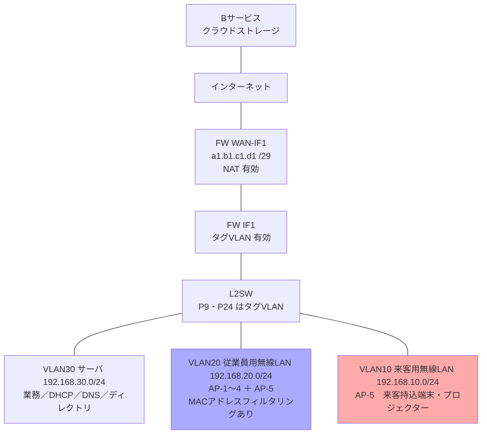

**この問の骨格**：ファイルの持出し経路を「**社外の攻撃者**」と「**内部の従業員**」に分けて棚卸しし、残った穴（方法1・方法2）を塞ぐ、という流れ。設問は前半が**攻撃者視点の脅威想定**、後半が**対策の設計と設定の後始末**に分かれている。

---

### 設問1(1)　空欄a・b（Bサービスのログインに必要なもの）

> **設問1**　〔社外の攻撃者によるファイルの持出しについてのセキュリティ対策の確認〕について答えよ。
> **(1)** 本文中の **a**、**b** に入れる適切な字句を答えよ。
>
> 　（S氏：しかし、Bサービスにログインするには **a** と **b** が必要です。）

**解答**：a＝**利用者ID**／b＝**パスワード**（順不同）

**解説**
表1のBサービスの記述そのまま。

> 従業員ごとに割り当てられた**利用者IDとパスワード**でログインし、利用する。

来客用無線LANに接続できただけではログインできない、という流れを作るための空欄。この後、Yさんが「**では、その利用者IDとパスワードを盗む方法はどうか**」と話を進める起点になっている。

**+α**：もうひとつの防御線として、表1に「M社の従業員に割り当てられた利用者IDでは、**`a1.b1.c1.d1` からだけ**、Bサービスにログイン可能である」という**送信元IPアドレス制限**もある。これは設問3(5)で重要な意味を持つので、ここで一緒に拾っておくとよい。

---

### 設問1(2)　図2 空欄c・d（サーバ証明書のエラー内容・各40字以内）

> **(2)** 図2中の **c**、**d** に入れる適切な字句を、それぞれ40字以内で答えよ。
>
> 　（図2 エラーメッセージの詳細（抜粋）：・**c**。・**d**。・このサーバ証明書は、失効している。・このサーバ証明書は、有効期限が切れている。）

**解答**（順不同）
- c＝**このサーバ証明書は、信頼された認証局から発行されたサーバ証明書ではない**
- d＝**このサーバ証明書に記載されているサーバ名は、接続先のサーバ名と異なる**

**解説**
ブラウザがサーバ証明書を検証する観点は、大きく4つある。図2には**すでに2つ（失効・期限切れ）が書かれている**ので、残る2つを書けばよい。

| 検証観点            | 内容                                                             | 図2での扱い   |
| ------------------- | ---------------------------------------------------------------- | ------------- |
| **①発行元の信頼性** | 証明書チェーンがブラウザ／OSの信頼されたルート認証局まで辿れるか | **c（解答）** |
| **②名前の一致**     | 証明書のSAN（サブジェクト代替名）が、接続先のFQDNと一致するか    | **d（解答）** |
| ③失効していないか   | CRL／OCSPで失効確認                                              | 記載済み      |
| ④有効期間内か       | notBefore／notAfter                                              | 記載済み      |

**なぜ偽サイトではこの2つが起きるのか**

攻撃者はBサービスのドメインの正規証明書を取得できない。取れる手は2つしかなく、どちらもエラーになる。

| 攻撃者の選択                                         | 発生するエラー                       |
| ---------------------------------------------------- | ------------------------------------ |
| **自己署名証明書**や自前のCAで発行した証明書を使う   | **①発行元が信頼されていない**（＝c） |
| 自分が正当に取得した**別ドメインの正規証明書**を使う | **②サーバ名が一致しない**（＝d）     |

本文が「偽サイトに使用されたサーバ証明書に応じて、……**一つ以上が**Webブラウザに表示されます」と書いているのは、**どの手を使うかでエラーの種類が変わる**からである。

**+α**：現在のブラウザはCNではなく**SAN（dNSName）**でホスト名を検証する。令和7年度春期 問3の設問2(1)（通信解析ツールが生成する証明書のSANの値）と同じ知識が問われている。

---

### 設問1(3)　下線①　エラー表示までのWebブラウザの動き（60字以内）

> **(3)** 本文中の下線①について、エラーメッセージが表示される直前までのWebブラウザの動きを、60字以内で答えよ。
>
> 　（Yさん：誤って `http://` と入力してBサービスにアクセスしようとした場合、エラーメッセージが表示されないのではないでしょうか。／S氏：HSTSを有効にしてあるので、その場合でも、**①先ほどと同じエラーメッセージが表示されます**。）

**解答**：**HTTPのアクセスをHTTPSのアクセスに置き換えてアクセスする。その後、偽サイトからサーバ証明書を受け取る。**

**解説**
**HSTS（HTTP Strict Transport Security）** は、サーバが `Strict-Transport-Security` ヘッダを返すことで、ブラウザに「**このドメインには常にHTTPSで接続せよ**」と記憶させる仕組み。

一度でも正規のBサービスにHTTPSでアクセスしていれば、ブラウザはこの指示を保持している。したがって `http://` と入力しても——

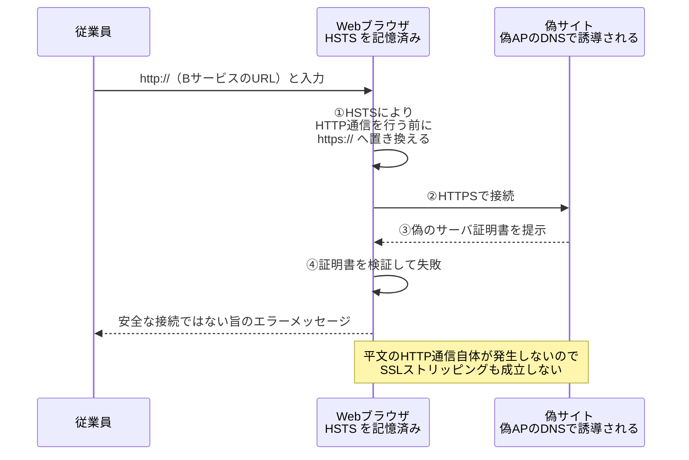

**答案に入れる2要素**：①**HTTPをHTTPSに置き換えてアクセスする**（＝HSTSの効果）②**偽サイトからサーバ証明書を受け取る**（＝だから設問1(2)のエラーが出る）。「HTTPSに置き換わる」だけで止めると、**なぜエラーが出るのか**が繋がらない。

**+α：HSTSの効果と限界**

| 効果                           | 内容                                                                  |
| ------------------------------ | --------------------------------------------------------------------- |
| **SSLストリッピング対策**      | HTTPでの通信そのものが発生しないため、中間者にHTTPへ降格させられない  |
| **リダイレクト前の攻撃を防ぐ** | `http://` → `https://` のリダイレクト応答を書き換える攻撃が成立しない |

ただし**初回アクセスだけはHSTSの記憶がないので保護されない**（TOFU問題）。これを補うのが**HSTSプリロードリスト**（ブラウザに最初から埋め込む仕組み）で、`preload` ディレクティブを付けて申請する。

---

### 設問2(1)　下線②　ファイル共有機能の悪用方法（40字以内）

> **設問2**　〔従業員によるファイルの持出しについてのセキュリティ対策の確認〕について答えよ。
> **(1)** 本文中の下線②について、M社外からファイルをダウンロード可能にするためのファイル共有機能の悪用方法を、40字以内で具体的に答えよ。

**解答**：**外部共有者のメールアドレスに自身の私用メールアドレスを指定する。**

**解説**
表1のBサービスのファイル共有機能の記述を分解すると、穴が見えてくる。

| 仕様                                                                                                          | 悪用できる点                                 |
| ------------------------------------------------------------------------------------------------------------- | -------------------------------------------- |
| 共有したいファイルの指定、<br>**外部の共有者のメールアドレスの入力**、<br>上長承認申請を行う                  | **宛先を自分で自由に指定できる**             |
| 上長が承認すると外部共有リンクが発行され、<br>**外部の共有者宛てに電子メールで自動的に送信される**            | 自分の私用アドレスに**リンク<br>が直接届く** |
| 外部の共有者は、**本人以外や上長には知られない**                                                              | 誰に送ったかが**事後にも分か<br>りにくい**   |
| 外部の共有者は外部共有リンクにアクセスすることで、<br>**Bサービスにログインせずに**ファイルをダウンロード可能 | **利用者IDもパスワードも不要**               |

そして会話の前提が「**宛先のメールアドレスとファイルを確認せずに承認している上長がいる**」。

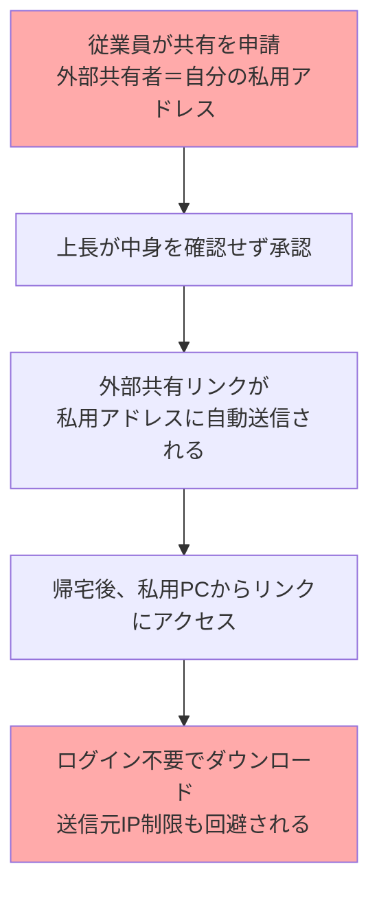

**ここが巧妙**：M社は「M社の利用者IDは `a1.b1.c1.d1` からだけログイン可能」という**送信元IP制限**を掛けているのに、**外部共有リンクはログイン不要**なので、この制限が丸ごと迂回される。

**+α**
- 実施済み対策（USB禁止・ローカル保存禁止・メール添付禁止）を全部すり抜けている点が重要。**正規の業務機能を正規の手順で使う**ので、技術的な遮断では止まらない。
- 対策の方向は、**承認プロセスの実効性**（宛先ドメインの制限・許可リスト、承認時の内容表示の必須化）、**監査**（共有ログの定期レビュー、個人のフリーメールドメイン宛の検知）、**DLP**（機密ラベルの付いたファイルの外部共有を禁止）。
- 令和5年度春期 午後Ⅰ問1の設問2(5)と同様、**「正しい人が正しい権限で行う不正」は技術だけでは防げない**という論点。

---

### 設問2(2)　空欄e（方法1で詐称するもの）

> **(2)** 本文中の **e** に入れる適切な字句を答えよ。
>
> 　（方法1：個人所有PCの無線LANインタフェースの **e** を業務PCの無線LANインタフェースの **e** に変更した上で、個人所有PCを従業員用無線LANに接続し、……）

**解答**：**MACアドレス**

**解説**
表1のAPの記述が根拠。

> **従業員用無線LANだけにMACアドレスフィルタリングが設定されており**、事前に情報システム部で登録された業務PCだけが接続できる。

従業員用無線LANに入るための関門は2つで、どちらも個人所有PCで突破できてしまう。

| 関門                          | 突破方法                                                     |
| ----------------------------- | ------------------------------------------------------------ |
| **WPA2-PSKの事前共有キー**    | 従業員なので**知っている**（表5の `Kxwekreb85gjbp5gkgajfg`） |
| **MACアドレスフィルタリング** | **MACアドレスを業務PCのものに変更（詐称）する**              |

**+α：MACアドレスフィルタリングはセキュリティ対策として弱い**

| 弱点                          | 理由                                                                                                        |
| ----------------------------- | ----------------------------------------------------------------------------------------------------------- |
| **MACアドレスは平文で流れる** | 暗号化されるのはペイロードで、<br>ヘッダのMACアドレスは暗号化されない。<br>周囲で傍受すれば正規の値が分かる |
| **簡単に変更できる**          | OSの設定やコマンドで任意の値に設定できる                                                                    |
| 運用負荷が高い                | 端末の追加・交換のたびに登録が必要                                                                          |

そして**WPA2-PSKは全員が同じ鍵を共有する**ため、**誰が接続したかを識別できない**。この2つの弱点をまとめて解決するのが、設問3の **EAP-TLS（IEEE 802.1X）** への移行である。

---

### 設問3(1)　下線③　認証サーバがEAPで使うUDP上のプロトコル

> **設問3**　〔方法1と方法2についての対策の検討〕について答えよ。
> **(1)** 本文中の下線③について、認証サーバがEAPで使うUDP上のプロトコルを答えよ。

**解答**：**RADIUS**

**解説**
IEEE 802.1X の構成要素と、どこで何のプロトコルが使われるかを整理する。

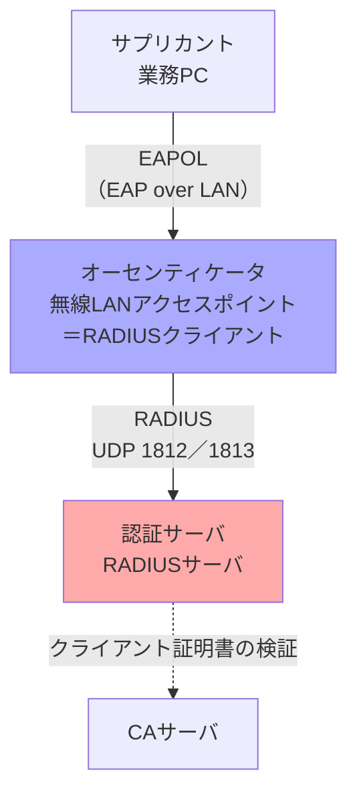

| 構成要素               | 役割                                                   | 本問での該当              |
| ---------------------- | ------------------------------------------------------ | ------------------------- |
| **サプリカント**       | 認証を受けるクライアント                               | 業務PC                    |
| **オーセンティケータ** | 両者を中継する装置。**RADIUSクライアント**の機能をもつ | AP-1〜5                   |
| **認証サーバ**         | 実際に認証を行う。**RADIUSサーバ**が使われる           | 下線③で新設する認証サーバ |

EAP自体は認証方式を載せる「枠」で、端末〜AP間は **EAPOL**（L2）、AP〜認証サーバ間は **RADIUS**（UDP 1812／Accounting は 1813）でカプセル化して運ばれる。設問が「**UDP上のプロトコル**」とわざわざ限定しているのは、EAPOLと区別させるため。

**+α**：RADIUSの発展形が **DIAMETER**（TCP／SCTP、携帯電話網やISPの大規模ネットワーク向け）。「RADIUS＝半径／DIAMETER＝直径」で対にして覚える。

---

### 設問3(2)(3)　空欄f・g（クライアント証明書に対応するものと、その保護）

> **(2)** 本文中の **f** に入れる適切な字句を答えよ。
> **(3)** 本文中の **g** に入れる適切な字句を、20字以内で答えよ。
>
> 　（S氏：クライアント証明書とそれに対応する **f** は、どのようにしますか。／Yさん：…… **f** は **g** しておくために業務PCのTPMに格納し、保護します。）

**解答**：f＝**秘密鍵**／g＝**業務PCから取り出せないように**

**解説**
**f＝秘密鍵**：公開鍵暗号方式では、証明書（＝公開鍵＋署名）と**それに対応する秘密鍵**が対になる。EAP-TLSでは、サーバから送られたチャレンジに**秘密鍵で署名**することで本人性を示すので、秘密鍵がなければ認証を通れない。

**g＝業務PCから取り出せないように**：**TPM（Trusted Platform Module）** は、鍵を内部で生成・保管し、**鍵そのものを外部に出さずに**署名や復号の演算だけを行える耐タンパ性のあるハードウェア。

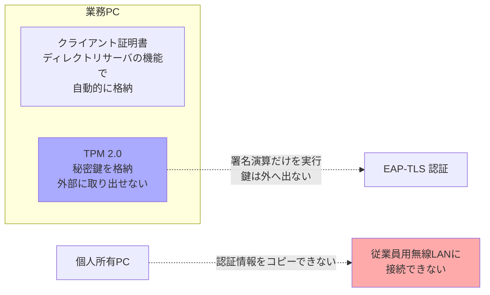

**+α**：Yさんの発言の「従業員が**自身の業務PCにインストールするのではなく**、ディレクトリサーバの機能で業務PCに格納します」も重要。**従業員自身がインストールできる運用だと、同じ証明書を個人所有PCにも入れられてしまう**ので、配布経路の時点で封じている。

---

### 設問3(4)　下線④　その格納方法であれば問題ない理由（40字以内）

> **(4)** 本文中の下線④について、その理由を、40字以内で答えよ。
>
> 　（S氏：**④その格納方法であれば問題ない**と思います。）

**解答**：**EAP-TLSに必要な認証情報は、業務PCにしか格納できないから**

**解説**
この設問は「**方法1を本当に封じられたのか**」を確認させるもの。方法1はこういう攻撃だった。

> 個人所有PCの無線LANインタフェースのMACアドレスを業務PCのものに変更した上で、**個人所有PCを従業員用無線LANに接続し**、Bサービスからファイルをダウンロードし、個人所有PCごと持ち出す。

EAP-TLSに移行すると、接続に必要なものが変わる。

|                              | WPA2-PSK＋MACフィルタ（変更前）                                                               | EAP-TLS（変更後）                                                                                   |
| ---------------------------- | --------------------------------------------------------------------------------------------- | --------------------------------------------------------------------------------------------------- |
| 必要なもの                   | 事前共有キー（**全員共通・<br>従業員は知っている**）<br>＋登録済みMACアドレス（**詐称可能**） | **クライアント証明書＋対応する秘密鍵**                                                              |
| 個人所有PCで用意<br>できるか | **できる**<br>（鍵を知っていてMACを詐称すればよい）                                           | **できない**<br>（証明書はディレクトリサーバ経由でしか配布され<br>ず、秘密鍵はTPMから取り出せない） |
| 誰が接続したか               | **識別できない**                                                                              | **証明書で個人・端末を識別できる**                                                                  |

つまり「**認証の根拠を"知っているもの・詐称できるもの"から、"その端末にしか存在しないもの"に変えた**」ことが対策の本質。答案には「**認証情報が業務PCにしか存在しない／持ち出せない**」という趣旨を入れる。

---

### 設問3(5)　下線⑤　FWのNATの変更内容（70字以内）

> **(5)** 本文中の下線⑤について、変更内容を、70字以内で答えよ。
>
> 　（方法2への対策の案：**⑤FWのNATの設定を変更する**。）

**解答**：**来客用無線LANからインターネットにアクセスする場合の送信元IPアドレスを `a1.b1.c1.d1` とは別のIPアドレスにする。**

**解説**
なぜ方法2（個人所有PCを**来客用無線LAN**に接続する）が成立してしまうのか、を3つの記述の組合せで読む。

| #   | 記述                                                                                             | 場所          |
| --- | ------------------------------------------------------------------------------------------------ | ------------- |
| ①   | M社の従業員に割り当てられた利用者IDでは、<br>**`a1.b1.c1.d1` からだけ**、Bサービスにログイン可能 | 表1 Bサービス |
| ②   | 来客用無線LAN `192.168.10.0/24` からインターネット<br>への HTTP／HTTPS は**許可、NAT有効**       | 表4 項番1     |
| ③   | 現在の設定では有効の場合、<br>送信元IPアドレスが **`a1.b1.c1.d1` に変換される**                  | 表4 注1       |

②③より、**来客用無線LANから出た通信も送信元が `a1.b1.c1.d1` になる**。すると①の条件を満たしてしまい、**個人所有PCから自分の利用者IDでBサービスにログインできる**。

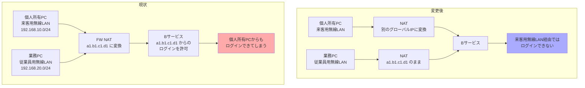

**なぜ別IPが用意できるのか**：表3項番4より WAN-IF1 のサブネットマスクは **255.255.255.248（/29）**。ネットワークアドレスとブロードキャストを除いて**6個のグローバルIPアドレスが使える**ので、来客用に別のアドレスを割り当てる余地がある。細かいが、実現可能性を裏付ける記述になっている。

**答案のポイント**：「NATの設定を変える」だけでは不十分で、**①どのセグメントの通信を ②どう変えるのか**を書く。「来客用無線LANからの通信の送信元IPアドレスを `a1.b1.c1.d1` 以外にする」が核。

---

### 設問3(6)　空欄h（不要になる通信の宛先）

> **(6)** 本文中の **h** に入れる適切な字句を答えよ。
>
> 　（今まで必要だった、来客持込端末からDHCPサーバと **h** サーバへの通信は、不要になる。）

**解答**：**DNS**

**解説**
表1の記述から、来客持込端末がM社内のサーバに対して行っていた通信を洗い出す。

| サーバ             | 表1の記述                                                       | 来客持込端末が使うか |
| ------------------ | --------------------------------------------------------------- | -------------------- |
| **DHCPサーバ**     | 「**業務PC、来客持込端末に**IPアドレスを割り当てる」            | 〇（本文に明記）     |
| **DNSサーバ**      | 「**業務PC、来客持込端末が利用する**DNSキャッシュサーバである」 | **〇（これが h）**   |
| 業務サーバ         | —                                                               | ✕                    |
| ディレクトリサーバ | 業務PCへのソフトウェア・証明書配布                              | ✕                    |

Dサービス導入後は「Dルータでは、**DHCPサーバ機能及びDNSキャッシュサーバ機能を有効にする**」「来客持込端末は、**M社のネットワークを経由せずに**……インターネットに接続する」ため、この2つの通信が不要になる。

---

### 設問3(7)　下線⑥　表3・表4から削除すべき項番

> **(7)** 本文中の下線⑥について、表3及び表4の削除すべき項番を、それぞれ全て答えよ。

**解答**：**表3 → 1**／**表4 → 1、4**

**解説**
Dサービス導入により、**来客用無線LAN（VLAN10／`192.168.10.0/24`）がM社のネットワークから消える**。プロジェクターもHDMI接続に変わるので、VLAN10に接続する機器は1台も残らない。

**表3（FWのVLANインタフェース設定）**

| 項番  | 内容                                   | 判定                                           |
| :---: | -------------------------------------- | ---------------------------------------------- |
| **1** | IF1／**VLAN10（ID 10）／192.168.10.1** | **削除**：来客用セグメントのゲートウェイが不要 |
|   2   | VLAN20（従業員用）                     | 残す                                           |
|   3   | VLAN30（サーバ）                       | 残す                                           |
|   4   | WAN-IF1／`a1.b1.c1.d1`                 | 残す（インターネット接続の出口）               |

**表4（FWのフィルタリング設定）**

| 項番  | 内容                                             | 判定                                                                |
| :---: | ------------------------------------------------ | ------------------------------------------------------------------- |
| **1** | `192.168.10.0/24` → 全て（HTTP, HTTPS）／NAT有効 | **削除**：来客用からインターネットへのアクセスが不要                |
|   2   | `192.168.20.0/24` → 全て（HTTP, HTTPS）          | 残す                                                                |
|   3   | `192.168.30.0/24` → 全て<br>（HTTP, HTTPS, DNS） | 残す                                                                |
| **4** | `192.168.10.0/24` → `192.168.30.0/24`（DNS）     | **削除**：来客持込端末からDNSサーバへの通信が不要<br>（＝設問3(6)） |
|   5   | `192.168.20.0/24` → `192.168.30.0/24`（全て）    | 残す                                                                |
|   6   | `192.168.30.0/24` → `192.168.20.0/24`（全て）    | 残す                                                                |
|   7   | 全て → 全て（拒否）                              | 残す（**暗黙のdenyは必ず残す**）                                    |

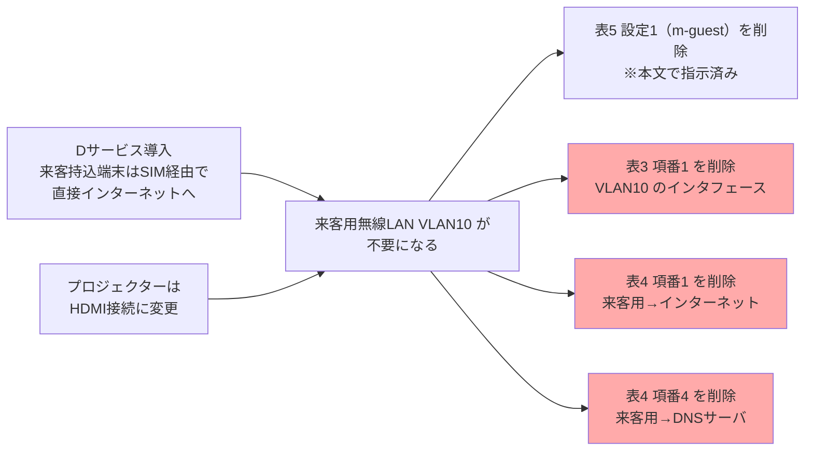

**引っ掛かりやすい点**

| 誤答                | なぜ違うか                                                              |
| ------------------- | ----------------------------------------------------------------------- |
| 表3の項番4も削除    | WAN-IF1 は**従業員用・サーバ用のインターネット接続で引き続き必要**      |
| 表4の項番7も削除    | **最後の全拒否ルールは残す**。削除すると意図しない通信が通る恐れがある  |
| 表4の項番2・3も削除 | 従業員用・サーバ用のインターネットアクセスは継続する                    |
| 表5は答えに含める   | 設問は「**表3及び表4の**削除すべき項番」。表5は本文で既に指示されている |

**+α**：**使われなくなった設定を残さない**のはセキュリティ設定管理の基本。不要なVLAN・フィルタルール・アカウントが残ると、構成変更時に**意図せず経路が復活する**ことがある。令和7年度春期 問4のサブドメインテイクオーバー（DNSレコードの消し忘れ）と同じ教訓。

---

### 問2の学習ポイントまとめ

| 論点               | 押さえる要点                                                                                                                                               |
| ------------------ | ---------------------------------------------------------------------------------------------------------------------------------------------------------- |
| サーバ証明書の検証 | **①発行元の信頼 ②名前の一致 ③失効 <br>④有効期限**の4観点。偽サイトでは①か<br>②が必ず崩れる                                                                 |
| HSTS               | **HTTP通信が発生する前に**ブラウザがHTTPSへ置き換え<br>る。SSLストリッピング対策。<br>初回アクセスは守れない（プリロードで補う）                           |
| 正規機能の悪用     | ファイル共有の**宛先を自分の私用アドレスにする**。<br>外部共有リンクは**ログイン不要**なのでIP制限を迂回する                                               |
| 無線LANの認証      | **WPA2-PSKは全員共通鍵で個人を識別できない**／<br>**MACアドレスは平文で流れ詐称できる**                                                                    |
| IEEE 802.1X        | サプリカント／オーセンティケータ<br>（**RADIUSクライアント**）／認証サーバ<br>（**RADIUSサーバ**）。端末〜APは**EAPOL**、<br>AP〜サーバは**RADIUS（UDP）** |
| EAP-TLSとTPM       | 秘密鍵を**TPMに格納して取り出せなくする**ことで、<br>認証情報を**その端末に固定**する                                                                      |
| NATと送信元IP制限  | **NAT後のグローバルIPが同じだと、<br>IP制限は区別できない**。<br>セグメントごとに変換後アドレスを分ける                                                    |
| 設定の後始末       | 構成変更で不要になった**VLAN・<br>フィルタルールを必ず削除**する。<br>ただし**最後の全拒否ルールは残す**                                                   |

---
## 問3 継続的インテグレーションサービスのセキュリティ（N社）

### 題材の整理

| 項目            | 内容                                                                                                                                                                                                                                      |
| --------------- | ----------------------------------------------------------------------------------------------------------------------------------------------------------------------------------------------------------------------------------------- |
| 企業            | N社：**継続的インテグレーションサービス<br>（Nサービス）** を提供する従業員400名の事業者。<br>C社のクラウド基盤で稼働                                                                                                                     |
| Nサービスの機能 | **ソースコード取得機能**（VCSのホスト名<br>＋リポジトリ固有の認証用SSH鍵を登録）／<br>**コマンド実行機能**（`ci.sh` を実行）／<br>**シークレット機能**<br>（ビルドスクリプトを実行する**シェルの環境変数**とし<br>て設定される）          |
| 構成要素        | フロントエンド（通知受付API）／<br>ユーザーデータベース（SSH鍵・<br>シークレットを保存、<br>**読み書きはフロントエンドからだけ**）／<br>**バックエンド50台**（Linux、CIデーモン、<br>**インターネットへの通信が可能**）／仮想ネットワーク |
| 実行環境        | CIデーモンが**特権を付与せずに新しいコンテナを起動**<br>し、その中で取得と実行を行う                                                                                                                                                      |
| 監視            | バックエンドに**管理者権限で稼働する監視ソフトウェ<br>ア製品X**。不正な処理をするプロセスを停止させる                                                                                                                                     |
| 管理            | **クラウド管理サイト**（C社提供）でアカウント管理・<br>構成変更・バックエンドへの管理者アクセス・<br>認証ログ監視。ログイン時に**TOTP**を入力                                                                                             |
| 体制            | **オペレーション部**が構成の設定・管理、<br>**セキュリティ部**が認証ログの監視                                                                                                                                                            |
| 顧客            | P社：従業員1,000名の**資金決済事業者**。<br>決済用の**Pアプリ**をJストア経由で配布                                                                                                                                                        |

**出題趣旨**：継続的インテグレーションサービスを提供する企業とその利用企業におけるインシデント対応を題材に、**攻撃の流れと波及し得る影響を推測し、対策を立案する能力**を問う。

**インシデントの全体像**

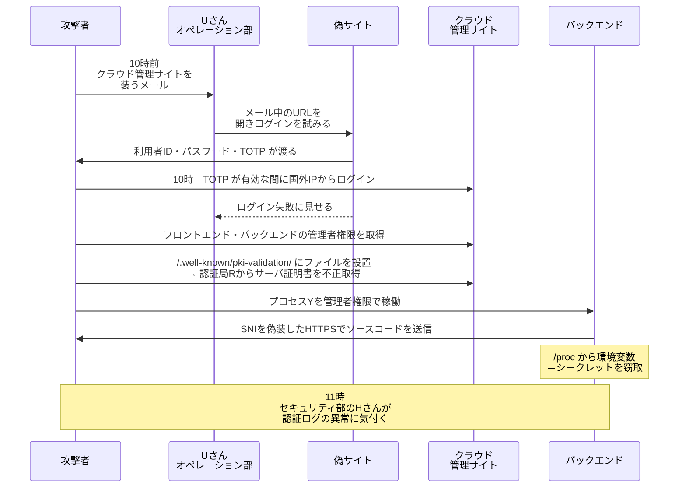

---

### 設問1　下線①　コンテナの脆弱性を悪用しなくても成功するもの

> **設問1**　本文中の下線①について、該当するものはどれか。解答群の中から全て選び、記号で答えよ。
>
> 　解答群
> 　　ア　CIデーモンのプロセスを中断させる。
> 　　イ　いずれかのバックエンド上の全プロセスを列挙して攻撃者に送信する。
> 　　ウ　インターネット上のWebサーバに不正アクセスを試みる。
> 　　エ　攻撃者サイトから命令を取得し、得られた命令を実行する。
> 　　オ　ほかのNサービス利用者のビルドスクリプトの出力を取得する。

**解答**：**ウ、エ**

**解説**
判定基準はただ一つ、「**その処理はコンテナの中だけで完結するか**」。

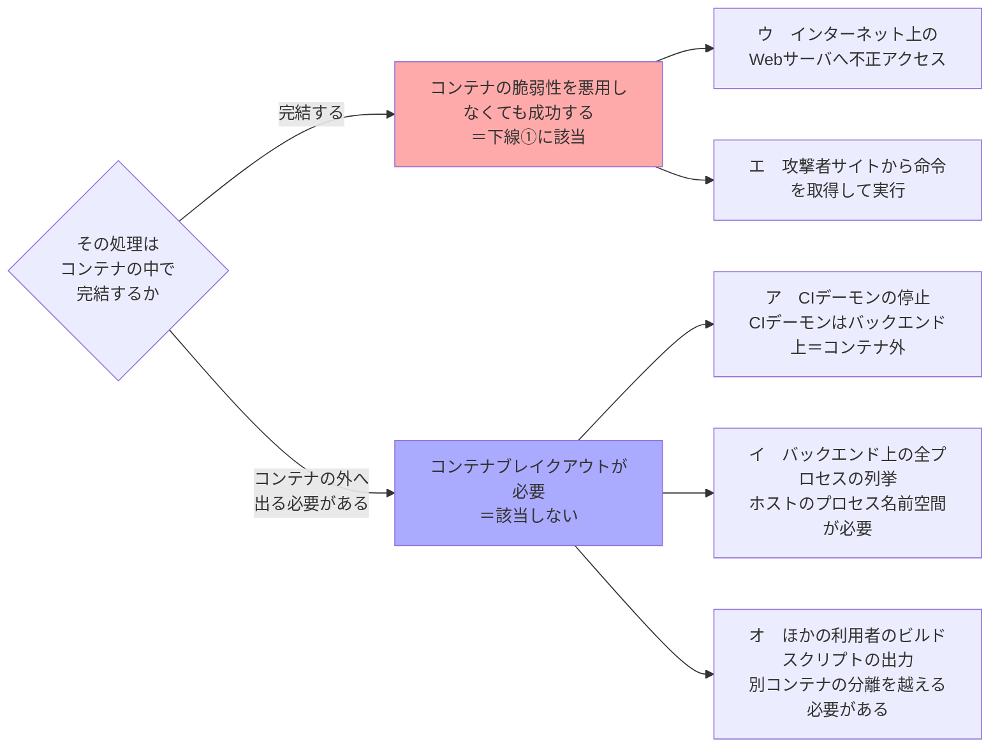

| 選択肢 | 必要なこと                                                                                                                                                 |  判定  |
| :----: | ---------------------------------------------------------------------------------------------------------------------------------------------------------- | :----: |
|   ア   | **CIデーモンはコンテナの外（バックエンド上）<br>で稼働する常駐プログラム**。<br>停止させるにはコンテナから脱出してホストのプロセ<br>スを操作する必要がある |   ✕    |
|   イ   | 「**バックエンド上の全プロセス**」＝<br>ホストのプロセス名前空間。<br>コンテナ内から見えるのは自分のコンテナのプロセスだけ                                 |   ✕    |
| **ウ** | ビルドスクリプトは任意のコマンドを書ける。<br>**バックエンドは「インターネットへの通信が可能」**<br>なので、コンテナ内からそのまま外部へ接続できる         | **〇** |
| **エ** | 同上。<br>外向き通信ができれば**C&C的に命令を取得して実行**で<br>きる。コンテナ内で完結する                                                                | **〇** |
|   オ   | 他の利用者のビルドは**別のコンテナ**で実行される。<br>その出力を取るにはコンテナ間の分離を越える必要がある                                                 |   ✕    |

**ここが本質**：コンテナは「**ホストや他のコンテナから隔離する**」仕組みであって、「**外部への通信を禁じる**」仕組みではない。N社は特権なしコンテナという正しい設計をしていたが、**アウトバウンド通信を制限していなかった**ため、この2つは最初から成立していた。

**+α**
- CI/CD環境では**ビルドスクリプトに任意のコマンドを書けること自体が仕様**なので、「不正なコマンドを書かせない」という発想では守れない。**実行環境側で何ができるかを絞る**（アウトバウンドの許可リスト化、egress proxy、必要なレジストリ・パッケージサイトのみ許可）のが対策。
- 令和5年度春期 午後Ⅰ問2の「受付サーバ→インターネットへ443だけ許可していたためC&Cが成立した」と同じ構図。**アウトバウンドの緩さが侵害の成立条件になる**という頻出論点。

---

### 設問2(1)　下線②　攻撃者による不正ログインの方法（50字以内）

> **設問2**　〔N社のインシデントの発生と対応〕について答えよ。
> **(1)** 本文中の下線②について、攻撃者による不正ログインの方法を、50字以内で具体的に答えよ。

**解答**：**偽サイトに入力されたTOTPを入手し、そのTOTPが有効な間にログインした。**

**解説**
N社はクラウド管理サイトに**TOTPによる多要素認証**を設定していた。それでも突破されたのはなぜか、を説明する設問。

TOTPの性質を押さえる。

| 性質                       | 内容                                                                     |
| -------------------------- | ------------------------------------------------------------------------ |
| **時刻同期型**             | 現在時刻と共有鍵から生成される。**30秒〜数分の有効期間**がある           |
| **使い回せない**（はず）   | 有効期間を過ぎれば無効                                                   |
| **フィッシング耐性がない** | 利用者が入力した値を**そのまま転送すれば、有効期間内なら攻撃者も使える** |

つまり攻撃者は**リアルタイムで中継**していた。

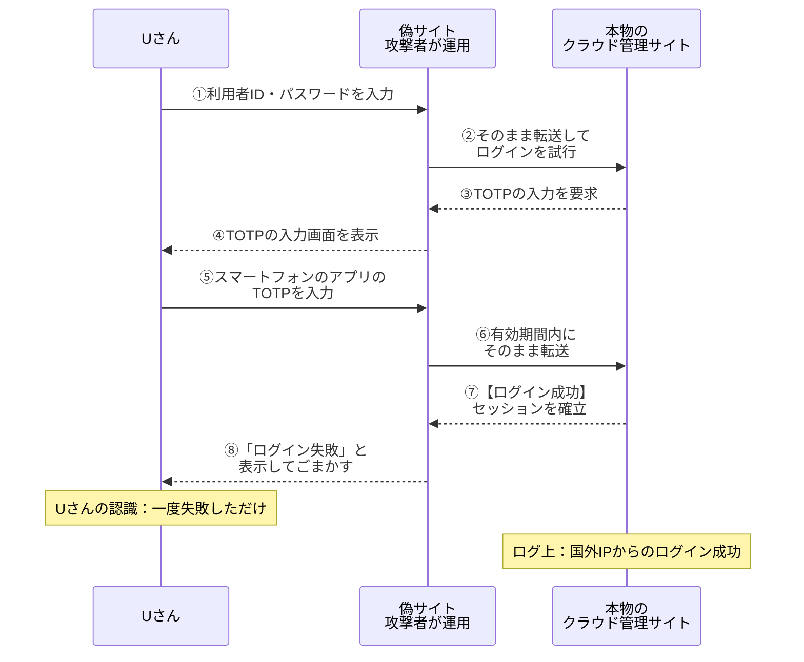

**本文との対応**

| 本文の記述                                                  | 意味                                                                     |
| ----------------------------------------------------------- | ------------------------------------------------------------------------ |
| Uさんは社内で同日10時にログインを試み、<br>**一度失敗した** | 偽サイト側が失敗表示を返した。<br>Uさんに違和感を残さないため            |
| 同日10時に**国外のIPアドレスから**ログインがあった          | 攻撃者が同時刻に本物へログインできていた＝<br>**リアルタイム中継**の証拠 |
| メール中の**URL中のドメイン名が異なっていた**               | 典型的なフィッシング                                                     |

**答案のポイント**：「TOTPを盗んだ」だけでは不十分。**「有効な間に（＝有効期間内にすぐ）使った」**という時間の要素を必ず入れる。

**+α：この攻撃の名前と対策**
- **リアルタイムフィッシング／中継型フィッシング（Adversary-in-the-Middle, AiTM）**。Evilginx などのツールが知られ、**セッションcookieごと盗む**変種もある。
- **TOTPやSMS-OTPでは防げない**。防げるのは**オリジンを検証する認証方式**——つまり図2の対策3で採用した **WebAuthn／FIDO2**（設問2(5)）。この問は「**なぜMFAを入れていたのに破られ、なぜWebAuthnなら防げるのか**」を一本の線で問うている。

---

### 設問2(2)　下線③　RFC 9162で規定されている技術

> **(2)** 本文中の下線③について、RFC 9162で規定されている技術を、解答群の中から選び、記号で答えよ。
>
> 　解答群　　ア　Certificate Transparency　　イ　HTTP Public Key Pinning
> 　　　　　　ウ　HTTP Strict Transport Security　　エ　Registration Authority

**解答**：**ア（Certificate Transparency）**

**解説**
本文は「**RFC 9162に規定された証明書発行ログ**中のNサービスのドメインのサーバ証明書を検索したところ」と書いている。「**証明書発行ログ**」という言葉がそのまま **Certificate Transparency（CT）** を指す。

|  選択肢   | 内容                                                                                                     | RFC                             |  判定  |
| :-------: | -------------------------------------------------------------------------------------------------------- | ------------------------------- | :----: |
| **ア CT** | 発行された**全てのサーバ証明書を公開の追記専用ログ<br>に記録**し、誰でも検索・監視できるようにする仕組み | **RFC 9162**<br>（旧 RFC 6962） | **〇** |
|  イ HPKP  | サーバが公開鍵のハッシュをブラウザに記憶させ、<br>以後それ以外を拒否させる                               | RFC 7469<br>（**現在は廃止**）  |   ✕    |
|  ウ HSTS  | 常にHTTPSで接続させる                                                                                    | RFC 6797                        |   ✕    |
|   エ RA   | PKIの**登録局**。本人確認・<br>登録を担う機関であって技術仕様ではない                                    | —                               |   ✕    |

**なぜここでCTを見たのか——前後の文脈**

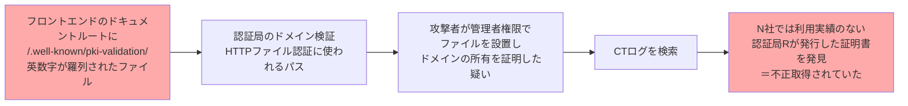

`/.well-known/pki-validation/` は、認証局が **DV（ドメイン検証）** を行う際に、申請者が本当にそのドメインを管理しているかを確認するためにファイルを置かせるパス。フロントエンドの管理者権限を奪った攻撃者は、ここにファイルを置くだけで**正規の手続きでサーバ証明書を取得できてしまう**。

CTログは**すべての公開証明書が記録される**ため、「自分のドメインの証明書が、自分の知らない認証局から発行されていないか」を**後から検証できる**。これがCTの存在意義そのもの。

**+α**：CTは**発行を止める仕組みではなく、発行を可視化して気付けるようにする仕組み**（発見的統制）。発行そのものを制限するのが設問2(6)の **CAAレコード**（予防的統制）。図2の対策2（失効申請）と対策4（CAAレコード）がセットで出てくるのは、**発見→是正→予防**の流れになっているから。

---

### 設問2(3)　下線④　SNIを偽装する手法の名称

> **(3)** 本文中の下線④について、このような手法の名称を、解答群の中から選び、記号で答えよ。
>
> 　解答群　　ア　DNSスプーフィング　　イ　ドメインフロンティング
> 　　　　　　ウ　ドメイン名ハイジャック　　エ　ランダムサブドメイン攻撃

**解答**：**イ（ドメインフロンティング）**

**解説**
**ドメインフロンティング（Domain Fronting）** は、**TLSハンドシェイクで見える名前と、暗号化された中で指定する名前を食い違わせる**手法。

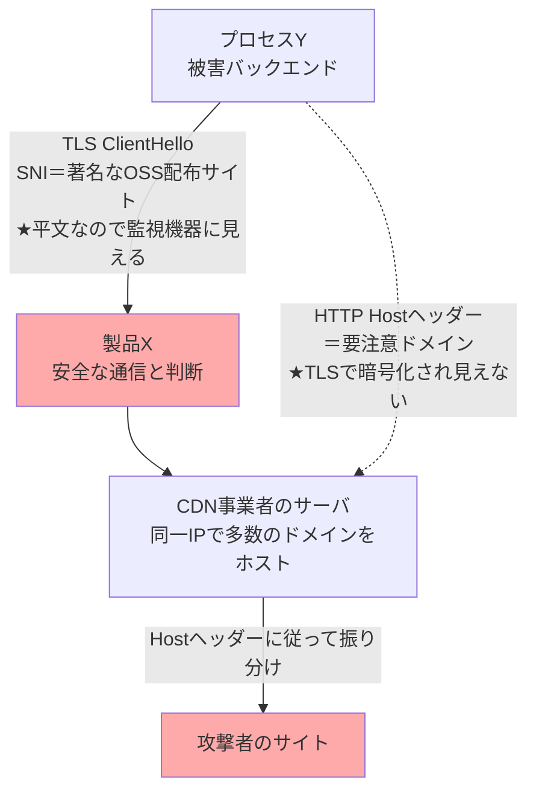

| 層                    | 指定される名前                  | 監視機器から見えるか        |
| --------------------- | ------------------------------- | --------------------------- |
| **TLSのSNI**          | 著名なOSS配布サイトのドメイン名 | **見える**（平文）          |
| **HTTP Hostヘッダー** | 要注意ドメイン（実際の宛先）    | **見えない**（TLSで暗号化） |

CDNは**同じIPアドレスで多数のドメインをホスト**しているため、TLSを終端した後に Hostヘッダーを見て振り分ける。この性質を悪用して、**評判の良いドメインの陰に隠れて**通信する。

**他の選択肢**

|             選択肢              | 内容                                                                   | 本問との違い                                             |
| :-----------------------------: | ---------------------------------------------------------------------- | -------------------------------------------------------- |
|    ア DNS<br>スプーフィング     | 偽のDNS応答を返して別のIPへ誘導する                                    | 本問はDNSを偽っていない。<br>**正しくCDNに接続している** |
|  ウ ドメイン名<br>ハイジャック  | レジストラのアカウント等を奪い、<br>ドメインの管理権を乗っ取る         | 本問は他人のドメインを<br>乗っ取っていない               |
| エ ランダム<br>サブドメイン攻撃 | 存在しないサブドメインへの大量問合せで<br>権威DNSサーバを枯渇させるDoS | 攻撃の目的が違う                                         |

**+α**
- 対策は、**TLSを復号して検査する（TLSインスペクション）** か、**SNIとHostヘッダーの不一致を検知する**こと。本問でもHさんは「TLS通信ライブラリの機能を用いて……復号」して初めて気付いている。
- 近年は **ECH（Encrypted Client Hello）** によってSNI自体が暗号化される方向にあり、SNIに依存した監視はさらに難しくなる。
- 令和5年度春期 午後Ⅰ問3のTLSインスペクション（Pサービス）と対で押さえると、「**検査する側／すり抜ける側**」の両面が見える。

---

### 設問2(4)　下線⑤　プロセスYがシークレットを取得した方法（35字以内）

> **(4)** 本文中の下線⑤について、プロセスYがシークレットを取得するのに使った方法として考えられるものを、35字以内で答えよ。

**解答**：**`/proc` ファイルシステムから環境変数を読み取った。**

**解説**
シークレットがどこに置かれるかを、表1から確認する。

> **シークレット機能**：ビルドスクリプトを実行する**シェルに設定される環境変数**を、Nサービス利用者が登録する機能である。

つまりシークレットは**実行中プロセスの環境変数**として存在する。そして——

| 条件             | 本文の記述                         |
| ---------------- | ---------------------------------- |
| バックエンドのOS | **Linux**をインストールしている    |
| プロセスYの権限  | **管理者権限**をもつ不審なプロセス |

Linuxでは `/proc/<PID>/environ` を読むことで、**そのプロセスの環境変数を取得できる**。通常は自分のプロセスか同一ユーザーのプロセスしか読めないが、**管理者権限（root）があれば他のプロセスの `environ` も読める**。

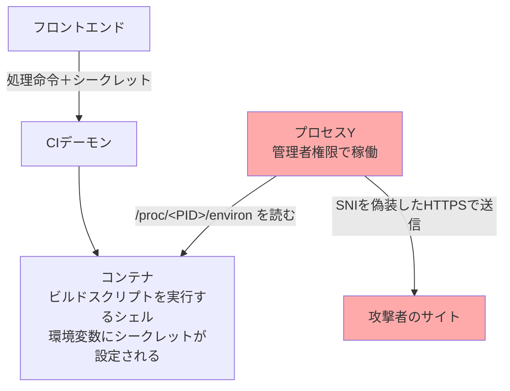

**ここが重要**：攻撃者はコンテナの中に入る必要すらない。**ホスト側に管理者権限のプロセスを置けば、コンテナ内で動くプロセスの環境変数も `/proc` 越しに読める**。コンテナは隔離の仕組みだが、**ホストから見れば中のプロセスは丸見え**である。

**+α：環境変数でシークレットを渡すことの弱点**

| 弱点                                          | 内容                         |
| --------------------------------------------- | ---------------------------- |
| `/proc/<PID>/environ` から読める              | 本問の手口                   |
| 子プロセスに**自動的に継承される**            | 意図しないプログラムにも渡る |
| `ps e` やクラッシュダンプ、デバッグログに出る | 思わぬ場所に残る             |

対策の方向は、**シークレット管理サービスから実行の直前に取得し、使用後すぐ破棄する**、**短命のトークンにする**、**ファイル経由で権限を絞って渡す**など。また、そもそも**ビルド環境を利用者ごとに分離する**（専用のバックエンド／VMレベルの分離）という設計も考えられる。

---

### 設問2(5)　下線⑥　不正ログインを防ぐWebAuthnの仕組み（40字以内）

> **(5)** 図2中の下線⑥について、仮に、利用者が偽サイトでログインを試みてしまっても、攻撃者は不正ログインできない。不正ログインを防ぐWebAuthnの仕組みを、40字以内で答えよ。

**解答**：**認証に用いる情報に含まれるオリジン及び署名をサーバが確認する仕組み**

**解説**
設問2(1)で破られたTOTPと比較すると、WebAuthnの強さが明確になる。

|                      | TOTP                                       | **WebAuthn**                                                         |
| -------------------- | ------------------------------------------ | -------------------------------------------------------------------- |
| 利用者が渡すもの     | **数字の列**<br>（どこへ入力しても同じ値） | **チャレンジへの署名**（認証器が生成）                               |
| 接続先の情報         | **含まれない**                             | **オリジンが署名対象データに含まれる**                               |
| 偽サイトに入力したら | **そのまま転送して使える**                 | 偽サイトのオリジンで署名されるため**正規サーバの検<br>証に失敗する** |
| 秘密情報の所在       | 共有鍵（サーバにも存在）                   | **秘密鍵は認証器から出ない**（サーバには公開鍵のみ）                 |

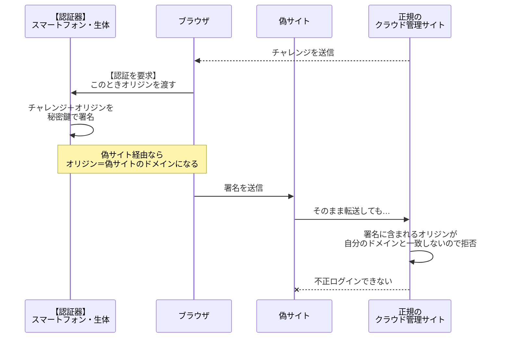

**答案に必ず入れる2要素**：①**オリジン**が認証情報に含まれること ②**サーバがそれ（と署名）を検証する**こと。「公開鍵暗号を使うから安全」だけでは、**なぜフィッシングに強いのか**の説明になっていない。

**+α**
- FIDO2は **WebAuthn**（ブラウザ〜サーバ間のAPI仕様）と **CTAP**（認証器〜端末間の仕様）から構成される。
- **秘密鍵が認証器から出ない**ため、サーバ側の漏えいでも認証情報が流出しない、総当たりが効かない、という利点もある。
- 令和5年度春期 午後Ⅰ問3の設問3(3)（TLSクライアント認証を選ぶ理由）と同じ「**人ではなく端末・オリジンを縛る**」発想。

---

### 設問2(6)　図2 空欄a（認証局を限定するDNSレコード）

> **(6)** 図2中の **a** に入れる適切な字句を、解答群の中から選び、記号で答えよ。
>
> 　解答群　　ア　CAA　　イ　CNAME　　ウ　DNSKEY　　エ　NS　　オ　SOA　　カ　TXT
>
> 　（図2 対策4：Nサービスのドメインのサーバ証明書を発行できる**認証局を限定する**ために、Nサービスのドメインの権威DNSサーバに、Nサービスのドメイン名に対応する **a** レコードを設定する。）

**解答**：**ア（CAA）**

**解説**
**CAA（Certification Authority Authorization）レコード**（RFC 8659）は、**そのドメインの証明書を発行してよい認証局を指定する**DNSリソースレコード。認証局は**証明書を発行する前にCAAレコードを確認することが義務付けられている**ので、指定外の認証局からの発行を防げる。

```
example.jp.  IN  CAA  0 issue "ca.example.com"
              │        │  │      └ 許可する認証局のドメイン
              │        │  └ タグ（issue／issuewild／iodef）
              │        └ フラグ
              └ レコード種別
```

**他の選択肢**

|  選択肢   | 用途                                                                                | 判定  |
| :-------: | ----------------------------------------------------------------------------------- | :---: |
| イ CNAME  | 別名の定義（正規ホスト名へのエイリアス）                                            |   ✕   |
| ウ DNSKEY | **DNSSEC**で使う公開鍵。DNS応答の正当性を検証するためのもので、証明書発行とは無関係 |   ✕   |
|   エ NS   | そのゾーンの権威DNSサーバを指定する                                                 |   ✕   |
|  オ SOA   | ゾーンの管理情報（シリアル番号、リフレッシュ間隔など）                              |   ✕   |
|  カ TXT   | 任意の文字列。SPF・DKIM・ドメイン所有権確認などに使う。**認証局の限定はできない**   |   ✕   |

**CTとCAAの役割分担**

|                  | Certificate Transparency    | CAAレコード                    |
| ---------------- | --------------------------- | ------------------------------ |
| タイミング       | **発行後**                  | **発行前**                     |
| 統制の種類       | **発見的統制**（気付ける）  | **予防的統制**（発行させない） |
| 誰が使うか       | ドメイン所有者が監視する    | 認証局が発行前に確認する       |
| 本問での位置づけ | 不正発行の**検知**（下線③） | 再発**防止**（図2 対策4）      |

**+α**：CAAを設定しても、**認証局が確認を怠れば防げない**し、**ドメインの管理権そのものを奪われたらCAAも書き換えられる**。本問でも攻撃者はフロントエンドの管理者権限を取っているので、**根本原因はアカウント侵害**。CAAは多層防御の一枚である、という位置づけで理解する。

---

### 設問3(1)　下線⑦　予想される攻撃（40字以内）

> **設問3**　〔N社の顧客での対応〕について答えよ。
> **(1)** 本文中の下線⑦について、Kさんが開始した対応を踏まえ、予想される攻撃を、40字以内で答えよ。

**解答**：**有効なコード署名が付与された偽のPアプリをJストアにアップロードする攻撃**

**解説**
漏えいしたシークレットが何だったかを表3で確認する。

| シークレット名    | 値の説明                                                         | 攻撃者ができること                                                                |
| ----------------- | ---------------------------------------------------------------- | --------------------------------------------------------------------------------- |
| **APP_SIGN_KEY**  | コード署名の付与に利用する**署名鍵とコー<br>ドサイニング証明書** | **J社の認証局が発行した正規の証明書で、<br>任意のアプリに有効な署名を付けられる** |
| **STORE_API_KEY** | Jストアにアプリをアップロードするための**<br>認証用APIキー**     | **P社の契約者としてJストアにアップロードできる**                                  |

この2つが揃うと、**Jストアの防御が丸ごと迂回される**。

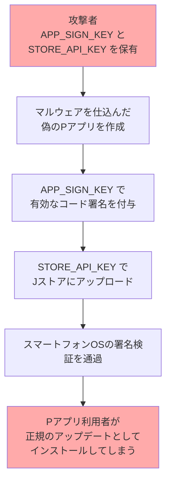

**「Kさんが開始した対応を踏まえ」という誘導**：Kさんは①**STORE_API_KEY への対応**と②**コードサイニング証明書の失効申請**の2つを始めている。この2つを無効化しようとしているということは、**その2つを使った攻撃**を防ごうとしている、と逆算できる。

**なぜP社にとって深刻か**：P社は**資金決済事業者**であり、Pアプリは**決済用**。偽アプリを配布されれば、利用者の決済情報や資金が直接狙われる。本文が従業員数や業種をわざわざ書いているのは、影響の大きさを示すため。

**+α**：これが**ソフトウェアサプライチェーン攻撃**の典型形。利用者から見れば**正規の配信経路から、正規の署名が付いたアプリ**が届くため、見分ける手段がない。令和5年度春期 午後Ⅱ問2（F社のリポジトリに不正コードが混入）と同じ系統の論点で、**委託先・外部サービスの侵害が自社の製品に波及する**という構図。

---

### 設問3(2)　下線⑧　認証用APIキーに必要な対応（20字以内）

> **(2)** 本文中の下線⑧について、必要な対応を、20字以内で答えよ。

**解答**：**J社のWebサイトから削除する。**

**解説**
本文に手順そのものが書かれている。

> 認証用APIキーは**J社が発行し、契約者だけがJ社のWebサイトから取得及び削除できる**。

漏えいした認証情報に対する対応は**無効化（削除・失効）**しかない。「パスワードを変更する」ような更新の概念がないので、**削除**が答え。20字以内という字数も、この簡潔な動作を求めている。

**+α**
- 漏えいした秘密情報への初動は、常に「**消す**」ではなく「**使えなくする**」。令和5年度春期 午後Ⅱ問2でも、F社はファイルZを削除しただけでは不十分で、最終的に**Xトークンを無効化**している。
- Kさんは実際にこの後「**新規の認証用APIキーを取得し**」ているので、削除→再発行という流れになっている。
- あわせて「リポジトリの**認証用SSH鍵を無効化**した」という記述もある。**漏えいしたおそれのある認証情報は、使っていなくても全てローテーションする**のが原則。

---

### 設問3(3)　下線⑨　HSMを使う利点（20字以内）

> **(3)** 本文中の下線⑨について、コード署名を付与する際にHSMを使うことによって得られるセキュリティ上の利点を、20字以内で答えよ。

**解答**：**秘密鍵が漏れないという利点**

**解説**
**HSM（Hardware Security Module）** は、鍵の生成・保管・演算を専用ハードウェア内で完結させる装置。

```mermaid
flowchart LR
  subgraph NOW["従来：Nサービスのシークレットに署名鍵を置く"]
    direction LR
    K1["署名鍵のファイル"] --> E1["環境変数として<br/>実行環境に渡る"]
    E1 --> L1["侵害されると<br/>鍵そのものが漏えいする"]
  end
  subgraph HSM["HSMを利用"]
    direction LR
    K2["署名鍵<br/>HSM内部で生成・保管<br/>外部に取り出せない"] --> E2["署名したいデータを<br/>HSMに渡す"]
    E2 --> L2["HSMが内部で署名演算<br/>署名結果だけを返す"]
    L2 --> R2["鍵は一度も外に出ない"]
  end
  style L1 fill:#faa
  style R2 fill:#aaf
```

今回の事故の本質は「**署名鍵そのものがシークレットとして持ち出せる形で置かれていた**」こと。HSMにすれば、仮に実行環境が侵害されても**署名の実行を悪用される可能性は残るが、鍵自体は持ち出せない**。

**FIPS 140-2 Security Level 3** という記述にも意味がある。Level 3 は**物理的な改ざん検知と応答**（こじ開けようとすると鍵を消去する）、**役割ベースの認証**を要求する水準で、鍵の持ち出し耐性が高いことを示している。

**+α**：設問3(2)で見たTPMと同じ思想。**「鍵を安全な場所に置く」ではなく「鍵が外に出ない仕組みにする」**——令和5年度秋期 問2の設問3(3)（TPMに秘密鍵を格納して取り出せなくする）とまったく同じ論点が、同じ回の別の問でも問われている。

---

### 設問3(4)　下線⑩　Pアプリ利用者への影響と対応（各20字以内）

> **(4)** 本文中の下線⑩について、影響と対応を、それぞれ20字以内で答えよ。

**解答**：**影響＝Pアプリを起動できない。**／**対応＝Pアプリをアップデートする。**

**解説**
Kさんの2つの対応のうち、**コードサイニング証明書の失効申請**が利用者に影響する。根拠は本文の次の記述。

> Jストアのアプリを実行するスマートフォンOSは、**各アプリを起動する前にコード署名の有効性を検証しており、検証に失敗したらアプリを起動しない**ようにしている。

```mermaid
flowchart TD
  A["Kさんがコードサイニング証明書の<br/>失効を申請"] --> B["利用者の端末にある既存のPアプリは<br/>失効した証明書で署名されている"]
  B --> C["スマートフォンOSが起動前に検証<br/>→ 検証に失敗"]
  C --> D["影響：Pアプリを起動できない"]
  E["P社が新しい鍵ペアで署名し直した<br/>Pアプリを Jストアにアップロード済み"] --> F["対応：Pアプリをアップデートする"]
  D --> F
  style D fill:#faa
  style F fill:#aaf
```

**なぜ「アップデートする」で解決するのか**：本文の最後に「**新規の認証用APIキーを取得し、署名済みのバイナリコードをJストアにアップロードする**」とあり、**新しい有効な署名が付いたPアプリが既にJストアに置かれている**。利用者がアップデートすれば、有効な署名のアプリに置き換わる。

**答案のポイント**：影響・対応とも20字以内なので、**端的な事実だけ**を書く。「セキュリティ上の問題が生じる」のような抽象表現ではなく、**起動できない／アップデートする**と具体的に書く。

**+α**
- 「**対応を取ると利用者に影響が出る**」という、インシデント対応の現実的なトレードオフを問う設問。失効させなければ偽アプリが流通し、失効させれば正規利用者のアプリが止まる。**それでも失効を選び、同時に告知と代替手段（アップデート）を用意する**のが正しい判断。
- 資金決済事業者なので、**アプリが起動しない＝決済できない**という事業影響も発生する。だからこそ**事前の告知**が不可欠で、本文も「Pアプリ利用者がとるべき対応について**告知した**」と締めている。
- あわせて「**外部委託先であるN社に起因するインシデントとして関係当局に報告**」もしている。資金決済事業者としての**監督官庁への報告義務**を踏まえた記述。

---

### 問3の学習ポイントまとめ

| 論点                         | 押さえる要点                                                                                                         |
| ---------------------------- | -------------------------------------------------------------------------------------------------------------------- |
| コンテナの隔離範囲           | コンテナは**ホスト・<br>他コンテナからの隔離**であって**外部通信の遮断ではな<br>い**。アウトバウンドの制限が別途必要 |
| TOTPの限界                   | **リアルタイム中継（AiTM）で突破される**。<br>有効期間内に転送されれば使える                                         |
| WebAuthn                     | **オリジンが署名対象に含まれ、<br>サーバが検証する**からフィッシングに強い。<br>秘密鍵は認証器から出ない             |
| Certificate <br>Transparency | RFC 9162。**発行済み証明書を公開ログで監視**できる<br>（発見的統制）                                                 |
| CAAレコード                  | **発行できる認証局を限定**する（予防的統制）。<br>認証局は発行前の確認が義務                                         |
| ドメイン検証の悪用           | `/.well-known/pki-validation/` にファイルを置けれ<br>ば**正規の手続きで証明書を取得できる**                          |
| ドメインフロンティング       | **SNI（平文）とHostヘッダー（暗号化）<br>を食い違わせて**監視をすり抜ける                                            |
| 環境変数とシークレット       | `/proc/<PID>/environ` から読める。<br>**管理者権限があればコンテナ内のプロセスも読める**                             |
| 鍵の保護                     | **HSM／TPMで鍵を外に出さない**。「安全な場所に置く」<br>ではなく「出ない仕組みにする」                               |
| サプライチェーン             | 署名鍵とストアのAPIキーが揃うと、<br>**正規経路で正規署名の偽アプリ**が配布され得る                                  |
| 失効のトレードオフ           | 証明書を失効させると**正規利用者のアプリも起動しな<br>くなる**。告知と代替手段をセットで用意する                     |

---
## 問4 リスクアセスメント（G百貨店・W社）

### 題材の整理

| 項目       | 内容                                                                                                                                                         |
| ---------- | ------------------------------------------------------------------------------------------------------------------------------------------------------------ |
| 委託元     | **G百貨店**：国内5店舗。<br>贈答品の菓子類Fの配送と在庫管理をW社に委託                                                                                       |
| 委託先     | **W社**：従業員100名の地域運送会社。<br>本社事務所と倉庫が同一敷地内。**他に拠点はない**                                                                     |
| 対象情報   | **Z情報**＝菓子類Fの受注情報。**配送先の住所・氏名・<br>電話番号**を含む。1日10〜50件                                                                        |
| 経路       | G百貨店が**Sサービス（受注管理SaaS）**<br>にZ情報を登録 → W社の配送管理課員が参照 → 在<br>庫管理サーバと配送管理SaaSに**手入力**<br>（直接連携はしていない） |
| アカウント | G百貨店が自社のSサービスのアカウントを**1つW社に貸<br>与**。Z情報だけにアクセスできるよう権限を設定                                                          |
| 業務体制   | 配送管理課は09:00〜21:00、**常時1名の6時間交代**。<br>**配送管理用PCは1台を交代で使用**                                                                      |
| きっかけ   | ランサムウェアの**二重の脅迫**が社会問題化。<br>G百貨店が全情報資産のリスクアセスメントをE社に依<br>頼。委託先のW社も調査対象                                |
| 担当       | E社の登録セキスペ**Tさん**。<br>まず**Z情報の機密性に限定**して進める                                                                                        |

**出題趣旨**：業務委託関係にある百貨店と運送会社を題材に、**リスクアセスメントを実施する能力**、及び個々のリスクを低減するための対策を立案する能力を問う。

**配送業務のデータの流れ（図1）**

```mermaid
flowchart LR
  S["Sサービス<br/>受注管理SaaS<br/>G百貨店がZ情報を登録"] -->|"(1) 参照"| K["配送管理課員<br/>配送管理用PC"]
  K -->|"(2) 在庫引当て"| Z["在庫管理サーバ"]
  K -->|"(3) 配送指示を入力"| H["配送管理SaaS"]
  H -->|"(4) 参照"| D["配送員<br/>配送用スマートフォン"]
  style S fill:#aaf
  style K fill:#faa
```

> **貸与アカウントが単一障害点**：W社側でZ情報に触れる入口はこの1アカウントだけで、しかも**課員全員で共用**している。設問1・設問3がいずれもこのアカウントの管理（表2項番12・13）に帰着するのは、この構造のため。

**リスクアセスメントの手順（図3）とリスクレベルの基準（表3）**

```mermaid
flowchart LR
  A["1. リスク特定<br/>リスク源／行為・事象の分類／<br/>行為又は事象／影響に至る経緯"] --> B["2. リスク分析<br/>(1) 関連する情報セキュリティの状況を表2から選ぶ<br/>(2) それを考慮した上で被害の大きさ<br/>(3) それを考慮した上で発生頻度"]
  B --> C["3. リスク評価<br/>表3のマトリクスで総合評価"]
  style B fill:#aaf
```

| 発生頻度＼被害の大きさ |  大   |  中   |  小   |
| ---------------------- | :---: | :---: | :---: |
| **高**（月に1回以上）  | **A** |   B   |   C   |
| **中**（年に2回以上）  |   B   |   C   |   D   |
| **低**（年に2回未満）  | **C** |   D   |   D   |

> **読み落としやすい前提**：被害の大きさも発生頻度も「**(1)の情報セキュリティの状況を考慮に入れた上で**」評価する。つまり**既存対策が効いていれば低く、効いていなければ高く**なる。設問2の「お＝高」はこの前提から導かれる。

---

### 設問1　表4・表5 空欄ア〜エ

> **設問1**　表4及び表5中の **ア** 〜 **エ** に入れる適切な字句を答えよ。**ア** は、表2中から該当する項番を全て選び、数字で答えよ。該当する項番がない場合は、"なし"と答えよ。**イ** は答案用紙の大・中・小のいずれかの文字を〇で囲んで示せ。**ウ** は答案用紙のA・B・C・Dのいずれかの文字を〇で囲んで示せ。

**解答**
- ア＝**10、11、12、13**
- イ＝**大**
- ウ＝**C**
- エ＝**G百貨店で、SサービスへログインできるIPアドレスをW社プロキシだけに設定する。**

**対象となるリスク（リスク番号1-1）**

| 欄                 | 内容                                                                                                           |
| ------------------ | -------------------------------------------------------------------------------------------------------------- |
| リスク源           | W社従業員                                                                                                      |
| 行為又は事象の分類 | **IDとPWの持出し（故意）**                                                                                     |
| 行為又は事象       | SサービスのIDとPWを**メモ用紙などに書き写して、<br>持ち出す**                                                  |
| 影響に至る経緯     | 持ち出されたIDとPWが利用され、<br>**W社外からSサービスにログイン**されて、<br>Z情報がW社外のPCなどに保存される |

**ア（情報セキュリティの状況）＝10、11、12、13**

「**IDとPWを書き写して持ち出す**」という行為と、「**W社外からログインされる**」という経緯の両方に関係する項番を拾う。

|  項番  | 内容                                                                                           | 関係する理由                                               |
| :----: | ---------------------------------------------------------------------------------------------- | ---------------------------------------------------------- |
| **10** | 基本的な情報セキュリティ研修（**IDとPWを含む、<br>秘密情報の取扱方法**）                       | 持出しを抑止する人的対策として機能している                 |
| **11** | **従業員の倫理意識は十分に高い。<br>不正行為の動機付けは十分に低い**                           | **故意**の行為なので、<br>動機の低さが発生頻度を下げる     |
| **12** | 配送管理課長が毎月PWを変更し、<br>**IDと変更後のPWをメールで周知**。<br>当番がアカウントを使用 | **課員全員がIDとPWを知っている**＝<br>書き写せる立場にある |
| **13** | PWは**ノートなどに書いてもよい**と指示。<br>実際に**PWを書いた付箋が机上に貼ってあった**       | 書き写すどころか**既に書かれた状態**で置<br>かれている     |

**入れたくなるが入らないもの**

|                 項番                  | なぜ外れるか                                                                        |
| :-----------------------------------: | ----------------------------------------------------------------------------------- |
| 7<br>（取外し可能媒体への書込み禁止） | **メモ用紙に書き写す**行為なので、<br>電子媒体の制限は関係しない                    |
|      8（本社事務所の入退館管理）      | リスク源が**W社従業員**＝既に正規に入館している。<br>外部者の侵入を前提としていない |
|   3（Sサービスのアクセス元IP制限）    | **表1の項目であって表2ではない**。設問は<br>「**表2中から**」と限定している         |

**イ（被害の大きさ）＝大**

貸与アカウントでログインできれば、**Z情報の全件を参照できる**（権限はZ情報だけに限定されているが、Z情報の範囲内では制限がない）。基準の「大：ほぼ全てのZ情報について、機密性が確保できない」に該当する。

**ウ（総合評価）＝C**

表3のマトリクスに当てはめるだけ。**発生頻度「低」（表4に記載済み）× 被害の大きさ「大」（イ）→ C**。

```mermaid
flowchart LR
  A["被害の大きさ＝大<br/>全件を参照できる"] --> C{"表3のマトリクス"}
  B["発生頻度＝低<br/>倫理意識が高く動機付けが低い"] --> C
  C --> D["総合評価＝C<br/>リスクレベルは中程度"]
  style D fill:#aaf
```

**エ（追加すべき管理策）**

表5のリスク1-1には既に2つの管理策が挙がっている。

- G百貨店で、Sサービスの利用者認証を、**多要素認証**に変更する
- G百貨店で、Sサービスの**操作ログを常時監視**し、不審な操作を発見したらブロックする

残る打ち手を**表1（Sサービスの仕様とG百貨店の設定状況）**から探すと、使われていない機能が見つかる。

| 表1 項番 | 仕様                                                                                                                                         | G百貨店の設定状況                                    |
| :------: | -------------------------------------------------------------------------------------------------------------------------------------------- | ---------------------------------------------------- |
|  **3**   | **ログインを許可するアクセス元IPアドレスのリストを<br>設定することができる。IPアドレスのリストは、<br>アカウントごとに設定することができる** | **全てのIPアドレスからのロ<br>グインを許可している** |

このリスクの経緯は「**W社外から**Sサービスにログインされて」なので、**アクセス元を絞れば経緯そのものが成立しなくなる**。

**どのIPアドレスに絞るのか**は図2と表2項番4・6から決まる。

> W社からインターネットへの通信は、**プロキシサーバからの必要な通信だけを許可**している（表2項番4）
> プロキシサーバは、社内の全てのPCとサーバから、インターネットへのHTTPとHTTPSの通信を転送する（表2項番6）

つまりW社からSサービスへの通信は**必ずプロキシサーバを経由する**ので、Sサービスから見た送信元は**W社プロキシのグローバルIPアドレス1つ**に収束する。

```mermaid
flowchart
  subgraph W["W社社内"]
    PC["配送管理用PC"] --> PX["プロキシサーバ"]
  end
  PX -->|"送信元＝W社プロキシのIP"| S["Sサービス<br/>許可IPリストに<br/>W社プロキシだけを登録"]
  OUT["W社外のPC<br/>持ち出したIDとPWを使用"] -.->|"別のIPアドレス<br/>→ 拒否される"| S
  style OUT fill:#faa
  style S fill:#aaf
```

**答案のポイント**：①**誰が**（G百貨店が。設定権限はアカウントを持つG百貨店側にある）②**何を**（Sサービスのログイン許可IPアドレス）③**どう**（W社プロキシだけに限定する）の3点を書く。表1項番3に「**アカウントごとに設定できる**」とあるので、貸与アカウントだけを絞ってもG百貨店自身の利用には影響しない。

---

### 設問2(1)　表4 空欄あ（リスク2-4の行為又は事象）

> **設問2**　次の問いに答えよ。
> **(1)** 表4中の **あ** に入れる適切な字句を、本文に示した状況設定に沿う範囲で、**あなたの知見に基づき**、答えよ。

**解答例（①標的型攻撃メール）**：**G百貨店からW社への連絡を装った電子メールに未知のマルウェアを添付して、配送管理課員宛てに送付する。**

> **IPA備考**：①〜③の例に限らず、本文に示した状況設定に沿うリスクアセスメントの結果が記述されていること

**解説**
この設問は**珍しい形式**で、既存の表を読むのではなく**自分でリスクを1つ起案**する。採点は「状況設定に沿っているか」なので、**満たすべき条件**を押さえることが重要になる。

**満たすべき4条件**

|   #   | 条件                          | 根拠                                                                  |
| :---: | ----------------------------- | --------------------------------------------------------------------- |
|   1   | リスク源は**W社外の第三者**   | 表4の2-1〜2-5の「リスク源」欄                                         |
|   2   | 分類は**W社へのサイバー攻撃** | 2-4の「行為又は事象の分類」欄（2-1〜2-3と同じ区分）                   |
|   3   | **2-1〜2-3と重複しない手口**  | 2-1＝フィッシングサイト／2-2＝脆弱性の悪用／2-3＝踏み台から課長のPCへ |
|   4   | **表2の弱点を突ける**こと     | 後続の「う（情報セキュリティの状況）」で説明が成立する必要がある      |

**表2から読み取れる弱点の棚卸し**

| 項番  | 記述                                                                                         | 弱点                                                           |
| :---: | -------------------------------------------------------------------------------------------- | -------------------------------------------------------------- |
|   2   | **パターンマッチング型**マルウェア対策ソフト                                                 | **未知のマルウェアを検知できない**                             |
|   5   | メールSaaSのオプションは**一つ目<br>（添付ファイルのパターンマッチング型検査）<br>だけ有効** | **迷惑メールのブロックが無効**／<br>添付検査も**未知には無力** |
|   6   | URLフィルタリングは**アダルトとギャンブルだけ禁止**。<br>**HTTPS復号機能なし**               | **C&C通信や不正サイトへのアクセスが通る**                      |
|   9   | 標的型攻撃に関する周知はしているが、<br>**訓練は実施していない**                             | **メールを開いてしまう可能性が高い**                           |
|  12   | **IDとPWをメールで周知**している                                                             | **メールを読まれると認証情報が盗まれる**                       |

この5つが綺麗に繋がるのが**「未知のマルウェアを添付した標的型攻撃メール」**。

**他の解答例**

|       例       | 行為又は事象                                                                                                                                                                                        |
| :------------: | --------------------------------------------------------------------------------------------------------------------------------------------------------------------------------------------------- |
| ② 水飲み場攻撃 | 配送管理課員がよく閲覧するWebサイトにおいて、<br>脆弱性を悪用するなどして、<br>配送管理課員が閲覧した時に、<br>未知のマルウェアを別のWebサイトからダウンロード<br>させるようにWebページを改ざんする |
| ③ URLリンク型  | W社からアクセスすると未知のマルウェアをダウンロ<br>ードする仕組みのWebページを用意した上で、<br>そのURLリンクを記載した電子メールを、<br>G百貨店からW社への連絡を装って送信する                     |

**+α：なぜ「G百貨店からの連絡を装う」のが効くのか**
本文に「配送に関する**G百貨店からW社への特別な連絡事項は、電子メールで送られてくる**」とある。つまり**G百貨店からのメールを受け取ること自体が日常業務**なので、課員は疑わない。**状況設定に沿う**とは、こうした本文の記述と整合させることを指す。

---

### 設問2(2)　表4・表5 空欄い〜き

> **(2)** 解答した **あ** の内容に基づき、表4及び表5中の **い** 〜 **き** に入れる適切な字句を答えよ。**う** は、表2中から該当する項番を全て選び、数字で答えよ。該当する項番がない場合は、"なし"と答えよ。**え** は答案用紙の大・中・小のいずれかの文字を〇で囲んで示せ。**お** は答案用紙の高・中・低のいずれかの文字を〇で囲んで示せ。**か** は答案用紙のA・B・C・Dのいずれかの文字を〇で囲んで示せ。

**解答例（①標的型攻撃メールの場合）**

|                    欄                    | 解答                                                                                                                                                                                                                                                             |
| :--------------------------------------: | ---------------------------------------------------------------------------------------------------------------------------------------------------------------------------------------------------------------------------------------------------------------- |
|              **い**（経緯）              | **配送管理課員が、添付ファイルを開き、<br>配送管理用PCが未知のマルウェアに感染した結果、<br>IDとPWを周知するメールが読み取られ、<br>SサービスのIDとPWが窃取される。<br>そのIDとPWが利用されて、<br>W社外からSサービスにログインされて、<br>Z情報が漏えいする。** |
| **う**<br>（情報セキュリテ<br>ィの状況） | **2、3、5、6、9、12**                                                                                                                                                                                                                                            |
|        **え**<br>（被害の大きさ）        | **大**                                                                                                                                                                                                                                                           |
|            **お**（発生頻度）            | **高**                                                                                                                                                                                                                                                           |
|            **か**（総合評価）            | **A**                                                                                                                                                                                                                                                            |
|             **き**（管理策）             | **配送管理用PCにEDRを導入し、<br>不審な動作が起きていないかを監視する。**                                                                                                                                                                                        |

**攻撃の流れ**

```mermaid
flowchart TD
  A["あ：G百貨店を装った標的型攻撃メール<br/>未知のマルウェアを添付"] --> B["項番5：添付ファイルの検査は<br/>パターンマッチング型のみ<br/>→ 未知のマルウェアを素通り"]
  B --> C["項番9：訓練を実施していない<br/>→ 課員が添付ファイルを開く"]
  C --> D["項番2：パターンマッチング型の<br/>マルウェア対策ソフト<br/>→ 感染を検知できない"]
  D --> E["配送管理用PCが感染"]
  E --> F["項番12：IDとPWをメールで周知<br/>→ メールを読み取られ認証情報が窃取される"]
  F --> G["項番6：URLフィルタはアダルトと<br/>ギャンブルのみ・HTTPS復号なし<br/>→ C&C通信や外部送信が通る"]
  G --> H["W社外からSサービスにログインされ<br/>Z情報が漏えいする"]
  style B fill:#faa
  style C fill:#faa
  style D fill:#faa
  style F fill:#faa
  style G fill:#faa
```

**う（情報セキュリティの状況）の選び方**

|  項番  | 選ぶ理由                                                                                                                                                 |
| :----: | -------------------------------------------------------------------------------------------------------------------------------------------------------- |
| **2**  | パターンマッチング型のマルウェア対策ソフトでは**未<br>知のマルウェアを検知できない**                                                                     |
| **3**  | 脆弱性修正プログラムは遅滞なく適用されている（＝<br>**脆弱性悪用型ではなく利用者に開かせる攻撃**であるこ<br>との裏返し）。添付ファイルを開く過程に関わる |
| **5**  | メールSaaSの対策が**添付ファイルのパターンマッチン<br>グ型検査だけ**。迷惑メールのブロックも無効                                                         |
| **6**  | プロキシのURLフィルタが**アダルトとギャンブルだけ**<br>で、**HTTPS復号機能もない**ため、<br>外部への送信を止められない                                   |
| **9**  | **標的型攻撃の訓練を実施していない**ため、<br>課員が開いてしまう                                                                                         |
| **12** | **IDとPWをメールで周知**しているため、<br>メールを読まれれば認証情報が渡る                                                                               |

**え（被害の大きさ）＝大**：ログインされればZ情報の全件が参照できる。設問1のイと同じ理由。

**お（発生頻度）＝高**

ここが最も判断を要する。基準は「**高：月に1回以上発生する**」。

| 観点                       | 評価                                                                                                                |
| -------------------------- | ------------------------------------------------------------------------------------------------------------------- |
| 標的型攻撃メールの着信頻度 | 一般に**日常的に発生する**                                                                                          |
| 既存対策で止まるか         | **項番5（未知に無力）・項番9（訓練なし）**により、<br>**止まる見込みが薄い**                                        |
| リスク1-1との違い          | 1-1は**項番11（倫理意識が高い・動機付けが低い）**<br>が効いて「低」になった。<br>**外部攻撃にはこの抑止が効かない** |

したがって「高」と評価する。**"情報セキュリティの状況を考慮に入れた上で"頻度を決める**という手順(3)の指示が、ここで効いている。

**か（総合評価）＝A**：表3より **発生頻度「高」× 被害の大きさ「大」→ A**（リスクレベルは高い）。表4の他のリスクが軒並みC・Dである中で、**唯一Aになる**のがこのリスク。

**き（管理策）**

既存対策の弱点が「**未知のマルウェアをパターンマッチングで検知できない**」ことなので、**検知方式そのものを変える**管理策を立てる。

| 管理策の方向                           | 具体例                                                                                             |
| -------------------------------------- | -------------------------------------------------------------------------------------------------- |
| **振る舞い検知への移行**<br>（解答例） | 配送管理用PCに**EDR**を導入し、<br>不審な動作が起きていないかを監視する                            |
| 同趣旨                                 | 全てのPCとサーバに、<br>**振舞い検知型又はアノマリ検知型**のマルウェア対策ソ<br>フトを導入する     |
| 入口対策の強化                         | メールSaaSの**迷惑メールのブロック**を有効にする／<br>サンドボックス型の添付ファイル検査を導入する |
| 人的対策                               | **標的型攻撃メールの訓練**を実施する<br>（項番9の穴を塞ぐ）                                        |
| 根本原因の除去                         | **IDとPWをメールで周知するのをやめる**<br>（項番12の穴を塞ぐ）                                     |

> **注意**：G百貨店が提示した条件に「**図1のデータの流れを変更しない前提で**」とあるので、「W社に参照させない」「システムを直接連携させる」といった業務フロー自体の変更は答えにできない。

**+α：設問2(1)(2)の一貫性が採点の軸**
この設問は「あ」で何を書いたかによって「い〜き」が全部変わる。つまり**自分の起案したリスクと、分析・評価・管理策が論理的に繋がっているか**が問われている。

| 起案例                        | 「う」<br>で挙がる項番の傾向 | 「き」の方向                                                                     |
| ----------------------------- | ---------------------------- | -------------------------------------------------------------------------------- |
| ①標的型攻撃メール<br>（添付） | 2、3、5、6、9、12            | EDR・振る舞い検知／訓練                                                          |
| ②水飲み場攻撃                 | 2、3、6                      | **URLフィルタリングの設定を変更**し、<br>アクセスできるURLを必要なものだけにする |
| ③URLリンク型メール            | 2、3、5、6、9、10            | 全PC・サーバに振舞い検知型／<br>アノマリ検知型のマルウェア対策ソフトを導入する   |

②で「う」が3項番だけなのは、**メールを経由しないので項番5・9・12が関係しなくなる**から。**起案した手口に応じて関係する状況が変わる**という点が、この設問の肝。

---

### 設問3　表4 空欄a・b

> **設問3**　表4中の **a**、**b** に入れる適切な字句について、表2中から該当する項番を全て選び、数字で答えよ。該当する項番がない場合は、"なし"と答えよ。

**解答**：a＝**5、10、12**／b＝**2、3、4**

**a：リスク番号1-5（IDとPWの漏えい・過失）**

| 欄           | 内容                                                                              |
| ------------ | --------------------------------------------------------------------------------- |
| 分類         | **IDとPWの漏えい（過失）**                                                        |
| 行為又は事象 | **誤って**、SサービスのIDとPWを、W社外の第三者に**メールで送信する**              |
| 経緯         | リスク番号1-2と同じ（第三者がそのIDとPWでW社外からログインし、Z情報が保存される） |

|  項番  | 選ぶ理由                                                                                                               |
| :----: | ---------------------------------------------------------------------------------------------------------------------- |
| **5**  | メールSaaSの<br>「**特定のキーワードを含むメールの送信のブロック**」<br>が**無効**。有効ならPWを含む誤送信を止められた |
| **10** | 情報セキュリティ研修に「**メール送信時の注意事項**」<br>が含まれる。過失を抑止する人的対策                             |
| **12** | **IDとPWをメールで周知**しているため、<br>そのメールを**転送・<br>引用して誤送信しやすい**状態にある                   |

**1-2（故意）との違いが問われている**

|                   項番                   | 1-2（故意） | 1-5（過失） |
| :--------------------------------------: | :---------: | :---------: |
|       5（キーワードブロック無効）        |     〇      |     〇      |
|                10（研修）                |     〇      |     〇      |
| **11（倫理意識が高い・動機付けが低い）** |   **〇**    |    **✕**    |
|          12（PWをメールで周知）          |     〇      |     〇      |

**項番11は「不正行為の動機付け」の話なので、過失には効かない**。倫理意識がどれだけ高くても、うっかりメールを誤送信することは起こる。この区別が設問3の最大のポイント。

**b：リスク番号2-2（W社へのサイバー攻撃・脆弱性の悪用）**

| 欄           | 内容                                                                                                                    |
| ------------ | ----------------------------------------------------------------------------------------------------------------------- |
| 行為又は事象 | W社のPC又はサーバの**脆弱性を悪用**し、<br>インターネット上のPCからW社のPC又はサーバを**不正<br>に操作する**            |
| 経緯         | 踏み台にされて配送管理用PCに**キーロガーが埋め込ま<br>れ**、IDとPWが窃取される。<br>そのIDとPWでW社外からログインされる |

| 項番  | 選ぶ理由                                                                                        |
| :---: | ----------------------------------------------------------------------------------------------- |
| **2** | 全PC・サーバに**マルウェア対策ソフト**を導入。**キーロガーの検知**に関係する                    |
| **3** | **脆弱性修正プログラムの適用が遅滞なく行われている**。脆弱性の悪用そのものを困難にする          |
| **4** | FWが**インターネットからW社への全ての通信を禁止**している。外部からの直接の攻撃経路を塞いでいる |

```mermaid
flowchart
  A["インターネット上のPC"] -->|"項番4：FWが全ての<br/>インバウンド通信を禁止"| B["W社のPC・サーバ"]
  B -->|"項番3：脆弱性修正<br/>プログラムを遅滞なく適用"| C["脆弱性の悪用"]
  C -->|"項番2：マルウェア対策ソフト"| D["キーロガーの埋込み"]
  D --> E["IDとPWの窃取"]
  style A fill:#faa
  style E fill:#faa
```

**+α：「情報セキュリティの状況」は対策の有無を両方拾う**

| 性格                 | 例                                                             | 評価への効き方             |
| -------------------- | -------------------------------------------------------------- | -------------------------- |
| **効いている対策**   | 項番3（修正プログラムの適用）、項番4（FW）、項番11（倫理意識） | 発生頻度を**下げる**       |
| **効いていない／穴** | 項番5（オプション未有効）、項番9（訓練なし）、項番13（付箋）   | 発生頻度や被害を**上げる** |

2-2で「発生頻度＝低」と評価されているのは、項番3・4という**効いている対策**が揃っているため。逆に設問2の2-4が「高」なのは、**効いている対策がないため**。**同じ「被害の大きさ＝大」でも、既存対策の有無で総合評価がC（2-2）とA（2-4）に分かれる**——これがリスクアセスメントの核心。

---

### 問4の学習ポイントまとめ

| 論点                           | 押さえる要点                                                                                                                                 |
| ------------------------------ | -------------------------------------------------------------------------------------------------------------------------------------------- |
| リスクアセスメン<br>トの手順   | **特定→分析（状況・被害・頻度）→評価<br>（マトリクス）**。<br>被害も頻度も**既存対策を考慮した上で**判定する                                 |
| 「情報セキュリテ<br>ィの状況」 | **効いている対策も、穴も両方拾う**。<br>効いていれば頻度が下がり、穴があれば上がる                                                           |
| 故意と過失の切り分け           | **倫理意識・動機付け（項番11）<br>は故意にしか効かない**。過失のリスクでは選ばない                                                           |
| 被害の大きさ                   | 基準の文言（大＝**ほぼ全て**、中＝**一部**、小＝<br>**単独では影響なし**）に照らす                                                           |
| 管理策の立案                   | **未使用の機能を探す**（表1項番3のIP制限）／<br>**既存対策の弱点を直接塞ぐ**<br>（パターンマッチング→EDR）                                   |
| 制約条件                       | 「**図1のデータの流れを変更しない前提**」など、<br>設問の条件を外した管理策は不可                                                            |
| 自分で起案する設問             | **既出と重複しない手口**を選び、<br>**表2の弱点と繋がる**ものにする。<br>(1)と(2)の**一貫性**が採点の軸                                      |
| 委託先管理                     | 委託元（G百貨店）<br>が**委託先の情報セキュリティの状況まで調査**し、<br>**委託元側の設定（IP制限・MFA・ログ監視）<br>で低減する**という発想 |

---

## 全体の学習ポイント

| 問      | テーマ                          | 中心となる知識・観点                                                                                                                                                                                     |
| ------- | ------------------------------- | -------------------------------------------------------------------------------------------------------------------------------------------------------------------------------------------------------- |
| **問1** | Webアプリ開発<br>（格納型XSS）  | XSSの種別判定／出力時のエスケープ／<br>**文字数制限はコメント化で回避される**／<br>XSSがあるとCSRF対策は無効／**同一オリジンポリシー**                                                                   |
| **問2** | 無線LANとクラウ<br>ドストレージ | サーバ証明書の**4つの検証観点**／**HSTS**／<br>**WPA2-PSKとMACフィルタの限界**／<br>**IEEE 802.1XとRADIUS**／EAP-TLSとTPM／<br>**NAT後のIPと送信元IP制限**／不要設定の削除                               |
| **問3** | CI/CDサービスの<br>インシデント | **コンテナの隔離範囲**／**TOTPはAiTMで破られる**／<br>**WebAuthnのオリジン検証**／**CT（RFC 9162）とCAA**／<br>**ドメインフロンティング**／`/proc` と環境変数／**HSM**／<br>コード署名のサプライチェーン |
| **問4** | リスクアセスメント              | 手順（特定→分析→評価）／<br>**既存対策を考慮した頻度・被害の判定**／<br>**故意と過失の切り分け**／管理策の立案／委託先管理                                                                               |

**この回を通じて繰り返し出てくる考え方**

| 考え方                                             | 現れた場所                                                                                              |
| -------------------------------------------------- | ------------------------------------------------------------------------------------------------------- |
| **鍵・認証情報は<br>「外に出ない仕組み」にする**   | 問2 設問3(2)(3)（TPM）／問3 設問3(3)（HSM）                                                             |
| **フィッシング耐性はオリジン検証で得る**           | 問2（サーバ証明書とHSTS）／問3 設問2(1)(5)<br>（TOTPの限界とWebAuthn）                                  |
| **アウトバウンドの緩さが侵害の成<br>立条件になる** | 問3 設問1（コンテナから外部通信）／問4<br>（プロキシのURLフィルタが実質ザル）                           |
| **単独では小さな不備の組合せが致<br>命傷になる**   | 問1（XSS＋HttpOnlyなし＋ファイル形式未検証）／<br>問4（未知のマルウェア＋訓練なし<br>＋PWをメール周知） |
| **正規の機能・<br>正規の経路が悪用される**         | 問2 設問2(1)（ファイル共有機能）／問3 設問3(1)<br>（正規署名の偽アプリ）                                |
| **設定の後始末を怠らない**                         | 問2 設問3(7)（不要なVLAN・フィルタの削除）                                                              |
