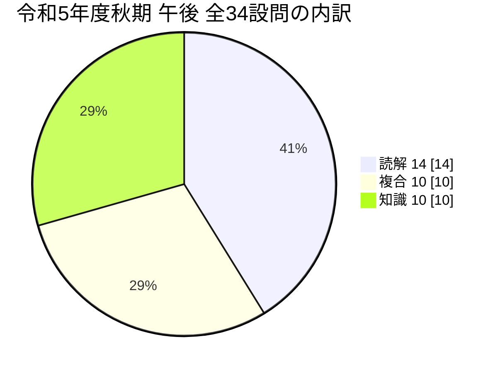
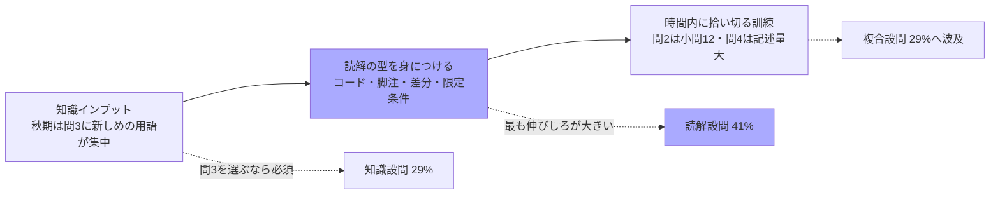

# 令和5年度 秋期 支援士 午後 設問タイプ分類 <!-- omit in toc -->

> 対象：令和5年度秋期 午後（問1〜問4）の**全34設問**
> 目的：**どの設問が「問題文を読めば解ける」のか、どの設問が「知らなければ解けない」のか**を切り分け、学習の投資先を決める
> 関連：同じ観点で分析した `過去問解説/令和5年度春期_設問タイプ分類.md`（全49設問）と比較できる

- [分類の定義](#分類の定義)
- [全体集計と春期との比較](#全体集計と春期との比較)
- [問1 Webアプリケーションプログラムの開発](#問1-webアプリケーションプログラムの開発)
- [問2 セキュリティ対策の見直し](#問2-セキュリティ対策の見直し)
- [問3 継続的インテグレーションサービスのセキュリティ](#問3-継続的インテグレーションサービスのセキュリティ)
- [問4 リスクアセスメント](#問4-リスクアセスメント)
- [知識問題で問われた知識の分野別まとめ](#知識問題で問われた知識の分野別まとめ)
- [読解問題の「根拠の置き場所」パターン](#読解問題の根拠の置き場所パターン)
- [この分析から導かれる学習方針](#この分析から導かれる学習方針)

---

## 分類の定義

| 記号       | 分類     | 定義                                                                                                                                           | 対策                                               |
| ---------- | -------- | ---------------------------------------------------------------------------------------------------------------------------------------------- | -------------------------------------------------- |
| **【読】** | **読解** | 問題文・図・表・ 注記の記述を**探して突き合わせれば**答えが出る。 専門知識がなくても、日本語として根拠を特定できる                       | **解き方の訓練** （根拠の探し方・ 時間配分） |
| **【複】** | **複合** | **知識を手掛かりにして**問題文の条件を当てはめる。 知識は「どこを見ればよいか」 を教えてくれる役割で、 最終的な答えは問題文の中にある | 知識を入れた上で**過去問演習**                     |
| **【知】** | **知識** | 用語・プロトコル・仕様を**知らなければ書けない**。 問題文には答えが書かれていない                                                           | **暗記・ 理解のインプット**                     |

> **判定の基準**：その設問の解答を、**本文・図・表のどこかの記述を指差して説明できるか**。できれば【読】、知識で補えば指差せるなら【複】、どこにも書かれていなければ【知】。

---

## 全体集計と春期との比較

| 分類           | 秋期（34設問） | 春期（49設問） |
| -------------- | -------------: | -------------: |
| **【読】読解** |  **14（41%）** |      21（43%） |
| **【複】複合** |  **10（29%）** |      16（33%） |
| **【知】知識** |  **10（29%）** |      12（24%） |

**問別の内訳**

| 問                                  | 設問数 | 【読】 | 【複】 | 【知】 | 傾向                                                                        |
| ----------------------------------- | -----: | -----: | -----: | -----: | --------------------------------------------------------------------------- |
| 問1 Webアプリ開発                |      7 |      3 |      3 |      1 | **純粋な知識設問は1問だけ**。 ただしHTMLとJavaScriptを読む力が前提       |
| 問2 セキュリティ対策の 見直し |     12 |      6 |      2 |      4 | **設問数が最多**。半分が読解だが、 小問が多く時間を使う                  |
| 問3 CIサービス                   |     11 |      3 |      3 |      5 | **知識比率45%で最高**。 CT・CAA・WebAuthn等が集中                        |
| 問4 リスクアセスメント           |      4 |      2 |      2 |      0 | **純粋な知識設問ゼロ**。 ただし**1設問あたりの記述量が 突出**して多い |

**春期との違い**

| 観点       | 春期                     | 秋期                                                                                                      |
| ---------- | ------------------------ | --------------------------------------------------------------------------------------------------------- |
| 知識比率   | 24%                      | **29%**（やや上昇）                                                                                       |
| 知識の中身 | 基本項目が中心           | **CT（RFC 9162）・CAA・WebAuthn・ ドメインフロンティング・ HSM**など**比較的新しい用語**が問3に集中 |
| 読解の対象 | 本文・表・ 注記が中心 | **HTMLとJavaScriptのコードそのもの**（問1 図3・図4） が加わった                                        |
| 設問の形式 | 穴埋め＋記述             | **自分でリスクを起案する設問**（問4 設問2）が登場                                                         |

> **選択の目安**：知識に不安があるうちは**問1・問4**、ネットワークと暗号の知識に自信があるなら**問2・問3**。問4は知識ゼロで解けるが**記述量が多い**ので、時間配分に注意。

---

## 問1 Webアプリケーションプログラムの開発

| 設問                          | 解答                                                                                                      |    分類    | 根拠の所在（読解）／必要な知識（知識）                                                                                                                                                                         |
| ----------------------------- | --------------------------------------------------------------------------------------------------------- | :--------: | -------------------------------------------------------------------------------------------------------------------------------------------------------------------------------------------------------------- |
| 設問1(1) XSSの種類         | イ（格納型XSS）                                                                                           | **【複】** | **必要な知識**：格納型／反射型／ DOM Based の定義と違い **読む場所**： 図3で**サーバが返すHTMLにスクリプトが入っている**こと＋ 「会員Aによって15件のレビューが投稿されている」 ＝保存されている |
| 設問1(2)　対策                | レビュータイトルを出力する前にエ スケープ処理を施す                                                    | **【複】** | **必要な知識**： XSSの根本対策は**出力時のエスケープ処理** **読む場所**： 図3で会員Bのレビュー詳細が `&gt;` `&lt;` と**エスケー プ済み**＝**タイトル欄だけが未対策**と特定できる                   |
| 設問2　文字数制 限の回避   | HTMLがコメントアウトされ一つのス クリプトになるような投稿を複数回 に分けて行った                    | **【読】** | **読む場所**：**図3のレビュータイトルそのもの**。 各件が `/*` で終わり次が `*/` で始まる。 あわせて図1機能5の「50字」制限と、 「15件のレビューが投稿されている」 というNさんの気付き               |
| 設問3(1)　6〜20 行目の処理 | XHRのレスポンスから取得したトー クンとともに、 アイコン画像としてセッションIDを アップロードする | **【読】** | **読む場所**：**図4のコードとNさんが追記したコメント**。 7-8行目でトークン取得、13行目 `document.cookie`、 16行目でファイル生成、17-18行目で `uploadfile`・ `token` を詰める                          |
| 設問3(2) 情報の取得方法    | 会員のアイコン画像をダウンロードして、 そこからセッションIDの文字列を取り出す                          | **【読】** | **読む場所**：図1機能6 「アップロードしたアイコン画像は……**レビューペー ジに表示される**」 ＋図3の ``                                                                    |
| 設問3(3) できること        | ページVにアクセスした会員になり すまして、WebアプリQの機能を使う                                       | **【複】** | **必要な知識**：セッションIDの窃取＝ **セッションハイジャック** **読む場所**：図1の 「**ログイン済み会員だけが利用できる**」機能 （購入機能・会員プロフィール機能）                                |
| 設問4 ブラウザ の仕組み | スクリプトから別ドメインのURLに 対してcookieが送られない仕組み                                         | **【知】** | **分野**：セキュリティ実装技術 **知識**：**同一オリジンポリシー**。 別オリジンへのXHRには既定でcookieが付かず、 応答も読めない。問題文に説明はない                                                    |

**この問の性格**：**7設問中6つが図3・図4のコードを読む作業**で、純粋な知識設問は設問4だけ。ただし「読める」とは**HTMLの構造とJavaScriptの基本（XHR・FormData・`document.cookie`）が分かる**という意味なので、**開発経験の有無で体感難易度が大きく変わる**。

---

## 問2 セキュリティ対策の見直し

| 設問                                     | 解答                                                                                                                     |    分類    | 根拠の所在（読解）／必要な知識（知識）                                                                                                                                                                                                                    |
| ---------------------------------------- | ------------------------------------------------------------------------------------------------------------------------ | :--------: | --------------------------------------------------------------------------------------------------------------------------------------------------------------------------------------------------------------------------------------------------------- |
| 設問1(1)　空欄a・b                       | 利用者ID／パスワード                                                                                                     | **【読】** | **読む場所**：表1 Bサービス 「従業員ごとに割り当てられた**利用者IDとパスワード** でログインし、利用する」                                                                                                                                           |
| 設問1(2)　空欄c・d                       | 信頼された認証局から発行され たものではない／ 記載されているサーバ名が接続 先と異なる                           | **【知】** | **分野**：セキュリティ実装技術 **知識**：サーバ証明書の**4つの検証観点** （発行元の信頼・名前の一致・失効・有効期限）。 図2に既出の2つから残りを補う                                                                                             |
| 設問1(3)　下線 ①　HSTSの動き          | HTTPのアクセスをHTTPSのアク セスに置き換えてアクセスする。 その後、 偽サイトからサーバ証明書を受け取る          | **【知】** | **分野**：セキュリティ実装技術**知識**： **HSTS**は通信を行う前にブラウザがHTTPSへ置き換える。 本文には「HSTSを有効にしてある」 としか書かれていない                                                                                             |
| 設問2(1)　下線 ②　悪用方法            | 外部共有者のメールアドレスに 自身の私用メールアドレスを指定する                                                       | **【読】** | **読む場所**：表1 Bサービスのファイル共有機能。 「外部の共有者の**メールアドレスの入力**」 「外部の共有者は、**本人以外や上長には知られない**」 「**ログインせずに**ファイルをダウンロード可能」 ＋会話「確認できていない上長もいる」         |
| 設問2(2)　空欄e                          | MACアドレス                                                                                                              | **【読】** | **読む場所**：表1 AP 「従業員用無線LANだけに**MACアドレスフィルタリング** が設定されており、 事前に情報システム部で登録された業務PCだけが接続 できる」                                                                                        |
| 設問3(1)　EAPで 使うUDP上のプロトコル | RADIUS                                                                                                                   | **【知】** | **分野**：ネットワーク／セキュリティ実装技術 **知識**：IEEE 802.1X の構成（サプリカント／ オーセンティケータ＝RADIUSクライアント／ 認証サーバ＝RADIUSサーバ）。端末〜APはEAPOL、 AP〜サーバはRADIUS（UDP 1812/1813）                          |
| 設問3(2)　空欄f                          | 秘密鍵                                                                                                                   | **【知】** | **分野**：情報セキュリティ（暗号） **知識**：公開鍵暗号で**証明書と秘密鍵が対**になること。 基礎知識だが問題文には書かれていない                                                                                                                    |
| 設問3(3)　空欄g                          | 業務PCから取り出せないように                                                                                             | **【複】** | **必要な知識**： **TPM**は鍵を内部で保管し外部に取り出せない **読む場所**：「業務PCのTPMに格納し、**保護します**」 という文脈                                                                                                                    |
| 設問3(4)　下線 ④　理由                | EAP-TLSに必要な認証情報は、 業務PCにしか格納できないから                                                              | **【複】** | **必要な知識**：EAP-TLSは**証明書と秘密鍵**で認証する **読む場所**：方法1 「個人所有PCを従業員用無線LANに接続」＋ 「ディレクトリサーバの機能で業務PCに格納」 「TPMに格納し、保護」                                                            |
| 設問3(5)　下線 ⑤　NATの変更           | 来客用無線LANからインターネ ットにアクセスする場合の送信 元IPアドレスを `a1.b1.c1.d1`  とは別のIPアドレスにする | **【読】** | **読む場所**：3か所の突き合わせ。①表1 「`a1.b1.c1.d1` からだけログイン可能」②表4項番1 （来客用→インターネット許可・NAT有効）③表4注1 「送信元IPアドレスが `a1.b1.c1.d1` に変換される」。 さらに表3項番4の **/29** が別IPの確保可能性を裏付ける |
| 設問3(6)　空欄h                          | DNS                                                                                                                      | **【読】** | **読む場所**：表1「DNSサーバ：業務PC、 **来客持込端末が利用する**DNSキャッシュサーバである」 ＋Dルータが 「DHCPサーバ機能及び**DNSキャッシュサーバ機能**を有 効にする」                                                                       |
| 設問3(7)　下線 ⑥　削除項番            | 表3 → 1／表4 → 1、4                                                                                                      | **【読】** | **読む場所**：表3・表4の中から **`192.168.10.0/24` （VLAN10）に関係する行**を拾う。最後の全拒否ルール （表4項番7）とWAN-IF1（表3項番4）は残す                                                                                                       |

**この問の性格**：**12設問と最多**だが、半分が表の記述を拾うだけの読解。知識は**サーバ証明書・HSTS・RADIUS・公開鍵**という定番4つに限られる。一方で**設問3(5)は3つの表を突き合わせる必要があり**、情報量の多さが実質的な難所になっている。

---

## 問3 継続的インテグレーションサービスのセキュリティ

| 設問                                            | 解答                                                                               |    分類    | 根拠の所在（読解）／必要な知識（知識）                                                                                                                                                                                                                                  |
| ----------------------------------------------- | ---------------------------------------------------------------------------------- | :--------: | ----------------------------------------------------------------------------------------------------------------------------------------------------------------------------------------------------------------------------------------------------------------------- |
| 設問1　下線 ①　該当するもの                  | ウ、エ                                                                             | **【複】** | **必要な知識**：**コンテナは「ホスト・ 他コンテナからの隔離」 であって外部通信の遮断ではない** **読む場所**：表2 「バックエンドは**インターネットへの通信が可能**」 「CIデーモンが……新しいコンテナを起動し、 **当該コンテナ内で**……実行する」         |
| 設問2(1)　下線 ②　不正ログインの方法         | 偽サイトに入力された TOTPを入手し、 そのTOTPが有効な間に ログインした     | **【複】** | **必要な知識**：**TOTPは有効期間内なら転送して使える** （AiTM／リアルタイムフィッシング） **読む場所**：「同日10時にログインを試み、 **一度失敗した**」 「同日**10時に**国外のIPアドレスから……ログインがあ った」＝同時刻の符合                          |
| 設問2(2)　RFC  9162の技術                    | ア（Certificate  Transparency）                                                 | **【知】** | **分野**：セキュリティ技術評価／実装技術 **知識**：**CT＝発行済み証明書の公開ログ**。RFC 9162。 HPKP（RFC 7469・廃止）・HSTS（RFC 6797）との区別                                                                                                                  |
| 設問2(3)　下線 ④　手法の名称                 | イ （ドメインフロンティング）                                                   | **【知】** | **分野**：ネットワーク／情報セキュリティ **知識**：**SNI（平文）とHost ヘッダー（暗号化） を食い違わせる**手法。DNSスプーフィング・ ドメイン名ハイジャック・ ランダムサブドメイン攻撃との区別                                                               |
| 設問2(4)　下線 ⑤　シークレット の取得方法 | `/proc` ファイルシステ ムから環境変数を読み取った                               | **【複】** | **必要な知識**： Linuxの **`/proc/<PID>/environ`** から環境変数が読める。 root なら他プロセスも読める **読む場所**：表1「シークレット機能： ……**シェルに設定される環境変数**」＋ 「**管理者権限をもつ**不審なプロセス」＋ 「**Linux**をインストール」 |
| 設問2(5)　下線 ⑥　WebAuthnの仕組み           | 認証に用いる情報に含 まれるオリジン及び署 名をサーバが確認する仕組み         | **【知】** | **分野**：セキュリティ実装技術 **知識**：**WebAuthn／ FIDO2 はオリジンを署名対象に含め、 サーバが検証する**からフィッシング耐性がある。 問題文に説明はない                                                                                                  |
| 設問2(6)　図2 空欄a                             | ア（CAA）                                                                          | **【知】** | **分野**：ネットワーク（DNS）／情報セキュリティ対策**知識**： **CAAレコード**は証明書を発行できる認証局を限定する。 CNAME・DNSKEY・NS・SOA・TXTとの区別                                                                                                           |
| 設問3(1)　下線 ⑦　予想される攻撃             | 有効なコード署名が付 与された偽のPアプリ をJストアにアップロ ードする攻撃 | **【読】** | **読む場所**：表3の2つのシークレット（**署名鍵 ＋コードサイニング証明書**／ **アップロード用APIキー**）＋本文 「スマートフォンOSは、 各アプリを**起動する前にコード署名の有効性を検証**」。 設問文の「**Kさんが開始した対応を踏まえ**」 が逆算の誘導  |
| 設問3(2)　下線 ⑧　必要な対応                 | J社のWebサイトから削除する                                                         | **【読】** | **読む場所**：本文「認証用APIキーはJ社が発行し、 **契約者だけがJ社のWebサイトから取得及び削除できる**」                                                                                                                                                              |
| 設問3(3)　下線 ⑨　HSMの利点                  | 秘密鍵が漏れないという利点                                                         | **【知】** | **分野**：情報セキュリティ対策 **知識**：**HSMは鍵を内部で生成・保管し、 外部に出さずに署名演算だけを行う**。 FIPS 140-2 Level 3 は物理的改ざん検知を要求                                                                                                      |
| 設問3(4)　下線 ⑩　影響と対応                 | 影響＝ Pアプリを起動できな い／対応＝ Pアプリをアップデートする           | **【読】** | **読む場所**：本文 「**起動する前にコード署名の有効性を検証しており、 検証に失敗したらアプリを起動しない**」＋ 「新規の認証用APIキーを取得し、 **署名済みのバイナリコードをJストアにアップロード**」                                                        |

**この問の性格**：**知識比率45%で4問中最高**。しかも **CT（RFC 9162）・CAA・WebAuthn・ドメインフロンティング・HSM** と、比較的新しめの用語が設問2に集中している。逆に設問3（P社側の対応）は**4問すべて本文に根拠がある読解**なので、**設問2で知識が足りなくても設問3は取れる**という構造になっている。

---

## 問4 リスクアセスメント

| 設問                               | 解答                                                                                                                   |    分類    | 根拠の所在（読解）／必要な知識（知識）                                                                                                                                                                                                                                      |
| ---------------------------------- | ---------------------------------------------------------------------------------------------------------------------- | :--------: | --------------------------------------------------------------------------------------------------------------------------------------------------------------------------------------------------------------------------------------------------------------------------- |
| 設問1　空欄ア〜エ                  | ア＝10,11,12,13／イ＝大／ウ＝C／エ＝ SサービスへログインできるIPア ドレスをW社プロキシだけに設定する             | **【読】** | **読む場所**：ア＝**表2から**該当項番を拾う（研修・ 倫理意識・PWのメール周知・付箋）／イ＝基準の文言 「大＝ほぼ全て」／ウ＝ **表3のマトリクス**に当てはめるだけ／エ＝ **表1項番3の未使用機能**＋図2・表2項番4,6 （通信はプロキシ経由）                       |
| 設問2(1)　空欄あ 　リスクの起案 | （例） G百貨店からW社への連絡を装っ た電子メールに未知のマルウェ アを添付して、 配送管理課員宛てに送付する | **【複】** | **必要な知識**：標的型攻撃メール・ 水飲み場攻撃などの**攻撃手口のレパートリー** （設問文に「**あなたの知見に基づき**」と明記） **読む場所**：表2の弱点（項番2・5・6・9・12）と、本文 「G百貨店からW社への連絡事項は**メールで送られてく る**」という状況設定 |
| 設問2(2)　空欄い〜き               | い＝経緯／う＝2,3,5,6,9,12／ え＝大／お＝高／か＝A／き＝ EDRを導入して監視する                                   | **【複】** | **読む場所**：**表2の該当項番を拾い**、 表3のマトリクスで評価する **必要な知識**：**EDR・振る舞い検知** （パターンマッチング型の限界を埋める対策）                                                                                                                 |
| 設問3　空欄a・b                    | a＝5,10,12／b＝2,3,4                                                                                                   | **【読】** | **読む場所**：**表2から該当項番を選ぶだけ**。a（過失） では**項番11（倫理意識・動機付け） を外す**のがポイント。b では項番3・ 4という**効いている対策**を拾う                                                                                                      |

**この問の性格**：**純粋な知識設問がゼロ**。すべて表2・表3・表1の記述に帰着する。ただし**設問2(2)だけで「い〜き」の6項目**を書かせるため、**1設問あたりの記述量が突出**している。知識面のハードルは低いが、**時間と記述体力**を要する問。

---

## 知識問題で問われた知識の分野別まとめ

**知識設問（10問）で直接問われた知識**と、**複合設問（10問）で前提になっていた知識**をまとめたものです。

| シラバス中分類           | 押さえるべき知識                                                                                                    | 該当設問                       | 重要度 |
| ------------------------ | ------------------------------------------------------------------------------------------------------------------- | ------------------------------ | :----: |
| **セキュリティ実装技術** | **XSSの3分類** — 格納型／反射型／DOM Based の判別                                                                   | 問1 設問1(1)                   |  ★★★   |
|                          | **出力時のエスケープ処理** — XSSの根本対策                                                                          | 問1 設問1(2)                   |  ★★★   |
|                          | **同一オリジンポリシー** — 別オリジンへのXHRに cookieは付かず応答も読めない                                      | 問1 設問4                      |  ★★★   |
|                          | **サーバ証明書の4つの検証観点** — 発行元の信頼・ 名前の一致・失効・有効期限                                      | 問2 設問1(2)                   |  ★★★   |
|                          | **HSTS** — 通信前にHTTPSへ置き換える。 SSLストリッピング対策                                                     | 問2 設問1(3)                   |  ★★★   |
|                          | **WebAuthn／ FIDO2** — **オリジンを署名対象に含めサーバが検証**す るからフィッシング耐性がある                | 問3 設問2(5)                   |  ★★★   |
|                          | **Certificate Transparency（RFC 9162）** — 発行済み証明書の公開ログ（発見的統制）                                | 問3 設問2(2)                   |  ★★☆   |
|                          | **CAAレコード** — 証明書を発行できる認証局を限定 （予防的統制）                                                  | 問3 設問2(6)                   |  ★★★   |
| **ネットワーク**         | **IEEE 802.1X／EAP／RADIUS** — サプリカント・ オーセンティケータ・認証サーバ。EAPOLとRADIUS （UDP）の役割分担 | 問2 設問3(1)                   |  ★★★   |
|                          | **ドメインフロンティング** — SNI（平文） とHostヘッダー（暗号化）の食い違い                                      | 問3 設問2(3)                   |  ★★☆   |
| **情報セキュリティ対策** | **TPM／HSM** — 鍵を内部で保管し**外部に取り出せない**。 「安全に置く」ではなく「出ない仕組みにする」             | 問2 設問3(3)、 問3 設問3(3) |  ★★★   |
|                          | **EDR・ 振る舞い検知** — パターンマッチング型では**未知のマ ルウェアを検知できない**                          | 問4 設問2(2)                   |  ★★★   |
|                          | **コンテナの隔離範囲** — ホスト・ 他コンテナからの隔離であり、 **外部通信の遮断ではない**                     | 問3 設問1                      |  ★★☆   |
| **情報セキュリティ**     | **公開鍵暗号の基礎** — 証明書と秘密鍵が対になる                                                                     | 問2 設問3(2)                   |  ★★★   |
|                          | **TOTPの限界** — **有効期間内に転送されれば使える** （AiTM／リアルタイムフィッシング）                           | 問3 設問2(1)                   |  ★★★   |
|                          | **セッションハイジャック** — セッションIDを得れば本 人として振る舞える                                           | 問1 設問3(3)                   |  ★★★   |
| **システム開発技術**     | **Linuxの `/proc`** — `/proc/<PID>/environ` から環境変 数が読める                                                | 問3 設問2(4)                   |  ★★☆   |
|                          | **HTMLとJavaScriptの読解** — ブロックコメント `/* */`、 XHR、FormData、`document.cookie`                         | 問1 設問2・ 設問3(1)        |  ★★☆   |
| **セキュリティ管理**     | **リスクアセスメントの手順** — 特定→分析（状況・ 被害・頻度）→評価（マトリクス）                                 | 問4 全般                       |  ★★★   |
|                          | **攻撃手口のレパートリー** — 標的型攻撃メール・ 水飲み場攻撃など（自分で起案するため）                           | 問4 設問2(1)                   |  ★★☆   |

> **春期との違い**：春期は**すべて教科書の基本項目**だったが、秋期は問3に **CT・CAA・ドメインフロンティング**といった**やや専門的な用語**が集中している。逆に言えば、**問3を避ければ知識面の負担は春期と変わらない**。

---

## 読解問題の「根拠の置き場所」パターン

読解問題14問の根拠がどこに置かれていたかを集計すると、春期とは少し違う傾向が出ます。

| 置き場所                                           | 具体例                                                                                                                                                                                                       |
| -------------------------------------------------- | ------------------------------------------------------------------------------------------------------------------------------------------------------------------------------------------------------------ |
| **図のコード・ HTMLそのもの** （秋期の特徴） | 問1 図3のレビュータイトル（`/*` `*/` の連鎖） → 設問2／図3の `&gt;` `&lt;` （詳細欄はエスケープ済み）→ 設問1(2)／ 図4のコードとコメント → 設問3(1)                                                  |
| **表の記述をそのまま拾う**                         | 問2 表1 Bサービス（利用者IDとパスワード） → 設問1(1)／表1 AP（MACアドレスフィルタリング） → 設問2(2)／問4 表2 → 設問1ア・設問3                                                                         |
| **表の脚注「注1)」**                               | 問2 表4 注1（NATで `a1.b1.c1.d1` に変換） → 設問3(5)／ 表3 項番4 のサブネットマスク **/29** → 別IPの確保可能性                                                                                         |
| **本文の仕様記述**                                 | 問3 「契約者だけがJ社のWebサイトから取得及び削除でき る」→ 設問3(2)／ 「起動する前にコード署名の有効性を検証」 → 設問3(4)／問2 表1 「ログインせずにファイルをダウンロード可能」 → 設問2(1) |
| **複数の表の突き合わせ**                           | 問2 表1＋表4＋表4注1 → 設問3(5)／表3 ＋表4 → 設問3(7)／問4 表2＋表3 → 設問1・ 設問2(2)・設問3                                                                                                          |
| **時刻・数値の符合**                               | 問3「同日10時にログインを試み一度失敗」と 「同日10時に国外IPからログイン」→ 設問2(1)                                                                                                                      |
| **設問文そのものの 限定条件**                   | 問3 設問3(1)「**Kさんが開始した対応を踏まえ**」 → 2つのシークレットから逆算／問4 「**表2中から**該当する項番を全て選び」 → 表1は対象外                                                              |

**実戦上の読み方**

1. **図のコードは読み飛ばさない**。秋期の問1は**図3と図4がそのまま解答根拠**で、本文より重要
2. **表の脚注「注1)」は必ず読む**。問2設問3(5)は注1がなければ解けない
3. **似た記述が2か所にあったら差分を取る**（図3で詳細欄だけエスケープされている、など）
4. **設問文の限定条件に下線を引く**。「表2中から」「Kさんが開始した対応を踏まえ」「あなたの知見に基づき」は解答の形を指定している
5. **時刻・ポート番号・件数の一致**は、別々の記述が同じ事象を指している証拠になる

---

## この分析から導かれる学習方針

| 優先  | やること                                                                                               | 根拠                                                                                                                                    |
| :---: | ------------------------------------------------------------------------------------------------------ | --------------------------------------------------------------------------------------------------------------------------------------- |
| **1** | **読解の型を固める**（図のコードを読む／ 脚注を読む／差分を取る／ 設問文の限定条件に印を付ける） | **41%が純粋な読解**。知識ゼロでも取れる                                                                                                 |
| **2** | **上表の知識項目を確実にする**                                                                         | **29%を確実に取れる**ようになり、 複合設問29%の足掛かりにもなる                                                                      |
| **3** | **HTML・JavaScriptの基本を読めるようにする**                                                           | 問1は7設問中6つがコードの読解。**読めれば得点源、 読めなければ選択を避ける**という判断材料になる                                     |
| **4** | **時間を計って解く**                                                                                   | 問2は**小問12個**、問4は**設問2(2)だけで6項目の記述**。 どちらも「分かる／分からない」より「**書き切れる／ 書き切れない**」の勝負 |
| **5** | **選択の判断基準を持っておく**                                                                         | 開発経験があるなら問1、ネットワーク・ 暗号に強いなら問2・問3、知識に不安があるなら問4 （ただし記述量に注意）                      |

> **結論**：秋期も**合否を分けるのは知識量より「根拠を拾い切れるか」**。ただし春期と違い、**問3を選ぶなら CT・CAA・WebAuthn・ドメインフロンティング・HSM の5つは事前に押さえておく必要がある**。この5つを知らずに問3を選ぶと、設問2の6問中5問が手付かずになる。
