# 令和6年度 春期 情報処理安全確保支援士試験 午後 設問別解説 <!-- omit in toc -->

> 出典：IPA 令和6年度春期 情報処理安全確保支援士試験 午後 問題・解答例（©2024 独立行政法人情報処理推進機構）
> 形式：問1〜問4から**2問選択**／12:30〜15:00（2時間30分）
> 構成：各設問について「**設問文 → 解答 → 解説**」の順に記載。**解答**はIPA公表の解答例であり、記述式は同趣旨であれば可。
> 備考：問題冊子に**正誤表**あり（p.31 表1 No.16「パーミッションは774」→**775**）。また**問4 設問2(3)の「システム運用担当者」側は不備により設問不成立**（令和6年7月19日 IPA追記）。

- [問1 APIセキュリティ（G社）](#問1-apiセキュリティg社)
- [問2 サイバー攻撃への対策（H社）](#問2-サイバー攻撃への対策h社)
- [問3 Webセキュリティ（D社）](#問3-webセキュリティd社)
- [問4 Webアプリケーションプログラム（A社）](#問4-webアプリケーションプログラムa社)
- [全体の学習ポイント](#全体の学習ポイント)

---

## 問1 APIセキュリティ（G社）

### 題材の整理

| 項目          | 内容                                                                                                                                           |
| ------------- | ---------------------------------------------------------------------------------------------------------------------------------------------- |
| 企業          | **G社**：ヘルスケアサービス新興企業。<br>食事・体重などを管理し、健康リスク判定や<br>食事メニューのアドバイスを提供する<br>**サービスY**を計画 |
| 構築体制      | ITベンダ**F社**に委託。<br>クラウドサービスプロバイダ**E社**の<br>クラウド上に**Sシステム**を構築                                              |
| F社の提供物   | **共通モジュールP**（利用者管理共通ライブラリ）<br>**ライブラリQ**（JWT管理ライブラリ）                                                        |
| E社のサービス | **K**＝APIゲートウェイ／**L**＝FaaS（イベント駆動）<br>**M**＝マネージドDB／**N**＝マネージドWAF<br>（**構築時点ではNを導入しない計画**）      |
| 診断          | セキュリティベンダ**U社**。<br>登録セキスペの**Z氏**が説明役                                                                                   |
| 担当者        | G社の**Rさん**（セキュリティ担当）                                                                                                             |

**Sシステムの要件（図1）**

| 要件 | 内容                                                                                                       |
| ---- | ---------------------------------------------------------------------------------------------------------- |
| 1    | 利用者が入力したデータを蓄積する                                                                           |
| 2    | 蓄積データを機械学習で学習し、<br>健康リスク判定や食事メニューの<br>アドバイスを提供する                   |
| 3    | 利用者ステータスとして<br>**"有償利用者"と"無償利用者"**を定義。<br>無償利用者は機能の利用に一部制限がある |
| 4    | 可能な限り、**既存のサービスやライブラリ**を<br>使って構築する                                             |

**S-APIの仕様（表2）**

| API名     | メソッド | パラメータ     | 要点                                                                                     |
| --------- | -------- | -------------- | ---------------------------------------------------------------------------------------- |
| 認証API   | POST     | mid, pass      | 一致したら**数字4桁の文字列X**を<br>登録済みメールアドレスへ送信                         |
| 認証API   | POST     | mid, otp       | 文字列Xが一致すれば"認証成功"。<br>**JWT**を発行。<br>**生成から10分以内**でなければ失敗 |
| 利用者API | GET      | mid            | midにひも付く利用者情報を返す                                                            |
| 利用者API | PUT      | mid, name, age | midにひも付く利用者情報を更新                                                            |

**この問題の骨格**

| 前半（設問1・2）                                                      | 後半（設問3）                                                                             |
| --------------------------------------------------------------------- | ----------------------------------------------------------------------------------------- |
| U社の診断で出た**4件の指摘**<br>＝OWASP API Security Top 10 の典型4種 | **Log4Shell（CVE-2021-44228）型の脆弱性V**<br>への緊急対応（検証→WAF暫定ルール→恒久対策） |

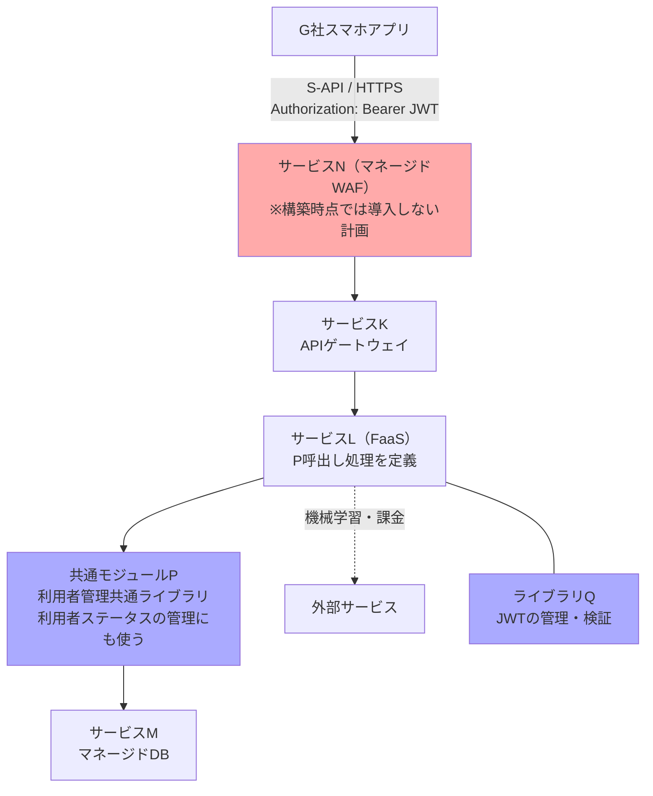

**U社による診断レポート（表3）**

| 項番 | 名称                                | 対象API   | 脆弱性の要約                                                                                        |
| ---- | ----------------------------------- | --------- | --------------------------------------------------------------------------------------------------- |
| 1    | JWT改ざんに<br>よるなりすまし       | 全体      | ヘッダとペイロードを改ざんしたJWTを<br>送信すると、なりすましが可能                                 |
| 2    | アクセス<br>コントロール<br>の不備A | 利用者API | パラメータ**mid**に他の利用者IDを指定すると、<br>他人の利用者情報を取得・改変できる                 |
| 3    | アクセス<br>コントロール<br>の不備B | 利用者API | **"paid"を設定したパラメータ"status"**を<br>追加すると、利用者ステータスを<br>無償→有償に改変できる |
| 4    | 2要素認証<br>の突破                 | 認証API   | 総当たり攻撃で文字列Xを突破できる                                                                   |

---

### 設問1　空欄a（RESTful APIの設計原則）

> **設問1**　本文中の　**a**　に入れる適切な字句を答えよ。
>
> （本文〔APIの設計〕）Sシステムには、将来的には他社が提供するスマートフォン専用アプリケーションプログラムからもアクセスすることを想定し、RESTful API方式のAPI（以下、SシステムのAPIをS-APIという）を用意する。**RESTful APIの設計原則の一つにセッション管理を行わないという性質がある。この性質を　a　という。**

**解答**：**ステートレス**

**解説**
RESTの設計原則のうち、**サーバがクライアントのセッション状態を保持しない**ことを**ステートレス（stateless）**という。リクエスト1回ごとに、処理に必要な情報がすべてそのリクエストに含まれていなければならない。

**RESTの6原則（押さえておく）**

| 原則                           | 内容                                   |
| ------------------------------ | -------------------------------------- |
| クライアント/サーバ            | 役割を分離する                         |
| **ステートレス**               | **サーバはセッション状態を保持しない** |
| キャッシュ可能                 | レスポンスがキャッシュ可能か明示する   |
| 統一インタフェース             | URIとメソッドで操作を統一する          |
| 階層化システム                 | 中間層（プロキシ・GW）を挟める         |
| コードオンデマンド<br>（任意） | クライアントへコードを配布できる       |

**+α：この設定が後の設問にどう効いてくるか**

ステートレスであることは、単なる用語問題ではなく**問1全体の前提**になっている。

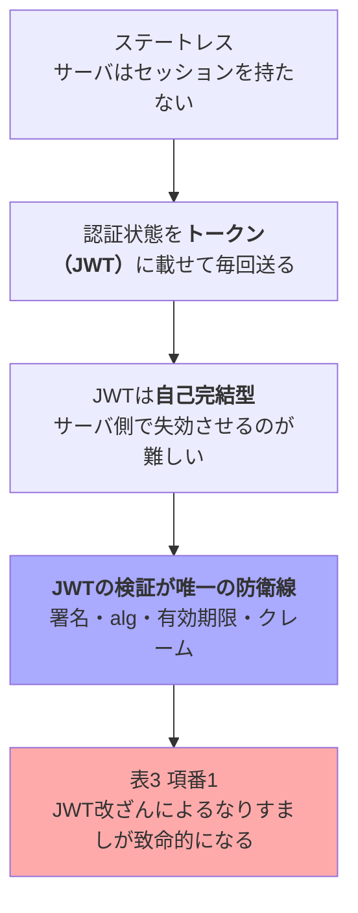

> **落とし穴**：「キャッシュ可能」「統一インタフェース」と混同しない。設問文が「**セッション管理を行わない**」と言い切っているので迷う余地はない。

---

### 設問2(1)　空欄b　総当たり攻撃の平均所要時間（整数）

> **設問2**　〔脆弱性診断の結果〕について答えよ。
> **(1)** 表3中の　**b**　に入れる適切な数値を、小数点以下を四捨五入して、整数で答えよ。
>
> （表3 項番4）総当たり攻撃によって、文字列Xを使った認証メカニズムを突破できる。**1秒間に10回試行する総当たり攻撃**を行った場合、文字列Xの検証において、平均的な認証成功までの時間は　b　秒になり、突破される可能性が高い。

**解答**：**500**

**解説**
必要な値は本文の3か所に分散している。

| 情報                        | 出典                                                                               |
| --------------------------- | ---------------------------------------------------------------------------------- |
| 文字列Xは**数字4桁**        | 表2 認証API「毎回ランダムに生成される<br>数字4桁の文字列」                         |
| **1秒間に10回**試行         | 表3 項番4                                                                          |
| 文字列Xの有効期限は**10分** | 表2「文字列Xを生成してから10分以内に<br>"認証成功"とならなかった場合、"認証失敗"」 |

**計算**

```text
① 全パターン数  = 10^4 = 10,000 通り
② 平均試行回数  = 10,000 ÷ 2 = 5,000 回   ← 総当たりの期待値は全パターンの半分
③ 平均所要時間  = 5,000 ÷ 10 回/秒 = 500 秒
```

**なぜ「半分」なのか**：正解が1番目にある確率も10,000番目にある確率も等しいので、期待値は (1+2+…+N)/N = (N+1)/2 ≒ N/2。厳密には5,000.5回だが、四捨五入して**500秒**。

**この数字の意味**

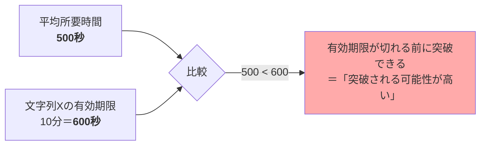

**+α：対策（表5 項番4）で「数字6桁」に変えると**

| 桁数    | 全パターン | 平均所要時間              | 600秒との比較            |
| ------- | ---------- | ------------------------- | ------------------------ |
| **4桁** | 10,000     | **500秒**                 | ✕ 期限内に突破される     |
| **6桁** | 1,000,000  | **50,000秒**（≒13.9時間） | ○ 期限内には突破できない |

**桁を2つ増やすと所要時間は100倍**になる。この感覚を持っておく。

> **落とし穴**：「10分以内」に引きずられて **600** と答えない。問われているのは**平均的な認証成功までの時間**であって有効期限ではない。

---

### 設問2(2)　下線①　修正後のライブラリQが行うJWTの検証（各20字以内）

> **(2)** 表5中の下線①について、修正後のライブラリQで行うJWTの検証では、どのようなデータに対してどのような検証を行うか。検証対象となるデータと検証の内容を、それぞれ**20字以内**で答えよ。
>
> （表5 表3の項番1に対する対策案）**①ライブラリQを修正する。**

**解答**

| 欄                       | 解答例                             |
| ------------------------ | ---------------------------------- |
| **検証対象となるデータ** | **JWTヘッダ内のalgに指定された値** |
| **検証の内容**           | **NONEでないことを検証する。**     |

**解説**

**本文の根拠（3点セット）**

| #   | 記述                                                                                                                           | 出典                         |
| --- | ------------------------------------------------------------------------------------------------------------------------------ | ---------------------------- |
| 1   | ヘッダ：署名の作成の際に使用する<br>**アルゴリズムが指定される**                                                               | 図4〔JWTを利用したアクセス〕 |
| 2   | ライブラリQは、JWT内の**ヘッダに指定された<br>アルゴリズムに基づいて**JWTを検証する                                            | 図4〔JWTを利用したアクセス〕 |
| 3   | 表4中の"RS256"の代わりに **"NONE"を指定**し、<br>"user01"を他の利用者IDに改ざんしたJWTを<br>送信したところ、**検証が成功**した | Z氏の説明                    |

**alg=none 攻撃の原理**

JWTは `base64url(ヘッダ).base64url(ペイロード).base64url(署名)` の形。

```text
【正規（表4）】
ヘッダ     { "alg": "RS256", （省略） }
ペイロード { "user": "user01", "iat": 1713059329, "exp": 1713664129, （省略） }

【攻撃者が改ざん】
ヘッダ     { "alg": "NONE",  （省略） }   ← 「署名検証は不要」と宣言
ペイロード { "user": "user99", （省略） }  ← 他人になりすまし
署名       （空）
```

ライブラリQは「**ヘッダのalgを読んで、その方式で検証する**」実装になっている。ここが罠で、**ヘッダは攻撃者が自由に書き換えられる入力値**である。`alg: none` は RFC 7515 / RFC 7519 で「Unsecured JWT（署名なし）」として定義された値なので、素直に受け入れると**署名検証そのものがスキップされる**。

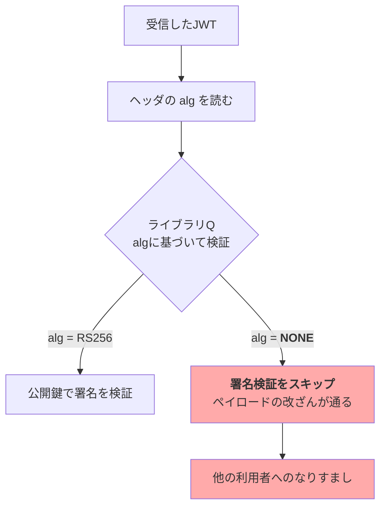

**+α：実務での一般的な対策**

| 評価     | 実装                                                                                                                        |
| -------- | --------------------------------------------------------------------------------------------------------------------------- |
| ✅ 正しい | **サーバ側で期待するアルゴリズムを固定**し、<br>ヘッダのalgがそれと一致する場合だけ検証<br>（アルゴリズム・ホワイトリスト） |
| ❌ 危険   | ヘッダのalgを信用して分岐する                                                                                               |

同じ根から生じる攻撃に **HS256/RS256 取り違え攻撃**（公開鍵をHMACの共通鍵として使わせる）がある。ただし本問は「①ライブラリQを修正する」に対応する解答なので、**NONEを弾く**という直接的な書き方でよい。

> **落とし穴**：検証対象を「JWTの署名」と書くと、検証内容が「正しいか検証する」になってしまい、**alg=none攻撃を防げない**。問われているのは**algの値そのものの検証**。

---

### 設問2(3)　下線②　P呼出し処理に追加すべき処理（40字以内）

> **(3)** 表5中の下線②について、P呼出し処理に追加すべき処理を、**40字以内**で具体的に答えよ。
>
> （表5 表3の項番2に対する対策案）**②P呼出し処理に処理を追加する。**

**解答**：**JWTに含まれる利用者IDがmidの値と一致するかどうかを検証する処理**

**解説**

Sシステムには**利用者を示す情報が2つ**存在する。これを突き合わせていないのが脆弱性の正体。

| 情報                            | 出所                                 | 信頼できるか                           |
| ------------------------------- | ------------------------------------ | -------------------------------------- |
| **JWTペイロードの<br>利用者ID** | 認証を通して**サーバが<br>発行**した | ✅ 信頼できる<br>（署名検証済みが前提） |
| **パラメータ mid**              | **クライアントが自由に<br>指定**する | ❌ 信頼できない                         |

現状の実装は「midで指定された利用者の情報を返す」だけで、**「そのmidをこの利用者が操作してよいか」を確認していない**。認証（あなたは誰か）は済んでいるのに、**認可（あなたはそれをしてよいか）が抜けている**典型例。

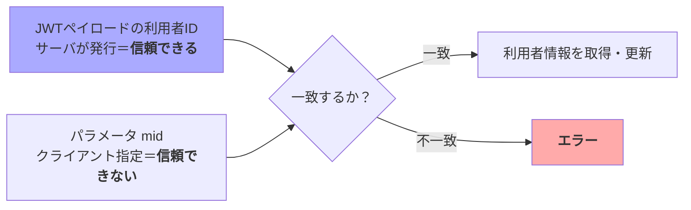

**OWASP API Security Top 10 での名称**：**API1 Broken Object Level Authorization（BOLA）**。**IDOR**（Insecure Direct Object Reference）とも呼ばれ、APIの脆弱性で最も多い類型。

**+α：なぜ「P呼出し処理」に追加するのか（対策箇所の選び方）**

| 場所                | 性質                                                                                | 修正してよいか                   |
| ------------------- | ----------------------------------------------------------------------------------- | -------------------------------- |
| **共通モジュールP** | F社が開発済みの**共通ライブラリ**。<br>利用者ステータス管理にも<br>使われる汎用部品 | ❌ 他の利用者に<br>影響する       |
| **P呼出し処理**     | **サービスLに定義された<br>Sシステム固有の処理**                                    | ✅ ここで認可チェック<br>を入れる |

表5の対策案が「②P呼出し処理に処理を追加する」と場所を指定しているのはそのため。

> **落とし穴**：「midを検証する」だけでは不十分。**何と突き合わせるか（JWT内の利用者ID）** を書かないと点にならない。40字は「JWTに含まれる利用者ID」「midの値」「一致するか検証」の3要素をちょうど入れられる長さ。

---

### 設問2(4)　空欄c　パラメータが素通りする先

> **(4)** 表5中の　**c**　に入れる適切な字句を、**表2中の用語**で答えよ。
>
> （表5 表3の項番3の分析）利用者APIの仕様には、パラメータ"status"の指定について定義されていない。一方、実装は、指定されたパラメータを検証せず全て　**c**　に送信していた。ここで、送信内容を改ざんしてパラメータ"status"を追加してリクエストを送信すると、　**c**　は利用者ステータスを変更できる。

**解答**：**共通モジュールP**

**解説**

決め手は表2 利用者APIの説明にある。

> F社が既に開発済みの利用者管理共通ライブラリ（以下、**共通モジュールP**という）……共通モジュールPは、サービスMを呼び出して、次の処理を行う。……**利用者ステータスの管理にも利用される**。

つまり、

- 利用者ステータスを変更する能力を持つのは**共通モジュールP**
- P呼出し処理が、受け取ったパラメータを**検証せずそのまま全部Pに横流し**している
- Pは汎用ライブラリなので `status=paid` を素直に受け取って処理してしまう

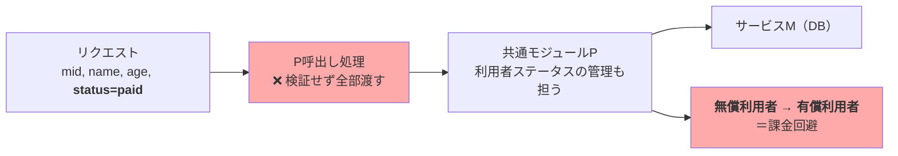

**この脆弱性の名称 — マスアサインメント（Mass Assignment）**

フレームワークやORMが「リクエストのパラメータ名 → オブジェクトのプロパティ」を自動マッピングする便利機能が悪用される類型。

```text
【想定】 mid, name, age の3つだけが来るはず
【実際】 mid, name, age, status=paid  ← 仕様外のパラメータが混入
         ↓ 検証なしで全部Pへ
【結果】 利用者ステータスが無償→有償に変わる
```

**+α：対策の型**

| 方式               | 内容                                                                                       | 評価                                   |
| ------------------ | ------------------------------------------------------------------------------------------ | -------------------------------------- |
| **許可リスト方式** | 仕様で定義されたパラメータ<br>（mid, name, age）だけを通し、<br>それ以外は破棄またはエラー | ✅ 推奨                                 |
| 拒否リスト方式     | "status" を弾く                                                                            | ❌ 将来別の項目が<br>増えたときに漏れる |

> **落とし穴**：「サービスM」と答えない。DBを直接更新するのはMだが、**リクエストのパラメータを解釈してステータス変更を実行する主体**はPである。設問が「**表2中の用語で**」と指定しているのもヒント。

---

### 設問2(5)　空欄d　2要素認証の総当たり対策（30字以内）

> **(5)** 表5中の　**d**　に入れる適切な処理内容を、**30字以内**で答えよ。
>
> （表5 表3の項番4に対する対策案）次の対策を実施する。
> ・　**d**　を実装する。**そのしきい値は10とする。**
> ・突破される可能性を十分に低減するために、文字列Xを数字6桁に変更する。

**解答**：**連続失敗回数がしきい値を超えたらアカウントをロックする処理**

**解説**

「**しきい値は10**」という指定が答えを強く縛っている。しきい値を持つ対策＝**回数のカウント**＝**アカウントロック（ログイン試行回数制限）**。

**2つの軸から総当たりを潰している点が重要**

| 軸                   | 対策                 | 効果                          |
| -------------------- | -------------------- | ----------------------------- |
| **探索空間を広げる** | 数字4桁 → 6桁        | 平均所要時間 500秒 → 50,000秒 |
| **試行回数を絞る**   | 連続10回失敗でロック | そもそも10回しか試せない      |

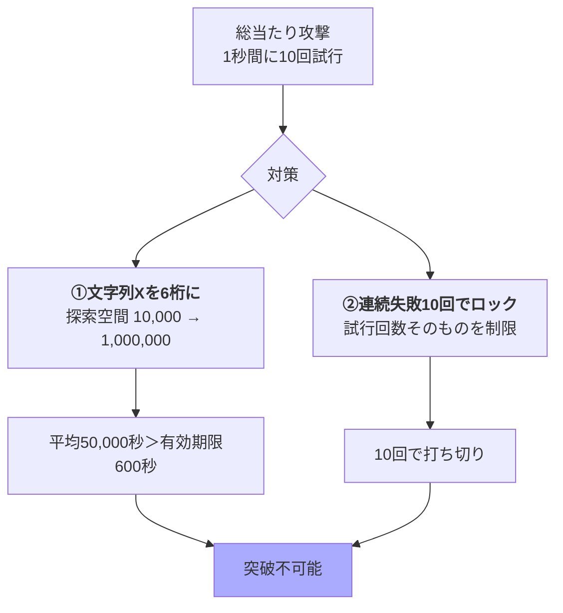

**+α：OTPに対する総当たり対策の定石**

| 対策                   | 内容                                       |
| ---------------------- | ------------------------------------------ |
| 試行回数制限           | アカウントロック／一時的ロックアウト       |
| 桁数・有効期限の適正化 | 本問の「6桁」「10分」                      |
| レート制限             | 同一IP・同一アカウントの試行を秒単位で制限 |
| **OTPの使い捨て**      | 1回使ったら即無効化（再利用禁止）          |
| 応答の均一化           | 「IDが違う」「OTPが違う」を区別しない      |

なお、恒久ロックは**DoSに悪用されうる**ため、実務では一定時間のロックアウトが一般的。本問では「しきい値10」の実装を答えれば足りる。

> **落とし穴**：「アカウントをロックする」とだけ書くと、**何を数えてロックするのか**が抜ける。「**連続失敗回数が**」という主語を必ず入れる。

---

### 設問3(1)　下線③　テストサーバに実装する仕組み（35字以内）

> **設問3**　〔新たな脆弱性への対応〕について答えよ。
> **(1)** 図7中の下線③について、テストサーバに実装する仕組みを、**35字以内**で具体的に答えよ。
>
> （図7 Rさんが実施した検証手順）
> (1) 攻撃用LDAPサーバと攻撃用HTTPサーバを兼ねたサーバ（以下、テストサーバという）を構築する。
> (2) 図8に示す検証コードを作成する。
> (3) **③図8で指定したコマンドが実行されたことを確認する仕組みをテストサーバに実装する。**
> (4) 検証コードをHTTPリクエスト中に指定してSシステムに送信する。

**解答**：**テストサーバのindex.htmlへのアクセスを記録し、確認する仕組み**

**解説**

**本文の根拠**

| 記述                                                                                                                                                | 出典      |
| --------------------------------------------------------------------------------------------------------------------------------------------------- | --------- |
| `d2dldCBodHRwOi8vYTIuYjIuYzIuZDIvaW5kZXguaHRtbA==` の<br>デコード結果は **`wget http://a2.b2.c2.d2/index.html`**。<br>これは**コマンドCに相当する** | 図8 注記2 |
| `a2.b2.c2.d2` は、Rさんが**テストサーバに<br>割り当てたIPアドレス**である                                                                           | 図8 注記1 |
| テストサーバは**攻撃用LDAPサーバと<br>攻撃用HTTPサーバを兼ねた**サーバ                                                                              | 図7(1)    |

**なぜこの設計になっているか — OOB（Out-of-Band）検証**

脆弱性Vは**リモートコード実行（RCE）**。しかしRCEが成功したかどうかは、攻撃対象サーバ（＝Sシステム）の中を見ないと普通は分からない。そこで検証コードは、**成功したら必ず外部に通信が飛ぶコマンド**を実行させる設計になっている。

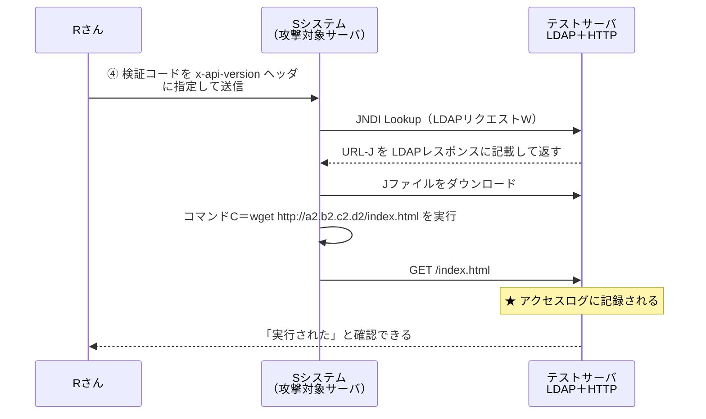

```text
Sシステムが攻撃コードを実行した
  → wget が走った
  → テストサーバの access_log に GET /index.html が残った
  → 「実行された」と確認できる
```

したがって実装すべきは「**index.htmlへのアクセスをログに記録し、それを確認できるようにすること**」。

**+α①：なぜ「システムに影響を与えない検証コード」なのか**

図7の前段で、Z氏は「**システムに影響を与えない検証コード**をSシステムに対して実行し、外部から脆弱性Vを悪用できるか検証するよう提案」している。`wget` は**ファイルを1つ取ってくるだけ**で、データ破壊も権限昇格もしない。本番稼働中のシステムに対する検証では、**PoCは無害なものに限る**のが鉄則。

**+α②：OOB検知の実務**

レスポンスに結果が返らない脆弱性（ブラインドRCE、ブラインドSSRF、ブラインドSQLi、ブラインドXXE）の実証に広く使われる。実務では Burp Collaborator、interactsh、自前のDNS/HTTPカナリアサーバなどを使う。

> **落とし穴**：「コマンドが実行されたかログを見る」では曖昧。**どのサーバの／何へのアクセスか**（テストサーバのindex.html）を明記する。35字はこの要素を入れられる長さ。

---

### 設問3(2)　空欄e・f　WAFルールの検証対象

> **(2)** 表6中の　**e**　，　**f**　に入れる適切な字句を、**図5中から選び**答えよ。
>
> （表6 WAFルールの案）
>
> | ルール | 検証対象 | パターン | 動作 |
> | --- | --- | --- | --- |
> | 1 | **e** | `\Wjndi\W` | 遮断 |
> | 2 | **f** | `\Wldap\W` | 遮断 |

**解答**：**e＝Header、f＝Header**

**解説**

**本文の根拠**（図6(3)）

> 準備した攻撃コードを HTTPリクエストの **x-api-version ヘッダ**の値として指定した HTTPリクエストを攻撃対象サーバに送信する。

**図5の〔検証対象〕の選択肢**

| 指定値     | 意味                                 | 本問では                   |
| ---------- | ------------------------------------ | -------------------------- |
| GET        | GETメソッドの**パラメータ**の値      | ✕                          |
| POST       | POSTメソッドの**パラメータ**の値     | ✕                          |
| PUT        | PUTメソッドの**パラメータ**の値      | ✕                          |
| ANY        | **全てのメソッドのパラメータ**の値   | ✕ **パラメータに限られる** |
| **Header** | **全てのヘッダの値**                 | ✅                          |
| COOKIE     | cookieの値                           | ✕                          |
| Multipart  | Multipart/form-data のフィールドの値 | ✕                          |

攻撃コードが入っているのは**パラメータではなくHTTPヘッダ（x-api-version）**。よって両ルールとも **Header** 一択。

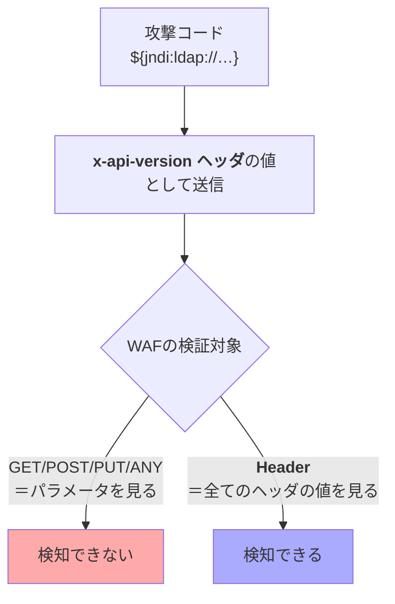

**+α：Log4Shellがヘッダ経由で刺さる理由**

Log4Shell（CVE-2021-44228）の恐ろしさは「**アプリがログに出力するあらゆる文字列が攻撃面になる**」点にあった。User-Agent、X-Forwarded-For、Referer、独自ヘッダ、利用者名の入力欄……ログに書かれた瞬間に `${jndi:ldap://…}` が展開される。本問の `x-api-version` は「APIのバージョン管理用の独自ヘッダ」という設定で、**いかにも素通しでログに書かれそうな値**である点がリアル。

> **落とし穴**：`ANY` を選ばない。ANYは「全てのメソッドの**パラメータ**」であって「全ての場所」ではない。図5の定義を最後まで読むこと。

---

### 設問3(3)　下線④　大文字・小文字の入替えに対応したパターン

> **(3)** 本文中の下線④の変更後の案について、表6中の**ルール1に記述すべきパターン**を、**図5の記述形式**で答えよ。
>
> （本文）Rさんは、例えば"**jnDI**"のように大文字・小文字を入れ替える手口によって、ルール1と2それぞれに、案のパターンを回避する方法があることに気付いた。**④このような手口にも対応できるように案を変更した。**

**解答**：**`\W[jJ][nN][dD][iI]\W`**　または　**`\W(j|J)(n|N)(d|D)(i|I)\W`**

**解説**

**図5の〔パターン〕で使える要素**

| 要素      | 意味                                |
| --------- | ----------------------------------- |
| `^`       | 文字列の先頭とマッチ                |
| `\W`      | **任意の非英数字**とマッチ          |
| `x\|y`    | x または y とマッチ                 |
| `(x\|y)z` | xz または yz とマッチ               |
| `[xyz]`   | x, y, z のいずれかとマッチ          |
| `.`       | 任意の文字とマッチ                  |
| `\.`      | "." とマッチ                        |
| `*`       | 直前の要素の0回以上の繰返しとマッチ |

**なぜこの書き方になるか**

図5の記述形式には **`i` フラグ（大文字小文字を無視）に相当する要素がない**。したがって、**1文字ずつ「大文字または小文字」を明示的に列挙する**しかない。

```text
元の案     ：\Wjndi\W            ← jnDI を取りこぼす
変更後(案1)：\W[jJ][nN][dD][iI]\W   ← 文字クラスで列挙
変更後(案2)：\W(j|J)(n|N)(d|D)(i|I)\W ← 選択で列挙

どちらも 2^4 ＝ 16通り（jndi, JNDI, jnDI, JnDi, …）すべてにマッチする
```

**前後の `\W` の役割（ここを落とす人が多い）**

`\W` ＝ 任意の**非英数字**。`${jndi:ldap://…}` の `jndi` は、前が `{`、後ろが `:` で挟まれている。

| `\W` の効果  | 例                                                                                     |
| ------------ | -------------------------------------------------------------------------------------- |
| ✅ 捕まえる   | `${jndi:` のように記号で挟まれた `jndi`                                                |
| ❌ 捕まえない | `myjndiValue` のように**単語の一部として<br>偶然含まれる**文字列（**誤検知を減らす**） |

だから書き直す際も **`\W` を消してはいけない**。

**+α：WAFのバイパス手法**

実際のLog4Shell対応でも、単純な `jndi` 文字列マッチはすぐ回避された。

| 手口            | 例                                                          |
| --------------- | ----------------------------------------------------------- |
| 大文字小文字    | `${jNdI:ldap://…}` ← **本問**                               |
| Lookupのネスト  | `${${lower:j}ndi:…}`<br>`${${::-j}${::-n}${::-d}${::-i}:…}` |
| プロトコル変更  | `ldaps`, `rmi`, `dns`, `iiop`                               |
| URLエンコード等 | `%24%7Bjndi`                                                |

図6の「悪用パターンが多岐にわたることから、網羅性のあるWAFルールの提供には最大で72時間掛かる」という記述は、この現実を反映している。**だからRさんの案は"暫定的な"WAFルールであり、最終的な解決はライブラリHのバージョンアップ**（本文末尾）である、という構成になっている。

> **落とし穴**：`\W.ndi\W` のように `.`（任意の文字）で誤魔化さない。それだと `andi` `1ndi` も遮断して誤検知が激増する。また `[jJ][nN][dD][iI]` を `[jJnNdDiI]` と書くと「これら8文字のうち**1文字**」の意味になってしまうので誤り。

---

### 設問3(4)　下線⑤　「遮断」ではなく「検知」にする利点と被害最小化（各25字以内）

> **(4)** 本文中の下線⑤について、WAFルールの動作に"遮断"ではなく"検知"を設定することによる利点と、"検知"に設定した際に被害を最小化するために実施すべき内容を、それぞれ**25字以内**で答えよ。
>
> （本文）Z氏は、**⑤本番運用開始後の一定期間においては、WAFルールの動作には"検知"を設定して、サービスYが今までどおり利用できるかを確認すること**を助言した。

**解答**

| 欄                 | 解答例                                           |
| ------------------ | ------------------------------------------------ |
| **利点**           | **誤検知による遮断を防ぐことができる。**         |
| **実施すべき内容** | **アラートを受信したら攻撃かどうかを精査する。** |

**解説**

**図5の〔動作〕の定義**

| 動作     | 通信     | ログ       | アラート     |
| -------- | -------- | ---------- | ------------ |
| 許可     | 通過     | 記録しない | —            |
| **検知** | **通過** | 記録する   | **送信する** |
| 遮断     | **遮断** | 記録する   | 送信する     |

**利点**：WAFルールは急ごしらえの暫定ルールである。もしサービスYの正常な通信にたまたま `\Wjndi\W` や `\Wldap\W` にマッチする文字列が含まれていたら、「遮断」設定では**正規利用者のリクエストが止まり、サービス障害になる**。「検知」なら通信は通るので、**可用性を損なわずにルールの妥当性を評価できる**。

**実施すべき内容**：ただし「検知」は通信を通してしまうので、**本物の攻撃も素通りする**。そこで、アラートが上がったら**人がその通信を精査し、攻撃であれば個別に対処する**運用を回す必要がある。

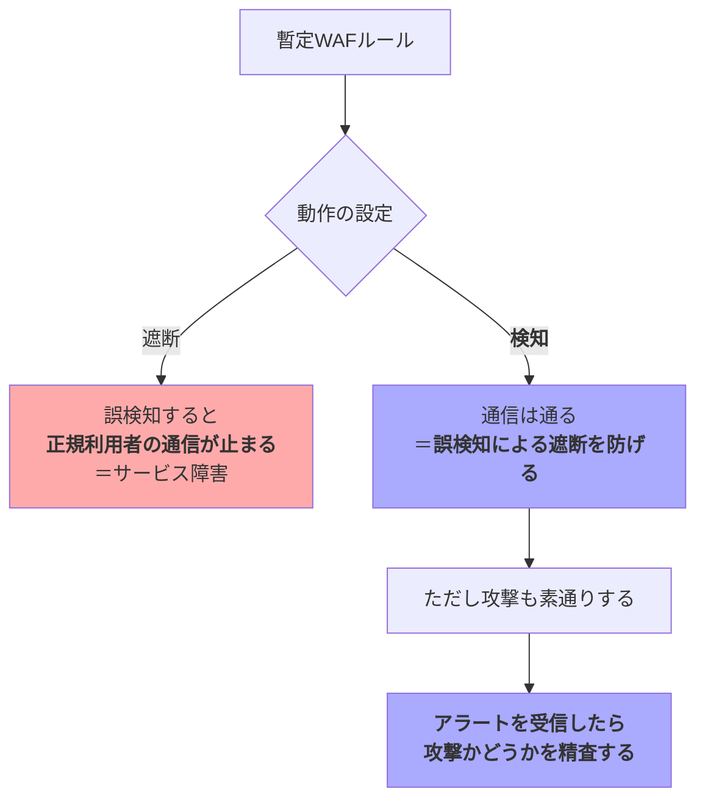

**+α：WAF/IPS導入の定石プロセス**

```text
① 検知モード（監視のみ）で一定期間運用
      ↓ ログを分析
② 誤検知（False Positive）を洗い出し、ルールをチューニング
      ↓
③ 遮断モードへ切替え
```

この「いきなり遮断にしない」という考え方は、**本年度 問2 設問1(2)のアノマリ型IPSのしきい値の話（しきい値が低すぎると正常な通信を異常と検知する）と完全に同じ構図**。午後試験では、この「**検知精度と可用性のトレードオフ**」が繰り返し問われる。

> **落とし穴**：利点を「攻撃を検知できる」と書かない。それは「遮断」でもできる。**「遮断」と比べたときの利点＝正常通信を止めないこと**を書く。

---

### 問1の学習ポイントまとめ

| 表3項番 | 脆弱性                                        | OWASP API Security Top 10                 | 対策の本質                                        |
| ------- | --------------------------------------------- | ----------------------------------------- | ------------------------------------------------- |
| 1       | JWT改ざんによるなりすまし<br>（alg=none）     | API2 Broken<br>Authentication             | サーバ側で<br>アルゴリズムを固定する              |
| 2       | アクセスコントロールの不備A<br>（mid改変）    | **API1 BOLA**                             | JWTの利用者IDと<br>リクエストの対象を突き合わせる |
| 3       | アクセスコントロールの不備B<br>（status追加） | Mass Assignment                           | 仕様外パラメータを<br>許可リストで排除            |
| 4       | 2要素認証の突破<br>（総当たり）               | API4 Unrestricted<br>Resource Consumption | 試行回数制限＋<br>探索空間の拡大                  |
| 後半    | 脆弱性V<br>（Log4Shell型RCE）                 | ソフトウェア<br>サプライチェーン          | 恒久＝バージョンアップ<br>暫定＝WAF               |

---

## 問2 サイバー攻撃への対策（H社）

### 題材の整理

| 項目           | 内容                                                                                                                                                  |
| -------------- | ----------------------------------------------------------------------------------------------------------------------------------------------------- |
| 企業           | **H社**：従業員3,000名の製造業。<br>H社製品の部品を製造する**約500社**と取引                                                                          |
| 守るべきもの   | **取引先向けWebサーバ**（取引先がHTTPSでログインし取引業務）<br>**公開Webサーバ**（製品紹介・問合せ受付）<br>→ **いずれが停止しても業務に支障が出る** |
| リモートワーク | 一部従業員に**R-PC**（リモート接続用PC）を貸与。<br>**VPN-H**（VPNゲートウェイ）でVPN通信                                                             |
| 運用体制       | 情報システム部の**L部長**と**T主任**を含む6名                                                                                                         |
| きっかけ       | 同業他社で2件の被害。<br>①**VPN-GWが攻撃を受け社内侵入・情報漏えい**<br>②**DDoS攻撃による被害**                                                       |

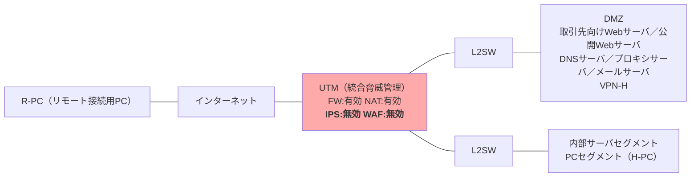

**UTMとVPN-Hの設定（表1・表2）**

| 機器  | 機能             | 設定     | 要点                                                                                                        |
| ----- | ---------------- | -------- | ----------------------------------------------------------------------------------------------------------- |
| UTM   | ファイアウォール | 有効     | ステートフルパケット<br>インスペクション型                                                                  |
| UTM   | NAT              | 有効     | —                                                                                                           |
| UTM   | **IPS**          | **無効** | アノマリ型／シグネチャ型を設定可                                                                            |
| UTM   | **WAF**          | **無効** | 同上                                                                                                        |
| VPN-H | VPN通信          | 有効     | VPNダイアログにID/PWを入力                                                                                  |
| VPN-H | **多要素認証**   | **無効** | （ア）SMSのセキュリティコード<br>（イ）**デジタル証明書によるクライアント認証**<br>（ウ）プッシュ通知の承認 |

**DNSサーバの現状（図1 注1）**：H社ドメインの**権威DNSサーバ**と再帰的な名前解決を行う**フルサービスリゾルバ**を**1台で兼ねている**。

**この問題の骨格**

| 設問  | テーマ                                                                       |
| ----- | ---------------------------------------------------------------------------- |
| 設問1 | **DDoS攻撃の調査**（攻撃の種類、<br>アノマリ型IPSのしきい値、DNSの内外分離） |
| 設問2 | **対策V-1（認証強化）**<br>→ MFAを突破するフィッシングと注意喚起             |
| 設問3 | **対策V-3（ステルス化）**<br>→ ポートノッキング（設定P）とSPAの比較          |
| 設問4 | **DDoSへの具体的対策**（回線／サーバ）                                       |

---

### 設問1(1)　空欄a　HTTP GET Flood攻撃の例

> **設問1**　〔DDoS攻撃に対する調査〕について答えよ。
> **(1)** 表4中の　**a**　に入れる攻撃の例を、**H社での攻撃対象を示して**具体的に答えよ。
>
> （表4 H社で未対策のDDoSに関連する攻撃）
>
> | 項番 | 攻撃 | 例 |
> | --- | --- | --- |
> | 1 | UDP Flood攻撃 | 公開Webサーバ、DNSサーバを攻撃対象に、偽の送信元IPアドレスと<br>ランダムな宛先ポート番号を設定したUDPデータグラムを大量に送り付ける。 |
> | 2 | SYN Flood攻撃 | （省略） |
> | 3 | DNSリフレクション攻撃の踏み台にされる | （省略） |
> | 4 | **HTTP GET Flood攻撃** | **a** |

**解答**：**公開Webサーバ、取引先向けWebサーバを攻撃対象に、HTTP GETリクエストを繰返し送る。**

**解説**

HTTP GET Flood は **HTTPで応答するサーバ**にしか成立しない。H社のHTTPサーバを洗い出す。

| サーバ                  | インターネットから<br>HTTP/HTTPSで到達できるか | 対象になるか |
| ----------------------- | ---------------------------------------------- | ------------ |
| **公開Webサーバ**       | ✅ 製品紹介・問合せ受付で公開                   | ○            |
| **取引先向けWebサーバ** | ✅ 取引先がHTTPSでアクセス                      | ○            |
| DNSサーバ               | ❌ DNSプロトコル                                | ✕            |
| メールサーバ            | ❌ SMTP/POP                                     | ✕            |
| プロキシサーバ          | ❌ 社内→外の中継。<br>外から直接叩けない        | ✕            |

**なぜ「両方」書くのか**：本文が「**いずれのWebサーバが停止しても、業務に支障が出る**」とわざわざ書いている。これは「両方が守るべき対象である」という誘導。**表4 項番1も攻撃対象を2つ挙げている**ので、書式を揃える。

**+α：HTTP GET Flood（HTTP Flood／F5攻撃）**

| 観点           | 内容                                                                                    |
| -------------- | --------------------------------------------------------------------------------------- |
| レイヤ         | **L7（アプリケーション層）**                                                            |
| 特徴           | TCPコネクションを**正常に確立**した上で、<br>正規のHTTPリクエストを大量送出する         |
| なぜ厄介か     | **パケット単体は正常**なので、<br>L3/L4のフィルタリングでは見分けられない               |
| 効きやすい標的 | 検索・一覧表示などDBアクセスを伴う重い処理のURL<br>（**少ないリクエストで大きな負荷**） |
| 対策           | WAF、レート制限、CAPTCHA、CDN、<br>同一IPからの同時接続数制限                           |

**表4の4つの攻撃を整理する**

| 項番 | 攻撃                                      | レイヤ | 仕組み                                             | H社での対策           |
| ---- | ----------------------------------------- | ------ | -------------------------------------------------- | --------------------- |
| 1    | UDP Flood                                 | L3/L4  | 偽装送信元・ランダム宛先ポートの<br>UDPを大量送付  | UTMのIPS              |
| 2    | SYN Flood                                 | L4     | SYNだけ送ってACKを返さず<br>half-openを溜める      | UTMのIPS              |
| 3    | DNSリフレクションの<br>**踏み台にされる** | L4     | オープンリゾルバが悪用され、<br>**加害者側**になる | **DNS-K/DNS-Fに分離** |
| 4    | HTTP GET Flood                            | **L7** | 正常なHTTPリクエストを大量送出                     | UTMのWAF              |

> **落とし穴**：項番3だけが**被害者ではなく加害者になる**話。だからT主任も「項番1, 2, **4**のDDoS攻撃のサーバへの影響は……」と項番3を除外している。設問が「**H社での攻撃対象を示して**」と指定しているので、サーバ名を必ず書く。

---

### 設問1(2)　下線①　しきい値が低すぎる場合の弊害（25字以内）

> **(2)** 本文中の下線①の場合に発生する弊害を、**25字以内**で答えよ。
>
> （T主任の発言）例えば、アノマリ型IPS機能で、トラフィック量について、しきい値が高すぎる場合にも、**①しきい値が低すぎる場合にも弊害が発生する**ので、しきい値の設定には注意するようにします。

**解答**：**正常な通信を異常として検知してしまう。**

**解説**

表1のIPS機能の定義：「**アノマリ型**：あらかじめ登録したしきい値を超えた通信を異常として検知する。」

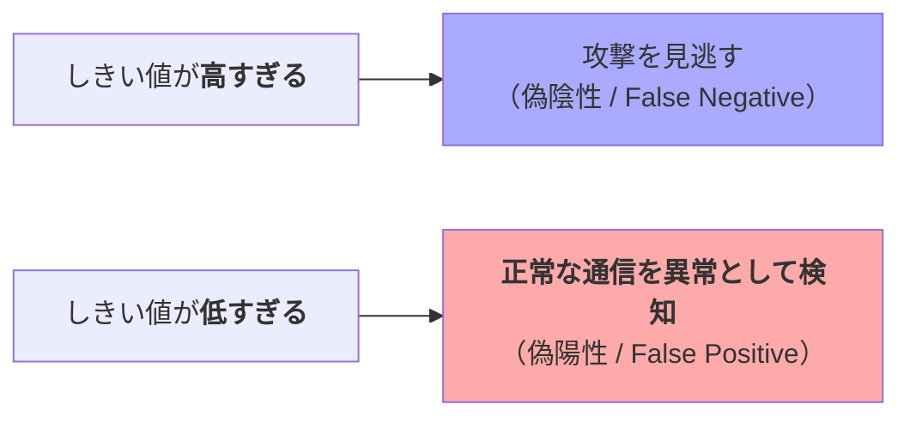

**この弊害が実害になる理由**

表1のIPS機能は**UTM上の機能**で、UTMは通信経路上（インライン）にある。IPSは検知した通信を**遮断**するので、誤検知＝**正規利用者の通信が止まる**。取引先500社が使う取引先向けWebサーバが止まれば業務に直撃する。

**+α：シグネチャ型とアノマリ型**

|            | シグネチャ型                       | アノマリ型                                                 |
| ---------- | ---------------------------------- | ---------------------------------------------------------- |
| 検知の根拠 | 既知の攻撃パターンとの一致         | **正常状態からの逸脱**                                     |
| 得意       | 既知攻撃を正確に検知               | **未知攻撃・<br>DDoS的な量的異常**                         |
| 弱点       | **未知攻撃を見逃す**<br>（偽陰性） | **誤検知しやすい**（偽陽性）、<br>学習・チューニングが必要 |

> **落とし穴**：「通信が遮断される」だけでは不十分。**何が**遮断されるのか＝**正常な通信が**、という主語が要る。25字ちょうどに収まる。
> なお**問1 設問3(4)の「検知モードの利点＝誤検知による遮断を防ぐ」と表裏一体**の論点。同じ年度の別問で同じ考え方が問われている点に注目。

---

### 設問1(3)　空欄b・c　DNSの内外分離

> **(3)** 本文中の　**b**　，　**c**　に入れる適切な字句を、**"DNS-F"又は"DNS-K"から選び**答えよ。
>
> （T主任の発言）また、項番3の対策として、現在のDNSサーバを廃止して、**権威DNSサーバの機能をもつサーバ（以下、DNS-Kという）**と**フルサービスリゾルバの機能をもつサーバ（以下、DNS-Fという）**を社内に新設します。インターネットから社内へのDNS通信は　**b**　への通信だけを許可し、社内からインターネットへのDNS通信は　**c**　からの通信だけを許可します。

**解答**：**b＝DNS-K、c＝DNS-F**

**解説**

2つのDNSサーバの「向き」を整理すると一発で決まる。

| 役割                              | 誰のための機能か                                  | 通信の向き  |
| --------------------------------- | ------------------------------------------------- | ----------- |
| **権威DNSサーバ（DNS-K）**        | **外部の人**が「H社のサーバのIPは？」と聞いてくる | **外 → 内** |
| **フルサービスリゾルバ（DNS-F）** | **社内の人**が「外部サイトのIPは？」と聞く        | **内 → 外** |

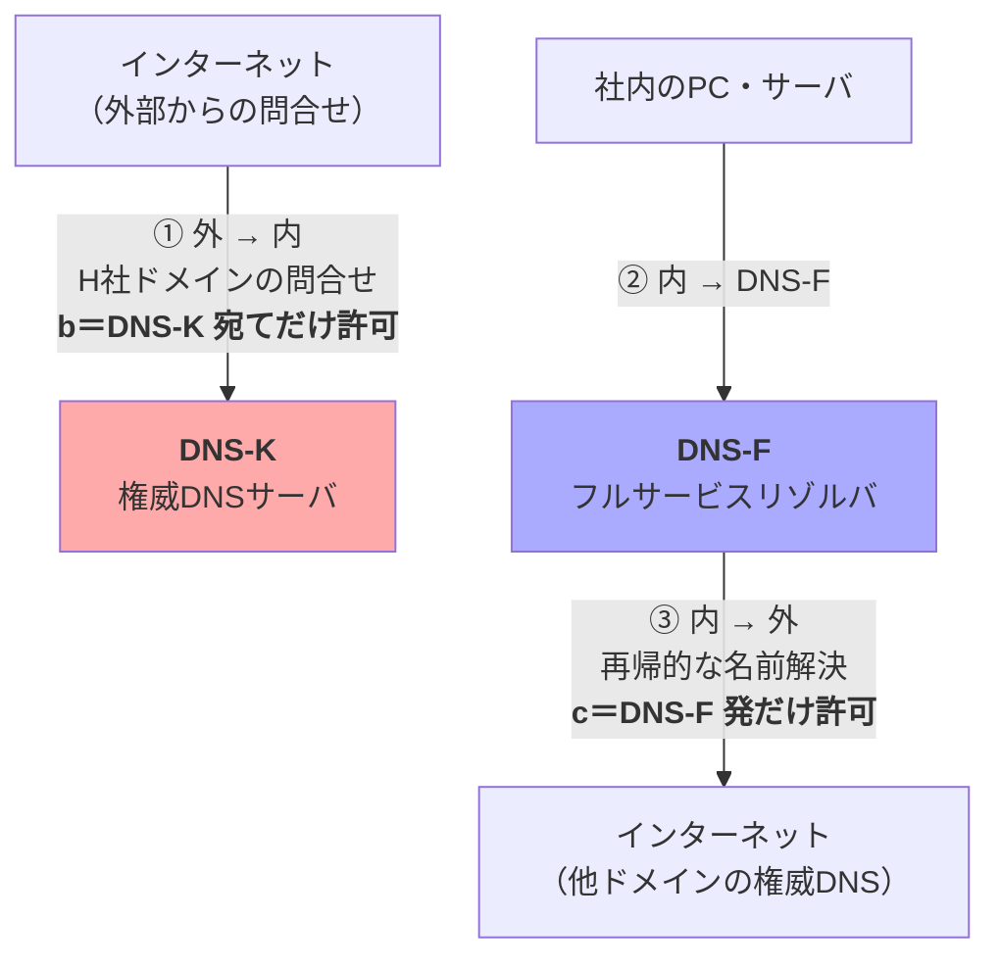

- 外 → 内 のDNS通信は **DNS-K宛てだけ**許可すればよい（DNS-Fに外から問い合わせさせる理由がない）
- 内 → 外 のDNS通信は **DNS-F発だけ**許可すればよい（他の端末が直接外に問い合わせる必要がない）

**なぜこれがDNSリフレクション攻撃（表4 項番3）の対策になるのか**

DNSリフレクション攻撃は、**オープンリゾルバ**（誰からの再帰問合せにも答えてしまうDNSサーバ）を踏み台にする。

```text
攻撃者 → [送信元IPを被害者に偽装した問合せ] → オープンリゾルバ
                                                    ↓ 大きな応答
                                              被害者（大量の応答が殺到）
```

H社の現DNSサーバは**権威とフルサービスリゾルバを1台で兼ねている**。権威機能のために外部からのDNS通信を受け付けている以上、**フルサービスリゾルバ機能も外から叩けてしまう＝オープンリゾルバ状態**になりうる。2台に分離し、**外からはDNS-Kにしか届かないようにする**ことで踏み台化を防ぐ。

**+α：DNSサーバ分離の一般的なメリット**

| メリット                             | 内容                                                                 |
| ------------------------------------ | -------------------------------------------------------------------- |
| 踏み台化の防止                       | オープンリゾルバ化を防ぎ、<br>リフレクション／アンプ攻撃に加担しない |
| キャッシュポイズニング<br>の影響限定 | 権威サーバはキャッシュを持たない                                     |
| 可用性の分離                         | 権威サーバがDDoSを受けても<br>社内の名前解決は継続できる             |

> **落とし穴**：bとcを逆に書かない。「**外から来るのは権威（DNS-K）、外へ出すのはリゾルバ（DNS-F）**」と唱えて覚える。

---

### 設問2(1)　空欄d・e　MFAを突破するフィッシングの手順

> **設問2**　〔対策V-1についての検討〕について答えよ。
> **(1)** 表5中の　**d**　，　**e**　に入れる、不正な接続までの攻撃手順を、具体的に答えよ。
>
> （表5 多要素認証を狙った攻撃例／攻撃例1）表2（ア）と組み合わせた多要素認証を突破するフィッシング攻撃であり、次の手順で行われる。
> (1) 攻撃者が、フィッシングメールを使って、VPNダイアログの画面を装った罠のWebサイトに正規利用者を誘導し、正規利用者に利用者IDとパスワードを入力させる。
> (2) **d**
> (3) **e**
> (4) 攻撃者が、社内ネットワークに不正に接続する。

**解答**

| 欄    | 解答例                                                                                                                                                                |
| ----- | --------------------------------------------------------------------------------------------------------------------------------------------------------------------- |
| **d** | **攻撃者が、正規のVPNダイアログに利用者IDとパスワードを入力すると、<br>正規利用者のスマートフォンにセキュリティコードが送信される。**                                 |
| **e** | **正規利用者が受信したセキュリティコードを、罠のWebサイトに入力すると、<br>攻撃者がそれを読み取り、正規のセキュリティコード入力画面に<br>入力することで認証される。** |

**解説**

**本文の根拠**

| 記述                                                                                                                                                                     | 出典               |
| ------------------------------------------------------------------------------------------------------------------------------------------------------------------------ | ------------------ |
| （ア）スマートフォンにSMSでセキュリティコードを送り、<br>その入力を確認する方式                                                                                          | 表2 多要素認証機能 |
| VPNダイアログに利用者IDとパスワードを入力し、その認証が完了すると、<br>**セキュリティコード入力画面が表示され**、SMSでセキュリティコードが<br>スマートフォンに送信される | 表2 注1            |

**攻撃の流れ — リアルタイム中継型（AiTM）フィッシング**

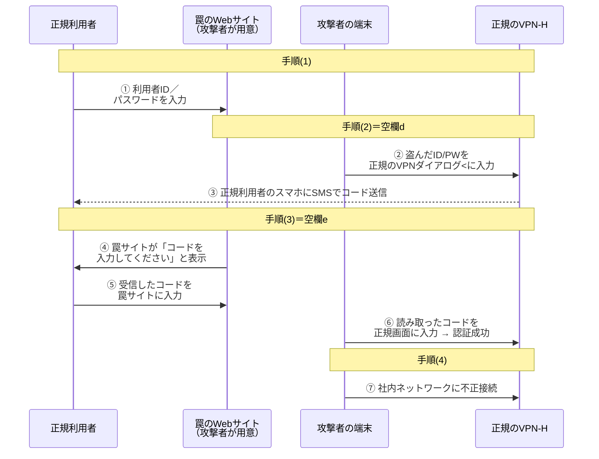

**この攻撃の肝**は「**攻撃者がリアルタイムで正規サイトに中継している**」こと。攻撃者はID/PWを盗んだ**その場で**正規サイトにログインを試み、正規利用者のスマホに**本物のSMS**を飛ばさせる。利用者から見ると「ログインしたらコードが届いた」という**完全に正常な体験**なので疑いようがない。

**+α：なぜOTP型MFAは破られるのか**

| 表2の方式                                          | この攻撃に耐えるか | 理由                                                           |
| -------------------------------------------------- | ------------------ | -------------------------------------------------------------- |
| （ア）SMSのセキュリティコード                      | ❌ 破られる         | コードは**人が読んで入力する値**<br>＝中継できる               |
| （ウ）プッシュ通知の承認                           | ❌ 破られうる       | 攻撃例2の**多要素認証疲労攻撃**<br>（承認を連打させる）        |
| **（イ）デジタル証明書による<br>クライアント認証** | ✅ **耐える**       | **秘密鍵が端末から出ない**。<br>中継しても攻撃者は署名できない |

T主任が最終的に「**方式は、表2（イ）の方式を採用する**」と決めているのは、まさにこの理由。**フィッシング耐性のあるMFA＝証明書ベース／FIDO2・パスキー**、という結論を覚えておく。

> **落とし穴**：dとeの役割分担を間違えない。**d＝攻撃者が正規サイトにログインしてSMSを飛ばさせる**、**e＝利用者が罠サイトにコードを入れ、攻撃者がそれを転記する**。「攻撃者が」「正規利用者が」の主語を必ず書き分ける。

---

### 設問2(2)　下線②　注意喚起の内容

> **(2)** 本文中の下線②について、注意喚起の内容を、具体的に答えよ。
>
> （T主任の発言）当社では、業務の手続の督促などで従業員にURLリンクが含まれるメールを送っているので、URLリンクのクリックを禁止することはできません。不審なURLかどうかを見極めさせることは難しいでしょう。そこで、**②たとえ罠のWebサイトへのURLリンクをクリックしてしまっても、不正なリモート接続をされないように、従業員全員が理解できる内容を、注意喚起する必要があります。**

**解答**：**認証情報の入力は、受信したメール内のURLリンクをクリックして起動した画面には行わず、VPNダイアログにだけ行う。**

**解説**

**本文が先に選択肢を消している**ことに気付けるかが勝負。

| 案                             | 可否 | 本文の記述                                                                                                                             |
| ------------------------------ | ---- | -------------------------------------------------------------------------------------------------------------------------------------- |
| URLリンクをクリックしない      | ❌    | 「業務の手続の督促などで従業員に<br>URLリンクが含まれるメールを送っているので、<br>**URLリンクのクリックを禁止することはできません**」 |
| 不審なURLを見極める            | ❌    | 「不審なURLかどうかを<br>**見極めさせることは難しいでしょう**」                                                                        |
| **認証情報の入力先を限定する** | ✅    | クリックは許したまま、<br>**被害の成立を止められる**                                                                                   |

下線②が「**たとえ……クリックしてしまっても**」と書いているのが決定的なヒント。**クリックを防ぐ対策ではなく、クリックした後で被害を止める対策**を答えさせている。

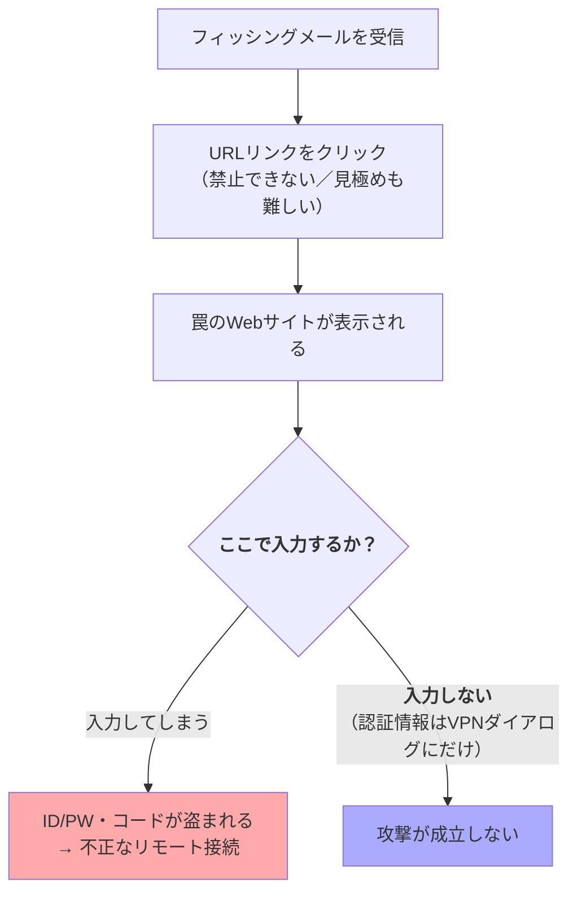

**なぜこれが有効か**：攻撃例1の成立条件は「**利用者が罠サイトにID/PW（とコード）を入力すること**」。VPN接続はそもそも**VPNクライアントソフトウェアを起動して表示されるVPNダイアログ**で行うものであり、メールのリンクから開いた画面で行うものではない。**「入力してよい画面」を利用者側で固定する**ことで、罠サイトがどれだけ精巧でも入力されなくなる。

**「従業員全員が理解できる内容」という条件**：「ドメインを確認せよ」「証明書を確認せよ」は専門知識が要る。**「認証情報はVPNダイアログにだけ入力する」なら誰でも守れる**。この**実行可能性**まで踏まえた解答が求められている。

**+α：フィッシング対策の階層**

```text
① 届かせない       … メールフィルタ、SPF/DKIM/DMARC
② クリックさせない  … 教育、URL書換え・サンドボックス
③ 入力させない      ← ★本問の答え。入力先を限定する運用
④ 入力されても無効  … フィッシング耐性MFA（証明書、FIDO2）
```

本問は③、そしてT主任の最終判断（表2（イ）の採用）が④に相当する。**教育だけに頼らず技術で潰す**という流れになっている点も読み取っておきたい。

> **落とし穴**：「不審なメールのリンクをクリックしない」と書くと、本文でT主任が明確に否定している内容になり0点。**本文が消した選択肢を答えない**のは午後試験の鉄則。

---

### 設問3(1)　下線③　設定Pを突破する方法（30字以内）

> **設問3**　〔対策V-3についての検討〕について答えよ。
> **(1)** 本文中の下線③について、設定Pを突破する方法を、**30字以内**で答えよ。
>
> （T主任の発言）VPN-Hには、どのような通信要求に対しても応答しない"Deny-All"を設定した上で、**あらかじめ設定されている順番にポートに通信要求した場合だけ**所定のポートへの接続を許可するという設定（以下、設定Pという）があります。……設定されている順番を攻撃者が知らなくても、**③攻撃者が何らかの方法でパケットを盗聴できた場合、設定Pを突破されてしまいます。**

**解答**：**盗聴したパケットと同じ順番に通信要求を送信する。**

**解説**

設定P＝**ポートノッキング**。その「秘密」は**ポート番号の並び（ノックシーケンス）という静的な情報**でしかなく、しかもその情報は**通信そのものに平文で現れる**。一度盗聴されれば**そのまま再送（リプレイ）するだけ**で突破できる。

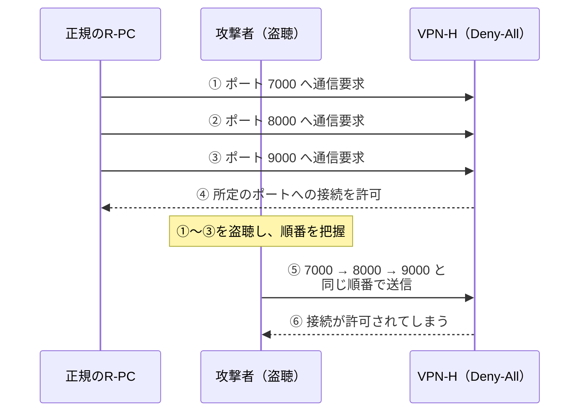

これは暗号の世界でいう「**知識を毎回同じ形で提示する認証は、リプレイ攻撃に弱い**」という一般則そのもの。

> **落とし穴**：「ポート番号を総当たりする」は誤り。下線③は「**パケットを盗聴できた場合**」という前提を置いているので、盗聴した情報を使う方法を答える。また「同じパケットを送る」だけでは弱く、**「同じ順番に」**という要素が核心。

---

### 設問3(2)　下線④　SPAが突破されない理由（40字以内）

> **(2)** 本文中の下線④について、突破されないのはなぜか。**40字以内**で答えよ。
>
> （T主任の発言）SPAなら、**④攻撃者が何らかの方法でパケットを盗聴できたとしても、突破はされません。**

**解答**：**SPAパケットはユニークであり、同じパケットを再利用すると破棄されるから**

**解説**

**表6 SPAの主な仕様を、何を守る仕様かで整理する**

| 項番  | 内容                                                                                                                                                             | 何を守るか                         |
| ----- | ---------------------------------------------------------------------------------------------------------------------------------------------------------------- | ---------------------------------- |
| 1     | SPAパケットには**HMACベースの<br>ワンタイムパスワード**が含まれ、<br>送信元の真正性を検証できる                                                                  | **真正性**<br>（なりすまし防止）   |
| **2** | SPAパケットには**ランダムデータ**が含まれ、<br>送信先で検証される。**以前受信したものと<br>同じランダムデータをもつSPAパケットを<br>受信した場合は、破棄される** | **リプレイ防止** ← ★               |
| 3     | 最後尾フィールドに先行フィールドの<br>**ハッシュ値**が格納され、<br>検証に失敗すれば破棄                                                                         | **完全性**<br>（改ざん防止）       |
| 4     | 送信先では、**検証した結果を<br>送信元に返さない**                                                                                                               | **ステルス性**<br>（探索されない） |

問われているのは「**盗聴できたとしても**突破されない理由」。盗聴した攻撃者にできるのは**そのパケットをそのまま再送すること（リプレイ）**だけである。それを直接潰しているのが**項番2**。

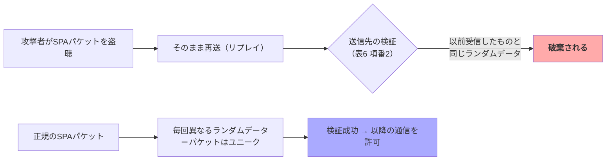

**設定P（ポートノッキング）との対比 — ここが本問の核心**

|                  | 設定P（ポートノッキング）      | SPA                                     |
| ---------------- | ------------------------------ | --------------------------------------- |
| 認証の材料       | ポート番号の**固定された並び** | **HMACベースのOTP＋<br>ランダムデータ** |
| 毎回変わるか     | ❌ 変わらない                   | ✅ 変わる                                |
| **リプレイ耐性** | ❌ **なし**                     | ✅ **あり（項番2）**                     |
| 改ざん検知       | ❌ なし                         | ✅ あり（項番3）                         |
| 結果の応答       | —                              | 返さない（項番4）                       |
| パケット数       | 複数回のノック                 | **1パケット**                           |

**なぜ項番1や3ではなく項番2なのか**

| 項番                    | 防ぐもの     | 盗聴＋再送には効くか                        |
| ----------------------- | ------------ | ------------------------------------------- |
| 1（HMAC-OTP）           | なりすまし   | △ 盗聴した正規パケットは<br>OTP自体が正しい |
| 3（ハッシュ値）         | 改ざん       | ❌ 改ざんせず再送されたら防げない            |
| **2（ランダムデータ）** | **リプレイ** | ✅ **そのままの再送を直接止める**            |

**+α：SPAとゼロトラスト**

SPAは **SDP（Software Defined Perimeter）** の中核技術で、「**接続が認証されるまでサーバは存在しないように見える**」（＝Deny-All＋応答を返さない）を実現する。攻撃の第一段階である**ポートスキャンによる偵察を無効化**できるため、**方法2（製品名・型番を調べて脆弱性を探す）に対する根本対策**になる。

> **落とし穴**：「HMACで認証しているから」だけでは、リプレイの話に答えていない。**「同じパケットを再利用すると破棄される」というリプレイ防止**を明示する。

---

### 設問4(1)　下線⑤　利用する外部のサービス（20字以内）

> **設問4**　〔DDoS攻撃に対する具体的対策の検討〕について答えよ。
> **(1)** 本文中の下線⑤について、利用する外部のサービスを、**20字以内**で具体的に答えよ。
>
> （本文）まず、通信回線については、DDoS攻撃で大量のトラフィックが発生すると、使えなくなる。これについては、通信回線の帯域を大きくするという方法のほか、**⑤外部のサービスを利用するという方法がある**ことが分かった。

**解答（いずれか）**

- **DDoS対策機能を有するCDNサービス**
- **クラウド型ファイアウォールサービス**
- **ISPが提供するDDoS防御サービス**

**解説**

回線が飽和する攻撃は、**トラフィックが自社の回線に到達した時点で負け**。UTMのIPS/WAFをどれだけ強化しても、その手前の回線が詰まっていれば意味がない。したがって、**自社の回線に届く前に、上流（インターネット側）で吸収・遮断する**しかない。

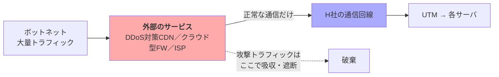

| サービス                                    | 仕組み                                                                                               |
| ------------------------------------------- | ---------------------------------------------------------------------------------------------------- |
| **DDoS対策機能を有するCDN**                 | 世界中のエッジに**巨大な帯域**を持ち、<br>攻撃トラフィックを分散吸収。<br>正常な通信だけをオリジンへ |
| **クラウド型ファイアウォール<br>（FWaaS）** | クラウド側で通信を検査し、<br>不正な通信を落としてから自社へ                                         |
| **ISPのDDoS防御サービス**                   | ISPの網内で検知・遮断<br>（ブラックホールルーティング、<br>スクラビングセンター）                    |

**+α：DDoSの3分類と対策レイヤ**

| 分類                             | 例                                 | 詰まる場所                      | 有効な対策                              |
| -------------------------------- | ---------------------------------- | ------------------------------- | --------------------------------------- |
| **容量枯渇型<br>（Volumetric）** | UDP Flood<br>DNS/NTPリフレクション | **回線帯域**                    | **上流での吸収<br>（CDN/ISP）** ← 下線⑤ |
| プロトコル型                     | SYN Flood                          | FW/LBの<br>セッションテーブル   | IPS、SYN Cookie                         |
| アプリケーション型               | HTTP GET Flood<br>Slowloris        | Webサーバ/DBの<br>CPU・スレッド | WAF、レート制限                         |

本文が「**通信回線については**」と限定しているので、狙いは**容量枯渇型への対策**。だから「WAFを導入する」では答えにならない。

> **落とし穴**：単に「CDN」「クラウドサービス」では不十分。**DDoS対策機能を持つ**ことを明示する。20字以内なので「DDoS対策機能を有するCDNサービス」がちょうど収まる。

---

### 設問4(2)　下線⑥　取引先向けWebサーバの影響が更に軽減できる理由（40字以内）

> **(2)** 本文中の下線⑥について、軽減できる理由を、**40字以内**で答えよ。
>
> （本文）加えて、取引先向けWebサーバについては、次の対応によって、**⑥更にDDoS攻撃の影響を軽減できる**ことが分かった。
> ・取引先には、H社との取引専用のPC（以下、取引専用PCという）を貸与する。取引専用PCには、Sソフトを導入する。
> ・取引専用PCごとのIDと秘密情報を、S-APPLと取引専用PCそれぞれに設定する。
> ・S-APPLに、取引専用PCがVPN確立後にアクセス可能なサーバとして、取引先向けWebサーバだけを設定する。
> ・UTMのファイアウォール機能で、インターネットから取引先向けWebサーバへの通信を拒否するように設定する。

**解答（いずれか）**

- **取引専用PC以外からの通信は取引先向けWebサーバに到達しないから**
- **UTMの設定変更によって、ボットネットからの通信が遮断されるから**
- **UTMの設定変更に伴って、外部からの接続対象サーバではなくなったから**

**解説**

対応前は、取引先向けWebサーバは**インターネットに公開された（誰でも到達できる）サーバ**だった。だからボットネットからのHTTP GET Floodをそのまま浴びる。

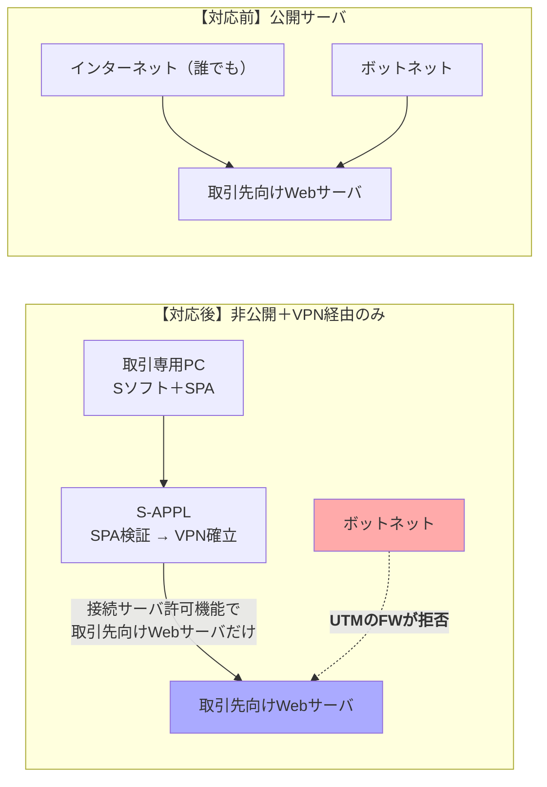

対応後の4段構え。

| #   | 対応                                                                       | 効果                                                  |
| --- | -------------------------------------------------------------------------- | ----------------------------------------------------- |
| 1   | UTMで**インターネット → 取引先向けWeb<br>サーバの通信を拒否**              | **公開サーバではなくなった**                          |
| 2   | 取引先は**VPN（S-APPL）経由でのみ**到達                                    | 経路が1本に絞られる                                   |
| 3   | VPNを張るには**SPAパケットの検証**を通る<br>必要がある（表7 項番1）        | ボットネットは秘密情報を<br>持たないのでSPAを通れない |
| 4   | **接続サーバ許可機能**で取引先向けWeb<br>サーバにしか行けない（表7 項番4） | 横移動も封じる                                        |

結果、**攻撃トラフィックは取引先向けWebサーバに1パケットも届かない**。

**「更に」という言葉の意味**

すでにUTMのIPS/WAF有効化で「サーバへの影響を軽減できる」ことは確認済み。それは**攻撃を受けた上で捌く**対策。下線⑥は**そもそも攻撃を受けなくする**対策なので「更に」軽減できる。

| 対策の性質                | 内容                       |
| ------------------------- | -------------------------- |
| **緩和**（IPS/WAF有効化） | 攻撃は届く。届いた上で捌く |
| **遮断**（下線⑥）         | **そもそも攻撃が届かない** |

**+α：ZTNA（Zero Trust Network Access）**

この構成は ZTNA そのもの。「アプリケーションをインターネットに公開せず、認証・認可を通った接続だけをアプリに中継する」という考え方で、

- DDoSの**攻撃面（アタックサーフェス）が消える**
- **脆弱性を突かれる機会も消える**（方法2への対策にもなっている）

という二重の効果がある。

> **落とし穴**：「VPNを使うから安全」では説明になっていない。**「インターネットからは到達できなくなった」＝攻撃対象でなくなった**という因果を書く。

---

### 問2の学習ポイントまとめ

| 対策           | 攻撃方法                      | 実現手段（最終形）                                                                                            |
| -------------- | ----------------------------- | ------------------------------------------------------------------------------------------------------------- |
| V-1 認証強化   | 方法1（認証情報を推測）       | 表7 項番3 多要素認証機能。<br>方式は**表2（イ）デジタル証明書による<br>クライアント認証**（フィッシング耐性） |
| V-2 脆弱性対策 | 方法2（脆弱性を悪用）         | S-APPLの脆弱性情報を収集し、<br>修正プログラムを適用                                                          |
| V-3 ステルス化 | 方法2（ポートスキャンで偵察） | 表7 項番1 **SPA機能**<br>（ポートノッキングの上位互換）                                                       |
| DDoS（回線）   | 容量枯渇型                    | **外部サービス**<br>（DDoS対策CDN等）                                                                         |
| DDoS（サーバ） | SYN/UDP/HTTP GET Flood        | UTMのIPS/WAF有効化 ＋<br>**取引先向けWebサーバの非公開化**                                                    |

---

## 問3 Webセキュリティ（D社）

### 題材の整理

| 項目      | 内容                                                                                                                   |
| --------- | ---------------------------------------------------------------------------------------------------------------------- |
| 企業      | **D社**：従業員1,000名の小売業。<br>Webアプリ診断を専門会社**Z社**に委託                                               |
| Z社の診断 | 脆弱性診断ツールによるスキャンだけでなく、<br>**手動による高度な分析も行う**                                           |
| サイトX   | **ECサイト**。会員に商品を販売。<br>取引は**毎月10,000件**ほどを見込む                                                 |
| サイトY   | **商品企画サイト**。顧客参加型。<br>**サイトP**（V大学の情報交換サイト）の情報を表示                                   |
| 基盤      | W社の**クラウドW**。<br>仮想Webサーバサービス＋<br>リレーショナルデータベースサービス。<br>いずれも**CMS**を使って構築 |

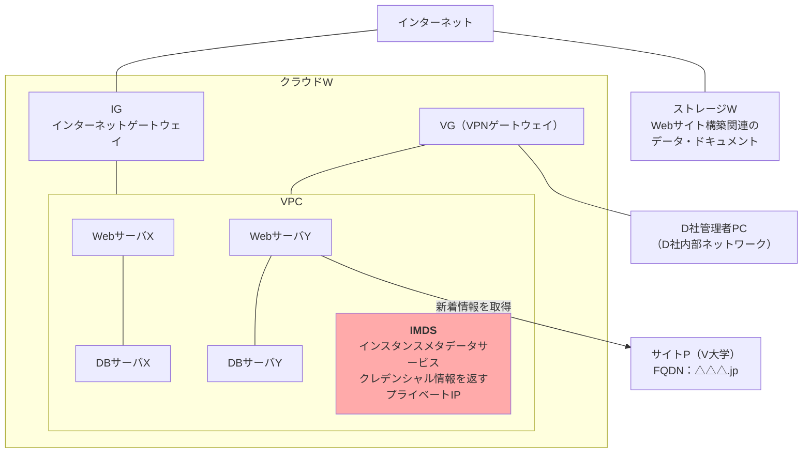

**検出された脆弱性**

| サイト                  | 用途                | 検出された脆弱性              |
| ----------------------- | ------------------- | ----------------------------- |
| **サイトX**（EC）       | 会員への商品販売    | **XSS／CSRF／認可制御の不備** |
| **サイトY**（商品企画） | サイトPの情報を表示 | **SSRF**                      |

**押さえるべき前提条件（設問の根拠になる）**

| #   | 記述                                                                                                   | 出典        |
| --- | ------------------------------------------------------------------------------------------------------ | ----------- |
| 1   | サイトXの `SESSIONID` には**値とSecure属性だけ**が<br>セットされる → **HttpOnly属性がない**            | 〔サイトX〕 |
| 2   | サーバ側のセッションの有効期間は**24時間**                                                             | 〔サイトX〕 |
| 3   | サイト管理機能は、D社の内部ネットワーク以外からも<br>利用する可能性があり、**接続元の制限は行わない**  | 〔サイトX〕 |
| 4   | IMDSは**方式1**（URLにアクセスするだけで<br>情報が取れる）を採用                                       | 図2         |
| 5   | CMSの管理ログイン画面へのログインは<br>**POSTメソッドでは許可されるが、<br>GETメソッドでは許されない** | 図2         |
| 6   | 各CMSの管理者アカウントは<br>**初期パスワードのまま**運用する                                          | 図2         |
| 7   | 注文管理番号＝**注文年月である数字6桁**と<br>**ランダムな英大文字6桁**をハイフンでつないだ値           | 表1 項番3   |

---

### 設問1(1)　下線①　スクリプトが出力される機能

> **設問1**　〔XSSについて〕について答えよ。
> **(1)** 本文中の下線①について、図3中のリクエスト内のスクリプトが出力されるのはどの機能か。**表1の詳細機能に対する項番**を選び答えよ。
>
> （本文）図3中のレスポンスボディには、問合せ機能で入力した値は出力されていない。しかし、Z社は、**①設計書を調査した上で手動による分析を行い、図3中のリクエスト内のスクリプトが別の機能の画面に出力されること**を確認した。

**解答**：**9**

**解説**

**本文の根拠**

| 記述                                                                                           | 出典                     |
| ---------------------------------------------------------------------------------------------- | ------------------------ |
| `POST /shop/contact` で `name=`（URLデコードすると<br>`"><script>alert(1)</script><"`）を送信  | 図3 ＋ 注記              |
| 問合せ情報を入力できる。入力した問合せ情報は、<br>**数字10桁の管理番号が発番され、管理される** | 表1 **項番5 問合せ機能** |
| **項番9 問合せ管理機能**：問合せ機能で入力された<br>**問合せ情報が閲覧できる**                 | 表1 **項番9**            |

**格納型XSSの入口と出口**

```mermaid
flowchart LR
  A["攻撃者"] -->|"① 問合せ機能（項番5）に<br/>スクリプトを入力<br/>＝ログイン前でも可"| DB[("DBに保存")]
  DB -->|"② 問合せ管理機能（項番9）で<br/>閲覧したときに出力"| V["D社管理者のブラウザで実行"]
  style DB fill:#aaf
  style V fill:#faa
```

XSSには**入力される場所（入口）と出力される場所（出口）が別**のパターンがある。これが**格納型（蓄積型／Stored）XSS**。

| 位置 | 機能                        | 誰が使うか                           |
| ---- | --------------------------- | ------------------------------------ |
| 入口 | 問合せ機能（**項番5**）     | 誰でも、**ログインせずに**入力できる |
| 出口 | 問合せ管理機能（**項番9**） | **D社管理者だけ**が閲覧する          |

だから図3のレスポンスには出力されない（＝**反射型ではない**）。Z社が「①**設計書を調査した上で**手動による分析を行い」とわざわざ書いているのは、**ツールのスキャンだけでは入口と出口が離れた格納型XSSは見つけにくい**ことを示している。冒頭の「Z社のWebアプリ診断は、脆弱性診断ツールによるスキャンだけではなく、**手動による高度な分析も行う**」という伏線の回収になっている。

**+α：XSSの3類型**

| 類型                     | 入口                       | 出口                               | 特徴                                                                     |
| ------------------------ | -------------------------- | ---------------------------------- | ------------------------------------------------------------------------ |
| 反射型<br>（Reflected）  | リクエストの<br>パラメータ | **同じリクエストの<br>レスポンス** | 罠リンクを<br>踏ませる必要がある                                         |
| **格納型<br>（Stored）** | 入力フォーム等             | **後から別の画面で**               | 保存されるので**被害が広範**。<br>管理画面が出口だと<br>管理者が狙われる |
| DOM based                | URLフラグメント等          | ブラウザ内の<br>JavaScript処理     | サーバのレスポンスには<br>現れない                                       |

> **落とし穴**：項番5（問合せ機能）と答えない。問われているのは「**出力される**のはどの機能か」であって、入力した機能ではない。

---

### 設問1(2)　下線②　全会員の利用者情報を取得する手順

> **(2)** 本文中の下線②について、攻撃者はどのような手順で利用者情報を取得するか。具体的に答えよ。
>
> （本文）Z社は、**②攻撃者がこのXSSを悪用してサイトX内の全会員の利用者情報を取得する**可能性があると説明した。

**解答**：**攻撃者がわなリンクを用意し、管理者にそのリンクを踏ませることで管理者権限のcookieを攻撃者のWebサイトに送信させ、その値を読み取って利用することで管理者としてサイトXにアクセスし、利用者情報を取得する。**

**解説**

**「全会員」に到達する経路を逆算する**

```text
「全会員の利用者情報」を持っているのは誰か？
  → 会員管理機能（表1 項番8）にアクセスできる D社管理者
管理者になるには？
  → 管理者のセッションを乗っ取る
どうやって？
  → 項番9（問合せ管理機能）の格納型XSSは、管理者のブラウザで実行される
cookieは読めるのか？
  → SESSIONID に HttpOnly属性がない → document.cookie で読める
盗んだ後どこからアクセスする？
  → サイト管理機能は接続元の制限を行わない → どこからでもアクセスできる
```

**本文の4つのピース**

| #   | 記述                                                                               | 効果                                         |
| --- | ---------------------------------------------------------------------------------- | -------------------------------------------- |
| 1   | SESSIONIDには、**値とSecure属性だけ**が<br>セットされる                            | **HttpOnlyがない**<br>＝JavaScriptから読める |
| 2   | サーバ側のセッションの有効期間は**24時間**                                         | 盗んだ後に悪用する時間がある                 |
| 3   | **項番8 会員管理機能**：登録された会員の<br>利用者情報を**閲覧**、変更、削除できる | **全会員の情報がここにある**                 |
| 4   | サイト管理機能は……**接続元の制限は行わない**                                       | **攻撃者がどこからでも<br>アクセスできる**   |

```mermaid
sequenceDiagram
    participant A as 攻撃者
    participant X as サイトX
    participant M as D社管理者
    participant E as 攻撃者のWebサイト
    A->>X: ① 問合せ機能に<br>スクリプトを格納（下線①）
    M->>X: ② 問合せ管理機能で<br>問合せを閲覧
    X-->>M: ③ スクリプトが管理者の<br>ブラウザで実行
    M->>E: ④ document.cookie の<br>SESSIONID を送信
    Note over M,E: HttpOnlyがないので読み取れる
    A->>E: ⑤ 盗んだSESSIONIDを取得
    A->>X: ⑥ SESSIONIDをセットして<br>管理者としてアクセス<br>（接続元制限がないので<br>どこからでも可）
    X-->>A: ⑦ 会員管理機能（項番8）で<br/>全会員の利用者情報を取得
```

**解答例が「わなリンク」と書いている点について**

IPA解答例は「攻撃者がわなリンクを用意し、管理者にそのリンクを踏ませる」という書き方をしている。格納型XSSの文脈では「**問合せ機能に仕込んだスクリプトを管理者が問合せ管理機能で閲覧する**」という筋も十分に成立し、そちらのほうが下線①とつながる。採点上の本質は、次の**3段のストーリー**が書けているかである。

1. **cookie（SESSIONID）を窃取する**
2. **管理者になりすましてサイトXにアクセスする**
3. **会員管理機能で全会員の利用者情報を取得する**

**+α：なぜHttpOnlyがないことが致命的か**

| 属性         | 効果                           | サイトXでは                          |
| ------------ | ------------------------------ | ------------------------------------ |
| Secure       | HTTPS通信でのみ送信            | ✅ セット済み                         |
| **HttpOnly** | **JavaScriptから読めなくする** | ❌ **未設定** ← 急所                  |
| SameSite     | クロスサイトでの送信を制限     | ❌ 未設定<br>（設問2(2)で追加を検討） |

HttpOnlyがあれば、XSSが成立してもcookieの窃取だけは防げる（**多層防御**）。「XSS対策＝出力エスケープ」が根本対策だが、**HttpOnlyは保険的対策**として必ずセットで覚える。

> **落とし穴**：「XSSでスクリプトを実行して情報を盗む」では粗すぎる。**誰の（管理者の）／何を（cookie＝SESSIONID）／どう使って（なりすまして）／どこから（会員管理機能）**を書く。

---

### 設問2(1)　下線③　利用者に被害を与える攻撃の手順

> **設問2**　〔CSRFについて〕について答えよ。
> **(1)** 本文中の下線③について、被害を与える攻撃の手順を、具体的に答えよ。
>
> （本文）Z社は、手順1, 2の応答が"エラー"であることから一定のCSRF対策ができているが、手順3の応答が"正常に処理"であることから**③利用者に被害を与える可能性がある**と判断した。
>
> （表2 リクエスト内のメッセージボディと応答）
>
> | 手順 | リクエスト内のメッセージボディ | 応答 |
> | --- | --- | --- |
> | 1 | `sei=sato&mei=taro&mail=aaa%40example.jp&csrf_token=` | エラー |
> | 2 | `sei=sato&mei=taro&mail=aaa%40example.jp` | エラー |
> | 3 | `sei=sato&mei=taro&mail=aaa%40example.jp&csrf_token=`<br>（**異なる利用者アカウントで取得したcsrf_tokenの値**） | **正常に処理** |

**解答**：**攻撃者が自らのアカウントで取得したcsrf_tokenと一緒に利用者情報をサイトXに送るように構成したわなフォームに、詐欺メールなどで利用者を誘導し、利用者情報を変更させる。**

**解説**

**表2が示していること**

| 手順                    | 分かること                                   |
| ----------------------- | -------------------------------------------- |
| 1（空のtoken）          | トークンの**存在**はチェックしている         |
| 2（パラメータ自体なし） | 同上                                         |
| **3（他人のtoken）**    | **トークンとセッションが紐付いていない** ← ★ |

CSRFトークンが機能するための条件は2つある。

```text
① トークンが存在すること                 ← サイトXは ✅ チェックしている
② トークンが「そのセッションのもの」であること ← サイトXは ❌ チェックしていない
```

②が欠けていると、**攻撃者は自分のアカウントでログインしてトークンを1つ入手し、それを罠フォームに埋め込むだけ**でCSRFが成立する。トークンが「誰のものか」を見ていないので、被害者のセッションで送っても通ってしまう。

```mermaid
sequenceDiagram
    participant A as 攻撃者
    participant X as サイトX
    participant V as 被害者
    A->>X: ① 自分のアカウントでログイン
    X-->>A: ② csrf_token を取得
    A->>A: ③ ②のトークンを埋め込んだ罠フォームを作成
    A->>V: ④ 詐欺メールで罠フォームへ誘導
    V->>X: ⑤ 被害者のブラウザが送信<br/>（cookieは自動付与 ＋ 攻撃者のトークン）
    X-->>V: ⑥ 「正常に処理」＝<b>利用者情報が変更される</b>
```

**被害の内容**

攻撃対象は図4のリクエスト `POST /shop/editmember`（会員機能（編集）＝表1 項番4）。ここで `sei` `mei` `mail` が変更できる。**メールアドレスを攻撃者のものに書き換えられると**、その後のパスワードリセット等でアカウントを完全に乗っ取られうる。

**なぜ「詐欺メールなどで誘導」が必要か**：CSRFは**被害者のブラウザにリクエストを送らせる**攻撃なので、被害者に罠ページを開かせる必要がある。ここを省くと攻撃が成立しない。

**+α：CSRF対策の実装パターン**

| 方式                   | 内容                                                                       | 注意点                                               |
| ---------------------- | -------------------------------------------------------------------------- | ---------------------------------------------------- |
| **Synchronizer Token** | セッションに紐付いたトークンを発行し、<br>**セッションと突き合わせて**検証 | **本問の欠陥はここ**。<br>存在チェックだけでは無意味 |
| Double Submit Cookie   | cookieとリクエストボディの両方に<br>同じ値を入れて一致を見る               | サブドメインからの<br>cookie注入に注意               |
| **SameSite属性**       | ブラウザ側でクロスサイト送信を制限                                         | 本問の対策案の2つ目                                  |
| Origin/Referer検証     | リクエスト元を確認                                                         | ヘッダが送られない環境に注意                         |
| パスワード再入力       | 重要操作時に本人確認                                                       | UXとのトレードオフ                                   |

> **落とし穴**：「CSRF攻撃を行う」だけでは点にならない。**「攻撃者が自分のトークンを入手して罠フォームに埋め込む」**という、この事例特有の一手を必ず書く。

---

### 設問2(2)　表3 空欄a〜d　SameSite属性

> **(2)** 表3中の　**a**　〜　**d**　に入れる適切な内容を、**"○"又は"×"から選び**答えよ。
>
> （表3 SameSite属性の値の違いによるcookie送信の有無）
>
> | SameSite<br>属性の値 | サイトX内で遷移<br>GET | サイトX内で遷移<br>POST | 外部WebサイトからサイトXに遷移<br>GET | 同<br>POST |
> | --- | --- | --- | --- | --- |
> | Strict | ○ | ○ | **a** | **b** |
> | Lax | ○ | ○ | **c** | **d** |
> | None | ○ | ○ | （省略） | （省略） |
>
> 注記　"○"はcookieが送られることを示す。"×"はcookieが送られないことを示す。

**解答**：**a＝×、b＝×、c＝○、d＝×**

**解説**

```mermaid
flowchart TD
  S["<b>Strict</b><br/>クロスサイトでは一切送らない"] --> S1["外部からのGET ✕<br/>外部からのPOST ✕"]
  L["<b>Lax</b><br/>クロスサイトでも安全な遷移なら送る"] --> L1["外部からのGET（トップレベル遷移） ○<br/>外部からのPOST ✕"]
  N["<b>None</b><br/>常に送る（Secure必須）"] --> N1["外部からのGET ○<br/>外部からのPOST ○"]
  style S fill:#aaf
  style N fill:#faa
```

| 値         | 考え方                                                                                                        | 副作用                                                           |
| ---------- | ------------------------------------------------------------------------------------------------------------- | ---------------------------------------------------------------- |
| **Strict** | クロスサイトのリクエストには<br>**一切cookieを付けない**                                                      | 外部サイトのリンクから来ると<br>**ログアウト状態で表示**される   |
| **Lax**    | **トップレベルのGETナビゲーション**<br>（リンククリック等）だけ許す。<br>POST・iframe・画像・Ajaxでは送らない | 実用性とのバランスが良い。<br>**現代の主要ブラウザのデフォルト** |
| **None**   | 常に送る（`Secure` 属性が必須）                                                                               | CSRF対策にならない。<br>クロスサイトで使うcookieのみ             |

**Laxが「GETだけ○」なのはなぜか**

GETは仕様上**安全なメソッド（safe method）＝状態を変更しない**とされている。だから「リンクをクリックして遷移する」程度なら害がないとみなして通す。一方POSTは**状態を変更する**ので、クロスサイトからは通さない。

裏を返すと、**GETで状態を変更する実装をしていると、Laxでは守れない**。設計上の教訓として重要。

**本問のCSRF対策としての評価**

図4のリクエストは `POST /shop/editmember`。したがって、

| 設定       | 外部からのPOST | 本問のCSRFを防げるか |
| ---------- | -------------- | -------------------- |
| **Strict** | b＝×           | ✅ 防げる             |
| **Lax**    | d＝×           | ✅ **これでも防げる** |

だから本文が「サイトXの構成次第では、SameSite属性をcookieに付与することも有効な対策となり得る」と書いている。

> **落とし穴**：cとdを取り違えない。**Laxは「GETだけ通す」**。「Laxは緩いから全部○」と誤解しない。また「サイトX内で遷移」の列がすべて○（同一サイトなのでSameSiteの制限対象外）である点も確認しておく。

---

### 設問3(1)　下線④　order-codeを知らなくても成功する攻撃手法（30字以内）

> **設問3**　〔認可制御の不備について〕について答えよ。
> **(1)** 本文中の下線④について、どのような攻撃手法を用いれば攻撃が成功するか。**30字以内**で答えよ。
>
> （本文）(4) さらに、ある利用者がほかの利用者が注文した際のorder-codeを知らなくても、**④ある攻撃手法を用いれば攻撃が成功すること**を確認した。

**解答**：**order-codeの下6桁を総当たりで試行する。**

**解説**

**order-codeの構造を分解する**

```text
202404 - AHUJKI
└─┬──┘   └─┬──┘
  │        └─ ランダムな英大文字6桁 … 26^6 ≒ 3.09億通り（推測困難）
  └─ 注文年月 … 「2024年4月」と分かれば一意に決まる（推測容易）
```

| 部分              | 推測可能性 | 攻撃者がすべきこと         |
| ----------------- | ---------- | -------------------------- |
| 上6桁（注文年月） | **容易**   | 攻撃したい月を指定するだけ |
| 下6桁（英大文字） | 困難       | **総当たりする** ← ★       |

つまり、**攻撃者が推測すべきなのは下6桁だけ**。

```mermaid
flowchart LR
  A["攻撃者"] --> B["上6桁＝202404<br/>（狙う月を指定）"]
  A --> C["下6桁＝AAAAAA から<br/><b>総当たり</b>"]
  B --> D["order-code=202404-XXXXXX"]
  C --> D
  D --> E["毎月10,000件の取引<br/>＝有効な値が多数存在"]
  E --> F["当たりを引ける"]
  style F fill:#faa
```

さらに表1 項番7（売上管理機能）に「条件を指定して検索することができる」とあり、取引は「毎月10,000件ほど」。**限られた探索空間に有効な値が多数存在する**ので、総当たりで当たりを引ける。

**+α：なぜこれが成立してしまうのか**

サイトXは、注文履歴の閲覧可否を「**order-codeを知っているかどうか**」だけで判断している。これは **Security by Obscurity（隠すことによるセキュリティ）** であって、認可制御ではない。IDがどれだけ長くても、

- 総当たりできる（レート制限がなければ）
- どこかから漏れる（メール、ログ、Referer、スクリーンショット）

ため、**認可はIDの秘匿性に頼ってはいけない**。

> **落とし穴**：「注文管理番号を総当たりする」だと12桁全部を試すことになり、本文の「注文年月」というヒントを使えていない。**「下6桁を」**と限定するのが正解。

---

### 設問3(2)　下線⑤　サイトXのWebアプリに追加すべき処理（60字以内）

> **(2)** 本文中の下線⑤について、サイトXのWebアプリに追加すべき処理を、**60字以内**で具体的に答えよ。
>
> （本文）Z社は、**⑤サイトXのWebアプリに追加すべき処理**を説明した。
>
> （図5・図6 注1）表1の注文管理番号のことである。**値から利用者を特定することができる。**

**解答**：**cookieの値で利用者アカウントを特定し、order-codeの値から特定したものと違っていれば、エラーにする。**

**解説**

**「2つの情報源で同じ利用者を特定し、突き合わせる」**

| 情報源                                 | 誰が決めたか                 | 信頼度         |
| -------------------------------------- | ---------------------------- | -------------- |
| **SESSIONID（cookie）**                | **サーバが認証後に発行**     | ✅ 信頼できる   |
| **order-code（リクエストパラメータ）** | **クライアントが自由に指定** | ❌ 信頼できない |

```mermaid
flowchart LR
  C["cookie の SESSIONID"] --> U1["利用者アカウント①<br/>（<b>信頼できる</b>：サーバが発行）"]
  O["リクエストの order-code"] --> U2["利用者アカウント②<br/>（<b>信頼できない</b>：クライアント指定）<br/>※注1「値から利用者を特定できる」"]
  U1 --> CMP{"一致するか？"}
  U2 --> CMP
  CMP -->|"一致"| OK["注文履歴を表示"]
  CMP -->|"不一致"| NG["<b>エラー</b>"]
  style NG fill:#faa
  style U1 fill:#aaf
```

認可の原則は「**信頼できる情報源から本人を特定し、要求されたリソースがその人のものか確認する**」こと。本問では図5・図6の注1が「order-codeの値から利用者を特定することができる」と親切に書いてくれているので、その突き合わせが可能。

**本年度 問1 設問2(3)とまったく同じ構造**

|                  | 問1 設問2(3)       | 問3 設問3(2)                                  |
| ---------------- | ------------------ | --------------------------------------------- |
| 信頼できる情報   | **JWT**の利用者ID  | **cookie（SESSIONID）**の<br>利用者アカウント |
| 信頼できない情報 | パラメータ **mid** | パラメータ **order-code**                     |
| 追加すべき処理   | 一致するか検証     | 一致しなければエラー                          |
| 脆弱性名         | BOLA / IDOR        | 認可制御の不備 / IDOR                         |

**+α：この対策が下線④（総当たり）も同時に潰す**

総当たりでorder-codeを当てても、**cookieの利用者と一致しなければエラー**になる。つまり設問3(2)の対策は(1)の攻撃にもそのまま効く。「IDを推測困難にする」よりも**認可チェックを入れるほうが根本対策**である、という点を理解しておく。

> **落とし穴**：「order-codeを推測困難な値にする」は根本対策ではない。また「ログイン中の利用者か確認する」は**認証**の話であって**認可**の話になっていない。**cookieで特定した利用者とorder-codeの利用者を突き合わせる**と書く。

---

### 設問4(1)　下線⑥　CMS管理画面にログインできない理由（35字以内）

> **設問4**　〔SSRFについて〕について答えよ。
> **(1)** 本文中の下線⑥について、ログインができないのはなぜか。**SSRF攻撃の特徴を基に**、**35字以内**で答えよ。
>
> （本文）(2) **⑥図7のリクエストのパラメータの値をWebサーバYのCMSの管理ログイン画面のURLに変更することで、その画面にアクセスできるが、ログインはできないこと**を確認した。

**解答**：**変更後のURLにPOSTデータは送ることができないから**

**解説**

**本文の根拠**

| 記述                                                                                                               | 出典               |
| ------------------------------------------------------------------------------------------------------------------ | ------------------ |
| ログインは、**POSTメソッドでは許可されるが、<br>GETメソッドでは許されない**                                        | 図2〔CMSについて〕 |
| `GET /top?page=https://△△△.jp/topic/202404.html`<br>→ WebサーバYは `page` で指定されたURLを<br>**GETで取りに行く** | 図7                |

```mermaid
flowchart LR
  A["攻撃者"] -->|"① GET /top?page=https://■■■.jp/admin"| Y["WebサーバY"]
  Y -->|"② <b>GETで</b>取得しに行く<br/>（POSTボディは送れない）"| CMS["WebサーバYの<br/>CMS管理ログイン画面"]
  CMS -->|"③ ログイン画面のHTMLは返る"| Y
  Y -->|"④ 画面は見えるが<br/><b>ログインはできない</b>"| A
  style CMS fill:#faa
```

SSRFは「サーバに代わりにリクエストを送らせる」攻撃だが、**送れるリクエストの形はアプリの実装に依存する**。サイトYの `page` パラメータは「サイトPの新着情報を取得する」ための機能なので、**単純なGET取得しかしない**。

一方、CMSのログインは**POSTメソッドでID/パスワードをボディに入れて送る**必要がある。GETでは許可されていない。したがって、

| 操作                             | 可否           |
| -------------------------------- | -------------- |
| ログイン**画面のHTML**を取得する | ✅ GETで取れる  |
| **ログイン処理**を実行する       | ❌ POSTできない |

**+α①：この制約が設問4(3)への伏線になっている**

設問4(3)では「図7のリクエストのパラメータの値を変更することで、WebサーバYから送られるリクエストに**任意のメソッドの指定及び任意のヘッダの追加ができる方法（方法G）**がある」と出てくる。つまり、**方法Gを使えばこの制約が外れる**。設問4(1)で「なぜ普通のSSRFでは限界があるか」を理解させ、4(3)で「その限界を越える手口」を問う、という構成になっている。

**+α②：「画面にアクセスできる」こと自体も問題**

図2には「各CMSの管理ログイン画面へのアクセスは、VPN接続されたD社管理者PC、又は**VPC内からのアクセスだけに制限される**」とある。WebサーバYは**VPC内**にいるので、SSRFによって**アクセス制限を迂回できてしまっている**。これがSSRFの本質的な怖さ（**境界の内側から叩ける**）。

> **落とし穴**：「認証情報を知らないから」は誤り。図2には「各CMSの管理者アカウントは**初期パスワードのまま運用する**」とあり、パスワードは推測できてしまう。設問が「**SSRF攻撃の特徴を基に**」と指定しているのだから、**SSRFの仕組み上の制約（メソッド／ボディ）**を答える。

---

### 設問4(2)　下線⑦　方法Fでクレデンシャル情報を取得する方法

> **(2)** 本文中の下線⑦について、クレデンシャル情報を取得する方法を、具体的に答えよ。
>
> （本文）(3) **⑦図7のリクエストのパラメータの値を別のURLに変更するという方法（以下、方法Fという）でSSRFを悪用して、クレデンシャル情報を取得し、ストレージWから情報を盗み出すことができること**を確認した。

**解答**：**パラメータpageの値をIMDSのクレデンシャル情報を返すURLに変更する。**

**解説**

**本文の根拠**（図2〔IMDSについて〕）

> IMDSは、VPCの各サーバから特定のURLにアクセスされると特定の情報を返す。例えば、`https://OOO.OOO.OOO.OOO/meta-data/credential` に**GETメソッドでアクセスされると、クラウドW上のサービスのクレデンシャル情報を返す**。IMDSには、**インターネットから直接アクセスできないプライベートIPアドレス**が設定されている。
> **方式1：特定のURLにアクセスするだけで情報を取得できる。** D社では、方式1を採用する。

**SSRFとIMDSの相性が最悪である理由**

```mermaid
flowchart 
  A["攻撃者<br/>（インターネット）"] -.->|"❌ 直接は届かない<br/>（プライベートIP）"| IMDS["IMDS"]
  A -->|"① page=https://OOO.OOO.OOO.OOO/meta-data/credential"| Y["WebサーバY<br/>（<b>VPC内</b>）"]
  Y -->|"② VPC内から<br>GET ✅ 届く"| IMDS
  IMDS -->|"③ クレデンシャル<br>情報"| Y
  Y -->|"④ レスポンスに<br>含めて返す"| A
  A -->|"⑤ クレデンシャルで<br>全操作が可能"| SW["ストレージW"]
  style IMDS fill:#faa
  style SW fill:#faa
```

IMDSの防御は「**プライベートIPアドレスなのでインターネットから直接アクセスできない**」という**ネットワーク的な境界**だけ。ところがSSRFは、**境界の内側にいるWebサーバYに代わりにアクセスさせる**攻撃なので、この防御をそのまま無効化する。

しかも**方式1**は「**特定のURLにアクセスするだけ**で情報を取得できる」。図7のSSRFは単純なGETしかできないが、方式1ならGETだけで足りる。相性が良すぎる。

**取得したクレデンシャルで何ができるか**

図2〔クラウドWにあるサーバ及びストレージWについて〕：「D社が利用するクラウドW上のサービスには、D社用に発行されたクレデンシャル情報でアクセスでき、**全ての操作ができる**」。

→ ストレージW（Webサイト構築関連のデータやドキュメントの保存場所）から**情報を盗み出せる**。「全ての操作ができる」＝**最小権限の原則に違反している**点も、この被害を拡大させている。

**+α：実際のIMDS SSRF事件**

2019年のCapital One事件（1億人以上の個人情報流出）は、まさにWAFのSSRF脆弱性からEC2のIMDS（169.254.169.254）を叩いてIAMロールの一時認証情報を奪い、S3から大量のデータを持ち出したもの。本問はこれをほぼそのままなぞっている。

> **落とし穴**：「IMDSにアクセスする」だけでなく、**どうやって（パラメータpageの値を変更して）**を書く。設問が「方法F＝図7のリクエストのパラメータの値を別のURLに変更するという方法」と定義しているので、それに沿った表現にする。

---

### 設問4(3)　下線⑧　方法Gでクレデンシャル情報を取得する方法

> **(3)** 本文中の下線⑧について、**方法G**を用いてクレデンシャル情報を取得する方法を、具体的に答えよ。
>
> （本文）(4) IMDSにアクセスする方式を方式1から方式2に変更すると、方法Fではクレデンシャル情報を取得できないので、ストレージWから情報を盗み出すことができない。しかし、図7のリクエストのパラメータの値を変更することで、WebサーバYから送られるリクエストに**任意のメソッドの指定及び任意のヘッダの追加ができる方法（以下、方法Gという）**がある。方法Gを用いれば、方式2に変更しても、**⑧クレデンシャル情報を取得し、ストレージWから情報を盗み出すことができること**を確認した。
>
> （図2 方式2）トークンを発行するURLに**PUTメソッド**でアクセスし、レスポンスボディに含まれるトークンを入手してから、そのトークンを**リクエストヘッダ**に含めて特定のURLにアクセスすると情報を取得できる。

**解答**：**トークンを発行するURLにPUTメソッドでアクセスしてトークンを入手し、そのトークンをリクエストヘッダに含めて、IMDSのクレデンシャル情報を返すURLにアクセスする。**

**解説**

```mermaid
sequenceDiagram
    participant A as 攻撃者
    participant Y as WebサーバY
    participant I as IMDS（方式2）
    Note over A,I: ① トークン取得（PUTが必要）
    A->>Y: 方法Gで「PUTで<br>トークン発行URLへ」を指示
    Y->>I: PUT /token
    I-->>Y: トークン
    Y-->>A: レスポンスに<br>トークンが含まれる
    Note over A,I: ② クレデンシャル取得（ヘッダが必要）
    A->>Y: 方法Gで「①のトークンをヘッダに付けて<br/>/meta-data/credential へ」を指示
    Y->>I: GET /meta-data/credential<br>（ヘッダ：トークン）
    I-->>Y: クレデンシャル情報
    Y-->>A: レスポンスに含まれる
```

**方式2（実際のIMDSv2）が守ろうとしていたもの**

| 方式2の要件                            | 何を防ぐつもりだったか                         | 方法Gでは                            |
| -------------------------------------- | ---------------------------------------------- | ------------------------------------ |
| **PUTメソッド**でトークンを取得        | 単純なGETしかできないSSRF<br>（＝方法F）を弾く | ❌ **任意のメソッド<br>を指定できる** |
| トークンを**リクエストヘッダ**に含める | ヘッダを操作できないSSRFを弾く                 | ❌ **任意のヘッダ<br>を追加できる**   |

つまり方式2は「**SSRFでは普通できないこと（メソッド変更・ヘッダ追加）を必須にする**」という設計思想。ところが方法Gは**まさにその2つができてしまう**ので、防御が丸ごと無効になる。

**+α：この設問が伝えたいこと**

「IMDSv2にすれば安全」という思い込みへの警告。**SSRFの根本対策は、あくまでアプリ側でリクエスト先を制限すること**（＝設問4(4)）であって、IMDS側の方式変更は緩和策にすぎない。だからZ社は最後に「クラウドW上のネットワークでのアクセス制御の設定、及び⑨サイトYのWebアプリに追加すべき処理」の**両方**を提案している（多層防御）。

> **落とし穴**：2段階（①PUTでトークン取得 → ②ヘッダに付けてアクセス）の**両方**を書く。片方だけだと不足。

---

### 設問4(4)　下線⑨　サイトYのWebアプリに追加すべき処理（35字以内）

> **(4)** 本文中の下線⑨について、サイトYのWebアプリに追加すべき処理を、**35字以内**で具体的に答えよ。

**解答**：**パラメータpageの値がサイトP以外のURLならエラーにする。**

**解説**

**本文の根拠**

| 記述                                                     | 出典                      |
| -------------------------------------------------------- | ------------------------- |
| **サイトYは、サイトPで取り扱っている情報などを表示する** | 〔新たなWebサイトの構築〕 |
| **△△△.jp はサイトPのFQDNである**                         | 図7 注記                  |

サイトYの `page` パラメータの**業務上の用途は「サイトPの情報を取得すること」ただ一つ**。ならば、**サイトP以外のURLを一切受け付けない**のが正しい。

| 方式                                 | 内容                           | 評価                                                   |
| ------------------------------------ | ------------------------------ | ------------------------------------------------------ |
| **許可リスト<br>（ホワイトリスト）** | **サイトPのFQDNだけ**を許可    | ✅ **本問の正解**。<br>用途が限定されているので実装可能 |
| 拒否リスト<br>（ブラックリスト）     | プライベートIPやIMDSのIPを拒否 | ❌ 回避手法が多数                                       |

```mermaid
flowchart TD
  P["パラメータ page の値"] --> C{"サイトP（△△△.jp）か？"}
  C -->|"はい"| OK["取得する"]
  C -->|"いいえ"| NG["<b>エラーにする</b>"]
  NG --> E["IMDSのURL・プライベートIP・<br/>別表記のIP・リダイレクト先……<br/><b>すべて原理的に通らない</b>"]
  style NG fill:#faa
  style E fill:#aaf
```

**+α①：なぜ拒否リストではダメか — SSRFフィルタのバイパス手法**

| 手口                | 例                                                                                               |
| ------------------- | ------------------------------------------------------------------------------------------------ |
| 別表記のIP          | `169.254.169.254` → `0251.0376.0251.0376`（8進）、<br>`2852039166`（10進）、`0xA9FEA9FE`（16進） |
| DNSリバインディング | 攻撃者のドメインが、検証時は正常IP、<br>アクセス時はIMDSのIPを返す                               |
| リダイレクト        | 許可された外部URLが `302` でIMDSへリダイレクトする                                               |
| 短縮URL・別ドメイン | 攻撃者が用意したドメインからのリダイレクト                                                       |

これらを全部塞ぐのは現実的でない。**許可リストなら、これらの回避手法が原理的に効かない**。

**+α②：実装上の注意**

- URLの**スキームとホスト部を厳密に検証**する（`https://△△△.jp/` で始まるかの前方一致だけでは `https://△△△.jp.evil.com/` を許してしまう）
- **リダイレクトを追わない**設定にする（追うなら、リダイレクト先も再検証する）

**+α③：Z社が提案したもう一つの対策**

「クラウドW上のネットワークでのアクセス制御の設定」＝ **WebサーバYからIMDSへの通信を、ネットワーク側で遮断する**。アプリ側の対策（⑨）と合わせて**多層防御**になっている。

> **落とし穴**：「外部URLを拒否する」では不正確（サイトPは外部にある）。「プライベートIPを拒否する」は拒否リスト方式で不十分。**「サイトP以外は拒否」＝許可リスト**と書く。

---

### 問3の学習ポイントまとめ

| 脆弱性             | 成立した原因（本文の設定）                                                                                                          | 根本対策                                                     | 保険的対策                                   |
| ------------------ | ----------------------------------------------------------------------------------------------------------------------------------- | ------------------------------------------------------------ | -------------------------------------------- |
| **格納型XSS**      | 問合せ機能の入力が問合せ管理機能で<br>未エスケープ出力。<br>**SESSIONIDにHttpOnlyがない**／<br>サイト管理機能に**接続元制限がない** | 出力時の<br>エスケープ                                       | HttpOnly、<br>接続元制限                     |
| **CSRF**           | csrf_tokenの**存在チェックのみ**で、<br>セッションとの紐付けを検証していない                                                        | トークンを<br>セッションに<br>紐付けて検証                   | SameSite属性                                 |
| **認可制御の不備** | 注文履歴の閲覧可否を<br>**order-codeの推測困難性だけ**に依存                                                                        | **cookieの利用者と<br>order-codeの利用者<br>を突き合わせる** | IDの推測困難化                               |
| **SSRF**           | pageパラメータの**遷移先を検証していない**。<br>IMDSが**方式1**。<br>クレデンシャルが**全操作可能**                                 | **許可リストで<br>遷移先をサイトPに<br>限定**                | ネットワークACL、<br>IMDS方式2、<br>最小権限 |

---

## 問4 Webアプリケーションプログラム（A社）

### 題材の整理

| 項目     | 内容                                                                                        |
| -------- | ------------------------------------------------------------------------------------------- |
| 企業     | **A社**：加工食品の製造・販売を行う従業員500名の会社                                        |
| 既存     | **業務システム**（A社内のサーバ上）。<br>問屋や直販店からの注文受付、商品の注文と在庫を管理 |
| 新規     | **Web受注システム**（IaaS上）。<br>個人顧客からインターネット経由でギフト注文を受ける       |
| 体制     | ITベンダ**B社**と委託契約。<br>開発言語／DBMSは**Java／RDBMS**                              |
| レビュー | セキュリティ専門会社**C社**の**E氏**<br>（登録セキスペ）が設計書とソースコードをレビュー    |

```mermaid
flowchart LR
  subgraph WEB["Web受注システム（IaaS）"]
    AP["本番APサーバ<br/>webappuser / <b>personal</b>"]
    BAT["本番バッチサーバ<br/>batchappuser / <b>operation</b>"]
    LOG["本番ログサーバ"]
    DB[("本番DB<br/>マネージドDB")]
  end
  subgraph GYOU["業務システム（A社内）"]
    GBAT["業務バッチサーバ"]
  end
  AP -->|"APログ"| LOG
  BAT -->|"APログ"| LOG
  AP --- DB
  BAT --- DB
  BAT -->|"CSV / HTTPS"| GBAT
  GBAT -->|"CSV / HTTPS"| BAT
  style BAT fill:#faa
```

**要件（表1）のうち設問の根拠になるもの**

| No.   | 内容                                                                                                                                                                                                                                                                                      |
| ----- | ----------------------------------------------------------------------------------------------------------------------------------------------------------------------------------------------------------------------------------------------------------------------------------------- |
| 5     | **重要情報**＝氏名、住所、電話番号、メールアドレス、<br>パスワード、銀行口座情報、決済情報                                                                                                                                                                                                |
| 15    | APサーバ・バッチサーバのプログラムは**APログ**を<br>ログサーバに転送し、テキストファイル形式で保存する                                                                                                                                                                                    |
| 16    | APサーバの標準出力と標準エラー出力はリダイレクトして<br>`/var/log/serverlog` 配下のテキストファイルに出力する。<br>ディレクトリのオーナーは webappuser、<br>パーミッションは **774**（→**正誤表で775**）。<br>配下のテキストファイルのオーナーは webappuser、<br>パーミッションは **664** |
| 18(2) | **システム運用担当者は重要情報にアクセスしてはならない**                                                                                                                                                                                                                                  |
| 18(3) | 重要情報取扱運用者は本番環境の**重要情報を参照**し、<br>個人顧客からの問合せに対応する                                                                                                                                                                                                    |
| 18(4) | **システム開発者は重要情報にアクセスしてはならない**。<br>障害発生時は**本番ログサーバ**にアクセスして調査する                                                                                                                                                                            |
| 19    | パスワードは **CRYPTREC暗号リスト（令和5年3月30日版）の<br>電子政府推奨暗号リスト**に記載されているハッシュ関数で<br>ハッシュ化してDBに保存する                                                                                                                                           |

**OSアカウントと所属グループ（表2・表3）**

| ユーザーID   | 所属グループ  | 誰が使うか                                   | グループの権限（表3）                                |
| ------------ | ------------- | -------------------------------------------- | ---------------------------------------------------- |
| root         | root          | システム管理責任者                           | 特権ユーザー。全アクセス権                           |
| operator     | **operation** | **システム運用担当者**                       | **本番APサーバと<br>本番バッチサーバ**へのアクセス権 |
| personal     | **personal**  | **重要情報取扱運用者**                       | **本番環境**へのアクセス権                           |
| developer    | **develop**   | **システム開発者**                           | **開発環境と本番ログサーバ**への<br>アクセス権       |
| batchappuser | **operation** | 本番バッチサーバで<br>データ連携機能を実行   | 同上（operation）                                    |
| webappuser   | personal      | 本番APサーバで<br>APサーバのプログラムを実行 | 同上（personal）                                     |

**この問題の骨格**

| 設問  | テーマ                                                                                                 |
| ----- | ------------------------------------------------------------------------------------------------------ |
| 設問1 | データ連携機能（CSVファイル）の<br>**OS権限設計の不備**＝Linuxのパーミッションと所属グループ           |
| 設問2 | ユーザー登録機能の**ソースコードレビュー**<br>＝ハッシュ関数、例外処理、ログ出力、リソース解放、ソルト |

---

### 設問1(1)　空欄a　CSVファイルを閲覧できてしまう者

> **設問1**　〔データ連携機能のセキュリティレビュー〕について答えよ。
> **(1)** 本文中の　**a**　に入れる適切な字句を、解答群の中から選び、記号で答えよ。
>
> （本文）E氏は、表2〜4及び図1の内容では表1の要件を満たしておらず、　**a**　がCSVファイルを閲覧できてしまうという問題を発見した。
>
> 　解答群
> 　　ア　システム運用担当者
> 　　イ　システム運用担当者とシステム開発者
> 　　ウ　システム開発者
> 　　エ　システム開発者と重要情報取扱運用者
> 　　オ　重要情報取扱運用者

**解答**：**ア（システム運用担当者）**

**解説**

**3段階でたどる**

**① CSVファイルはどこに、どんな権限で置かれるか（図1）**

```text
/var/data            オーナー: batchappuser   パーミッション: 770  (rwxrwx---)
/var/data/*.csv      オーナー: batchappuser   パーミッション: 660  (rw-rw----)
```

**② batchappuser はどのグループか（表2 No.5）** → **operation**

→ ディレクトリ・ファイルのグループは **operation**。パーミッション 770 / 660 は「**グループにも読み書きを許可**」。

**③ operation グループには誰がいるか（表2・表3）**

| ユーザーID   | 所属グループ  | 説明                             |
| ------------ | ------------- | -------------------------------- |
| **operator** | **operation** | **システム運用担当者**が利用する |
| batchappuser | operation     | プログラムの実行に利用する       |

```mermaid
flowchart LR
  OP["システム運用担当者<br/>OSアカウント：operator"] --> G["所属グループ<br/><b>operation</b>"]
  BA["batchappuser"] --> G
  G -->|"グループ権限で読める<br/>(770 / 660)"| CSV["/var/data/*.csv<br/><b>重要情報を平文で格納</b>"]
  CSV --> NG["要件18(2)違反<br/>システム運用担当者は<br/>重要情報にアクセスしてはならない"]
  style CSV fill:#faa
  style NG fill:#faa
```

CSVには「銀行コード、銀行支店コード、預金種別、銀行口座番号、銀行口座氏名、お届け先住所、お届け先氏名……」＝**要件5の重要情報**が**平文で**出力される（図1）。ところが**要件18(2)でシステム運用担当者は重要情報にアクセスしてはならない**。にもかかわらず、operation グループのパーミッションで**読めてしまう**。

**他の選択肢を消す根拠**

| 選択肢                           | 消す理由                                                                                                                                                                                                                  |
| -------------------------------- | ------------------------------------------------------------------------------------------------------------------------------------------------------------------------------------------------------------------------- |
| ウ・イ<br>（システム開発者）     | OSアカウントは developer、所属グループは **develop**。<br>表3 No.4：develop は「**開発環境と本番ログサーバ**への<br>アクセス権」であり、**本番バッチサーバへのアクセス権がない**。<br>そもそも `/var/data` に到達できない |
| オ・エ<br>（重要情報取扱運用者） | 要件18(3)で「本番環境に保管されている**重要情報を参照**し、<br>個人顧客からの問合せに対応する」＝**アクセスが許可されている**。<br>だから「問題」ではない                                                                 |

> **落とし穴**：所属グループとパーミッションの2つを追わないと解けない。**「誰が」「どのグループに属し」「そのグループにどの権限があるか」**を表2・表3・図1で三角測量する。

---

### 設問1(2)　空欄b　変更後の所属グループ

> **(2)** 本文中の　**b**　に入れる適切な所属グループを、**表3中から選び**答えよ。
>
> （本文）(1) 問題に対しては、表2のbatchappuserについて、所属グループを　**b**　に変更する。

**解答**：**personal**

**解説**

| 候補         | 判定                                                                         |
| ------------ | ---------------------------------------------------------------------------- |
| root         | ❌ 特権すぎる（最小権限に反する）                                             |
| operation    | ❌ **問題の原因そのもの**                                                     |
| **personal** | ✅                                                                            |
| develop      | ❌ **本番バッチサーバにアクセス権がない**<br>（開発環境と本番ログサーバのみ） |

**変更の効果**

| 変更後                                                    | 効果                                                                                                              |
| --------------------------------------------------------- | ----------------------------------------------------------------------------------------------------------------- |
| batchappuser の所属グループを<br>**operation → personal** | CSVファイルのグループが personal になる                                                                           |
| → operation グループ<br>（システム運用担当者）            | **グループ権限を失う** → ✅ 読めなくなる                                                                           |
| → personal グループ<br>（重要情報取扱運用者）             | ✅ 読める（要件18(3)でアクセスが許可されている）                                                                   |
| → batchappuser 自身                                       | 表3 No.3：personal は「**本番環境**へのアクセス権」。<br>本番バッチサーバも本番環境なので✅ プログラムを実行できる |

```mermaid
flowchart LR
  subgraph AFTER["【変更後】group = personal"]
    O2["システム運用担当者<br/>（operation）"] -.->|"読めない ✅"| C2["/var/data/*.csv"]
    P2["重要情報取扱運用者<br/>（personal）"] -->|"読める ✅ 要件どおり"| C2
  end
  subgraph BEFORE["【変更前】group = operation"]
    O1["システム運用担当者<br/>（operation）"] -->|"読めてしまう ❌"| C1["/var/data/*.csv"]
  end
  style C1 fill:#faa
  style C2 fill:#aaf
```

---

### 設問1(3)　空欄c　復号処理を追加するプログラム

> **(3)** 本文中の　**c**　に入れる適切なプログラムを、**表4中から選び、No.列の番号で**答えよ。
>
> （本文）(2) 保険的対策としては、表4のNo.3のプログラムに暗号化を行う処理を追加し、表4のNo.　**c**　のプログラムに復号を行う処理を追加する。

**解答**：**4**

**解説**

**表4のうち、CSVファイルが通る経路**

| No.   | プログラム名                          | 実行するサーバ                        | 概要                                                              |
| ----- | ------------------------------------- | ------------------------------------- | ----------------------------------------------------------------- |
| **3** | 注文データCSV**出力**<br>バッチ処理   | **Web受注システム**の<br>バッチサーバ | 注文テーブルから注文データを<br>取得し、CSVファイルに出力する     |
| 7     | データ送信1<br>バッチ処理             | Web受注システムの<br>バッチサーバ     | CSVファイルを業務システムの<br>バッチサーバにHTTPSで送信する      |
| 10    | データ受信2<br>バッチ処理             | 業務システムの<br>バッチサーバ        | 受信したCSVファイルを指定された<br>ディレクトリに保存する         |
| **4** | 注文データCSV**取込み**<br>バッチ処理 | **業務システム**の<br>バッチサーバ    | 保存されたCSVファイルを読み込んで、<br>業務システムのDBを更新する |

**暗号化区間を「出力から取込みまで」にする**

```mermaid
flowchart LR
  DB1[("Web受注DB<br/>注文テーブル")] --> P3["<b>No.3</b> 注文データCSV出力<br/>🔒 <b>暗号化を追加</b>"]
  P3 --> F1["CSVファイル（暗号化済み）<br/>/var/data"]
  F1 --> P7["No.7 データ送信1<br/>HTTPS"]
  P7 --> P10["No.10 データ受信2<br/>保存"]
  P10 --> F2["CSVファイル（暗号化済み）<br/>※1週間保存"]
  F2 --> P4["<b>No.4</b> 注文データCSV取込み<br/>🔓 <b>復号を追加</b>"]
  P4 --> DB2[("業務システムDB")]
  style P3 fill:#faa
  style P4 fill:#aaf
```

E氏が提案したのは「CSVファイルには重要情報が記録されるので、**本番バッチサーバにアクセスできる者が不正に閲覧するリスクを軽減するための保険的対策**」。したがって、**CSVファイルがディスク上に存在している間ずっと暗号化されている**必要がある。

| タイミング | 処理                             |
| ---------- | -------------------------------- |
| 暗号化     | **生成した瞬間** ＝ No.3（出力） |
| 復号       | **使う直前** ＝ No.4（取込み）   |

その間（No.7送信 → No.10受信 → 保存）はずっと暗号化された状態。**更新処理後のCSVファイルは障害発生に備えて1週間保存する**とあるので、この保存期間中も暗号化されたままになる。

**なぜNo.10（データ受信2）ではダメか**：No.10は「受信したCSVファイルを**指定されたディレクトリに保存する**」処理。ここで復号すると、**業務システム側のディスク上に平文のCSVが1週間残る**ことになり、保険的対策の意味が薄れる。

**+α：「根本対策」と「保険的対策」の区別（この問題の重要テーマ）**

| 種別           | 内容                                         | 本問での対応                                          |
| -------------- | -------------------------------------------- | ----------------------------------------------------- |
| **根本対策**   | 問題そのものを解消する                       | (1) batchappuser の<br>所属グループを personal に変更 |
| **保険的対策** | 根本対策をすり抜けた<br>場合の被害を軽減する | (2) CSVファイルの暗号化                               |

本文も「問題に対しては……(1)」「**保険的対策としては**……(2)」と明確に書き分けている。IPA「安全なウェブサイトの作り方」でも使われる用語なので押さえておく。

> **落とし穴**：No.7やNo.10を選ばない。**「どこからどこまで暗号化されていてほしいか」**を先に決めてから、その両端のプログラムを選ぶ。

---

### 設問2(1)　空欄d　例外が発生する行番号

> **設問2**　〔ユーザー登録機能のセキュリティレビュー〕について答えよ。
> **(1)** 本文中の　**d**　に入れる適切な行番号を、**図3中から選び**、答えよ。
>
> （E氏の指摘）今後、メンテナンスなどで実行環境を変更した場合に、　**d**　行目で　**e**　が発生すると、25, 26行目では、パスワードが平文でユーザーマスターテーブルに保存されてしまう。

**解答**：**5**

**解説**

**図3 UserDataクラスのソースコード（該当部分）**

```java
 3:   this.password = request.getParameter("password");   // ← 平文がセットされる
      （省略）  //入力値チェックなど
 4:   try {
 5:     MessageDigest mdObj = MessageDigest.getInstance("SHA-1");   // ★
 6:     byte[] hashByte = mdObj.digest(this.password.getBytes());
 7:     this.password = String.format("%x", new BigInteger(1, hashByte));  // ← ハッシュ値に上書き
 8:   } catch (NoSuchAlgorithmException e) {
 9:     log.debug("error:" + e);      // ← ログに出すだけ。処理は続行
10:   }
```

**catch句が受ける例外の型から、投げうるメソッドを逆算する**

| 行    | メソッド                             | `NoSuchAlgorithmException` を投げるか                              |
| ----- | ------------------------------------ | ------------------------------------------------------------------ |
| **5** | `MessageDigest.getInstance("SHA-1")` | ✅ **指定されたアルゴリズムが<br>実行環境に存在しない場合に投げる** |
| 6     | `mdObj.digest(…)`                    | ❌                                                                  |
| 7     | `String.format(…)`                   | ❌                                                                  |

8行目の `catch (NoSuchAlgorithmException e)` が受けている例外なので、それを投げうるのは **5行目の `getInstance()`** しかない。

**「実行環境を変更した場合に」が意味すること**：SHA-1は既に危殆化しており、**将来のJavaランタイムやセキュリティポリシーでSHA-1が無効化される可能性**がある。そうなると `getInstance("SHA-1")` が例外を投げる。

**なぜ平文保存になるのか（問題の核心）**

```mermaid
flowchart TD
  P3["3行目: this.password = <b>平文パスワード</b>"] --> P5["5行目: getInstance('SHA-1')"]
  P5 -->|"✅ 正常"| P7["7行目: this.password = ハッシュ値"]
  P5 -->|"❌ 例外発生"| P8["8〜10行目: catch<br/><b>ログに出すだけで処理続行</b>"]
  P7 --> OK["20行目: setString(3, ハッシュ値)"]
  P8 --> P20["20行目: setString(3, this.password)<br/>＝<b>平文のまま</b>"]
  P20 --> P25["25, 26行目: execute() / commit()<br/><b>平文パスワードがDBに保存</b>"]
  style P8 fill:#faa
  style P25 fill:#faa
```

7行目が実行されなければ、`this.password` は**3行目でセットされた平文のまま**。そのまま20行目で `setString(3, this.password)` され、25・26行目でコミットされる。

**+α：例外の握り潰し（Exception Swallowing）**

`catch` ブロックでログを出すだけで**処理を継続してしまう**実装。セキュリティ上の重大な問題を引き起こす典型パターン。

| 悪い例                                     | 正しい対処                                             |
| ------------------------------------------ | ------------------------------------------------------ |
| `catch (e) { log(e); }`<br>…握り潰して続行 | **処理を中断する**<br>（再スロー、またはエラー画面へ） |
| `catch (e) { }`<br>…完全に無視             | 論外                                                   |

**Fail Safe（安全側に倒す）の原則**：セキュリティ処理が失敗したら、**処理を続行するのではなく止める**。「ハッシュ化に失敗したから平文で保存する」は最悪の挙動。だから図4では10行目に `g` が追加された（設問2(5)）。

> **落とし穴**：3行目や7行目と答えない。`NoSuchAlgorithmException` を投げるのは `getInstance()` だけ。

---

### 設問2(2)　空欄e　何が発生するか

> **(2)** 本文中の　**e**　に入れる適切な字句を答えよ。

**解答**：**例外**

**解説**

文中が「〔 d 〕行目で〔 e 〕が発生すると」という形なので、「**例外**」が自然。`NoSuchAlgorithmException` と具体的に書いてもよいが、IPAの解答例は「例外」。

図4の9行目の直後に「**//回復不能な例外発生**」というコメントが追加されていることからも、本文の語彙は「例外」で統一されていると分かる。

---

### 設問2(3)　下線①　アクセスが禁止されている情報とその出力場所

> **(3)** 本文中の下線①について、システム運用担当者とシステム開発者が、アクセスが禁止されているのにアクセスできてしまう情報は何か。**図2中のユーザーマスターテーブルの列名**で、それぞれ全て答えよ。また、その情報が出力される場所を、解答群の中から選び、それぞれ記号で答えよ。
>
> （E氏の指摘）**①システム運用担当者とシステム開発者が、要件でアクセスが禁止されている情報にアクセスできてしまう。**
>
> 　解答群
> 　　ア　開発ログサーバのAPログを保存したテキストファイル
> 　　イ　本番APサーバの`/sbin`ディレクトリ配下のバイナリファイル
> 　　ウ　本番APサーバの`/var/data`ディレクトリ配下のCSVファイル
> 　　エ　本番APサーバの`/var/log/serverlog`ディレクトリ配下のテキストファイル
> 　　オ　本番ログサーバのAPログを保存したテキストファイル
>
> **※ 令和6年7月19日 IPA追記：不備により設問2(3)「システム運用担当者」の「アクセスできてしまう情報」及び「出力される場所」は成立しない。**

**解答**

| 対象               | アクセスできてしまう情報                                 | 出力される場所 |
| ------------------ | -------------------------------------------------------- | -------------- |
| システム運用担当者 | **不備により設問が成立しない**                           | 同左           |
| **システム開発者** | **パスワード、氏名、住所、電話番号、<br>メールアドレス** | **オ**         |

**解説**

**図3 の21〜24行目**

```java
      //次の2行はデバッグログの出力
21:    System.out.println("SQL:" + sql);
22:    System.out.println("InsertData:" + this.toString());
      //次の2行はログサーバへのAPログの出力
23:    log.debug("SQL:" + sql);
24:    log.debug("InsertData:" + this.toString());
```

| 行     | 出力先                                                                             | 根拠                                                                                        | 解答群 |
| ------ | ---------------------------------------------------------------------------------- | ------------------------------------------------------------------------------------------- | ------ |
| 21・22 | **標準出力** → 本番APサーバの<br>`/var/log/serverlog` 配下の<br>テキストファイル   | 要件16「APサーバの標準出力と<br>標準エラー出力は、リダイレクトして<br>……に出力する」        | **エ** |
| 23・24 | **ログサーバへのAPログ** →<br>本番ログサーバのAPログを<br>保存したテキストファイル | 図3 注記「log.debug()は、引数の<br>文字列をログサーバに送信する<br>メソッドである」／要件15 | **オ** |

**`this.toString()` に何が含まれるか**

図2のプログラム仕様：「各インスタンス変数は、ユーザーマスターテーブルの各レコードに対応し、画面から入力された値をString型で保持する」。

| 列名               | 要件5の重要情報か                    |
| ------------------ | ------------------------------------ |
| ユーザーOID        | ✕                                    |
| ユーザーID         | ✕                                    |
| **パスワード**     | ✅                                    |
| **氏名**           | ✅                                    |
| 郵便番号           | ✕（要件5に「郵便番号」の記載がない） |
| **住所**           | ✅                                    |
| **電話番号**       | ✅                                    |
| **メールアドレス** | ✅                                    |
| 作成日時／更新日時 | ✕                                    |

**システム開発者側の論理**

```mermaid
flowchart LR
  DEV["システム開発者<br/>OSアカウント：developer<br/>グループ：develop"] -->|"表3 No.4<br/>開発環境と<b>本番ログサーバ</b>への<br/>アクセス権"| LOG["本番ログサーバ<br/>APログのテキストファイル"]
  CODE["図3 23, 24行目<br/>log.debug(this.toString())"] --> LOG
  LOG --> LEAK["<b>パスワード・氏名・住所・<br/>電話番号・メールアドレス</b>"]
  LEAK --> NG["要件18(4)違反<br/>システム開発者は<br/>重要情報にアクセスしてはならない"]
  style LEAK fill:#faa
  style NG fill:#faa
```

要件18(4)は「障害発生時は、**本番ログサーバにアクセスして**障害原因を調査する。**重要情報にアクセスしてはならない**」と、アクセスしてよい場所と見てはいけない情報を切り分けている。ところが図3の23・24行目が、**重要情報を含む `this.toString()` を本番ログサーバに送っている**ので、両立しなくなっている。

**なぜ「システム運用担当者」側は不成立なのか（正誤表との関係）**

21・22行目の `System.out.println` は `/var/log/serverlog` 配下（＝エ）に出力される。ここへのアクセス可否は要件16のパーミッションで決まる。

|                                                        | 当初の出題                                                                 | 正誤表による訂正                        |
| ------------------------------------------------------ | -------------------------------------------------------------------------- | --------------------------------------- |
| `/var/log/serverlog`<br>ディレクトリ                   | **774**（`rwxrwxr--`）                                                     | **775**（`rwxrwxr-x`）                  |
| その他ユーザー<br>（システム運用担当者）<br>から見ると | `r--` ＝ **実行（通過）権 x がない**<br>→ 配下のファイルに**到達できない** | `r-x` ＝ **通過できる**<br>→ 到達できる |
| 配下のテキストファイル<br>（664 `rw-rw-r--`）          | —                                                                          | その他ユーザーも **`r` で読める**       |

- ディレクトリのオーナーは webappuser、グループは **personal**（表2 No.6）
- システム運用担当者（operator）は operation グループなので、このディレクトリでは「**その他ユーザー**」の扱い
- **774のままでは、ディレクトリに x（通過権）がないため配下のファイルにアクセスできない** → 「アクセスできてしまう」という前提が成り立たない
- 775に訂正されると x が付いて到達でき、ファイルは 664 なので読めてしまう

この不整合のため、IPAは当該部分を不成立とした。

**+α①：試験対策としてのポイント**

この設問は結果的に一部不成立になったが、**Linuxのディレクトリの `x` は「そのディレクトリを通過してよい権利」**という知識は極めて重要。

| パーミッション | ディレクトリでの意味                               |
| -------------- | -------------------------------------------------- |
| `r`            | ディレクトリ内の**一覧**を取得できる               |
| `w`            | ディレクトリ内にファイルを<br>**作成・削除**できる |
| **`x`**        | **そのディレクトリを通過（cd・パス解決）できる**   |

ファイルが 644 でも、**親ディレクトリに x がなければアクセスできない**。逆にディレクトリに x があればファイルのパーミッション次第で読める。ここは確実に押さえる。

**+α②：図4での修正**

図4では21・22行目の `System.out.println` が**削除**され、23・24行目は

```java
22:    UserData userMaskDataObj = this.maskUserData(this);
23:    log.debug("SQL:" + sql);
24:    log.debug("InsertData:" + userMaskDataObj.toString());
```

に変更されている（37行目 `maskUserData` で重要情報を `*` に置換）。**デバッグログを本番に残さない**、**ログに出す前にマスクする**という2つの対策が入っている。

---

### 設問2(4)　空欄f　使用すべきハッシュ関数

> **(4)** 図4中の　**f**　に入れる適切な字句を答えよ。
>
> （図4 5行目）`MessageDigest mdObj = MessageDigest.getInstance("　f　");`

**解答**：**SHA-256**／**SHA-384**／**SHA-512**（いずれか）

**解説**

**本文の根拠**

| 記述                                                                                                                                             | 出典       |
| ------------------------------------------------------------------------------------------------------------------------------------------------ | ---------- |
| パスワードは、**CRYPTREC暗号リスト（令和5年3月30日版）の<br>電子政府推奨暗号リストに記載されているハッシュ関数**で<br>ハッシュ化してDBに保存する | 表1 要件19 |
| パスワードからハッシュ値を得るためのハッシュ関数が、<br>**表1の要件を満たしていない**                                                            | E氏の指摘  |

CRYPTREC電子政府推奨暗号リストのハッシュ関数は **SHA-256、SHA-384、SHA-512**（SHA-2系）。

**SHA-1がなぜ外れたか**

| 年   | 出来事                                                         |
| ---- | -------------------------------------------------------------- |
| 2005 | 理論的な衝突攻撃が示される                                     |
| 2017 | Googleらが**実際の衝突（SHAttered）**を実証                    |
| 現在 | **運用監視暗号リスト**（互換性維持のためにのみ使用可）に格下げ |

**+α：ハッシュ関数の選定だけではパスワード保存として不十分**

| 観点                       | 本問での扱い                         |
| -------------------------- | ------------------------------------ |
| ハッシュ関数を安全なものに | ✅ 設問2(4)（SHA-256等）              |
| **ソルト**を付ける         | ✅ 設問2(7)（レインボーテーブル対策） |
| **ストレッチング**（反復） | ❌ 本問では問われていない             |

実務では、パスワード保存には**単純なSHA-2ではなく、bcrypt / scrypt / Argon2 / PBKDF2 といったパスワードハッシュ専用関数**を使うべき。SHA-2は高速すぎて、GPUによる総当たりに弱いため。ただし**本問は要件19が「電子政府推奨暗号リストのハッシュ関数」と指定している**ので、SHA-256等が正解になる。

> **落とし穴**：`SHA-3` や `MD5` と書かない。CRYPTREC電子政府推奨暗号リスト（令和5年3月30日版）のハッシュ関数＝**SHA-256 / SHA-384 / SHA-512** を暗記しておく。

---

### 設問2(5)　空欄g　回復不能な例外発生時の処理

> **(5)** 図4中の　**g**　に入れる適切な処理を、ソースコード又は具体的な処理内容のいずれかで答えよ。
>
> （図4）
> ```
>  8:   } catch (NoSuchAlgorithmException e) {
>  9:     log.debug("error:" + e);
>       //回復不能な例外発生
> 10:     　g　 ;
> 11:   }
> ```

**解答**：**`throw new RuntimeException(e)`**／**ランタイムエラーを例外としてthrowする。**

**解説**

設問2(1)で見たとおり、現状は**catchでログを出すだけで処理を続行**してしまうため、平文パスワードが保存される。これを止めるには、**catchブロックで処理を中断する＝例外を再スローする**。

```java
} catch (NoSuchAlgorithmException e) {
    log.debug("error:" + e);
    //回復不能な例外発生
    throw new RuntimeException(e);   // ← 処理を中断し、呼出し元に伝える
}
```

**なぜ `RuntimeException`（非検査例外）なのか**

| 例外の種類                                         | 特徴                                                                      |
| -------------------------------------------------- | ------------------------------------------------------------------------- |
| **検査例外（Checked）**                            | `throws` 宣言が必要。<br>呼出し元に catch を強制する                      |
| **非検査例外<br>（Unchecked / RuntimeException）** | `throws` 宣言が不要。<br>**メソッドのシグネチャを変えずに**再スローできる |

`UserData(HttpServletRequest request)` はコンストラクタで、`throws NoSuchAlgorithmException` を追加すると**呼出し元をすべて修正**しなければならない。`RuntimeException` でラップすれば、**既存の呼出し元に影響を与えずに処理を中断できる**。

**`(e)` を付ける意味**：元の例外を**原因（cause）**として保持する。これがないと、障害調査時に「何が起きたか」が失われる（**例外の連鎖／Exception Chaining**）。

**+α：Fail Safe / Fail Closed**

```text
❌ Fail Open（開いたまま落ちる）
   ハッシュ化に失敗 → 平文で保存を続行 → 情報漏えい

✅ Fail Safe / Fail Closed（閉じたまま落ちる）
   ハッシュ化に失敗 → 処理を中断 → 登録は失敗するが、平文は保存されない
```

```mermaid
flowchart TD
  E["getInstance('SHA-256') が例外"] --> C{"catchブロックの実装"}
  C -->|"ログだけ出して続行<br/>（図3）"| FO["<b>Fail Open</b><br/>平文パスワードがDBへ"]
  C -->|"<b>throw new RuntimeException(e)</b><br/>（図4）"| FS["<b>Fail Safe</b><br/>登録は失敗するが平文は残らない"]
  style FO fill:#faa
  style FS fill:#aaf
```

「エラーで止まる」ことは一見悪いことに見えるが、**セキュリティ処理が失敗した状態で処理を続けるほうが遥かに危険**。

> **落とし穴**：`return;` や `System.exit()` は不適切。`return` だとコンストラクタが正常終了扱いになり、呼出し元は失敗に気づけない。**呼出し元に異常を伝える**ことが必要。

---

### 設問2(6)　空欄h　リソース解放のためのブロック

> **(6)** 図4中の　**h**　に入れる適切なソースコードを答えよ。
>
> （図4）
> ```
> 27:  } catch (SQLException e) {
>       （省略）  //例外処理
> 28:  } 　h　 {
> 29:    if (psObj != null) {
> 30:      try {
> 31:        psObj.close();
> 32:      } catch (SQLException e) {
>           （省略）  //例外処理
> 33:      }
> 34:    }
> 35:  }
> ```

**解答**：**finally**

**解説**

**E氏の指摘**：「利用するAPサーバの実装では、**変数psObjの指すメモリ領域においてメモリリークが発生する可能性がある**」

```mermaid
flowchart TD
  T["<b>try</b><br/>本来の処理"] -->|"正常終了"| F["<b>finally</b><br/>必ず実行される"]
  T -->|"例外発生"| C["<b>catch</b><br/>例外処理"]
  C --> F
  F --> E["リソースを解放<br/>psObj.close()"]
  style F fill:#aaf
```

`finally` ブロックは、**tryを正常に抜けても、catchで例外を処理しても、必ず実行される**。データベース接続やファイルハンドルなどの**外部リソースの解放**は、例外の有無にかかわらず必ず行う必要があるので `finally` に書く。

**なぜ `psObj = null` で初期化されているのか（図4の14行目）**

```java
// 図3（修正前）
13:  PreparedStatement psObj;              // 初期化なし

// 図4（修正後）
14:  PreparedStatement psObj = null;       // ← null で初期化
```

| 理由                 | 内容                                                                                                                                       |
| -------------------- | ------------------------------------------------------------------------------------------------------------------------------------------ |
| コンパイルを通すため | `finally` の中で `psObj` を参照するには、<br>**tryに入る前に初期化されている必要がある**<br>（Javaは未初期化のローカル変数を参照できない） |
| null チェックのため  | `prepareStatement()` 自体が例外を投げた場合、<br>`psObj` は未代入のまま `finally` に来るので<br>`if (psObj != null)` が必要                |

**14行目の `= null` と29行目の null チェックはセットの設計**。

**なぜ close() を try-catch で囲むのか（30〜33行目）**：`PreparedStatement.close()` 自身が `SQLException` を投げうるため。`finally` の中で例外が発生すると、**元の例外が握り潰されてしまう**ので、ここでも catch する。

**+α①：より現代的な書き方**

Java 7以降は **try-with-resources** を使うと、`AutoCloseable` を実装したリソースが自動でクローズされ、このボイラープレートが不要になる。

```java
try (PreparedStatement psObj = conn.prepareStatement(sql)) {
    ...
} catch (SQLException e) {
    ...
}   // ← 自動で close() される
```

**+α②：メモリリークがセキュリティ問題である理由**

リソースが解放されないと、コネクションプールやメモリが枯渇し、最終的に**サービス停止（可用性の喪失）**につながる。要件10の稼働率目標99.9%を達成できなくなる。**可用性も情報セキュリティの3要素の一つ**であることを忘れない。

---

### 設問2(7)　下線②　ソルトを用いた修正

> **(7)** 本文中の下線②について、図4の6, 7行目をどのように修正すればよいか。修正後の適切なソースコードを解答群の中から選び、記号で答えよ。ここで、変数 `salt` には、**addUserメソッドの呼出しごとに異なる32バイトの固定長文字列**が入っているものとし、**ユーザーマスターテーブルの定義に変更はない**ものとする。
>
> （E氏の指摘）図4のソースコードでは、レインボーテーブル攻撃を受けたときに攻撃が成立してしまうので、図2の仕様及び**②図4のソースコードの6, 7行目を修正すべき**である。
>
> 　解答群
>
> | 記号 | ソースコード |
> | --- | --- |
> | **ア** | `byte[] hashByte = mdObj.digest((salt + this.password).getBytes());`<br>`this.password = salt + String.format("%x", new BigInteger(1, hashByte));` |
> | イ | `byte[] hashByte = mdObj.digest((salt + this.password).getBytes());`<br>`this.password = String.format("%x", new BigInteger(1, hashByte));` |
> | ウ | `byte[] hashByte = mdObj.digest(this.password.getBytes());`<br>`byte[] saltByte = mdObj.digest(salt.getBytes());`<br>`this.password = String.format(…hashByte) + String.format(…saltByte);` |
> | エ | `byte[] hashByte = mdObj.digest(this.password.getBytes());`<br>`this.password = salt + String.format("%x", new BigInteger(1, hashByte));` |
> | オ | `byte[] hashByte = mdObj.digest(this.password.getBytes());`<br>`this.password = String.format(…hashByte);`<br>`byte[] saltHashByte = mdObj.digest((salt + this.password).getBytes());`<br>`this.password = String.format(…saltHashByte);` |

**解答**：**ア**

**解説**

**ソルトが満たすべき2条件**

```text
条件① ソルトを「ハッシュ計算の入力」に混ぜること
       → digest((salt + password)) でなければ意味がない
条件② ソルトを「保存」して、後で検証に使えること
       → テーブル定義を変えられないので、PASSWORD列に一緒に格納するしかない
```

**アだけが両方を満たす。**

```java
// ア：salt を混ぜてハッシュし、salt を先頭に付けて保存
byte[] hashByte = mdObj.digest((salt + this.password).getBytes());        // ← 条件①
this.password = salt + String.format("%x", new BigInteger(1, hashByte));  // ← 条件②
```

保存される値は `<32バイトのsalt><ハッシュ値>` という連結文字列。**ソルトは固定長32バイトなので、認証時は先頭32バイトを切り出してソルトを復元できる**。設問が「**固定長**文字列」とわざわざ明示しているのはこのため。

**各選択肢の判定**

| 記号   | 条件①<br>ソルトを混ぜる                                                                                | 条件②<br>ソルトを保存                                                  | 判定  |
| ------ | ------------------------------------------------------------------------------------------------------ | ---------------------------------------------------------------------- | ----- |
| **ア** | ✅ `digest(salt + password)`                                                                            | ✅ `salt + hash` を保存                                                 | **○** |
| イ     | ✅                                                                                                      | ❌ ハッシュ値だけ保存<br>→ **ソルトが失われ、<br>認証時に検証できない** | ✕     |
| ウ     | ❌ passwordとsaltを**別々に**<br>ハッシュして連結<br>→ ソルトがパスワードの<br>ハッシュに影響していない | （ハッシュ化されたsaltは<br>復元不能）                                 | ✕     |
| エ     | ❌ `digest(password)` のみ。<br>**ソルトがハッシュ計算に<br>使われていない**                            | ✅                                                                      | ✕     |
| オ     | ✅ 二重ハッシュしている                                                                                 | ❌ 最終的に**saltが<br>保存されていない**                               | ✕     |

**特にエが紛らわしい**：保存形式は `salt + hash` でアと同じだが、**ハッシュ計算にソルトが入っていない**。同じパスワードなら常に同じハッシュ値になるので、レインボーテーブル攻撃がそのまま成立する。「**ソルトを保存すればよい**」ではなく「**ソルトを混ぜてハッシュする**」ことが本質。

**レインボーテーブル攻撃とソルトの関係**

```mermaid
flowchart LR
  subgraph NG["【ソルトなし】"]
    P1["password123"] --> H1["SHA-256"] --> D1["ef92b778…<br/>（常に同じ）"]
    D1 -.->|"事前計算表で逆引き"| R1["password123 が判明"]
  end
  subgraph OK["【ソルトあり】"]
    P2["password123"] --> C["＋ 利用者ごとの<br/>32バイトのsalt"] --> H2["SHA-256"] --> D2["利用者ごとに<br/><b>異なるハッシュ値</b>"]
    D2 -.->|"事前計算表が使えない"| R2["逆引きできない"]
  end
  style R1 fill:#faa
  style R2 fill:#aaf
```

| ソルトの効果                             | 内容                                                                                  |
| ---------------------------------------- | ------------------------------------------------------------------------------------- |
| **事前計算表の無効化**                   | ソルトが利用者ごとに違えば、<br>汎用のレインボーテーブルは役に立たない                |
| **同一パスワード利用者の<br>特定を防ぐ** | 同じパスワードでもハッシュ値が異なるので、<br>「この2人は同じパスワード」が分からない |
| **総当たりを1人ずつに強制**              | 全員分をまとめて攻撃できなくなる                                                      |

**ソルトの要件**

| 要件                                   | 本問では                                                 |
| -------------------------------------- | -------------------------------------------------------- |
| **利用者ごと（レコードごと）に異なる** | 「addUserメソッドの呼出しごとに異なる」                  |
| **十分な長さ**がある                   | 32バイト                                                 |
| 暗号論的に安全な乱数で生成する         | （明示なし）                                             |
| **秘密にする必要はない**               | ハッシュ値と一緒に保存してよい<br>← アの設計はこれを利用 |

**+α：ソルトだけでは足りないもの**

ソルトは**事前計算表**を無効化するが、**1人を狙った総当たり**は防げない。それを防ぐのが**ストレッチング**（PBKDF2・bcrypt・scrypt・Argon2）。両者はセットで覚える。

> **落とし穴**：エを選ばない。「saltを保存しているからOK」ではなく、**digestの引数にsaltが入っているか**を必ず確認する。

---

### 問4の学習ポイントまとめ

**E氏の指摘と図4での修正**

| E氏の指摘                                        | 問題の本質                           | 図4での修正                                                                              |
| ------------------------------------------------ | ------------------------------------ | ---------------------------------------------------------------------------------------- |
| ハッシュ関数が要件を<br>満たさない（SHA-1）      | 危殆化した暗号<br>アルゴリズムの使用 | **SHA-256等**に変更<br>（設問2(4)）                                                      |
| 5行目で例外が発生すると<br>平文保存              | **例外の握り潰し<br>（Fail Open）**  | 10行目で<br>**`throw new RuntimeException(e)`**<br>（設問2(5)）                          |
| 運用担当者・開発者が<br>禁止情報にアクセスできる | **ログへの<br>機微情報出力**         | `System.out.println` を削除、<br>`log.debug` は **maskUserData**<br>でマスク（設問2(3)） |
| psObjでメモリリークの<br>可能性                  | **リソースの解放漏れ**               | **finally** ブロックで<br>`close()`（設問2(6)）                                          |
| （再レビュー）<br>レインボーテーブル攻撃         | **ソルトの欠如**                     | `digest(salt + password)` し、<br>`salt + hash` を保存（設問2(7)）                       |

**設問1（データ連携）の構図**

| 論点       | 内容                                                                                                                        |
| ---------- | --------------------------------------------------------------------------------------------------------------------------- |
| 問題       | `/var/data`（770）とCSV（660）のグループが **operation**<br>→ **システム運用担当者が重要情報を閲覧できる**（要件18(2)違反） |
| 根本対策   | batchappuser の所属グループを **operation → personal** に変更                                                               |
| 保険的対策 | **No.3（出力）で暗号化 → No.4（取込み）で復号**                                                                             |

---

## 全体の学習ポイント

### 繰り返し現れた3つの型

**① 信頼できる情報と信頼できない情報を突き合わせる（＝認可）**

| 問           | 信頼できる情報                 | 信頼できない情報          | 追加すべき処理          |
| ------------ | ------------------------------ | ------------------------- | ----------------------- |
| 問1 設問2(3) | JWTの利用者ID                  | パラメータ **mid**        | 一致するか検証          |
| 問1 設問2(4) | 仕様で定義された<br>パラメータ | 追加された **status**     | 許可リストで排除        |
| 問3 設問3(2) | cookie（SESSIONID）            | パラメータ **order-code** | 不一致ならエラー        |
| 問3 設問4(4) | 許可されたURL<br>（サイトP）   | パラメータ **page**       | サイトP以外は<br>エラー |

**② 検知精度と可用性のトレードオフ**

| 問           | 場面                        | 結論                                                         |
| ------------ | --------------------------- | ------------------------------------------------------------ |
| 問1 設問3(4) | WAFルールの動作             | 一定期間は「検知」→誤検知による遮断を防ぐ<br>→アラートを精査 |
| 問2 設問1(2) | アノマリ型IPSの<br>しきい値 | 低すぎると正常な通信を異常と検知する                         |

**③ 根本対策と保険的対策の区別**

| 問             | 根本対策                      | 保険的対策                               |
| -------------- | ----------------------------- | ---------------------------------------- |
| 問1（脆弱性V） | ライブラリHのバージョンアップ | WAFの暫定ルール                          |
| 問3（XSS）     | 出力時のエスケープ            | HttpOnly、接続元制限                     |
| 問3（SSRF）    | 許可リストで遷移先を限定      | ネットワークACL、<br>IMDS方式2、最小権限 |
| 問4（CSV）     | 所属グループの変更            | CSVファイルの暗号化                      |

### 答案作成の型

| 指示                   | 書くべき要素                                                                                                      |
| ---------------------- | ----------------------------------------------------------------------------------------------------------------- |
| 「**具体的に**」       | **誰が／何を使って／何をして／何が起きるか**を、<br>本文の固有名詞（mid、order-code、DNS-K、page…）<br>のまま書く |
| 「**〜を示して**」     | 指定された要素（問2設問1(1)の「H社での攻撃対象」）<br>を必ず書く                                                  |
| 「**〜の特徴を基に**」 | その観点から答える（問3設問4(1)のSSRFの仕組み上の制約）                                                           |
| 理由を問う設問         | **「〜から」「〜ため」**で締める                                                                                  |

**本文が否定した選択肢は書かない**（問2設問2(2)の「リンクをクリックしない」など）。

**字数制限は要素数のヒント**。20〜25字＝1要素、35〜40字＝2〜3要素、60字＝3要素が目安。

### 令和6年度春期の出題傾向

| 問  | 中心テーマ                                  | 難度の勘所                                              |
| --- | ------------------------------------------- | ------------------------------------------------------- |
| 問1 | APIセキュリティ<br>（JWT・BOLA・Log4Shell） | JWTのalg=none、<br>WAFの正規表現記述                    |
| 問2 | VPN・DDoS                                   | ポートノッキングとSPAの対比、<br>MFA突破フィッシング    |
| 問3 | Web脆弱性<br>（XSS/CSRF/認可/SSRF）         | SameSiteの挙動表、<br>IMDSv1/v2とSSRF                   |
| 問4 | セキュアプログラミング                      | Linuxパーミッションと所属グループ、<br>例外処理、ソルト |

**問1と問3は「認可の不備」が共通テーマ**。どちらを選んでも同じ思考（信頼できる情報と突き合わせる）が使える。**問4はOS権限とJavaの読解**で、Linuxとプログラミングの素養がある受験者には得点源になりやすい。
