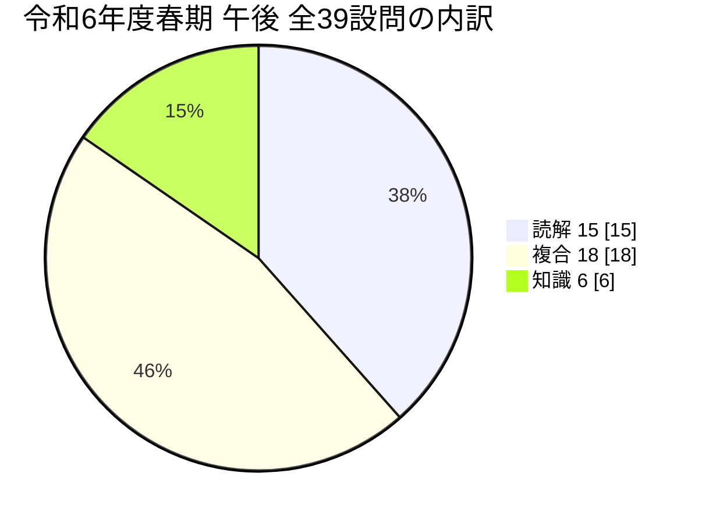
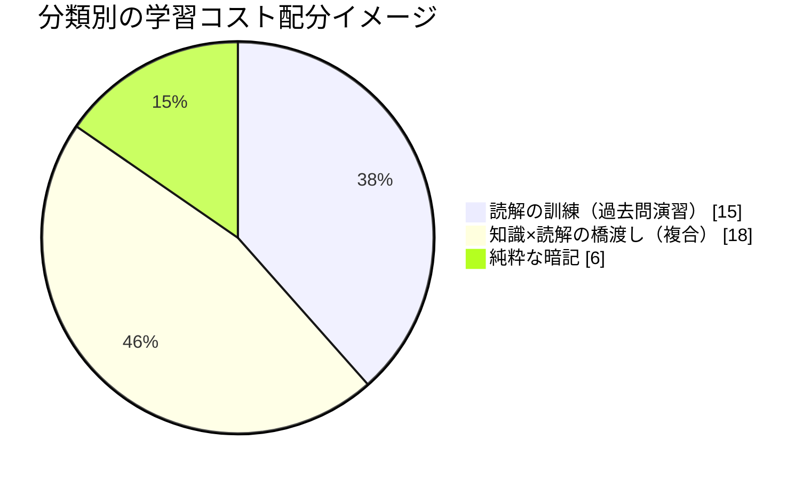

# 令和6年度 春期 支援士 午後 設問タイプ分類 <!-- omit in toc -->

> 対象：令和6年度春期 午後（問1〜問4）の**全39設問**
> 目的：**どの設問が「問題文を読めば解ける」のか、どの設問が「知らなければ解けない」のか**を切り分け、学習の投資先を決める
> 関連：同じ観点で分析した `過去問解説/令和5年度春期_設問タイプ分類.md`（全49設問）、
> 　　　`過去問解説/令和5年度秋期_設問タイプ分類.md`（全34設問）と比較できる

- [分類の定義](#分類の定義)
- [全体集計と令和5年度との比較](#全体集計と令和5年度との比較)
- [問1 APIセキュリティ](#問1-apiセキュリティ)
- [問2 サイバー攻撃への対策](#問2-サイバー攻撃への対策)
- [問3 Webセキュリティ](#問3-webセキュリティ)
- [問4 Webアプリケーションプログラム](#問4-webアプリケーションプログラム)
- [知識問題で問われた知識の分野別まとめ](#知識問題で問われた知識の分野別まとめ)
- [読解問題の「根拠の置き場所」パターン](#読解問題の根拠の置き場所パターン)
- [この分析から導かれる学習方針](#この分析から導かれる学習方針)
  - [① 令和6年度春期は「複合46%」— 知識の暗記より“使い方”](#-令和6年度春期は複合46-知識の暗記より使い方)
  - [② 問選択の戦略](#-問選択の戦略)
  - [③ 「あと1歩」で落とす典型パターン](#-あと1歩で落とす典型パターン)
  - [④ 令和5年度との接続](#-令和5年度との接続)

---

## 分類の定義

| 記号       | 分類     | 定義                                                                                                                                               | 対策                                               |
| ---------- | -------- | -------------------------------------------------------------------------------------------------------------------------------------------------- | -------------------------------------------------- |
| **【読】** | **読解** | 問題文・図・表・注記の記述を **探して突き合わせれば**答えが出る。 専門知識がなくても、 日本語として根拠を特定できる                       | **解き方の訓練** （根拠の探し方・ 時間配分） |
| **【複】** | **複合** | **知識を手掛かりにして** 問題文の条件を当てはめる。 知識は「どこを見ればよいか」を 教えてくれる役割で、 最終的な答えは問題文の中にある | 知識を入れた上で **過去問演習**                 |
| **【知】** | **知識** | 用語・プロトコル・仕様を **知らなければ書けない**。 問題文には答えが書かれていない                                                           | **暗記・ 理解のインプット**                     |

> **判定の基準**：その設問の解答を、**本文・図・表のどこかの記述を指差して説明できるか**。できれば【読】、知識で補えば指差せるなら【複】、どこにも書かれていなければ【知】。

---

## 全体集計と令和5年度との比較

| 分類           | R6春期（39設問） | R5秋期（34設問） | R5春期（49設問） |
| -------------- | ---------------: | ---------------: | ---------------: |
| **【読】読解** |    **15（38%）** |        14（41%） |        21（43%） |
| **【複】複合** |    **18（46%）** |        10（29%） |        16（33%） |
| **【知】知識** |     **6（15%）** |        10（29%） |        12（24%） |

**問別の内訳**

| 問                                     | 設問数 | 【読】 | 【複】 | 【知】 | 傾向                                                                                                 |
| -------------------------------------- | -----: | -----: | -----: | -----: | ---------------------------------------------------------------------------------------------------- |
| 問1　APIセキュリティ                   |     10 |      3 |      6 |      1 | **複合が6割**。 知識は「ステートレス」1問だけだが、 JWT・正規表現・WAF運用の 理解が前提     |
| 問2　サイバー攻撃への対策              |      9 |      5 |      3 |      1 | **読解比率が最高の56%**。 本文が選択肢を つぶしてくれる設問が多い                              |
| 問3　Webセキュリティ                   |     10 |      4 |      5 |      1 | SSRF関連4問のうち 2問は**図2をなぞるだけ**。 知識はSameSiteの1問                               |
| 問4　Webアプリケーション プログラム |     10 |      3 |      4 |      3 | **知識比率30%で最高**。 CRYPTREC・Javaの例外・finally が集中。 ただし**全て定番の基礎知識** |

**令和5年度との違い**

| 観点           | R5（春・秋）                                           | R6春期                                                                                                        |
| -------------- | ------------------------------------------------------ | ------------------------------------------------------------------------------------------------------------- |
| 知識比率       | 24〜29%                                                | **15%に低下**                                                                                                 |
| 複合比率       | 29〜33%                                                | **46%に急増**                                                                                                 |
| 意味するところ | 知識の量で差が付いた                                   | **「知識を手掛かりに本文を 読み解く」力**で差が付く。 用語を知っているだけでは 解答を書き切れない    |
| 知識の中身     | CT・CAA・WebAuthn など **新しめの用語**（R5秋 問3） | **CRYPTREC・SameSite・ Javaの例外処理**など **定番の基礎**に回帰                                        |
| 読解の対象     | 本文・表・注記、 HTML／JavaScript                   | **Javaのソースコード**（問4）、 **正規表現の記述形式**（問1 図5）、 **base64のデコード結果**（問1 図8） |

> **選択の目安**：知識のインプットが足りていないうちは**問2**（読解5問・知識1問）が最も素直。Linuxのパーミッションと Java が読めるなら**問4**は得点源（知識4問はいずれも基礎）。**問1・問3は複合中心**で、知識と読解の両方を要求される。

---

## 問1 APIセキュリティ

| 設問                                          | 解答                                                                                                   |    分類    | 根拠の所在（読解）／必要な知識（知識）                                                                                                                                                                                                                                                                |
| --------------------------------------------- | ------------------------------------------------------------------------------------------------------ | :--------: | ----------------------------------------------------------------------------------------------------------------------------------------------------------------------------------------------------------------------------------------------------------------------------------------------------- |
| 設問1 空欄a                                | ステートレス                                                                                           | **【知】** | **分野**：Web技術／システム アーキテクチャ **知識**：**RESTの6原則**（クライアント/ サーバ、**ステートレス**、キャッシュ可能、 統一インタフェース、階層化システム、 コードオンデマンド）。 本文は「セッション管理を行わない 性質」としか書かず、**用語そのものは 本文にない** |
| 設問2(1) 空欄b                             | 500                                                                                                    | **【複】** | **必要な知識**：総当たりの平均試行回数は **全パターンの半分**（期待値 (N+1)/2） **読む場所**：表2「**数字4桁**の文字列X」＋ 表3項番4「**1秒間に10回**試行」。 10^4÷2÷10＝500                                                                                                              |
| 設問2(2) 下線① JWTの検証                | データ：JWTヘッダ内の algに指定された値／ 内容：NONEでないこと を検証する                     | **【複】** | **必要な知識**：**alg=none 攻撃** （RFC 7515のUnsecured JWT） **読む場所**：図4「ライブラリQは、JWT内の **ヘッダに指定されたアルゴリズムに 基づいて**JWTを検証する」＋Z氏の説明 「"RS256"の代わりに**"NONE"を指定**し ……検証が成功し」                                              |
| 設問2(3) 下線② 追加すべき処理           | JWTに含まれる利用者IDが midの値と一致するか どうかを検証する処理                                 | **【複】** | **必要な知識**：**認可（BOLA／IDOR）**。 信頼できる情報源と要求対象を 突き合わせる **読む場所**：図4「ペイロードに含まれた **利用者ID**を確認して利用者を識別し」＋ 表3項番2「パラメータ**mid**に他の 利用者IDを指定すると」                                                        |
| 設問2(4) 空欄c                             | 共通モジュールP                                                                                        | **【読】** | **読む場所**：表2 利用者API 「F社が既に開発済みの利用者管理共通 ライブラリ（以下、**共通モジュールP** という）……**利用者ステータスの管理にも 利用される**」。 設問も「**表2中の用語で**」と指定している                                                                                |
| 設問2(5) 空欄d                             | 連続失敗回数がしきい値を 超えたらアカウントを ロックする処理                                     | **【複】** | **必要な知識**：OTPの総当たり対策＝ **試行回数制限（アカウントロック）** **読む場所**：表5項番4 「**そのしきい値は10とする**」。 しきい値を持つ対策＝回数のカウント と結び付ける                                                                                                       |
| 設問3(1) 下線③ テストサーバの 仕組み | テストサーバのindex.html へのアクセスを記録し、 確認する仕組み                                   | **【読】** | **読む場所**：図8 注記2 「デコード結果は、**wget http://a2.b2. c2.d2/index.html** である。これは、 コマンドCに相当する」＋注記1 「a2.b2.c2.d2は、**テストサーバに 割り当てたIPアドレス**」＋図7(1) 「攻撃用HTTPサーバを兼ねたサーバ」                                               |
| 設問3(2) 空欄e・f                          | e＝Header、f＝Header                                                                                   | **【読】** | **読む場所**：図6(3) 「準備した攻撃コードをHTTPリクエストの **x-api-versionヘッダの値として指定**」＋ 図5〔検証対象〕 「**Header：全てのヘッダの値**を 検証対象とする」                                                                                                                |
| 設問3(3) 下線④ パターンの変更           | `\W[jJ][nN][dD][iI]\W` または `\W(j\|J)(n\|N)` `(d\|D)(i\|I)\W`                               | **【複】** | **必要な知識**：**正規表現の 文字クラス `[xyz]` と選択 `x\|y`**。 大文字小文字無視の `i` フラグが 使えない場合の書き方 **読む場所**：図5〔パターン〕の 要素一覧（`\W` `x\|y` `[xyz]` など）。 **`\W` を外してはいけない**点も図5から                                                |
| 設問3(4) 下線⑤ 「検知」の利点           | 利点：誤検知による遮断を 防ぐことができる／ 内容：アラートを受信したら 攻撃かどうかを精査する | **【複】** | **必要な知識**：WAF/IPSは **検知モードで運用して 誤検知をチューニングしてから遮断** という定石。偽陽性と可用性の関係 **読む場所**：図5〔動作〕の定義 （**検知＝通過させ、ログに記録し、 アラートを送信する**）                                                                      |

**この問の性格**：**10設問中6つが複合**。本文に手掛かりは必ずあるが、**JWTの構造・総当たりの期待値・正規表現・WAF運用**という「道具」を持っていないと、どの記述が根拠なのかに気付けない。逆に言えば、**この4つの道具を揃えれば満点が狙える**構成になっている。

---

## 問2 サイバー攻撃への対策

| 設問                                  | 解答                                                                                                                                                                    |    分類    | 根拠の所在（読解）／必要な知識（知識）                                                                                                                                                                                                                                                          |
| ------------------------------------- | ----------------------------------------------------------------------------------------------------------------------------------------------------------------------- | :--------: | ----------------------------------------------------------------------------------------------------------------------------------------------------------------------------------------------------------------------------------------------------------------------------------------------- |
| 設問1(1) 空欄a HTTP GET Flood   | 公開Webサーバ、 取引先向けWebサーバを 攻撃対象に、HTTP GET リクエストを繰返し送る                                                                              | **【複】** | **必要な知識**：HTTP GET Flood は **L7の攻撃**で、HTTPで応答する サーバだけが標的になる **読む場所**：冒頭「取引先向けWebサーバ」 「公開Webサーバ」＋ 「**いずれのWebサーバが停止しても、 業務に支障が出る**」＋ 表4項番1の書式（攻撃対象を先に書く）                      |
| 設問1(2) 下線① しきい値が低い   | 正常な通信を異常として 検知してしまう                                                                                                                                | **【読】** | **読む場所**：表1 IPS機能 「**アノマリ型**：あらかじめ登録した **しきい値を超えた通信を異常として 検知する**」。 しきい値が低い→正常な通信も超える →異常と検知、と定義だけで導ける                                                                                               |
| 設問1(3) 空欄b・c DNSの内外分離 | b＝DNS-K、c＝DNS-F                                                                                                                                                      | **【複】** | **必要な知識**：**権威DNSサーバ**は 外部からの問合せに答える、 **フルサービスリゾルバ**は内部から 外部へ問い合わせる、という役割の向き **読む場所**：T主任の発言 「権威DNSサーバの機能をもつサーバ （**DNS-K**）」「フルサービスリゾルバの 機能をもつサーバ（**DNS-F**）」 |
| 設問2(1) 空欄d・e MFA突破の手順 | d＝攻撃者が正規のVPN ダイアログにID/PWを入力 →正規利用者のスマホに コード送信／ e＝利用者が罠サイトに 入力したコードを攻撃者が 読み取り正規画面に入力 | **【複】** | **必要な知識**：**リアルタイム中継型 （AiTM）フィッシング**。 OTPは「人が読んで入力する値」 なので中継できる **読む場所**：表2 注1のSMS認証の 手順（ID/PW入力→コード入力画面表示 →SMS送信→入力）を、 攻撃者と利用者に割り振り直す                                          |
| 設問2(2) 下線② 注意喚起の内容   | 認証情報の入力は、受信した メール内のURLリンクを クリックして起動した画面には 行わず、VPNダイアログに だけ行う                                              | **【読】** | **読む場所**：T主任の発言が **選択肢を2つ消してくれている**。 「**URLリンクのクリックを禁止する ことはできません**」 「不審なURLかどうかを**見極めさせる ことは難しい**」＋下線② 「**たとえ……クリックしてしまっても**」                                                       |
| 設問3(1) 下線③ 設定Pの突破      | 盗聴したパケットと同じ順番に 通信要求を送信する                                                                                                                      | **【読】** | **読む場所**：T主任の発言 「**あらかじめ設定されている順番に ポートに通信要求した場合だけ**所定の ポートへの接続を許可する」。 秘密が「順番」だけなら、 盗聴して同じ順番を再現すればよい                                                                                         |
| 設問3(2) 下線④ SPAが破られない  | SPAパケットはユニークであり、 同じパケットを再利用すると 破棄されるから                                                                                           | **【読】** | **読む場所**：表6 項番2 「SPAパケットには**ランダムデータ**が 含まれ……**以前受信したものと同じ ランダムデータをもつSPAパケットを 受信した場合は、破棄される**」。 **ほぼそのまま書き写せる**                                                                                     |
| 設問4(1) 下線⑤ 外部のサービス   | DDoS対策機能を有する CDNサービス／ クラウド型ファイアウォール サービス／ISPが提供する DDoS防御サービス                                                      | **【知】** | **分野**：ネットワーク／ セキュリティ対策技術 **知識**：**容量枯渇型DDoS**は 自社回線に届いた時点で負けるため、 **上流で吸収するサービス** （DDoS対策CDN、FWaaS、ISPの スクラビング）を使う。 本文には一切列挙がない                                                       |
| 設問4(2) 下線⑥ 軽減できる理由   | 取引専用PC以外からの通信は 取引先向けWebサーバに 到達しないから／UTMの設定 変更によってボットネット からの通信が遮断されるから                              | **【読】** | **読む場所**：下線⑥直後の4つの対応、 特に「**UTMのファイアウォール機能で、 インターネットから取引先向けWeb サーバへの通信を拒否する**」。 公開サーバでなくなった＝ 攻撃対象でなくなった                                                                                          |

**この問の性格**：**9設問中5つが読解**で、4問中もっとも知識依存が低い。特に設問3(2)は**表6をほぼ書き写すだけ**、設問2(2)は**本文が誤答をつぶしてくれている**。知識が必要なのは設問4(1)の1問だけ。**選択問題としての「当たり」**になりやすい。

---

## 問3 Webセキュリティ

| 設問                                     | 解答                                                                                                                                |    分類    | 根拠の所在（読解）／必要な知識（知識）                                                                                                                                                                                                                                             |
| ---------------------------------------- | ----------------------------------------------------------------------------------------------------------------------------------- | :--------: | ---------------------------------------------------------------------------------------------------------------------------------------------------------------------------------------------------------------------------------------------------------------------------------- |
| 設問1(1) 下線① 出力される機能      | 9                                                                                                                                   | **【読】** | **読む場所**：図3は問合せ機能 （表1項番5）への入力。 表1 項番9 **問合せ管理機能** 「**問合せ機能で入力された問合せ情報が 閲覧できる**」。 入口と出口が別＝格納型                                                                                                    |
| 設問1(2) 下線② 全会員情報の取得    | わなリンクで管理者に cookieを送信させ、その値で 管理者としてサイトXに アクセスし利用者情報を取得                           | **【複】** | **必要な知識**：**HttpOnly属性がない cookieはJavaScriptから読める** （document.cookie） **読む場所**：〔サイトX〕 「SESSIONIDには、**値とSecure属性 だけ**がセットされる」＋表1項番8 会員管理機能＋「サイト管理機能は ……**接続元の制限は行わない**」          |
| 設問2(1) 下線③ CSRFの攻撃手順      | 攻撃者が自らのアカウントで 取得したcsrf_tokenと一緒に 送るわなフォームに利用者を 誘導し、利用者情報を 変更させる        | **【複】** | **必要な知識**：CSRFトークンは **セッションに紐付けて検証**しないと 無意味。罠フォームで被害者の ブラウザに送信させる **読む場所**：表2 手順3 「**異なる利用者アカウントで取得した csrf_tokenの値**」→「正常に処理」                                             |
| 設問2(2) 表3 空欄a〜d SameSite属性 | a＝×、b＝×、c＝○、d＝×                                                                                                              | **【知】** | **分野**：セキュリティ実装技術 **知識**：**SameSite属性の3つの値**。 Strictはクロスサイトで一切送らない、 **Laxはトップレベルの GETナビゲーションだけ送る**、 Noneは常に送る。 本文に挙動の説明は一切ない                                                        |
| 設問3(1) 下線④ 総当たりの手法      | order-codeの下6桁を 総当たりで試行する                                                                                           | **【読】** | **読む場所**：表1 項番3 「注文履歴は、**注文年月である数字6桁 とランダムな英大文字6桁**の値を ハイフンでつないだ注文管理番号で 管理される」。 上6桁は推測容易＝下6桁だけが対象                                                                                      |
| 設問3(2) 下線⑤ 追加すべき処理      | cookieの値で利用者アカウント を特定し、order-codeの値 から特定したものと違って いれば、エラーにする                        | **【複】** | **必要な知識**：**認可は信頼できる 情報源（セッション）と要求対象を 突き合わせる** **読む場所**：〔サイトX〕 「ログインセッション管理は、 cookieパラメータのSESSIONIDで行う」 ＋図5・図6 注1「**値から利用者を 特定することができる**」                       |
| 設問4(1) 下線⑥ ログインできない    | 変更後のURLにPOSTデータは 送ることができないから                                                                                 | **【複】** | **必要な知識**：SSRFは **アプリが送る形のリクエストしか 送れない**（ここでは単純なGET） **読む場所**：図2〔CMSについて〕 「ログインは、**POSTメソッドでは 許可されるが、GETメソッドでは 許されない**」＋図7の `GET /top?page=`                                   |
| 設問4(2) 下線⑦ 方法Fでの取得       | パラメータpageの値をIMDSの クレデンシャル情報を返す URLに変更する                                                             | **【読】** | **読む場所**：図2〔IMDSについて〕 「`https://OOO.OOO.OOO.OOO/ meta-data/credential` に**GETメソッド でアクセスされると……クレデンシャル 情報を返す**」＋「**方式1**：特定のURLに アクセスするだけで情報を取得できる」                                                |
| 設問4(3) 下線⑧ 方法Gでの取得       | トークン発行URLにPUT メソッドでアクセスして トークンを入手し、ヘッダに 含めてクレデンシャル情報を 返すURLにアクセスする | **【読】** | **読む場所**：図2〔IMDSについて〕 **方式2**の説明をそのまま2段階で書く。 「トークンを発行するURLに**PUT メソッド**でアクセスし……そのトークン を**リクエストヘッダに含めて**特定の URLにアクセスすると情報を取得できる」                                             |
| 設問4(4) 下線⑨ 追加すべき処理      | パラメータpageの値が サイトP以外のURLなら エラーにする                                                                        | **【複】** | **必要な知識**：SSRF対策は **許可リスト（ホワイトリスト）**。 拒否リストは別表記IP・DNSリバイン ディング・リダイレクトで回避される **読む場所**：「サイトYは、**サイトPで 取り扱っている情報などを表示する**」 ＋図7 注記「**△△△.jpはサイトPの FQDN**である」 |

**この問の性格**：**設問4(2)(3)は図2の説明をなぞるだけ**で、SSRFを知らなくても書ける。一方 設問2(2)（SameSite）は**完全な知識問題**で、挙動表を覚えていなければ4か所すべて落とす。**認可の不備（設問3(2)）は問1 設問2(3)と同型**なので、どちらかを理解すれば両方取れる。

---

## 問4 Webアプリケーションプログラム

| 設問                                                    | 解答                                                                                                                         |    分類    | 根拠の所在（読解）／必要な知識（知識）                                                                                                                                                                                                                                                                      |
| ------------------------------------------------------- | ---------------------------------------------------------------------------------------------------------------------------- | :--------: | ----------------------------------------------------------------------------------------------------------------------------------------------------------------------------------------------------------------------------------------------------------------------------------------------------------- |
| 設問1(1) 空欄a                                       | ア （システム運用担当者）                                                                                                 | **【複】** | **必要な知識**：Linuxのパーミッション **770 / 660 は「グループにも 読み書きを許可」** **読む場所**：図1（/var/dataのオーナー はbatchappuser）＋表2 No.5 （batchappuserは**operation**）＋ 表2 No.2（operatorもoperation）＋ 要件18(2)                                                  |
| 設問1(2) 空欄b                                       | personal                                                                                                                     | **【読】** | **読む場所**：表3 No.3 「**personal**：一般ユーザー権限である。 **本番環境へのアクセス権**がある」。 rootは特権すぎ、operationは問題の原因、 developは本番バッチサーバに アクセスできない（表3 No.4）                                                                                        |
| 設問1(3) 空欄c                                       | 4                                                                                                                            | **【読】** | **読む場所**：表4 No.3 「注文データCSV**出力**バッチ処理」と No.4「注文データCSV**取込み**バッチ処理 ……CSVファイルを読み込んで、 業務システムのDBを更新する」。 暗号化区間の両端を選ぶ                                                                                                       |
| 設問2(1) 空欄d                                       | 5                                                                                                                            | **【複】** | **必要な知識**： `MessageDigest.getInstance()` が **NoSuchAlgorithmException を投げる** （指定アルゴリズムが環境にないとき） **読む場所**：図3 8行目 `catch (NoSuchAlgorithmException e)`。 catch句の型から投げうる行を逆算する                                                           |
| 設問2(2) 空欄e                                       | 例外                                                                                                                         | **【読】** | **読む場所**：図3 8行目の `catch`、 および図4で追加されたコメント 「**//回復不能な例外発生**」。 本文の語彙が「例外」で統一されている                                                                                                                                                              |
| 設問2(3) 下線① アクセスできて しまう情報と場所 | 開発者：パスワード、氏名、 住所、電話番号、 メールアドレス／場所＝オ （**運用担当者側は不備により 設問不成立**） | **【複】** | **必要な知識**：Linuxの **ディレクトリの x は「通過権」** （774だと配下に到達できない） **読む場所**：図3 23・24行目 `log.debug("InsertData:" + this.toString())`＋注記 「log.debug()は……**ログサーバに 送信する**」＋要件5の重要情報一覧＋ 表3 No.4（developは**本番ログサーバ**） |
| 設問2(4) 空欄f                                       | SHA-256／SHA-384／ SHA-512                                                                                                | **【知】** | **分野**：情報セキュリティ（暗号） **知識**：**CRYPTREC電子政府推奨暗号 リスト（令和5年3月30日版）の ハッシュ関数＝SHA-256/384/512**。 SHA-1は運用監視暗号リストに格下げ。 本文に列挙はない                                                                                                  |
| 設問2(5) 空欄g                                       | `throw new` `RuntimeException(e)`／ ランタイムエラーを例外 としてthrowする                                          | **【知】** | **分野**：セキュアプログラミング **知識**：**例外の握り潰しを止めて 再スローする**書き方。 非検査例外（RuntimeException）なら **メソッドのシグネチャを変えずに** 中断できる。Fail Safe の原則                                                                                                |
| 設問2(6) 空欄h                                       | finally                                                                                                                      | **【知】** | **分野**：プログラミング（Java） **知識**：**try-catch-finally**。 finallyは正常終了でも例外発生でも 必ず実行されるので、 **外部リソースの解放**はここに書く                                                                                                                                    |
| 設問2(7) 下線② ソルトの実装                       | ア                                                                                                                           | **【複】** | **必要な知識**：ソルトは **①ハッシュ計算の入力に混ぜる** **②後で検証できるよう保存する** の両方が必要 **読む場所**：設問の条件 「saltには……**32バイトの固定長 文字列**」「**テーブルの定義に変更は ない**」→PASSWORD列に連結保存する しかない、と読み取る                           |

**この問の性格**：**知識3問はいずれも定番の基礎**（CRYPTREC・例外の再スロー・finally）で、Javaを書いたことがあれば即答できる。難所はむしろ**設問1(1)と設問2(3)**で、**表2（アカウントと所属グループ）・表3（グループの権限）・図1（パーミッション）・要件18（誰が何にアクセスしてよいか）の4つを三角測量**する必要がある。

---

## 知識問題で問われた知識の分野別まとめ

| 分野                                           | 設問                         | 押さえるべき知識                                                                                                                                                                       |
| ---------------------------------------------- | ---------------------------- | -------------------------------------------------------------------------------------------------------------------------------------------------------------------------------------- |
| **Web技術／ アーキテクチャ**                | 問1 設問1                    | **RESTの6原則**。特に **ステートレス**＝サーバがセッション状態を 保持しない                                                                                                      |
| **セキュリティ 実装技術**                   | 問3 設問2(2)                 | **SameSite属性**： Strict＝クロスサイトで一切送らない／ **Lax＝トップレベルのGETナビゲーションだけ**／ None＝常に送る（Secure必須）                                           |
| **ネットワーク／ セキュリティ 対策技術** | 問2 設問4(1)                 | **容量枯渇型DDoS**への対策は **上流で吸収**。DDoS対策機能付きCDN、 クラウド型FW（FWaaS）、 ISPのDDoS防御（スクラビング／ ブラックホールルーティング）                      |
| **情報セキュリティ （暗号）**               | 問4 設問2(4)                 | **CRYPTREC電子政府推奨暗号リスト （令和5年3月30日版）のハッシュ関数 ＝SHA-256／SHA-384／SHA-512**。 SHA-1は2017年のSHAtteredで衝突が実証され 運用監視暗号リストへ          |
| **セキュア プログラミング**                 | 問4 設問2(5) 問4 設問2(6) | **例外の握り潰しの禁止**（Fail Safe）。 `throw new RuntimeException(e)` で シグネチャを変えずに中断。 **finally** でリソースを必ず解放 （Java 7以降は try-with-resources） |

**知識問題は6問だけだが、複合問題18問の「手掛かり」になる知識はもっと広い。**

| 複合問題を解くために必要だった知識                                       | 該当設問                   |
| ------------------------------------------------------------------------ | -------------------------- |
| 総当たりの平均試行回数＝全パターンの半分                                 | 問1 設問2(1)               |
| **JWTの構造と alg=none 攻撃**                                            | 問1 設問2(2)               |
| **認可の不備（BOLA／IDOR）**                                             | 問1 設問2(3)、問3 設問3(2) |
| マスアサインメント                                                       | 問1 設問2(4)※読解判定      |
| OTPの総当たり対策（アカウントロック）                                    | 問1 設問2(5)               |
| **正規表現の文字クラスと選択**                                           | 問1 設問3(3)               |
| WAF/IPSの検知モード運用と偽陽性                                          | 問1 設問3(4)、問2 設問1(2) |
| HTTP GET Flood（L7攻撃）                                                 | 問2 設問1(1)               |
| 権威DNSサーバとフルサービスリゾルバの役割                                | 問2 設問1(3)               |
| **リアルタイム中継型（AiTM）フィッシング**                               | 問2 設問2(1)               |
| HttpOnly属性と document.cookie                                           | 問3 設問1(2)               |
| CSRFトークンはセッションに紐付けて検証                                   | 問3 設問2(1)               |
| **SSRFの制約（送れるリクエストの形）**                                   | 問3 設問4(1)               |
| SSRF対策は許可リスト                                                     | 問3 設問4(4)               |
| **Linuxのパーミッションと所属グループ** （ディレクトリの x ＝通過権） | 問4 設問1(1)、問4 設問2(3) |
| NoSuchAlgorithmException を投げるメソッド                                | 問4 設問2(1)               |
| **ソルトは「混ぜて」「保存する」**                                       | 問4 設問2(7)               |

---

## 読解問題の「根拠の置き場所」パターン

15問の読解問題（および複合問題で本文側の根拠になった箇所）について、**根拠がどこに置かれていたか**を分類すると、**探し方の型**が見えてくる。

| 置き場所                             | 該当設問                                                                                                                         | 探し方のコツ                                                                                                                               |
| ------------------------------------ | -------------------------------------------------------------------------------------------------------------------------------- | ------------------------------------------------------------------------------------------------------------------------------------------ |
| **表の「概要」欄の 最後の一文**   | 問1 設問2(4) （共通モジュールPは 利用者ステータスの 管理にも利用される）                                                | 長い説明文の**末尾**に、 さらりと決定打が置かれている。 **表は最後まで読む**                                                         |
| **図・表の注記／注1**                | 問1 設問3(1)（図8 注記1・2） 問3 設問3(2)【複】（図5・図6 注1） 問3 設問4(4)【複】（図7 注記）                             | **IPAは解答根拠を注記に隠す**。 図表を見たら必ず注記まで目を通す。 R5春期 問3の 「SaaS-aは研究開発部だけ」 も図1の注記にあった |
| **機能・仕様の 定義そのもの**     | 問1 設問3(2)（図5 検証対象） 問2 設問3(2)（表6 項番2） 問3 設問4(2)(3)（図2 IMDS） 問4 設問1(2)(3)（表3・表4）          | **定義を書き写せば解答になる**。 字数制限に合わせて 削るだけでよい                                                                   |
| **登場人物の発言が 選択肢を消す** | 問2 設問2(2) （「クリック禁止はできない」 「見極めは難しい」）                                                             | 会話文で**否定されたこと**は 解答にしてはいけない。 消去法で残るものが答え                                                           |
| **定義から論理的に 一歩進める**   | 問2 設問1(2) （しきい値を超えたら異常 →低いと正常も超える） 問2 設問3(1) （秘密が順番だけ →盗聴すれば再現できる） | 表の定義に**「だとしたら どうなるか」**を一回だけ 当てはめる                                                                         |
| **本文中の列挙を 突き合わせる**   | 問3 設問1(1)（表1項番5と9） 問3 設問3(1)（表1項番3）                                                                          | **入口と出口**、 **構造の分解**（6桁＋6桁）など、 並んでいる要素の対応を取る                                                         |
| **直後の箇条書き**                   | 問2 設問4(2) （下線⑥の直後の4つの対応）                                                                                       | 下線部の**直前・直後**を まず読む。 特に「次の対応によって」 の後ろ                                                               |
| **本文の語彙に 合わせる**         | 問4 設問2(2) （空欄e＝「例外」）                                                                                              | 空欄前後の言い回しと、 図4で追加された コメント「//回復不能な **例外**発生」から、 本文が使っている語を選ぶ                    |

---

## この分析から導かれる学習方針

### ① 令和6年度春期は「複合46%」— 知識の暗記より“使い方”

純粋な暗記で取れるのは**39問中6問（15%）**だけ。残りの33問は**本文を読む作業**が必ず入る。**知識のインプットはほどほどに切り上げ、過去問を解いて「根拠を探す」訓練に時間を回す**のが費用対効果が高い。

### ② 問選択の戦略

| 優先度 | 問      | 理由                                                                                                     |
| ------ | ------- | -------------------------------------------------------------------------------------------------------- |
| ◎      | **問2** | 読解5／複合3／知識1。 本文が選択肢を消してくれる設問が多く、 **表6をほぼ書き写すだけ**の設問もある |
| ○      | **問4** | 知識3問はいずれも定番の基礎。 **LinuxとJavaが読めれば得点源**。 ただし表の三角測量に時間を使う     |
| ○      | **問3** | SSRFの2問（設問4(2)(3)）は図2をなぞるだけ。 ただし**SameSiteの4か所**を落とすと痛い                   |
| △      | **問1** | 複合6問。JWT・正規表現・WAF運用の **4つの道具**が揃っていないと苦戦する                               |

### ③ 「あと1歩」で落とす典型パターン

| パターン                       | 本年度の該当例                                                                 |
| ------------------------------ | ------------------------------------------------------------------------------ |
| **突き合わせる相手を書かない** | 問1 設問2(3)「midを検証する」だけでは不足。 **JWT内の利用者IDと**を書く     |
| **主語を落とす**               | 問2 設問1(2)「通信が遮断される」ではなく **「正常な通信を」**異常として検知 |
| **本文が否定した案を書く**     | 問2 設問2(2)で「リンクをクリックしない」                                       |
| **指定された観点を外す**       | 問3 設問4(1)「認証情報を知らないから」は **SSRF攻撃の特徴**になっていない   |
| **2段階の片方しか書かない**    | 問3 設問4(3)（PUTでトークン取得→ ヘッダに付けてアクセス）の片方だけ         |
| **攻撃対象・場所を書かない**   | 問2 設問1(1)で**サーバ名**を省く 問1 設問3(1)で**index.html**を省く         |

### ④ 令和5年度との接続

| テーマ                             | R5での出題                                     | R6春期での出題                                    |
| ---------------------------------- | ---------------------------------------------- | ------------------------------------------------- |
| **認可の不備**                     | R5春期 問3 設問3(2) （order-code）※同一題材 | 問1 設問2(3)（mid） 問3 設問3(2)（order-code） |
| **検知と可用性の トレードオフ** | R5秋期 問2                                     | 問1 設問3(4) 問2 設問1(2)                      |
| **根本対策と 保険的対策**       | R5秋期 問1（HttpOnly）                         | 問3（XSS・SSRF） 問4（CSV暗号化）              |
| **セキュア プログラミング**     | R5秋期 問1 （HTML/JavaScript）              | 問4（Java）                                       |

**同じ論点が年度をまたいで繰り返し問われている。**過去問を「解いて終わり」にせず、**論点単位で横串に整理する**と、初見の問題でも「これは認可の話だ」と当たりを付けられるようになる。
