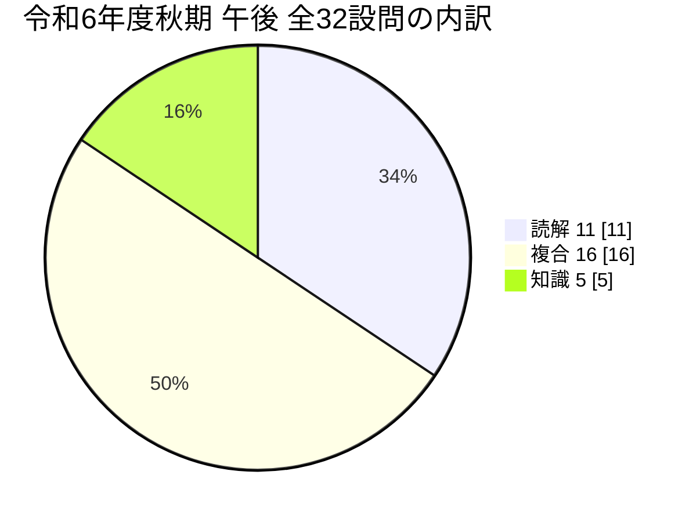
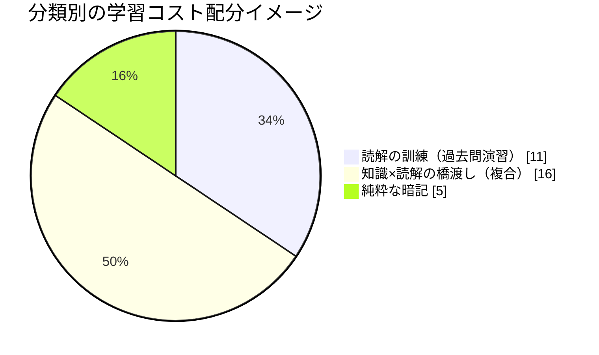
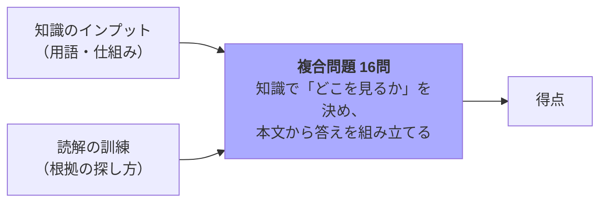

# 令和6年度 秋期 支援士 午後 設問タイプ分類 <!-- omit in toc -->

> 対象：令和6年度秋期 午後（問1〜問4）の**全32設問**
> 目的：**どの設問が「問題文を読めば解ける」のか、どの設問が「知らなければ解けない」のか**を切り分け、学習の投資先を決める
> 関連：`過去問解説/令和6年度春期_設問タイプ分類.md`（全39設問）、
> 　　　`過去問解説/令和5年度春期_設問タイプ分類.md`（全49設問）、
> 　　　`過去問解説/令和5年度秋期_設問タイプ分類.md`（全34設問）と比較できる

- [分類の定義](#分類の定義)
- [全体集計と過去回との比較](#全体集計と過去回との比較)
- [問1 インシデントレスポンス](#問1-インシデントレスポンス)
- [問2 ドメイン名変更](#問2-ドメイン名変更)
- [問3 クレジットカード情報の漏えい](#問3-クレジットカード情報の漏えい)
- [問4 セキュリティ診断](#問4-セキュリティ診断)
- [知識問題で問われた知識の分野別まとめ](#知識問題で問われた知識の分野別まとめ)
- [読解問題の「根拠の置き場所」パターン](#読解問題の根拠の置き場所パターン)
- [この分析から導かれる学習方針](#この分析から導かれる学習方針)
  - [① 令和6年度秋期は「複合50%」— 知識と読解の“つなぎ”が本体](#-令和6年度秋期は複合50-知識と読解のつなぎが本体)
  - [② 問選択の戦略](#-問選択の戦略)
  - [③ 「あと1歩」で落とす典型パターン](#-あと1歩で落とす典型パターン)
  - [④ 年度をまたいだ論点の接続](#-年度をまたいだ論点の接続)

---

## 分類の定義

| 記号       | 分類     | 定義                                                                                                                                               | 対策                                               |
| ---------- | -------- | -------------------------------------------------------------------------------------------------------------------------------------------------- | -------------------------------------------------- |
| **【読】** | **読解** | 問題文・図・表・注記の記述を **探して突き合わせれば**答えが出る。 専門知識がなくても、 日本語として根拠を特定できる                       | **解き方の訓練** （根拠の探し方・ 時間配分） |
| **【複】** | **複合** | **知識を手掛かりにして** 問題文の条件を当てはめる。 知識は「どこを見ればよいか」を 教えてくれる役割で、 最終的な答えは問題文の中にある | 知識を入れた上で **過去問演習**                 |
| **【知】** | **知識** | 用語・プロトコル・仕様を **知らなければ書けない**。 問題文には答えが書かれていない                                                           | **暗記・ 理解のインプット**                     |

> **判定の基準**：その設問の解答を、**本文・図・表のどこかの記述を指差して説明できるか**。できれば【読】、知識で補えば指差せるなら【複】、どこにも書かれていなければ【知】。

---

## 全体集計と過去回との比較

| 分類           | R6秋期 （32設問） | R6春期 （39設問） | R5秋期 （34設問） | R5春期 （49設問） |
| -------------- | -------------------: | -------------------: | -------------------: | -------------------: |
| **【読】読解** |        **11（34%）** |            15（38%） |            14（41%） |            21（43%） |
| **【複】複合** |        **16（50%）** |            18（46%） |            10（29%） |            16（33%） |
| **【知】知識** |         **5（16%）** |             6（15%） |            10（29%） |            12（24%） |

**問別の内訳**

| 問                                    | 設問数 | 【読】 | 【複】 | 【知】 | 傾向                                                                                        |
| ------------------------------------- | -----: | -----: | -----: | -----: | ------------------------------------------------------------------------------------------- |
| 問1　インシデント レスポンス       |      9 |      5 |      4 |  **0** | **純粋な知識設問がゼロ**。 ただし**表3のログを時系列で 再構成する作業量**が多い       |
| 問2　ドメイン名変更                   |     10 |      1 |      6 |      3 | **読解は1問だけ**。 SPF/DKIM/DMARCの仕組みを 知らないとほぼ手が出ない                 |
| 問3　クレジットカード 情報の漏えい |      6 |      3 |      3 |  **0** | **設問数が最少の6問**で、 知識設問もゼロ。 **JavaScriptとHTMLが読めるか**が すべて |
| 問4　セキュリティ診断                 |      7 |      2 |      3 |      2 | 診断報告書という **構造化された資料**を読む。 設問3は**自由記述**                     |

**過去回との違い**

| 観点           | R5（春・秋）             | R6春期                           | R6秋期                                                                                                                   |
| -------------- | ------------------------ | -------------------------------- | ------------------------------------------------------------------------------------------------------------------------ |
| 知識比率       | 24〜29%                  | 15%                              | **16%**                                                                                                                  |
| 複合比率       | 29〜33%                  | 46%                              | **50%（過去最高）**                                                                                                      |
| 読解比率       | 41〜43%                  | 38%                              | **34%（過去最低）**                                                                                                      |
| 意味するところ | 知識の量で 差が付いた | 知識を手掛かりに 本文を読む力 | **R6春期の傾向がさらに進行**。 「用語を知っている」だけでも 「本文が読める」だけでも 書き切れない設問が半分以上 |

> **選択の目安**：**問1と問3は知識設問ゼロ**。知識のインプットが不安なら、この2問の組合せが安全。ただし**問1は設問9問で記述量が多く**、**問3はJavaScript／HTML／CSSセレクタが読めることが前提**。逆に**問2はSPF/DKIM/DMARCを知らないと壊滅する**ので、メール関連が手薄なら避ける。

---

## 問1 インシデントレスポンス

| 設問                                              | 解答                                                                                                                                            |    分類    | 根拠の所在（読解）／必要な知識（知識）                                                                                                                                                                                                                                                                   |
| ------------------------------------------------- | ----------------------------------------------------------------------------------------------------------------------------------------------- | :--------: | -------------------------------------------------------------------------------------------------------------------------------------------------------------------------------------------------------------------------------------------------------------------------------------------------------- |
| 設問1(1) 空欄a                                 | PC-C                                                                                                                                            | **【読】** | **読む場所**：表3の `12/04 23:32:51　PC-AからPC-Cに、 .\administrator で、RDP接続が 許可された` の**1行だけ**。 ＋注4「（省略）は**RDP接続の 失敗ログだけ**である」で、 許可はこの1件と確定できる                                                                                      |
| 設問1(2) 空欄b                                 | filesv                                                                                                                                          | **【読】** | **読む場所**：表3 `12/04 22:42:06　\\filesv のファイル が参照された`＋表1 ファイルサーバ 「**ホスト名は filesv である**」。 設問が「**ホスト名**を答えよ」と 指定している                                                                                                                 |
| 設問1(3) 空欄c                                 | ad01\user019                                                                                                                                    | **【読】** | **読む場所**：表5の利用者ID欄が すべて `ad01\user019`＋表1 「ドメイン名 **ad01**」＋ 表3 注記1の表記ルール （domainhost\userNNN）                                                                                                                                                            |
| 設問1(4) 空欄d                                 | 無効化                                                                                                                                          | **【複】** | **必要な知識**：インシデント対応では **削除ではなく無効化** （SIDを残し**証拠を保全**しつつ アクセスは即座に止める） **読む場所**：図3 暫定対策1 「マルウェア感染拡大とこれ以上の ファイルの送信を防ぐために」＋ **10字以内**という制限                                             |
| 設問1(5) 下線① プロキシでの対策             | 全てのドメイン ユーザーに対して、 ○○○.com／△△△.com ／□□□.com を 管理者拒否リストに 登録する                                      | **【複】** | **必要な知識**：攻撃者の通信先は **全部塞ぐ**。URLフィルタは **適用範囲（誰に）**まで決めて 初めて機能する **読む場所**：表1 プロキシサービス （3種類のリストと**ドメインユーザー ごと**に指定）＋図4 の3つのURL                                                                       |
| 設問1(6) 下線② 感染ホストの調査             | 3つのURLに通信した L社内ホストが ないか調査する                                                                                           | **【読】** | **読む場所**：表1 「L社内ホストからインターネットへの HTTP通信及びHTTPS通信を **全て中継する**」＝ **全ホストのログが集約されている** ＋図4 (e)(f) のコネクトバック先                                                                                                                     |
| 設問1(7) 下線③ 全ホストへの調査             | タスク名が install であるタスクが 登録されている L社内ホストが ないか調査する                                                       | **【読】** | **読む場所**：図4 i.ps1 (a) 「**タスク名：install**」 「**タスク実行のトリガー：ログオン時に 実行される**」。 まだログオンしていないホストは **外部通信の痕跡がない**が タスクは残っている、と本文だけで 導ける                                                                     |
| 設問1(8) 下線④ 自動検出の仕組み （二つ） | ①マルウェア対策 サービスのログから 対策ソフトが停止した ホストを検出 ②ドメインサーバの ログからRDP接続を くり返すホストを検出 | **【複】** | **必要な知識**：**振る舞い検知**の発想 （マルウェア本体ではなく 「対策ソフトが止まった」 「RDPを連打している」を検出する） **読む場所**：表1 「マルウェア対策ソフトの **稼働状況の確認**ができる」 「ログオンは、ドメインユーザーの 利用者IDとパスワードで行う」 ＋図4 (c)(h) |
| 設問2 空欄e・f                                 | e＝仮想PCへのRDP接続 にIPアドレスによる 接続元制限を行う f＝DLPを導入し ファイルの持出しを 制限する                              | **【複】** | **必要な知識**：**DLP**（Data Loss Prevention）という対策カテゴリ。 f は用語を知らないと書けない **読む場所**：表1 仮想PC 「従業員が**シンクライアントPCから RDPで接続**して利用する」 → 仮想PC間のRDPは業務上不要                                                                     |

**この問の性格**：**知識設問ゼロ**。9問すべて本文・図表の中に根拠がある。難しさは知識ではなく**作業量**で、表3（time.csv 36行）・表4・表5・図4 を突き合わせて**攻撃の時系列を1本に再構成する**必要がある。逆に言えば、**タイムラインを描ききれば一気に全問解ける**構造になっている。

---

## 問2 ドメイン名変更

| 設問                                   | 解答                                                                                                                                                                     |    分類    | 根拠の所在（読解）／必要な知識（知識）                                                                                                                                                                                                                                                                                               |
| -------------------------------------- | ------------------------------------------------------------------------------------------------------------------------------------------------------------------------ | :--------: | ------------------------------------------------------------------------------------------------------------------------------------------------------------------------------------------------------------------------------------------------------------------------------------------------------------------------------------ |
| 設問1(1) 空欄a                      | A社ドメイン名                                                                                                                                                            | **【複】** | **必要な知識**：**第三者中継 （オープンリレー）防止**の原則。 受信は**自ドメイン宛てだけ**許可 **読む場所**：表1 メールサーバ 「宛先メールアドレスのドメイン名が a であるメールを**メールボックスに 格納する**」＝自社宛ての受信                                                                                   |
| 設問1(2) 空欄b                      | 全て                                                                                                                                                                     | **【複】** | **必要な知識**：同上。 送信は**全ドメイン宛てを許可** **読む場所**：冒頭「顧客との間で 見積書や注文書の送受信をしたり、 ニュースサイトのメールマガジンに 登録して」＝社外へ広く送る＋ 項番3（業務サーバは自ドメイン限定） との対比                                                                              |
| 設問2 空欄c                         | SMTPS                                                                                                                                                                    | **【知】** | **分野**：ネットワーク（メール） **知識**：**SMTPS**＝SMTP over TLS （Implicit TLS、ポート465）。 STARTTLS（587/25）との違い。 POP3S(995)／IMAPS(993) も セットで押さえる。 本文に名称は一切ない                                                                                                                   |
| 設問3(1) 下線① DKIMのFQDN        | エ `z2024._domainkey.` `z-sha.co.jp`                                                                                                                               | **【知】** | **分野**：セキュリティ実装技術 **知識**：RFC 6376。DKIM公開鍵 レコードの名前は **`<セレクタ>._domainkey.<署名ドメイン>`**。 **`_domainkey` は仕様で固定**。 表6のタグ（s・d）は読めるが、 この構文は本文にない                                                                                                     |
| 設問3(2) 空欄d                      | イ（none）                                                                                                                                                               | **【複】** | **必要な知識**：**DMARCポリシーの 3つの値**（none／quarantine／ reject）。accept・receive は 存在しないダミー **読む場所**：図3 Mail-Step1 「DMARCポリシーを、**特定の アクションを要求しないこととし**」                                                                                                          |
| 設問4(1) 下線② Webの悪用         | ソフトウェア修正 プログラムに 見せかけた マルウェアを ダウンロードさせる                                                                                     | **【読】** | **読む場所**：冒頭「A社のWebサイト では……**顧客向けに自社製工作機械 管理用アプリケーションプログラムと そのソフトウェア修正プログラムを 提供している**」＋下線② 「コンテンツを細工して **見た目を変えずに**」 ＝変えるのは**配布物の中身**                                                                      |
| 設問4(2) 下線③ メール受信の悪用  | メール＝社外サービス のパスワード再設定 画面のURLが書かれた メール／攻撃＝任意の パスワードを設定し アカウントを乗っ取る                                  | **【複】** | **必要な知識**：**メールアドレスは 本人確認の最後の砦**。多くの サービスでパスワードリセットの 唯一の確認手段になっている **読む場所**：表7 メールの受信 「従業員が業務で用いる社外サービス があり、メールでの連絡先として…… **連絡先の変更を忘れてしまうと**」                                                 |
| 設問4(3) 空欄e                      | ア（`-all`）                                                                                                                                                             | **【知】** | **分野**：セキュリティ実装技術 **知識**：**SPFの修飾子**。 `-all`＝Fail（hard fail）／ `~all`＝SoftFail／ `?all`＝Neutral。 `v=spf1 -all` は **Null SPF Record**（RFC 7208）。 block・deny・refuse はダミー                                                                                                     |
| 設問5(1) 下線④ 登録内容の見直し  | SPFレコードに、 Tサービスのメール 送信元IPアドレスを 追加する                                                                                                   | **【複】** | **必要な知識**：SPFは **送信元IPをDNSに登録して照合する** 仕組み。送信元サービスが増えたら 追加が必要 **読む場所**：図6「**From は、 サービス契約者が所属する組織が 保有するドメイン名**を用いた メールアドレスだけを設定できる」 ＋「SPFレコードを、**Uサービスから 提供された情報に基づいて作成した**」 |
| 設問5(2) 下線⑤ SPF・DKIM両方失敗 | SPF＝SPFレコードに Yサービスの情報が 登録されていないのに Yサービスから送られる DKIM＝hタグにSubject が含まれているのに YサービスでSubjectが 変わる | **【複】** | **必要な知識**：**SPFはエンベロープ From＋送信元IP**、**DKIMはhタグに 列挙したヘッダーを署名対象にする** **読む場所**：表6 hタグ `From:To:<b>Subject</b>:Date:…`＋ 図7 (5) Subject設定2 「Subject に**メールの通番情報を 付加する**」＋(1)「ドメイン名は Y社のドメイン名」                                   |

**この問の性格**：**読解は設問4(1)の1問だけ**。残り9問はSPF／DKIM／DMARCの仕組みを知っていることが前提になる。特に**設問5(2)は、SPFとDKIMが「何を検証しているか」を正確に言えないと一行も書けない**。逆にメール関連の知識があれば、本文の手掛かりは親切で、短時間で高得点が狙える。

---

## 問3 クレジットカード情報の漏えい

| 設問                                              | 解答                                                                                                                               |    分類    | 根拠の所在（読解）／必要な知識（知識）                                                                                                                                                                                                                                                              |
| ------------------------------------------------- | ---------------------------------------------------------------------------------------------------------------------------------- | :--------: | --------------------------------------------------------------------------------------------------------------------------------------------------------------------------------------------------------------------------------------------------------------------------------------------------- |
| 設問1 空欄a〜e                                 | a＝5、 b＝クロスサイト スクリプティング、 c＝格納、 d＝2、 e＝SQLインジェクション                                   | **【複】** | **必要な知識**：**XSSとSQLiの ペイロードの形** （`"><script>` ／ `' UNION select`）、 **格納型は1回の攻撃で多数に影響** **読む場所**：表2のリクエストURI。 6行目 `green's sofa` は **正常な商品名**で引っ掛け。 会話文「**1回の攻撃で多数の利用者に 対して**」が c を決める |
| 設問2(1) 下線① 画面全体の図示               | お支払方法の見出し・ 配送先・戻る／次へは 残り、ラジオボタンが 消えてカード情報の 入力欄4つが出現                      | **【複】** | **必要な知識**：**CSSセレクタの階層**と **innerHTML は要素の中身だけを 置き換える**こと **読む場所**：図2 2行目の `"#shopping-form > div > div > div.order_payment > div.radio"` と図3のHTML構造を一階層ずつ 突き合わせる                                                      |
| 設問2(2) 下線② パラメータ名と値             | order[Payment] ／ 1                                                                                                                | **【読】** | **読む場所**：図2 3行目末尾の `<input type="hidden" name="order[Payment]" value="1" />` ＋図3の `value="1"`→クレジットカード決済、 `value="2"`→銀行振込                                                                                                                              |
| 設問2(3) 図2 4〜15行目の 処理内容           | addEventListenerで form要素にリスナーを 登録し、submit時に カード情報をクエリ パラメータとして i-sha.com に送信する | **【読】** | **読む場所**：図2 4〜14行目を そのまま日本語化する。 4行目＝form取得、5行目＝ addEventListener('submit')、 7〜11行目＝入力値の取得、 12行目＝URL組立て、 13行目＝`req.open("GET", url)`                                                                                           |
| 設問3(1) 下線③ アプリ不要で 取得する方法 | Webサーバの アクセスログの リクエストURIから 情報を取得する                                                               | **【複】** | **必要な知識**：**Webサーバは アプリが動く前にリクエストURIを アクセスログに記録する**。 404でも記録される **読む場所**：図2 13行目 `req.open("GET", url)`＋12行目の **クエリパラメータにカード情報を 載せている**こと                                                         |
| 設問3(2) 空欄f                                 | 配送先・支払方法 選択画面に アクセスした アカウント名                                                                     | **【読】** | **読む場所**：図2 1行目 `if (location.pathname == '/shopping')`＝この画面でだけ発動 ＋図1 注記2「`/cart` 以外への アクセスは**ログインが必要**」＋ 「アプリケーションログには…… **アカウント名**……が記録される」                                                                  |

**この問の性格**：**設問数が6問と最少**で、**知識設問はゼロ**。ただし**JavaScript・HTML・CSSセレクタを読む力**が全設問の土台になっている。開発経験があれば30分で解けるが、コードに不慣れだと設問2(1)の図示で手が止まる。**「選ぶなら時間が稼げる問」だが、前提スキルの有無で体感難易度が大きく変わる**。

---

## 問4 セキュリティ診断

| 設問                                       | 解答                                                                                                                                                                                                                    |    分類    | 根拠の所在（読解）／必要な知識（知識）                                                                                                                                                                                                                                                                                |
| ------------------------------------------ | ----------------------------------------------------------------------------------------------------------------------------------------------------------------------------------------------------------------------- | :--------: | --------------------------------------------------------------------------------------------------------------------------------------------------------------------------------------------------------------------------------------------------------------------------------------------------------------------- |
| 設問1(1) 空欄a                          | （イ）                                                                                                                                                                                                                  | **【複】** | **必要な知識**：セッション フィクセーションの本体は **ログイン前後でセッションIDが 変わらないこと** **読む場所**：図3で**認証の境界を またぐ遷移**は（イ）だけ （画面01「ログイン」→画面02）。 （ア）は画面内操作、 （エ）はログイン後の画面間                                                |
| 設問1(2) 空欄b                          | `https://test.△△△.jp/`                                                                                                                                                                                                  | **【読】** | **読む場所**：表1 「**01, 02**　`https://test.△△△.jp/`」。 手順2・3は画面01、 手順7は画面02だが **URLは同じ**なので3か所とも同じ                                                                                                                                                                          |
| 設問1(3) 空欄c                          | メール受信者による ログイン                                                                                                                                                                                          | **【複】** | **必要な知識**：攻撃者が持つ sessionIDは**未認証**であり、 **被害者のログインによって 認証済みに昇格する**という構造 **読む場所**：図A 手順6 「罠サイトにアクセスするのを待つ」 → 手順7「アクセスを**検知後**、 c が完了することを期待して **数分間待ち**」                                   |
| 設問1(4) 空欄d 修正方法              | 使用済みのsessionIDを 無効にした上で、 新しいsessionIDを発行                                                                                                                                                      | **【知】** | **分野**：セキュリティ実装技術 **知識**：**Session Regeneration**。 認証成功の直後に **①旧IDを無効化し ②新IDを発行** する。PHPの `session_regenerate_id(true)`、 Servletの `changeSessionId()` 等。 本文に修正方法の記述はない                                                                   |
| 設問1(5) 空欄e・f HTTPヘッダーの効果 | e＝MサイトへのHTTPS 接続を強制できる f＝Content-Typeで 指定したMIMEタイプを 強制適用できる                                                                                                                  | **【知】** | **分野**：セキュリティ実装技術 **知識**：**HSTS**＝ブラウザが 送信前に `http://`→`https://` に 書き換える（SSLストリッピング対策）。 **X-Content-Type-Options: nosniff** ＝MIMEスニッフィングを禁止。 表Dには効果が空欄のまま                                                                       |
| 設問2 空欄g・h 図Dの攻撃手順         | g＝画面09の会社名に 図Cの検査文字列 （アドレスを攻撃者の ものに変更）を入力して 変更ボタンをクリック h＝画面04からの操作で 画面05又は07に 再設定後のパスワードを 入力しAPIkeyを 確認又は発行 | **【読】** | **読む場所**：g は**図Bの手順1 そのまま**（画面09の会社名に 図Cの検査文字列を入力）＋ 図C のアドレスを攻撃者のものに 置き換える。 h は図3の画面遷移 （画面04→画面05/07 の **PW再確認**→画面06/08）と 図2 4(2)「複数のAPIkeyを 発行できる」                                                 |
| 設問3 空欄i〜ℓ 仕様の改善方針案      | （例）i＝求職者IDを 推測困難にする／ j＝被害を当該企業に 問合せ・応募した 求職者だけに軽減できる k＝多要素認証に変更／ ℓ＝アカウントの 乗っ取りを防げる                                            | **【複】** | **必要な知識**：**IDの推測困難化・ IPアドレス制限・多要素認証・ データ最小化**という対策の引き出し **読む場所**：図2 注1 「**年月日の8桁の数字**の後ろに…… **000001 から登録順に割り当てられる 6桁の数字**」＝総当たり可能＋ 図3 注2「メールアドレス以外だけを 変更した場合」は通知メールなし |

**この問の性格**：**診断報告書という構造化された資料**（1章〜5章、表A〜G、図A〜D）を読む問題。設問1(2)・設問2 のように**図Bや表1をなぞれば書ける**ものと、設問1(4)(5) のように**知らなければ一字も書けない**ものが明確に分かれる。**設問3は正解が1つではない自由記述**で、「方針案＋理由」の型さえ守れば部分点が取りやすい。

---

## 知識問題で問われた知識の分野別まとめ

| 分野                                             | 設問         | 押さえるべき知識                                                                                                                                                                                                                                |
| ------------------------------------------------ | ------------ | ----------------------------------------------------------------------------------------------------------------------------------------------------------------------------------------------------------------------------------------------- |
| **ネットワーク （メール）**                   | 問2 設問2    | **SMTPS**＝SMTP over TLS（Implicit TLS、465）。 **STARTTLS**（Explicit TLS、587/25）との違い。 受信は **POP3S(995) / IMAPS(993)**。 経路の暗号化（SMTPS）と本文の暗号化（S/MIME・PGP） は別物                                       |
| **セキュリティ 実装技術 （DKIM）**         | 問2 設問3(1) | DKIM公開鍵レコードの名前は **`<セレクタ>._domainkey.<署名ドメイン>`**（RFC 6376）。 セレクタ＝sタグ、署名ドメイン＝dタグ、 **`_domainkey` は固定文字列**。 セレクタで**鍵のローテーション**とサービス別の 使い分けができる       |
| **セキュリティ 実装技術 （SPF）**          | 問2 設問4(3) | **SPFの修飾子**：`+all`（Pass）／**`-all`（Fail）**／ `~all`（SoftFail）／`?all`（Neutral）。 メールを送らないドメインには **`v=spf1 -all`（Null SPF Record）** ＋ `p=reject` が ベストプラクティス                                 |
| **セキュリティ 実装技術 （セッション）**   | 問4 設問1(4) | **Session Regeneration**：認証成功の直後に **①使用済みIDを無効化 ②新IDを発行**。 両方そろって初めて セッションフィクセーションを防げる                                                                                                 |
| **セキュリティ 実装技術 （HTTPヘッダー）** | 問4 設問1(5) | **HSTS**＝ブラウザが送信前に `https://` に書き換える （SSLストリッピング対策／初回アクセスは未保護）。 **X-Content-Type-Options: nosniff**＝MIME スニッフィング禁止。 あわせて **CSP**・`X-Frame-Options`・ `Referrer-Policy` も |

**知識問題は5問だけだが、複合問題16問の「手掛かり」になる知識はもっと広い。**

| 複合問題を解くために必要だった知識                                | 該当設問        |
| ----------------------------------------------------------------- | --------------- |
| インシデント対応では**削除ではなく無効化**（証拠保全）            | 問1 設問1(4)    |
| 攻撃者の通信先は**全部塞ぐ**／URLフィルタは**適用範囲**まで決める | 問1 設問1(5)    |
| **振る舞い検知**（対策ソフトの停止・RDP連打を検出する）           | 問1 設問1(8)    |
| **DLP**（Data Loss Prevention）／RDPの接続元IP制限                | 問1 設問2       |
| **第三者中継（オープンリレー）防止**の原則                        | 問2 設問1(1)(2) |
| **DMARCポリシーの3値**と段階的導入（none→quarantine→reject）      | 問2 設問3(2)    |
| **メールアドレスは本人確認の最後の砦**（パスワードリセット）      | 問2 設問4(2)    |
| **SPFは送信元IPを登録して照合する**                               | 問2 設問5(1)    |
| **SPFはエンベロープFrom＋IP／DKIMはhタグのヘッダーを署名**        | 問2 設問5(2)    |
| **XSSとSQLiのペイロードの形**／格納型の影響範囲                   | 問3 設問1       |
| **CSSセレクタの階層**と **innerHTML は中身だけを置換**            | 問3 設問2(1)    |
| **WebサーバはリクエストURIをアクセスログに記録する**（404でも）   | 問3 設問3(1)    |
| **セッションフィクセーションの成立条件**                          | 問4 設問1(1)(3) |
| **IDの推測困難化・IP制限・多要素認証・データ最小化**              | 問4 設問3       |

---

## 読解問題の「根拠の置き場所」パターン

11問の読解問題（および複合問題で本文側の根拠になった箇所）について、**根拠がどこに置かれていたか**を分類すると、**探し方の型**が見えてくる。

| 置き場所                               | 該当設問                                                                                                        | 探し方のコツ                                                                                                               |
| -------------------------------------- | --------------------------------------------------------------------------------------------------------------- | -------------------------------------------------------------------------------------------------------------------------- |
| **大量のログの中の たった1行**      | 問1 設問1(1) （表3の「許可された」1行） 問1 設問1(2) （`\\filesv` の1行）                              | **結果欄だけを縦に読む**。 36行の表3で「許可された」は1件だけ                                                           |
| **図・表の注記／注1**                  | 問1 設問1(1)（表3 注4） 問1 設問1(3)（表3 注記1） 問3 設問3(2)（図1 注記2） 問4 設問3【複】（図2 注1） | **IPAは解答根拠を注記に隠す**。 注4「**失敗ログだけ**である」が なければ「許可は1件」と 断定できない              |
| **機能・仕様の 定義そのもの**       | 問1 設問1(6)（表1 プロキシ） 問1 設問1(7)（図4 i.ps1） 問4 設問1(2)（表1 各画面のURL）                    | **定義を書き写せば解答になる**。 字数制限に合わせて削るだけ                                                             |
| **ソースコードを 日本語化する**     | 問3 設問2(2)（図2 3行目） 問3 設問2(3)（図2 4〜14行目）                                                      | 1行ずつ「何をしているか」を 日本語にし、**字数に合わせて 要素を選ぶ**                                                |
| **検出手順を 攻撃手順に読み替える** | 問4 設問2（図B → 図D の g）                                                                                     | 「**診断で検出した手順**」が そのまま「**攻撃の手順**」になる。 検査文字列のアドレスだけ 攻撃者のものに差し替える |
| **本文中の 役割の対比**             | 問2 設問1(2) （PC-LAN vs 業務サーバ）                                                                        | 似た行が並んでいたら **なぜ違うのか**を考える。 最小権限の設計意図が見える                                           |
| **冒頭の事業説明**                     | 問2 設問4(1) （顧客向けに修正プログラムを提供）                                                              | **問題文の最初の数行**に、 後半の解答根拠が置かれている ことがある                                                   |

---

## この分析から導かれる学習方針

### ① 令和6年度秋期は「複合50%」— 知識と読解の“つなぎ”が本体

純粋な暗記で取れるのは**32問中5問（16%）**だけ。一方、本文を読むだけで取れるのも**11問（34%）**にとどまる。**ちょうど半分の16問は「知識で当たりを付けて本文を読む」**という作業を要求している。

**知識を入れたら、必ず過去問でその知識を「使う」練習までセットで行う**こと。用語集を眺めるだけでは複合問題は取れない。

### ② 問選択の戦略

| 優先度 | 問      | 設問数 | 読/複/知 | 理由                                                                                                            |
| ------ | ------- | -----: | -------- | --------------------------------------------------------------------------------------------------------------- |
| ◎      | **問3** |  **6** | 3/3/0    | **設問数が最少・知識ゼロ**。 JavaScriptとHTMLが読めれば 短時間で高得点。 **時間を問1に回せる**         |
| ○      | **問1** |      9 | 5/4/0    | **知識ゼロ**だが設問9問で記述量が多い。 **タイムラインを先に描く**のが攻略法                                 |
| ○      | **問4** |      7 | 2/3/2    | 診断報告書をなぞれば書ける設問と、 知らないと書けない設問が明確。 **設問3は自由記述で部分点を取りやすい** |
| △      | **問2** |     10 | 1/6/3    | **読解1問のみ**。 SPF/DKIM/DMARCを知らないと壊滅する。 逆に知っていれば最速で解ける                       |

> **おすすめの組合せ**：メール系に自信がなければ **問3＋問1**（どちらも知識ゼロ）。**問3を先に30〜40分で片付け、残り時間を問1のログ分析に充てる**。

### ③ 「あと1歩」で落とす典型パターン

| パターン                     | 本年度の該当例                                                                                   |
| ---------------------------- | ------------------------------------------------------------------------------------------------ |
| **適用範囲を書かない**       | 問1 設問1(5)で「**全てのドメインユーザーに対して**」 が抜ける                                 |
| **列挙を片方しか書かない**   | 問1 設問1(5)(6)で3つのURLのうち1つしか挙げない                                                   |
| **指定された表記に従わない** | 問1 設問1(3)で `user019` とだけ書く （注記1は `domainhost\userNNN`）                          |
| **指定された要素を外す**     | 問2 設問5(2)で「Sサービスへの登録内容」か 「Yサービスの仕様」の片方しか書かない               |
| **2つの動作のうち片方だけ**  | 問4 設問1(4)で「新しいsessionIDを発行」 とだけ書く（「使用済みを無効化」が抜ける）            |
| **残る要素まで描かない**     | 問3 設問2(1)の図示で「お支払方法」の見出しや 「配送先」「戻る／次へ」を消してしまう           |
| **具体性の不足**             | 問4 設問2 g で「メールヘッダーインジェクションを 行う」とだけ書く（画面・項目・入力値が必要） |

### ④ 年度をまたいだ論点の接続

| テーマ                       | R5                           | R6春期                         | R6秋期                                                       |
| ---------------------------- | ---------------------------- | ------------------------------ | ------------------------------------------------------------ |
| **IDの推測可能性**           | R5春期 問3 （order-code） | 問3 設問3(1) （order-code） | 問4 設問3 （求職者ID）                                    |
| **認可の不備**               | R5春期 問3                   | 問1 設問2(3) 問3 設問3(2)   | 問4（WebAPIが 任意のIDを許す）                            |
| **根本対策と 保険的対策** | R5秋期 問1 （HttpOnly）   | 問3・問4                       | 問4 設問1(5) （HTTPヘッダー）                             |
| **ログから 攻撃を読む**   | R5秋期 問2                   | —                              | **問1（中心テーマ）** 問3 設問1                           |
| **メール セキュリティ**   | —                            | —                              | **問2（中心テーマ）** 問4（ヘッダー インジェクション） |

**同じ論点が年度をまたいで繰り返し問われている。**過去問を「解いて終わり」にせず、**論点単位で横串に整理する**と、初見の問題でも「これは認可の話だ」「これはIDの推測可能性だ」と当たりを付けられるようになる。
