# 令和7年度 春期 情報処理安全確保支援士試験 午後 設問別解説 <!-- omit in toc -->

> 出典：IPA 令和7年度春期 情報処理安全確保支援士試験 午後 問題・解答例（©2025 独立行政法人情報処理推進機構）
> 形式：問1〜問4から**2問選択**／12:30〜15:00（2時間30分）
> 構成：各設問について「**設問文 → 解答 → 解説**」の順に記載。**解答**はIPA公表の解答例であり、記述式は同趣旨であれば可。

- [問1 サプライチェーンのリスク対策（L社）](#問1-サプライチェーンのリスク対策l社)
- [問2 脆弱性管理（M社）](#問2-脆弱性管理m社)
- [問3 スマートフォン用アプリケーションプログラムの開発（A社）](#問3-スマートフォン用アプリケーションプログラムの開発a社)
- [問4 IT資産管理及び脆弱性管理（V社）](#問4-it資産管理及び脆弱性管理v社)
- [全体の学習ポイント](#全体の学習ポイント)

---

## 問1 サプライチェーンのリスク対策（L社）

### 題材の整理

| 項目              | 内容                                                                                                                                                                                |
| ----------------- | ----------------------------------------------------------------------------------------------------------------------------------------------------------------------------------- |
| 企業              | **L社**：金融業向けシステムを開発する<br>従業員1,000名の企業                                                                                                                        |
| 登場人物          | **Bさん**（情報セキュリティ担当）／<br>**D氏**（セキュリティコンサルタント、<br>**登録セキスペ**）／**Cさん**（システムSの担当者）                                                  |
| プラットフォームG | ソフトウェア開発プラットフォーム。<br>①ソースコード及び開発ドキュメントの<br>**バージョン管理**<br>②**CI/CDパイプラインの管理**<br>③開発対象の**SBOM作成**                          |
| SBOM作成機能      | **リポジトリサーバ内のソースコード及び<br>ライブラリ**をシステム構成要素として一覧化する。<br>**現状では特に利用していない**                                                        |
| ツールF           | L社が採用している**SASTツール**。<br>リポジトリサーバや開発者の端末に<br>インストールして利用。<br>**コンパイルエラーが解消された<br>ソースコードに対してだけ正常な検査が可能** ← ★ |
| 発端              | 業務委託先でのセキュリティ侵害に起因する<br>インシデント報道が増え、経営陣が<br>**サプライチェーンリスク対策の強化**を指示                                                          |
| 取組み            | ①ガイドライン案の作成（表1）<br>②過去のインシデントに対する有効性の評価<br>③ガイドラインを用いた**システムSの点検**（表2）                                                          |

**システムSの開発環境（図2）**

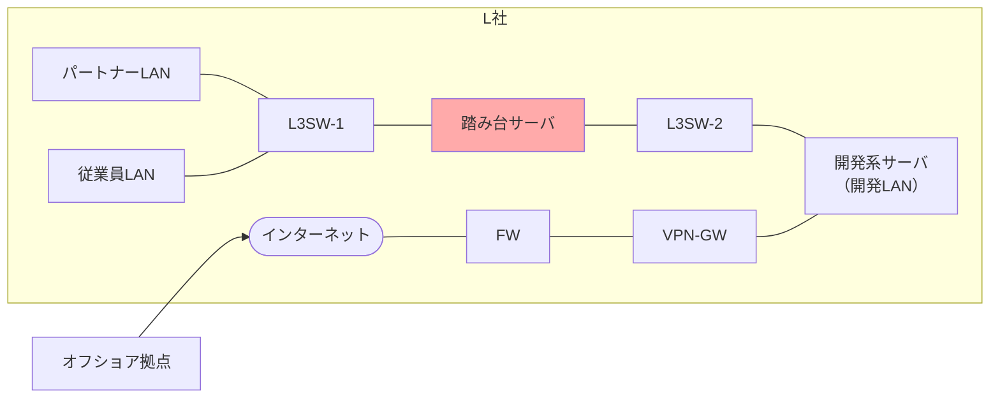

| 経路                                          | ログの取得状況                                                                               |
| --------------------------------------------- | -------------------------------------------------------------------------------------------- |
| オフショア拠点 → 開発LAN                      | **VPN-GWで取得できている**（Cさんの発言）                                                    |
| 社内（従業員LAN／パートナーLAN）<br>→ 開発LAN | **取得できていない** ← 設問5(1)の論点。<br>必ず**踏み台サーバ**を経由する（図1 項番10）      |
| 開発LAN上のサーバ自身                         | 製品仕様上、**アクセスログが取れないものもある**（図1 項番10）<br>→ サーバ側のログに頼れない |

### ガイドライン案（表1）と点検結果（表2）の対応を押さえる

**表1は「全工程で共通」＋「調達／開発／リリース・デプロイ／運用」の5区分・15項番**。設問3はこの表と図1（システムSの実態）を1対1で突き合わせる作業なので、**先に対応表を作ってしまうのが速い**。

| 工程               | 項番 | 対策の要旨                                   | 図1の該当項番 | 確認結果                                          |
| ------------------ | ---: | -------------------------------------------- | ------------- | ------------------------------------------------- |
| 共通               |    1 | 情報資産の一覧化・管理                       | 8, 9          | **OSSライブラリを台帳管理していない**             |
| 共通               |    2 | アカウントは必要な利用者だけ＋**責任追跡性** | **ア＝10**    | **a（踏み台サーバの共用アカウント）**             |
| 共通               |    3 | パッチ適用状況など構成情報の把握             | —             | （表2では問われていない）                         |
| 調達               |    4 | 業務委託先を**再委託先まで**一覧管理         | —             | （表2では問われていない）                         |
| 調達               |    5 | 委託先のセキュリティ要件を**契約に含める**   | **イ＝4**     | 問題なし                                          |
| 開発               |    6 | 開発環境のアクセス制御                       | —             | （表2では問われていない）                         |
| 開発               |    7 | 開発環境への**アクセスログ**の記録           | —             | **社内からのアクセスは取得できていない**（設問5） |
| 開発               |    8 | 人手によるレビュー＋**SASTツール**           | —             | 開発リーダーのレビューのみ（設問5）               |
| 開発               |    9 | 仕様・機能を精査し**設計書から確認**         | **ウ＝5**     | **b（問題なし）**                                 |
| リリース・デプロイ |   10 | **SBOMの作成**                               | 6             | **SBOMを作成していない**                          |
| リリース・デプロイ |   11 | リリースバージョンの管理                     | 7             | （表2では問われていない）                         |
| 運用               |   12 | 稼働状況の監視                               | 2             | （表2では問われていない）                         |
| 運用               |   13 | 要件に応じたアクセス制御                     | 3             | （表2では問われていない）                         |
| 運用               |   14 | 運用端末のある部屋の入退室管理               | 3             | （表2では問われていない）                         |
| 運用               |   15 | **インシデント対応手順書**の作成             | **エ＝11**    | **c（問題なし）**                                 |

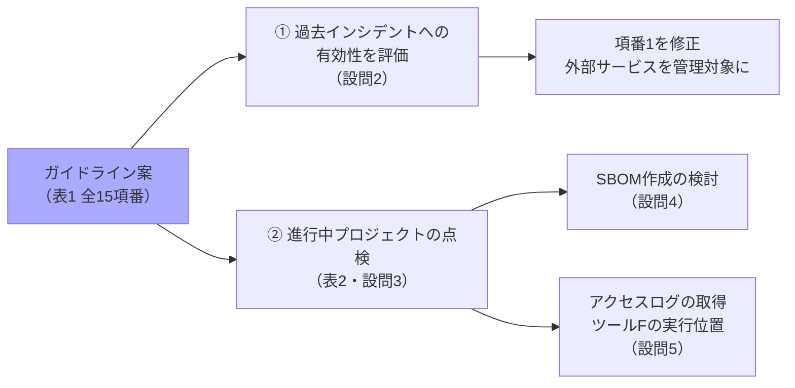

---

### 設問1(1)　下線①　セキュリティ・バイ・デザインの考え方

> **設問1**　〔ガイドラインの作成〕について答えよ。
> **(1)** 本文中の下線①について、どのような**考え方**か答えよ。
>
> （本文）Bさん：①**セキュリティ・バイ・デザインの考え方**を一部取り入れました。その他、留意すべき点などはありますか。

**解答**：**企画・設計工程からセキュリティ対策を組み込むという考え方**

**解説**

ガイドライン案のどこがSBDなのかを探すと、表1の**項番9**に行き着く。

| 項番 | 記述                                                                                                 | SBDとしての意味                      |
| ---- | ---------------------------------------------------------------------------------------------------- | ------------------------------------ |
| 9    | システムの仕様、機能を精査し、不要な機能やセキュリティ上の欠陥がないことを**設計書から確認**すること | **設計工程**でセキュリティを作り込む |

SBD（Security by Design）の定義は、**「情報セキュリティを企画・設計段階から確保するための方策」**（内閣サイバーセキュリティセンター／IPA）。
**運用開始後に後付けするのではない**という点が答案の核なので、「**企画・設計の段階から**」という時間軸の語を必ず入れる。

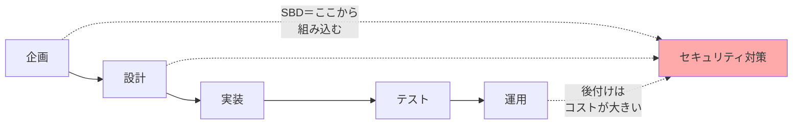

**+α：紛らわしい用語の区別**

| 用語                             | 意味                                                                             |
| -------------------------------- | -------------------------------------------------------------------------------- |
| **セキュリティ・バイ・デザイン** | **企画・設計段階から**セキュリティを組み込む                                     |
| セキュア・バイ・デフォルト       | **初期設定の時点で安全**にしておく（不要ポート閉塞、初期パスワード強制変更など） |
| プライバシー・バイ・デザイン     | 同じ発想を**個人情報保護**に適用したもの                                         |
| シフトレフト                     | 検査・テストを**開発工程の前倒し**で行う（設問5(2)の(あ)がこれ）                 |

> **落とし穴**：「脆弱性を作り込まないこと」だけでは不十分。**どの工程で**という要素が採点の要になる。

---

### 設問1(2)　下線②　再委託に備えて契約書に明記すべき事項（50字以内）

> **(2)** 本文中の下線②について、**明記すべき事項**を、**50字以内**で答えよ。
>
> （本文）D氏：項番5には、②**業務委託先が再委託を行う場合に備えて、L社と業務委託先との間の契約書に明記すべき事項**を具体的に示しておくとよいでしょう。

**解答**：**L社の業務委託先に要求する対策と同等のセキュリティ対策を再委託先にも要求させること**

**解説**

表1 項番5は「業務委託先でのセキュリティ管理に関する要件を、**業務委託先との契約に含める**こと」。ここで抜け落ちるのが**再委託先（2次委託先）**である。

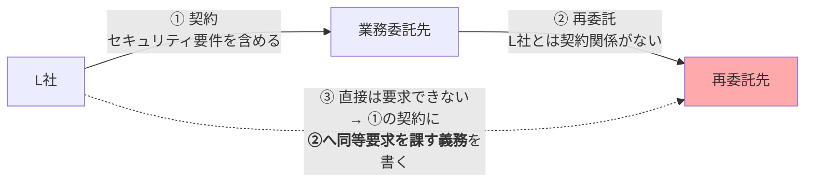

**なぜ契約書に書くしかないのか**

| 事実                                      | 帰結                                             |
| ----------------------------------------- | ------------------------------------------------ |
| L社と再委託先の間には**直接の契約がない** | L社から再委託先へ直接の指示・監査ができない      |
| 業務委託先と再委託先の間には契約がある    | **委託先を経由して**同等水準を課すのが唯一の手段 |
| 表1 項番4で再委託先まで一覧管理する       | 「誰が再委託先か」は把握済み＝**要求が実行可能** |

**+α：委託契約で定める定番条項**

| 条項                     | 内容                                                    |
| ------------------------ | ------------------------------------------------------- |
| **再委託の事前承認**     | 原則禁止とし、書面による事前承認制にする                |
| **同等以上の措置の義務** | 本問の解答。委託先に、再委託先へ同等要求をさせる        |
| **監査権**               | 実地監査・報告徴求の権利（図1 項番4の「定期的な監査」） |
| **インシデント報告義務** | 発生時の報告先・期限（例：覚知後24時間以内）            |
| 契約終了時の措置         | データの返却・**消去証明**                              |

> **参考**：図1 項番4では、N社との業務委託契約に「**N社が再委託を行わないことを明記**」とある。**再委託そのものを禁じる**のも有効な選択肢で、システムSはこちらを採っている。

---

### 設問2(1)　下線③　影響を受けないスクリプトPの配置方法

> **設問2**　〔過去のインシデントの確認〕について答えよ。
> **(1)** 本文中の下線③について、**影響を受けない配置方法**を答えよ。
>
> （本文）D氏：他社の発表によると、③**スクリプトPを利用していたシステムでもスクリプトPの配置方法が違えば、影響を受けなかった**ようですね。

**解答**：**スクリプトPをダウンロードしておき、システムQのサーバ上に配置する方法**

**解説**

**インシデント1件目の構図**

| 要素        | 内容                                                                                   |
| ----------- | -------------------------------------------------------------------------------------- |
| スクリプトP | 古いWebブラウザをサポートするためのJavaScript（**T社製**、当時広く使われていた）       |
| 配置        | **T社が運営するサーバT**に置かれ、システムQにアクセスしたWebブラウザが**都度読み込む** |
| 侵害        | **サーバTが乗っ取られ**、スクリプトPが改ざんされた                                     |
| 被害        | 利用者のアクセスが**悪意のあるWebサイトにリダイレクト**された                          |

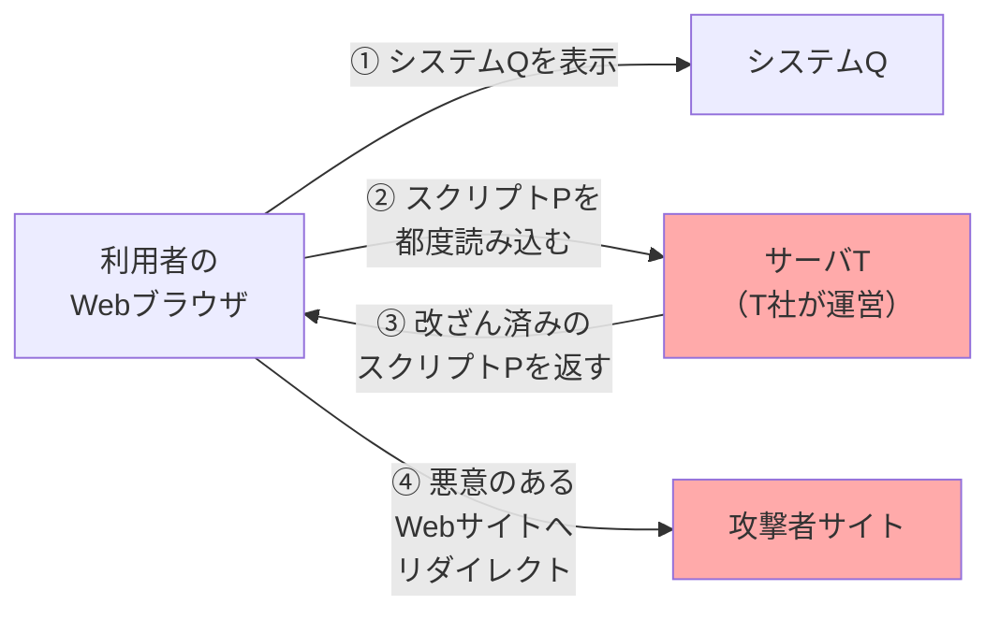

**ポイントは「L社は何も侵害されていない」こと。** システムQ自体は無傷で、**他社（T社）のサーバが侵害されただけ**で被害が出た。これが**サプライチェーン攻撃**（Webスキミング／Magecart型と同じ構図）である。

したがって、**外部サーバを参照しない配置＝自社サーバに取り込んで配信（セルフホスティング）**にすれば、配信元の侵害の影響を受けない。

**+α：外部から読み込み続ける場合の緩和策**

| 対策                             | 内容                                                                                                         |
| -------------------------------- | ------------------------------------------------------------------------------------------------------------ |
| **SRI（Subresource Integrity）** | `<script src="..." integrity="sha384-...">` でハッシュを固定し、<br>改ざんされたスクリプトを**実行させない** |
| **CSP**（`script-src`）          | 読み込み先ドメインを限定する                                                                                 |
| バージョン固定                   | `latest` ではなく特定バージョンのURLを参照する                                                               |

> **落とし穴**：「SRIを設定する」は技術的には正しいが、設問が聞いているのは**配置方法**。設問の言葉（配置方法）に合わせて答える。

---

### 設問2(2)　下線④　システムQのソースコードに加えた変更

> **(2)** 本文中の下線④について、**加えた変更**を、具体的に答えよ。
>
> （本文）Bさん：はい。違う配置方法にするという対策もありました。しかし、Webブラウザ開発元での古いWebブラウザの公式サポートが終了していたことから、当社の対策としては、④**システムQのソースコードに変更を加えて、古いWebブラウザのサポートを終了しました**。

**解答**：**スクリプトPを読み込む箇所をソースコードから削除する。**

**解説**

スクリプトPの役割は「**古いWebブラウザをサポートするためのJavaScript**」＝いわゆる**ポリフィル**。

| 前提                                                | 帰結                                      |
| --------------------------------------------------- | ----------------------------------------- |
| Webブラウザ開発元が古いブラウザの公式サポートを終了 | L社も古いブラウザをサポートする必要がない |
| 古いブラウザのサポートを終了する                    | **スクリプトPそのものが不要**になる       |
| 不要なものを残さない                                | 読み込み箇所を**削除**＝攻撃経路が消える  |

**この対策の本質は「アタックサーフェスを減らす」こと。** 配置方法を変える（自社配置）のは参照先のリスクを下げるだけだが、**そもそも読み込まない**なら、スクリプトPに起因するリスクはゼロになる。

> **落とし穴**：「古いWebブラウザのサポートを終了する」とだけ書くのは、下線④の**言い換えにすぎない**。設問は「**加えた変更**を具体的に」なので、**ソースコード上で何をしたか**（＝読み込み箇所の削除）を書く。

---

### 設問2(3)　下線⑤　SBOM以外の手段で外部スクリプトを把握する修正

> **(3)** 本文中の下線⑤について、**修正した項番と修正内容**を答えよ。
>
> （本文）Bさんは、⑤**SBOM以外の手段で、システムが利用している外部のスクリプトを把握できるよう、案の項目を一つ修正した**。
>
> （直前のD氏の発言）いいえ、開発対象のSBOM作成機能でSBOMを作成していたとしても、**スクリプトPはSBOMに含まれない**ので、インシデントは防げなかったでしょう。

**解答**：**項番　1** ／ 修正内容：**連携している外部サービスを管理対象に含める。**

**解説**

**なぜスクリプトPはSBOMに含まれないのか**

| SBOM作成機能の仕様（本文）                                                           | 帰結                                       |
| ------------------------------------------------------------------------------------ | ------------------------------------------ |
| **リポジトリサーバ内のソースコード及びライブラリ**をシステム構成要素として一覧化する | リポジトリに入っていないものは載らない     |
| スクリプトPは**サーバT上にあり、実行時にブラウザが読み込む**                         | リポジトリに存在しない＝**SBOMに現れない** |

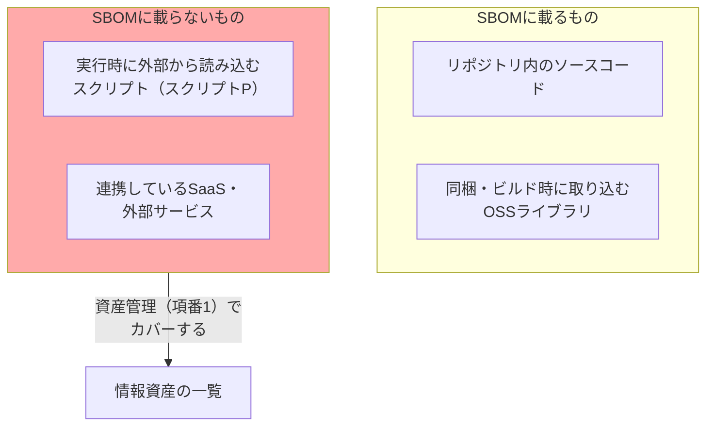

**なぜ項番1なのか**

表1 項番1の「一覧化すべき情報資産」は、サーバ／ネットワーク機器／ソースコード／リポジトリ内のライブラリの4つ。**実行時に外部から読み込むもの（外部サービス）が列挙から漏れている**。ここに追加すれば、SBOMに載らない依存関係も**資産管理の側**で把握できる。

| 候補の項番 | なぜ違うか                                                                                                       |
| ---------- | ---------------------------------------------------------------------------------------------------------------- |
| 項番3      | 「一覧化した情報資産**ごとに**」構成情報を把握する＝**一覧化が前提**。<br>一覧に載っていないものは対象にならない |
| 項番10     | SBOMの作成そのもの。D氏が「**SBOMでは防げない**」と否定済み                                                      |
| **項番1**  | **一覧化の対象範囲**を広げる＝SBOM以外の手段で把握できるようになる ← 正解                                        |

**+α**：近年のSBOM論点は「**何が載らないか**」が本番。
- 載りにくいもの：**実行時に外部から読み込むスクリプト／CDN配信のコード／連携SaaS／IaCで動的に構成されるもの**
- SBOM標準：**SPDX**、**CycloneDX**。経済産業省「ソフトウェア管理に向けたSBOM導入に関する手引」も押さえる

---

### 設問3(1)　表2中のア〜エ　確認した図1の項番

> **設問3**　〔ガイドラインを用いた点検の実施〕について答えよ。
> **(1)** 表2中の　**ア**　〜　**エ**　に入れる適切な**項番**を答えよ。

**解答**：**ア＝10／イ＝4／ウ＝5／エ＝11**

**解説**

表2は「**表1の項番（求める対策）**」に対して「**確認した図1の項番（システムSの実態）**」を並べる構造。表1の対策文と、図1の記述を1行ずつ突き合わせる。

| 空欄   | 表1の項番と対策文                                                                                                                               | 図1の該当項番と記述                                                                                                                                                                 | 突き合わせの根拠                         |
| ------ | ----------------------------------------------------------------------------------------------------------------------------------------------- | ----------------------------------------------------------------------------------------------------------------------------------------------------------------------------------- | ---------------------------------------- |
| **ア** | 項番2：各工程で利用するシステムのアカウントは必要な利用者だけに発行。<br>**責任追跡性**を確保するためにアカウントの利用者を特定できるようにする | **項番10**：踏み台サーバには、L社、業務委託先など**会社ごとに発行した共用アカウント**でログインする。<br>ログインごとに、**利用記録簿に記載**する                                   | 「アカウント」の話をしているのはここだけ |
| **イ** | 項番5：業務委託先でのセキュリティ管理に関する要件を、業務委託先との契約に含める                                                                 | **項番4**：L社のセキュリティポリシーの順守とプロジェクトでのセキュリティルールの順守について**契約書で定めている**。<br>N社が**再委託を行わない**ことを明記。**定期的な監査**で確認 | 「契約書」＝契約に含めること             |
| **ウ** | 項番9：システムの仕様、機能を精査し、不要な機能やセキュリティ上の欠陥がないことを**設計書から確認**                                             | **項番5**：開発時に、**要件定義段階での脅威モデリング及び設計段階での設計書の確認**を行い、不要な機能やセキュリティ上の欠陥がないことを確認                                         | 「設計書の確認」が一致                   |
| **エ** | 項番15：**インシデント対応手順書**を作成する                                                                                                    | **項番11**：インシデント発生時にL社のシステムSの担当者に連絡するための業務フローが**インシデント対応手順書に定められて**いる                                                        | 「インシデント対応手順書」が一致         |

> **解き方のコツ**：**図1の項番は12個しかない**ので、表2で既に埋まっている行（項番1↔8・9／項番10↔6）を消し込んでから、残りを当てる。図1の項番6（SBOMは作成しない）・7（レビューとリリースバージョン）・8/9（資産管理台帳とOSSライブラリ）は既出・既使用なので、候補は4・5・10・11・12に絞られる。

---

### 設問3(2)　表2中のa〜c　確認結果又は問題点

> **(2)** 表2中の　**a**　〜　**c**　に入れる適切な**字句**を答えよ。

**解答**
- **a＝開発環境の踏み台サーバで共用アカウントを利用している。**
- **b＝問題なし。**
- **c＝問題なし。**

**解説**

**a：責任追跡性が確保できていない**

| 表1 項番2が求めること                                      | 図1 項番10の実態                                                 | 判定           |
| ---------------------------------------------------------- | ---------------------------------------------------------------- | -------------- |
| 必要な利用者**だけ**に発行                                 | 会社ごとの**共用アカウント**                                     | △              |
| **アカウントの利用者を特定できる**ようにする（責任追跡性） | ログインごとに**利用記録簿に記載**している（＝紙・台帳での運用） | **✗ 問題あり** |

**利用記録簿という運用で補っている**点が引っ掛けになっている。しかし、

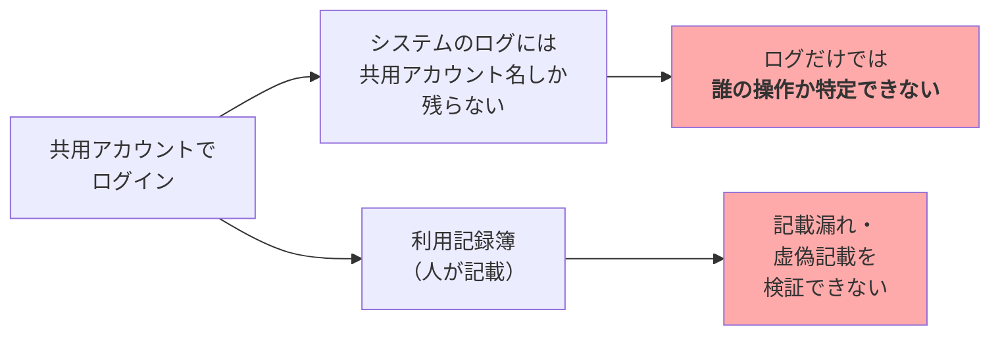

インシデント調査で求められるのは**システムが自動的に記録した証跡**であり、**人の申告に依存する台帳は責任追跡性の担保にならない**。したがって「問題点」として挙げる。

**b・c：いずれも問題なし**

| 空欄 | 表1の項番 | 図1の実態                                         | 判定                              |
| ---- | --------- | ------------------------------------------------- | --------------------------------- |
| b    | 項番9     | 項番5：脅威モデリング＋設計書の確認を実施している | 求める対策を満たす → **問題なし** |
| c    | 項番15    | 項番11：インシデント対応手順書が整備されている    | 求める対策を満たす → **問題なし** |

> **落とし穴**：**「全部に問題がある」と思い込まない**。表2には既に「問題なし」（調達・項番5の行）という記入例があり、**同じ書式でよい**ことが示されている。aだけが問題点で、b・cは充足している、という切り分けが設問の狙い。

---

### 設問4　下線⑥　SBOMで脆弱性管理がしやすくなる理由

> **設問4**　本文中の下線⑥について、**脆弱性管理がしやすくなる理由**を、具体的に答えよ。
>
> （本文）Bさん：SBOMを利用すると、⑥**将来、脆弱性管理がしやすくなります**。プラットフォームGで作成することができます。

**解答**：**利用しているソフトウェアやそのバージョンが明確になり、脆弱性の影響有無を容易に把握できるから**

**解説**

Cさんの前提は「**システムSのソフトウェア構成は設計書で把握できる**」。これに対して、SBOMが優れている点を説明する設問である。

| 観点           | 設計書                                 | SBOM                                                 |
| -------------- | -------------------------------------- | ---------------------------------------------------- |
| 粒度           | 設計時点の構成（**自分で書いたもの**） | **実際に取り込んだコンポーネント**（依存の依存まで） |
| バージョン情報 | 記載されているとは限らない             | **バージョンまで機械可読で列挙**                     |
| 鮮度           | 更新されないことがある                 | ビルドのたびに生成できる                             |
| 使い方         | 人が読む                               | **機械的に検索・突合できる**                         |

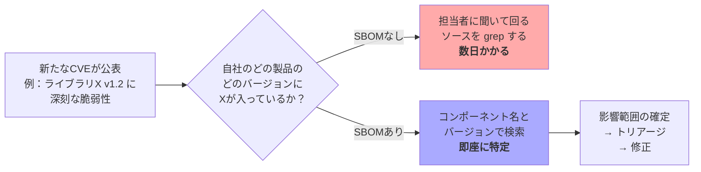

答案には「**ソフトウェアとバージョンが明確になる**」（何が分かるか）と「**影響の有無を容易に把握できる**」（それで何ができるか）の**2要素**を入れる。

**+α**：この発想が普及した契機は **Log4Shell（CVE-2021-44228）**。多くの組織が「自社でLog4jを使っているかどうか」の調査に数週間を要した。米国大統領令14028やEUのCRA（サイバーレジリエンス法）でSBOMが要求されるようになった背景でもある。

---

### 設問5(1)　本文中のd　アクセスログの取得箇所

> **設問5**　〔開発工程のセキュリティ対策についての確認〕について答えよ。
> **(1)** 本文中の　**d**　に入れる適切な字句を、**図2中の名称**で答えよ。
>
> （本文）Cさん：オフショア拠点から開発LANへのアクセスについてはVPN-GWでアクセスログを取得できているものの、**社内からのアクセスについては取得できていません**。
> Bさん：アクセスログは図2中の　**d**　で取得するのがよいでしょう。

**解答**：**踏み台サーバ**

**解説**

**社内から開発LANへ行く経路を図2で追う**

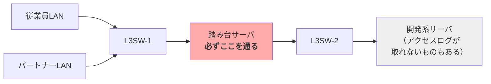

| 根拠                                                                                                                  | 出所       |
| --------------------------------------------------------------------------------------------------------------------- | ---------- |
| テストなどのためにシステムSの開発系サーバがあるLAN（開発LAN）にアクセスする際には**一旦、踏み台サーバにログインする** | 図1 項番10 |
| 開発LAN上のサーバには**製品仕様上、アクセスログが取れないものもある**                                                 | 図1 項番10 |
| 設問が「**図2中の名称**で答えよ」と指定                                                                               | 設問5(1)   |

**サーバ側では取れない**以上、**全アクセスが必ず経由する踏み台サーバ**で取得するしかない。L3SW-1／L3SW-2でも通信は通るが、**L3スイッチは「誰がログインしたか」を記録できない**（アクセスログではなく通信の転送）。設問が求めているのは表1 項番7「**開発環境にアクセスしたアカウントを特定できるようにアクセスログを記録する**」なので、**アカウントを識別できる箇所＝踏み台サーバ**が答えになる。

**+α：踏み台サーバ（bastion／jump server）の意義**

| 目的           | 内容                                                              |
| -------------- | ----------------------------------------------------------------- |
| **経路の集約** | 管理対象への入口を1つに絞る＝ログの取得点を1つにできる            |
| **証跡の確保** | 誰が・いつ・どこへ接続したかを記録。PAM製品なら**操作の録画**まで |
| **認証の強化** | 踏み台でMFAを課せば、背後のサーバ群をまとめて保護できる           |

> **関連**：設問3(2)のaで指摘した「**共用アカウント**」問題と組み合わせると、**踏み台サーバのアカウントを個人ごとにする**ことが、項番2（責任追跡性）と項番7（アクセスログ）の両方を同時に満たす改善策になる。

---

### 設問5(2)　下線⑦　(あ)(い)でツールFを実行する利点（各40字以内）

> **(2)** 本文中の下線⑦について、**(あ)、(い)で実行する利点**を、それぞれ**40字以内**で答えよ。
>
> （本文）Bさん：ツールFの特性を踏まえると、図3のシステムSの開発フロー中の(あ)又は(い)で実行するのがよいと考えられます。⑦**それぞれ利点が異なります**。

**解答**
- **(あ)：ツールFで検知できるエラーをより早く発見することができる。**
- **(い)：CI/CDパイプラインの管理機能を使って自動実行することができる。**

**解説**

**まず「ツールFの特性」を押さえる**

| 特性                                                                       | 帰結                                                   |
| -------------------------------------------------------------------------- | ------------------------------------------------------ |
| **コンパイルエラーが解消されたソースコードに対してだけ正常な検査が可能**   | **コンパイルの直後**にしか置けない                     |
| リポジトリサーバや**開発者の端末**にインストールして利用                   | 開発者端末でも実行できる（図1 項番12で両方に導入済み） |
| プラットフォームGのCI/CD管理機能で**自動実行するワークフローを構成できる** | プラットフォームG側では**自動化**できる                |

**図3のどこが候補になるか**

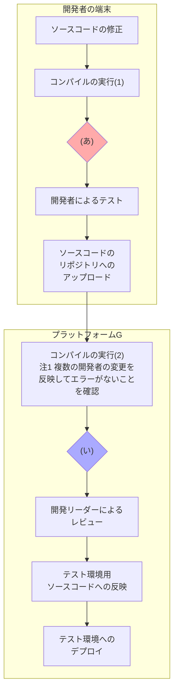

**それぞれの利点**

| 実行位置                                       | 何が良いか                                                                                                          | キーワード             |
| ---------------------------------------------- | ------------------------------------------------------------------------------------------------------------------- | ---------------------- |
| **(あ)** 開発者端末の<br>コンパイル直後        | 開発者が**自分のテストに入る前**に指摘を受けられる。<br>修正が最も安く済み、手戻りが小さい                          | **シフトレフト**       |
| **(い)** プラットフォームGの<br>コンパイル直後 | **CI/CDパイプラインに組み込める**＝実行漏れがない。<br>複数開発者の変更を反映した状態で、全員分をまとめて検査できる | **自動化・実行の強制** |

> **落とし穴**：「早く見つけられる」は(あ)だけの利点、「自動実行できる」は(い)だけの利点。**両方に同じことを書かない**。設問が「**それぞれ利点が異なります**」とわざわざ言っているのは、**対比で書け**という指示である。

**+α：検査手法の守備範囲**

| 手法     | 対象                       | 実行タイミング           | 特徴                                           |
| -------- | -------------------------- | ------------------------ | ---------------------------------------------- |
| **SAST** | ソースコード（実行しない） | コンパイル後・コミット時 | 早期に発見できるが**偽陽性が多い**             |
| **DAST** | 稼働中のアプリ             | テスト環境               | 実際に動く問題を検出。コード箇所は特定しにくい |
| **IAST** | 実行時の内部挙動           | テスト実行中             | SASTとDASTの中間                               |
| **SCA**  | OSSライブラリと依存関係    | ビルド時                 | **SBOM**と組み合わせて脆弱性を管理             |

CI/CDでは「**SAST＋SCA＋シークレットスキャン**」を自動実行し、重大な指摘があればパイプラインを止める構成が定石。

---

### 問1の学習ポイントまとめ

| 論点                         | 押さえる要点                                                                                            |
| ---------------------------- | ------------------------------------------------------------------------------------------------------- |
| セキュリティ・バイ・デザイン | **企画・設計工程から**組み込む。後付けではない                                                          |
| 再委託管理                   | L社は再委託先と**直接契約がない** → 委託先に**同等要求を課す義務**を契約に明記する                      |
| 外部スクリプト               | 外部サーバから**都度読み込む**構成は、配信元の侵害で即被害。<br>**自社配置**／SRI／そもそも読み込まない |
| SBOMの限界                   | **リポジトリ内のコードとライブラリ**しか載らない。<br>外部サービス・外部スクリプトは**資産管理**で拾う  |
| SBOMの効用                   | 「**何のどのバージョンを使っているか**」が機械可読 → **影響範囲の即時特定**                             |
| 責任追跡性                   | **共用アカウント＋紙の利用記録簿**では担保できない。システムのログで個人を特定できること                |
| ログの取得点                 | サーバ側で取れないなら、**必ず経由する踏み台サーバ**で取る                                              |
| SASTの配置                   | **コンパイル後**にしか置けない。<br>開発者端末＝**早期発見**／CI/CD＝**自動実行**                       |

**この問は知識よりも「表1（あるべき姿）と図1（実態）の突き合わせ」という作業が本体。** ガイドラインの各項番が、システムSのどの記述に対応するかを機械的にマッピングできれば、設問3は確実に取れる。

---

## 問2 脆弱性管理（M社）

### 題材の整理

| 項目             | 内容                                                                                                                                     |
| ---------------- | ---------------------------------------------------------------------------------------------------------------------------------------- |
| 企業             | **M社**：従業員3,000名の情報サービス業。<br>自社ホームページ、販売したソフトウェアの<br>サポート用Webサイトなど**複数のサイト**を保有    |
| 登場人物         | **Eさん**・**J課長**（情報システム部）／<br>各サイトの**サイト担当者**／専門ベンダー**P社**                                              |
| 運用             | 管理者が**自宅や外出先からサイトにリモートアクセス**する。<br>セキュリティの問合せ窓口は情報システム部                                   |
| 診断の種類       | **PF診断**（プラットフォーム）＋**Webアプリ診断**＝**両診断**                                                                            |
| 診断のルール     | **重要サイト**は初回リリース前に両診断を実施。<br>**初回リリース後の実施は任意**。重要サイト以外も任意                                   |
| 重要サイトの指定 | 情報の重要性・停止による影響を勘案し、**各サイトの所管部門が判断**                                                                       |
| 実施主体         | ①P社に依頼（**悪用できることを確認した上で報告**＝評判がよい）<br>②サイト担当者が診断ツールを実施<br>③緊急時は情報システム部が実施       |
| 深刻度レベル     | **Critical / High / Medium / Low / None** の5段階。<br>診断ツール＝**CVSS基本値**で分類／P社＝**独自の知見で基本値を基に値を変えて**分類 |
| 対応ルール       | **High以上は速やかな修正を必須**、それ以外は所管部門が対応要否を判断                                                                     |

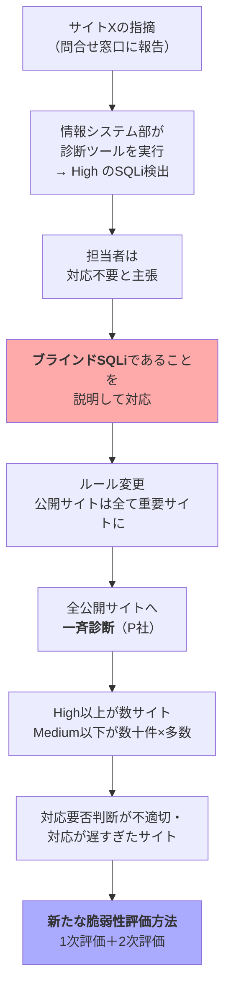

**この問の骨格**：前半（設問1〜4）は**個別の脆弱性をどう読むか**、後半（設問5〜6）は**多数の脆弱性をどう捌くか**。後半のモデル（領域図＋対応優先度表）を正確に運用できるかが配点の山になる。

---

### 設問1　表1中のa〜e　ブラインドSQLインジェクションの応答

> **設問1**　表1中の　**a**　〜　**e**　に入れる**応答**を、解答群の中から選び、記号で答えよ。なお、解答は**重複して選んでもよい**。
>
> **解答群**
> ア　“コンテンツがありません”というメッセージが返される。
> イ　2025年4月1日のキャンペーンのコンテンツが返される。
> ウ　サーバから応答が返されない。
> エ　内部サーバエラーが返される。

**解答**：**a＝ア／b＝ア／c＝ア／d＝ア／e＝イ**

**解説**

**図1（サイトXの仕様）の2行が全てを決める**

| 仕様                                                                                                                            | 効果                                                     |
| ------------------------------------------------------------------------------------------------------------------------------- | -------------------------------------------------------- |
| コンテンツ番号がDBサーバ上に**存在しない場合、又はSQLが構文エラーになる場合**は、“コンテンツがありません”というメッセージを返す | **エラーも「該当なし」も同じ応答**＝エラー内容が漏れない |
| Webアプリにおいて、クエリパラメータ **article の値はSQLでの検索では数値型として扱われる**                                       | SQL文で**引用符に囲まれない**                            |

つまり、生成されるSQLは `... WHERE article = <値>` の形で、`<値>` に入力がそのまま連結される。

| 空欄 | クエリパラメータ                   | デコード後の条件         | SQLの状態          | 応答                       |
| ---- | ---------------------------------- | ------------------------ | ------------------ | -------------------------- |
| —    | `article=20250401`                 | `= 20250401`             | 正常・該当あり     | コンテンツが返る           |
| a    | `article=20250401'`                | `= 20250401'`            | **構文エラー**     | **ア**                     |
| b    | `article=20250401'%20and%20'a'='a` | `= 20250401' and 'a'='a` | **構文エラー**     | **ア**                     |
| c    | `article=20250401'%20and%20'a'='b` | `= 20250401' and 'a'='b` | **構文エラー**     | **ア**                     |
| d    | `article=20250401%20and%201=0`     | `= 20250401 and 1=0`     | 正常・**条件が偽** | **ア**（該当なし）         |
| e    | `article=20250401%20and%201=1`     | `= 20250401 and 1=1`     | 正常・**条件が真** | **イ**（コンテンツが返る） |

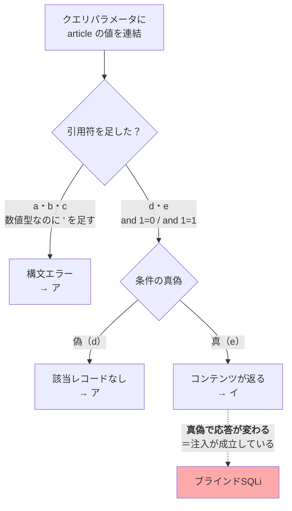

**なぜこれが「ブラインドSQLインジェクション」なのか**

d と e は**SQLとして正しく解釈され、条件式が評価されている**。つまり攻撃者の入力がSQL文の一部として動いている。**エラーメッセージや検索結果そのものは返らなくても、「真なら表示／偽なら非表示」という1ビットの差**を利用すれば、

```text
and (select substr(table_name,1,1) from ... ) = 'a'  → 真偽の差で1文字ずつ特定
```

のように**DBのテーブル名を1文字ずつ抜き出せる**。これがEさんの「表1と同様の手法を用いることによって、DBのテーブル名が特定できることになる」という説明の中身である。

**サイト担当者の主張がなぜ誤りか**

| 担当者の主張                          | 反論                                                                                |
| ------------------------------------- | ----------------------------------------------------------------------------------- |
| 重要情報の漏えいなどの問題は生じない  | テーブル名が判明すれば、**UPDATE／DELETEや他テーブルへのUNION**など次の攻撃に進める |
| DBには重要情報もない                  | DBサーバを**踏み台**にされる／キャンペーン情報の**改ざん**も被害                    |
| サイトXへのアクセスを止める必要はない | 修正までの間は**ネットワーク構成の変更で遮断**するのが定石                          |

**+α：SQLインジェクションの型と見分け方**

| 型                     | 判定方法                                                     |
| ---------------------- | ------------------------------------------------------------ |
| エラーベース           | エラーメッセージにDBの情報が出る                             |
| **ブラインド（真偽）** | **応答の有無・内容の差**で1ビットずつ判定（本問）            |
| **ブラインド（時間）** | `sleep()` などで**応答時間の差**を作る（応答が常に同じ場合） |
| UNIONベース            | `UNION SELECT` で結果に別テーブルの内容を混ぜる              |

根本対策は**プレースホルダ（バインド機構）**。数値型と分かっているなら整数チェックも有効だが、**SQL文を文字列連結で組み立てない**のが原則。

> **落とし穴**：`and 'a'='a`（真の条件）を見ると反射的に「イ」と答えたくなるが、**数値型だから引用符を足した時点で構文エラー**。図1の最後の1行を読めたかどうかだけで3問（a・b・c）が決まる。

---

### 設問2　本文中のf・g　診断結果が異なっていた要因（各20字以内）

> **設問2**　本文中の　**f**　、　**g**　に入れる適切な字句を、それぞれ**20字以内**で答えよ。
>
> （本文）サイトによっては、初回リリース時の両診断以降にアップデートや設定変更をしていないにもかかわらず、初回リリース時の両診断結果と今回の一斉診断結果が異なっている場合もあった。……Eさんが、改めてP社に確認すると、診断結果が異なっていた要因は、　**f**　や　**g**　だった。

**解答**（順不同）
- **f＝新たな脆弱性が発見されたこと**
- **g＝リスクが変わったと評価し値を変えたこと**

**解説**

設問の前提は「**サイトは何も変わっていないのに結果が変わった**」。本文は先回りして、**診断の品質を疑う線を潰している**。

| 本文の記述                                                                 | 潰される仮説                 |
| -------------------------------------------------------------------------- | ---------------------------- |
| P社の診断は、**決められた手順に従って**行う                                | 手順のばらつきではない       |
| 診断結果は**技術レビューを行う**ので、**診断員による差異はほぼない**       | 診断員の力量差ではない       |
| 初回リリース時の両診断では、**サイトに不具合はなかった**と報告を受けている | 前回の見落としという線も弱い |

残るのは「**サイト側ではなく、脆弱性情報の側が変わった**」という説明である。

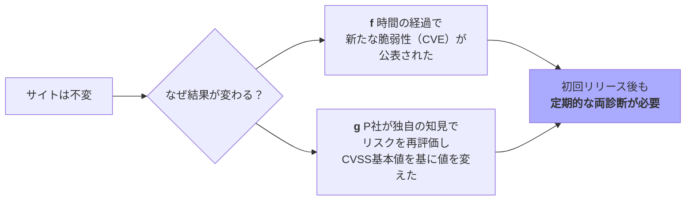

**gの根拠**は本文冒頭の「**P社の診断では、P社が独自の知見でCVSS基本値を基に値を変え、分類している**」。深刻度レベルの分類がP社の評価に依存している以上、**評価が見直されれば分類も変わる**。

> **結論の位置づけ**：この設問の答えがそのまま「**初回リリース後も定期的な両診断が必要**」という結論の根拠になる。脆弱性管理が**一度やって終わりにならない**理由を説明できることが、この問のテーマそのもの。

---

### 設問3(1)　表4中のh〜k　鍵交換におけるビットセキュリティの基準

> **設問3**　〔PF診断で検出された脆弱性〕について答えよ。
> **(1)** 表4中の　**h**　〜　**k**　に入れる適切な字句の組合せを、解答群の中から選び、記号で答えよ。
>
> | 記号 | h   | i    | j   | k    |
> | ---- | --- | ---- | --- | ---- |
> | ア   | 112 | 曲線 | 128 | 鍵長 |
> | イ   | 112 | 直線 | 128 | 署名 |
> | ウ   | 128 | 曲線 | 112 | 鍵長 |
> | エ   | 128 | 直線 | 112 | 署名 |

**解答**：**ウ**（h＝128／i＝曲線／j＝112／k＝鍵長）

**解説**

完成形は次のとおり。

| 鍵交換プロトコル | 基準                                          |
| ---------------- | --------------------------------------------- |
| **ECDHE**        | **128**ビットセキュリティ以上を満たす**曲線** |
| **DHE**          | **112**ビットセキュリティ以上を満たす**鍵長** |

**2つの軸で絞り込む**

| 軸                     | 判断                                                                                                                                                                                                               |
| ---------------------- | ------------------------------------------------------------------------------------------------------------------------------------------------------------------------------------------------------------------ |
| i・k（何で決まるか）   | **ECDHEは楕円曲線暗号** → 強度は**どの曲線を使うか**で決まる（P-256など）。<br>**DHEは有限体** → 強度は**鍵長**（2048／3072ビット）で決まる。<br>「直線」「署名」は鍵交換の強度指標ではない → **ア or ウ**に絞れる |
| h・j（どちらが高いか） | ECDHEは**短い鍵で同等以上の強度**が得られるため、推奨設定ではECDHE側により高い水準を課せる。<br>CRYPTREC／IPA「TLS暗号設定ガイドライン」の**推奨セキュリティ型**では **ECDHE＝128／DHE＝112** → **ウ**             |

**+α：ビットセキュリティの対応表（暗記推奨）**

| 強度          | 共通鍵      | RSA／DH（有限体） | 楕円曲線      | ハッシュ |
| ------------- | ----------- | ----------------- | ------------- | -------- |
| **112ビット** | 3-key TDES  | **2048ビット**    | 224ビット     | SHA-224  |
| **128ビット** | **AES-128** | **3072ビット**    | **256ビット** | SHA-256  |
| 192ビット     | AES-192     | 7680ビット        | 384ビット     | SHA-384  |
| 256ビット     | AES-256     | 15360ビット       | 512ビット     | SHA-512  |

> **ビットセキュリティとは**：その暗号を破るのに **2^n 回**の計算が必要、という強度の表し方。「鍵長＝強度」ではない点に注意（RSA 2048ビットの強度は112ビット相当）。

**脆弱性PA-1・PB-3（SSL/TLSサーバの暗号強度が弱く、推奨されていない鍵交換をサポート）への対応**は、**基準を満たす曲線・鍵長だけを有効にする設定変更**。古いDHE（1024ビット）やDH鍵交換の無効化、ECDHEでのP-256以上の採用がこれに当たる。

---

### 設問3(2)　下線①　攻撃を早期に検知する方法

> **(2)** 本文中の下線①について、**検知する方法**を、具体的に答えよ。
>
> （本文）もしも、脆弱性を修正したバージョンのOpenSSHに更新できない場合には、次のいずれかを行う。
> ・トレードオフはあるものの、認証試行にタイムアウトを設けないようにサーバの設定を変更する。
> ・①**サイト担当者が攻撃を早期に検知する方法**を採用することによって被害を抑制する。

**解答**：**OpenSSHのログに認証タイムアウトのメッセージの出力が多数あったらサイト担当者に電子メールでアラートを送る。**

**解説**

**本文が与えている「攻撃の痕跡」**

| 本文の記述                                                                                               | 使いどころ                         |
| -------------------------------------------------------------------------------------------------------- | ---------------------------------- |
| OpenSSHでは、ログインが一定時間内に成功しないと、**認証試行のタイムアウト処理が実行される**              | 攻撃は**タイムアウトを多発させる** |
| 認証試行の接続時間（**LoginGraceTime**）の設定が120秒の場合、その間に**100件試行**されると               | 大量の同時試行が条件               |
| OpenSSHのログに **“Timeout before authentication”** という認証タイムアウトのメッセージが**多数出力**され | **ログに明確な前兆が残る**         |
| **3〜4時間**で悪用に成功する可能性がある                                                                 | **検知して対処する時間がある**     |

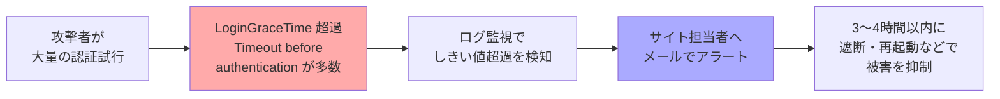

**答案に入れる3要素**

| 要素               | 本問での内容                                    |
| ------------------ | ----------------------------------------------- |
| **どのログの何を** | OpenSSHのログの**認証タイムアウトのメッセージ** |
| **どうなったら**   | **多数出力されたら**（しきい値超過）            |
| **どうする**       | **サイト担当者にメールでアラート**を送る        |

> **落とし穴**：「ログを監視する」だけでは不十分。**誰に・どう知らせるか**まで書かないと「**早期に検知する**」＝**気付ける仕組み**にならない。設問1(5)のような「対策の内容」系は、**対象・条件・通知先**をセットで書く。

**+α**：もう一方の選択肢「認証試行にタイムアウトを設けない（`LoginGraceTime 0`）」の**トレードオフ**は、**未認証の接続が居座ることによるリソース枯渇（DoS）**。本文が「トレードオフはあるものの」と書いているのはこの意味。

---

### 設問3(3)　下線②　アクセス元のPCを認証する対策（20字以内）

> **(3)** 本文中の下線②について、**採用した対策**を、**20字以内**で具体的に答えよ。
>
> （本文）脆弱性PB-2は、送信元IPアドレス制限が対策の一つだが現実的な運用が難しい。代わりの対策として、ログイン画面のアカウントロックがあるが、採用する場合はロック解除の運用方法や実装について検討が必要である。サイトBでは、②**アクセス元のPCを認証する対策**を採用した。

**解答**：**クライアント認証を行う。**

**解説**

**PB-2の性質と、潰された選択肢**

| 対策                     | 本文での扱い                                                                               |
| ------------------------ | ------------------------------------------------------------------------------------------ |
| 送信元IPアドレス制限     | **現実的な運用が難しい**（管理者が**自宅や外出先から**アクセスするため、IPが固定できない） |
| アカウントロック         | **ロック解除の運用方法や実装の検討が必要**                                                 |
| **アクセス元のPCを認証** | ← これを採用した＝**クライアント証明書によるTLSクライアント認証**                          |

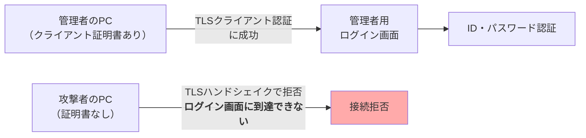

「認証試行が何回でも可能」という脆弱性に対し、**試行そのものを成立させない**という解き方。**証明書を持つ端末しかログイン画面に到達できない**ので、総当たりもパスワードスプレーも届かない。しかも**IPアドレスに依存しない**ので、自宅・外出先からのリモートアクセスという運用要件を壊さない。

**+α：「所持」による端末認証の手段**

| 手段                      | 備考                                             |
| ------------------------- | ------------------------------------------------ |
| **TLSクライアント証明書** | 本問の解。ブラウザ／OSの証明書ストアに格納       |
| デバイス証明書＋MDM       | 会社管理端末だけを通す                           |
| FIDO2のセキュリティキー   | フィッシング耐性も得られる（ただし「人」の認証） |

> **20字以内**という制限から、書けるのは「クライアント認証を行う」程度。**手段の名前を正確に1語で出せるか**が勝負で、長く書く余地はない。

---

### 設問4(1)　下線③　AC（Attack Complexity）の評価根拠

> **設問4**　〔Webアプリ診断で検出された脆弱性〕について答えよ。
> **(1)** 本文中の下線③について、**脆弱性WA-1のACがLと評価された評価根拠**と**脆弱性WB-1のACがHと評価された評価根拠**を、それぞれ具体的に答えよ。
>
> （本文）脆弱性WA-1とWB-1は、HTTPリクエストの内容を一部変更することによって本来閲覧できない画面を閲覧できるという点では同じであるが、評価指標の値が異なる。評価指標のうち、③**Attack Complexity（AC）の値はそれぞれLとHであった**。

**解答**
- **WA-1：パラメータ item の値が容易に推測できること**
- **WB-1：発注確認機能のURLが推測困難であること／発注確認機能のURLを入手する必要があること**

**解説**

**2つの脆弱性を並べて比較する**

| 項目             | WA-1（サイトA）                                                                                                                                           | WB-1（サイトB）                                                                                                                                                                     |
| ---------------- | --------------------------------------------------------------------------------------------------------------------------------------------------------- | ----------------------------------------------------------------------------------------------------------------------------------------------------------------------------------- |
| 内容             | 購入機能で、商品の詳細を閲覧するリクエストに含まれる**パラメータ item の5桁の数字を変更**することで、一般会員が本来閲覧できない商品の説明画面を閲覧できた | **管理者用アカウントでログインし、発注確認機能のURLを確認後**、一般利用者アカウントでログインし直し、Webブラウザのアドレスバーに当該URLを入力することで、管理者用の画面を閲覧できた |
| 注記のURL        | —                                                                                                                                                         | `https://site-b.m-sha.co.jp/administrator0001/order_history`                                                                                                                        |
| CVSS             | 4.3　AV:N/**AC:L**/PR:L/UI:N/S:U/C:L/I:N/A:N                                                                                                              | 5.3　AV:N/**AC:H**/PR:L/UI:N/S:U/C:H/I:N/A:N                                                                                                                                        |
| 攻撃に必要な準備 | **5桁の数字を変えるだけ**                                                                                                                                 | **推測困難なURLを事前に知っている**必要がある                                                                                                                                       |

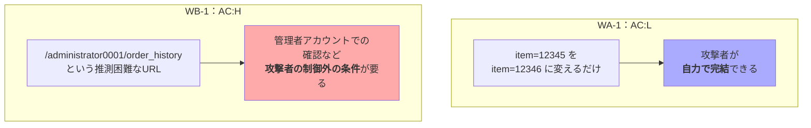

**CVSS v3 の AC の定義**

| 値          | 定義                                                                               |
| ----------- | ---------------------------------------------------------------------------------- |
| **L（低）** | 攻撃者が**制御可能な条件だけ**で、再現性をもって攻撃できる                         |
| **H（高）** | 攻撃者が**制御できない条件**（事前の情報収集、競合状態、特定の設定など）に依存する |

**WB-1がAC:Hなのは「URLを知る」という準備が攻撃者の制御外にあるから**。逆にWA-1は連番の推測だけで完結するのでAC:L。
なお**影響度**を見ると、WA-1は C:L（商品説明画面）、WB-1は C:H（**他人の発注情報が全て閲覧できた**）で、基本値はWB-1の方が高い（4.3 < 5.3）。**ACが高い＝脆弱性として軽い、とは限らない**。

> **重要な補足**：WB-1の「URLが推測困難だから安全」という設計は **Security by Obscurity**。本問でも**一般利用者アカウントでURLを入力するだけで閲覧できてしまっている**のが本質的な欠陥で、**根本対策はサーバ側での認可チェック**（そのアカウントがその画面を見てよいかを毎回判定する）。

---

### 設問4(2)　下線④　該当するサイトCの仕様（図2中の項番）

> **(2)** 本文中の下線④について、**該当するサイトCの仕様**を、図2中の項番から選び、答えよ。
>
> （本文）脆弱性WC-1について、④**管理者権限が必要な操作ができなかったのは、サイトCの仕様どおりであった**。

**解答**：**3**

**解説**

図2（サイトCの仕様）の項番3は「**Webアプリケーションプログラムは、一般利用者権限の専用アカウントでプロセスを実行している**」。

| 事実                                                 | 帰結                                             |
| ---------------------------------------------------- | ------------------------------------------------ |
| WC-1＝**OSコマンドインジェクション**（Critical 9.8） | **任意のOSコマンドが実行できた**                 |
| プロセスは**一般利用者権限の専用アカウント**で稼働   | 実行できるのは**そのアカウントの権限の範囲まで** |
| よって管理者権限が必要な操作はできない               | **最小権限の原則**が被害を限定した               |

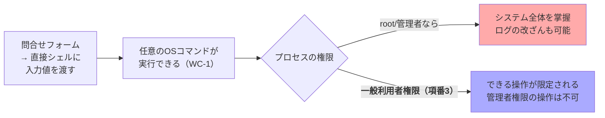

**+α：図2の他の項番も「被害範囲」を決めている**

| 項番 | 仕様                                                               | セキュリティ上の意味                                             |
| ---- | ------------------------------------------------------------------ | ---------------------------------------------------------------- |
| 2    | **DBサーバとの連携はしていない**                                   | DB経由の情報漏えいはない                                         |
| 4    | 問合せフォームに入力された値を**メールコマンドで管理者宛てに送る** | **これが脆弱性の原因**（シェル経由でコマンド実行）               |
| 5    | 問合せ内容がログに保存され、**メールアドレスなどの個人情報**をもつ | 一般利用者権限でも**ログは読める可能性**＝個人情報漏えいのリスク |
| 6    | ログには**特定のアカウントだけ**がアクセスできる                   | 項番3のアカウントで読めるかどうかが被害の分かれ目                |

> **根本対策**：OSコマンドインジェクションは**シェルを起動する関数を使わない**（メール送信はライブラリ／API経由にする）ことが本筋。プロセス権限の最小化は**被害を限定する多層防御**であって、脆弱性そのものの修正ではない。

---

### 設問5(1)　下線⑤　現状値は手間が掛かり、EPSS値は手間が掛からない理由（各40字以内）

> **設問5**　〔脆弱性評価方法の検討〕について答えよ。
> **(1)** 本文中の下線⑤について、**現状値は手間が掛かる理由**と**EPSS値は手間が掛からない理由**を、それぞれ**40字以内**で答えよ。
>
> （本文）Eさん：1次評価では、基本値と Exploit Prediction Scoring System（EPSS）値を用います。EPSS値の代わりにCVSSv3の現状値を用いる方法もありますが、⑤**現状値とEPSS値を比べると、現状値は手間が掛かり、EPSS値は手間が掛からない**とされています。

**解答**
- **現状値：攻撃コードなどの情報を多くの公開サイトにある情報から判断する必要があるから**
- **EPSS値：FIRSTのサイトで公開されている値をそのまま使えばよいから**

**解説**

**両者は「誰が評価するのか」が決定的に違う**

| 観点       | CVSS現状値（Temporal）                                                                                | EPSS値                                                                 |
| ---------- | ----------------------------------------------------------------------------------------------------- | ---------------------------------------------------------------------- |
| 評価指標   | **E**（攻撃される可能性）／**RL**（利用可能な対策レベル）／**RC**（脆弱性情報の信頼性）               | 今後30日以内に**悪用される確率**（0〜100%）                            |
| 誰が出すか | **自組織が、公開情報を集めて自分で判断する**                                                          | **FIRST**（Forum of Incident Response and Security Teams）が算出・公開 |
| 作業       | 攻撃コード（PoC/Exploit）の有無、修正プログラムの提供状況、報告の確からしさを**サイトを巡回して確認** | **値を参照するだけ**                                                   |
| 更新       | 自分で追い続ける必要がある                                                                            | **毎日更新される**                                                     |

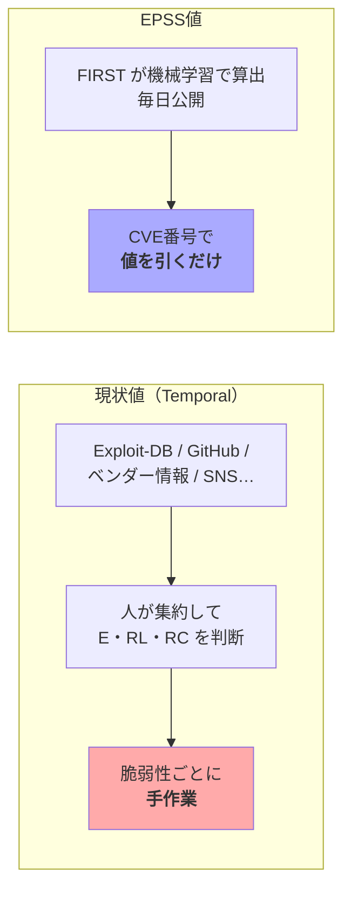

**答案の型**：どちらも「**誰が・どこから情報を得るか**」を書く。
- 現状値 → **多くの公開サイトの情報から自分で判断する必要がある**
- EPSS値 → **FIRSTが公開している値をそのまま使える**

**+α：EPSSとCVSSの関係**

| 指標     | 答える問い                               |
| -------- | ---------------------------------------- |
| **CVSS** | 悪用されたら**どれだけ深刻か**           |
| **EPSS** | **悪用される可能性はどれくらいか**       |
| **KEV**  | **実際に悪用されたか**（CISAのカタログ） |

3つは競合ではなく**掛け合わせて優先度を決める**もの。本問の1次評価（基本値×EPSS値）→2次評価（環境値）という設計は、まさにこの掛け合わせである。

---

### 設問5(2)　本文中のl（15字以内）

> **(2)** 本文中の　**l**　に入れる適切な字句を、**15字以内**で答えよ。
>
> （本文）J課長：あとはEPSS値を用いた脆弱性評価について、しきい値の見直し以外にも、　**l**　を継続的に行うことで被害を防ぐ助けになるだろう。

**解答**：**EPSS値の監視**

**解説**

EPSS値は**毎日更新される**。PoCの公開や実際の攻撃観測によって、**昨日まで0.1%だった脆弱性が翌日に数十%へ跳ね上がる**ことがある。

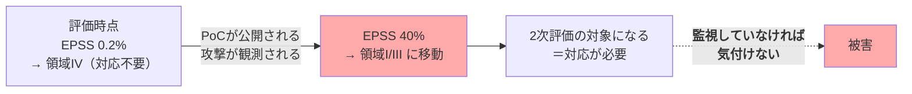

| しきい値の見直し         | EPSS値の監視                                 |
| ------------------------ | -------------------------------------------- |
| **判定ルール**を調整する | **個々の脆弱性の値の変化**を追う             |
| 漏れが出たときに見直す   | 日々の変化で**領域が移動したもの**を拾い直す |

J課長が「しきい値の見直し**以外にも**」と前置きしているので、**ルールではなく値そのものを追う**という答えになる。

---

### 設問5(3)　下線⑥　Webアプリ診断の脆弱性をしきい値Bより高いとみなす理由（30字以内）

> **(3)** 本文中の下線⑥について、**妥当である理由**を、**30字以内**で答えよ。
>
> （本文）Eさん：⑥**P社のWebアプリ診断であれば、見つかった脆弱性のEPSS値は、しきい値Bよりも高いとみなすのが妥当である**と考えられます。Webアプリ診断で検出される脆弱性を、全て領域IかIIIとみなそうと考えています。

**解答**：**診断時に実際に悪用できることを確認しているから**

**解説**

**なぜWebアプリ診断ではEPSS値が使えないのか**

| 理由                                                                           |
| ------------------------------------------------------------------------------ |
| EPSSは**CVE番号が付いた既知の脆弱性**に対して算出される                        |
| Webアプリ診断で見つかるのは**そのサイト固有の実装上の欠陥**（CVEが存在しない） |
| よって表8のEPSS値は「**対象外**」になっている                                  |

そこで「EPSS値が分からないものをどう扱うか」という問題になる。Eさんの答えは**安全側に倒す**こと。その根拠が本文冒頭の一文である。

> P社のWebアプリ診断は、**脆弱性が実際に悪用できることを確認した上で報告してくれる**ので、評判がよい。

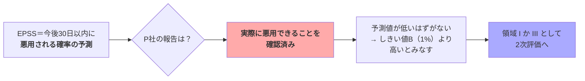

**J課長の「その方法が安全だな」という相槌**が、この判断の性格を言い当てている。**不明な値は危険側に見積もる**のが脆弱性管理の原則（領域IVに落として対応不要にしてしまうと、実証済みの脆弱性を放置することになる）。

> **落とし穴**：「診断ツールではなくP社だから」という条件に注意。**サイト担当者が診断ツールで見つけた脆弱性**には、この「実証済み」という前提が成り立たない。設問が「**P社のWebアプリ診断であれば**」と限定しているのはそのため。

---

### 設問6　表7・表8中のm〜t　対応優先度

> **設問6**　表7中及び表8中の　**m**　〜　**t**　に入れる**対応優先度**を答えよ。

**解答**：**m＝A／n＝A／o＝C／p＝A／q＝B／r＝B／s＝A／t＝S**

**解説**

**ステップ1：1次評価で「領域」を決める（図3）**

| 条件                                                           | 領域    | 扱い          |
| -------------------------------------------------------------- | ------- | ------------- |
| EPSS値 ≧ しきい値B（**1%**）かつ 基本値 ≧ しきい値A（**7.0**） | **I**   | 2次評価の対象 |
| EPSS値 ≧ 1% かつ 基本値 < 7.0                                  | **III** | 2次評価の対象 |
| EPSS値 < 1% かつ 基本値 ≧ 7.0                                  | **II**  | 2次評価の対象 |
| EPSS値 < 1% かつ 基本値 < 7.0                                  | **IV**  | **対応不要**  |

> **境界値の扱い**（図3 注記）：EPSS値が**ちょうどしきい値B**なら領域IIIかI、基本値が**ちょうどしきい値A**なら領域IかII。つまり**境界は「高い側」に寄せる**。

```mermaid
flowchart TB
  S["脆弱性"] --> Q1{"EPSS値 ≧ 1% ?"}
  Q1 -->|"Yes"| Q2{"基本値 ≧ 7.0 ?"}
  Q1 -->|"No"| Q3{"基本値 ≧ 7.0 ?"}
  Q2 -->|"Yes"| R1["領域 I"]
  Q2 -->|"No"| R3["領域 III"]
  Q3 -->|"Yes"| R2["領域 II"]
  Q3 -->|"No"| R4["領域 IV<br/><b>対応不要</b>"]
  R1 --> T["2次評価<br/>（表6）"]
  R3 --> T
  R2 --> T
  style R4 fill:#eee
  style T fill:#aaf
```

**ステップ2：2次評価で環境値と組み合わせる（表6）**

| 領域       | 0〜3.9 | 4.0〜6.9 | 7.0〜8.9 | 9.0〜10.0 |
| ---------- | :----: | :------: | :------: | :-------: |
| **I、III** |   C    |    B     |  **A**   |   **S**   |
| **II**     |   C    |  **C**   |  **B**   |   **A**   |

S＝即時対応／A＝対応優先度高／B＝対応優先度中／C＝対応優先度低

**ステップ3：表7・表8を1件ずつ当てはめる**

| ID   | EPSS値（%） | 基本値（表3・表5） | 1次評価の領域           | 環境値 | 表6の列   | 優先度   |
| ---- | ----------: | -----------------: | ----------------------- | -----: | --------- | -------- |
| PB-1 |          39 |                8.1 | **I**（両方しきい値超） |    8.1 | 7.0〜8.9  | **m＝A** |
| PC-1 |       96.54 |                5.9 | **III**（基本値が低い） |    7.7 | 7.0〜8.9  | **n＝A** |
| PD-1 |         0.0 |                7.2 | **II**（EPSSが低い）    |    5.7 | 4.0〜6.9  | **o＝C** |
| PD-2 |         2.6 |                9.8 | **I**                   |    8.0 | 7.0〜8.9  | **p＝A** |
| PE-1 |         8.7 |                6.5 | **III**                 |    6.5 | 4.0〜6.9  | **q＝B** |
| WA-1 |      対象外 |                4.3 | **I か III とみなす**   |    5.0 | 4.0〜6.9  | **r＝B** |
| WB-1 |      対象外 |                5.3 | **I か III とみなす**   |    7.1 | 7.0〜8.9  | **s＝A** |
| WC-1 |      対象外 |                9.8 | **I か III とみなす**   |    9.8 | 9.0〜10.0 | **t＝S** |

**この表から読み取るべきこと**

| 気付き                                                     | 意味                                                                                        |
| ---------------------------------------------------------- | ------------------------------------------------------------------------------------------- |
| 表6で**領域IとIIIは同じ行**                                | EPSSがしきい値Bを超えていれば、**基本値の高低は最終優先度に影響しない**                     |
| 差が出るのは**領域II**だけ                                 | **EPSSが低く、基本値だけ高い**ものは1段階下げて扱う（PD-1は環境値5.7でC）                   |
| PC-1は基本値5.9（Medium）なのに**A**                       | **EPSS 96.54%**＝ほぼ確実に悪用される → **深刻度レベルだけで判断してはいけない**            |
| PD-1は基本値7.2（**High＝速やかな修正が必須**）なのに**C** | EPSS 0.0%＋環境値5.7＝**自社環境では急ぐ必要がない**。旧ルールとの衝突に注意                |
| WC-1は**S（即時対応）**                                    | 実証済み（領域I/III扱い）＋環境値9.8。**Webアプリ診断の指摘は基本的に優先度が高く出る**設計 |

> **このモデルの狙い**：従来は「深刻度レベルがHigh以上なら必須、あとは所管部門の判断」というルールだったため、**対応要否の判断が不適切だったサイトや対応が遅すぎたサイト**が出た。基本値（深刻度）・EPSS（悪用可能性）・環境値（自社環境での影響）の3軸にしたことで、**サイト担当者によらず適切かつ迅速に**優先度を決められるようになった、というのが本文末尾の結論。

**+α：CVSS v3の3つの評価基準**

| 基準                              | 誰が評価するか     | 変化するか               |
| --------------------------------- | ------------------ | ------------------------ |
| **基本評価基準（Base）**          | ベンダー・公表組織 | **変化しない**           |
| **現状評価基準（Temporal）**      | ベンダー・公表組織 | **時間の経過で変化する** |
| **環境評価基準（Environmental）** | **製品利用者**     | **利用環境ごとに変わる** |

本問では、環境値の算出時に「**現状評価基準の各評価指標を Not Defined に設定できる**」としている。つまり**現状値を省いて、基本値＋環境の補正だけで算出する**運用。EPSSが現状値の役割を代替しているので、二重に評価しないという整理である。

---

### 問2の学習ポイントまとめ

| 論点                   | 押さえる要点                                                                                                               |
| ---------------------- | -------------------------------------------------------------------------------------------------------------------------- |
| ブラインドSQLi         | **数値型なら引用符で構文エラー**／`and 1=0` と `and 1=1` の**応答差**が注入成立の証拠。<br>テーブル名を1文字ずつ特定できる |
| 診断結果が変わる理由   | サイトが不変でも、**新たな脆弱性の公表**と**評価の見直し**で結果は変わる → **定期診断が必要**                              |
| ビットセキュリティ     | **ECDHE＝曲線で128／DHE＝鍵長で112**。RSA2048＝112、RSA3072＝ECC256＝128                                                   |
| 攻撃の早期検知         | **どのログの／何が／どうなったら／誰に通知**の4要素で書く                                                                  |
| 試行回数無制限への対策 | IP制限が使えない・アカウントロックも運用が重い → **クライアント証明書による端末認証**                                      |
| CVSSのAC               | **攻撃者が制御できない条件に依存するか**で L/H を判定。<br>URLの推測困難性は**Security by Obscurity**                      |
| 権限の最小化           | OSコマンドインジェクションでも、**プロセス権限が一般利用者なら被害が限定**される                                           |
| EPSS                   | **FIRSTが公開**する「30日以内に悪用される確率」。現状値と違い**自分で調べなくてよい**／**毎日更新→監視**が必要             |
| 優先度評価             | 1次評価（基本値×EPSS）で領域、2次評価（環境値）で S〜C。<br>**領域IとIIIは同じ扱い／差が出るのは領域II**                   |
| 実証済みの脆弱性       | EPSSが算出されない（CVEなし）ものは、**悪用可能と確認済みなら安全側に高く見積もる**                                        |

**この問の肝は「深刻度（CVSS）だけで優先順位を決めない」こと。** PC-1（Medium だが EPSS 96.54% → A）と PD-1（High だが EPSS 0.0% → C）の逆転を説明できれば、この問のテーマを理解したことになる。

---

## 問3 スマートフォン用アプリケーションプログラムの開発（A社）

### 題材の整理

| 項目      | 内容                                                                                                                                        |
| --------- | ------------------------------------------------------------------------------------------------------------------------------------------- |
| 企業      | **A社**：撮影機器の販売・写真プリントサービスを<br>全国200店舗で展開（従業員2,000名）。ECサイト事業も有する                                 |
| Eサービス | 会員がスマホアプリから**フォトグッズ**（写真入りカレンダー等）を<br>注文できる新サービス                                                    |
| Fアプリ   | Eサービス用スマホアプリ。**OS-α／OS-β**の<br>**過去5年以内に正式リリースされたバージョン**をサポート                                        |
| サーバ側  | **A社Webサーバ**（FQDN：`www.a-sha.co.jp`）＋DBサーバ<br>＋C社のクラウドストレージ（**Cサービス**）。すべて**HTTPS**で通信                  |
| 登場人物  | **Uさん**（Fアプリ開発チーム）／**Sさん**（セキュリティ専門会社D社）                                                                        |
| 診断結果  | 脆弱性1＝**サーバ証明書の検証不備**／<br>脆弱性2＝**Cサービスのアクセスキーの保護に不備**／<br>脆弱性3＝**F-URLの処理にアクセス制御の不備** |

**Cサービスのファイル操作方式（図5）**

| 方式      | 仕組み                                                                                                                              | 権限の範囲                                            |
| --------- | ----------------------------------------------------------------------------------------------------------------------------------- | ----------------------------------------------------- |
| **方式a** | **Authorizationヘッダーにアクセスキー**を指定<br>（`Authorization: Bearer ○○○`）                                                    | **ストレージ内の全ファイル**に対する操作が可能 ← 危険 |
| **方式b** | **署名付きURL**（`?Expires=<UNIX時刻>&Signature=<署名値>`）<br>署名値＝**HMAC-SHA256**（鍵＝アクセスキー）を**base64url**エンコード | **特定のファイルに対する操作を一時的に**許可          |

```mermaid
flowchart LR
  subgraph APP["Fアプリ（スマホ）"]
    K["アクセスキー<br/>（AES-CBCで暗号化して<br/>リソースとして保存）"]
    IV["共通鍵・初期ベクトル<br/>（コード中に定数として定義）"]
  end
  APP -->|"HTTPS<br/>方式a：Authorization: Bearer"| C["Cサービス<br/>ストレージ名 e-service"]
  APP -->|"HTTPS"| W["A社Webサーバ<br/>www.a-sha.co.jp"]
  W --- DB["DBサーバ"]
  style K fill:#faa
  style IV fill:#faa
```

**この問の骨格**：3つの脆弱性が**連鎖**している。
- 脆弱性1（証明書検証不備）→ **通信の盗聴**でアクセスキーが漏れる（設問1(1)）
- 脆弱性2（アクセスキーの保護不備）→ **アプリの解析**でもアクセスキーが漏れる（設問1(2)）
- どちらの経路でも、方式aのアクセスキーがあれば**全利用者の写真をダウンロードできる**（設問1(3)）
- 脆弱性3（F-URLの検証不備）→ **フィッシング**と**認証トークンの窃取**（設問1(4)・設問4）

---

### 設問1(1)　表1中の下線①　盗聴した内容からアクセスキーを取得する方法

> **設問1**　〔Fアプリの脆弱性診断結果〕について答えよ。
> **(1)** 表1中の下線①について、**アクセスキーを取得する方法**を、具体的に答えよ。
>
> （表1 脆弱性1の解説）Fアプリは、HTTPSでサーバと接続する際、サーバ証明書の検証エラーがあっても無視し、通信を続行する。そのため、HTTPS通信の内容が盗聴されたり、改ざんされたりするおそれがある。盗聴されると、①**盗聴した内容からアクセスキーとストレージ名を攻撃者が取得するおそれ**がある。

**解答**：**Cサービスに送られたHTTPリクエストのAuthorizationヘッダーから取り出す。**

**解説**

**なぜ盗聴できるのか**

| Fアプリの実装                                        | 結果                                                        |
| ---------------------------------------------------- | ----------------------------------------------------------- |
| サーバ証明書の**検証エラーを無視して通信を続行**する | **中間者（MITM）が用意した偽の証明書でもTLSが成立する**     |
| 攻撃者がプロキシとして間に入る                       | TLSを**攻撃者の手元で一度復号**できる＝**平文として読める** |

**何が見えるのか（図5 方式aの使用例）**

```text
GET /e-service/00000001.zip HTTP/1.1
Host: storage.c-sha.jp
Authorization: Bearer ○○○      ← アクセスキー（40字の英数字）
         ↑ パスの先頭がストレージ名（e-service）
```

| 取得されるもの   | 出どころ                                             |
| ---------------- | ---------------------------------------------------- |
| **アクセスキー** | **Authorizationヘッダー**（`Bearer <アクセスキー>`） |
| **ストレージ名** | リクエストラインの**パスの先頭**（`/e-service/...`） |

```mermaid
sequenceDiagram
  participant F as Fアプリ
  participant M as 攻撃者（MITM）
  participant C as Cサービス
  F->>M: TLS接続（偽の証明書）
  Note over F: 検証エラーを<b>無視</b>して続行
  F->>M: PUT /e-service/00000001.zip<br/>Authorization: Bearer ○○○
  Note over M: <b>平文で読める</b><br/>アクセスキー＋ストレージ名を取得
  M->>C: 同じリクエストを転送（正常に見える）
```

> **答案のポイント**：「盗聴する」だけでは下線①の言い換えにすぎない。**どのリクエストの、どのヘッダーから取るのか**を書く。方式aの仕様（Authorizationヘッダーにアクセスキーを指定する）を引用できるかが採点の分かれ目。

**+α：証明書検証を無視する実装がなぜ生まれるか**

本問でも、Uさんが「**開発用PCの通信解析ツール（プロキシ）を使うと検証エラーで通信が中断された**」ため、「**インターネット上のある記事でエラーが発生しても通信を続行する方法が紹介されていたのを参考にして、Fアプリのコードを変更した**」と説明している。**開発時の回避策が本番に残る**という典型的な作り込み経緯。正しい対処は設問2(3)の「ルート証明書のインストール」である。

---

### 設問1(2)　表1中の下線②　Fアプリから平文のアクセスキーを取得する方法

> **(2)** 表1中の下線②について、**アクセスキーを取得する方法**を、具体的に答えよ。
>
> （表1 脆弱性2の解説）②**攻撃者がFアプリから平文のアクセスキーとストレージ名を取得できる**。

**解答**：**Fアプリを解析し、暗号化されたアクセスキー並びに共通鍵及び初期ベクトルを入手し、暗号化されたアクセスキーをAES-CBCで復号する。**

**解説**

**本文が与えている実装（ここが全て）**

| 記述                                                                                                            | 攻撃者から見ると                       |
| --------------------------------------------------------------------------------------------------------------- | -------------------------------------- |
| アクセスキーは、**鍵長256ビットの共通鍵とAES-CBCアルゴリズムで暗号化**し、**Fアプリ内にリソースとして保存**する | 暗号文が**アプリのファイルの中にある** |
| Cサービスのストレージ名並びに**AES-CBCの共通鍵及び初期ベクトルは、Fアプリのコード中に定数として定義**する       | **鍵も一緒にアプリの中にある**         |

```mermaid
flowchart LR
  A["Fアプリの<br/>パッケージを入手<br/>（誰でもできる）"] --> B["逆コンパイル・<br/>リソース抽出"]
  B --> C["暗号化された<br/>アクセスキー"]
  B --> D["共通鍵<br/>（定数）"]
  B --> E["初期ベクトル<br/>（定数）"]
  C --> F["AES-CBCで復号"]
  D --> F
  E --> F
  F --> G["<b>平文のアクセスキー</b>"]
  style D fill:#faa
  style E fill:#faa
  style G fill:#faa
```

**本質：「アプリに埋め込んだ鍵は秘密にできない」**

| よくある誤解                   | 実際                                                                   |
| ------------------------------ | ---------------------------------------------------------------------- |
| 暗号化して保存しているから安全 | **復号に必要な鍵が同じ場所にある**なら暗号化は難読化にすぎない         |
| コンパイルすれば読めない       | 逆コンパイル・文字列抽出・デバッガで容易に取り出せる                   |
| 一般利用者は解析しない         | **攻撃者は自分の端末で自由に解析できる**（クライアントは信頼境界の外） |

**答案に必要な3要素**：①**Fアプリを解析する**、②**暗号化されたアクセスキーと共通鍵・初期ベクトルを入手する**、③**AES-CBCで復号する**。「アプリを解析して取り出す」だけだと、**暗号化されている**という前提に答えていないので不足。

**+α：正しい設計**

| 対策                                   | 内容                                                                       |
| -------------------------------------- | -------------------------------------------------------------------------- |
| **長期の資格情報をアプリに持たせない** | サーバが**都度、短命の権限を払い出す**（＝本問の方式bへの移行）            |
| OSのセキュアストレージ                 | Keychain（iOS）／Keystore（Android）。ただし**最初から配布しない**のが上策 |
| 権限の最小化                           | ストレージ全体ではなく、**そのファイルだけ・一定時間だけ**                 |

---

### 設問1(3)　表1中の下線③　全利用者の写真をダウンロードする方法

> **(3)** 表1中の下線③について、**ダウンロードする方法**を、具体的に答えよ。
>
> （表1 脆弱性2の解説）そのアクセスキーを用いて、③**攻撃者がEサービスの全利用者の写真を不正にダウンロードするおそれ**がある。

**解答**：**ファイル名に含まれる注文番号を00000001から順に増やしてダウンロードを試行する。**

**解説**

**3つの事実を掛け合わせる**

| 事実                                                                              | 出所            |
| --------------------------------------------------------------------------------- | --------------- |
| 写真は **`nnnnnnnn.zip`** というファイル名でZIP形式に圧縮してアップロードする     | 図4             |
| **`nnnnnnnn` は注文番号であり、00000001から始まる十進数の連番**                   | 図4 注記 ← ★    |
| 方式aのアクセスキーは、**ストレージに格納された全てのファイル**に対する操作が可能 | 図5 2.方式a (1) |
| ファイルのダウンロードには**GETメソッド**を用い、パスで指定する                   | 図5 1.(3)       |

```mermaid
flowchart LR
  A["アクセスキー入手<br/>（設問1(1) or (2)）"] --> B["GET /e-service/00000001.zip"]
  B --> C["GET /e-service/00000002.zip"]
  C --> D["GET /e-service/00000003.zip ..."]
  D --> E["<b>全利用者の写真を取得</b>"]
  style E fill:#faa
```

**「予測可能な識別子」＋「広すぎる権限」の組合せ**が致命的になる、というのがこの設問の教訓。どちらか一方でも断てば被害は限定される。

| 弱点             | 断ち方                                                    |
| ---------------- | --------------------------------------------------------- |
| 連番のファイル名 | **推測困難な識別子**（UUID／ランダム文字列）にする        |
| 全ファイル操作可 | **署名付きURL**で、対象ファイル・操作・有効期限を限定する |

> **落とし穴**：設問が「**ダウンロードする方法**を具体的に」なので、「アクセスキーを使って全ファイルをダウンロードする」では不十分。**連番を総当たりする**という手順を書く。

---

### 設問1(4)　表1中の下線④　細工したURLの例

> **(4)** 表1中の下線④について、**攻撃者のWebサイトにアクセスさせることができるように細工したURLの例**を、攻撃者が取得したドメイン名を **k-sha.co.jp** とした場合で答えよ。
>
> （表1 脆弱性3の解説）F-URLの url クエリパラメータに、④**細工したURL**が指定されることによって、攻撃者のWebサイトにアクセスしてしまうおそれがある。

**解答**（いずれか）
- **`https://www.a-sha.co.jp.k-sha.co.jp/`**
- **`https://www.a-sha.co.jp@k-sha.co.jp/`**
- **`https://k-sha.co.jp/`**

**解説**

**何が検証されているのか（図7）**

> 呼出し元のWebページのURLの先頭は **“https://www.a-sha.co.jp”** か。

つまり**前方一致**でしか見ていない。URLのホスト名部分の切れ目（`/`、`?`、`#`、`@`、`:`）を考慮していないため、次のように**前方一致を満たしつつ別のホストへ行く**URLが作れる。

| 細工したURL                            | 実際の接続先    | 仕掛け                                                               |
| -------------------------------------- | --------------- | -------------------------------------------------------------------- |
| `https://www.a-sha.co.jp.k-sha.co.jp/` | **k-sha.co.jp** | **サブドメインに見せかけた別ドメイン**。登録ドメインは `k-sha.co.jp` |
| `https://www.a-sha.co.jp@k-sha.co.jp/` | **k-sha.co.jp** | `@` より前は**ユーザー情報**（userinfo）として解釈される（RFC 3986） |
| `https://k-sha.co.jp/`                 | **k-sha.co.jp** | そもそもF-URLの url パラメータに**検証がない**（脆弱性3の本体）      |

```mermaid
flowchart TB
  U["https://www.a-sha.co.jp.k-sha.co.jp/"] --> P["ホスト名として解析すると"]
  P --> H["www.a-sha.co.jp<b>.k-sha.co.jp</b><br/>＝ k-sha.co.jp のサブドメイン"]
  U2["https://www.a-sha.co.jp@k-sha.co.jp/"] --> P2["@ の前はユーザー情報"]
  P2 --> H2["接続先は <b>k-sha.co.jp</b>"]
  H --> X["前方一致の検証を<b>通過</b>"]
  H2 --> X
  style X fill:#faa
```

**+α：URL検証の正しい実装**

| 誤り                                    | 正しい実装                                                                     |
| --------------------------------------- | ------------------------------------------------------------------------------ |
| `startsWith("https://www.a-sha.co.jp")` | **URLパーサーでホスト名を取り出し、完全一致で比較**する                        |
| 文字列の部分一致・正規表現の雑な記述    | スキーム（https）も含めて検証／許可リスト方式                                  |
| 末尾の区切りを考えない                  | 前方一致で済ませるなら **`https://www.a-sha.co.jp/`**（末尾の `/` まで）とする |

> **設問4(2)との接続**：ここで挙げた回避例を潰せる形が、設問4(2)の解答（**先頭が `https://www.a-sha.co.jp/` であるかを検証する**）になっている。**同じ問の中で「攻撃例」と「対策」が対になっている**ので、両方を突き合わせて覚える。

---

### 設問2(1)　図9中の下線⑤　サーバ証明書のSubject Alternative Nameの値

> **設問2**　〔脆弱性1〕について答えよ。
> **(1)** 図9中の下線⑤について、**サーバ証明書のSubject Alternative Nameの値**を、具体的に答えよ。
>
> （図9）⑤**サーバ証明書を生成**　注1）通信解析ツールは、自身のプライベート認証局機能を用いる。

**解答**：**www.a-sha.co.jp**

**解説**

通信解析ツール（プロキシ）は、クライアントから見て**接続先サーバになりすます**必要がある。Fアプリがアクセスしようとしているのは `https://www.a-sha.co.jp/campaign/□□□` なので、**そのFQDNを証明書のSANに入れた証明書をその場で生成**する。

| 項目               | 値                                     |
| ------------------ | -------------------------------------- |
| 発行者（Issuer）   | 通信解析ツールの**プライベート認証局** |
| **SAN（dNSName）** | **www.a-sha.co.jp**                    |
| 署名               | プライベート認証局の秘密鍵             |

```mermaid
flowchart LR
  F["Fアプリ"] -->|"① CONNECT www.a-sha.co.jp:443"| P["通信解析ツール"]
  P -->|"② SAN＝www.a-sha.co.jp の<br/>証明書をその場で生成"| P
  P -->|"③ 証明書を提示"| F
  F -->|"④ ルート証明書が信頼<br/>されていないので<br/><b>検証エラー</b>"| F
  style P fill:#aaf
```

**なぜプライベートIPアドレス（`○○○.○○○.○○○.○○○`）ではないのか**

クライアントは「**接続しようとしたホスト名**」と証明書のSANを突き合わせる。プロキシのIPアドレスを入れても、FQDNとは一致しないので検証に失敗する。

**+α：証明書の名前検証**

| 項目               | 内容                                                                                          |
| ------------------ | --------------------------------------------------------------------------------------------- |
| **SAN（dNSName）** | 現在のブラウザ・OSが**ホスト名検証に使う唯一の項目**                                          |
| CN（Common Name）  | **非推奨**。RFC 2818以降、SANがあればCNは参照されない                                         |
| ワイルドカード     | `*.a-sha.co.jp` は1階層のみに一致（`www.a-sha.co.jp` には一致、`a.b.a-sha.co.jp` には不一致） |

> **関連**：令和5年度秋期にも同じ論点（CNではなくSANで検証する）が出題されている。**証明書を自分で生成する側の視点**で問われたのが本問の特徴。

---

### 設問2(2)　図9中のa〜h　通信フロー

> **(2)** 図9中の　**a**　〜　**h**　に入れる適切な字句を、解答群の中から選び、記号で答えよ。
>
> **解答群**
> ア　Certificate　／　イ　Certificate Verify　／　ウ　Client Hello
> エ　CONNECT ○○○.○○○.○○○.○○○:443 HTTP/1.1　／　オ　CONNECT www.a-sha.co.jp:443 HTTP/1.1
> カ　Finished　／　キ　GET /campaign/□□□ HTTP/1.1
> ク　HTTPステータスコード 101 (Switching Protocols)　／　ケ　HTTPステータスコード 200 (OK)
> コ　Server Hello

**解答**：**a＝オ／b＝ケ／c＝ウ／d＝コ／e＝ア／f＝イ／g＝カ／h＝キ**

**解説**

**フロー全体の構造**

```mermaid
sequenceDiagram
  participant S as スマホ（Fアプリ）
  participant P as 通信解析ツール
  participant W as A社Webサーバ
  S->>P: TCP 3ウェイハンドシェイク
  S->>P: a　CONNECT www.a-sha.co.jp:443（オ）
  P->>S: b　200 OK（ケ）
  S->>P: c　Client Hello（ウ）
  Note over P: ⑤ サーバ証明書を生成
  P->>S: (1) d Server Hello（コ）<br/>(2) Encrypted Extensions<br/>(3) e Certificate（ア）<br/>(4) f Certificate Verify（イ）<br/>(5) g Finished（カ）
  S->>P: g　Finished（カ）
  S->>P: h　GET /campaign/□□□（キ）
  P->>W: TCP 3ウェイハンドシェイク＋同様のTLSハンドシェイク
  P->>W: h　GET /campaign/□□□（キ）
  W->>P: b　200 OK（ケ）
  P->>S: b　200 OK（ケ）
```

**空欄ごとの根拠**

| 空欄 | 解答                               | 根拠                                                                                                                 |
| ---- | ---------------------------------- | -------------------------------------------------------------------------------------------------------------------- |
| a    | **オ** CONNECT www.a-sha.co.jp:443 | プロキシに**HTTPSトンネルの確立を要求**する。宛先は**接続したいFQDN**で指定する（エのIPアドレス指定は誤り）          |
| b    | **ケ** 200 (OK)                    | CONNECTが成功した応答。**ク（101 Switching Protocols）はWebSocketなどのプロトコル切替**で、HTTPSトンネルでは使わない |
| c    | **ウ** Client Hello                | TLSハンドシェイクの開始。この直後に解析ツールが証明書を生成している（＝SNIで宛先FQDNを知る）                         |
| d    | **コ** Server Hello                | サーバ側の最初の応答。以降は暗号化される                                                                             |
| e    | **ア** Certificate                 | 生成した偽のサーバ証明書を送る                                                                                       |
| f    | **イ** Certificate Verify          | **証明書に対応する秘密鍵を持っていること**をハンドシェイクへの署名で証明する                                         |
| g    | **カ** Finished                    | ハンドシェイクの完了（サーバ→クライアント、続けてクライアント→サーバの両方向で送られる）                             |
| h    | **キ** GET /campaign/□□□           | TLS確立後に送られる**実際のHTTPリクエスト**                                                                          |

**TLS 1.3の特徴がそのまま図になっている**

| 順序 | メッセージ                                                      |
| ---- | --------------------------------------------------------------- |
| (1)  | **Server Hello**                                                |
| (2)  | **Encrypted Extensions** ← 図では既に埋まっている（TLS1.3特有） |
| (3)  | **Certificate**                                                 |
| (4)  | **Certificate Verify**                                          |
| (5)  | **Finished**                                                    |

TLS 1.2では ServerHello → Certificate → ServerHelloDone と分かれて送られたが、**TLS 1.3では ServerHello 以降をまとめて送信し、Certificate以降は暗号化される**。図9の「次の順にまとめて送信」という書き方がその再現。

**図の下半分が示す「終端が2つある」構造**

| 区間                          | TLSセッション                                  |
| ----------------------------- | ---------------------------------------------- |
| スマホ ⇔ 通信解析ツール       | **解析ツールが生成した証明書**を使うセッション |
| 通信解析ツール ⇔ A社Webサーバ | **本物のサーバ証明書**を使うセッション         |

これが**TLS終端型プロキシ**の仕組みであり、企業のSWG（Secure Web Gateway）やURLフィルタリングでHTTPSを検査する際の構成と同じ（令和7年度秋期 問3のKサービスも同じ方式）。

> **落とし穴**：エ（CONNECTにプロキシ自身のIPを書く）を選ばない。**CONNECTは「どこへ繋ぎたいか」を書く**メソッドであり、プロキシのアドレスはTCP接続先であってメソッドの引数ではない。

---

### 設問2(3)　本文中の下線⑥　開発用スマホに行う必要な設定

> **(3)** 本文中の下線⑥について、**設定の内容**を、具体的に答えよ。
>
> （本文）Uさんは、通信解析ツールを利用してテストを行う際も通信を正常に続行させる方法をチーム内で話し合った。その結果、今後、開発用のスマホに⑥**必要な設定**を行うことにした。加えて、OS-αではテストを行う際だけその設定を有効化するように、Fアプリの中にも設定を追加した。

**解答**：**通信解析ツールのプライベート認証局のルート証明書をインストールし、信頼設定を行う。**

**解説**

**問題の切り分け**

| 選択肢                                         | 評価                                                          |
| ---------------------------------------------- | ------------------------------------------------------------- |
| 検証エラーを無視するコードを入れる（元の対応） | **本番にも残る**＝脆弱性1そのもの。✗                          |
| **解析ツールのルート証明書を端末に信頼させる** | **検証処理はそのまま**で、開発環境だけ検証が通るようになる。◯ |

```mermaid
flowchart LR
  A["検証エラーの原因＝<br/>解析ツールの証明書を<br/>発行した認証局が<br/>信頼されていない"] --> B["ルート証明書を<br/>開発用スマホに<br/>インストール"]
  B --> C["<b>信頼設定</b>を行う<br/>（OSの信頼ストアで有効化）"]
  C --> D["検証が成功し、<br/>通信が続行される"]
  style D fill:#aaf
```

**「インストール」だけでは足りない**点に注意。近年のスマホOSでは、**ユーザーが追加した証明書は「インストール」した後に、設定画面で明示的に信頼（フル信頼）を有効化する**必要がある。解答例が「インストールし、**信頼設定を行う**」と2段階で書かれているのはそのため。

**+α：Fアプリ側の追加設定の意味**

本文の「OS-αではテストを行う際**だけ**その設定を有効化するように、Fアプリの中にも設定を追加した」は、**ユーザー追加の証明書をアプリが信頼するかどうかの設定**（Androidの Network Security Config に相当）を指す。
**本番ビルドでは信頼しない**ようにしておけば、利用者の端末に悪意ある証明書が入れられても、Fアプリの通信は保護される。

| 設定の対象                       | 開発ビルド | 本番ビルド |
| -------------------------------- | ---------- | ---------- |
| OSの信頼ストア（ルート証明書）   | 追加する   | 追加しない |
| アプリがユーザー追加証明書を信頼 | **する**   | **しない** |

> **関連**：さらに強い対策として**証明書ピンニング**（想定した証明書／公開鍵以外を拒否）があるが、導入すると解析ツールも通らなくなるため、**開発ビルドだけ例外にする**運用が必要になる。

---

### 設問3　本文中のi　署名付きURLを生成する時点

> **設問3**　本文中の　**i**　に入れる記号を、図4中の**(あ)〜(お)**から選び、答えよ。
>
> （本文）脆弱性2への対応について、Sさんからは**方式bを利用し、その際に署名付きURLの生成を図4中の　i　の時点で行ってはどうか**との提案があった。UさんはSさんの提案を了承した。

**解答**：**(い)**

**解説**

**図4のどこで何が確定するか**

| 時点     | 直前の処理                                           | 署名付きURLを作れるか                                                      |
| -------- | ---------------------------------------------------- | -------------------------------------------------------------------------- |
| **(あ)** | Fアプリから「フォトグッズを注文」を受けた直後        | **注文番号が未採番**＝ファイル名が決まらない → ✗                           |
| **(い)** | **注文内容をDBサーバに登録し、注文番号を採番**した後 | **ファイル名（`nnnnnnnn.zip`）が確定**し、かつ**注文番号を通知する前** → ◯ |
| **(う)** | Fアプリが注文番号の通知を受けた後                    | ここはFアプリ側の処理。**サーバが関与しない**（＝通知に同梱できない）      |
| **(え)** | 写真をZIP圧縮した後                                  | 同上。アップロード直前で、URLを取りに行く往復が余計に必要                  |
| **(お)** | **アップロード成功後**                               | **手遅れ**（アップロードに使うURLなので）                                  |

```mermaid
sequenceDiagram
  participant F as Fアプリ
  participant W as A社Webサーバ
  participant C as Cサービス
  F->>W: フォトグッズを注文
  Note over W: （あ）注文番号なし
  W->>W: 注文内容をDBに登録し<br/>注文番号を採番
  Note over W: <b>（い）署名付きURLを生成</b><br/>対象＝/e-service/nnnnnnnn.zip<br/>操作＝PUT／有効期限＝Expires
  W->>F: 注文番号を通知（＋署名付きURL）
  Note over F: （う）
  F->>F: 写真を nnnnnnnn.zip に圧縮
  Note over F: （え）
  F->>C: 署名付きURLで nnnnnnnn.zip をアップロード
  C->>W: アップロード成功を通知
  Note over C: （お）
```

**この対応で何が解決するのか**

| 脆弱性2の問題               | 方式bへの移行による解決                                          |
| --------------------------- | ---------------------------------------------------------------- |
| Fアプリがアクセスキーを持つ | **アクセスキーはA社Webサーバだけが持つ**（署名はサーバ側で計算） |
| 全ファイルを操作できる      | **そのファイル・その操作（PUT）だけ**に限定される                |
| 期限がない                  | **Expires**で有効期限が切れる                                    |
| 盗聴・解析で漏れる          | 漏れても**1ファイル・一時的**な被害に留まる                      |

> **設計のポイント**：署名付きURLの署名値は `HMAC-SHA256(アクセスキー, "PUT/e-service/nnnnnnnn.zip?Expires=...")` で計算される。**アクセスキー＝秘密鍵をサーバ側に閉じ込めたまま、クライアントに一時的な権限だけを渡せる**のが方式bの本質。クラウドストレージの「署名付きURL／Pre-signed URL」は実務でも頻出の設計パターン。

---

### 設問4(1)　下線⑦　Fアプリの仕様上の問題点（20字以内）

> **設問4**　〔脆弱性3〕について答えよ。
> **(1)** 本文中の下線⑦について、**問題点**を、**20字以内**で答えよ。
>
> （本文）Sさん：図7の処理を修正すれば、認証トークンを盗まれるリスクは回避できます。しかし、Webブラウザと比べると、⑦**フィッシングサイトにアクセスしてしまっても気付くことができないというFアプリの仕様上の問題点**が残ります。

**解答**：**URLを確認する手段がない。**

**解説**

**WebブラウザとWebViewの違い**

| 項目                 | Webブラウザ                     | **WebView**                              |
| -------------------- | ------------------------------- | ---------------------------------------- |
| **アドレスバー**     | **ある**（URLを目視確認できる） | **ない**（アプリの画面の一部として表示） |
| 鍵アイコン・警告表示 | ある                            | 基本的にない                             |
| 証明書の確認         | クリックして確認できる          | できない                                 |
| 利用者の印象         | 「サイトを見ている」            | 「**アプリの画面を見ている**」           |

```mermaid
flowchart LR
  subgraph B["Webブラウザ"]
    B1["https://k-sha.co.jp/ ←<b>見える</b>"] --> B2["利用者が<br/>異変に気付ける"]
  end
  subgraph V["WebView（Fアプリ）"]
    V1["URLが表示されない"] --> V2["フィッシングサイトでも<br/><b>アプリの正規画面に見える</b>"]
  end
  style V2 fill:#faa
```

本文の「キャンペーンページからキャンペーンに応募する際の会員のセッションの識別には、Fアプリに保存されている認証トークンを用いる」という仕様とあわせると、**利用者は「Fアプリの中だから安全」と思い込んで情報を入力する**ことになる。

> **20字以内**という制限から、「URLを確認する手段がない」「表示されるURLを確認できない」程度に圧縮する。**WebViewにアドレスバーがない**という一点を書けばよい。

---

### 設問4(2)　下線⑧　フィッシングサイトにアクセスできないようにする機能

> **(2)** 本文中の下線⑧について、**実装する機能**を、具体的に答えよ。
>
> （本文）Uさん：はい。図7の処理の修正に加えて、⑧**フィッシングサイトにアクセスできないようにする機能**を実装します。

**解答**：**WebViewを呼び出す前に、URLの先頭が `https://www.a-sha.co.jp/` であるかを検証する。**

**解説**

**2つの対策の役割分担**

| 対策                          | 何を守るか                                                           |
| ----------------------------- | -------------------------------------------------------------------- |
| 図7の処理の修正（設問の前提） | **認証トークンを渡さない**（getToken関数のオリジン確認を厳密化する） |
| **下線⑧の機能**（本設問）     | **そもそもフィッシングサイトを表示させない**（F-URLの検証）          |

Sさんが「**フィッシングサイトに気付くことができるようにするための機能か、そもそもフィッシングサイトにアクセスできないようにする機能が必要**」と2択を示し、Uさんは後者を選んでいる。

```mermaid
flowchart TB
  A["メールのF-URLを開く<br/>f-app://campaign?url=＜URL＞"] --> B{"<b>url パラメータを検証</b><br/>先頭が<br/>https://www.a-sha.co.jp/ か"}
  B -->|"Yes"| C["WebViewで表示"]
  B -->|"No"| D["表示しない<br/>（エラー／無視）"]
  style B fill:#aaf
  style D fill:#aaf
```

**検証は「WebViewを呼び出す前」でなければならない**。表示してから判定しても、その時点で通信が発生し、フィッシングサイトに情報が渡る余地が生まれる。

**末尾の `/` まで含める理由**（設問1(4)との接続）

| 細工URL                                | 「`https://www.a-sha.co.jp`」で検証 | 「`https://www.a-sha.co.jp/`」で検証 |
| -------------------------------------- | :---------------------------------: | :----------------------------------: |
| `https://www.a-sha.co.jp.k-sha.co.jp/` |             **通過** ✗              |              **遮断** ◯              |
| `https://www.a-sha.co.jp@k-sha.co.jp/` |             **通過** ✗              |              **遮断** ◯              |
| `https://k-sha.co.jp/`                 |               遮断 ◯                |                遮断 ◯                |

> **より堅牢な実装**：文字列の前方一致ではなく、**URLパーサーでホスト名を取り出して `www.a-sha.co.jp` と完全一致で比較する**。さらに、url パラメータで任意のパスを受け取らず、**キャンペーンIDだけを受け取ってアプリ側でURLを組み立てる**設計にすれば、オープンリダイレクト的な問題を根本から断てる。

---

### 問3の学習ポイントまとめ

| 論点                   | 押さえる要点                                                                                                                           |
| ---------------------- | -------------------------------------------------------------------------------------------------------------------------------------- |
| 証明書検証の無視       | **開発時の回避策が本番に残る**典型。MITMで**Authorizationヘッダーが丸見え**になる                                                      |
| 正しい開発環境の作り方 | 検証を無効化せず、**解析ツールのルート証明書をインストールして信頼設定**。本番ビルドでは信頼しない                                     |
| SAN                    | **接続先FQDN**が入る。CNは非推奨。プロキシは接続先になりすますため**その場で証明書を生成**する                                         |
| TLS 1.3のフロー        | CONNECT → 200 OK → Client Hello → **Server Hello／EE／Certificate／Certificate Verify／Finished をまとめて送信**                       |
| アプリ内の秘密         | **埋め込んだ鍵は秘密にできない**。暗号化しても鍵が同梱なら難読化にすぎない                                                             |
| 予測可能な識別子       | **連番のファイル名**＋**全ファイル操作可能な権限**＝全件取得。UUID化と権限の限定で断つ                                                 |
| 署名付きURL            | サーバ側が **HMAC-SHA256**で署名し、**対象ファイル・操作・有効期限**を限定。<br>生成は**ファイル名が確定した直後**（注文番号の採番後） |
| URL検証                | 前方一致は **`.`／`@`** で回避される。**末尾の `/` まで**含めるか、**ホスト名を完全一致**で比較                                        |
| WebViewの弱点          | **アドレスバーがない**＝利用者がURLを確認できない。アプリ側で遷移先を検証するしかない                                                  |

**この問は「クライアントは信頼できない」という一点に集約される。** 証明書検証・鍵の保管・URL検証のいずれも、**攻撃者が自分の端末で自由に解析・改変できる**という前提に立てば、どこが穴になるかが見える。

---

## 問4 IT資産管理及び脆弱性管理（V社）

### 題材の整理

| 項目       | 内容                                                                                                                                         |
| ---------- | -------------------------------------------------------------------------------------------------------------------------------------------- |
| 企業       | **V社**：従業員3,000名の製造業。東京に本社、大阪・名古屋・福岡に支社。<br>**J事業部／K事業部／情報システム部（情シ部）／総務部／経理部**など |
| 体制       | 社内システム・ネットワークの運用と情報セキュリティ管理は、<br>情シ部の**B部長**と**S主任**を含む**8名**が担当                                |
| ドメイン名 | **`v-sha.co.jp`**（レジストラW社から取得）。<br>JPRSの登録情報に組織名＝V社、担当者名＝**S主任**                                             |
| GIP        | ISPのR社から割当て。JPNICの登録者情報に組織名＝V社、担当者名＝**S主任**                                                                      |
| 公開IT資産 | **インターネットからアクセス可能な全てのIT資産**（表1の定義）                                                                                |
| 課題       | 事業部が**他社DC・クラウドサービス・レンタルサービス**を契約して使ったサーバは<br>**IT資産管理台帳に登録していない**（表1 IT資産管理5(3)）   |

```mermaid
flowchart LR
  NET(["インターネット"])
  subgraph HQ["V社本社"]
    subgraph DMZ["DMZ"]
      DNSC["DNSキャッシュサーバ"]
      AUTH["<b>権威DNSサーバ</b>"]
      WEB["公開Webサーバ"]
      PROXY["プロキシサーバ"]
      MAIL["メールサーバ"]
    end
    subgraph SRV["サーバセグメント"]
      ACC["会計システム"]
      HR["人事システム"]
      FS["ファイルサーバ"]
    end
    PCSEG["PCセグメント"]
    UTM1["UTM"]
  end
  DC["V社データセンター<br/>データセンターセグメント"]
  BR["V社支社<br/>工場セグメント／PCセグメント"]
  UTM1 --- NET
  NET --- DC
  NET --- BR
  style AUTH fill:#faa
```

**本社・支社・データセンター間はUTMのVPN機能で通信**。各支社には**UTMを除いてインターネットからアクセス可能なIT機器はない**（＝公開IT資産は本社DMZとデータセンターに集中している、という前提）。

**報道された3つのニュースと、V社での論点**

| ニュース | 内容                                                                                        | V社での扱い                                     |
| -------- | ------------------------------------------------------------------------------------------- | ----------------------------------------------- |
| (1)      | **CVE-20XX-XXXXX**（Webサーバの通信の暗号化に関する脆弱性）を悪用した攻撃で広告代理店が被害 | **脆弱性管理**の見直しへ（設問4）               |
| (2)      | **CDNのサブドメインが、解約後に海外の広告サイトとして使われていた**                         | **緊急確認 → 図1のサーバの設定を変更**（設問1） |
| (3)      | 不要になったのに公開されたままのWebサーバが改ざんされ、**フィッシングに悪用**               | **未把握の公開IT資産**の洗い出しへ（設問2・3）  |

**4つの目標（表2）**

| 目標    | 内容                                                                     | 対応する設問   |
| ------- | ------------------------------------------------------------------------ | -------------- |
| **K-1** | IT資産管理台帳に公開IT資産を**漏れなく登録**する                         | 設問2・設問3   |
| **K-2** | 情シ部が、サーバの**導入SWを一元管理**する                               | 設問4(4)の前提 |
| **K-3** | **重要な脆弱性を事業部が修正したかどうかを情シ部が確認**できるようにする | 設問4(4)       |
| **K-4** | **利用が終了した公開IT資産**について、必要な措置を漏れなく行う           | 設問3(3)       |

---

### 設問1　下線①　設定を変更したサーバと変更内容（30字以内）

> **設問1**　本文中の下線①について、**設定を変更したサーバ**を、図1中から一つ選び、サーバ名を答えよ。また、その**設定の変更内容**を、**30字以内**で具体的に答えよ。
>
> （本文）(2)については、V社でも、CDN事業者のサービスを利用してWebサーバを立ち上げてキャンペーンを行った後、CDNサービスを解約した経緯があったので、緊急に確認した。その結果、問題があることが分かり、①**図1中のサーバの設定を変更した**。

**解答**
- **サーバ名：権威DNSサーバ**
- **変更内容：終了したサブドメインのCNAMEレコードを削除する。**

**解説**

**サブドメインテイクオーバー（Dangling DNS）の構図**

```mermaid
sequenceDiagram
  participant V as V社の権威DNSサーバ
  participant C as CDN事業者
  participant A as 攻撃者
  Note over V,C: ① キャンペーン開始時
  V->>C: campaign.v-sha.co.jp の<br/>CNAME を CDN のホスト名に向ける
  Note over V,C: ② キャンペーン終了・CDN解約
  C-->>C: CDN側のリソースは解放される
  Note over V: <b>CNAMEレコードは残ったまま</b>
  Note over A,C: ③ 攻撃者が同じCDNで<br/>同名のリソースを取得
  A->>C: 任意のコンテンツを配置
  Note over A: ④ campaign.v-sha.co.jp で<br/><b>攻撃者のコンテンツが配信される</b>
```

| なぜ危険か                                                                            |
| ------------------------------------------------------------------------------------- |
| **V社の正規ドメイン名で**第三者のコンテンツが配信される（詐欺・広告・マルウェア配布） |
| 利用者から見れば**V社のサイトそのもの**＝ブランド毀損、フィッシングに直結             |
| TLS証明書も、ドメイン検証（DV）であれば攻撃者が**正規に取得できてしまう**             |

**なぜ「権威DNSサーバ」なのか**

| 候補                | 判定                                                                    |
| ------------------- | ----------------------------------------------------------------------- |
| **権威DNSサーバ**   | **V社のドメイン名のレコードを公開している当事者**。CNAMEを消せる ← 正解 |
| DNSキャッシュサーバ | 社内からの名前解決用。外部向けの公開には無関係                          |
| 公開Webサーバ       | 今回のキャンペーンサイトは**CDN上**にあり、自社Webサーバではない        |

**対策の原則：解約より先にレコードを消す**

| 順序                              | 結果                             |
| --------------------------------- | -------------------------------- |
| ✗ サービス解約 → レコードを放置   | **乗っ取り可能な時間が生まれる** |
| ◯ **レコード削除** → サービス解約 | 向き先が消えるので乗っ取られない |

> **関連**：令和5年度秋期でも「**使われなくなった設定（VLAN・フィルタ・アカウント）を残さない**」という同趣旨の論点が出題されている。**退役（デコミッション）手順の抜け**は繰り返し問われるテーマ。

---

### 設問2(1)　図2中のa・b　調査を依頼する未登録の公開IT資産（各30字以内）

> **設問2**　〔目標K-1の実現〕について答えよ。
> **(1)** 図2中の　**a**　、　**b**　に入れる適切な内容を、それぞれ**30字以内**で答えよ。
>
> （図2 事業部への調査依頼）次の未登録の公開IT資産を調査し、その一覧を回答すること
> ・クラウドサービスを契約して利用している公開IT資産
> ・　**a**　公開IT資産
> ・　**b**　公開IT資産

**解答**（順不同）
- **a＝レンタルサービスを契約して利用した**（公開IT資産）
- **b＝他社データセンターを契約して利用した**（公開IT資産）

**解説**

**根拠は表1 IT資産管理5(3)の一文**

> 事業部が**他社データセンター、クラウドサービス又はレンタルサービス**を契約して、サーバなどを利用する場合については、IT資産管理台帳に登録していない。

```mermaid
flowchart LR
  A["台帳に登録されない<br/>3つの契約形態"] --> B["クラウドサービス<br/>（図2に記載済み）"]
  A --> C["<b>レンタルサービス</b><br/>＝a"]
  A --> D["<b>他社データセンター</b><br/>＝b"]
  style C fill:#aaf
  style D fill:#aaf
```

図2には既に「クラウドサービスを契約して利用している公開IT資産」が書かれているので、**残る2つを埋めるだけ**の設問。登録されるケース（情シ部が購入／V社DC・V社DMZへの設置）は**既に台帳にある**ので調査対象ではない。

| 契約形態                       | 台帳登録 | GIP・ドメイン名の出どころ                                       |
| ------------------------------ | :------: | --------------------------------------------------------------- |
| 情シ部が購入                   |    ◯     | 情シ部が管理                                                    |
| V社DC・V社DMZへの設置          |    ◯     | 情シ部に申請（表1 ドメイン名1(3)(4)）                           |
| **他社DC／クラウド／レンタル** |  **✗**   | **各サービス会社から割当て／各事業部が取得**（表1 ドメイン名2） |

> **この設問の位置づけ**：ここが目標K-1「登録漏れをなくす」の出発点。ただしB部長が言うとおり「**事業部への調査依頼だけでは漏れが出る**」ので、情シ部自身の調査（設問2(2)〜(4)）へ話が進む。

---

### 設問2(2)　本文中のc　レジストラ／レジストリへの問合せプロトコル（英字10字以内）

> **(2)** 本文中の　**c**　に入れる適切な字句を、**英字10字以内**で答えよ。
>
> （本文）S主任：まず、IPアドレスの割当て、ドメイン名の登録などに関する情報をレジストラ又はレジストリに問い合わせることができます。そのための標準プロトコルとして、　**c**　が用意されており、**RFC 3912**で定義されています。

**解答**：**WHOIS**

**解説**

| 項目         | 内容                                                                                     |
| ------------ | ---------------------------------------------------------------------------------------- |
| **WHOIS**    | ドメイン名やIPアドレスの**登録者情報を問い合わせるプロトコル**（**RFC 3912**）。TCP 43番 |
| 問合せ先     | **レジストリ**（JPRS、JPNICなど）／**レジストラ**                                        |
| 得られる情報 | 登録者（組織名）、担当者、連絡先、ネームサーバ、登録日・有効期限など                     |

**+α：後継プロトコルと周辺用語**

| 用語       | 内容                                                                        |
| ---------- | --------------------------------------------------------------------------- |
| **RDAP**   | WHOISの後継（RFC 7480〜）。**JSONで応答**し、**アクセス制御・国際化**に対応 |
| レジストリ | TLDを管理する組織（`.jp` は**JPRS**）                                       |
| レジストラ | 登録を取り次ぐ事業者（本問のW社）                                           |
| **JPNIC**  | 日本のIPアドレス割当てを管理（本問の「JPNICの登録者情報」）                 |

> **攻撃者視点**：WHOISは**偵察（リコネサンス）の基本手段**でもある。登録者名・担当者のメールアドレスは**標的型攻撃やソーシャルエンジニアリングの材料**になるため、実務では代理公開（Whois Privacy）や役職メールの利用が行われる。
> 本問では逆に、**自社の資産を洗い出す側が同じ手段を使う**（＝ASM）という構図になっている。

---

### 設問2(3)　図3中のあ〜う　使用するサービス

> **(3)** 図3中の　**あ**　〜　**う**　に入れる適切な文字を、**X、Y、Z**から選び、答えよ。

**解答**：**あ＝Z／い＝X／う＝Y**

### 設問2(4)　図3中のd〜h　検索キーワードと検索結果

> **(4)** 図3中の　**d**　〜　**h**　に入れる適切な内容を、次の解答群の中から選び、記号で答えよ。
>
> **解答群**：ア FQDN／イ GIP／ウ GIP割振り元の事業者名／エ OS／オ V社／カ 位置情報／キ 担当者識別番号／ク ドメイン名／ケ ポート番号／コ メールアドレス

**解答**：**d＝オ（V社）／e＝ア（FQDN）／f＝イ（GIP）／g＝ク（ドメイン名）／h＝キ（担当者識別番号）**

**解説**

**3つのサービスの守備範囲を整理する**

| サービス             | 検索キーワード                                                         | 得られる情報                                                                                                 |
| -------------------- | ---------------------------------------------------------------------- | ------------------------------------------------------------------------------------------------------------ |
| **Xサービス**（表3） | **組織名**／**ドメイン名**／ネームサーバ名／ドメイン名の担当者識別番号 | ドメイン名、**組織名・担当者識別番号**、ネームサーバ、<br>担当者名・メールアドレス・**部署名**・電話番号     |
| **Yサービス**（表4） | **GIP**／GIPの担当者識別番号                                           | **組織名・担当者識別番号**、ネームサーバ名、割当て年月日、<br>担当者名・メールアドレス・**部署名**・電話番号 |
| **Zサービス**（表5） | **ドメイン名、GIP、又は組織名**                                        | **GIP**、GIP割当て元の事業者名、**FQDN**、位置情報、<br>ポート番号、OS、応答メッセージ情報                   |

**なぜ手順1がZサービスなのか**

| 条件                                                                    | 帰結                                           |
| ----------------------------------------------------------------------- | ---------------------------------------------- |
| 出発点は「**V社**」という**組織名**しかない（自社の資産を探したいので） | 組織名で検索できるのは**XサービスとZサービス** |
| 欲しいのは**GIPとFQDN**（Fリストの材料）                                | **GIPとFQDNが得られるのはZサービスだけ**       |
| Xサービスで組織名から得られるのは「登録されているドメイン名」のみ       | **GIPは得られない**                            |

したがって **あ＝Z**。ここで **d＝V社（組織名）** を入力し、**e＝FQDN** と **f＝GIP** を得る。

```mermaid
flowchart TB
  S["組織名＝V社（d）"] -->|"手順1：<b>Zサービス</b>（あ）"| R1["FQDN（e）"]
  S -->|"同上"| R2["GIP（f）"]
  R1 -->|"FQDNから取り出す"| D["ドメイン名（g）"]
  D -->|"手順2-1：<b>Xサービス</b>（い）"| X1["ドメイン名の組織名<br/>＋担当者識別番号（h）"]
  X1 -->|"手順2-2：Xサービス"| X2["ドメイン名の部署名<br/>＋担当者名"]
  R2 -->|"手順3-1：<b>Yサービス</b>（う）"| Y1["GIPの組織名<br/>＋担当者識別番号（h）"]
  Y1 -->|"手順3-2：Yサービス"| Y2["GIPの部署名<br/>＋担当者名"]
  X2 --> F["手順4：Fリスト"]
  Y2 --> F
  R1 --> F
  R2 --> F
  style S fill:#aaf
  style F fill:#aaf
```

**手順2と手順3の対称性**

| 手順     | サービス    | 1段目で得るもの                                  | 2段目で得るもの                        |
| -------- | ----------- | ------------------------------------------------ | -------------------------------------- |
| 2-1・2-2 | **X（い）** | **ドメイン名（g）**の組織名と担当者識別番号（h） | 担当者識別番号から**部署名・担当者名** |
| 3-1・3-2 | **Y（う）** | **GIP（f）**の組織名と担当者識別番号（h）        | 同上                                   |

**なぜ2段階になるのか**：表3・表4とも、**組織名は1段目で得られるが、部署名・担当者名は「担当者識別番号」を検索キーワードにしないと得られない**。つまり**担当者識別番号が2つの表をつなぐ鍵**になっている。

| 注記の意味                                                                                                                                                                                                                                                                                                                     |
| ------------------------------------------------------------------------------------------------------------------------------------------------------------------------------------------------------------------------------------------------------------------------------------------------------------------------------ |
| 表3 注2：**一部の「.jp」ドメインの場合だけ**担当者識別番号を検索できる<br>→ 図3 注記1「手順2-1〜3-2は、手順1で得られた検索結果のうち、**“.jp”ドメインのものについて**、それぞれ行う」と対応<br>→ 表1 ドメイン名2(2)「使用するドメイン名は全て、**トップレベルドメインが“.jp”**のドメインを使用している」が前提として効いている |

> **Fリストの目的**：S主任が挙げた項目は「GIP、ドメイン名、GIPの組織名・部署名・担当者名、ドメイン名の組織名・部署名・担当者名、FQDN」。**事業部から提出されるリストと突合できるように**、**誰の持ち物かまで**特定できる形にしている。

**+α：ASM（Attack Surface Management）の実務**

| 方式                       | 内容                                 | 長所／短所                                                 |
| -------------------------- | ------------------------------------ | ---------------------------------------------------------- |
| **オンアクセス型**         | 自分でインターネットをスキャンする   | 最新・正確／**他社環境に負荷を与える可能性**・時間が掛かる |
| **検索エンジン型**（採用） | 既に外部に構築されているDBを検索する | 負荷を与えない・高速／情報の鮮度と網羅性はサービス依存     |

S主任が検索エンジン型を選んだ理由は本文に明記（**他社の環境に負荷を与える可能性**／**スキャンには時間が掛かる**）。実在のサービスでは Shodan・Censys などが該当する。

---

### 設問3(1)　下線②　Webだけが稼働していると分かった調査方法（40字以内）

> **設問3**　〔V社の管理すべきIT資産の確認と管理の強化〕について答えよ。
> **(1)** 本文中の下線②について、**調査方法**を、**40字以内**で具体的に答えよ。
>
> （本文）S主任：表6の結果1については、SSHでは接続できませんでしたが、公開サービスはWebだけが稼働しているようだということが、X、Y、Zサービス以外の②**調査**から分かりました。

**解答**：**ポートスキャンでWebのポートだけが開いていることを確認する。**

**解説**

| 問われている条件                      | 満たす調査                                                       |
| ------------------------------------- | ---------------------------------------------------------------- |
| **X、Y、Zサービス以外**               | 外部DBの検索ではなく、**自分で対象に通信する**（オンアクセス型） |
| 「**公開サービスはWebだけ**」が分かる | **開いているポートの一覧**を取る＝**ポートスキャン**             |

```mermaid
flowchart LR
  A["sub1.v-sha-g.jp<br/>のGIPに対して<br/>ポートスキャン"] --> B["80／443 が open"]
  A --> C["22（SSH）は closed/filtered<br/>＝SSHで接続できなかった事実と整合"]
  B --> D["公開サービスは<br/><b>Webだけ</b>と判断"]
  style D fill:#aaf
```

**答案に入れる要素**：①**ポートスキャン**という手段、②**Webのポートだけが開いている**ことを確認する、という結論の出し方。

> **注意**：ポートスキャンは**他人の資産に対して無断で行えば問題になる**行為。本問の結果1は「**GIPの部署名がV社G事業部／ドメイン名の組織名がV社**」＝**自社の資産であることが判明している**ので実施できる。表6の結果2（P協議会）のように**自社でない可能性があるもの**を同じように扱わないのが実務の勘所。

---

### 設問3(2)　下線③　多くの脆弱性が内在していると分かった調査方法（40字以内）

> **(2)** 本文中の下線③について、**調査方法**を、**40字以内**で具体的に答えよ。
>
> （本文）また、利用OSやSWもバージョンが古く、多くの脆弱性が内在しているようだということが、③**別の調査**から分かりました。

**解答**：**脆弱性スキャナーを実行して、脆弱性の有無を確認する。**

**解説**

| 調査                    | 分かること                                  |
| ----------------------- | ------------------------------------------- |
| ポートスキャン（②）     | **どのサービスが動いているか**              |
| **脆弱性スキャン（③）** | **既知の脆弱性が存在するか**（CVEとの突合） |

ZサービスでもOSや製品名・バージョン情報は得られるが、設問は「**X、Y、Zサービス以外**」の流れを受けた「**別の調査**」。したがって**脆弱性スキャナー（Nessus、OpenVASなどに相当）を実際に実行する**という答えになる。

**+α：検査手法の深さと広さ**

| 手法                   | 範囲     | 深さ   | 特徴                                         |
| ---------------------- | -------- | ------ | -------------------------------------------- |
| ポートスキャン         | 広い     | 浅い   | 稼働サービスの把握                           |
| **脆弱性スキャン**     | **広い** | **中** | 既知脆弱性を**網羅的・自動**に検査           |
| ペネトレーションテスト | 狭い     | 深い   | 実際に侵入を試みる。**事前の書面合意が必須** |

> **この2問（設問3(1)(2)）の狙い**：情報を「**外部DBから集める（受動的）**」段階から、「**対象に働きかけて確かめる（能動的）**」段階へ進む、という調査の順序を理解しているか。ASMの実務でも、まず受動的に資産を洗い出し、自社資産と確定したものにだけ能動的スキャンを掛ける。

---

### 設問3(3)　下線④　継続利用する場合としない場合の対応方法（各35字以内）

> **(3)** 本文中の下線④について、**二つの場合における主な対応方法**を、それぞれ**35字以内**で具体的に答えよ。
>
> （本文）攻撃を受けて被害が発生しないようにするために、④**表6の結果1の公開IT資産を継続利用する場合としない場合のそれぞれの場合にK事業部が行うべき具体的な対応方法**を伝えます。

**解答**
- **する場合：一旦、サービスを停止し、脆弱性を修正後に再開する。**
- **しない場合：速やかにネットワークから切り離し、機器を廃棄する。**

**解説**

**結果1の状態を確認する**

| 事実                                                                          | 出所        |
| ----------------------------------------------------------------------------- | ----------- |
| FQDN＝**sub1.v-sha-g.jp**、GIPの部署名＝**V社G事業部**                        | 表6 結果1   |
| **G事業部はもはや存在しない**。**K事業部が業務承継部門**                      | S主任の説明 |
| 公開サービスは**Webだけ**が稼働（設問3(1)）                                   | 下線②       |
| 利用OS・SWが古く、**多くの脆弱性が内在**（設問3(2)）                          | 下線③       |
| 競合他社では、放置された公開Webサーバが**改ざんされフィッシングに悪用**された | ニュース(3) |

```mermaid
flowchart TB
  A["結果1：古いOS/SWの<br/>公開Webサーバ<br/>（管理者不在）"] --> B{"K事業部は<br/>継続利用するか"}
  B -->|"する"| C["<b>① 一旦サービスを停止</b><br/>（攻撃可能な状態を断つ）"]
  C --> D["② OS・SWの脆弱性を修正"]
  D --> E["③ 再開"]
  B -->|"しない"| F["<b>① 速やかにネットワークから切り離す</b>"]
  F --> G["② 機器を廃棄<br/>（データ消去）"]
  style C fill:#faa
  style F fill:#faa
```

**両方に共通する原則は「まず止める」**

| 誤りやすい答案            | なぜ不十分か                                                                |
| ------------------------- | --------------------------------------------------------------------------- |
| 「脆弱性を修正する」だけ  | **修正作業中も攻撃にさらされ続ける**。多数の脆弱性があるなら尚更            |
| 「使わないので放置する」  | ニュース(3)そのもの。**放置された公開サーバが最も危険**                     |
| 「DNSレコードを消す」だけ | レコードを消してもGIPで直接アクセスできる。**サーバ自体を止める**必要がある |

**+α：目標K-4（利用終了時の措置）として実務で行うこと**

| 順序 | 措置                                                           |
| ---- | -------------------------------------------------------------- |
| 1    | **サービス停止・ネットワークからの切り離し**                   |
| 2    | **DNSレコードの削除**（設問1のサブドメインテイクオーバー対策） |
| 3    | **ドメイン名・GIPの返却／契約解除**                            |
| 4    | **データの消去**と機器の廃棄（消去証明の取得）                 |
| 5    | **IT資産管理台帳の更新**（表1 IT資産管理6の棚卸しと連動）      |

---

### 設問4(1)　下線⑤　CVSSの最新のバージョン番号（4字以内）

> **設問4**　〔脆弱性管理の改善〕について答えよ。
> **(1)** 本文中の下線⑤について、**CVSSの最新のバージョン番号**を、**4字以内**で答えよ。
>
> （本文）S主任：脆弱性についての⑤**CVSSの深刻度**と⑥**KEVカタログ**への掲載の有無に基づいて判断するのがよいようです。

**解答**：**4.0**

**解説**

| バージョン      | 公開           | 主な特徴                                                   |
| --------------- | -------------- | ---------------------------------------------------------- |
| CVSS v2         | 2007年         | 基本／現状／環境の3基準                                    |
| CVSS v3.0／v3.1 | 2015年／2019年 | **Scope（S）**の導入、PR・UIの新設                         |
| **CVSS v4.0**   | **2023年11月** | 評価群の再編、**AT**の新設、影響の分離、スコア表記の明確化 |

**CVSS v4.0の要点**

| 変更点          | 内容                                                                          |
| --------------- | ----------------------------------------------------------------------------- |
| 評価群の再編    | **Base／Threat／Environmental／Supplemental**（v3の**Temporal → Threat**）    |
| 新指標 **AT**   | **Attack Requirements**（攻撃の前提条件）。v3のACを分割した形                 |
| **UI** の細分化 | None／**Passive（P）**／**Active（A）**                                       |
| 影響の分離      | **VC/VI/VA**（脆弱なシステムへの影響）と **SC/SI/SA**（後続システムへの影響） |
| スコア表記      | **CVSS-B／CVSS-BT／CVSS-BE／CVSS-BTE**（どの群まで評価したかを明示）          |

> **本問での位置づけ**：令和7年度春期 問2では**CVSS v3.1**のベクトル（`CVSS:3.1/AV:N/AC:L/...`）が出題され、問4では**最新バージョン番号**が問われている。**v3.1とv4.0が併存している過渡期**であることを押さえておく。

---

### 設問4(2)(3)　下線⑥　KEVカタログ

> **(2)** 本文中の下線⑥について、**KEVカタログのフルスペル**を、解答群の中から選び、記号で答えよ。
> ア Key Exploited Vulnerabilities catalog／イ Key Exposure Vulnerabilities catalog／<br>ウ Known Exploited Vulnerabilities catalog／エ Known Exposure Vulnerabilities catalog
>
> **(3)** 本文中の下線⑥について、**KEVカタログに掲載される脆弱性はどのようなものか。掲載される条件のうち主なもの**を、**20字以内**で答えよ。

**解答**
- (2)：**ウ（Known Exploited Vulnerabilities catalog）**
- (3)：**実際に悪用された。**

**解説**

| 項目     | 内容                                                                                                                       |
| -------- | -------------------------------------------------------------------------------------------------------------------------- |
| 運営     | 米国 **CISA**（Cybersecurity and Infrastructure Security Agency）                                                          |
| 正式名称 | **Known Exploited Vulnerabilities Catalog**（**既知の悪用された**脆弱性カタログ）                                          |
| 掲載条件 | ①**CVE番号が採番**されている<br>②**実際に悪用された証拠がある** ← ★<br>③明確な**修正方法（ベンダー提供のパッチ等）がある** |
| 使われ方 | 米国連邦政府機関に**期限付きの是正**を義務付ける（BOD 22-01）。<br>民間でも**対応優先度の判断材料**として広く参照される    |

**用語の切り分け（ここが(2)の引っ掛け）**

| 単語          | 意味                                     |
| ------------- | ---------------------------------------- |
| **Known**     | **既知の**（Keyではない）                |
| **Exploited** | **悪用された**（Exposure＝露出ではない） |

```mermaid
flowchart LR
  A["CVSS<br/>＝どれだけ深刻か"] --> D["対応優先度"]
  B["EPSS<br/>＝悪用される確率<br/>（予測）"] --> D
  C["<b>KEV</b><br/>＝実際に悪用された<br/>（事実）"] --> D
  style C fill:#faa
  style D fill:#aaf
```

**なぜKEVが効くのか**：CVSSが高くても**実際には悪用されていない脆弱性が大半**であり、逆に**CVSSが中程度でも悪用されている**ものがある。**「事実として悪用されている」という情報は、予測値であるEPSSよりも強い根拠**になるため、最優先対応の判断に直結する。

> **関連**：令和7年度春期 問2では **EPSS（悪用される確率の予測）** を用いた優先度評価が出題された。**問2＝予測（EPSS）／問4＝事実（KEV）**という対で整理しておくと、同じ年度内で知識が噛み合う。

---

### 設問4(4)　下線⑦　表1の脆弱性管理 項番1・2の改善策

> **(4)** 本文中の下線⑦について、**表1の脆弱性管理の項番1、2の改善策**を、項番1の改善策は**60字以内**で、項番2の改善策は**40字以内**でそれぞれ具体的に答えよ。
>
> （表1 脆弱性管理の現状）
> 1. サーバに導入したSWの脆弱性情報は、情シ部が**脆弱性のニュースを毎日見て確認**している。
> 2. 情シ部が、脆弱性のニュースで**話題になった脆弱性情報全てを全部門に連絡**している。
> 3. 連絡を受けた各部門が**取捨選択**し、必要に応じて対応している。

**解答**
- **項番1（60字以内）：情シ部がIT資産管理台帳にあるSWについて、重要な脆弱性情報が発表されていないかを継続的に確認する。**
- **項番2（40字以内）：該当SWを保有する管理部門に対策の優先度を連絡し、対策実施を確認する。**

**解説**

**現状の何が問題なのか**

| 項番 | 現状                                         | 問題点                                                                                                                                                   |
| ---- | -------------------------------------------- | -------------------------------------------------------------------------------------------------------------------------------------------------------- |
| 1    | **ニュースを毎日見て**確認している           | **情報の側（ニュース）が起点**になっており、**自社が使っているSWを起点にしていない**<br>→ 話題にならない脆弱性を見落とす／自社に無関係な情報に時間を使う |
| 2    | **話題になった脆弱性情報を全部門に一斉連絡** | 関係のない部門にも届く＝**受け手が自分事として判断できない**                                                                                             |
| 3    | 各部門が**取捨選択**して対応                 | **重要な脆弱性が放置され得る**（目標K-3「修正したかを情シ部が確認できるようにする」に反する）                                                            |

```mermaid
flowchart LR
  subgraph AS["現状（プル型・一斉配信）"]
    N1["脆弱性のニュース"] --> I1["情シ部が毎日見る"]
    I1 --> ALL["全部門へ一斉連絡"]
    ALL --> S1["各部門が取捨選択<br/>→ <b>放置され得る</b>"]
  end
  subgraph TO["改善後（資産起点・プッシュ型）"]
    DB["<b>IT資産管理台帳のSW</b><br/>（目標K-2で一元管理）"] --> I2["情シ部が該当する<br/>重要な脆弱性情報を<br/><b>継続的に確認</b>"]
    I2 --> OWN["<b>該当SWを保有する<br/>管理部門にだけ</b>連絡<br/>＋<b>対策の優先度</b>"]
    OWN --> CHK["<b>対策実施を確認</b><br/>（目標K-3）"]
  end
  style S1 fill:#faa
  style CHK fill:#aaf
```

**改善策に入れるべき要素**

| 項番 | 要素                                                                                                                                                                   |
| ---- | ---------------------------------------------------------------------------------------------------------------------------------------------------------------------- |
| 1    | ①**IT資産管理台帳にあるSW**を起点にする（＝目標K-2で一元管理できている前提）<br>②**重要な脆弱性情報**が出ていないかを<br>③**継続的に確認する**                         |
| 2    | ①**該当SWを保有する管理部門に**（全部門ではない）<br>②**対策の優先度**を連絡し（設問4(1)〜(3)のCVSS＋KEVが優先度の根拠）<br>③**対策実施を確認する**（＝目標K-3の実現） |

> **設問の構造**：設問4(1)〜(3)で**優先度を判断する材料（CVSS 4.0とKEV）**を問い、(4)で**それを運用に組み込む**という流れ。**「判断ルールを作る」だけでなく、「誰に伝え、実施を確認するところまで回す」**のがマネジメント問題の答案になる。

**+α：脆弱性管理のサイクル**

| ステップ     | 本問での対応                                            |
| ------------ | ------------------------------------------------------- |
| ① 資産の把握 | IT資産管理台帳＋**公開IT資産の洗い出し（設問2・3）**    |
| ② 情報の収集 | **台帳のSWを起点**に脆弱性情報を継続確認（項番1の改善） |
| ③ 優先度判断 | **CVSSの深刻度＋KEV掲載の有無**（設問4(1)〜(3)）        |
| ④ 連絡・指示 | 該当部門に**優先度付きで**連絡（項番2の改善）           |
| ⑤ 対応確認   | **修正したかを情シ部が確認**（目標K-3）                 |

---

### 問4の学習ポイントまとめ

| 論点                       | 押さえる要点                                                                                                            |
| -------------------------- | ----------------------------------------------------------------------------------------------------------------------- |
| サブドメインテイクオーバー | CDN・クラウド解約時に**CNAMEレコードを残さない**。**レコード削除が先、解約が後**                                        |
| 未登録の公開IT資産         | **他社DC／クラウド／レンタル**で事業部が立てた資産は台帳に載らない＝**シャドーIT**                                      |
| WHOIS                      | **RFC 3912**。レジストラ／レジストリへの問合せ。後継は**RDAP**                                                          |
| 外部調査（検索エンジン型） | **組織名で横断検索できるサービス**を起点に、**FQDNとGIP**を得て、<br>ドメイン検索（X）とIP検索（Y）で**持ち主**まで辿る |
| 担当者識別番号             | 組織名→**担当者識別番号**→部署名・担当者名、という**2段階検索**の鍵                                                     |
| ASMの2方式                 | **オンアクセス型**（負荷・時間）と**検索エンジン型**（高速・鮮度はサービス依存）                                        |
| 能動的調査の順序           | 受動的に資産を洗い出す → **自社資産と確定してから**ポートスキャン・脆弱性スキャン                                       |
| 利用終了時の措置（K-4）    | **停止・切り離し → DNSレコード削除 → ドメイン/GIP返却 → データ消去・廃棄 → 台帳更新**                                   |
| CVSS 4.0                   | **Base／Threat／Environmental／Supplemental**、**AT**の新設、VC/VI/VA と SC/SI/SA                                       |
| KEVカタログ                | **Known Exploited Vulnerabilities**（CISA）。掲載の主条件は**実際に悪用された**こと                                     |
| 脆弱性管理の改善           | **ニュース起点→資産台帳起点**／**全部門一斉→該当部門に優先度付きで**／**連絡して終わり→実施を確認**                     |

**この問のテーマは「知らない資産は守れない」。** 設問1〜3が「**資産の把握**」、設問4が「**把握した資産に対する脆弱性管理**」という二部構成になっており、目標K-1〜K-4がそのまま答案の骨子になっている。

---

## 全体の学習ポイント

### 4問に共通する視点

**① 「自分が把握していないもの」が穴になる**

| 問  | 把握できていなかったもの                                               |
| --- | ---------------------------------------------------------------------- |
| 問1 | **外部サーバから読み込むスクリプトP**（SBOMにも資産台帳にも載らない）  |
| 問2 | **初回リリース後に増えた脆弱性**（サイトは不変でも脆弱性情報は変わる） |
| 問3 | **アプリに埋め込んだ鍵**が秘密でないこと／**WebViewが表示するURL**     |
| 問4 | 事業部が**他社DC・クラウド・レンタル**で立てた**未登録の公開IT資産**   |

**② 優先順位を「深刻度」だけで決めない**

| 指標       | 答える問い                     | 出題箇所                                |
| ---------- | ------------------------------ | --------------------------------------- |
| **CVSS**   | 悪用されたら**どれだけ深刻か** | 問2（基本値・環境値）／問4（最新版4.0） |
| **EPSS**   | **悪用される確率**（予測）     | 問2（1次評価の縦軸）                    |
| **KEV**    | **実際に悪用されたか**（事実） | 問4                                     |
| **環境値** | **自社環境での影響**           | 問2（2次評価）                          |

> 問2のPC-1（Medium だが EPSS 96.54% → **A**）と PD-1（High だが EPSS 0.0% → **C**）の逆転が、この視点の象徴。

**③ 境界の外にあるものは信頼しない**

| 問  | 信頼境界の外にあるもの                          | 取るべき態度                                      |
| --- | ----------------------------------------------- | ------------------------------------------------- |
| 問1 | 業務委託先・**再委託先**／他社が運営するサーバT | 契約で同等要求を課す／外部読み込みをやめる        |
| 問2 | リモートアクセス元のPC                          | **クライアント認証**で端末を認証する              |
| 問3 | **スマホ（利用者の端末）**                      | 鍵を置かない／**サーバ側で署名付きURLを発行**する |
| 問4 | 事業部が勝手に契約したサービス                  | **外部から見える姿**を自分で調べる（ASM）         |

**④ 「仕様」は守ってもくれるし、頼りすぎると裏切る**

| 問  | 守ってくれた仕様                                         | 頼ってはいけない仕様                           |
| --- | -------------------------------------------------------- | ---------------------------------------------- |
| 問2 | サイトCのWebアプリが**一般利用者権限で稼働**（最小権限） | **URLの推測困難性**（Security by Obscurity）   |
| 問3 | **署名付きURL**の有効期限・対象限定                      | **前方一致のURL検証**（`.`／`@` で回避される） |
| 問4 | 支社に**UTM以外の公開IT機器がない**という構成            | **台帳に載っているものが全て**という思い込み   |

### 答案作成の型

| 設問の指示                     | 書くべき要素                                                                                                      |
| ------------------------------ | ----------------------------------------------------------------------------------------------------------------- |
| 「**方法**を具体的に」         | **どこ（どのログ・どの機能）から／何を／どうするか**<br>（問2 設問3(2)、問3 設問1(1)〜(3)、問4 設問3(1)(2)）      |
| 「**理由**を具体的に」         | **事実＋その効果**の2要素<br>（問1 設問4「バージョンが明確になる」＋「影響有無を把握できる」）                    |
| 「**それぞれ**」と指定         | **対比で書く**。同じ内容を2つ書かない<br>（問1 設問5(2)＝早期発見／自動実行、問2 設問5(1)＝手作業／参照するだけ） |
| 「**〜する場合としない場合**」 | **両方に異なる措置**を書く（問4 設問3(3)＝停止して修正／切り離して廃棄）                                          |
| **15〜20字以内**               | **用語そのもの**を出す（問2 設問3(3)＝クライアント認証、問3 設問4(1)＝URLを確認する手段がない）                   |
| 「**明記すべき事項**」         | **契約・規程に書く文言**として成立する形で書く（問1 設問1(2)）                                                    |
| 表の空欄（点検結果）           | **「問題なし」も立派な解答**。全部に問題があると思い込まない（問1 設問3(2)）                                      |

### 令和7年度春期の出題傾向

| 問  | 中心テーマ                 | 難度の勘所                                                                                                                 |
| --- | -------------------------- | -------------------------------------------------------------------------------------------------------------------------- |
| 問1 | サプライチェーンリスク対策 | **表1（あるべき姿）と図1（実態）の突き合わせ**が本体。知識依存は低いが、**対応表を作る作業量**がある                       |
| 問2 | 脆弱性管理（評価と優先度） | 前半はブラインドSQLiとCVSSの読解、後半は**領域図＋対応優先度表の適用**。<br>**設問6で8件を機械的に判定**でき、得点源になる |
| 問3 | スマホアプリの脆弱性       | **TLSハンドシェイクの順序**と**モバイル特有の落とし穴**。知識依存が最も高い                                                |
| 問4 | IT資産管理・脆弱性管理     | **ASM（外部からの資産調査）**という新しめのテーマ。<br>X・Y・Zサービスの役割分担を整理できれば設問2で大きく稼げる          |

**この回は「脆弱性管理」が問2と問4の2問を占めた。** しかも問2は**EPSS**、問4は**KEVカタログ・CVSS 4.0**と、**いずれも新しい指標**が問われている。
出題の重心を整理すると次のとおり。

| 観点               |  問1   |  問2   |  問3   |  問4   |
| ------------------ | :----: | :----: | :----: | :----: |
| 知識依存           |   低   |   中   | **高** |   中   |
| 読解・突き合わせ量 | **多** |   中   |   中   | **多** |
| 計算・判定作業     |   少   | **多** |   少   |   少   |
| マネジメント色     | **強** |   中   |   弱   | **強** |

> **選択の目安**：マネジメント寄りの記述が得意なら**問1＋問4**、技術仕様の読み込みが得意なら**問2＋問3**。
> ただし**問2の設問6（m〜t）は表に当てはめるだけで8箇所**取れるので、評価モデルの運用を理解しておくと費用対効果が高い。
> 年度をまたいだ接続としては、**令和5年度春期 午後Ⅱ 問1のSQLi（文字列型）と本年度 問2（数値型）**、**令和5年度秋期のSAN検証と本年度 問3 設問2(1)**、**令和5年度春期 午後Ⅱの公開資産把握と本年度 問4のASM**が対になっている。
