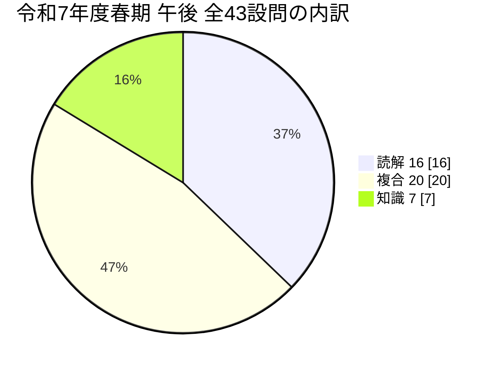
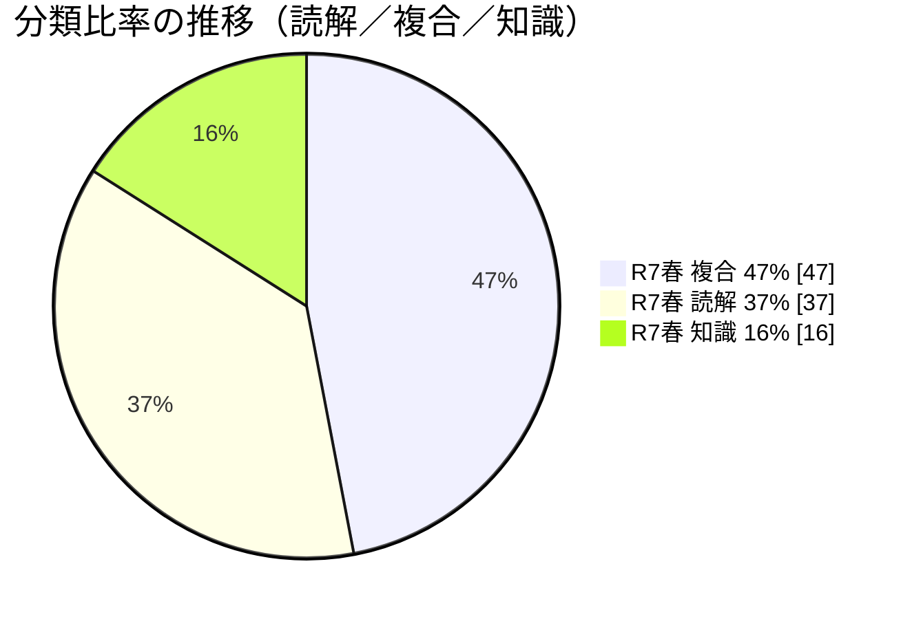

# 令和7年度 春期 支援士 午後 設問タイプ分類 <!-- omit in toc -->

> 対象：令和7年度春期 午後（問1〜問4）の**全43設問**
> 目的：**どの設問が「問題文を読めば解ける」のか、どの設問が「知らなければ解けない」のか**を切り分け、学習の投資先を決める
> 関連：`過去問解説/令和6年度秋期_設問タイプ分類.md`（全32設問）、
> 　　　`過去問解説/令和6年度春期_設問タイプ分類.md`（全39設問）、
> 　　　`過去問解説/令和5年度秋期_設問タイプ分類.md`（全34設問）、
> 　　　`過去問解説/令和5年度春期_設問タイプ分類.md`（全49設問）と比較できる

- [分類の定義](#分類の定義)
- [全体集計と過去回との比較](#全体集計と過去回との比較)
- [問1 サプライチェーンのリスク対策](#問1-サプライチェーンのリスク対策)
- [問2 脆弱性管理](#問2-脆弱性管理)
- [問3 スマートフォン用アプリケーションプログラムの開発](#問3-スマートフォン用アプリケーションプログラムの開発)
- [問4 IT資産管理及び脆弱性管理](#問4-it資産管理及び脆弱性管理)
- [知識問題で問われた知識の分野別まとめ](#知識問題で問われた知識の分野別まとめ)
- [読解問題の「根拠の置き場所」パターン](#読解問題の根拠の置き場所パターン)
- [この分析から導かれる学習方針](#この分析から導かれる学習方針)
  - [① 令和7年度春期も「複合47%」— R6からの傾向が定着](#-令和7年度春期も複合47-r6からの傾向が定着)
  - [② 問選択の戦略](#-問選択の戦略)
  - [③ 「あと1歩」で落とす典型パターン](#-あと1歩で落とす典型パターン)
  - [④ 年度をまたいだ論点の接続](#-年度をまたいだ論点の接続)

---

## 分類の定義

| 記号       | 分類     | 定義                                                                                                                                               | 対策                                               |
| ---------- | -------- | -------------------------------------------------------------------------------------------------------------------------------------------------- | -------------------------------------------------- |
| **【読】** | **読解** | 問題文・図・表・注記の記述を **探して突き合わせれば**答えが出る。 専門知識がなくても、 日本語として根拠を特定できる                       | **解き方の訓練** （根拠の探し方・ 時間配分） |
| **【複】** | **複合** | **知識を手掛かりにして** 問題文の条件を当てはめる。 知識は「どこを見ればよいか」を 教えてくれる役割で、 最終的な答えは問題文の中にある | 知識を入れた上で **過去問演習**                 |
| **【知】** | **知識** | 用語・プロトコル・仕様を **知らなければ書けない**。 問題文には答えが書かれていない                                                           | **暗記・ 理解のインプット**                     |

> **判定の基準**：その設問の解答を、**本文・図・表のどこかの記述を指差して説明できるか**。できれば【読】、知識で補えば指差せるなら【複】、どこにも書かれていなければ【知】。

---

## 全体集計と過去回との比較

| 分類           | R7春期 （43設問） | R6秋期 （32設問） | R6春期 （39設問） | R5秋期 （34設問） | R5春期 （49設問） |
| -------------- | -------------------: | -------------------: | -------------------: | -------------------: | -------------------: |
| **【読】読解** |        **16（37%）** |            11（34%） |            15（38%） |            14（41%） |            21（43%） |
| **【複】複合** |        **20（47%）** |            16（50%） |            18（46%） |            10（29%） |            16（33%） |
| **【知】知識** |         **7（16%）** |             5（16%） |             6（15%） |            10（29%） |            12（24%） |

**問別の内訳**

| 問                                    | 設問数 | 【読】 | 【複】 | 【知】 | 傾向                                                                                       |
| ------------------------------------- | -----: | -----: | -----: | -----: | ------------------------------------------------------------------------------------------ |
| 問1　サプライチェーン のリスク対策 |     10 |      5 |      5 |  **0** | **純粋な知識設問がゼロ**。 表1（あるべき姿）と図1（実態）の **突き合わせ作業**が本体 |
| 問2　脆弱性管理                       |     11 |      4 |      5 |      2 | **設問数が最多の11問**。 設問6だけで**8箇所**あり、 評価モデルを理解すれば大量得点   |
| 問3　スマホアプリの開発               |     10 |      4 |      5 |      1 | 知識設問は1問だが、 **TLS・モバイル・URL構文**と 前提知識の幅が広い                  |
| 問4　IT資産管理及び 脆弱性管理     |     12 |      3 |      5 |  **4** | **知識設問が最多の4問**。 WHOIS・CVSS4.0・KEVと **新しめの用語**が集中               |

**過去回との違い**

| 観点           | R5（春・秋）             | R6（春・秋）                     | **R7春期**                                                                                         |
| -------------- | ------------------------ | -------------------------------- | -------------------------------------------------------------------------------------------------- |
| 知識比率       | 24〜29%                  | 15〜16%                          | **16%**（R6の水準が定着）                                                                          |
| 複合比率       | 29〜33%                  | 46〜50%                          | **47%**                                                                                            |
| 読解比率       | 41〜43%                  | 34〜38%                          | **37%**                                                                                            |
| 設問数         | 34〜49                   | 32〜39                           | **43**（1問あたり約11問＝**記述量が多い**）                                                        |
| 意味するところ | 知識の量で 差が付いた | 知識を手掛かりに 本文を読む力 | **R6の傾向が継続**しつつ、**設問数が増加**。 知識は広く浅く、**本文との往復回数**で差が付く構成 |

> **選択の目安**：**問1は知識設問ゼロ**で、ガイドライン（表1）とシステムS（図1）の対応を取る作業に集中できる。**問2は設問6（8箇所）が機械的に取れる**ので、評価モデルさえ理解していれば時間対効果が高い。逆に**問4は知識設問が4問**あり、WHOIS・CVSS 4.0・KEVを知らないと序盤から削られる。

---

## 問1 サプライチェーンのリスク対策

| 設問                                    | 解答                                                                                                             |    分類    | 根拠の所在（読解）／必要な知識（知識）                                                                                                                                                                                                                                                                           |
| --------------------------------------- | ---------------------------------------------------------------------------------------------------------------- | :--------: | ---------------------------------------------------------------------------------------------------------------------------------------------------------------------------------------------------------------------------------------------------------------------------------------------------------------- |
| 設問1(1) 下線① SBDの考え方        | 企画・設計工程から セキュリティ対策を 組み込むという考え方                                                 | **【複】** | **必要な知識**：**セキュリティ・バイ・ デザイン**＝企画・設計段階から セキュリティを確保する考え方 **読む場所**：表1 項番9「不要な機能や セキュリティ上の欠陥がないことを **設計書から確認**すること」                                                                                            |
| 設問1(2) 下線② 再委託時の明記事項 | L社の業務委託先に要求する 対策と同等のセキュリティ 対策を再委託先にも 要求させること                    | **【複】** | **必要な知識**：L社と再委託先には **直接の契約関係がない**→委託先経由で 同等水準を課すしかない **読む場所**：表1 項番5「業務委託先での セキュリティ管理に関する要件を、 業務委託先との契約に含めること」                                                                                          |
| 設問2(1) 下線③ 影響を受けない配置 | スクリプトPをダウンロード しておき、システムQの サーバ上に配置する方法                                     | **【読】** | **読む場所**：本文「スクリプトPは、 T社が運営するサーバTに配置され、 ……**都度読み込む**ようにシステムQは 構成されていました」の**裏返し**                                                                                                                                                               |
| 設問2(2) 下線④ 加えた変更         | スクリプトPを読み込む箇所を ソースコードから削除する。                                                        | **【読】** | **読む場所**：本文「**古いWebブラウザを サポートするためのJavaScript**」＋ 「古いWebブラウザのサポートを 終了しました」＝**不要になる**                                                                                                                                                                 |
| 設問2(3) 下線⑤ 修正する項番と内容 | 項番1／連携している 外部サービスを 管理対象に含める。                                                      | **【複】** | **必要な知識**：**SBOMに載るのは リポジトリ内のコードとライブラリ**だけ **読む場所**：D氏「**スクリプトPはSBOMに 含まれない**」＋表1 項番1の一覧化対象 （サーバ／NW機器／ソースコード／ライブラリ）                                                                                                  |
| 設問3(1) 表2 ア〜エ                  | ア＝10、イ＝4、 ウ＝5、エ＝11                                                                                 | **【読】** | **読む場所**：表1の各項番と図1の記述を 1対1で突き合わせる。 「共用アカウント」「契約書」「設計書の 確認」「インシデント対応手順書」が そのままキーワードになる                                                                                                                                       |
| 設問3(2) 表2 a〜c                    | a＝開発環境の踏み台サーバで 共用アカウントを 利用している。 b＝問題なし。 c＝問題なし。              | **【読】** | **読む場所**：図1 項番10「会社ごとに 発行した**共用アカウント**でログイン するが、**ログインごとに利用記録簿に 記載する**」。 b・cは図1 項番5・11で**充足している**                                                                                                                                  |
| 設問4 下線⑥ SBOMの効用            | 利用しているソフトウェアや そのバージョンが明確になり、 脆弱性の影響有無を 容易に把握できるから         | **【複】** | **必要な知識**：SBOMの目的＝ **新たな脆弱性公表時の影響範囲の特定** **読む場所**：本文「開発対象のSBOM作成 機能は……ソースコード及びライブラリを **システム構成要素として一覧化する**」                                                                                                               |
| 設問5(1) 空欄d ログの取得箇所     | 踏み台サーバ                                                                                                     | **【読】** | **読む場所**：図1 項番10「開発LANに アクセスする際には**一旦、踏み台サーバに ログインする**」＋「開発LAN上のサーバには 製品仕様上、**アクセスログが取れない ものもある**」＋設問の「**図2中の名称で**」                                                                                              |
| 設問5(2) 下線⑦ (あ)(い)の利点     | (あ)＝ツールFで検知できる エラーをより早く発見できる (い)＝CI/CDパイプラインの 管理機能で自動実行できる | **【複】** | **必要な知識**：**シフトレフト**（早期発見 ほど手戻りが小さい）の発想 **読む場所**：本文「**コンパイルエラーが 解消されたソースコードに対してだけ** 正常な検査が可能」＋「CI/CDパイプラインの 管理機能で、ツールFでのチェックを **自動的に行うようなワークフローを 構成することができる**」 |

**この問の性格**：**知識設問ゼロ**。10問すべて本文・図表に根拠がある。難しさは知識ではなく、**表1（15項番）・図1（12項番）・表2を往復する作業量**。逆に言えば、**最初に「表1の項番 ↔ 図1の項番」の対応表を作ってしまえば**、設問3の6箇所が一気に埋まる。

---

## 問2 脆弱性管理

| 設問                                    | 解答                                                                                                                                                                      |    分類    | 根拠の所在（読解）／必要な知識（知識）                                                                                                                                                                                                                          |
| --------------------------------------- | ------------------------------------------------------------------------------------------------------------------------------------------------------------------------- | :--------: | --------------------------------------------------------------------------------------------------------------------------------------------------------------------------------------------------------------------------------------------------------------- |
| 設問1 表1 a〜e                       | a＝ア、b＝ア、c＝ア、 d＝ア、e＝イ                                                                                                                                     | **【複】** | **必要な知識**：**数値型なら引用符で 囲まれない**→`'` を足すと**構文エラー**／ `and 1=0`・`and 1=1` は**真偽で応答が変わる** **読む場所**：図1「構文エラーになる場合は、 “コンテンツがありません”」＋ 「article の値は**数値型として扱われる**」 |
| 設問2 空欄f・g                       | f＝新たな脆弱性が 発見されたこと g＝リスクが変わったと 評価し値を変えたこと                                                                                      | **【複】** | **必要な知識**：脆弱性情報は**時間とともに 増える／評価は見直される** **読む場所**：本文「P社の診断では、 P社が**独自の知見でCVSS基本値を基に 値を変え**、分類している」＋ 「診断員による差異はほぼない」（＝品質の線を否定）                    |
| 設問3(1) 表4 h〜k                    | ウ（h＝128、i＝曲線、 j＝112、k＝鍵長）                                                                                                                                | **【知】** | **分野**：セキュリティ技術評価／暗号 **知識**：CRYPTREC／IPA「TLS暗号設定 ガイドライン」の**推奨セキュリティ型**。 **ECDHEは曲線で128／DHEは鍵長で112**。 RSA2048＝112、RSA3072＝ECC256＝128。 本文に数値の根拠はない                            |
| 設問3(2) 下線① 早期検知の方法     | OpenSSHのログに認証 タイムアウトのメッセージの 出力が多数あったらサイト 担当者にメールでアラートを送る                                                           | **【読】** | **読む場所**：本文「OpenSSHのログに **“Timeout before authentication”** という認証タイムアウトのメッセージが **多数出力され**、3〜4時間で悪用に 成功する可能性がある」                                                                              |
| 設問3(3) 下線② アクセス元PCの認証 | クライアント認証を行う。                                                                                                                                                  | **【複】** | **必要な知識**：**TLSクライアント証明書**に よる端末認証という対策カテゴリ **読む場所**：本文「送信元IPアドレス制限 ……**現実的な運用が難しい**」「アカウント ロック……**検討が必要**」＝消去法＋ 「**アクセス元のPCを認証する**」                 |
| 設問4(1) 下線③ ACの評価根拠       | WA-1＝パラメータitemの値が 容易に推測できること WB-1＝発注確認機能のURLが 推測困難であること                                                                     | **【複】** | **必要な知識**：**CVSS v3のAC**＝ 攻撃者が**制御できない条件**に依存するか **読む場所**：表5の補足「**item の5桁の 数字を変更する**ことによって」／ 「**管理者用アカウントでログインし、 発注確認機能のURLを確認後**」＋注1のURL                 |
| 設問4(2) 下線④ サイトCの仕様      | 3                                                                                                                                                                         | **【読】** | **読む場所**：図2 項番3「Webアプリケーション プログラムは、**一般利用者権限の専用 アカウントでプロセスを実行**している」                                                                                                                                  |
| 設問5(1) 下線⑤ 手間の違いの理由   | 現状値＝攻撃コードなどの 情報を多くの公開サイトに ある情報から判断する必要が あるから EPSS値＝FIRSTのサイトで 公開されている値をそのまま 使えばよいから | **【知】** | **分野**：セキュリティ技術評価 **知識**：**CVSS現状値**＝E／RL／RCを **自分で情報収集して評価**する／ **EPSS**＝**FIRSTが算出・公開**する 悪用確率。**本文にFIRSTの記載はない**                                                                     |
| 設問5(2) 空欄l                       | EPSS値の監視                                                                                                                                                              | **【複】** | **必要な知識**：EPSS値は**毎日更新される** **読む場所**：J課長「しきい値の見直し **以外にも**、　l　を**継続的に行う**ことで 被害を防ぐ助けになる」                                                                                                    |
| 設問5(3) 下線⑥ 妥当である理由     | 診断時に実際に悪用できる ことを確認しているから                                                                                                                        | **【読】** | **読む場所**：本文冒頭「P社のWebアプリ 診断は、**脆弱性が実際に悪用できることを 確認した上で報告してくれる**ので、 評判がよい」                                                                                                                        |
| 設問6 表7・表8 m〜t（8箇所）      | m＝A、n＝A、o＝C、p＝A、 q＝B、r＝B、s＝A、t＝S                                                                                                                        | **【読】** | **読む場所**：図3（領域図）＋しきい値A＝7.0／ B＝1%＋表6（対応優先度表）＋ 表3・表5の基本値＋表7・表8の値。 **当てはめるだけ**だが、 **領域IとIIIが同じ行**である点に注意                                                                           |

**この問の性格**：**設問数が最多の11問**で、そのうち**設問6だけで8箇所**。前半（設問1〜4）は個別の脆弱性の読み解き、後半（設問5〜6）は評価モデルの運用。**知識設問は2問（設問3(1)・5(1)）だけ**だが、そこがいずれも**CRYPTRECの基準値とEPSSの出所**という細かい知識なので、落としても致命傷にはならない。**設問6を確実に取ることが最優先**。

---

## 問3 スマートフォン用アプリケーションプログラムの開発

| 設問                                    | 解答                                                                                                           |    分類    | 根拠の所在（読解）／必要な知識（知識）                                                                                                                                                                                                                                             |
| --------------------------------------- | -------------------------------------------------------------------------------------------------------------- | :--------: | ---------------------------------------------------------------------------------------------------------------------------------------------------------------------------------------------------------------------------------------------------------------------------------- |
| 設問1(1) 下線① 盗聴からの取得     | Cサービスに送られた HTTPリクエストの Authorizationヘッダーから 取り出す。                             | **【読】** | **読む場所**：図5 2.方式a「アクセスキーを HTTPリクエストの**Authorizationヘッダーに 指定する**方式」＋使用例の `Authorization: Bearer ○○○`                                                                                                                                |
| 設問1(2) 下線② アプリからの取得   | Fアプリを解析し、暗号化された アクセスキー並びに共通鍵及び 初期ベクトルを入手し、 AES-CBCで復号する。 | **【読】** | **読む場所**：本文「アクセスキーは、鍵長 256ビットの共通鍵とAES-CBC……で暗号化し、 **Fアプリ内にリソースとして保存**する」＋ 「**共通鍵及び初期ベクトルは、Fアプリの コード中に定数として定義**する」                                                                   |
| 設問1(3) 下線③ 全利用者の写真DL   | ファイル名に含まれる注文番号を 00000001から順に増やして ダウンロードを試行する。                         | **【読】** | **読む場所**：図4 注記「**“nnnnnnnn”は 注文番号であり、00000001から始まる 十進数の連番**である」＋図5「アクセスキーに 対応するストレージに格納された **全てのファイル**に対する操作が可能」                                                                            |
| 設問1(4) 下線④ 細工したURL        | `https://www.a-sha.co.jp.k-sha.co.jp/` `https://www.a-sha.co.jp@k-sha.co.jp/` `https://k-sha.co.jp/`     | **【複】** | **必要な知識**：**URLの構文**。`@` より前は **ユーザー情報**／`.` を足せば別ドメインの サブドメインになる **読む場所**：図7「URLの先頭は **“https://www.a-sha.co.jp”か**」＝**前方一致**                                                                               |
| 設問2(1) 下線⑤ SANの値            | www.a-sha.co.jp                                                                                                | **【複】** | **必要な知識**：**SAN（dNSName）**で ホスト名検証が行われる／プロキシは **接続先になりすます** **読む場所**：本文のアクセス先 `https://www.a-sha.co.jp/campaign/□□□` ＋注1「自身のプライベート認証局機能を用いる」                                                  |
| 設問2(2) 図9 a〜h                    | a＝オ、b＝ケ、c＝ウ、d＝コ、 e＝ア、f＝イ、g＝カ、h＝キ                                                     | **【知】** | **分野**：セキュリティ実装技術 **知識**：**CONNECTメソッド**（宛先はFQDN）／ **200 OK**／TLS1.3のハンドシェイク順序 （**Server Hello → EE → Certificate → Certificate Verify → Finished をまとめて送信**）。 図には「Encrypted Extensions」しか 与えられていない |
| 設問2(3) 下線⑥ 開発用スマホの設定 | 通信解析ツールのプライベート 認証局のルート証明書を インストールし、信頼設定を行う。                     | **【複】** | **必要な知識**：**検証を無効化するのではなく、 CAを信頼させる**のが正しい対処 **読む場所**：注1「通信解析ツールは、 **自身のプライベート認証局機能を用いる**」＋ 脆弱性1の経緯（エラーを無視するコードを入れた）                                                       |
| 設問3 空欄i 署名付きURLの生成時点 | (い)                                                                                                           | **【読】** | **読む場所**：図4「(い)の直前に**注文内容を DBサーバに登録し、注文番号を採番**」＋ 図4注記（ファイル名＝注文番号）＋ (い)の直後に「**注文番号を通知**」                                                                                                                   |
| 設問4(1) 下線⑦ 問題点（20字）     | URLを確認する手段がない。                                                                                      | **【複】** | **必要な知識**：**WebViewにはアドレスバーが ない**（ブラウザとの差） **読む場所**：Sさん「**Webブラウザと 比べると**、フィッシングサイトに アクセスしてしまっても気付くことが できない」                                                                            |
| 設問4(2) 下線⑧ 実装する機能       | WebViewを呼び出す前に、URLの 先頭が https://www.a-sha.co.jp/ であるかを検証する。                        | **【複】** | **必要な知識**：**前方一致は `.`／`@` で 回避される**（設問1(4)の裏返し） **読む場所**：Sさん「**そもそもフィッシング サイトにアクセスできないようにする 機能**が必要です」＋図8のF-URLの構造                                                                          |

**この問の性格**：**読解4問・複合5問・知識1問**で、数字の上では知識依存が低く見える。しかし**複合5問の「必要な知識」がTLS・SAN・URL構文・WebView・モバイルの鍵管理と広範囲**に散っており、実質的な知識負荷は4問中最も高い。逆に**設問1の(1)〜(3)は仕様を読むだけ**なので、ここで3問を確実に取れる。

---

## 問4 IT資産管理及び脆弱性管理

| 設問                                  | 解答                                                                                                                                                                                               |    分類    | 根拠の所在（読解）／必要な知識（知識）                                                                                                                                                                                                                        |
| ------------------------------------- | -------------------------------------------------------------------------------------------------------------------------------------------------------------------------------------------------- | :--------: | ------------------------------------------------------------------------------------------------------------------------------------------------------------------------------------------------------------------------------------------------------------- |
| 設問1 下線① サーバ名と変更内容  | 権威DNSサーバ／終了した サブドメインのCNAMEレコードを 削除する。                                                                                                                             | **【複】** | **必要な知識**：**サブドメインテイクオーバー** （Dangling DNS）。CNAMEの消し忘れで 第三者にサブドメインを乗っ取られる **読む場所**：ニュース(2)「CDNサービスを 解約したが、……**そのサブドメインが 海外の会社の広告サイトとして使われている**」 |
| 設問2(1) 図2 a・b                  | a＝レンタルサービスを契約して 利用した b＝他社データセンターを 契約して利用した                                                                                                           | **【読】** | **読む場所**：表1 IT資産管理5(3)「事業部が **他社データセンター、クラウドサービス 又はレンタルサービス**を契約して…… IT資産管理台帳に登録していない」。 図2に**クラウドは記載済み**                                                               |
| 設問2(2) 空欄c                     | WHOIS                                                                                                                                                                                              | **【知】** | **分野**：ネットワーク **知識**：**WHOIS**＝レジストラ／レジストリへの 問合せプロトコル、**RFC 3912**、TCP43。 後継は**RDAP**。本文はRFC番号しか 与えていない                                                                                     |
| 設問2(3) 図3 あ〜う                | あ＝Z、い＝X、う＝Y                                                                                                                                                                                | **【読】** | **読む場所**：表3（Xは**ドメイン名**の検索）／ 表4（Yは**GIP**の検索）／表5（Zは**組織名**でも 検索でき、**GIPとFQDN**が得られる）。 出発点が「組織名」なので**Zしかない**                                                                           |
| 設問2(4) 図3 d〜h                  | d＝オ（V社）、e＝ア（FQDN）、 f＝イ（GIP）、g＝ク（ドメイン名）、 h＝キ（担当者識別番号）                                                                                                    | **【読】** | **読む場所**：表3〜表5の「検索キーワード」と 「検索可能な情報」の列を順に当てはめる。 **担当者識別番号**が2段階検索の つなぎになっている                                                                                                             |
| 設問3(1) 下線② Webだけの確認    | ポートスキャンでWebのポート だけが開いていることを 確認する。                                                                                                                                | **【複】** | **必要な知識**：**ポートスキャン**＝ 開いているポートと稼働サービスの把握 **読む場所**：「**SSHでは接続できませんでした が、公開サービスはWebだけが稼働している ようだ**」＋「X、Y、Zサービス以外の調査」                                         |
| 設問3(2) 下線③ 脆弱性の確認     | 脆弱性スキャナーを実行して、 脆弱性の有無を確認する。                                                                                                                                           | **【複】** | **必要な知識**：**脆弱性スキャン**＝既知脆弱性の 網羅的検査（ポートスキャンとの役割の違い） **読む場所**：「利用OSやSWも バージョンが古く、**多くの脆弱性が 内在しているようだ**」                                                                |
| 設問3(3) 下線④ 二つの場合の対応 | する場合＝一旦、サービスを 停止し、脆弱性を修正後に再開する しない場合＝速やかにネット ワークから切り離し、機器を廃棄する                                                                 | **【複】** | **必要な知識**：**まず止める**（修正中も 攻撃にさらされる）／**利用終了時は 切り離しと廃棄** **読む場所**：目標K-4「**利用が終了した 公開IT資産について、必要な措置を 漏れなく行う**」＋ニュース(3)                                            |
| 設問4(1) 下線⑤ CVSSの最新版     | 4.0                                                                                                                                                                                                | **【知】** | **分野**：セキュリティ技術評価 **知識**：**CVSS v4.0**（2023年11月公開）。 Base／**Threat**／Environmental／ Supplemental、**AT**の新設。 本文に版数の記載はない                                                                                  |
| 設問4(2) 下線⑥ KEVのフルスペル  | ウ（Known Exploited Vulnerabilities catalog）                                                                                                                                                   | **【知】** | **分野**：セキュリティ技術評価 **知識**：**Known**（既知の）＋**Exploited** （悪用された）。Key／Exposure は ダミー。CISAが運営                                                                                                                      |
| 設問4(3) 下線⑥ KEVの掲載条件    | 実際に悪用された。                                                                                                                                                                                 | **【知】** | **分野**：同上 **知識**：掲載条件＝①CVE採番 ②**悪用の証拠がある** ③修正方法がある。 **CVSSが高いだけでは載らない**                                                                                                                                   |
| 設問4(4) 下線⑦ 項番1・2の改善策 | 項番1＝情シ部がIT資産管理台帳に あるSWについて、重要な脆弱性情報が 発表されていないかを継続的に確認する 項番2＝該当SWを保有する管理部門に 対策の優先度を連絡し、対策実施を 確認する | **【複】** | **必要な知識**：**資産起点のプッシュ型運用**／ 優先度は**CVSS＋KEV**で判断（設問4(1)〜(3)） **読む場所**：表1 脆弱性管理の現状3項目＋ 目標**K-2**（導入SWの一元管理）・ **K-3**（**修正したかを情シ部が確認できる ようにする**）               |

**この問の性格**：**知識設問が4問と最多**（WHOIS／CVSS 4.0／KEVフルスペル／KEV掲載条件）。いずれも**1行で答える短答**なので、知っていれば一瞬、知らなければ手が出ない。一方で**設問2(3)(4)の図3（Fリスト作成手順）は、表3〜5を突き合わせるだけで8箇所**が埋まる大きな得点源。**知識4問を落としても、読解で挽回できる構造**になっている。

---

## 知識問題で問われた知識の分野別まとめ

| 分野                     | 設問            | 問われた知識                                                                                                           |
| ------------------------ | --------------- | ---------------------------------------------------------------------------------------------------------------------- |
| **セキュリティ技術評価** | 問2 設問3(1)    | **CRYPTREC／IPA「TLS暗号設定ガイドライン」**の推奨設定。 ECDHE＝**曲線で128ビットセキュリティ**／DHE＝**鍵長で112** |
| **セキュリティ技術評価** | 問2 設問5(1)    | **CVSS現状値（E／RL／RC）は自分で評価**／ **EPSSはFIRSTが公開**する悪用確率                                         |
| **セキュリティ技術評価** | 問4 設問4(1)    | **CVSSの最新版は4.0**（Base／Threat／Environmental／Supplemental）                                                     |
| **セキュリティ技術評価** | 問4 設問4(2)(3) | **KEV＝Known Exploited Vulnerabilities catalog**（CISA）。 掲載条件は**実際に悪用された**こと                       |
| **セキュリティ実装技術** | 問3 設問2(2)    | **CONNECTメソッド**／**200 OK**／**TLS 1.3のハンドシェイク順序**                                                       |
| **ネットワーク**         | 問4 設問2(2)    | **WHOIS**（RFC 3912）。後継は**RDAP**                                                                                  |

**R7春期の知識問題の特徴**

| 観点   | 内容                                                                                                        |
| ------ | ----------------------------------------------------------------------------------------------------------- |
| 偏り   | **7問中4問が「セキュリティ技術評価」**（CVSS／EPSS／KEV／CRYPTREC）に集中                                   |
| 新しさ | **EPSS・KEV・CVSS 4.0**は、いずれも近年実務で使われ始めた指標。**過去問だけでは拾えない**                   |
| 対策   | **IPA「脆弱性対応におけるリスク評価手法のまとめ」**（本文にも登場）、CISAのKEV、FIRSTのEPSSを一度読んでおく |

---

## 読解問題の「根拠の置き場所」パターン

| パターン                       | 例                                                                                                                           |
| ------------------------------ | ---------------------------------------------------------------------------------------------------------------------------- |
| **注記・注に答えがある**       | 問3 設問1(3)（図4**注記**「00000001から始まる十進数の連番」）／ 問4 設問2(4)（表3**注2**「一部の.jpドメインの場合だけ」） |
| **表の1セルが答えそのもの**    | 問2 設問4(2)（図2 項番3）／問1 設問5(1)（図1 項番10）                                                                        |
| **2つの表を突き合わせる**      | 問1 設問3(1)（表1 ↔ 図1）／問4 設問2(3)(4)（表3・表4・表5 ↔ 図3）                                                            |
| **会話文が消去法を与える**     | 問2 設問3(3)（IP制限は「運用が難しい」、ロックは「検討が必要」→残りを選ぶ）                                                  |
| **本文の記述の裏返し**         | 問1 設問2(1)（「サーバTに配置して都度読み込む」→「自社サーバに配置する」）                                                   |
| **直前の会話が条件を限定する** | 問4 設問3(1)(2)（「**X、Y、Zサービス以外の**調査」）／ 問3 設問3（「図4中の**どの時点**か」）                             |

---

## この分析から導かれる学習方針

### ① 令和7年度春期も「複合47%」— R6からの傾向が定着

R5の「知識24〜29%」から、R6・R7は**知識15〜16%／複合46〜50%**で安定している。
つまり、**用語を覚えるだけでも、本文を読むだけでも書き切れない設問が約半分**。対策は「**知識を入れた上で過去問を解く**」という順序しかない。

### ② 問選択の戦略

| 条件                                | おすすめの組合せ | 理由                                                                           |
| ----------------------------------- | ---------------- | ------------------------------------------------------------------------------ |
| 知識のインプットが不安              | **問1＋問4**     | **問1は知識設問ゼロ**。問4の知識4問は短答なので、落としても読解8問で挽回できる |
| 評価モデル・計算が得意              | **問2＋問1**     | **問2の設問6（8箇所）**は表に当てはめるだけ。問1と合わせて作業量勝負に持ち込む |
| TLS・モバイルの技術知識に自信がある | **問3＋問2**     | 問3は**設問1で3問**を仕様読みで確保でき、残りも技術知識で押し切れる            |
| マネジメント記述が得意              | **問1＋問4**     | ガイドライン・資産管理・運用改善が中心で、**記述の型**が効く                   |

> **注意**：**問2は設問数11問**と最多で、設問6だけで8箇所ある。**時間が足りない人ほど問2は得点源**になり得る。

### ③ 「あと1歩」で落とす典型パターン

| パターン                             | 具体例                                                                                                   |
| ------------------------------------ | -------------------------------------------------------------------------------------------------------- |
| **設問の限定条件を読み飛ばす**       | 問4 設問3「**X、Y、Zサービス以外の**調査」／ 問2 設問5(3)「**P社のWebアプリ診断であれば**」           |
| **「それぞれ」で同じことを書く**     | 問1 設問5(2)（(あ)＝早期発見／(い)＝自動実行を**対比**で書く）／ 問2 設問5(1)（手作業／参照するだけ） |
| **言い換えで済ませる**               | 問1 設問2(2)（「サポートを終了した」は下線の言い換え。**ソースコード上の変更**を書く）                   |
| **全部に問題があると思い込む**       | 問1 設問3(2)（b・cは**「問題なし」が正解**）                                                             |
| **字数制限に対して用語が出てこない** | 問2 設問3(3)（20字→「クライアント認証を行う」）／ 問3 設問4(1)（20字→「URLを確認する手段がない」）    |
| **境界値の扱いを誤る**               | 問2 設問6（**EPSS＝しきい値Bちょうどなら領域III又はI**／基本値＝しきい値Aなら領域I又はII）               |

### ④ 年度をまたいだ論点の接続

| 論点                        | R7春期                  | 過去回                                                       |
| --------------------------- | ----------------------- | ------------------------------------------------------------ |
| **SQLインジェクションの型** | 問2 設問1（**数値型**） | R5春 午後Ⅱ 問1（**文字列型**）。`'`で閉じる必要の有無が逆    |
| **サーバ証明書の検証**      | 問3 設問2(1)（**SAN**） | R5秋（CNではなくSANで検証する）                              |
| **公開資産の把握（ASM）**   | 問4 設問2・3            | R5春 午後Ⅱ（公開資産を把握していなければ診断も始まらない）   |
| **設定の消し忘れ**          | 問4 設問1（**CNAME**）  | R5秋（使われなくなったVLAN・フィルタ・アカウントを残さない） |
| **脆弱性の優先度付け**      | 問2（EPSS）・問4（KEV） | R6秋 問4（診断報告書からの優先度判断）                       |
| **サプライチェーン**        | 問1（委託先・SBOM）     | R6春 問1（OSS・Log4Shell型）                                 |

> **まとめ**：R7春期は、**「脆弱性管理」をテーマにした問が2問（問2・問4）**という構成で、しかも**EPSS・KEV・CVSS 4.0**という新しい指標が集中した回だった。
> ここを押さえておくと、**同じ年度の秋期（問1の診断ツールの限界、問4の経営ガイドライン）**とも接続する。
