# 令和7年度 秋期 情報処理安全確保支援士試験 午後 設問別解説 <!-- omit in toc -->

> 出典：IPA 令和7年度秋期 情報処理安全確保支援士試験 午後 問題・解答例（©2025 独立行政法人情報処理推進機構）
> 形式：問1〜問4から**2問選択**／12:30〜15:00（2時間30分）
> 構成：各設問について「**設問文 → 解答 → 解説**」の順に記載。**解答**はIPA公表の解答例であり、記述式は同趣旨であれば可。

- [問1 コンサルティング業務で利用するSaaS（H社）](#問1-コンサルティング業務で利用するsaash社)
- [問2 暗号資産交換業におけるセキュリティ（A社）](#問2-暗号資産交換業におけるセキュリティa社)
- [問3 情報システムのセキュリティ強化（P社）](#問3-情報システムのセキュリティ強化p社)
- [問4 製造業におけるセキュリティ管理（L社）](#問4-製造業におけるセキュリティ管理l社)
- [全体の学習ポイント](#全体の学習ポイント)

---

## 問1 コンサルティング業務で利用するSaaS（H社）

### 題材の整理

| 項目     | 内容                                                                                                                                  |
| -------- | ------------------------------------------------------------------------------------------------------------------------------------- |
| 提供者   | **H社**：コンサルティング業務で利用するSaaS（**Sサービス**）を提供。<br>利用企業50社程度、総利用者数1,000名程度                       |
| ロール   | **管理者**＝自社の**全てのプロジェクト**の情報にアクセスできる<br>**一般利用者**＝**自身に割り当てられているプロジェクト**の情報だけ  |
| 利用者ID | **“U”＋数字8桁**（例：`U00331001`）／プロジェクトID＝**“P”＋数字8桁**                                                                 |
| 診断     | **診断ツールX**による脆弱性診断（半年ごと＋新機能リリース前）。<br>**送信したリクエストとそれに対するレスポンスから**脆弱性を検出する |
| 防御     | HTTPレスポンスヘッダーに **CSP（`default-src 'self'`）** を設定                                                                       |
| 登場人物 | **Uさん**（Sサービスのシステム担当者）／B社の管理者／**元従業員Z**（一般利用者だった）                                                |
| 発端     | 「元従業員Zの**ローカルPC上に、Zが割り当てられていなかったプロジェクトのファイル**が保存されていた」という調査依頼                    |

**主な機能（表1）で押さえるべき仕様**

| 機能                     | 設問に効く仕様                                                                                                                                                                                                                          |
| ------------------------ | --------------------------------------------------------------------------------------------------------------------------------------------------------------------------------------------------------------------------------------- |
| **ロール管理**           | ① `GET /management/role` → **csrf_token**（一時的なランダム文字列）が発行され、ロール設定画面が表示される<br>② `POST /management/roleset` に **csrf_token・is_admin・user_id** を送る（**管理者＝is_admin=1／一般利用者＝is_admin=0**） |
| **タスク管理**           | タスクの項目は**タスク名**／タスクの詳細説明／担当者／**締切日**／進捗状況／完了フラグ                                                                                                                                                  |
| **スレッド作成**         | アクセスできる一般利用者を指定する。**管理者は利用企業内の全てのスレッドにアクセスできる**                                                                                                                                              |
| **スレッド投稿**         | アップロードできる拡張子は **docx, xlsx, pptx, pdf, jpg, gif, png の7種類**。<br>参照時・ダウンロード時のパスは **`/files/[一意のファイル識別子].[拡張子]`** ← ★同一オリジン                                                            |
| **プロジェクト進捗管理** | **未完了のタスクのうち締切日を過ぎたもの**は、プロジェクト進捗管理画面に**そのタスク名と締切日からの経過日数が表示される** ← ★                                                                                                          |

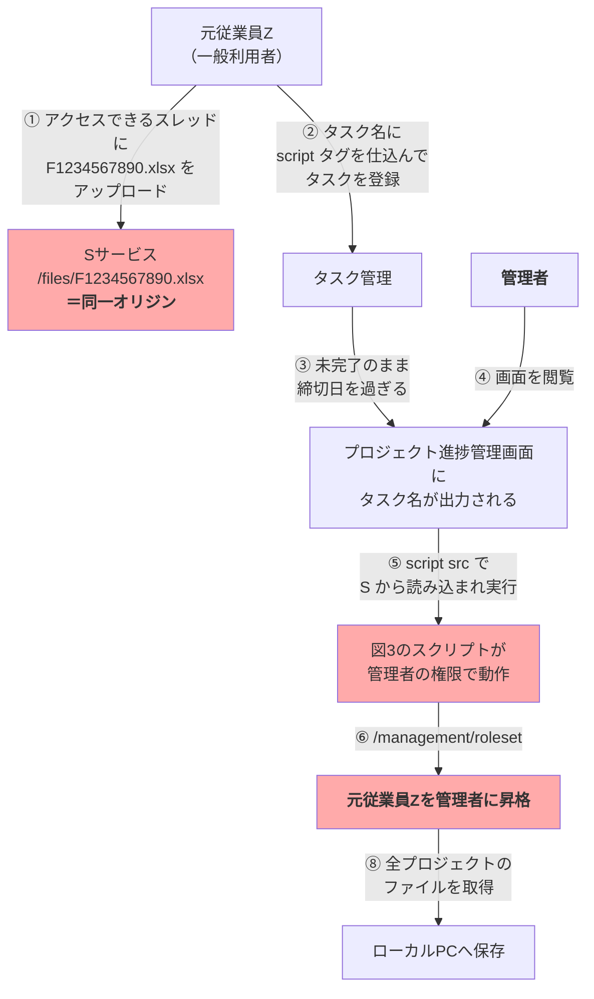

**出題趣旨**：セキュアプログラミングに対する理解、並びに**HTML及びECMAScriptを読み解いて**問題点及び原因を認識し、対策を講じる実践的能力を問う。

---

### 設問1　本文中のa・b　CSPの効果

> **設問1**　本文中の　**a**　、　**b**　に入れる適切な字句を、**“できる”、“できない”のいずれかで**それぞれ答えよ。
>
> （本文）図1の設定では、リソースの読込みとスクリプトの実行に関する動作は次のようになる。
> ・Sサービス以外のドメインからのリソースの読込み：　**a**
> ・scriptタグ内に直接記述されたスクリプトの実行：　**b**

**解答**：**a＝できない／b＝できない**

**解説**

図1のヘッダーは `Content-Security-Policy: default-src 'self';` の1行だけ。

| ディレクティブ               | 意味                                                       |
| ---------------------------- | ---------------------------------------------------------- |
| `default-src`                | 個別指定がないリソース種別すべての**既定の取得元**         |
| `'self'`                     | **同一オリジン**（スキーム・ホスト・ポートが同じ）のみ許可 |
| （`'unsafe-inline'` がない） | **インラインスクリプトの実行を禁止**                       |

| 空欄 | 対象                                             | 判定                                      |
| ---- | ------------------------------------------------ | ----------------------------------------- |
| a    | Sサービス**以外のドメイン**からのリソース読込み  | `'self'` だけなので **できない**          |
| b    | **scriptタグ内に直接記述された**スクリプトの実行 | `'unsafe-inline'` がないので **できない** |

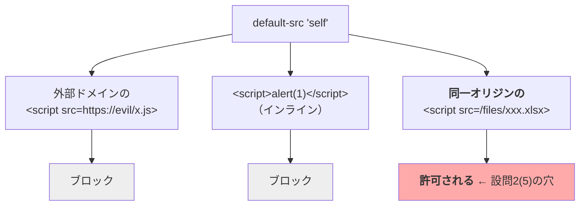

**+α：図1に現れた他のヘッダー**

| ヘッダー                                                         | 役割                                                      |
| ---------------------------------------------------------------- | --------------------------------------------------------- |
| `X-Frame-Options: SAMEORIGIN`                                    | **クリックジャッキング**対策（frame内への埋め込みを制限） |
| `Strict-Transport-Security: max-age=31536000; includeSubDomains` | **HSTS**。HTTPへのダウングレードを防ぐ                    |
| `Set-Cookie: ...; Secure; HttpOnly`                              | **Secure**＝HTTPSでのみ送信／**HttpOnly**＝JSから読めない |
| `Cache-Control: no-store`                                        | 機微な画面をキャッシュに残さない                          |

> **この設問の位置づけ**：CSPが「何を防ぐか」をここで確認させておき、設問2(5)で「**それでも抜けられる**」ことを問う構成になっている。**a・bの2問は確実に取る**。

---

### 設問2(1)　図3のスクリプトが悪用する機能

> **設問2**　〔インシデントの発生とその調査〕について答えよ。
> **(1)** 図3のスクリプトは、**表1中のどの機能を悪用するものか**。機能名を答えよ。

**解答**：**ロール管理**

**解説**

**図3のスクリプトを1行ずつ読む**

```javascript
(async function() {
    const response = await fetch("/management/role");       // ① ロール設定画面を取得
    const text = await response.text();
    // 次の2行で csrf_token を取得
    const tokenMatch = text.match(/id="csrf_token"[^>]*value="(([^"]+)"/);
    const csrfToken = tokenMatch[1];                         // ② トークンを抜き出す
    await fetch("/management/roleset", {                     // ③ ロールを設定する
        method: "POST",
        body: new URLSearchParams({
            "csrf_token": csrfToken,
            "is_admin": "1",                                 // ④ 管理者にする
            "user_id": "U00331001"                           // ⑤ 元従業員ZのID
        })
    });
})();
```

| スクリプトの行                       | 表1「ロール管理」の処理の流れ                                                                          |
| ------------------------------------ | ------------------------------------------------------------------------------------------------------ |
| `fetch("/management/role")`          | 1. パス `/management/role` にGETで送信。**csrf_token** が発行され、ロール設定画面が表示される          |
| トークン抽出                         | 画面HTMLから **csrf_token** の値を取り出す                                                             |
| `fetch("/management/roleset", POST)` | 2. パス `/management/roleset` に対して、**csrf_token、is_admin、user_id** を含むリクエストをPOSTで送信 |
| `"is_admin": "1"`                    | **管理者：is_admin=1**                                                                                 |

**CSRFトークンはXSSを防げない**

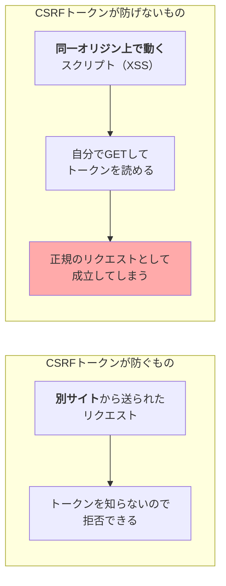

CSRFトークンは「**リクエストが自サイトの画面から送られたこと**」を保証する仕組みであって、「**実行者が本人の意思で操作したこと**」を保証しない。XSSでスクリプトが同一オリジンで動けば、**トークンは普通に読み出せる**。これはXSS対策とCSRF対策の守備範囲を問う典型論点。

> **落とし穴**：「利用者管理」と答えない。利用者の**登録・変更・削除**は利用者管理だが、**ロール（管理者／一般利用者）の設定**はロール管理であり、スクリプトが叩いているパスも `/management/role(set)` で一致している。

---

### 設問2(2)　図4中のc　文字列を指定したタスクの項目

> **(2)** 図4中の　**c**　に入れる適切な**タスクの項目**を、**表1中の字句を用いて**答えよ。
>
> （図4 項番2）当該利用者IDで、タスク管理画面から　**c**　に次の文字列を指定して、タスクを登録した。

**解答**：**タスク名**

**解説**

**タスクの項目は6つあるが、画面に出力されるのは限られる**

| タスクの項目（表1） | プロジェクト進捗管理画面に表示されるか     |
| ------------------- | ------------------------------------------ |
| **タスク名**        | **表示される** ← ★                         |
| タスクの詳細説明    | （進捗管理画面には表示されない）           |
| タスクの担当者      | 同上                                       |
| タスクの締切日      | 締切日**からの経過日数**が表示される       |
| タスクの進捗状況    | 同上                                       |
| タスクの完了フラグ  | 同上（未完了かどうかの条件判定に使われる） |

表1「プロジェクト進捗管理」の記述が決め手。

> 未完了のタスクのうち締切日を過ぎたものは、プロジェクト進捗管理画面に**そのタスク名と締切日からの経過日数が表示される**。

**XSSを成立させるには「攻撃者が入力した値が、被害者の画面にHTMLとして出力される」必要がある。** 出力される項目は**タスク名**なので、そこに仕込む。実際、図2のHTMLでも `<li>個人タスク<script ...></script>（締切日過ぎ 5日）</li>` と、**タスク名と経過日数が並んで出力されている**。

---

### 設問2(3)　図4中のd　指定した文字列

> **(3)** 図4中の　**d**　に入れる適切な文字列を、**図2から抜き出して**答えよ。

**解答**：**`個人タスク<script src="/files/F1234567890.xlsx"></script>`**

**解説**

図2の該当行（プロジェクト進捗管理画面のHTML）

```html
<ul className="delayed-task">
    <li>G社のコンペ資料作成（締切日過ぎ 1日）</li>
    <li>G社の業界分析（締切日過ぎ 4日）</li>
    <li>個人タスク<script src="/files/F1234567890.xlsx"></script>（締切日過ぎ 5日）</li>
</ul>
```

| HTMLの部分                                                  | 正体                           |
| ----------------------------------------------------------- | ------------------------------ |
| `個人タスク<script src="/files/F1234567890.xlsx"></script>` | **登録されたタスク名**（＝d）  |
| `（締切日過ぎ 5日）`                                        | システムが付加する**経過日数** |

他の2行（`G社のコンペ資料作成`／`G社の業界分析`）と比べると、**3行目だけタスク名の中にタグが混ざっている**ことが一目で分かる。これが**格納型（蓄積型）XSS**の証拠。

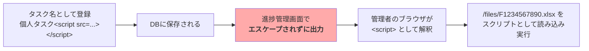

> **答案の注意**：「図2から抜き出して」なので、**余計な加工をしない**。経過日数の部分（`（締切日過ぎ 5日）`）は**システムが付けたもの**なので含めない。逆に `個人タスク` という前半部分は**タスク名の一部**なので落とさない。

---

### 設問2(4)　図4中のe〜g

> **(4)** 図4中の　**e**　〜　**g**　に入れる適切な字句を答えよ。
>
> （図4）
> 3. その後、2で登録したタスクが次の条件を満たしたときに、　**e**　がプロジェクト進捗管理画面にアクセスした。
> 　条件：未完了の状態で、かつ、　**f**
> 4. 3の結果、図2のHTMLが　**e**　のWebブラウザに出力された。
> 6. 5の結果、元従業員Zの利用者IDであったU00331001に対して次の処理が行われた。
> 　処理：　**g**

**解答**
- **e＝管理者**
- **f＝タスクの締切日を過ぎる。**
- **g＝利用者のロールを管理者に設定する。**

**解説**

**e：なぜ管理者でなければならないのか**

| 理由                                                                                                                                 |
| ------------------------------------------------------------------------------------------------------------------------------------ |
| 図3のスクリプトは **`/management/roleset`** を叩く＝**ロール管理は「管理者が、利用者のロールを設定する」機能**（表1）                |
| 一般利用者のブラウザで実行しても、**権限がないので処理されない**                                                                     |
| 攻撃の目的は**自分（Z）を管理者に昇格させること**＝**より高い権限をもつ者に実行させる**必要がある                                    |
| 図2のHTMLは**プロジェクトID P00339500**の画面で、Zが割り当てられていないプロジェクトを含む＝**全プロジェクトを見られる管理者**の画面 |

**f：条件は表1の記述そのまま**

> **未完了のタスクのうち締切日を過ぎたもの**は、プロジェクト進捗管理画面にそのタスク名と締切日からの経過日数が表示される。

「未完了の状態で、かつ、**タスクの締切日を過ぎる**」が条件。図2でも「**締切日過ぎ 5日**」と表示されている。

**g：is_admin=1 の意味を日本語にする**

| 図3のパラメータ        | 処理内容                             |
| ---------------------- | ------------------------------------ |
| `user_id: "U00331001"` | 対象＝元従業員Zの利用者ID            |
| `is_admin: "1"`        | 表1より **管理者：is_admin=1**       |
| → **g**                | **利用者のロールを管理者に設定する** |

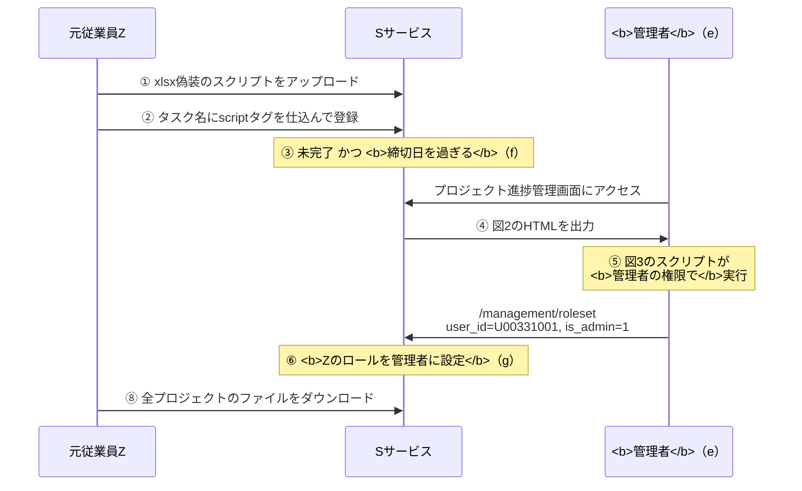

> **この攻撃の怖さ**：攻撃者は**仕込んだあと待つだけ**でよい。締切日を過ぎるまで発火しないので、**退職後に発動する**ことすらあり得る（本問はまさにそのケース）。「**遅延して発火する格納型XSS**」という構造を押さえておく。

---

### 設問2(5)　下線①　攻撃を成功させた工夫

> **(5)** 本文中の下線①について、**工夫の内容**を、具体的に答えよ。
>
> （本文）Uさんは、図4の項番2と類似した文字列が指定されたタスクが登録されていないかどうかを確認したところ、完了済みタスクの中に類似したものがあることを確認した。**しかし、このタスクによる攻撃は、CSPの設定で防御できていた**。Uさんは、攻撃者がこの失敗の原因を分析し、失敗したときに使用した文字列に①**工夫を加える**ことによって図4の項番2の文字列を作成し、攻撃を成功させたと推測した。

**解答**：**図3のスクリプトをSサービス内にアップロードする工夫**

**解説**

**失敗した攻撃と成功した攻撃の差分を考える**

| 試行     | 推測される文字列                                                                                                          | CSP（`default-src 'self'`）の判定    |
| -------- | ------------------------------------------------------------------------------------------------------------------------- | ------------------------------------ |
| **失敗** | `<script>…</script>`（**インラインで直接記述**）<br>または `<script src="https://攻撃者サイト/x.js">`（**外部ドメイン**） | **ブロック**（設問1のa・bそのもの）  |
| **成功** | `<script src="/files/F1234567890.xlsx">`                                                                                  | **同一オリジン**なので**許可される** |

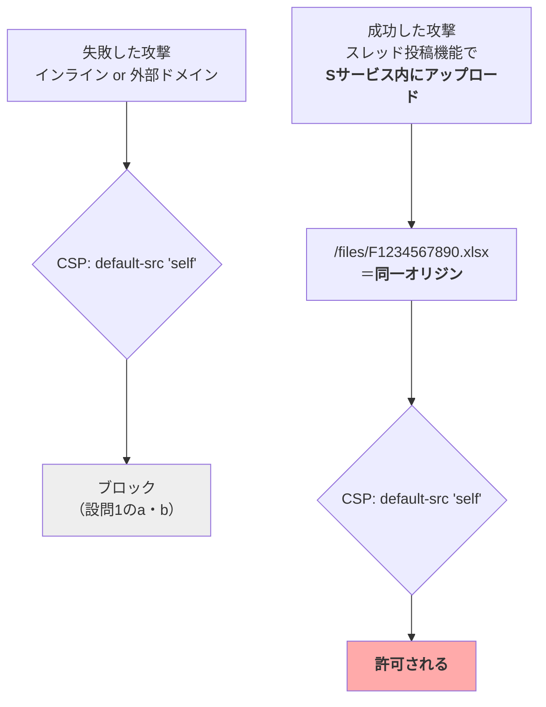

**なぜアップロードできてしまったのか（3つの仕様の組合せ）**

| 仕様（表1）                                         | 攻撃者にとっての意味                                       |
| --------------------------------------------------- | ---------------------------------------------------------- |
| アップロードできる拡張子は7種類（**xlsx を含む**）  | **拡張子さえ合わせれば中身は何でも通る**（設問3(1)へ）     |
| パスは **`/files/[一意のファイル識別子].[拡張子]`** | **同一オリジンのURLで参照できる**                          |
| スレッドにアクセスできる利用者だけがアクセスできる  | **Z自身がアクセスできるスレッド**に置けばよい（図4 項番1） |

**答案のポイント**：「CSPを回避した」だけでは不十分で、**どうやって同一オリジンに置いたか**＝**Sサービスのアップロード機能を使った**ことを書く。

> **実務上の教訓**：**利用者がアップロードしたファイルを同一オリジンから配信する**構成は、CSPの `'self'` を実質的に無力化する。対策は
> - **別ドメイン（サンドボックスドメイン）から配信する**
> - `Content-Disposition: attachment` で常にダウンロードさせる
> - **`X-Content-Type-Options: nosniff`** を付け、正しい `Content-Type` を返す
> - CSPを `script-src 'self' 'nonce-xxx'` のように**nonce方式**にして、`/files/` 配下のスクリプト読込みを許さない

---

### 設問3(1)　本文中のh　アップロード時に追加すべき処理

> **設問3**　〔インシデントへの対応及び攻撃への対策〕について答えよ。
> **(1)** 本文中の　**h**　に入れる**追加すべき処理の内容**を、具体的に答えよ。
>
> （本文）(1) 図4の項番1については、アップロードされたファイルが許可された拡張子であることのチェックに加えて、次の処理を追加する。処理：　**h**

**解答**：**アップロードされたファイルの形式が拡張子と整合しているかをチェックする。**

**解説**

| チェック                       | 突破方法                                                        |
| ------------------------------ | --------------------------------------------------------------- |
| **拡張子だけ**を見る（現状）   | **中身がJavaScriptのファイルを `.xlsx` にリネーム**すれば通る   |
| **中身と拡張子の整合性**を見る | xlsxならZIP形式（`PK\x03\x04`）で始まる等、**形式を検証**できる |

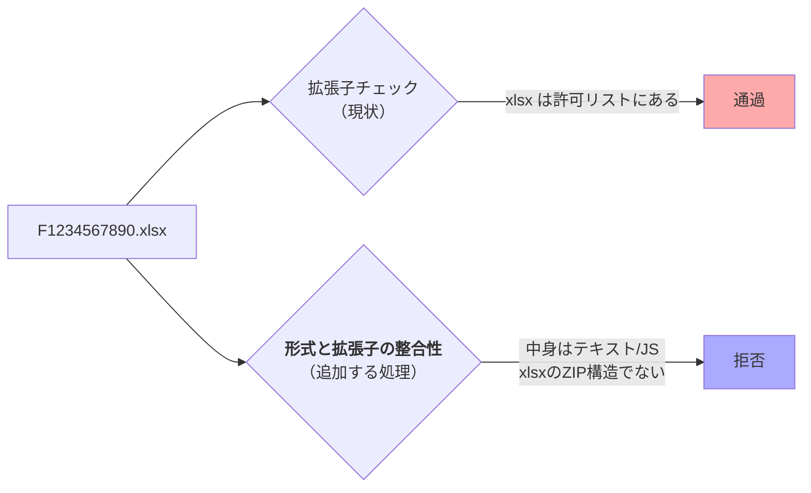

**+α：ファイルアップロードの多層防御**

| 層           | 対策                                                                     |
| ------------ | ------------------------------------------------------------------------ |
| 入口（検証） | 拡張子の許可リスト＋**マジックナンバー／構造の検証**＋サイズ上限         |
| 保存         | **ファイル名を一意な識別子に変換**（本問は実施済み）／実行権限を与えない |
| 配信         | **別ドメイン**から配信／`Content-Disposition: attachment`／`nosniff`     |
| 検査         | マルウェアスキャン（サンドボックス型を含む）                             |

> **注意**：整合性チェックだけでは「**xlsxの中にマクロや細工を埋め込む**」攻撃は防げない。本問の文脈では「**スクリプトとして読み込めるテキストを置かせない**」ことが主眼であり、設問3(3)の出力時エスケープと**両輪**で効く。

---

### 設問3(2)　本文中のi　必要な処理を追加する機能

> **(2)** 本文中の　**i**　に入れる適切な**機能名**を答えよ。
>
> （本文）(2) 図4の項番4について、類似の問題がないかどうか、Sサービス全体を確認したところ、**問題は1箇所だけだった**ので、表1の機能のうち、　**i**　について、②**必要な処理を追加する**。なお、この処理が行われていないという脆弱性は、**診断ツールXでは検知されない**。

**解答**：**プロジェクト進捗管理**

**解説**

図4の項番4は「**図2のHTMLが管理者のWebブラウザに出力された**」＝**タスク名をエスケープせずに出力した画面**の話。図2の `<title>` は「プロジェクト進捗管理」であり、**出力している機能はプロジェクト進捗管理**。

| 機能                     | 役割                                   | 今回の脆弱性との関係                        |
| ------------------------ | -------------------------------------- | ------------------------------------------- |
| タスク管理               | タスクを**登録・更新**する（入力側）   | 攻撃者が文字列を**入れた**場所              |
| **プロジェクト進捗管理** | タスク名を**画面に表示**する（出力側） | **エスケープせずに出力している** ← 修正対象 |

> **XSS対策は「出力する側」で行う**のが原則。入力時にタグを除去する方式（サニタイズ）は、**出力先ごとに正しい変換が異なる**ため漏れが生じやすい。「**どの機能が出力しているか**」を特定する設問になっているのはそのため。

**なぜ診断ツールXでは検知されないのか**

| 診断ツールXの仕様                                                  | 本脆弱性の性質                                                                       |
| ------------------------------------------------------------------ | ------------------------------------------------------------------------------------ |
| **送信したリクエストとそれに対するレスポンス**から脆弱性を検出する | 入力したのは**タスク管理のリクエスト**、出力されるのは**別画面・別リクエスト**       |
| —                                                                  | さらに「**未完了かつ締切日を過ぎる**」という**時間の条件**を満たさないと出力されない |

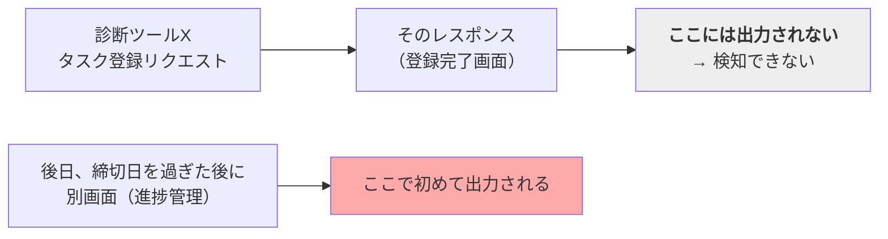

これが**蓄積型・遅延型のXSSをDAST系ツールが見逃す**典型例であり、設問4（人手による検査の必要性）につながる。

---

### 設問3(3)　下線②　追加すべき処理の内容

> **(3)** 本文中の下線②について、**追加すべき処理の内容**を、具体的に答えよ。

**解答**：**出力時にエスケープ処理を施す。**

**解説**

| 文字 | エスケープ後 |
| ---- | ------------ |
| `<`  | `&lt;`       |
| `>`  | `&gt;`       |
| `&`  | `&amp;`      |
| `"`  | `&quot;`     |
| `'`  | `&#39;`      |

エスケープすれば、タスク名は次のように**文字列として表示される**だけになる。

```html
<li>個人タスク&lt;script src="/files/F1234567890.xlsx"&gt;&lt;/script&gt;（締切日過ぎ 5日）</li>
```

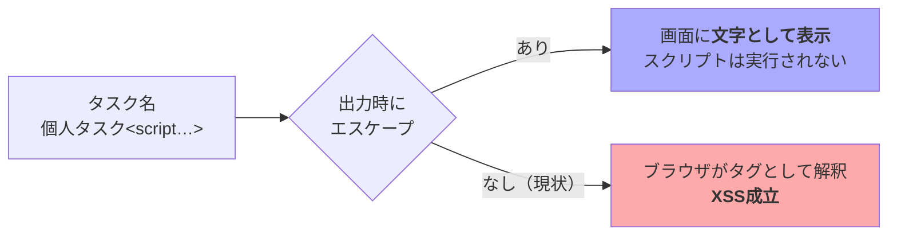

**+α：出力先ごとに必要な処理が違う**

| 出力先                     | 必要な処理                                                |
| -------------------------- | --------------------------------------------------------- |
| HTMLの要素内容             | **HTMLエスケープ**（本問）                                |
| HTMLの属性値               | HTMLエスケープ＋**引用符で必ず囲む**                      |
| JavaScriptの文字列リテラル | JavaScript用のエスケープ（`\`、改行、`</script>` など）   |
| URL（href／src）           | **URLエンコード**＋スキームの検証（`javascript:` を弾く） |
| CSS                        | CSS用エスケープ                                           |

> **設問3の全体像**：(1)入口（アップロード時の形式チェック）、(3)出口（出力時のエスケープ）の**両方**を塞ぐ。片方だけだと、別の経路（別のアップロード機能／別の出力画面）で同じ攻撃が成立し得る。

---

### 設問4　本文中のj　追加する検査方法

> **設問4**　本文中の　**j**　に入れる適切な**検査方法**を、具体的に答えよ。
>
> （本文）Uさんは、図4の項番4の脆弱性のように診断ツールXで検知されないものであっても、**検知できる可能性のある検査**として、次の二つも実施するという開発プロセスの見直し案を作成した。
> ・SAST
> ・　**j**

**解答**：**Sサービスの仕様を理解した専門家による脆弱性検査**

**解説**

**3つの検査の守備範囲**

| 検査                         | 見るもの                             | 今回の脆弱性を検知できるか                                      |
| ---------------------------- | ------------------------------------ | --------------------------------------------------------------- |
| **診断ツールX（DAST）**      | **送ったリクエストとそのレスポンス** | **✗**（入力画面と出力画面が別、かつ時間条件がある）             |
| **SAST**（静的解析）         | ソースコード                         | **△**（エスケープ漏れをコード上で検出できる可能性がある）       |
| **専門家による検査**（手動） | **仕様を理解した上での探索**         | **◯**（「タスク名が進捗管理画面に出る」という業務仕様を辿れる） |

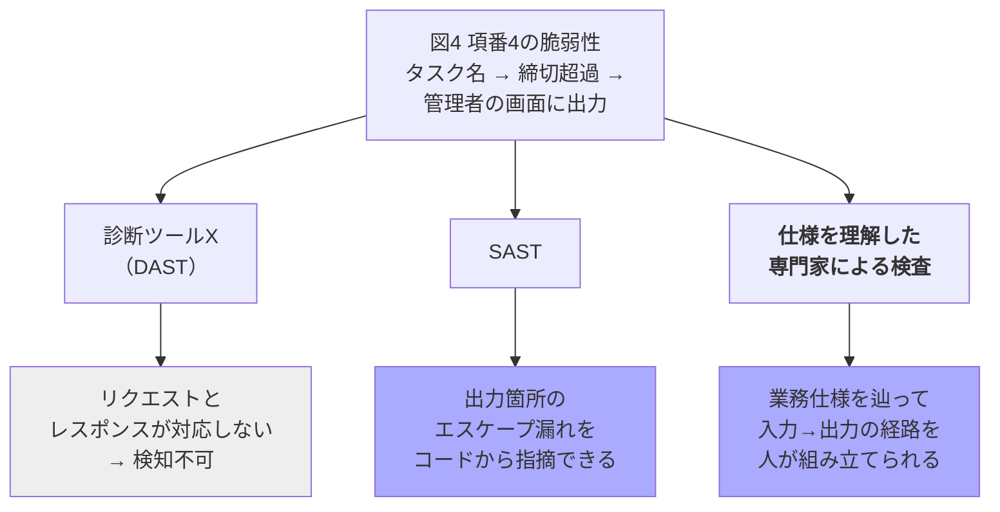

**「仕様を理解した」という限定が重要**

今回の脆弱性を見つけるには、次の連鎖を**業務仕様から推測して試す**必要がある。

| ステップ                                             | 必要な知識                                 |
| ---------------------------------------------------- | ------------------------------------------ |
| タスク名に文字列を入れると、**どこに出力されるのか** | 「プロジェクト進捗管理画面に出る」         |
| **いつ**出力されるのか                               | 「未完了かつ締切日を過ぎたとき」           |
| **誰の画面**に出るのか                               | 「管理者は全プロジェクトを見られる」       |
| CSPがある中で**どう実行させるか**                    | 「アップロードしたファイルは同一オリジン」 |

機械的なスキャンでは、この**仕様に依存した経路**を辿れない。だからこそ「**Sサービスの仕様を理解した専門家による脆弱性検査**」＝手動診断／ペネトレーションテストが必要になる。

> **答案の注意**：「ペネトレーションテスト」「手動診断」とだけ書くより、**「仕様を理解した専門家による」**という限定を入れたほうが設問の意図（＝ツールで検知できないものをどう見つけるか）に正面から答えられる。

---

### 問1の学習ポイントまとめ

| 論点                 | 押さえる要点                                                                                                                  |
| -------------------- | ----------------------------------------------------------------------------------------------------------------------------- |
| CSP                  | `default-src 'self'` は**外部ドメイン読込み**と**インラインスクリプト**を止める。<br>**同一オリジンのファイルは止められない** |
| CSPの回避            | **アップロード機能で同一オリジンにスクリプトを置く**＝`'self'` を実質無力化                                                   |
| 格納型XSS            | **入力画面と出力画面が別**／**時間条件（締切超過）で遅延発火**／**狙うのは権限の高い利用者**                                  |
| CSRFトークンの限界   | **別サイトからのリクエスト**は防げるが、**同一オリジンで動くスクリプト**には読まれる                                          |
| 権限昇格             | `is_admin=1` を**管理者のブラウザから**送らせる。一般利用者の画面で動かしても意味がない                                       |
| ファイルアップロード | 拡張子だけのチェックは**リネームで突破**される。**形式と拡張子の整合性**を検証する                                            |
| XSSの根本対策        | **出力時のエスケープ**。出力先（HTML／属性／JS／URL／CSS）ごとに正しい処理を選ぶ                                              |
| DASTの限界           | **リクエストとレスポンスの対応**でしか判定できない＝**蓄積型・遅延型を見逃す**                                                |
| 検査の組合せ         | **DAST＋SAST＋仕様を理解した専門家による手動検査**                                                                            |

**この問は「CSPを設定してあるのに、なぜ攻撃が成立したのか」という一点に答えられるかが全て。** 失敗した攻撃（インライン／外部ドメイン）と成功した攻撃（同一オリジンのアップロードファイル）の差分を説明できれば、設問2(5)だけでなく設問3(1)・設問4まで一本の線でつながる。

---

## 問2 暗号資産交換業におけるセキュリティ（A社）

### 題材の整理

| 項目          | 内容                                                                                                                                                                                          |
| ------------- | --------------------------------------------------------------------------------------------------------------------------------------------------------------------------------------------- |
| 企業          | **A社**：従業員50名の暗号資産交換業者。顧客20万人、<br>**時価200億円相当のBコイン**を顧客に代わって保有・管理                                                                                 |
| Bコイン       | **楕円曲線暗号を用いたデジタル署名方式**＋**分散型台帳**で管理。<br>移転情報に**署名鍵**で署名し、**Bコインノード**に送付する                                                                 |
| 二重移転防止  | **同一の移転情報は一度しか分散型台帳に記録されない**                                                                                                                                          |
| Bコインノード | **誰でも自由にインターネット上に立ち上げることができる** ← ★（想定事例(b)の前提）                                                                                                             |
| 施設K         | **鍵管理PC**と**監視カメラ**だけを設置。**ネットワークから遮断**。出入口に**金属探知機**。<br>入室は**財務部の従業員だけ**／持込み・持出しは**業務用メディア（会社用意のUSBメモリ）だけ**許可 |
| 鍵            | **署名鍵S**＝鍵管理PCに保存／**検証鍵V**＝基幹サーバに保存                                                                                                                                    |
| 登場人物      | **Jさん**（セキュリティ部、**登録セキスペ**）／当日担当者（財務部）／M社の従業員                                                                                                              |

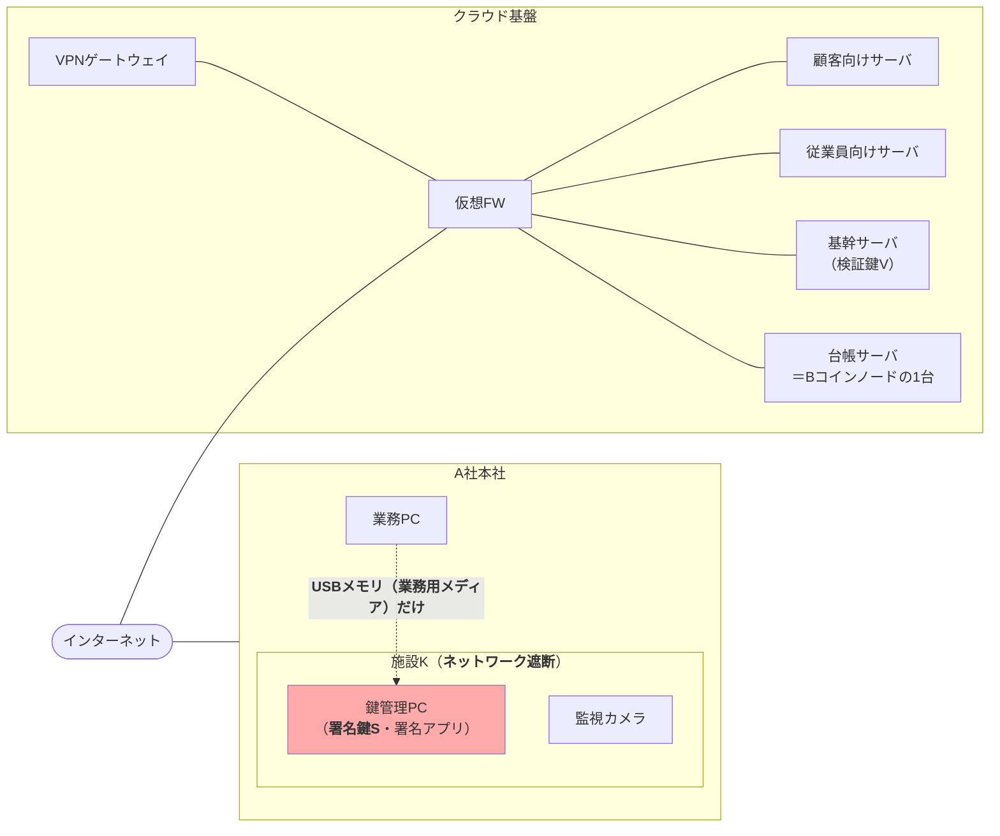

**出庫業務の処理手順（図3）**

| 手順      | 内容                                                                                                                                                                                                                                                                      |
| --------- | ------------------------------------------------------------------------------------------------------------------------------------------------------------------------------------------------------------------------------------------------------------------------- |
| **手順1** | 午前9時、基幹サーバが未処理の出庫依頼を取り出し、**移転情報を記録したファイルを出庫依頼ごとに1つずつ生成**し、従業員向けサーバに全てアップロード                                                                                                                          |
| **手順2** | 午前10時、当日担当者が次の作業を行う                                                                                                                                                                                                                                      |
| (i)       | 業務PCでファイルを全てダウンロードし、**空の業務用メディアに全て保存**する                                                                                                                                                                                                |
| (ii)      | 業務用メディアを取り外し、**施設Kに入室**する                                                                                                                                                                                                                             |
| (iii)     | 鍵管理PCの電源を入れ、業務用メディアを接続し、**署名アプリを起動**する                                                                                                                                                                                                    |
| (iv)      | 各ファイルを署名アプリに読み込み、**署名鍵Sでデジタル署名**し、署名済みファイルを業務用メディアに保存する                                                                                                                                                                 |
| (v)       | 業務用メディアを取り外し、**鍵管理PCの電源を切る**                                                                                                                                                                                                                        |
| (vi)      | 業務用メディアを持って施設Kから退室し、**自身の業務PCに接続**する                                                                                                                                                                                                         |
| (vii)     | 署名済みファイルを**従業員向けサーバに全てアップロード**する                                                                                                                                                                                                              |
| (viii)    | 業務用メディア内のデータを全て消去し、所定の場所に返却する                                                                                                                                                                                                                |
| **手順3** | 午後1時、基幹サーバが署名済みファイルをダウンロードし、**手順1で生成したファイルと移転情報が一致するかを検査**。<br>また**検証鍵Vでデジタル署名を検証**。異常がなければ台帳サーバに送付。<br>**不一致又は検証失敗なら処理を中止し、財務部の従業員全員に電子メールで警告** |

**出題趣旨**：暗号鍵の管理を題材に、情報の暗号化・復号、デジタル署名の生成・検証の基礎的理解と、**暗号鍵の暗号化**といった高度な応用力を問う。

---

### 設問1　楕円曲線暗号を用いたデジタル署名アルゴリズム

> **設問1**　**楕円曲線暗号を用いたデジタル署名アルゴリズム**を解答群の中から**全て選び**、記号で答えよ。
>
> **解答群**：ア AES／イ ECDH／ウ ECDSA／エ EdDSA／オ RSA／カ SHA-256

**解答**：**ウ、エ**

**解説**

**2つの条件（①楕円曲線暗号である ②デジタル署名である）で絞る**

| 記号   | アルゴリズム | 楕円曲線か | 署名か | 判定                                               |
| ------ | ------------ | :--------: | :----: | -------------------------------------------------- |
| ア     | **AES**      |     ✗      |   ✗    | 共通鍵暗号（ブロック暗号）                         |
| イ     | **ECDH**     |     ◯      | **✗**  | **鍵交換**（Elliptic Curve Diffie-Hellman）        |
| **ウ** | **ECDSA**    |   **◯**    | **◯**  | **楕円曲線DSA** ← 正解                             |
| **エ** | **EdDSA**    |   **◯**    | **◯**  | **エドワーズ曲線デジタル署名**（Ed25519等） ← 正解 |
| オ     | **RSA**      |   **✗**    |   ◯    | 素因数分解ベース。署名にも使えるが楕円曲線ではない |
| カ     | **SHA-256**  |     ✗      |   ✗    | ハッシュ関数                                       |

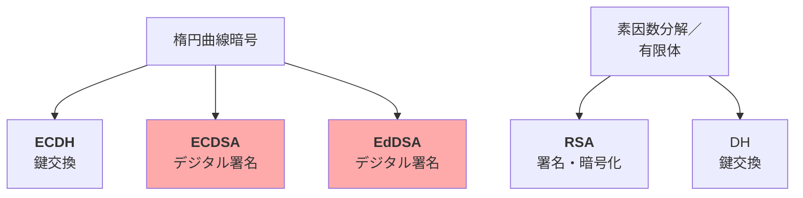

**+α：暗号技術の分類（この並びで覚える）**

| 用途             | 共通鍵系           | 公開鍵系（有限体） | 公開鍵系（楕円曲線） |
| ---------------- | ------------------ | ------------------ | -------------------- |
| **暗号化**       | AES、ChaCha20      | RSA                | ECIES                |
| **デジタル署名** | —（MACは認証のみ） | RSA署名、DSA       | **ECDSA、EdDSA**     |
| **鍵交換**       | —                  | DH、DHE            | **ECDH、ECDHE**      |
| **ハッシュ**     | SHA-2、SHA-3       | —                  | —                    |

> **落とし穴**：**ECDHを選ばない**。「EC」が付いていても**鍵交換**であって署名ではない。逆にRSAは署名できるが**楕円曲線ではない**。両方の条件を機械的に当てはめれば確実に取れる。
> なお、暗号資産（ビットコイン等）が**ECDSA（secp256k1）**を使っているという実例知識があれば、より確信をもって選べる。

---

### 設問2　下線①　サイドチャネル攻撃の手法

> **設問2**　本文中の下線①について、**攻撃にはどのような手法が考えられるか**。手法を具体的に答えよ。
>
> （本文）施設Kには、①**サイドチャネル攻撃を防ぐ対策**が施されている。

**解答**：**施設Kの外から、鍵管理PCの作動音や鍵管理PCから放出される電磁波を観測し、署名鍵Sを推測する。**

**解説**

**施設Kの防御を確認すると、残る攻撃経路が見える**

| 施設Kの対策                            | 塞がれる攻撃                                 |
| -------------------------------------- | -------------------------------------------- |
| **ネットワークから遮断**               | リモートからの侵入・通信による窃取           |
| **入室は財務部の従業員だけ**           | 部外者の物理侵入                             |
| **出入口に金属探知機**                 | **電子機器の持込み**（盗聴器・解析装置など） |
| 持込み・持出しは**業務用メディアだけ** | 記録媒体によるデータ持出し                   |
| **監視カメラ**                         | 不審な作業の記録                             |

→ つまり**「中に入る」「機器を持ち込む」「ネットワークで繋ぐ」のいずれもできない**。残るのは**施設の外から非接触で観測する**手段＝**サイドチャネル攻撃**である。

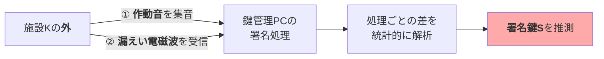

**サイドチャネル攻撃の種類と対策**

| 種類                       | 観測対象                 | 主な対策                                   |
| -------------------------- | ------------------------ | ------------------------------------------ |
| **音響解析**               | **動作音**（本問）       | 遮音、筐体の対策、処理の一定化             |
| **電磁波解析／テンペスト** | **漏えい電磁波**（本問） | **電磁シールド**、放射抑制、機器の隔離配置 |
| 電力解析（SPA／DPA）       | 消費電力                 | 電力波形の一定化、**マスキング**           |
| タイミング攻撃             | 処理時間                 | **処理時間を一定にする**、ブラインディング |
| キャッシュ攻撃             | キャッシュのアクセス時間 | 秘密情報に依存するアクセスの回避           |

**答案に入れる3要素**：①**施設Kの外から**（＝入室できないという条件に答える）、②**作動音や電磁波を観測する**（＝非接触の観測手段）、③**署名鍵Sを推測する**（＝攻撃の目的）。

> **落とし穴**：「電力解析」「タイミング攻撃」だけを書くと、**施設の外から実施できるのか**が説明できない（電力解析は機器への接続、タイミング攻撃は通信が必要）。本問の文脈では**遠隔から観測可能な音・電磁波**を挙げるのが筋。

---

### 設問3(1)　図4中の下線②　マルウェアXにさせる処理

> **設問3**　〔Bコインの不正移転への対策強化〕について答えよ。
> **(1)** 図4中の下線②について、**どのような処理をさせるのか**。処理の内容を答えよ。
>
> （図4 想定事例(a)）図3の手順2(iv)では、デジタル署名しようとする移転情報の内容を当日担当者が確認していない。そこで攻撃者が、②**図3の手順2(i)と(ii)の間及び(vi)と(vii)の間のそれぞれにおいてマルウェアXに特定の処理をさせる**。その結果、図3の手順3で警告の電子メールが送られないまま、Bコインが攻撃者に移転される。

**解答**
- **(i)と(ii)の間**：**Bコインを攻撃者に移転する移転情報を記録したファイルを業務用メディア内に追加する。**
- **(vi)と(vii)の間**：**Bコインを攻撃者に移転する署名済みの移転情報を記録したファイルを攻撃者に送信するとともに、業務用メディアから削除する。**

**解説**

**マルウェアXができること（図4）**

> マルウェアXは、マルウェア対策ソフトに検知されず、攻撃者の指示に従って、**PC上の任意のファイルの書換えやインターネット通信を行うことが可能**である。

**業務PCは「施設Kの外」にあるので、マルウェアXが触れるのは業務用メディアだけ。** そこで**入口（署名前）と出口（署名後）**の2か所に仕掛ける。

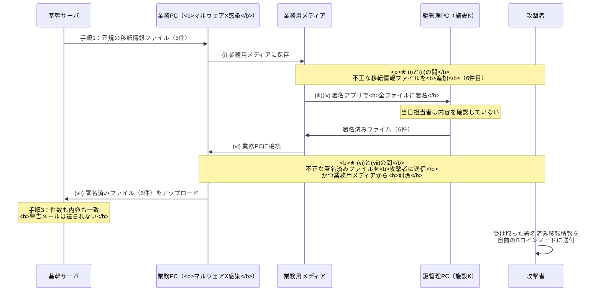

**なぜ「削除」まで必要なのか（ここが設問の核心）**

| もし削除しなかったら                                                                |
| ----------------------------------------------------------------------------------- |
| 手順3で基幹サーバが「**手順1で生成したファイルと移転情報が一致するか**」を検査する  |
| 不正ファイル（手順1に存在しない移転情報）が混ざっている → **不一致**                |
| → **処理が中止され、財務部の従業員全員に警告メールが送られる** → **攻撃が露見する** |

削除すれば、アップロードされるのは**正規の5件だけ**になり、**検査を正常に通過する**。攻撃者は自分で受け取った署名済みファイルを、**誰でも立ち上げられるBコインノード**に送付すれば移転が成立する（A社のシステムを経由する必要がない）。

**この攻撃が成立する前提条件**

| 前提                                                          | 出所               |
| ------------------------------------------------------------- | ------------------ |
| **署名対象の内容を当日担当者が確認していない**                | 図4（下線②の直前） |
| 署名アプリは読み込んだファイルを**全て署名する**              | 図3 手順2(iv)      |
| **Bコインノードは誰でも立ち上げられる**                       | 本文冒頭           |
| マルウェアXは**ファイルの書換えとインターネット通信**ができる | 図4                |

> **エアギャップの限界**：施設Kをネットワークから遮断していても、**可搬媒体（業務用メディア）が橋渡しになる**。Stuxnetと同じ構図であり、「**隔離してあるから安全**」とは言えない。

---

### 設問3(2)　本文中のa　共通鍵を使った暗号技術

> **(2)** 本文中の　**a**　に入れる**共通鍵を使った適切な暗号技術**を答えよ。
>
> （本文）Jさんは、この改修案では、正規の移転情報を記録したファイルの一つを不正な移転情報に書き換えた上で、**メッセージダイジェストが一致するように照合ファイルを書き換えることができてしまう**と指摘し、改修案において、照合ファイルにメッセージダイジェストを記録する代わりに**基幹サーバ及び署名アプリに共通鍵をもたせ、その共通鍵を使った　a　を記録する**よう提言した。

**解答**：**メッセージ認証符号**（MAC）

**解説**

**改修案（図5）の弱点**

| 改修案                                                                                                                       | Jさんの指摘                                                                                                                              |
| ---------------------------------------------------------------------------------------------------------------------------- | ---------------------------------------------------------------------------------------------------------------------------------------- |
| 基幹サーバが、各ファイルの**メッセージダイジェスト**を計算し、<br>ファイル名とダイジェストの一覧を**照合ファイル**に記録する | **ハッシュは鍵を使わない＝誰でも計算できる**<br>→ ファイルを書き換えた上で、**照合ファイルのダイジェストも計算し直して書き換えればよい** |

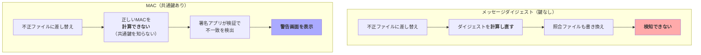

**ハッシュ・MAC・デジタル署名の使い分け**

| 方式                          | 鍵             | 改ざん検知 | 送信元認証 | 否認防止 | 備考                             |
| ----------------------------- | -------------- | :--------: | :--------: | :------: | -------------------------------- |
| **メッセージダイジェスト**    | なし           |     △      |     ✗      |    ✗     | **偶発的な破損**の検知のみ       |
| **メッセージ認証符号（MAC）** | **共通鍵**     |   **◯**    |   **◯**    |  **✗**   | HMAC-SHA256、CMAC など。本問の解 |
| **デジタル署名**              | 秘密鍵／公開鍵 |     ◯      |     ◯      |  **◯**   | 署名鍵Sによる署名がこれ          |

**なぜMACで足りるのか**：ここで守りたいのは**基幹サーバ（生成者）と署名アプリ（検証者）の間**だけであり、**第三者に対する否認防止は不要**。両者が共通鍵を安全に共有できるなら、**MACで十分**。「共通鍵を使った」という設問の指定もこれを示している。

> **答案の注意**：「HMAC」と書いても趣旨は同じだが、設問が「**暗号技術**を答えよ」なので、一般名である**メッセージ認証符号（MAC）**が最も素直。

---

### 設問3(3)　下線③　手順2の作業中の不正行為の機会を減らす対策

> **(3)** 本文中の下線③について、**対策を具体的に**答えよ。
>
> （本文）想定事例(b)に対して財務部は、出庫業務の担当者に対する研修を強化する対策に加えて、③**図3の手順2の作業中における不正行為の機会を減らす対策**を講じることにした。

**解答**：**当日担当者を複数名とし、互いに確認しながら作業を実施するように手順を変更する。**

**解説**

**想定事例(b)の構図（単独犯の内部不正）**

| 手順              | 不正行為                                                                                                  |
| ----------------- | --------------------------------------------------------------------------------------------------------- |
| 手順2(iv)の作業中 | **署名鍵Sを業務用メディアにコピー**する                                                                   |
| 手順2(vi)の後     | 業務PCで業務用メディアから署名鍵Sを取り出し、**自身の個人メールアドレスに送付**                           |
| 後日・自宅        | 自分にBコインを移転させる移転情報を作成して**署名鍵Sで署名**し、<br>**自身で設置したBコインノード**に送付 |

**なぜ「複数名＋相互確認」なのか**

| 本文の条件                                                                           | 導かれる対策                                     |
| ------------------------------------------------------------------------------------ | ------------------------------------------------ |
| 図3 注記：**財務部には複数の従業員がおり、営業日ごとの担当者を事前に割り当てている** | **複数名での作業に変更できる**                   |
| 施設Kは財務部の従業員だけ入室可                                                      | 複数名でも入室可能                               |
| 研修の強化は「動機・正当化」への対策                                                 | 残るのは**機会**への対策（不正のトライアングル） |

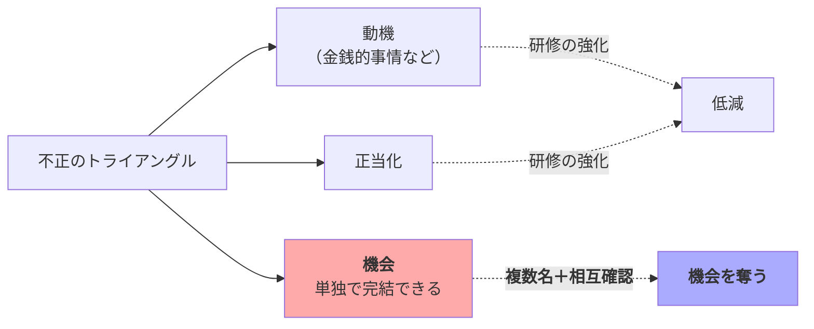

**+α：内部不正対策の定石**

| 原則                             | 内容                                                 |
| -------------------------------- | ---------------------------------------------------- |
| **職務の分離**                   | 申請者と承認者、実行者と確認者を分ける               |
| **デュアルコントロール**（本問） | **2人以上揃わないと作業できない**（Two-person rule） |
| **相互牽制**                     | 互いの作業を見ている状態をつくる                     |
| 監視・証跡                       | 監視カメラ、操作ログ（本問では既に監視カメラがある） |
| 権限の最小化・ローテーション     | 担当の固定を避ける                                   |

> **補足**：A社は実際にセキュリティ部に**業務PCのログと監視カメラの映像を分析させ、事業開始以来、流出事案につながる不正の兆候は発見されなかった**ことを確認している。**検知（事後）だけでなく、機会の削減（事前）**まで手を打つのがこの設問の趣旨。

---

### 設問4(1)　下線④　図6の問題点のうちリスクの最も高いもの

> **設問4**　〔M社によるA社の買収〕について答えよ。
> **(1)** 本文中の下線④について、**問題点のうちリスクの最も高いもの**を答えよ。
>
> （本文）Jさんがこの方法によって安全に署名鍵Sを移送できるかどうかを検討したところ、図6の方法には④**幾つかの問題点**があることが分かった。

**解答**：**作業2において、パスワードで暗号化した署名鍵Sと紙に書き留めたパスワードを一緒に移送している点**

**解説**

**図6の手順を並べ直す**

| 作業  | 内容                                                                                                                                         |
| ----- | -------------------------------------------------------------------------------------------------------------------------------------------- |
| 作業1 | 施設K内で、鍵管理PCを用いて署名鍵Sを**パスワード付き圧縮ファイル**に圧縮し、<br>空の移送用メディアに保存する。**パスワードは紙に書き留める** |
| 作業2 | **移送用メディア及びパスワードを書き留めた紙をM社まで持ち運ぶ** ← ★                                                                          |
| 作業3 | HSM管理サーバに移送用メディアを接続し、**紙のパスワードを使って展開**。<br>HSMに署名鍵Sを読み込んで登録する                                  |
| 作業4 | 署名鍵Sで移転情報にデジタル署名し、移転できるかをテストする                                                                                  |
| 作業5 | 移送用メディアの内容を消去する                                                                                                               |

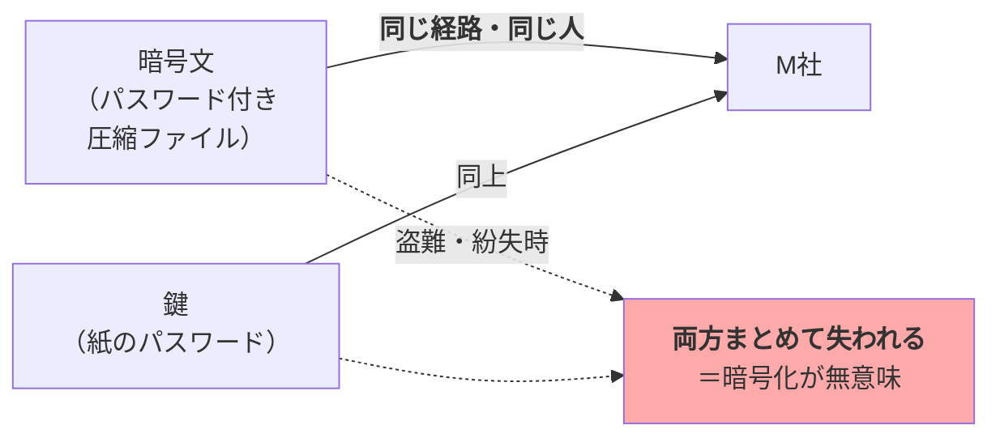

**なぜこれが「最もリスクが高い」のか**

| 観点                   | 内容                                                                                                                      |
| ---------------------- | ------------------------------------------------------------------------------------------------------------------------- |
| 暗号化の前提が崩れる   | **暗号文と鍵を分離して管理する**のが大原則。一緒に運べば暗号化の意味がない                                                |
| 影響の大きさ           | 漏えいすれば**時価200億円相当のBコイン**を攻撃者が移転できる                                                              |
| 発生のしやすさ         | 置き忘れ・盗難・紛失は**日常的に起こり得る**                                                                              |
| パスワード強度は無関係 | 注1「オフライン解析を試みる攻撃に対して十分な強度のものを選ぶ」としても、<br>**鍵が添付されていれば強度は意味を持たない** |

**他にも問題点はある（が「最も高い」ではない）**

| 問題点                                            | 補足                                                    |
| ------------------------------------------------- | ------------------------------------------------------- |
| 作業3で**署名鍵SがHSM管理サーバ上に平文で現れる** | マルウェア感染時に窃取され得る（図7の案でも論点になる） |
| 作業5の消去だけでは**復元される可能性**がある     | 物理破壊や暗号消去が望ましい                            |
| パスワードを**紙に書く**こと自体                  | 複写・撮影のリスク                                      |

> **答案の注意**：設問は「問題点のうち**リスクの最も高いもの**」なので、**1つに絞って**書く。「暗号文と鍵を一緒に運んでいる」という本質を、**どの作業の話か（作業2）**を添えて書くと確実。

---

### 設問4(2)　図7中のb〜e、あ・い

> **(2)** 図7中の　**b**　〜　**e**　に入れる適切な字句を**b〜eの解答群**の中から、　**あ**　、　**い**　に入れる適切な字句を**あ、いの解答群**の中から、それぞれ選び、記号で答えよ。なお、**解答は重複して選んでもよい**。
>
> **b〜eの解答群**：ア 暗号鍵E／イ 検証鍵V／ウ 署名鍵S／エ 復号鍵D
> **あ、いの解答群**：オ 暗号化／カ 検証／キ デジタル署名／ク 復号

**解答**：**b＝ウ／c＝ア／あ＝オ／d＝エ／い＝ク／e＝ウ**

**解説**

**図7（Jさんの案）の流れ**

| 作業  | 内容                                                                                                                                                                                                                  |
| ----- | --------------------------------------------------------------------------------------------------------------------------------------------------------------------------------------------------------------------- |
| 作業1 | M社の従業員が、A社の財務部の従業員の立会いの下、HSM管理サーバを操作して**HSM内に3,072ビットのRSA暗号の鍵ペア**として<br>**暗号鍵E**（公開鍵）及び**復号鍵D**（秘密鍵）を生成し、**暗号鍵Eを移送用メディアに保存**する |
| 作業2 | 移送用メディアを**施設Kまで**持ち運ぶ                                                                                                                                                                                 |
| 作業3 | 施設K内の鍵管理PCで、移送用メディアから暗号鍵Eを読み込む。そして、<br>**b（署名鍵S）**を**c（暗号鍵E）**で**あ（暗号化）**し、生成されたデータを移送用メディアに保存する。<br>移送用メディアから暗号鍵Eを削除する     |
| 作業4 | 移送用メディアを**HSM管理サーバまで**持ち運ぶ                                                                                                                                                                         |
| 作業5 | 移送用メディアをHSM管理サーバに接続する                                                                                                                                                                               |
| 作業6 | 移送用メディアから読み込んだデータをHSMにアップロードする。HSM内でこのデータを<br>**d（復号鍵D）**で**い（復号）**し、得られた**e（署名鍵S）**をHSMに登録する                                                         |

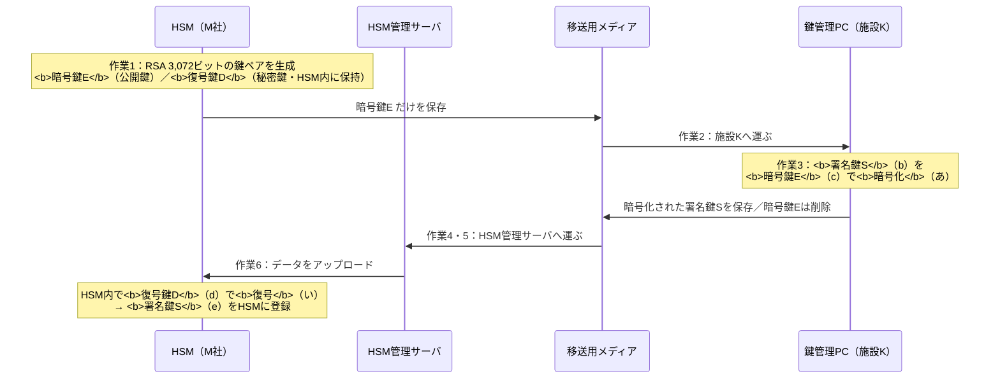

**解き方：鍵の「向き」を間違えない**

| 操作         | 使う鍵                  | 本問                                |
| ------------ | ----------------------- | ----------------------------------- |
| **暗号化**   | **公開鍵**（＝暗号鍵E） | 施設K側（送る側）が行う             |
| **復号**     | **秘密鍵**（＝復号鍵D） | **HSM内**（受け取る側）だけが行える |
| デジタル署名 | 秘密鍵（署名鍵S）       | 本問の移送手順では使わない          |
| 検証         | 公開鍵（検証鍵V）       | 同上                                |

> **引っ掛け**：「あ、いの解答群」には**キ デジタル署名／カ 検証**も入っている。ここで行っているのは**鍵の移送（機密性の確保）**であって、**真正性の確認ではない**ので、暗号化／復号を選ぶ。
> また **e＝署名鍵S** は b と同じ答えになる（「解答は重複して選んでもよい」という注記がヒント）。**運ばれたものが最終的に何になるか**を素直に追えばよい。

**この方式の名前**

| 名称                             | 内容                                                                |
| -------------------------------- | ------------------------------------------------------------------- |
| **鍵ラッピング（Key Wrapping）** | **鍵を別の鍵で暗号化して運ぶ**。本問そのもの                        |
| **ハイブリッド暗号**             | 公開鍵暗号で鍵を配送し、共通鍵暗号で本文を暗号化する（TLS・S/MIME） |

> **パスワードが不要になった点が本質**：図6では「パスワードという共有秘密」を別途運ぶ必要があったが、図7では**暗号化する側は公開鍵しか持たない**ので、**秘密を運ぶ経路が存在しない**。

---

### 設問4(3)　下線⑤　盗難されても署名鍵Sが漏えいしないと考えていた根拠

> **(3)** 本文中の下線⑤について、**Jさんが考えていた根拠**を答えよ。
>
> （本文）Jさんは当初、図7の案では、⑤**図7の作業4で移送用メディアが盗難に遭ったとしても署名鍵Sは漏えいしない**と考えていた。

**解答**：**復号鍵Dがないので、暗号化された署名鍵Sは復号できない。**

**解説**

**作業4の時点で移送用メディアに入っているもの**

| 中身                             | 補足                             |
| -------------------------------- | -------------------------------- |
| **暗号鍵Eで暗号化された署名鍵S** | 作業3で生成                      |
| 暗号鍵E                          | **作業3で削除済み**（図7に明記） |
| 復号鍵D                          | **HSM内にあり、外部に出ない**    |

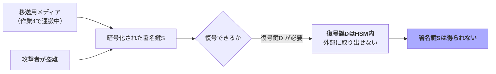

**公開鍵暗号を使う意義**

| 方式              | 運搬物                 | 運搬経路に必要な秘密            |
| ----------------- | ---------------------- | ------------------------------- |
| 図6（パスワード） | 暗号文＋**パスワード** | **あり**（だから一緒に運んだ）  |
| **図7（公開鍵）** | 暗号文のみ             | **なし**（復号鍵はHSM内に常駐） |

> **ただし、この根拠は「作業4の盗難」に限った話**。Jさんはこの後、**HSM管理サーバがマルウェアに感染した場合**（作業1で保存される暗号鍵Eがすり替えられ、作業5で移送用メディアの内容を読み取られる場合）には、**署名鍵Sが漏えいするリスクがある**ことに気付く。それが設問4(4)。

**+α：HSM（Hardware Security Module）の役割**

| 特徴                  | 内容                                                                  |
| --------------------- | --------------------------------------------------------------------- |
| **鍵が外部に出ない**  | 鍵はHSM内で生成・保管され、**取り出せない**（本問の復号鍵D）          |
| **耐タンパー性**      | 物理的な開封・解析を検知すると**鍵を消去**する                        |
| 暗号処理をHSM内で実行 | 署名・復号などをHSM内で行い、**平文の鍵がホスト側のメモリに現れない** |
| サイドチャネル耐性    | 電力解析・タイミング攻撃への対策が施されている（設問2との対比）       |

---

### 設問4(4)　下線⑥　攻撃者がファイルを何に書き換えるか

> **(4)** 本文中の下線⑥について、**攻撃者はファイルを何に書き換えるか**。書換え後のファイルの内容を答えよ。
>
> （本文）HSM管理サーバが仮にマルウェアに感染し、その結果、攻撃者の指示によって⑥**図7の作業1で移送用メディアに保存されるファイルが書き換えられ**、かつ、図7の作業5で移送用メディアの内容を読み取られてしまった場合には、署名鍵Sが攻撃者に漏えいするリスクがあると分かった。

**解答**：**攻撃者の生成した鍵ペアの暗号鍵**

**解説**

**攻撃の筋道（公開鍵のすり替え）**

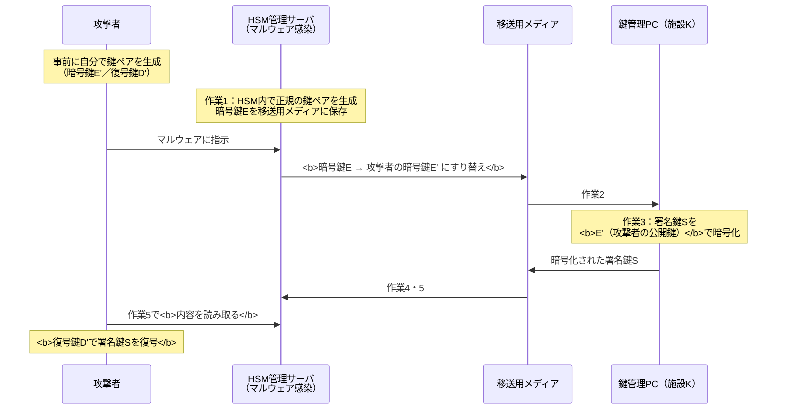

| ステップ | 内容                                                                                         |
| -------- | -------------------------------------------------------------------------------------------- |
| ①        | 攻撃者が**自分で鍵ペア（暗号鍵E'・復号鍵D'）を生成**しておく                                 |
| ②        | 作業1で移送用メディアに保存される**暗号鍵Eを、攻撃者の暗号鍵E'にすり替える**                 |
| ③        | A社は気付かずに、**偽の公開鍵で署名鍵Sを暗号化**してしまう                                   |
| ④        | 作業5で移送用メディアの内容を読み取られると、攻撃者は**自分の復号鍵D'で署名鍵Sを復号**できる |

**本質：公開鍵の真正性が保証されていない**

| 公開鍵暗号の前提                                 | 破られた場合                                                                  |
| ------------------------------------------------ | ----------------------------------------------------------------------------- |
| **受け取った公開鍵が本当に相手のものである**こと | **中間者攻撃（MITM）**が成立する                                              |
| 通常の保証手段                                   | **PKI（証明書）**、フィンガープリントの帯域外確認、HSMの鍵証明（attestation） |

**本文の結論（改良案）**

> Jさんは、**HSMの機能を利用して、移送用メディアに保存されるファイルの改ざんを検知できるように改良した手順**をA社及びM社の経営陣に提案した。

つまり、**HSMが暗号鍵Eに署名して出力し、施設K側でその署名を検証する**（＝すり替えを検知する）といった対策になる。**暗号化（機密性）だけでは足りず、真正性・完全性の確認が要る**という、設問3(2)（ハッシュ→MAC）と同じ教訓がここでも繰り返されている。

> **答案の注意**：「攻撃者の公開鍵」でも趣旨は通るが、本文の用語に合わせて「**攻撃者の生成した鍵ペアの暗号鍵**」と書くのが最も安全。「暗号鍵E'」のように**自分で記号を作る場合は、何を指すか明示**する。

---

### 問2の学習ポイントまとめ

| 論点                | 押さえる要点                                                                                                                               |
| ------------------- | ------------------------------------------------------------------------------------------------------------------------------------------ |
| 楕円曲線＋署名      | **ECDSA／EdDSA**。ECDHは**鍵交換**、RSAは楕円曲線ではない                                                                                  |
| サイドチャネル攻撃  | ネットワーク遮断・持込み制限の**外側**から狙う＝**作動音・漏えい電磁波**。対策は遮音・電磁シールド                                         |
| エアギャップの限界  | **可搬媒体が橋渡し**になる。入口（署名前の追加）と出口（署名後の持出し・削除）の2か所を押さえる                                            |
| 検知を避ける細工    | **警告が出る条件**（件数・内容の一致検査）を調べ、**そこを通過するように**痕跡を消す                                                       |
| ハッシュ／MAC／署名 | ハッシュは**鍵がないので誰でも再計算できる**→改ざん検知にならない。<br>**MAC＝共通鍵**（否認防止は不可）／署名＝公開鍵ペア（否認防止あり） |
| 内部不正の機会削減  | **複数名＋相互確認**（デュアルコントロール）。研修は動機・正当化、手順は**機会**に効く                                                     |
| 鍵の移送            | **暗号文と鍵を同じ経路で運ばない**。公開鍵暗号なら**運ぶのは暗号文だけ**で済む（鍵ラッピング）                                             |
| HSM                 | **鍵が外部に出ない**／耐タンパー／暗号処理をHSM内で実行                                                                                    |
| 公開鍵のすり替え    | 暗号化の前に**公開鍵の真正性**を確認しないとMITMが成立。**署名・証明書・帯域外確認**で防ぐ                                                 |

**この問は「暗号を使っていても、周辺の手順が穴になる」という一本の筋で貫かれている。** 署名対象を確認しない（設問3(1)）、鍵なしハッシュで照合する（設問3(2)）、暗号文と鍵を一緒に運ぶ（設問4(1)）、公開鍵の出所を確認しない（設問4(4)）——いずれも**暗号アルゴリズムではなく運用設計の欠陥**である。

---

## 問3 情報システムのセキュリティ強化（P社）

### 題材の整理

| 項目         | 内容                                                                                                                                                  |
| ------------ | ----------------------------------------------------------------------------------------------------------------------------------------------------- |
| 企業         | **P社**：従業員100名の機械部品商社。**総務部**（**経理係**・**情報システム係**）、営業部、技術部                                                      |
| 端末         | 1人1台の**社有PC**＋**社有スマホ**（併せて情報端末）。<br>故障・災害などの緊急時は**個人所有のスマホの利用も許可**                                    |
| 体制         | 情報システム係の**T主任**と**Fさん**（H部長配下）。<br>各部に**情報セキュリティ推進者**がいて情報システム係をサポート                                 |
| 情報システム | **オンプレミスなし**。**Vサービス**（権威DNS・公開Web・Webメール・**認証基盤**）＋<br>**Wサービス**（P社専用の人事労務・販売管理・ファイル・社内Web） |
| 境界         | **M-FW**＝**ステートフルパケットインスペクション型FW＋DNSキャッシュサーバ＋Webプロキシ**                                                              |
| アクセス制限 | W-GWはFW機能をもち、**P社専用Wサービスに接続できるのはM-FWのGIPだけ**                                                                                 |

**グローバルIPアドレス（表3）**

| 機器又はサービス                         | IPアドレス             |
| ---------------------------------------- | ---------------------- |
| **M-FWのインターネット側インタフェース** | **a1.b1.c1.d1**        |
| P社専用Wサービス                         | a8.b8.c8.1〜a8.b8.c8.4 |
| Vサービスの認証基盤サービス              | a9.b9.c9.d9            |

```mermaid
flowchart LR
  subgraph P["P社"]
    SOU["総務部LAN"] --- MFW["<b>M-FW</b><br/>FW／DNSキャッシュ／<br/>Webプロキシ<br/>GIP: a1.b1.c1.d1"]
    EIG["営業部LAN"] --- MFW
    GIJ["技術部LAN"] --- MFW
  end
  NET(["インターネット"])
  MFW --- NET
  subgraph V["Vサービス"]
    DNS["権威DNSサービス"]
    WEB["公開Webサービス"]
    MAIL["Webメールサービス"]
    AUTH["<b>認証基盤サービス</b><br/>（MFA・IdP）"]
  end
  subgraph W["Wサービス"]
    WGW["W-GW<br/>（P社のGIPだけ許可）"] --- PW["P社専用Wサービス<br/>人事労務／販売管理／<br/>ファイル／社内Web"]
  end
  NET --- V
  NET --- WGW
  style MFW fill:#aaf
```

**認証基盤サービスのMFA（表2）**

| 認証方式      | 内容                                                                                           |
| ------------- | ---------------------------------------------------------------------------------------------- |
| **認証方式1** | 利用者ごとにあらかじめ登録した**1件の電話番号へのSMS通知**による認証                           |
| **認証方式2** | 利用者ごとにあらかじめ登録した**1台のスマホでの認証アプリ**を用いた認証（**P社はこれを設定**） |
| **認証方式3** | **認証の都度、利用者が認証方式1又は2のいずれかを選択**                                         |

> MFA設定画面（以下、MFA設定画面という）へのアクセスは**接続元IPアドレス制限が可能**。

**この問の3つのパート**

| パート                                       | テーマ                                     | 設問     |
| -------------------------------------------- | ------------------------------------------ | -------- |
| 〔情報システムの現状〕                       | DNSのセキュリティプロトコル                | 設問1    |
| 〔攻撃者口座に振り込んでしまうリスクの検討〕 | **IBのトークン方式の比較**（MITB対策）     | 設問2    |
| 〔リモートワークの検討〕〜〔OS移行の施策〕   | **Kサービス（HTTPS型VPN／SWG）**の導入設計 | 設問3〜5 |

---

### 設問1(1)　表2中のa　応答にデジタル署名を付与するプロトコル（英字10字以内）

> **設問1**　〔情報システムの現状〕について答えよ。
> **(1)** 表2中の　**a**　に入れる適切な字句を、**英字10字以内**で答えよ。
>
> （表2 権威DNSサービス）次のプロトコルにも対応している。
> ・　**a**　：応答にデジタル署名を付与する。

**解答**：**DNSSEC**

### 設問1(2)　表2中のb・c（各英字5字以内）

> **(2)** 表2中の　**b**　、　**c**　に入れる適切な字句を、それぞれ**英字5字以内**で答えよ。
>
> ・　**b**　：HTTPSを用いてDNS通信する。
> ・DoT：　**c**　を用いてDNS通信を暗号化する。

**解答**：**b＝DoH／c＝TLS**

**解説**

**3つのプロトコルは目的が違う**

| プロトコル | 正式名称                | 目的                             | 何をするか                       |
| ---------- | ----------------------- | -------------------------------- | -------------------------------- |
| **DNSSEC** | DNS Security Extensions | **完全性・真正性**（送信元認証） | **応答にデジタル署名を付与**する |
| **DoH**    | **DNS over HTTPS**      | **機密性**（盗聴・改ざん防止）   | **HTTPS（443/TCP）**でDNS通信    |
| **DoT**    | **DNS over TLS**        | **機密性**                       | **TLS（853/TCP）**でDNS通信      |

```mermaid
flowchart TB
  A["DNSのセキュリティ"] --> B["<b>DNSSEC</b><br/>応答に署名<br/>＝改ざん検知・真正性"]
  A --> C["<b>DoH／DoT</b><br/>経路を暗号化<br/>＝盗聴防止"]
  B --> B1["キャッシュポイズニング対策<br/><b>暗号化はしない</b>"]
  C --> C1["第三者に<b>問合せ内容</b>を<br/>知られない<br/><b>偽の応答は検知できない</b>"]
  style B fill:#faa
  style C fill:#aaf
```

**両者は補完関係**にある。DNSSECは「**返ってきた答えが正しいか**」を保証し、DoH／DoTは「**やり取りを覗かれないか**」を保証する。どちらか一方では不十分。

**+α：押さえるべき周辺知識**

| 項目             | 内容                                                                                        |
| ---------------- | ------------------------------------------------------------------------------------------- |
| DNSSECのレコード | **RRSIG**（署名）、**DNSKEY**（公開鍵）、**DS**（親ゾーンへの委任）、NSEC/NSEC3（不在証明） |
| 信頼の連鎖       | ルート → TLD → ドメインと**DSレコードで親子をつなぐ**                                       |
| DoHの特徴        | **443/TCP**なので通常のHTTPS通信に紛れる＝**企業がフィルタしにくい**                        |
| DoTの特徴        | **853/TCP**専用ポート＝ポートで識別・制御できる                                             |
| 本問での位置づけ | P社のM-FWが**DNSキャッシュサーバ機能**をもつ（社内の名前解決を集約）                        |

> **注意**：設問が「**英字10字以内**」「**英字5字以内**」と字数を区切っているのは、**略称をそのまま書かせる**ため。DNSSEC（7字）、DoH（3字）、TLS（3字）。

---

### 設問2　表5中のd・e　やり取りされる情報

> **設問2**　表5中の　**d**　、　**e**　に入れる適切な字句を解答群の中からそれぞれ選び、記号で答えよ。なお、**解答は重複して選んでもよい**。
>
> **解答群**：ア 攻撃者口座の口座番号／イ 攻撃者による書換え前の口座番号

**解答**：**d＝イ／e＝ア**

**解説**

**まず正常な振込みの流れ（図3）を押さえる**

| 手順 | 内容                                                                            |
| ---- | ------------------------------------------------------------------------------- |
| 1    | 振込先の**金融機関名・店名**を選択                                              |
| 2    | 振込先の**口座種別・口座番号**を入力                                            |
| 3    | Web画面に振込先の**口座名義人が表示される**（**表示されないことがある**）       |
| 4    | **振込金額**を入力                                                              |
| 5    | **数字入力トークンに振込先の口座番号を入力する** ← ★                            |
| 6    | トークンが**口座番号と時刻情報を基に認証番号を生成・表示**。それをWeb画面に入力 |
| 7    | 振込元・振込先・金額が表示される                                                |
| 8    | “振込”ボタンで実行                                                              |

**偽サーバを挟んだときの流れ（図4）**

```mermaid
sequenceDiagram
  participant T as 数字入力トークン
  participant B as 操作担当者の<br/>Webブラウザ
  participant F as <b>偽のサーバ</b>
  participant Y as Y-IBのWebサイト
  B->>F: (1)
  F->>Y: (2) <b>攻撃者口座</b>の金融機関名及び店名
  Y->>F: (3)
  F->>B: (4)
  B->>F: (5)
  F->>Y: (6) <b>攻撃者口座</b>の口座種別及び口座番号
  Y->>F: (7) <b>攻撃者口座</b>の口座名義人
  F->>B: (8) (7)の各文字を<b>空白に置き換えた</b>文字列
  B->>F: (9)
  F->>Y: (10) 攻撃者による<b>書換え後の振込金額</b>
  Y->>F: (11)
  F->>B: (12)
  B-->>T: (13) <b>d＝書換え前の口座番号</b>（＝図3 手順5）
  T-->>B: (14) 認証番号
  B->>F: (15)
  F->>B: (16) <b>図5のポップアップ画面</b>（図3にない流れ）
  B-->>T: (17) <b>e＝攻撃者口座の口座番号</b>
  T-->>B: (18) 認証番号
  B->>F: (19)
  F->>Y: (20) …
```

**d：操作担当者は「自分が入力したつもりの口座番号」を入れる**

| 根拠                                                                                |
| ----------------------------------------------------------------------------------- |
| (13)(14)は図3の手順5・6に**そのまま対応する正常な流れ**                             |
| 操作担当者のWeb画面には、**本人が入力した（＝書換え前の）口座番号**が表示されている |
| したがってトークンに入力するのは **書換え前の口座番号（イ）**                       |

→ この認証番号は**正規の振込先に対するもの**なので、攻撃者口座への振込みには使えない。

**e：攻撃者が本当に欲しい認証番号を、偽の画面で入力させる**

| 根拠                                                                                                                                                        |
| ----------------------------------------------------------------------------------------------------------------------------------------------------------- |
| 本物のY-IBは、(6)で送られた**攻撃者口座の口座番号**に対する認証番号を要求する                                                                               |
| そこで偽サーバは(16)で**図5のポップアップ**を表示：<br>「高額の振込みのため、本人確認が必要です。次の数字を数字入力トークンに入力してください **1234567**」 |
| 図5の注1：**“1234567”は図4の(16)で送られてきた数字** ＝ **攻撃者口座の口座番号（ア）**                                                                      |

→ 利用者は「本人確認のための数字」だと思って入力するが、実際は**攻撃者口座の口座番号**。これで(18)の認証番号＝**攻撃者口座への振込みを承認する認証番号**が手に入る。

**(8)の細工にも注目**

| 仕掛け                                                                                | 狙い                                                                                                                            |
| ------------------------------------------------------------------------------------- | ------------------------------------------------------------------------------------------------------------------------------- |
| (7)で得た**攻撃者口座の口座名義人**を、<br>**各文字を空白に置き換えて**ブラウザに返す | 図3 手順3の「**口座名義人が表示されないことがある**」という仕様に紛れさせ、<br>**知らない名義が表示されて怪しまれること**を防ぐ |

**なぜ数字入力トークンでは守れないのか**

| トークン                       | 利用者が確認できるもの                                                               | 改ざんに気付けるか                            |
| ------------------------------ | ------------------------------------------------------------------------------------ | --------------------------------------------- |
| **数字入力トークン**（Y-IB）   | **自分が入力した数字だけ**。トークンは**その数字が何を意味するか示せない**           | **✗**（別の数字を入れさせられても分からない） |
| **カメラ付きトークン**（Z-IB） | Web画面の2次元コードを読み取り、**取引内容と認証番号をトークンのディスプレイに表示** | **◯**（口座情報の改ざんに気付ける）           |

```mermaid
flowchart LR
  subgraph Y["Y-IB：数字入力トークン"]
    Y1["利用者が数字を入力"] --> Y2["認証番号を生成"]
    Y2 --> Y3["<b>何の取引か分からない</b>"]
  end
  subgraph Z["Z-IB：カメラ付きトークン"]
    Z1["Web画面の2次元コードを読取り"] --> Z2["<b>取引内容</b>と認証番号を<br/>トークンに表示"]
    Z2 --> Z3["改ざんされていれば<br/><b>気付ける</b>"]
  end
  style Y3 fill:#faa
  style Z3 fill:#aaf
```

**この仕組みの名前＝トランザクション署名**。取引内容そのものを、**マルウェアの影響を受けないハードウェアトークン**で確認・署名することで、**MITB（Man-in-the-Browser）攻撃**に対抗する。本文の結論「**攻撃者口座に振り込んでしまうリスクはZ-IBの方が低い**」はこれが根拠。

> **本文の指摘も押さえる**：図4の(16)〜(19)は**図3にない流れ**なので、「**図3の流れを理解していれば違和感を覚える可能性が高い**」。逆に言えば、**手順を知らない担当者は気付けない**。技術的対策（カメラ付きトークン）と教育の両輪が要る。

---

### 設問3　図8中の下線①　Kサービス設定サイトへのアクセス制限

> **設問3**　図8中の下線①について、**設定内容を具体的に**答えよ。
>
> （図8 項番8）図6の項番8については、①**Kサービス設定サイトへのアクセスはP社内だけからできるよう制限する**。

**解答**：**Kサービス設定サイトへのアクセスが許可される接続元IPアドレスを a1.b1.c1.d1 に制限する。**

**解説**

| 使える仕組み（図6 項番8）                                                                                               |
| ----------------------------------------------------------------------------------------------------------------------- |
| 契約企業向けに用意された設定画面（Kサービス設定サイト）への**アクセスを許可する接続元IPアドレスを設定することができる** |

| 「P社内だけから」をIPアドレスで表現すると                      |
| -------------------------------------------------------------- |
| P社内からインターネット向けの通信は**M-FWを経由**する          |
| 表3より、**M-FWのインターネット側インタフェース＝a1.b1.c1.d1** |
| → 許可する接続元IPアドレスは **a1.b1.c1.d1** のみ              |

```mermaid
flowchart LR
  IN["P社内の社有PC"] --> MFW["M-FW<br/>a1.b1.c1.d1"] --> KS["Kサービス設定サイト<br/>（許可：a1.b1.c1.d1）"]
  OUT["リモートワーク中のPC<br/>（Kサービス経由）"] -->|"送信元は<b>Kサービスの<br/>固定GIP</b>になる"| X["<b>拒否される</b>"]
  style KS fill:#aaf
  style X fill:#eee
```

> **引っ掛け**：図6 項番4の「契約企業専用の**Kサービス用固定グローバルIPアドレス**」を許可してしまうと、**リモートワーク中の社有PCからも設定サイトに入れてしまい**、「**P社内だけから**」という要求を満たさない。設定サイトは**Kサービスそのものの設定（接続可否の条件、URLフィルタの除外など）を変更できる**ため、社内の管理拠点からだけに絞る。

**+α：管理コンソールの保護**

| 対策                     | 内容                                                    |
| ------------------------ | ------------------------------------------------------- |
| **接続元IPアドレス制限** | 本問の解。管理操作の入口を物理的な拠点に縛る            |
| 管理者アカウントのMFA    | 図8 項番3（MFAの利用）                                  |
| 管理者の限定             | 図8 項番2（管理者はT主任とFさん）                       |
| 操作ログ                 | 図6 項番7（管理者アカウントでログの検索・参照ができる） |

---

### 設問4(1)　本文中のf　取引先への依頼内容

> **設問4**　〔段階的な利用計画〕について答えよ。
> **(1)** 本文中の　**f**　に入れる**依頼の内容**を具体的に答えよ。
>
> （本文）(3) 各取引先サービスについて、次の依頼を取引先に行う。依頼：　**f**　。

**解答**：**各取引先サービスへの接続を許可するIPアドレスとして、P社専用のKサービス用固定グローバルIPアドレスを登録してもらう**

**解説**

**何が変わるのか**

| 時点                | 取引先サービスから見た接続元IPアドレス                                                                                        |
| ------------------- | ----------------------------------------------------------------------------------------------------------------------------- |
| 現状                | **M-FWのGIP（a1.b1.c1.d1）**（取引先で許可済み）                                                                              |
| **Kサービス利用後** | **Kサービスの固定GIP**（図6 項番4・5：KサービスがHTTPS通信を終端し、<br>インターネット側へは契約企業専用の固定GIPで出ていく） |

```mermaid
flowchart LR
  PC["社有PC"] -->|"HTTPS"| K["Kサービス<br/>（HTTPS通信を終端）"]
  K -->|"<b>Kサービス用固定GIP</b>で<br/>再送出"| TR["取引先サービス<br/>（接続元IP制限あり）"]
  TR -.->|"a1.b1.c1.d1 しか<br/>許可していないと"| NG["<b>接続できない</b>"]
  style NG fill:#faa
```

| 本文の根拠                                                                                                                                              |
| ------------------------------------------------------------------------------------------------------------------------------------------------------- |
| 各取引先サービスで**接続元IPアドレス制限**を行っている／M-FWのGIPからの接続は許可されている                                                             |
| 図6 項番4：**Kサービスのインターネットへのアクセス時の送信元IPアドレスとして、契約企業専用のKサービス用固定グローバルIPアドレスを指定することができる** |
| 図6 項番5：KサービスはHTTPS通信を**終端**し、URLフィルタリングを行う                                                                                    |
| 図8 項番5：**図6の項番4を利用する**                                                                                                                     |

> **R-MRを使わない理由との対比**：先に検討したR社のモバイルルータ（Rサービス）は「**インターネットに接続したときに割り当てられるGIPに、固定GIPを割り当てることはできない**」ことが分かっている。**固定GIPを提供できるKサービス**だからこそ、取引先のIP制限に対応できる。

---

### 設問4(2)　下線②　追加する宛先

> **(2)** 本文中の下線②について、**追加する宛先**を答えよ。
>
> （本文）T主任は、(2)について、問題を指摘し、許可する宛先の追加を指示した。Fさんは、②**追加する宛先**をT主任に報告し、了承を得た。
>
> （Fさんの案(2)）M-FWのファイアウォール機能では社内からのHTTP通信を禁止とし、**HTTPS通信の宛先はKサービスだけを許可する**。

**解答**：**Z-IB、OSベンダーのOSアップデート配布サイト、認証基盤サービス及びKサービス設定サイトへのHTTPSサービス**

**解説**

Fさんの案(2)のままだと、**Kサービスを経由しない（できない）通信がすべて遮断される**。本文を辿ると、該当するものが4つある。

| 追加すべき宛先                           | 理由（本文の根拠）                                                                                                                                                               |
| ---------------------------------------- | -------------------------------------------------------------------------------------------------------------------------------------------------------------------------------- |
| **Z-IB**                                 | 図8 項番1・本文：**経理係のIBの利用はKサービスの対象外**（リモートワークの対象外とする前提）                                                                                     |
| **OSベンダーのOSアップデート配布サイト** | 図7 項番2：情報システム係が**あらかじめダウンロードしておいた最新の脆弱性修正プログラムを適用**する。<br>また表1 項番1(2)で利用者がOSのアップデート機能を用いて適用する          |
| **認証基盤サービス**                     | 図7 項番3：**Kソフト導入前**に、MFA設定画面にログインして認証アプリを登録する。<br>さらにKサービスの認証は**認証基盤サービスをIdPとするSAML**（図6 項番2）＝**認証のたびに必要** |
| **Kサービス設定サイト**                  | 図7 項番4：**Kソフトをダウンロード・インストール**するためにアクセスする                                                                                                         |

```mermaid
flowchart TB
  A["Kサービスを<b>使うため</b>に<br/>必要な通信"] --> B["Kソフトの入手<br/>（<b>Kサービス設定サイト</b>）"]
  A --> C["認証<br/>（<b>認証基盤サービス</b>／SAML）"]
  A --> D["導入前のOS更新<br/>（<b>OSアップデート配布サイト</b>）"]
  E["Kサービスの<br/><b>対象外</b>の業務"] --> F["<b>Z-IB</b>（経理係のIB）"]
  style A fill:#faa
  style E fill:#faa
```

**この設問の構造**：「**Kサービス経由に一本化する**」という方針には、**鶏と卵の問題**がある。Kサービスを使うには、まずKソフトを入手し、アカウントを作り、認証できる状態にしなければならない。その準備の通信まで塞いでしまうと、**新規PCのセットアップが不可能**になる。

> **答案の注意**：4つのうち1つでも落とすと減点。本文を「**Kサービスを使う前に必要な通信**」と「**Kサービスの対象外と明記されている業務**」の2軸で洗い出すと漏れにくい。
> なお、Vサービスの他の構成要素（公開Web・Webメール）や取引先サービスは**Kサービス経由で利用できる**ので追加不要。

---

### 設問5(1)　本文中のg　社有スマホ故障時の設定（先行利用の利用者アカウント）

> **設問5**　〔先行利用の実施とOS移行の施策〕について答えよ。
> **(1)** 本文中の　**g**　に入れる**設定内容を具体的に**答えよ。
>
> （本文）先行利用では、利用中に社有スマホが故障し、認証ができないという問題が発生した。そこで、H部長とも相談し、社有スマホの故障時でもKサービスが利用できるように、MFA設定画面で次の二つを行った。
> ・管理者のアカウントで、認証方式を表2の**認証方式3に変更**する。
> ・先行利用の利用者アカウントについては、　**g**　。

**解答**：**認証方式1の電話番号として、個人所有スマホの電話番号を登録する**

**解説**

**問題の構造**

| 状況                                                          | 結果                                       |
| ------------------------------------------------------------- | ------------------------------------------ |
| P社は**認証方式2**（1台のスマホでの認証アプリ）を設定していた | 社有スマホが故障すると**認証手段が消える** |
| 管理者が**認証方式3**（都度、方式1か2を選択）に変更した       | 方式1も選べるようになった                  |
| しかし**方式1は「あらかじめ登録した1件の電話番号へのSMS」**   | **電話番号が登録されていなければ使えない** |

→ したがって、利用者アカウント側で**認証方式1用の電話番号を登録**する必要がある。どの番号かといえば、**表1 項番2で緊急時の利用が許可されている個人所有のスマホの電話番号**。

```mermaid
flowchart LR
  A["社有スマホが故障"] --> B{"認証方式"}
  B -->|"方式2のみ（変更前）"| C["<b>認証不能</b>"]
  B -->|"方式3（変更後）"| D["方式1も選べる"]
  D --> E{"方式1の電話番号は<br/>登録済みか"}
  E -->|"未登録"| C
  E -->|"<b>個人所有スマホの<br/>電話番号を登録</b>（g）"| F["SMSで認証できる"]
  style C fill:#faa
  style F fill:#aaf
```

| 本文・表の根拠                                                                                       |
| ---------------------------------------------------------------------------------------------------- |
| 表1 項番2：「社有スマホ、**緊急時に利用する個人所有のスマホ**」が利用規程の対象                      |
| 冒頭：「社有スマホの故障、災害発生などの**緊急時については、個人所有のスマホの利用を許可している**」 |
| 表2 認証方式1：利用者ごとに**あらかじめ登録した1件の電話番号**へのSMS通知                            |

> **設計上の注意**：SMSベースの認証は**SIMスワップ**や**SS7の悪用**のリスクがあり、一般には推奨されない。本問では**社内規程で許可された緊急時の代替手段**として位置づけられており、**認証方式3（都度選択）にすることで平時は認証アプリを使う**という設計になっている点が重要。

---

### 設問5(2)　下線③　KサービスでOS移行を促進させる施策

> **(2)** 本文中の下線③について、**施策を具体的に**答えよ。
>
> （本文）T主任とFさんは、現状、社有PCのOSの移行が滞っていることから、③**情報システム係がKサービスを活用して移行を促進させる施策**を考えた。

**解答**：**Kサービス接続時のログからOSがバージョンXの社有PCを抽出し、アカウント名から利用者を特定後、利用者の所属する部の情報セキュリティ推進者に報告し、バージョンYへの移行を促してもらう。**

**解説**

**Kサービスが「全社有PCの状態が集まる場所」になっている**

| 図6 項番3の仕様                                                                                                                                                           |
| ------------------------------------------------------------------------------------------------------------------------------------------------------------------------- |
| Kサービス接続時に、**接続元PCのOSのバージョン、OSの脆弱性修正プログラム適用状況、マルウェア定義ファイルのバージョン**（＝**PC情報**）をチェックし、接続の可否を判定できる |
| **アカウント名、PCのシリアル番号、PC情報及び接続可否をログに記録する** ← ★                                                                                                |
| 図6 項番7：**契約企業の管理者アカウントでログの検索や参照ができる**                                                                                                       |

さらに図8の方針で、**リモートワーク時に限らずP社出勤時も社有PCでのKサービスの利用を必須**にしたため、**ほぼ全ての社有PCがKサービスに接続する**。

```mermaid
flowchart LR
  A["全社有PCが<br/>Kサービスに接続<br/>（図8の方針）"] --> B["ログに記録<br/>アカウント名／シリアル番号／<br/><b>OSのバージョン</b>"]
  B --> C["① <b>バージョンXのPCを抽出</b>"]
  C --> D["② アカウント名から<br/><b>利用者を特定</b>"]
  D --> E["③ 所属する部の<br/><b>情報セキュリティ推進者</b>に報告"]
  E --> F["④ バージョンYへの<br/>移行を促してもらう"]
  style C fill:#aaf
  style F fill:#aaf
```

**なぜ情報セキュリティ推進者を経由するのか**

| 根拠                                                                                                               |
| ------------------------------------------------------------------------------------------------------------------ |
| 冒頭：「各部には、**情報システム係をサポートする情報セキュリティ推進者**がいる」                                   |
| 表1 項番1(3)：**各部の情報セキュリティ推進者が、利用者が項番1(2)に従って適切に利用しているかどうかを毎月確認する** |
| 〔社有PCのOSの現状〕：移行は**各部の情報セキュリティ推進者の管理の下、6か月以内に完了**させることになっている      |

つまり**移行の推進責任は各部の推進者にある**ので、情報システム係は「**誰が未移行か**」という情報を提供して動いてもらうのが筋。

> **答案の型**：「**どの情報を使って（Kサービスのログ）／何を特定し（バージョンXのPCとその利用者）／誰に働きかけるか（各部の情報セキュリティ推進者）**」の3要素で書く。
> なお、図6 項番3の判定条件を厳しくして**バージョンXのPCを接続拒否にする**のも技術的には可能だが、それは「**促進させる施策**」ではなく業務停止に直結するため、本問の答えとしては過剰（図8 項番4では、表1 項番1(2)を満たさないPCからの接続を拒否する設定が既に入っている点との区別に注意）。

---

### 問3の学習ポイントまとめ

| 論点                       | 押さえる要点                                                                                                  |
| -------------------------- | ------------------------------------------------------------------------------------------------------------- |
| DNSのセキュリティ          | **DNSSEC＝署名（真正性・完全性、暗号化なし）／DoH＝HTTPS／DoT＝TLS（機密性）**                                |
| MITB・口座情報の改ざん     | **数字入力トークンは「入力した数字が何か」を示せない**→別の数字を入れさせられる                               |
| トランザクション署名       | **カメラ付きトークンが取引内容をディスプレイに表示**＝改ざんに気付ける                                        |
| 偽サーバの細工             | **名義人を空白に置換**して「表示されないことがある」仕様に紛れさせる／<br>**図3にない画面**は違和感の手掛かり |
| 管理コンソールの保護       | **接続元IPアドレス制限**。社内の出口（M-FWのGIP）だけに絞る                                                   |
| プロキシ型サービスの副作用 | **送信元IPが変わる**→取引先のIP制限に**新しい固定GIPを登録**してもらう                                        |
| 一本化の落とし穴           | **Kサービスを使うために必要な通信**（ソフト入手・認証・OS更新）と**対象外の業務**は許可が要る                 |
| MFAの運用                  | **認証手段が1つだと故障で詰む**。方式3（都度選択）＋**代替手段の事前登録**                                    |
| ログの二次利用             | 接続制御のためのログ（OSバージョン・アカウント名）を、**資産管理・移行促進**に活用する                        |

**この問は「サービスを1つ入れると、周辺の前提が全部ずれる」という設計の勘所を問うている。** Kサービスの導入で、送信元IPが変わり（設問4(1)）、通信経路の許可設計が変わり（設問4(2)）、認証手段の冗長性が必要になり（設問5(1)）、代わりに新しい可視性が手に入る（設問5(2)）。

---

## 問4 製造業におけるセキュリティ管理（L社）

### 題材の整理

| 項目        | 内容                                                                                                                                        |
| ----------- | ------------------------------------------------------------------------------------------------------------------------------------------- |
| 企業        | **L社**：従業員100名。主に**家電製品の部品を製造**。精密加工技術に定評                                                                      |
| 取引関係    | **売上げの90%が大手家電製品製造企業J社向け**。昨年度**J社の資本参加を受け子会社化**                                                         |
| 要求        | J社から、経済産業省及びIPAが策定した**“サイバーセキュリティ経営ガイドライン Ver3.0”**に基づく対策整備を求められた                           |
| 体制        | **CISO＝E取締役**。N社のコンサルタント**C氏**（**登録セキスペ**）が支援                                                                     |
| 組織        | 総務部（総務課・**情報システム課**）／営業部／製造部（**設計課・製造課・品質保証課**）                                                      |
| J社との契約 | 秘密保持義務、**秘密保持状況についてのJ社の監査を受ける義務**、<br>漏えい時の損害賠償責任、**納期遅延・品質不良などの発生時の損害賠償責任** |
| 制約条件    | **全ての工作機械が停止しても、停止時間が2時間以内であれば出荷への大きな影響は避けられる** ← ★（設問4のRTO）                                 |

```mermaid
flowchart LR
  NET(["インターネット"])
  MAIL["電子メールSaaS"] --- NET
  PROXY["WebプロキシSaaS"] --- NET
  subgraph SRV["サーバ室"]
    FW["FW"]
    L3["L3SW"]
    FS["ファイルサーバ<br/>（設計情報／設計図の<br/>保存領域・領域ごとに権限）"]
    LDAP["LDAPサーバ<br/>（利用者認証）"]
  end
  NET --- FW --- L3
  L3 --- FS
  L3 --- LDAP
  subgraph OFF["事務部門"]
    SOU["総務部 一般PC"]
    EIG["営業部 一般PC"]
    SEK["設計課 CAD PC／一般PC"]
    HIN["品質保証課 一般PC／製造監視用PC"]
  end
  subgraph SEIZO["製造課"]
    NC["NC PC"]
    GPC["一般PC"]
    SCADA["SCADA<br/>（サーバ用OS・予備機1台）"]
    SOP["SCADA操作用PC<br/>（予備機1台）"]
    MC["工作機械 ×複数"]
    MOP["工作機械操作用PC"]
  end
  L3 --- OFF
  L3 --- SEIZO
  SCADA --- MC
  SOP --- SCADA
  style SCADA fill:#faa
```

**製造の流れ（図4：試作時／図5：量産時）で押さえる点**

| 事項                                                                           | 設問への効き方                               |
| ------------------------------------------------------------------------------ | -------------------------------------------- |
| 設計情報ファイル（**三面図**）は**営業部が受け取り、ファイルサーバに保存**する | 設問2(2)の**書込権限**                       |
| **設計課**はCAD PCで設計情報ファイルを**参照**して設計図を作成                 | 設問2(2)の**読込権限のみ**                   |
| **製造課・品質保証課**は、試作品が設計情報ファイルに適合しているか**確認**     | 同上（読込権限のみ）                         |
| NCプログラムは**NC PC → USBメモリ → SCADA操作用PC → SCADA**と運ばれる          | 設問3(g)の**USBメモリ検査**、設問4の**復旧** |
| 工作機械は**SCADAからの指示**又は**工作機械操作用PCの操作**で加工する          | 設問4(2)の**代替手段・被害シナリオ**         |

**出題趣旨**：サプライチェーンに組み込まれている企業で、システム構成・ネットワーク構成・業務の流れを前提に、**攻撃シナリオの検討、対策及び必要な運用手順の立案**の能力を問う。

---

### 設問1　表2中のa・b　マルウェア対策機能の比較（各5字以内）

> **設問1**　表2中の　**a**　、　**b**　に入れる適切な字句を、それぞれ**5字以内**で答えよ。
>
> （表2 電子メールSaaSのマルウェア対策機能）
> | 機能 | メリット | デメリット |
> | --- | --- | --- |
> | パターンマッチング型 | ・検査時間が短い。 | ・　**a**　マルウェアは検知できない。<br>・　**b**　された添付ファイル内のマルウェアは検知できない。 |
> | サンドボックス型 | ・　**a**　マルウェアでも検知が期待できる。 | ・検査に時間が掛かる。<br>・　**b**　された添付ファイル内のマルウェアは検知できない。 |

**解答**：**a＝未知の／b＝暗号化**

**解説**

**同じ字句が両方の行に入る**という表の構造がヒント。

| 観点                            | パターンマッチング型                     | サンドボックス型                         |
| ------------------------------- | ---------------------------------------- | ---------------------------------------- |
| 検知の仕組み                    | **既知のパターン（シグネチャ）との一致** | **実際に動かして振る舞いを観測**         |
| **a＝未知の**マルウェア         | **検知できない**（パターンがない）       | **検知が期待できる**                     |
| 検査時間                        | 短い                                     | **長い**                                 |
| **b＝暗号化**された添付ファイル | **検知できない**                         | **検知できない**（復号できないため同じ） |

```mermaid
flowchart TB
  A["添付ファイル"] --> B{"暗号化されているか"}
  B -->|"はい（パスワード付きZIPなど）"| C["<b>どちらの方式でも<br/>中身を検査できない</b>"]
  B -->|"いいえ"| D{"既知のパターンと一致するか"}
  D -->|"一致"| E["パターンマッチング型で検知"]
  D -->|"不一致（未知）"| F["サンドボックス型なら<br/>振る舞いで検知が期待できる"]
  style C fill:#faa
  style F fill:#aaf
```

**なぜ暗号化された添付ファイルが検査できないのか**：ゲートウェイ側は**パスワードを知らない**ので復号できず、中身を見られない。**パスワードは別メールで送られる**のが通例（いわゆるPPAP）。利用者の端末で復号・展開された瞬間に実行されるため、**ゲートウェイでの検査をすり抜ける**。だからこそPPAPの廃止が進んだ。

**+α：L社の現状との関係**

| 表1の記述                                                                                           | 意味                                          |
| --------------------------------------------------------------------------------------------------- | --------------------------------------------- |
| 電子メールSaaSは「オプションとして、表2に示すマルウェア対策機能を利用できるが、**契約していない**」 | **メールの入口に検査がない**                  |
| 全PCは**パターンマッチング型**のマルウェア対策ソフトのみ                                            | **未知のマルウェアを防げない**（設問3の前提） |

> 表4 項番3の対策で「電子メールSaaSで、表2の**両方の**マルウェア対策機能を契約する」とあるのは、**既知はパターンマッチングで速く、未知はサンドボックスで深く**という多層構成にするため。

---

### 設問2(1)　図8中のc〜e　リスク対応の分類

> **設問2**　〔指示4に関する助言〕について答えよ。
> **(1)** 図8中の　**c**　〜　**e**　に入れる適切な字句を答えよ。
>
> （図8 項番4）洗い出したリスクについて、対応する方法を決定し、対応計画を策定する。リスクに対応する方法は、**低減**、　**c**　、　**d**　、　**e**　の**四つに分類**される。

**解答**（順不同）：**c＝回避／d＝移転／e＝保有**

**解説**

| 分類                   | 内容                           | 具体例                                            |
| ---------------------- | ------------------------------ | ------------------------------------------------- |
| **低減**（軽減）       | 発生可能性や影響度を**下げる** | 対策の導入（本問の表4の保護対策）                 |
| **回避**               | リスク源そのものを**なくす**   | 業務・サービスの**廃止**、USBメモリの**利用禁止** |
| **移転**（共有／転嫁） | **第三者に移す**               | **サイバー保険**、専門ベンダへの委託              |
| **保有**（受容／保持） | 対策せず**受け入れる**         | 影響が軽微でコストに見合わない場合                |

**図7（指示4の説明）にヒントがある**

> **サイバー保険の活用**や守るべき情報やデジタル基盤の保護に関する**専門ベンダへの委託**を含めたリスク対応計画を策定させ、**対応後の残留リスクを識別させる**。

| 図7の記述            | 対応する分類                 |
| -------------------- | ---------------------------- |
| サイバー保険の活用   | **移転**                     |
| 専門ベンダへの委託   | **移転**                     |
| **残留リスクの識別** | 対応後に残るリスク＝**保有** |

```mermaid
flowchart TB
  R["識別したリスク"] --> A["<b>低減</b><br/>対策で可能性・影響を下げる"]
  R --> B["<b>回避</b><br/>リスク源をなくす"]
  R --> C["<b>移転</b><br/>保険・委託で third party へ"]
  R --> D["<b>保有</b><br/>受け入れる（残留リスク）"]
  style C fill:#aaf
  style D fill:#aaf
```

> **用語の揺れ**：JIS Q 31000では「回避／除去／変える／共有／保有」など別の言い方もあるが、**情報処理試験では「低減・回避・移転・保有」の4分類**で覚えておけばよい。

---

### 設問2(2)　下線①　最小権限の原則に沿った権限設定の見直し

> **(2)** 本文中の下線①について、**見直し後の権限の設定**を答えよ。
>
> （本文）C氏：項番4について例を挙げると、**設計情報ファイルを扱う業務が図4だけなら**、①**最小権限の原則に沿って表3の権限の設定を見直すことによって**、PCがマルウェアに感染したときの設計情報ファイルに影響を与えるリスクを低減することができます。

**解答**

| 所属組織             | 読込権限 | 書込権限 | 権限変更権限 |
| -------------------- | :------: | :------: | :----------: |
| 総務部総務課         |    ×     |    ×     |      ×       |
| 総務部情報システム課 |    ×     |    ×     |    **○**     |
| 営業部               |  **○**   |  **○**   |      ×       |
| 製造部設計課         |  **○**   |    ×     |      ×       |
| 製造部製造課         |  **○**   |    ×     |      ×       |
| 製造部品質保証課     |  **○**   |    ×     |      ×       |

**解説**

**現状（表3）と必要な権限を突き合わせる**

| 所属組織             | 現状（読/書/権限変更） | 図4で行う業務                                                                 | 必要な権限                 |
| -------------------- | ---------------------- | ----------------------------------------------------------------------------- | -------------------------- |
| 総務部総務課         | ○／×／×                | **設計情報ファイルを扱う業務はない**                                          | **なし**                   |
| 総務部情報システム課 | ○／○／○                | システム管理（**権限の設定・運用**）                                          | **権限変更のみ**           |
| 営業部               | ○／○／×                | 項番1・2：J社から受け取り、**ファイルサーバに保存**し、正常に読み込めるか確認 | **読込＋書込**             |
| 製造部設計課         | ○／○／○                | 項番3：**参照**して設計図ファイルを作成／項番5：適合を確認                    | **読込のみ**               |
| 製造部製造課         | ○／×／×                | 項番5：試作品が設計情報ファイルに適合しているか**確認**                       | **読込のみ**（現状のまま） |
| 製造部品質保証課     | ○／×／×                | 項番5：同上                                                                   | **読込のみ**（現状のまま） |

```mermaid
flowchart LR
  A["設計情報ファイル<br/>（J社の秘密情報）"] --> B["営業部<br/><b>読込＋書込</b><br/>受領して保存"]
  A --> C["設計課・製造課・品質保証課<br/><b>読込のみ</b><br/>参照して作成・確認"]
  A --> D["情報システム課<br/><b>権限変更のみ</b><br/>中身は見ない"]
  A --> E["総務課<br/><b>権限なし</b><br/>業務がない"]
  style B fill:#aaf
  style C fill:#aaf
```

**なぜこれでリスクが下がるのか**

| 攻撃シナリオ                                         | 見直し後の効果                                                   |
| ---------------------------------------------------- | ---------------------------------------------------------------- |
| PCがマルウェアに感染し、**ファイルを暗号化／改ざん** | **書込権限が営業部だけ**なので、他部門の感染では書き換えられない |
| 感染したPCから**ファイルを窃取**                     | **読込権限のない総務課・情報システム課**の感染では読めない       |
| 感染したPCから**権限を書き換えて拡大**               | **権限変更権限が情報システム課だけ**に限定される                 |

**情報システム課の扱いが論点**：システム管理者は「権限を設定する役割」であって、「**中身を読む必要はない**」。読込・書込を落とし、権限変更だけ残すのが**職務の分離**の考え方。

> **前提の確認**：C氏は「**設計情報ファイルを扱う業務が図4だけなら**」と条件を付けている。つまり**業務の流れ（図4）から必要な操作を1つずつ拾う**のが解き方。図5（量産時）には設計情報ファイルを扱う記述がないので、図4だけを見ればよい。
> **落とし穴**：「全部×にする」のではなく、**業務に必要な権限は残す**。最小権限は「権限をなくす」ことではなく「**必要最小限にする**」こと。

---

### 設問3　表4中のf・g　追加する保護対策

> **設問3**　表4中の　**f**　、　**g**　に入れる適切な字句を、**対策とその導入箇所を含めて**答えよ。いずれも、**できるだけ効果が高いもの**を答えるものとし、効果が同程度であれば、**業務への影響が少ないもの**を答えるものとする。なお、**導入箇所がネットワーク上の場合は、導入箇所については、図3の(あ)〜(す)から選んで含めよ**。

**解答**
- **f＝図3中の(け)の箇所に、追加でFW**（を導入する）
- **g＝USBメモリを接続したときの動きを確認するためのソフトウェアを導入した、社内LANから切り離された検査用PC**（を導入する）

**解説**

**f：項番3のシナリオと、すでに挙がっている対策を確認する**

| 項番3の攻撃シナリオ                                                                                                                           |
| --------------------------------------------------------------------------------------------------------------------------------------------- |
| 電子メールに添付されたマルウェアによって、**社内の一般PCにマルウェアの感染が広がった後、SCADAに感染が広がり、NCプログラムが使用できなくなる** |

| すでに挙がっている保護対策                                                | 効く場所                             |
| ------------------------------------------------------------------------- | ------------------------------------ |
| 電子メールSaaSで**両方のマルウェア対策機能を契約**する                    | **入口**（メール）                   |
| 一般PC及びSCADAに**パターンマッチング型以外のマルウェア対策ソフト**を導入 | **端末**（未知への対応）             |
| **f**                                                                     | **残るのは「感染の拡大」を止める層** |

→ したがって **ネットワークの分離（セグメント間のアクセス制御）** が答えになる。

```mermaid
flowchart LR
  MAIL["電子メール<br/>（入口対策：SaaSの<br/>マルウェア対策）"] --> PC["一般PC<br/>（端末対策：サンドボックス型<br/>などの導入）"]
  PC -->|"<b>感染の拡大</b>"| SEG{"(け)<br/><b>追加のFW</b>"}
  SEG -->|"遮断"| SCADA["SCADA・工作機械"]
  style SEG fill:#faa
```

| 判断のポイント                                                                                                                                                |
| ------------------------------------------------------------------------------------------------------------------------------------------------------------- |
| **導入箇所**：L3SWから**製造課のセグメントへ向かう経路＝(け)**。<br>ここに置けば、事務部門から製造課（SCADA・工作機械）への不要な通信をまとめて遮断できる     |
| **「できるだけ効果が高いもの」**：個々の端末対策より、**制御系への経路を断つ**方が確実                                                                        |
| **「業務への影響が少ないもの」**：完全な物理分離ではなく**FWで必要な通信だけ許可**する方が業務を止めない                                                      |
| 表4 項番2の書き方（「図3中の(あ)の箇所に、現行のFWとは異なるベンダーのFWを導入する」）に倣い、<br>**“(け)の箇所に、追加でFW”** と**箇所＋対策**をセットで書く |

**g：項番4のシナリオ**

| 項番4の攻撃シナリオ                                                                                                                                                       |
| ------------------------------------------------------------------------------------------------------------------------------------------------------------------------- |
| **購入したUSBメモリがマルウェアに感染していて**、そのUSBメモリからSCADA操作用PCがマルウェアに感染し、<br>マルウェアがSCADAを不正に操作した結果、**SCADAが停止**してしまう |

| すでに挙がっている保護対策                        | 残る課題                                  |
| ------------------------------------------------- | ----------------------------------------- |
| SCADA操作用PCに**マルウェア対策ソフトを導入**する | **パターンマッチングでは未知を防げない**  |
| **g**                                             | **USBメモリ自体を使用前に検査する仕組み** |

```mermaid
flowchart LR
  A["購入したUSBメモリ"] --> B["<b>検査用PC</b><br/>・接続時の動きを確認する<br/>　ソフトウェアを導入<br/>・<b>社内LANから切り離し</b>"]
  B -->|"問題なし"| C["NC PC／<br/>SCADA操作用PCで使用"]
  B -->|"異常を検知"| D["使用しない"]
  style B fill:#aaf
```

| 要素                                         | なぜ必要か                                                                                                                 |
| -------------------------------------------- | -------------------------------------------------------------------------------------------------------------------------- |
| **接続したときの動きを確認するソフトウェア** | 未知のマルウェアも**振る舞い**で検知できる可能性がある（サンドボックス的な検査）                                           |
| **社内LANから切り離されている**              | **検査用PCが感染しても社内に広がらない**                                                                                   |
| 「USBメモリを使わない」としない理由          | 図4 項番4(1)(2)のとおり、**USBメモリでNCプログラムを運ぶ運用が業務に組み込まれている**＝<br>禁止は「業務への影響が大きい」 |

> **設問の条件に忠実に**：「対策**とその導入箇所**を含めて」とあるので、fは**(け)という箇所**を必ず書く。gは機器そのものの導入なのでネットワーク上の箇所の指定は不要だが、**社内LANから切り離す**という配置条件を書く。

---

### 設問4(1)　表6中のh・i　必要な仕組みと必要な手順

> **設問4**　〔指示8に関する助言〕について答えよ。
> **(1)** 表6中の　**h**　、　**i**　に入れる適切な字句を答えよ。
>
> （表6 3行目）被害のシナリオ：一般PC、CAD PC又はNC PCがマルウェアに感染し、SCADAに感染が広がり、工作ができなくなる。
> | 必要な仕組み | 必要な手順 |
> | --- | --- |
> | PCを復旧するための、業務アプリケーションプログラム（アプリ）を含むリカバリメディア | PCを一斉に復旧する手順 |
> | 予備機を用いてSCADAを復旧するための、SCADAアプリを含むリカバリメディア | SCADAを復旧する手順 |
> | **h** | **i** |

**解答**
- **h＝SCADA内のNCプログラムをバックアップ／リストアするための媒体とソフトウェア**
- **i＝SCADAにNCプログラムをリストアする手順**

**解説**

**「2時間以内に製造を再開する」ために何が足りないかを考える**

| すでに挙がっているもの                      | 復旧できるもの                    |
| ------------------------------------------- | --------------------------------- |
| アプリを含むリカバリメディア＋一斉復旧手順  | **PC**（一般PC・CAD PC・NC PC）   |
| SCADAアプリを含むリカバリメディア＋復旧手順 | **SCADAという「箱」**             |
| **h・i**                                    | **SCADAの中身＝NCプログラム** ← ★ |

```mermaid
flowchart LR
  A["SCADAを予備機で<br/>立ち上げ直した"] --> B{"工作できるか"}
  B -->|"NCプログラムがない"| C["<b>工作機械に投入する<br/>プログラムがない</b><br/>＝製造再開できない"]
  B -->|"NCプログラムをリストア"| D["量産用NCプログラムを<br/>工作機械に投入<br/>＝<b>製造再開</b>"]
  style C fill:#faa
  style D fill:#aaf
```

| 根拠（図4・図5）                                                                                                                             |
| -------------------------------------------------------------------------------------------------------------------------------------------- |
| 図4 項番4(2)：試作用NCプログラムを**SCADA内の試作用NCプログラム領域に保存**する                                                              |
| 図4 項番6／図5 項番3：**量産用NCプログラムをSCADA内の量産用NCプログラム領域に保存**し、<br>SCADAがそれを工作機械に投入して工作開始を指示する |
| 表1 SCADA：**故障時の予備機を1台保管しているが、予備機にはOSを含め何もインストールしていない**                                               |

つまり**SCADAを復旧しても、NCプログラムがなければ製造は再開できない**。NCプログラムは**設計図ファイルからNC PCで作り直す**こともできるが、それでは2時間に収まらない。だから**事前にバックアップを取り、リストアできる仕組みと手順**が要る。

> **表の構造に注意**：「**必要な仕組み**＝事前に用意しておくもの（媒体・ソフトウェア・ハードウェア）」「**必要な手順**＝実際に実行する作業手順」。h は**仕組み**なので「媒体とソフトウェア」、i は**手順**なので「〜する手順」と書き分ける。

---

### 設問4(2)　表6中のj〜l　もう一つの被害のシナリオと対策

> **(2)** 表6中の　**j**　〜　**l**　に入れる適切な字句を答えよ。　**j**　には、**できるだけ起こる可能性が高いもの**を、**攻撃の発端を含めて**答えよ。　**k**　には、**できるだけ効果の高いもの**を答えよ。

**解答**
- **j＝マルウェアに感染した一般PCが、正常な通信を妨害するパケットを大量に送信して、SCADAと工作機械の間の通信ができなくなる。**
- **k＝SCADA、工作機械及び製造監視用PCだけの独立したLANを構成するためのネットワーク機器**
- **l＝SCADA、工作機械及び製造監視用PCをL社のネットワークから切り離す手順**

**解説**

**j：なぜ「感染」ではなく「通信妨害」なのか**

| 候補のシナリオ                                                                      | 起こる可能性の評価                                                                       |
| ----------------------------------------------------------------------------------- | ---------------------------------------------------------------------------------------- |
| マルウェアがSCADAに**感染**して停止させる                                           | SCADAは**サーバ用OS**（表1）。マルウェアがそのOSに対応している必要がある                 |
| 工作機械そのものにマルウェアが感染する                                              | 工作機械は専用機器で、感染のハードルが高い                                               |
| **感染した一般PCが大量のパケットを送信し、<br>SCADAと工作機械の間の通信を妨害する** | **マルウェアの種類を問わず起こり得る**（通信を出すだけでよい）<br>→ **最も可能性が高い** |

```mermaid
flowchart LR
  A["<b>攻撃の発端</b><br/>一般PCがマルウェアに感染"] --> B["正常な通信を妨害する<br/>パケットを<b>大量に送信</b>"]
  B --> C["SCADA ⇔ 工作機械の<br/>通信ができなくなる"]
  C --> D["<b>工作が停止</b>"]
  style B fill:#faa
  style D fill:#faa
```

**設問の条件「攻撃の発端を含めて」**に答えるため、「**マルウェアに感染した一般PCが**」という主語を必ず書く。

**k：なぜ「独立したLAN」なのか**

| 対策候補                   | 効果                                                                                  |
| -------------------------- | ------------------------------------------------------------------------------------- |
| FWの追加（設問3のf）       | 通信を**制御**できるが、**同じネットワーク上**にある限り影響は受け得る                |
| **独立したLANを構成**（k） | **制御系を物理的に分離**＝事務系からのパケットが**そもそも届かない** ← 効果が最も高い |

| 分離する対象                        | 根拠                                                                                                     |
| ----------------------------------- | -------------------------------------------------------------------------------------------------------- |
| **SCADA、工作機械及び製造監視用PC** | 表1：SCADAは**工作機械の稼働状況を製造監視用PCに送信する**＝<br>この3者の間の通信だけが製造に必要        |
| NC PC・一般PCは含めない             | NCプログラムは**USBメモリで運ぶ**運用（図4 項番4(1)(2)）なので、<br>ネットワーク接続がなくても業務が回る |

**l：必要な手順＝「切り離す手順」**

インシデント発生時に**即座に制御系をL社のネットワークから切り離す**手順があれば、事務系で感染が起きても**2時間以内に製造を再開**できる。仕組み（k：ネットワーク機器）と手順（l：切り離す手順）が対になっている。

```mermaid
flowchart TB
  A["平時"] --> B["SCADA・工作機械・製造監視用PCは<br/><b>独立したLAN</b>（k）"]
  C["インシデント発生"] --> D["<b>L社のネットワークから<br/>切り離す手順</b>（l）を実行"]
  D --> E["制御系は無事<br/>→ <b>2時間以内に製造再開</b>"]
  style B fill:#aaf
  style E fill:#aaf
```

> **+α：OT（制御系）セキュリティの定石**
>
> | 原則                     | 内容                                                                 |
> | ------------------------ | -------------------------------------------------------------------- |
> | **IT／OTの分離**         | 事務系と制御系を分け、間にDMZやFWを置く（Purdueモデル）               |
> | **可用性最優先**         | 制御系は**パッチ適用や再起動が容易でない**→予防より**隔離と復旧**に重心 |
> | **可搬媒体の検査**       | USBメモリは**検査用PCで確認してから**使う（設問3のg）                 |
> | **復旧の事前準備**       | リカバリメディア・設定/プログラムのバックアップ・**演習**             |
>
> 本文末でC氏が「**必要な仕組み及び必要な手順が整備できた後に、演習を行う必要があります**」と述べているとおり、**手順書を作って終わりにしない**ことまでが指示8（事業継続・復旧体制の整備）の要求である。

---

### 問4の学習ポイントまとめ

| 論点                   | 押さえる要点                                                                                                   |
| ---------------------- | -------------------------------------------------------------------------------------------------------------- |
| マルウェア対策方式     | パターンマッチング＝**既知のみ・速い**／サンドボックス＝**未知も検知・遅い**／<br>**暗号化添付はどちらも不可** |
| リスク対応の4分類      | **低減・回避・移転・保有**。サイバー保険と委託＝**移転**、残留リスク＝**保有**                                 |
| 最小権限               | **業務の流れから必要な操作を1つずつ拾う**。管理者は「権限変更だけ」で中身は読まない（職務の分離）              |
| ネットワーク分離       | 端末対策・入口対策で止まらなかった**感染の拡大**を、**セグメント間のFW**で断つ                                 |
| 可搬媒体の検査         | **業務で必要なUSBメモリは禁止ではなく検査**。検査用PCは**社内LANから切り離す**                                 |
| 制御系の復旧           | **箱（SCADA）だけでなく中身（NCプログラム）**まで復旧できないと製造は再開できない                              |
| 被害シナリオの作り方   | **発端（感染したPC）→ 経路（大量パケット）→ 結果（通信断・工作停止）**を一続きで書く                           |
| 仕組みと手順の書き分け | **仕組み＝事前に用意するモノ**／**手順＝実行する作業**                                                         |
| RTOからの逆算          | 「**2時間以内**」という最大許容停止時間が、**どこまで事前準備するか**を決める                                  |

**この問は「サプライチェーンの下流企業が、上流から要求された水準をどう整えるか」という設定。** 売上げの90%をJ社に依存し、**納期遅延・品質不良でも損害賠償責任を負う**という条件が、**可用性（2時間以内の復旧）**を最重要に押し上げている。技術論だけでなく**事業上の制約から対策の優先度が決まる**という構造を読み取りたい。

---

## 全体の学習ポイント

### 4問に共通する視点

**① 「検知されないための工夫」を見抜く**

| 問  | 攻撃者／リスク側が検知を逃れた方法                                                                 |
| --- | -------------------------------------------------------------------------------------------------- |
| 問1 | **同一オリジンにスクリプトを置いてCSPを回避**／入力と出力が別画面で**診断ツールに検知されない**    |
| 問2 | 署名後の不正ファイルを**業務用メディアから削除**して、照合検査を通過させ**警告メールを出させない** |
| 問3 | 攻撃者口座の名義人を**空白文字に置換**して、「表示されないことがある」仕様に紛れさせる             |
| 問4 | **パターンマッチング型では未知のマルウェアが検知できない**／**暗号化添付は検査できない**           |

**② 暗号・認証そのものではなく「周辺の手順」が穴になる**

| 問  | 周辺の穴                                                                                                     |
| --- | ------------------------------------------------------------------------------------------------------------ |
| 問2 | 署名対象を**確認しない**／**鍵なしハッシュ**で照合／暗号文と鍵を**一緒に運ぶ**／**公開鍵の出所を確認しない** |
| 問3 | トークンは正しく動くが、**入力させる数字をすり替えられる**／MFAの**代替手段が未登録**                        |

**③ 権限と分離で被害を限定する**

| 問  | 使われた原則                                                         |
| --- | -------------------------------------------------------------------- |
| 問1 | 攻撃の本体は**権限昇格**（is_admin=1）。ロール設計が攻撃対象になる   |
| 問2 | **デュアルコントロール**（複数名＋相互確認）で内部不正の機会を減らす |
| 問4 | **最小権限**（表3の見直し）＋**ネットワーク分離**（IT/OT）           |

**④ 「使うために必要な前提」を塞がない**

| 問  | 見落とされた前提                                                                        |
| --- | --------------------------------------------------------------------------------------- |
| 問3 | HTTPSの宛先をKサービスだけに絞ると、**Kソフトの入手・認証・OS更新・対象外業務**が止まる |
| 問4 | USBメモリを禁止すると、**NCプログラムを運ぶ業務**が止まる → **検査して使う**            |

### 答案作成の型

| 設問の指示                         | 書くべき要素                                                                                    |
| ---------------------------------- | ----------------------------------------------------------------------------------------------- |
| 「**処理の内容**を答えよ」         | **どのファイルを／どこに／どうするか**（問2 設問3(1)は「追加する」＋「送信して削除する」の2段） |
| 「**手法**を具体的に」             | **どこから／何を観測して／何を得るか**（問2 設問2のサイドチャネル）                             |
| 「**設定内容**を具体的に」         | **対象・項目・値**まで書く（問3 設問3は「接続元IPアドレスを a1.b1.c1.d1 に制限」）              |
| 「**対策とその導入箇所**を含めて」 | **箇所（図の記号）＋対策名**をセットで（問4 設問3）                                             |
| 「**攻撃の発端を含めて**」         | **発端 → 経路 → 結果**を一続きの文で（問4 設問4(2)のj）                                         |
| 「**できるだけ効果が高いもの**」   | 端末ごとの対策より**経路を断つ対策**を選ぶ（問4 設問3・設問4(2)）                               |
| 「**施策**を具体的に」             | **どの情報を使い／誰を特定し／誰に働きかけるか**（問3 設問5(2)）                                |
| 表の空欄（仕組み／手順）           | **仕組み＝用意するモノ／手順＝実行する作業**で書き分ける（問4 設問4）                           |

### 令和7年度秋期の出題傾向

| 問  | 中心テーマ                     | 難度の勘所                                                                                                                     |
| --- | ------------------------------ | ------------------------------------------------------------------------------------------------------------------------------ |
| 問1 | SaaSのXSSと権限昇格            | **HTMLとECMAScriptを読む**力が前提。ただし知識は**CSPとXSSに集中**しており、読めれば一気に解ける                               |
| 問2 | 暗号鍵の管理                   | **公開鍵暗号の向き**（暗号鍵＝公開鍵／復号鍵＝秘密鍵）を取り違えなければ設問4(2)は確実。<br>記述は「手順の穴を突く」発想が要る |
| 問3 | 情報システムの強化（SaaS前提） | 設問が**本文の至る所に根拠が散っている**タイプ。<br>設問4(2)は**4つの宛先を漏れなく**挙げる必要があり差が付く                  |
| 問4 | 製造業のセキュリティ管理       | **経営ガイドラインの指示4・5・8**に沿った構成。知識は軽いが、**業務の流れから権限・対策を導く**作業量が多い                    |

**この回は「技術2問（問1・問2）＋マネジメント2問（問3・問4）」という構成。**

| 観点               |  問1   |  問2   |  問3   |  問4   |
| ------------------ | :----: | :----: | :----: | :----: |
| 知識依存           |   中   | **高** |   中   |   低   |
| 読解・突き合わせ量 |   中   |   中   | **多** | **多** |
| コード／図の読解   | **高** |   中   |   低   |   低   |
| マネジメント色     |   弱   |   中   |   中   | **強** |

> **選択の目安**：コードが読めるなら**問1**は短時間で高得点が狙える。暗号の基礎（公開鍵の向き、MACと署名の違い）が固まっているなら**問2**。
> 業務要件から対策を導くのが得意なら**問3＋問4**。ただし**問3は設問4(2)のような「漏れなく挙げる」設問**、**問4は表の空欄を業務の流れから埋める作業**が中心で、いずれも**本文を往復する時間**が必要になる。
>
> **年度内の接続**：令和7年度は**春期も秋期も「脆弱性管理」「サプライチェーン」「クラウド／SaaS前提の構成」**が繰り返し問われている。
> - 春期 問1（SBOM・委託先管理）↔ 秋期 問4（サプライチェーンの下流側）
> - 春期 問3（TLS終端プロキシ）↔ 秋期 問3（KサービスによるHTTPS終端）
> - 春期 問2（EPSSによる優先度）↔ 秋期 問1（診断ツールで検知できない脆弱性の扱い）
