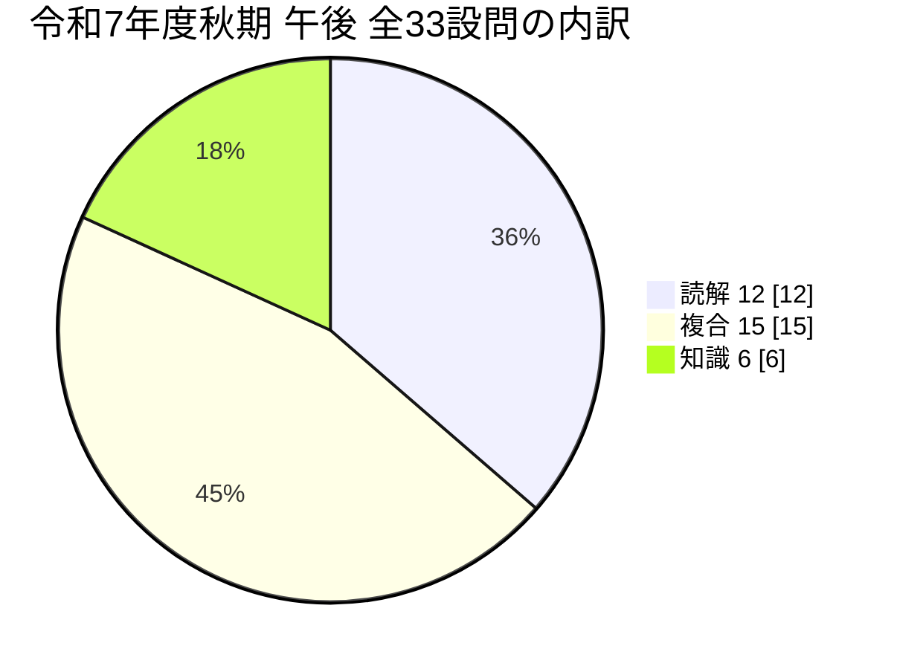
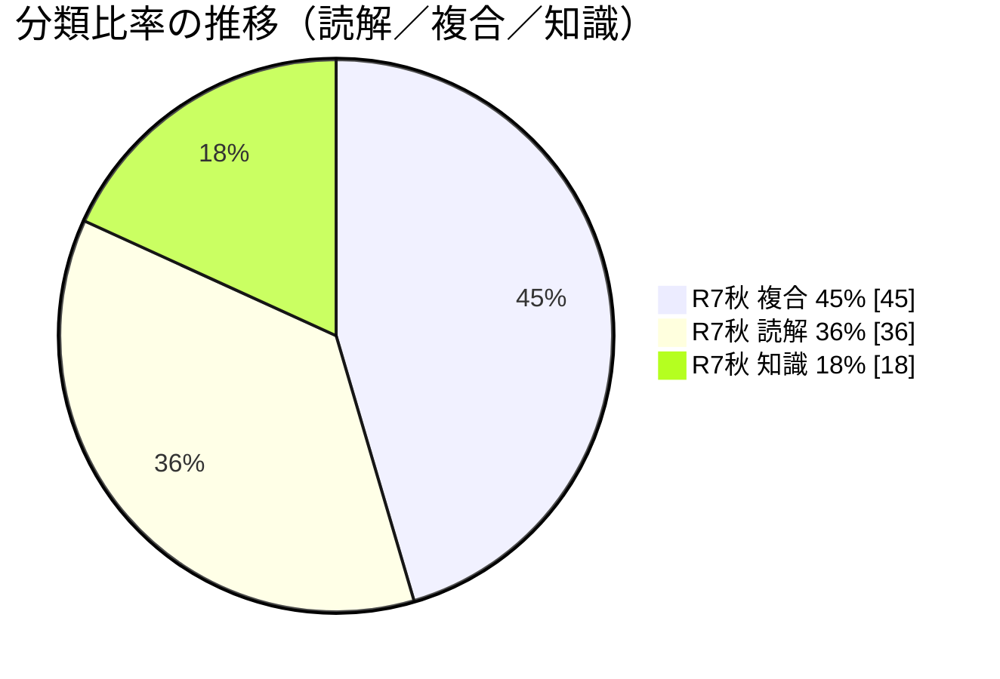

# 令和7年度 秋期 支援士 午後 設問タイプ分類 <!-- omit in toc -->

> 対象：令和7年度秋期 午後（問1〜問4）の**全33設問**
> 目的：**どの設問が「問題文を読めば解ける」のか、どの設問が「知らなければ解けない」のか**を切り分け、学習の投資先を決める
> 関連：`過去問解説/令和7年度春期_設問タイプ分類.md`（全43設問）、
> 　　　`過去問解説/令和6年度秋期_設問タイプ分類.md`（全32設問）、
> 　　　`過去問解説/令和6年度春期_設問タイプ分類.md`（全39設問）、
> 　　　`過去問解説/令和5年度秋期_設問タイプ分類.md`（全34設問）、
> 　　　`過去問解説/令和5年度春期_設問タイプ分類.md`（全49設問）と比較できる

- [分類の定義](#分類の定義)
- [全体集計と過去回との比較](#全体集計と過去回との比較)
- [問1 コンサルティング業務で利用するSaaS](#問1-コンサルティング業務で利用するsaas)
- [問2 暗号資産交換業におけるセキュリティ](#問2-暗号資産交換業におけるセキュリティ)
- [問3 情報システムのセキュリティ強化](#問3-情報システムのセキュリティ強化)
- [問4 製造業におけるセキュリティ管理](#問4-製造業におけるセキュリティ管理)
- [知識問題で問われた知識の分野別まとめ](#知識問題で問われた知識の分野別まとめ)
- [読解問題の「根拠の置き場所」パターン](#読解問題の根拠の置き場所パターン)
- [この分析から導かれる学習方針](#この分析から導かれる学習方針)
  - [① R7秋期も「複合45%」— 4回連続で同じ構成](#-r7秋期も複合45-4回連続で同じ構成)
  - [② 問選択の戦略](#-問選択の戦略)
  - [③ 「あと1歩」で落とす典型パターン](#-あと1歩で落とす典型パターン)
  - [④ 年度をまたいだ論点の接続](#-年度をまたいだ論点の接続)

---

## 分類の定義

| 記号       | 分類     | 定義                                                                                                                                               | 対策                                               |
| ---------- | -------- | -------------------------------------------------------------------------------------------------------------------------------------------------- | -------------------------------------------------- |
| **【読】** | **読解** | 問題文・図・表・注記の記述を **探して突き合わせれば**答えが出る。 専門知識がなくても、 日本語として根拠を特定できる                       | **解き方の訓練** （根拠の探し方・ 時間配分） |
| **【複】** | **複合** | **知識を手掛かりにして** 問題文の条件を当てはめる。 知識は「どこを見ればよいか」を 教えてくれる役割で、 最終的な答えは問題文の中にある | 知識を入れた上で **過去問演習**                 |
| **【知】** | **知識** | 用語・プロトコル・仕様を **知らなければ書けない**。 問題文には答えが書かれていない                                                           | **暗記・ 理解のインプット**                     |

> **判定の基準**：その設問の解答を、**本文・図・表のどこかの記述を指差して説明できるか**。できれば【読】、知識で補えば指差せるなら【複】、どこにも書かれていなければ【知】。

---

## 全体集計と過去回との比較

| 分類           | R7秋期 （33設問） | R7春期 （43設問） | R6秋期 （32設問） | R6春期 （39設問） | R5秋期 （34設問） | R5春期 （49設問） |
| -------------- | -------------------: | -------------------: | -------------------: | -------------------: | -------------------: | -------------------: |
| **【読】読解** |        **12（36%）** |            16（37%） |            11（34%） |            15（38%） |            14（41%） |            21（43%） |
| **【複】複合** |        **15（45%）** |            20（47%） |            16（50%） |            18（46%） |            10（29%） |            16（33%） |
| **【知】知識** |         **6（18%）** |             7（16%） |             5（16%） |             6（15%） |            10（29%） |            12（24%） |

**問別の内訳**

| 問                            | 設問数 | 【読】 | 【複】 | 【知】 | 傾向                                                                                       |
| ----------------------------- | -----: | -----: | -----: | -----: | ------------------------------------------------------------------------------------------ |
| 問1　コンサル業務用SaaS       |     10 |  **5** |      4 |      1 | **読解が半分**。ただし前提として **HTMLとECMAScriptが読めること**が必須                 |
| 問2　暗号資産交換業           |      9 |      2 |  **5** |      2 | **読解が最少の2問**。 暗号の基礎（鍵の向き・MAC）がないと 記述がほぼ書けない         |
| 問3　情報システムの強化       |      8 |      3 |      3 |      2 | 根拠が**本文・図6〜図8に散らばる**。 設問4(2)は**4要素を漏れなく**挙げる必要がある      |
| 問4　製造業のセキュリティ管理 |      6 |      2 |      3 |      1 | **設問数が最少の6問**で記述が長い。 **業務の流れ（図4）から権限・対策を導く**作業が中心 |

**過去回との違い**

| 観点           | R5（春・秋）             | R6（春・秋）                     | R7春期                         | **R7秋期**                                                                  |
| -------------- | ------------------------ | -------------------------------- | ------------------------------ | --------------------------------------------------------------------------- |
| 知識比率       | 24〜29%                  | 15〜16%                          | 16%                            | **18%**                                                                     |
| 複合比率       | 29〜33%                  | 46〜50%                          | 47%                            | **45%**                                                                     |
| 読解比率       | 41〜43%                  | 34〜38%                          | 37%                            | **36%**                                                                     |
| 設問数         | 34〜49                   | 32〜39                           | **43**                         | **33**（春期より10問少なく、**1問あたりの記述が長い**）                     |
| 意味するところ | 知識の量で 差が付いた | 知識を手掛かりに 本文を読む力 | 同左＋ **本文との往復回数** | **同じ傾向が継続**。 設問数が減った分、**1問の記述量と作業量**で差が付く |

> **4回連続で「複合45〜50%・知識15〜18%」**という比率が続いている。R5の頃の「知識で殴る」構成には戻っていない、と見てよい。

---

## 問1 コンサルティング業務で利用するSaaS

| 設問                                | 解答                                                                                  |    分類    | 根拠の所在（読解）／必要な知識（知識）                                                                                                                                                                                                            |
| ----------------------------------- | ------------------------------------------------------------------------------------- | :--------: | ------------------------------------------------------------------------------------------------------------------------------------------------------------------------------------------------------------------------------------------------- |
| 設問1 空欄a・b CSPの効果      | a＝できない b＝できない                                                            | **【知】** | **分野**：セキュリティ実装技術 **知識**：**CSP**。`default-src 'self'` は **同一オリジンのみ許可**／ **`'unsafe-inline'` がなければ インラインスクリプトは実行されない**。 本文には設定値しか書かれていない                        |
| 設問2(1) 悪用される機能          | ロール管理                                                                            | **【読】** | **読む場所**：図3の `fetch("/management/role")` `fetch("/management/roleset")` と、 表1「ロール管理」の処理の流れ （パス名・csrf_token・is_admin）が**完全一致**                                                                         |
| 設問2(2) 空欄c タスクの項目   | タスク名                                                                              | **【読】** | **読む場所**：表1 プロジェクト進捗管理 「未完了のタスクのうち締切日を過ぎたものは、 ……**そのタスク名と締切日からの経過日数が 表示される**」                                                                                              |
| 設問2(3) 空欄d 指定した文字列 | `個人タスク`               | **【読】** | **読む場所**：図2の3つ目の `<li>` 要素。 他の2行と見比べると**タグが混ざっている**のは この行だけ。**（締切日過ぎ 5日）は システムが付加**するので含めない                                                                               |
| 設問2(4) 空欄e〜g                | e＝管理者 f＝タスクの締切日を過ぎる。 g＝利用者のロールを 管理者に設定する。 | **【読】** | **読む場所**：表1 ロール管理「**管理者が**、 利用者のロールを設定する」「管理者： **is_admin=1**」＋プロジェクト進捗管理 「**未完了のタスクのうち締切日を過ぎたもの**」 ＋図3の `"is_admin": "1"`                                     |
| 設問2(5) 下線① 工夫の内容     | 図3のスクリプトをSサービス内に アップロードする工夫                                | **【複】** | **必要な知識**：CSPの `'self'` は **同一オリジンのスクリプトを止められない** **読む場所**：本文「このタスクによる攻撃は、 **CSPの設定で防御できていた**」＋ 表1 スレッド投稿「パスは **/files/[一意の ファイル識別子].[拡張子]**」 |
| 設問3(1) 空欄h 追加する処理   | アップロードされたファイルの 形式が拡張子と整合しているかを チェックする。      | **【複】** | **必要な知識**：**拡張子チェックだけでは リネームで突破される** **読む場所**：本文「許可された拡張子で あることのチェック**に加えて**」＋ 表1「アップロードできるファイルの 拡張子は……7種類である」                                |
| 設問3(2) 空欄i 機能名         | プロジェクト進捗管理                                                                  | **【読】** | **読む場所**：図2の `<title>` 「**プロジェクト進捗管理**」＋図4 項番4 「**図2のHTMLが**管理者のWebブラウザに **出力された**」＝出力している機能                                                                                          |
| 設問3(3) 下線② 追加すべき処理 | 出力時にエスケープ処理を施す。                                                        | **【複】** | **必要な知識**：**XSSの根本対策は 出力時のエスケープ** **読む場所**：図2でタスク名が **そのままHTMLとして出力**されている                                                                                                                |
| 設問4 空欄j 追加する検査方法  | Sサービスの仕様を理解した 専門家による脆弱性検査                                   | **【複】** | **必要な知識**：**DASTの限界**（蓄積型・ 遅延型を検知できない）→**手動診断**が必要 **読む場所**：本文「診断ツールXは、 **送信したリクエストとそれに対する レスポンスから**脆弱性を検出する」＋ 「SASTと**次の二つ**」              |

**この問の性格**：**読解が5問と半分を占める**。ただし、その読解は「**図2のHTMLと図3のECMAScriptを読んで、表1の仕様と突き合わせる**」作業なので、**コードが読めることが前提**。知識としてはCSPとXSSに集中しており、**この2つさえ押さえていれば10問中9問に手が届く**。

---

## 問2 暗号資産交換業におけるセキュリティ

| 設問                                        | 解答                                                                                                                                                 |    分類    | 根拠の所在（読解）／必要な知識（知識）                                                                                                                                                                                                                            |
| ------------------------------------------- | ---------------------------------------------------------------------------------------------------------------------------------------------------- | :--------: | ----------------------------------------------------------------------------------------------------------------------------------------------------------------------------------------------------------------------------------------------------------------- |
| 設問1 楕円曲線の署名方式                 | ウ、エ（ECDSA、EdDSA）                                                                                                                               | **【知】** | **分野**：セキュリティ実装技術／暗号 **知識**：**ECDSA・EdDSA＝楕円曲線の署名**／ **ECDHは鍵交換**／RSAは楕円曲線ではない／ AESは共通鍵、SHA-256はハッシュ                                                                                               |
| 設問2 下線① サイドチャネルの手法      | 施設Kの外から、鍵管理PCの 作動音や放出される電磁波を 観測し、署名鍵Sを推測する。                                                               | **【複】** | **必要な知識**：**サイドチャネル攻撃** （音響・電磁波・電力・タイミング） **読む場所**：施設Kは**ネットワークから遮断**／ **金属探知機**／入室制限＝ **中に入れず機器も持ち込めない**→外から観測                                                      |
| 設問3(1) 下線② マルウェアXの処理      | (i)〜(ii)＝不正な移転情報の ファイルを業務用メディアに追加 (vi)〜(vii)＝署名済みの不正 ファイルを攻撃者に送信し、 業務用メディアから削除 | **【読】** | **読む場所**：図3 手順3「手順1で生成した ファイルに記録された移転情報と**一致するか どうかを検査**」「**移転情報が一致しなかった 場合……処理を中止し、財務部の従業員全員に 電子メールで警告**」＝**削除が必要な理由**                                  |
| 設問3(2) 空欄a 共通鍵の暗号技術       | メッセージ認証符号（MAC）                                                                                                                            | **【知】** | **分野**：セキュリティ実装技術 **知識**：**MAC＝共通鍵で改ざん検知**。 ハッシュ（鍵なし）は**誰でも再計算できる**ので 改ざん検知にならない。本文に用語はない                                                                                             |
| 設問3(3) 下線③ 不正の機会を減らす     | 当日担当者を複数名とし、互いに 確認しながら作業を実施するよう 手順を変更する。                                                                 | **【複】** | **必要な知識**：**職務の分離／デュアル コントロール**（単独で完結させない） **読む場所**：図3 注記「**財務部には複数の 従業員がおり**、営業日ごとの出庫業務の 担当者を事前に割り当てている」                                                          |
| 設問4(1) 下線④ 最もリスクの高い問題点 | 作業2において、パスワードで 暗号化した署名鍵Sと紙に 書き留めたパスワードを 一緒に移送している点                                             | **【複】** | **必要な知識**：**暗号文と鍵は分離して 運ぶ**のが大原則 **読む場所**：図6 作業2「移送用メディア **及びパスワードを書き留めた紙**を M社まで持ち運ぶ」                                                                                                  |
| 設問4(2) 図7 b〜e、あ・い                | b＝ウ、c＝ア、あ＝オ、 d＝エ、い＝ク、e＝ウ                                                                                                       | **【複】** | **必要な知識**：**公開鍵で暗号化し、 秘密鍵で復号する**（鍵の向き）／ **鍵ラッピング** **読む場所**：図7 作業1「RSA暗号の鍵ペアとして **暗号鍵E**及び**復号鍵D**を生成し、 **暗号鍵Eを移送用メディアに保存**する」                                 |
| 設問4(3) 下線⑤ 漏えいしない根拠       | 復号鍵Dがないので、暗号化 された署名鍵Sは復号できない。                                                                                           | **【読】** | **読む場所**：図7 作業1（復号鍵DはHSM内で 生成され、**移送用メディアには暗号鍵Eだけ**）＋ 作業3「**移送用メディアから暗号鍵Eを 削除する**」                                                                                                              |
| 設問4(4) 下線⑥ 書換え後のファイル     | 攻撃者の生成した鍵ペアの 暗号鍵                                                                                                                   | **【複】** | **必要な知識**：**公開鍵の真正性が 保証されないとMITMが成立**する **読む場所**：本文「HSM管理サーバが仮に マルウェアに感染し……**作業1で移送用 メディアに保存されるファイルが書き換えられ**、 かつ、作業5で**内容を読み取られてしまった 場合**」 |

**この問の性格**：**読解はわずか2問**。残り7問は暗号の基礎知識（**署名アルゴリズムの分類／MAC／公開鍵の向き／公開鍵の真正性**）を手掛かりに本文を読む構成で、**知識が欠けていると記述が1行も書けない**。逆に、鍵の向きさえ間違えなければ**設問4(2)の6箇所**はまとめて取れる。

---

## 問3 情報システムのセキュリティ強化

| 設問                                | 解答                                                                                                                                                                   |    分類    | 根拠の所在（読解）／必要な知識（知識）                                                                                                                                                                                                                    |
| ----------------------------------- | ---------------------------------------------------------------------------------------------------------------------------------------------------------------------- | :--------: | --------------------------------------------------------------------------------------------------------------------------------------------------------------------------------------------------------------------------------------------------------- |
| 設問1(1) 空欄a                   | DNSSEC                                                                                                                                                                 | **【知】** | **分野**：ネットワーク **知識**：**DNSSEC**＝応答に**デジタル署名**を 付与（RRSIG／DNSKEY／DS）。 **暗号化はしない**                                                                                                                             |
| 設問1(2) 空欄b・c                | b＝DoH、c＝TLS                                                                                                                                                         | **【知】** | **分野**：ネットワーク **知識**：**DoH＝DNS over HTTPS（443）**／ **DoT＝DNS over TLS（853）**。 本文は「HTTPSを用いて」「DoT：　c　を用いて」 という定義だけを与えている                                                                     |
| 設問2 表5 d・e                   | d＝イ（書換え前の口座番号） e＝ア（攻撃者口座の口座番号）                                                                                                           | **【複】** | **必要な知識**：**数字入力トークンは 入力した数字が何かを示せない** **読む場所**：図3 手順5「数字入力トークンに **振込先の口座番号を入力する**」＋ 図5 注1「**図4の(16)で送られてきた数字**」＋ 表5(6)「攻撃者口座の口座種別及び口座番号」 |
| 設問3 図8 下線① 設定内容      | Kサービス設定サイトへの アクセスが許可される接続元 IPアドレスを a1.b1.c1.d1 に 制限する。                                                                     | **【読】** | **読む場所**：図6 項番8「**アクセスを許可する 接続元IPアドレスを設定することができる**」＋ 表3「**M-FWのインターネット側 インタフェース＝a1.b1.c1.d1**」                                                                                         |
| 設問4(1) 空欄f 取引先への依頼 | 各取引先サービスへの接続を 許可するIPアドレスとして、 P社専用のKサービス用固定 グローバルIPアドレスを 登録してもらう                                       | **【複】** | **必要な知識**：**プロキシ型サービスを挟むと 送信元IPが変わる** **読む場所**：図6 項番4「**契約企業専用の Kサービス用固定グローバルIPアドレスを 指定することができる**」＋本文「各取引先 サービスで**接続元IPアドレス制限**を行っている」  |
| 設問4(2) 下線② 追加する宛先   | Z-IB、OSベンダーのOSアップ デート配布サイト、認証基盤 サービス及びKサービス設定 サイトへのHTTPSサービス                                                       | **【読】** | **読む場所**：図7 項番2（**脆弱性修正 プログラムの適用**）・項番3（**MFA設定画面**）・ 項番4（**Kソフトのダウンロード**）＋ 図8 項番1・本文（**経理係のIBの利用は Kサービスの対象外**）                                                       |
| 設問5(1) 空欄g 設定内容       | 認証方式1の電話番号として、 個人所有スマホの電話番号を 登録する                                                                                                  | **【複】** | **必要な知識**：**認証手段が1つだと 故障時に詰む**（冗長性） **読む場所**：表2「認証方式1：……**あらかじめ 登録した1件の電話番号へのSMS通知**」＋ 冒頭「**緊急時については、個人所有のスマホの 利用を許可している**」                       |
| 設問5(2) 下線③ OS移行の施策   | Kサービス接続時のログから OSがバージョンXの社有PCを 抽出し、アカウント名から 利用者を特定後、各部の情報 セキュリティ推進者に報告し、 移行を促してもらう | **【読】** | **読む場所**：図6 項番3「**アカウント名、PCの シリアル番号、PC情報**及び接続可否を ログに記録する」＋項番7（管理者アカウントで **ログの検索や参照ができる**）＋冒頭 「各部には……**情報セキュリティ推進者**がいる」                            |

**この問の性格**：**根拠が本文・図6・図7・図8に散らばっている**のが最大の特徴。特に**設問4(2)は4つの宛先を漏れなく挙げる**必要があり、1つでも落とすと減点される。逆に、**図6の項番（1〜9）と図8の項番（1〜8）の対応表**を先に作っておくと、設問3・4・5がまとめて見通せる。

---

## 問4 製造業におけるセキュリティ管理

| 設問                              | 解答                                                                                                                                                                                                                                 |    分類    | 根拠の所在（読解）／必要な知識（知識）                                                                                                                                                                                                                                           |
| --------------------------------- | ------------------------------------------------------------------------------------------------------------------------------------------------------------------------------------------------------------------------------------ | :--------: | -------------------------------------------------------------------------------------------------------------------------------------------------------------------------------------------------------------------------------------------------------------------------------- |
| 設問1 表2 a・b                 | a＝未知の、b＝暗号化                                                                                                                                                                                                                 | **【複】** | **必要な知識**：**パターンマッチング型は 未知を検知できない／サンドボックス型は 未知も検知できるが時間が掛かる／ 暗号化添付はどちらも不可** **読む場所**：表2の**同じ字句が両方の行に 入る**という構造                                                            |
| 設問2(1) 図8 c〜e              | 回避、移転、保有（順不同）                                                                                                                                                                                                           | **【知】** | **分野**：情報セキュリティ管理 **知識**：**リスク対応の4分類** （低減・回避・移転・保有） **ヒント**：図7「**サイバー保険の活用**や…… **専門ベンダへの委託**」＝移転／ 「**残留リスク**を識別させる」＝保有                                                       |
| 設問2(2) 下線① 権限の見直し | 総務課＝×××／情報システム課＝ ××○／営業部＝○○×／設計課＝ ○××／製造課＝○××／ 品質保証課＝○××                                                                                                                                 | **【読】** | **読む場所**：図4 項番1・2（**営業部が受け取り ファイルサーバに保存**＝読込＋書込）、 項番3（設計課が**参照**）、項番5（設計課・製造課・ 品質保証課が**確認**）＝読込のみ。 総務課は**業務の記述がない**                                                             |
| 設問3 表4 f・g                 | f＝図3中の(け)の箇所に、 追加でFW g＝USBメモリを接続したときの 動きを確認するためのソフトウェアを 導入した、社内LANから 切り離された検査用PC                                                                          | **【複】** | **必要な知識**：**ネットワーク分離**で 感染拡大を止める／**可搬媒体は禁止ではなく 検査**して使う **読む場所**：表4 項番2の書き方 （「図3中の(あ)の箇所に……導入する」）＋ 図4 項番4（**USBメモリでNCプログラムを運ぶ**）                                           |
| 設問4(1) 表6 h・i              | h＝SCADA内のNCプログラムを バックアップ／リストアする ための媒体とソフトウェア i＝SCADAにNCプログラムを リストアする手順                                                                                                 | **【読】** | **読む場所**：図4 項番4(2)・6／図5 項番3 （**NCプログラムはSCADA内の領域に保存**され、 そこから工作機械に投入される）＋ 表1 SCADA「**予備機にはOSを含め 何もインストールしていない**」                                                                               |
| 設問4(2) 表6 j〜l              | j＝マルウェアに感染した一般PCが、 正常な通信を妨害するパケットを 大量に送信して、SCADAと工作機械の 間の通信ができなくなる k＝独立したLANを構成するための ネットワーク機器 l＝L社のネットワークから 切り離す手順 | **【複】** | **必要な知識**：**IT／OTの分離**。 制御系は**可用性最優先**で、予防より **隔離と復旧**に重心を置く **読む場所**：設問の条件「**できるだけ 起こる可能性が高いもの**を、**攻撃の発端を 含めて**」＋表1（SCADAは工作機械の稼働状況を **製造監視用PCに送信**する） |

**この問の性格**：**設問数は6問と最少**だが、**1問あたりの記述量が多い**（設問2(2)は表を18マス埋める、設問4(2)は3要素を書く）。知識は**リスク対応の4分類**くらいで、残りは**業務の流れ（図4・図5）と機器の仕様（表1）から導く**作業。**経営ガイドラインVer3.0の指示4・5・8**という枠組みは、知らなくても図7・図9・図10で説明されている。

---

## 知識問題で問われた知識の分野別まとめ

| 分野                     | 設問         | 問われた知識                                                     |
| ------------------------ | ------------ | ---------------------------------------------------------------- |
| **セキュリティ実装技術** | 問1 設問1    | **CSP**（`default-src 'self'` の効果、`'unsafe-inline'` の有無） |
| **セキュリティ実装技術** | 問2 設問1    | **ECDSA／EdDSA＝楕円曲線の署名**、**ECDH＝鍵交換**               |
| **セキュリティ実装技術** | 問2 設問3(2) | **メッセージ認証符号（MAC）**＝共通鍵による改ざん検知            |
| **ネットワーク**         | 問3 設問1(1) | **DNSSEC**＝応答にデジタル署名（暗号化はしない）                 |
| **ネットワーク**         | 問3 設問1(2) | **DoH＝HTTPS／DoT＝TLS**                                         |
| **情報セキュリティ管理** | 問4 設問2(1) | **リスク対応の4分類**（低減・回避・移転・保有）                  |

**R7秋期の知識問題の特徴**

| 観点 | 内容                                                                                    |
| ---- | --------------------------------------------------------------------------------------- |
| 傾向 | **定番の基礎知識ばかり**。春期のようなEPSS・KEV・CVSS 4.0といった新しい指標は出ていない |
| 配置 | **6問すべてが空欄補充（短答）**で、記述式の知識問題はない                               |
| 対策 | **過去問と基本書の範囲で十分**。確実に取りに行ける6問                                   |

---

## 読解問題の「根拠の置き場所」パターン

| パターン                             | 例                                                                         |
| ------------------------------------ | -------------------------------------------------------------------------- |
| **コードと仕様表の一致**             | 問1 設問2(1)（図3の `/management/role(set)` ↔ 表1 ロール管理の処理の流れ） |
| **図から該当箇所を抜き出す**         | 問1 設問2(3)（図2の3つ目の `<li>` だけタグが混ざっている）                 |
| **「検査で弾かれる条件」の裏返し**   | 問2 設問3(1)（手順3の照合・警告の条件 → **削除すれば通過する**）           |
| **注記が答えを指す**                 | 問3 設問2（図5 **注1**「図4の(16)で送られてきた数字」）                    |
| **複数の図から要素を集める**         | 問3 設問4(2)（図7の項番2・3・4＋図8の項番1＝**4つの宛先**）                |
| **業務の流れから必要権限を導く**     | 問4 設問2(2)（図4の項番1〜5で**誰が何をするか**を1行ずつ拾う）             |
| **「すでに挙がっている対策」の残り** | 問4 設問3（入口対策・端末対策は既出 → 残るのは**感染拡大の遮断**）         |

---

## この分析から導かれる学習方針

### ① R7秋期も「複合45%」— 4回連続で同じ構成

R6春期以降、**複合45〜50%・読解34〜38%・知識15〜18%**という比率が4回続いている。
**「知識を入れる」と「本文を読む」を別々に鍛えても届かない**ため、**過去問を解いて「知識をどう本文に当てるか」を身体で覚える**しかない。

### ② 問選択の戦略

| 条件                       | おすすめの組合せ | 理由                                                                            |
| -------------------------- | ---------------- | ------------------------------------------------------------------------------- |
| コード（HTML／JS）が読める | **問1＋問3**     | 問1は**読解5問**で短時間に取れる。問3は作業量はあるが知識は定番のみ             |
| 暗号の基礎が固まっている   | **問2＋問1**     | 問2は**設問4(2)の6箇所**が鍵の向きだけで取れる。 問1と合わせて技術系で固める |
| マネジメント記述が得意     | **問4＋問3**     | 問4は**知識1問のみ**。業務の流れから対策を導く設問が中心                        |
| 記述量を減らしたい         | **問1＋問2**     | 問3・問4は**1問あたりの記述が長い**（宛先4つ、表18マス、3要素など）             |

> **逆に避けたい組合せ**：**問3＋問4**は、どちらも**本文を何度も往復する**タイプなので、時間切れのリスクが高い。

### ③ 「あと1歩」で落とす典型パターン

| パターン                             | 具体例                                                                                                        |
| ------------------------------------ | ------------------------------------------------------------------------------------------------------------- |
| **抜き出しで余計なものを含める**     | 問1 設問2(3)（**（締切日過ぎ 5日）はシステムが付加**するので含めない）                                        |
| **要素を1つ落とす**                  | 問3 設問4(2)（**4つの宛先**のうち1つでも欠けると減点）／ 問2 設問3(1)（**送信**と**削除**の2段階）         |
| **鍵の向きを取り違える**             | 問2 設問4(2)（**暗号鍵E＝公開鍵で暗号化／復号鍵D＝秘密鍵で復号**）                                            |
| **「できるだけ〜なもの」を無視する** | 問4 設問3（**効果が高いもの**＝経路を断つ）／ 問4 設問4(2)（**起こる可能性が高いもの**＝感染より通信妨害） |
| **仕組みと手順を書き分けない**       | 問4 設問4(1)（h＝**媒体とソフトウェア**／i＝**リストアする手順**）                                            |
| **最小権限を「全部×」と誤解する**    | 問4 設問2(2)（**業務に必要な権限は残す**。営業部は読込＋書込が必要）                                          |

### ④ 年度をまたいだ論点の接続

| 論点                           | R7秋期                  | 関連する回                                                       |
| ------------------------------ | ----------------------- | ---------------------------------------------------------------- |
| **XSSと出力時エスケープ**      | 問1 設問3(3)            | R6秋 問3（Webスキミング／ECMAScriptの読解）                      |
| **CSPの限界**                  | 問1 設問2(5)            | R5秋（HttpOnlyが守るのはcookieだけ／根本対策は出力時エスケープ） |
| **診断ツールの限界**           | 問1 設問3(2)・設問4     | R5秋 午後Ⅱ 問1（**DASTは送った先の応答しか見ない**）             |
| **TLS終端型プロキシ**          | 問3 設問3・設問4        | R7春 問3（通信解析ツールによるTLS終端）                          |
| **公開鍵の真正性**             | 問2 設問4(4)            | R5秋（PKI・証明書検証）                                          |
| **サプライチェーン（下流側）** | 問4（J社からの要求）    | R7春 問1（**委託元から委託先への要求**＝上流側の視点）           |
| **可搬媒体の管理**             | 問2 設問3(1)／問4 設問3 | R6春 問2（USB経由の持込み・持出し）                              |

> **まとめ**：R7秋期は、**技術2問（問1・問2）＋マネジメント2問（問3・問4）**という分かりやすい構成だった。
> 知識問題は**CSP・ECDSA・MAC・DNSSEC・DoH／DoT・リスク対応の4分類**と**すべて定番**で、**知識で落とす設問はほぼない**。
> 差が付くのは、**問3の「漏れなく挙げる」設問**と、**問4の「業務の流れから導く」設問**という、**本文を往復する作業の精度**である。
